Cite this paper: Chin. J. Chem. 2025, 43, 1181—1189. DOI: 10.1002/cjoc.202401301

# A Divergent Synthesis of Spiroindenes via Ligand-Controlled [3+2]/[4+2] Cycloadditions of Zwitterionic π-Propargyl Palladium Species with Benzofulvenes

Yongjie Long, Xianhua Zhong, Min Shi,\* and Yin Wei\*

State Key Laboratory of Organometallic Chemistry, Center for Excellence in Molecular Synthesis, University of Chinese Academy of Sciences, Shanghai Institute of Organic Chemistry, Chinese Academy of Sciences, 345 Lingling Road, Shanghai 200032, China

## Keywords

Zwitterions | Palladium catalyzed | Divergent synthesis | Ligand control | Spiro compounds |π-Propargyl palladium species Annulation

## Comprehensive Summary

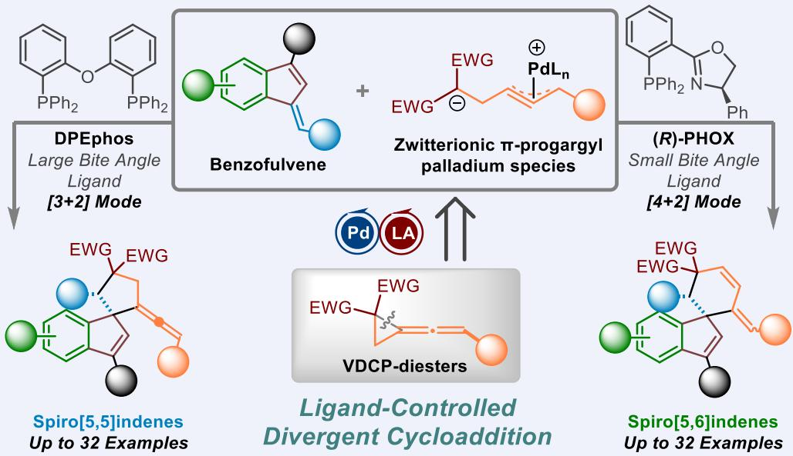

A divergent synthesis of spiroindenes through a palladium catalyzed cycloaddition between zwitterionic π-propargyl palladium species and benzofulvenes in moderate to good yields has been disclosed along with good functional group compatibility and a broad substrate universality. This protocol features a highly regioselective switchable process between [3+2] and [4+2] cycloadditions controlled by phosphine ligands with different bite angles. The reaction mechanism has been clarified by mechanistic studies and DFT calculations, rendering that the coordination modes of the ligands with the substrates and the bite angle of the ligands play critical roles in the product regioselectivity.

## Background and Originality Content

Spirocyclic compounds occupy an important position in the field of chemical biology and pharmaceutical science.[1] In the vast family of spirocylic compounds, spiroindenes, widespread likewise spirocyclohexadienones or spiroindolones, are gradually revealing their significant potential in natural product chemistry,[2] drug synthesis[3] and asymmetric catalysis[4] (Figure 1). However, comparing with their immense potential, the construction of spiroindene skeleton is still running in traditional pathways, which need either long-winded procedures or complicated materials, such as sequential cyclization of bisphenols or 1,5-diphenyl-3-pentanone derivatives promoted by Brønsted or Lewis acid,[5] cascade dearomatization between alkynes and 1-aryl-2-naphthols[6] or intramolecular cyclization from complex substrates such as indene-substituted cyclobutanols and 2-phenethyl cyclic ketones.[7] Hence, more advanced synthetic strategies should be unearthed to realize various types of spiroindenes efficiently and concisely.

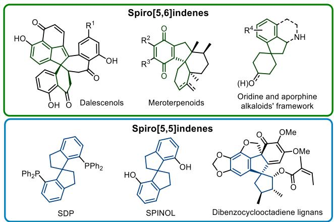  
Figure 1 Natural products, bioactive molecules and ligands containing the spiroindene or spiroindane core.

As a kind of synthon having semi-aromatic characteristics, benzofulvenes have been mainly employed in the synthesis of polymeric compounds and transition-metal-complexes.[8] Based on the same indene structure, benzofulvenes could be transformed to spiroindenes in certain ways. In 2016, Jørgensen’s group utilized benzofulvenes initiatively to form enantiomerically enriched polysubstituted spiro[5,6]indenes or spiro[5,3]indenes induced by chiral diphenylprolinol silylether[9] or chiral cinchona alkaloid catalysts,[10] which marked the milestone of spiroindene skeleton being formed tersely from benzofulvenes in one step. Nevertheless, although Wang’s group combined azomethine ylides and benzofulvenes together to construct heterospiro[5,5]indenes in 2023 (Scheme 1, a),[11] the development of benzofulvenes to spiroindene’s synthetic protocol has nearly stagnated. Thus far, each method only has the ability to build up one type of spiroindenes. Therefore, there is still lack of a diversified synthetic method in this field.

On the other hand, zwitterionic π-propargyl palladium species, similar as zwitterionic π-allyl palladium species, have already emerged its synthetic capacity in various cycloadditions.[12] Depending on the adjustment of bidentate ligand with different bite angles, the electrophilic point of π-propargyl palladium part was shifted between 3-terminal carbon and 2-internal carbon (Scheme 1, b).[12] In continuation of our research interest in zwitterionic π-propargyl palladium species related chemistry, we supposed that the indene part of benzofulvene was stabilized by the aromatic cyclopentadienyl anion after the nucleophilic attack from zwitterionic π-propargyl palladium species, providing a driving force for the subsequent cyclization. Thus, we anticipate that a divergent synthesis of spiroindenes could be achieved upon using bidentate phosphine ligands having different bite angles as the key controlling point (Scheme 1, c).

Scheme 1 a Previous synthesis of spiroindenes via benzofulvenes. b Reaction mode of zwitterionic π-palladium species adjusted by ligands. c Design of this work.

a) Previous construction of spiroindenes from benzofulvenes

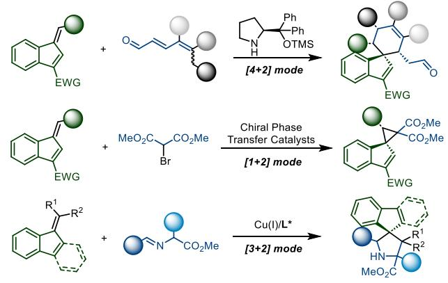

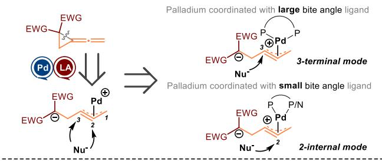

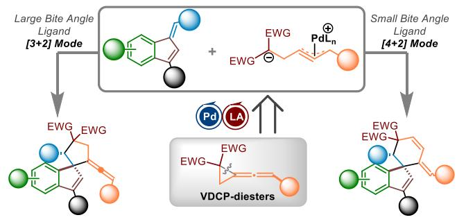

## Results and Discussion

We first utilized cyan substituted benzofulvene 1a (1.0 eq) and vinylidenecyclopropane-diester (VDCP-diester) 2a (2.0 eq) as the model substrates to perform the initial investigation and subsequently optimize the reaction conditions of [3+2] cycloaddition (Table 1). As a result, we found that the desired product 3a was obtained in 69% NMR yield by using Pd2dba3 as a palladium catalyst, DPEphos as a ligand, Yb(OTf)3 as the cocatalyst, Cs2CO3 as a base and upon heating at 55 °C in THF for 4.0 h with 4 Å MS (100 mg) (Table 1, entry 1). However, the polarity of 3a is too close to the byproduct dibenzylideneacetone derived from Pd2dba3, which makes it difficult to separate these two compounds. Hence, the source of palladium catalyst was switched to Pd(PPh3)4, affording 3a in 71% yield (Table 1, entry 2). The influence of solvent was investigated, discovering that using toluene, DCE, or DMF as solvent decreased the yield of 3a to 41%, 52% and 48%, respectively, and nearly trace in 1,4-dioxane (Table 1, entries 3—6). The effect of different phosphine ligands was examined afterward. When other ligands with a large bite angle, such as dtpbf, Xantphos and BINAP were used to replace DPEphos, the yield of 3a decreased to 43%, 30% and nearly zero (Table 1, entries 7, 9, 10).

Table 1 Optimization of the reaction conditions for the synthesis of 3a  
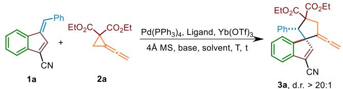

<table><tr><td>entrya</td><td>ligand</td><td>solvent</td><td>base</td><td> $T / { } ^ { \circ } \mathsf { C }$ </td><td>t/h</td><td>yield/%</td></tr><tr><td>1b</td><td>DPEphos</td><td>THF</td><td> ${ \sf C S } _ { 2 } { \sf C O } _ { 3 }$ </td><td>55</td><td>4</td><td>69</td></tr><tr><td>2</td><td>DPEphos</td><td>THF</td><td> ${ \sf C S } _ { 2 } { \sf C O } _ { 3 }$ </td><td>55</td><td>4</td><td>71</td></tr><tr><td>3</td><td>DPEphos</td><td>toluene</td><td> ${ \sf C S } _ { 2 } { \sf C O } _ { 3 }$ </td><td>55</td><td>4</td><td>41</td></tr><tr><td>4</td><td>DPEphos</td><td>DCE</td><td> ${ \sf C S } _ { 2 } { \sf C O } _ { 3 }$ </td><td>55</td><td>4</td><td>52</td></tr><tr><td>5</td><td>DPEphos</td><td>1,4-dioxane</td><td> ${ \sf C S } _ { 2 } { \sf C O } _ { 3 }$ </td><td>55</td><td>4</td><td>trace</td></tr><tr><td>6</td><td>DPEphos</td><td>DMF</td><td> ${ \sf C S } _ { 2 } { \sf C O } _ { 3 }$ </td><td>55</td><td>4</td><td>48</td></tr><tr><td>7</td><td>BINAP</td><td>THF</td><td> ${ \sf C S } _ { 2 } { \sf C O } _ { 3 }$ </td><td>55</td><td>4</td><td>trace</td></tr><tr><td>8</td><td>dppe</td><td>THF</td><td> ${ \sf C S } _ { 2 } { \sf C O } _ { 3 }$ </td><td>55</td><td>4</td><td>trace</td></tr><tr><td>9</td><td>dtpbf</td><td>THF</td><td> ${ \sf C S } _ { 2 } { \sf C O } _ { 3 }$ </td><td>55</td><td>4</td><td>43</td></tr><tr><td>10</td><td>Xantphos</td><td>THF</td><td> ${ \sf C S } _ { 2 } { \sf C O } _ { 3 }$ </td><td>55</td><td>4</td><td>30</td></tr><tr><td>11</td><td>DPEphos</td><td>THF</td><td>TEA</td><td>55</td><td>4</td><td>38</td></tr><tr><td>12</td><td>DPEphos</td><td>THF</td><td>DBU</td><td>55</td><td>4</td><td>trace</td></tr><tr><td>13</td><td>DPEphos</td><td>THF</td><td>K₃PO₄</td><td>55</td><td>4</td><td>N.R.</td></tr><tr><td>14</td><td>DPEphos</td><td>THF</td><td>CsOAc</td><td>55</td><td>4</td><td>65</td></tr><tr><td>15</td><td>DPEphos</td><td>THF</td><td> $\pmb { \cos _ { 2 } } \pmb { \cos _ { 3 } }$ </td><td>55</td><td>8</td><td>78 (77c)</td></tr><tr><td>16</td><td>DPEphos</td><td>THF</td><td> ${ \sf C S } _ { 2 } { \sf C O } _ { 3 }$ </td><td>55</td><td>12</td><td>65</td></tr><tr><td>17</td><td>DPEphos</td><td>THF</td><td> ${ \sf C S } _ { 2 } { \sf C O } _ { 3 }$ </td><td>60</td><td>4</td><td>69</td></tr><tr><td>18</td><td>DPEphos</td><td>THF</td><td> ${ \sf C S } _ { 2 } { \sf C O } _ { 3 }$ </td><td>60</td><td>8</td><td>70</td></tr><tr><td>19</td><td>DPEphos</td><td>THF</td><td> ${ \sf C S } _ { 2 } { \sf C O } _ { 3 }$ </td><td>45</td><td>8</td><td>49</td></tr><tr><td>20d</td><td>DPEphos</td><td>THF</td><td> ${ \sf C S } _ { 2 } { \sf C O } _ { 3 }$ </td><td>55</td><td>8</td><td>65</td></tr><tr><td>21e</td><td>DPEphos</td><td>THF</td><td> ${ \sf C S } _ { 2 } { \sf C O } _ { 3 }$ </td><td>55</td><td>8</td><td>73</td></tr></table>

a Reactions were carried out with 1a (0.1 mmol), 2a (0.2 mmol), [Pd] (5 mol%), ligand (7.5 mol%), Yb(OTf)3 (10 mol%), 4 Å MS (100 mg), Cs2CO3 (0.1 mmol) in solvents (1.0 mL). Yields were determined by NMR spectroscopy using CH Br as an internal standard. b Pd dba instead of Pd(PPh3)4. c Isolated yield. d 0.15 mmol 2a. e 0.25 mmol 2a.

Significantly, using dppe as a traditional bidentate ligand with a small bite angle only afforded trace of 3a also without the formation of [4+2] cycloadduct (Table 1, entry 8). The exploration of base effect revealed that both organic bases such as TEA or DBU and inorganic bases such as ${ \sf K } _ { 3 } { \sf P } { \sf O } _ { 4 }$ or CsOAc did not give better performance than ${ \mathsf { C s } } _ { 2 } { \mathsf { C O } } _ { 3 }$ in this reaction (Table 1, entries 11—14). Next, we further examined the reaction temperature and time, identifying that the reaction should be carried out at 55 °C for 8.0 h, giving 3a in 77% isolated yield. This result was better than those at $4 5 ~ ^ { \circ } \mathsf { C }$ for 8.0 h or at $6 0 ~ ^ { \circ } \mathsf { C }$ for 8.0 h, respectively, even if the yield of 3a at 60 °C (70%) seems to be higher than that at $6 0 ~ ^ { \circ } \mathsf { C }$ for 4.0 h (69%) (Table 1, entries 15—19). Finally, we also confirmed that decreasing or increasing the amount of VDCP-diester 2a to 1.5 or 2.5 equivalents did not improve the yield of 3a under otherwise identical conditions (Table 1, entries 20 & 21). It should be noted that the diastereoselectivity of this [3+2] cycloaddition is higher than 20 : 1, probably due to the steric hindrance derived from benzofulvene skeleton. Furthermore, a series of common Lewis acids including SnCl4, ${ \tt B F } _ { 3 } { \cdot } { \tt E t } _ { 2 } { \tt O } ,$ In(OTf)3, Zn(OTf)2, Y(OTf)₃, Sc(OTf)₃, Yb(OTf)₃ were screened for this reaction; the Yb(OTf)₃ particularly demonstrated superior catalytic efficacy in mediating the [3+2] cycloaddition reaction when compared to other Lewis acid additives (see part E at the page S4 of the Supporting Information).

Table 2 Optimization of the reaction conditions for the synthesis of 4a

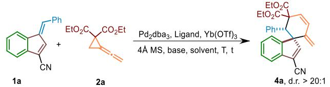

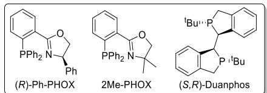

<table><tr><td>entrya</td><td>ligand</td><td>solvent</td><td>base</td><td>T/℃</td><td>t/h</td><td>yield/%</td></tr><tr><td>1</td><td>(R)-Ph-PHOX</td><td>THF</td><td>CS2CO₃</td><td>45</td><td>6</td><td>trace</td></tr><tr><td>2</td><td>(R)-Ph-PHOX</td><td>THF</td><td> ${ \sf C S } _ { 2 } { \sf C O } _ { 3 }$ </td><td>50</td><td>6</td><td>12</td></tr><tr><td>3</td><td>(R)-Ph-PHOX</td><td>THF</td><td>CS2CO₃</td><td>55</td><td>8</td><td>45</td></tr><tr><td>4</td><td>(R)-Ph-PHOX</td><td>THF</td><td>CS₂CO₃</td><td>60</td><td>8</td><td>55</td></tr><tr><td>5</td><td>(R)-Ph-PHOX</td><td>THF</td><td>Cs2CO₃</td><td>65</td><td>8</td><td>78 (76b)</td></tr><tr><td>6</td><td>(R)-Ph-PHOX</td><td>THF</td><td>CS₂CO₃</td><td>65</td><td>12</td><td>64</td></tr><tr><td>7</td><td>(R)-Ph-PHOX</td><td>THF</td><td>CS2CO₃</td><td>70</td><td>8</td><td>52</td></tr><tr><td>8</td><td>(S,R)-Duanphos</td><td>THF</td><td> ${ \sf C S } _ { 2 } { \sf C O } _ { 3 }$ </td><td>65</td><td>8</td><td>59c</td></tr><tr><td>9</td><td>2Me-PHOX</td><td>THF</td><td> ${ \sf C S } _ { 2 } { \sf C O } _ { 3 }$ </td><td>65</td><td>8</td><td>62d</td></tr><tr><td>10e</td><td>(R)-Ph-PHOX</td><td>THF</td><td> ${ \sf C S } _ { 2 } { \sf C O } _ { 3 }$ </td><td>65</td><td>8</td><td>40</td></tr><tr><td>11f</td><td>(R)-Ph-PHOX</td><td>THF</td><td>CS2CO₃</td><td>65</td><td>8</td><td>64</td></tr><tr><td>12</td><td>(R)-Ph-PHOX</td><td>DCE</td><td> ${ \sf C S } _ { 2 } { \sf C O } _ { 3 }$ </td><td>65</td><td>8</td><td>trace</td></tr><tr><td>13</td><td>(R)-Ph-PHOX</td><td>1,4-dioxane</td><td> ${ \sf C S } _ { 2 } { \sf C O } _ { 3 }$ </td><td>65</td><td>8</td><td>trace</td></tr><tr><td>14</td><td>(R)-Ph-PHOX</td><td>toluene</td><td> ${ \sf C S } _ { 2 } { \sf C O } _ { 3 }$ </td><td>65</td><td>8</td><td>13</td></tr><tr><td>15</td><td>(R)-Ph-PHOX</td><td>DMF</td><td> ${ \sf C S } _ { 2 } { \sf C O } _ { 3 }$ </td><td>65</td><td>8</td><td>24</td></tr></table>

a Reactions were carried out with 1a (0.1 mmol), 2a (0.2 mmol), [Pd] (5 mol%), ligand (7.5 mol%), Yb(OTf)3 (10 mol %), 4 Å MS (100 mg), Cs2CO3 (0.1 mmol) in solvents (1.0 mL). Yields were determined by NMR spectroscopy using CH2Br2 as an internal standard. b Isolated yield. c 5-Membered ring : 6-membered ring = 1 : 1. d 5-Membered ring : 6-membered ring = 0.7 : 1. e 0.15 mmol 2a. f 0.25 mmol 2a.

Based on the assumption of ligand-controlled regioselectivity, we attempted to find a ligand which can switch the reaction mode from [3+2] to [4+2] cycloaddition. Fortunately, (R)-Ph-PHOX was found out to realize the [4+2] cycloaddition mode. It should be mentioned here that although dppe as a traditional bidentate ligand having a small bite angle[12a] was a preferred bidentate phosphine ligand in the palladium-catalyzed [4+2] cycloaddition of 2a with methyleneindolinone, it did not perform as a useful ligand in this reaction (Table 1, entry 8). The reaction temperature and time were investigated in the first place to optimize the reaction conditions of this [4+2] cycloaddition, revealing that the reaction outcome was better at $6 5 ~ ^ { \circ } \mathsf { C }$ for 8.0 h rather than those at lower or higher temperatures for shorter or longer time, affording 4a in 78% NMR yield along with 76% isolated yield (Table 2, entries 1—7). The use of other ligands having a small bite angle such as Duanphos or PHOX substituted with two methyl groups actually affected the regioselectivity of this reaction as well as the ratio of [4+2]/[3+2] products, and delivered 4a in lower yields (Table 2, entries 8 & 9). In addition, using 1.5 or 2.5 equivalents of VDCP-diester 2a did not improve the yield of 4a under otherwise identical conditions as well (Table 2, entries 10 & 11). Moreover, the influence of solvent effect was explored, indicating that replacing THF with DCE or $^ { 1 , 4 }$ -dioxane inhibited the reaction, and altering to toluene or DMF decreased the yield of 4a to 13% and 24%, respectively (Table 2, entries 12—15). The diastereomeric ratio of [4+2] cycloaddition product 4a was also higher than 20 : 1 due to the steric effect of the employed substrates.

The exploration of substrate scopes on spiro[5,5]indenes 3 and spiro[5,6]indenes 4 was subsequently carried out based on their optimized reaction conditions. The results of [3+2] cycloadditions are displayed in Scheme 2; the ORTEP drawing of 3a unambiguously identified by X-ray diffraction is also shown in Scheme 2. Introducing both electron-donating groups such as methyl, tert-butyl or methoxy and electron-withdrawing groups such as halogen atom, trifluoromethyl or nitryl at the 2,4,5,6,7- position of indene ring afforded the corresponding products 3a— 3j in good to excellent yields ranging from 67% to 99%, suggesting that the electronic property of 1 did not have significant impact on the reaction outcome. The diastereoselectivity of 3j was dropped to 8 : 1 on account of the steric effect from 2-methyl group which may neutralize the steric effect from benzofulvene skeleton. Replacing the cyan group with carbomethoxy or formyl group also furnished the corresponding products 3k and 3l in the yields of 82% and 80%, while the substrates having the methyl group substitution for cyan group or without substitution did not undergo the reaction to afford the desired products 3m and 3n. In addition, condensed, polycyclic or even polysubstituted indene skeletons were also compatible in this reaction, producing the desired cycloadducts 3o, 3p and 3q in good yields ranging from 74% to 80%. Besides, the shift from phenyl group to cinnamyl or heteroaryl group, except for pyridyl group, did not restrain the reaction, giving the desired products 3r—3v in 72%—75% yields, while the diastereoselectivity of 3r and 3s decreased to 5 : 1 and 10 : 1 presumably due to the similar reason as that of 3j. The introduction of para-methoxy, para-carbomethoxy, para-trifluoromethyl, para-bromo and meta/ortho-methyl group into the phenyl ring generated the corresponding products 3w—3ab in good yields ranging from 74% to 77%. Furthermore, the [3+2] cycloaddition proceeded smoothly utilizing benzofulvenes with a carboethoxy group or a tert-butyl substituent, affording the desired products 3ac and 3ad in the yields of 74% and 36%, respectively. Moreover, we also examined the reaction outcome with VDCP-diesters 2 bearing different ester groups. The variation of diester’s moiety slightly influenced the reaction results, delivering the corresponding products 3ae—3ag in the yields of 67%—78%, while inserting an ethyl group to the terminal position of allene provided the desired product 3ah in the yield of 76% with the diastereomeric ratio of 1.7 : 1, due to the introduction of an allenyl axial chirality.

The results of the study on the substrate universality of [4+2] cycloaddition are generally similar to the [3+2] cycloaddition mode, which are exhibited in Scheme 3 along with the ORTEP drawing of 4b unequivocally determined by X-ray diffraction. When the DPEphos ligand with a large bite angle was replaced by the (R)-Ph-PHOX ligand with a small bite angle, the excellent diastereoselectivity was inherited and the regioselectivity on spiro[5,6]indene to spiro[5,5]indene ratio can be kept over 16 : 1 in most cases. Analogously, the introduction of electron-donating groups as well as electron-withdrawing group at the 4,5,6,7-position of indene ring or varying diverse electron-withdrawing group at 1-position of indene ring afforded the corresponding products 4a—4i in moderate to good yields ranging from 44% to 76%. In the case of naphthobenzofulvene, the ratio of [4+2] cycloadduct 4h and [3+2] cycloadduct as 3o in Scheme 2 decreased to 10 : 1. Heteroaryl groups are compatible with this [4+2] cycloaddition, giving the desired products 4j and 4k with 2-furanyl or 2-thienyl moiety in 64% and 62% yields, although their diastereomeric ratios decreased to 10 : 1 and 11 : 1, respectively. In addition, the functional group tolerance of the exocyclic-olefinic moiety in benzofulvenes exhibited semblable peculiarity as those of spiro[5,5]indenes described in Scheme 2, affording spiro[5,6]indenes 4l—4r in 52% to 70% yields. However, an exocyclic carboethoxy instead of a phenyl group gave the desired product 4s in 19% yield and 5 : 1 regioselectivity. Besides, the reactivity of different VDCP-diesters 2 was also tested in this [4+2] cycloaddition, affording the corresponding products 4t—4w in 56% to 68% yields. Interestingly, the diastereoselectivity for 4u (> 20 : 1) and 4v (14 : 1) seems to be reversed as compared with 3ad (> 20 : 1) and 3ae (10: 1) in the [3+2] cycloaddition shown in Scheme 2, perhaps due to the mutual steric effect between ligand and the substrates. VDCP diester with an ethyl unit at the terminal position of allene furnished the desired product 4w in 4 : 1 regioselectivity along with high diastereoselectivity.

Scheme 2 Substrate scope for the spiro[5,5]indenes 3

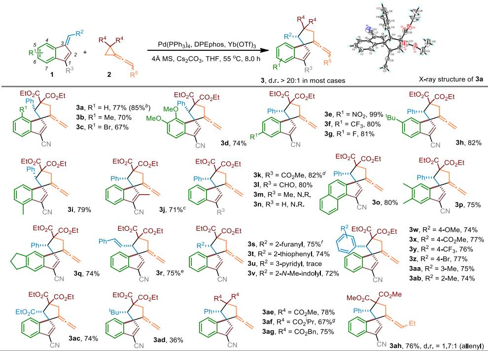  
a Reaction condition: 1 (0.1 mmol), 2 (0.2 mmol), Pd(PPh3)4 (5 mol%), Ligand (7.5 mol%), Yb(OTf)₃ (10 mol%), Cs2CO₃ (0.1 mmol), 4 A MS (0.1 g) THF (1.0 mL), heated at 55 °C for 8.0 h. b Scale-up reaction: 1a (229 mg, 1.0 mmol), 2a (0.35 mL, 1.5 mmol), Pd(PPh3)4 (58 mg, 5 mol%), DPEphos (40 mg, 7.5 mol%), Yb(OTf)3 (62 mg, 10 mol%), Cs2CO3 (325 mg, 1.0 mmol), 4 A MS (1.0 g), THF (10.0 mL), heated at 55 °C for 8.0 h. c d.r. = 8:1. d d.r. = 12:1. ° d.r. = 5:1. f d.r. = 10:1. 9 d.r. = 10:1.

Scheme 3 Substrate scope for the spiro[5,6]indenes 4

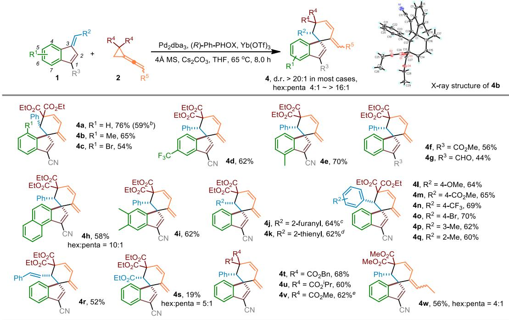

a Reaction condition: 1 (0.1 mmol), 2 (0.2 mmol), Pd2dba3 (2.5 mol%), (R)-Ph-PHOX (7.5 mol%), Yb(OTf)₃ (10 mol%), Cs2CO₃ (0.1 mmol), 4 A MS (0.1 g), THF (1.0 mL), heated at 65 °C for 8.0 h. b Scale-up reaction: 1a (229 mg, 1.0 mmol), 2a (0.35 mL, 1.5 mmol), Pd2dba3 (23 mg, 2.5 mol%), (R)-Ph-PHOX (30 mg, 7.5 mol%), Yb(OTf)₃3 (62 mg, 10 mol%), Cs2CO3 (325 mg, 1.0 mmol), 4 Å MS (1.0 g), THF (10.0 mL), heated at 65 °C for 8.0 ${ \mathsf { h . } } ^ { \mathrm { ~ c ~ } } { \mathsf { d . } } { \mathsf { r . } } = 1 0 ; 1 \mathrm { ~ . ~ } ^ { d } { \mathsf { d . } } { \mathsf { r . } } = 1 1 ; 1 \mathrm { ~ . ~ } ^ { \mathrm { ~ e ~ } } { \mathsf { d . } } { \mathsf { r . } } = 1 4 ; 1 \mathrm { ~ . ~ }$

Scheme 4 a Large-scale synthesis. b Asymmetric investigation. c Further transformations of 3a and 4a.

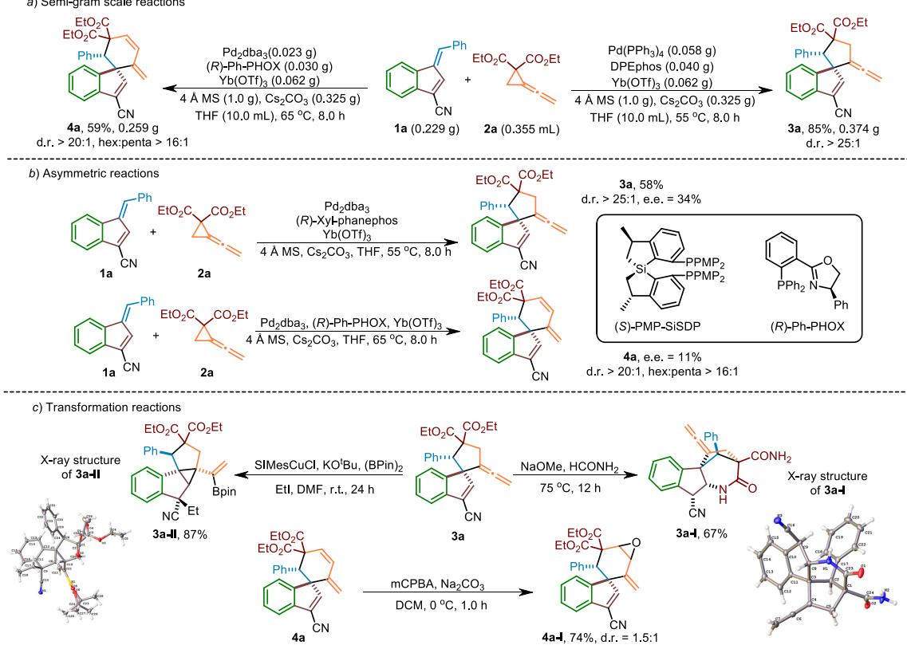

On the basis of above investigations, the potential synthetic practicability of this method on a large-scale was next assessed. As shown in Scheme 4, a, the desired products 3a and 4a were acquired in 85% yield (0.374 g) and 59% yield (0.259 g) in the reactions of 1a (0.229 g) with 2a (0.355 mL) under respective optimal reaction conditions. Furthermore, the feasibility of asymmetric catalysis was also investigated on both cycloaddition modes (Scheme 4, b). Regrettably, the spiro[5,5]indene 3a could be only obtained in 58% yield along with 34% enantiomeric excess using spiral ligand (S)-PMP-SiSDP as a chiral ligand (for more information on the asymmetric investigation on [3+2] cycloaddition, see Table S1 in the Supporting Information). On the other hand, the [4+2]

Scheme 5 Control experiments

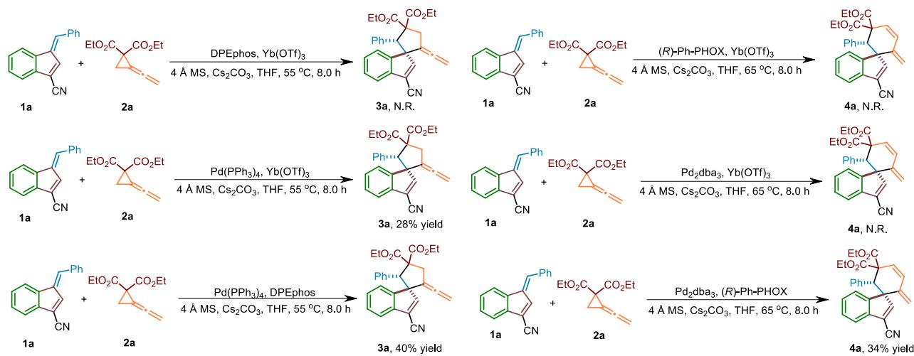

cycloaddition product 4a was formed with 11% enantiomeric excess upon using the original (R)-Ph-PHOX as a chiral ligand.

Moreover, the further conversions of 3a and 4a were also conducted as shown in Scheme $4 , \ \mathsf { c } .$ Aminolysis of the carboethoxy groups upon treating 3a with NaOMe in formamide at $7 5 ~ ^ { \circ } \mathsf { C }$ produced 3a-I in 67% yield, which was derived from a further Michael addition on the vinylcyanide moiety after the aminolysis reaction. Moreover, a difunctionalization process of terminal allene with SIMesCuCl and (BPin)2 in the presence of KOtBu and EtI developed by Ito’s group[13] was also used in the transformation of 3a, generating 3a-II in 87% yield in DMF at room temperature; 3a probably went through an insertion of alkenyl-copper species to conjugated cyanide due to the inductive effect brought from the conjugated cyanide similar as that of aminolysis reaction. The structures of 3a-I and 3a-II have been unambiguously identified by X-ray diffraction and their ORTEP drawings are shown in Scheme 4. On the other hand, 4a could be transformed to the corresponding epoxide 4a-I in 74% yield along with 1.5 : 1 diastereomeric ratio through an epoxidation upon treating with m-CPBA and ${ \mathsf { N a } } _ { 2 } { \mathsf { C O } } _ { 3 } { \mathsf { i n } }$ THF.

In order to clarify the mechanism of this reaction, a series of control experiments were performed to probe the reaction pathways (Scheme 5). Neither [3+2] nor [4+2] cycloaddition occurred in the absence of palladium resources, while removing Yb(OTf) led to the lower yields for both two types of cycloadditions. Hence, palladium as the basic catalyst and Yb(OTf) as the cocatalyst were confirmed. In addition, using Pd(PPh3)4 as the palladium source gave the [3+2] cycloaddition product 3a in 28% yield in absence of DPEphos and none of the [4+2] cycloaddition product 4a was formed in the absence of (R)-Ph-PHOX ligand, rendering that the bidentate ligand plays a key role in these cycloaddition reactions.

On the basis of the above experimental results and our previous investigations on the reaction pathways,[12,14] a plausible reaction mechanism was proposed in Scheme 6. The zwitterionic π-propargyl palladium species I, generated from an oxidative addition between ligand-coordinated Pd(0) and $\yen 6$ -coordinated VDCP-diester 2a, launches a nucleophilic attack to the exocyclic position of benzofulvene 1a, forming an intermediate II stabilized by the aromaticity of cyclopentadienyl anion. When palladium catalyst coordinates with DPEphos, a bidentate ligand with a large bite angle, the cyclopentadienyl anion tends to attack onto the carbon atom at 3-position of the π-propargyl palladium species to provide [3+2] cycloaddition intermediate III-3-pre, and subsequently produces spiro[5,5]indene 3a through a ligand exchange process with 2a along with the regeneration of the zwitterionic π-propargyl palladium species I to complete the catalytic cycle. Whereas, the cyclopentadienyl anion is more likely to approach onto the carbon atom at 2-position of π-propargyl palladium species if palladium catalyst is coordinated by (R)-Ph-PHOX, a special bidentate ligand with a small bite angle, affording palladacyclobutene species ${ \sf I I I } , ^ { \left[ 1 5 \right] }$ which can be formed in a similar way as that of palladacyclobutane derived from π-allyl palladium species.[15] Then, the palladium intermediate III shall undergo a base-induced protonation to form a π-allyl palladium species IV, which undergoes a β-H elimination to furnish the [4+2] cycloaddition intermediate V-4-pre. A ligand exchange process between V-4-pre and 2a affords spiro[5,6]indene 4a and regenerates the zwitterionic π-propargyl palladium species I to complete the catalytic cycle.

As shown in Scheme 6, the selectivity originates from the cyclopentadienyl anion moiety of the intermediate II attacking different carbon of π-propargyl palladium moiety. Thus, density functional theory (DFT) calculation was used to investigate the selectivity-determining step (Figure 2). When DPEphos is utilized as the ligand, the cycloaddition can undergo two pathways originated from η1/η3 type intermediates INT A-1 or INT A-1’ to form [3+2] product or [4+2] product. Although the energy of intermediate INT A-1’ is lower than that of INT A-1 by 13.7 kcal/mol, the

Scheme 6 A plausible mechanism

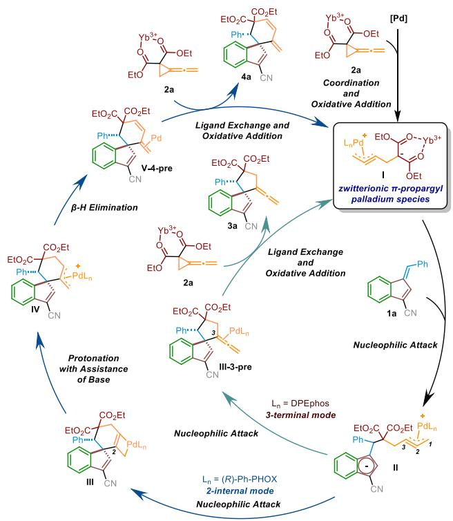

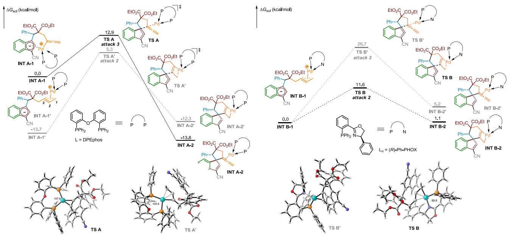  
Figure 2 DFT calculation studies of ligand-controlled selectivity.

[4+2] pathway has to overcome a much higher energy barrier which was 19.0 kcal/mol rather than 12.9 kcal/mol as [3+2] pathway. On another side, the energy of [4+2] product INT A-2’ was slightly higher than that of INT A-1’ by 1.4 kcal/mol, which means that [4+2] pathway is a reversible process; in contrast, the [3+2] pathway is an exothermic process $\langle \Delta G = - 1 3 . 8$ kcal/mol). Therefore, the [3+2] product is thermodynamically and kinetically favorable which is in line with the experimental result. In the case of (R)-Ph-PHOX used as the ligand, [4+2] pathway and [3+2] pathway shared the same intermediate INT B-1. The [4+2] pathway is easier to occur both thermodynamically and kinetically, which showed an energy gap of 15.1 kcal/mol between two transition states and an energy gap of 4.1 kcal/mol between the two products. We speculate that DPEphos with a large bite angle, which is about 104°— 108° upon coordinating with palladium source, would produce more steric hindrance, thereby restraining the formation of TS A’ from INT A-1’ and raising the energy barrier of [4+2] type reaction; (R)-Ph-PHOX with a small bite angle, that is about $8 1 ^ { \circ } - 9 0 ^ { \circ }$ upon coordinating with palladium source, results in much smaller energy barrier for generation of the [4+2] product due to the steric effect.

## Conclusions

In summary, a ligand-controlled divergent $[ 3 + 2 ] / [ 4 + 2 ]$ cycloaddition between benzofulvenes and zwitterionic π-propargyl palladium species generated from VDCP-diesters has been established for the rapid construction of substituted spiro[5,5]indenes and spiro[5,6]indenes in moderate to excellent yields with good functional group toleration and a broad substrate scope. The plausible mechanistic paradigm was proposed based on the control experiments and our previous work, rendering that the reaction proceeds through a zwitterionic π-propargyl palladium species, a key intermediate in these cycloaddition reactions. The large-scale synthesis and the further conversion of the obtained cyclized products indicated that this synthetic method can easily access multi-substituted endocyclic compounds, polycyclic compounds or epoxide substances. The DFT calculations reveal the origin of product selectivity. The further applications of this methodology in the preparing bioactive substances or drug-like molecules are also undergoing in our laboratory.

## Experimental

General procedure for the [3+2] products. Tetrakis(triphenylphosphine)palladium (0.005 mmol, 5 mol%) and DPEPhos (0.007 mmol, 7.5 mol%) were added to an oven dried 10 mL sealed tube equipped with a magnetic stirring bar under argon atmosphere. The resulting catalyst system was stirred in THF (degassed) (1.0 mL) with 4 Å MS (100 mg) for 30 min. After that, 1 (0.1 mmol), 2 (0.2 mmol), ${ \mathsf { Y b } } ( { \mathsf { O T f } } ) _ { 3 }$ (0.01 mmol, 10 mol%) and ${ \mathsf { C s } } _ { 2 } { \mathsf { C O } } _ { 3 }$ (0.1 mmol, 1.0 eq) were added under argon atmosphere. The reaction mixture was stirred at $5 5 ~ ^ { \circ } \mathsf { C }$ for 8.0 h. The reaction solution was filtered through a pad of celite to remove insoluble solids. Then, the solvent was evaporated under vacuum and the residue was purified by a silica gel column chromatography to afford the desired product 3.

General procedure for the [4+2] products. Tris(dibenzylideneacetone)dipalladium (0.002 mmol, 2.5 mol%) and (R)-Ph-PHOX (0.007 mmol, 7.5 mol%) were added to an oven dried 10 mL sealed tube equipped with a magnetic stirring bar under argon atmosphere. The resulting catalyst system was stirred in THF (degassed) (1.0 mL) with 4 Å MS (100 mg) for 30 min. After that, 1 (0.1 mmol), 2 (0.2 mmol), ${ \mathsf { Y b } } ( { \mathsf { O T f } } ) _ { 3 }$ (0.01 mmol, 10 mol%) and ${ \mathsf { C s } } _ { 2 } { \mathsf { C O } } _ { 3 }$ 3 (0.1 mmol, 1.0 eq) were added under argon atmosphere. The reaction mixture was stirred at 65 °C for 8.0 h. The reaction solution was filtered through a pad of celite to remove insoluble solids. Then, the solvent was evaporated under vacuum and the residue was purified by a silica gel column chromatography to afford the desired product 4.

## Supporting Information

The supporting information for this article is available on the WWW under https://doi.org/10.1002/cjoc.202401301.

## Acknowledgement

We are grateful for the financial support from the National Key R & D Program of China (2023YFA1506700), the Strategic Priority Research Program of the Chinese Academy of Sciences (Grant No. XDB0590000), and the National Natural Science Foundation of China (21372250, 21121062, 21302203, 21772037, 21772226, 21861132014, 91956115 and 22171078).

## References

[1] (a) Garthwaite, S. M.; McMahon, E. G. The Evolution of Aldosterone

Antagonists. Mol. Cell. Endocrinol. 2004, 217, 27‒31; (b) Cella, J. A.; Brown, E. A.; Burtner, R. R. Steroidal Aldosterone Blockers. I. J. Org. Chem. 1959, 24, 743‒748; (c) Cella, J. A.; Tweit, R. C. Steroidal Aldosterone Blockers. II1. J. Org. Chem. 1959, 24, 1109‒1110; (d) Quintavalla, A. Spirolactones: Recent Advances in Natural Products, Bioactive Compounds and Synthetic Strategies. Curr. Med. Chem. 2018, 25, 917‒962; (e) Elger, W.; Beier, S.; Pollow, K.; Garfield, R.; Shi, S.-Q.; Hillisch, A. Conception and Pharmacodynamic Profile of Drospirenone. Steroids 2003, 68, 891‒905.

[2] Smith, L. K.; Baxendale, I. R. Total syntheses of natural products containing spirocarbocycles. Org. Biomol. Chem. 2015, 13, 9907‒9933.

[3] (a) Marson, C. M. New and unusual scaffolds in medicinal chemistry. Chem. Soc. Rev. 2011, 40, 5514‒5533; (b) Zheng, Y.; Tice, C. M.; Singh, S. B. The use of spirocyclic scaffolds in drug discovery. Bioorg. Med. Chem. Lett. 2014, 24, 3673‒3682; (c) Hiesinger, K.; Dar'in, D.; Proschak, E.; Krasavin, M. Spirocyclic Scaffolds in Medicinal Chemistry. J. Med. Chem. 2021, 64, 150‒183.

[4] (a) Zhu, S.-F.; Zhou, Q.-L. Transition-Metal-Catalyzed Enantioselective Heteroatom–Hydrogen Bond Insertion Reactions. Acc. Chem. Res. 2012, 45, 1365‒1377; (b) Zhu, S.-F.; Zhou, Q.-L. Iridium-Catalyzed Asymmetric Hydrogenation of Unsaturated Carboxylic Acids. Acc. Chem. Res. 2017, 50, 988‒1001; (c) Yang, F.; Xie, J.-H.; Zhou, Q.-L. Highly Efficient Asymmetric Hydrogenation Catalyzed by Iridium Complexes with Tridentate Chiral Spiro Aminophosphine Ligands. Acc. Chem. Res. 2023, 56, 332‒349; (d) Li, Y.-P.; Zhu, S.-F.; Zhou, Q.-L. Chiral Spiro Phosphoramide-Catalyzed Sulfa-Michael Addition/Enantioselective Protonation of Exocyclic Enones. Org. Lett. 2019, 21, 9391‒9395; (e) Wang, B.; Zhang, T.-Z.; Xiao, L.-J.; Zhou, Q.-L. Nickel-Catalyzed Intermolecular Reductive Coupling of Styrene and Its Derivatives with Imines Using Methanol as a Reductant. ACS Catal. 2023, 13, 8692‒8699; (f) Han, A.-C.; Xiao, L.-J.; Zhou, Q.-L. Construction of Ge-Stereogenic Center by Desymmetric Carbene Insertion of Dihydrogermanes. J. Am. Chem. Soc. 2024, 146, 5643‒5649; (g) Xu, B.; Ji, D.-T.; Wu, L.-Z.; Zhou, L.-J.; Liu, Y.; Zhang, Z.-M.; Zhang, J.-L. Palladium/Xu-Phos-Catalyzed Enantioselective Cascade Heck/Remote C(sp2)–H Alkylation Reaction. Chem 2022, 8, 836‒849; (h) Chu, H.-K.; Cheng, J.; Yang, J.-F.; Guo, Y.-L.; Zhang, J.-L. Asymmetric Dearomatization of Indole via Palladium/PC-Phos-Catalyzed Dynamic Kinetic Transformation. Angew. Chem. Int. Ed. 2020, 59, 21991‒21996.

[5] Zhao, Q.-H.; Tang, L.-C.; Jiao, P. Construction of Spiro Skeletons in 2,2',3,3'-Tetrahydro-1,1'-spirobi[1H-indene]-7,7'-diol (SPINOL) and Analogues. Chin. J. Org. Chem. 2021, 41, 3400‒3413.

[6] (a) Zheng, J.; Wang, S.-B.; Zheng, C.; You, S.-L. Asymmetric Dearomatization of Naphthols via a Rh-Catalyzed C(sp2)–H Functionalization/Annulation Reaction. J. Am. Chem. Soc. 2015, 137, 4880‒4883; (b) Yang, L.; Zheng, H.-Y.; Luo, L.; Nan, J.; Liu, J.-J.; Wang, Y.-Y.; Luan, X.-J. Palladium-Catalyzed Dynamic Kinetic Asymmetric Transformation of Racemic Biaryls: Axial-to-Central Chirality Transfer. J. Am. Chem. Soc. 2015, 137, 4876‒4879.

[7] (a) Chai, Z.; Rainey, T. J. Pd(II)/Brønsted Acid Catalyzed Enantioselective Allylic C–H Activation for the Synthesis of Spirocyclic Rings. J. Am. Chem. Soc. 2012, 134, 3615‒3618; (b) Fan, L.-L.; Takizawa, S.; Takeuchi, Y.; Takenaka, K.; Sasai, H. Pd-catalyzed enantioselective intramolecular α-arylation of α-substituted cyclic ketones: facile synthesis of functionalized chiral spirobicycles. Org. Biomol. Chem. 2015, 13, 4837‒4840.

[8] (a) Diekmann, M.; Bockstiegel, G.; Lützen, A.; Friedemann, M. Saak, W.; Haase, D.; Beckhaus, R. Chiral Bis(η5:η1-pentafulvene)titanium Complexes. Organometallics 2006, 25, 339‒348; (b) Yan, J.-C.; Cheng, X.; Zhou, Q.-L.; Pei, J. Chiral Polyfluorene Derivatives:  Synthesis, Chiroptical Properties, and Investigation of the Structure−Property Relationships. Macromolecules 2007, 40, 832‒839; (c) Cappelli, A.; Galeazzi, S.; Zanardi, I.; Travagli, V.; Anzini, M.; Mendichi, R.; Petralito,

S.; Memoli, A.; Paccagnini, E.; Peris, W.; Giordani, A.; Makovec, F.; Fresta, M.; Vomero, S. A nanocomposite material formed by benzofulvene polymer nanoparticles loaded with a potent 5-HT receptor antagonist (CR3124). J. Nanopart. Res. 2010, 12, 895‒903; (d) Kosaka, Y.; Kitazawa, K.; Inomata, S.; Ishizone, T. Living Anionic Polymerization of Benzofulvene: Highly Reactive Fixed Transoid 1,3-Diene. ACS Macro Lett. 2013, 2, 164‒167; (e) Kosaka, Y.; Kawauchi, S.; Goseki, R.; Ishizone, T. High Anionic Polymerizability of Benzofulvene: New Exo-Methylene Hydrocarbon Monomer. Macromolecules 2015, 48, 4421‒4430.

[9] Donslund, B. S.; Nielsen, R. P.; Mønsted, S. M. N.; Jørgensen, K. A. Benzofulvenes in Trienamine Catalysis: Stereoselective Spiroindene Synthesis. Angew. Chem. Int. Ed. 2016, 55, 11124‒11128.

[10] Donslund, B. S.; Jessen, N. I.; Jakobsen, J. B.; Monleo'n, A.; Nielsen, R. P.; Jørgensen, K. A. Enantioselective formation of cyclopropane spiroindenes from benzofulvenes by phase transfer catalysis. Chem. Commun. 2016, 52, 12474‒12477.

[11] Chang, X.; Liu, X.-T.; Li, F.-F.; Yang, Y.-H.; Chung, L. W.; Wang, C-J. Electron-rich benzofulvenes as effective dipolarophiles in copper(I)- catalyzed asymmetric 1,3-dipolar cycloaddition of azomethine ylides. Chem. Sci. 2023, 14, 5460‒5469.

[12] (a) Niu, B.; Wei, Y.; Shi, M. Palladium catalyzed divergent cycloadditions of vinylidenecyclopropane-diesters with methyleneindolinones enabled by zwitterionic π-propargyl palladium species. Chem. Commun. 2021, 57, 4783‒4786; (b) Shen, J.-H.; Long, Y.-J.; Shi, M.; Wei, Y. Palladium-catalyzed and ligand-controlled divergent cycloadditions of vinylidenecyclopropane-diesters with para-quinone methides enabled by zwitterionic π-propargyl palladium species. Org. Chem. Front. 2024, 11, 3214‒3224; (c) Long, Y.-J.; Shen, J.-H.; Wei, Y.; Shi, M. Substrate-Controlled [8+3] Cycloaddition of Tropsulfimides and Tropones with Zwitterionic Allenyl Palladium Species Derived from Vinylidenecyclopropane-diesters. J. Org. Chem. 2024, 89, 14831‒14850; (d) Long, Y.-J.; Shen, J.-H.; Shi, M.; Wei, Y. Theoretical Studies on the Reaction Mechanism for the Cycloaddition of Zwitterionic π-Allenyl Palladium Species: Substrate-Controlled Isomerization. Molecules 2025, 30, 103‒113.

[13] Ozawa, Y.; Endo, K.; Ito, H. Regio- and Stereoselective Synthesis of Multi-Alkylated Allylic Boronates through Three-Component Coupling Reactions between Allenes, Alkyl Halides, and a Diboron Reagent. J. Am. Chem. Soc. 2021, 143, 13865‒13877.

[14] Zhong, X.-H.; Long, Y.-J.; Wei, Y.; Shi, M. Palladium-Catalyzed Sc(OTf)3/Cs2CO3-Assisted C−O Cross-Coupling of Vinylidenecyclopropane-Diesters with Phenolic Compounds. Adv. Syn. Catal. 2024, 366, 3387‒3396.

[15] (a) Montgomery, T. D.; Rawal, V. H. Palladium-Catalyzed Modular Synthesis of Substituted Piperazines and Related Nitrogen Heterocycles. Org. Lett. 2016, 18, 740‒743; (b) O'Broin, C. Q.; Guiry, P. J. Synthesis of 2‑Amino-1,3-dienes from Propargyl Carbonates via Palladium-Catalyzed Carbon−Nitrogen Bond Formation. Org. Lett. 2020, 22, 879‒883; (c) Mondal, D.; Pal, G.; Chowdhury, C. Palladium(0)- catalysed regioselective cyclisations of 2-amino(tosyl) benzamides/ sulphonamides: the stereoselective synthesis of 3-ylidene-[1,4]benzodiazepin-5-ones/benzo[f][1,2,5]thiadiazepine-1,1-dioxides. Chem. Commun. 2021, 57, 5462‒5465; (d) Dai, M.-F.; Sun, Z.-M.; Chen, L.-A. Palladium-Catalyzed Regiodivergent Synthesis of 1,3-Dienyl and Allyl Esters from Propargyl Esters. Angew. Chem. Int. Ed. 2022, 61, e202203835.

## The Authors

  
Left to Right: Yongjie Long, Xianhua Zhong, Min Shi, Yin Wei