www.eurjoc.org

# Synthesis of Pyrrolidin-3-Ones and Spiropyrrolidinones by 1,3-Dipolar Cycloadditions of Nitrones with Allenylphosphonates

Rayhane Hammami, Lucas Mele, Soufiane Touil, David Virieux, Jean-François Poisson,\* Tahar Ayad,\* and Benjamin Darses\*

A general and effective (3  2) cycloaddition reaction between nitrones and allenes to synthesize fluoro-phosphonopyrrolidin-3-ones, as well as spiropyrrolidin-3-one phosphonates is reported

## 1. Introduction

Nitrogen-containing heterocycles are widely present in biologically active natural products and synthetic pharmaceutical drugs. The vast majority of the FDA approved drugs contain at least one nitrogen-heterocycle.[1] Among these, pyrrolidines play a central role and numerous studies have been dedicated to their pharmacology.[2] Consequently, synthetic chemists have developed various and efficient routes to access functionalized pyrrolidine derivatives, which also find applications in diverse area of organic chemistry.[3] Notably, pyrrolidin-3-one derivatives have demonstrated potential anti-(HIV) human immunodeficiency viruses activity (Figure $1 ) , ^ { [ 4 ] }$ and have been utilized as valuable building blocks in total synthesis.[5]

under microwave heating. The products have been isolated in moderate to good yields and exclusively as $4 , 5 \cdot$ -trans diastereoisomers in all transformations.

However, pyrrolidin-3-ones still remain underexploited, likely due to the limited number of effective synthetic approaches. The main strategies reported so far to access pyrrolidin-3-ones rely on aza-Michael conjugated-addition followed by base-catalyzed Dieckmann condensation, and a Krapcho decarboxylation yielding poorly functionalized products (Scheme $\mathsf { 1 a } ) , \mathsf { \Omega } ^ { [ 6 ] }$ gold-catalyzed rearrangement of homopropargylic N-sulfonylhydroxylamines (Scheme $1 6 ) , { } ^ { [ 7 ] }$ or $( 3 + 2 )$ cycloaddition of nitrones with allenes directly followed by the spontaneous rearrangement of the alkylidene isoxazolidine intermediate (Scheme $1 { \mathsf { c } } ) . { } ^ { [ 8 ] }$ The latter method requires allenes substituted with electron-withdrawing groups (EWG), typically cyanide (CN), arylsulfone $( \mathsf { S O } _ { 2 } \mathsf { A r } )$ , or carbonyl (COR, ${ \mathsf { C O } } _ { 2 } \mathsf { R } ) .$

The cycloaddition of nitrones with allenes is likely the most practical route to date, although it has been poorly explored. Recently, we reported a 1,3-dipolar cycloaddition of nitrones with phosphinylallenes $( \mathsf { E W G } = \mathsf { P O P h } _ { 2 } )$ for the formation of 4-phosphinyl-pyrrolidin-3-ones in high yields achieving complete control of diastereoselectivity at positions ${ \mathsf { C } } ^ { 4 }$ and $C ^ { 5 }$ of the pyrrolidin-3-one ring.[9] Encouraged by these results, we decided to extend our investigations to functionalized allenylphosphonates $( \mathsf { E W G } = \mathsf { P O } ( \mathsf { O R } ) _ { 2 } )$ , aiming to obtain a diverse set of pyrrolidin-3-ones. This combination of two versatile reagents provides an affordable methodology to cover the broadest chemical space, aiming to identify new and potentially biologically active molecules.[10] In this work, we present our findings on the synthesis of both fluoroalkyl phosphono- and spiro-piperidinylpyrrolidin-3-ones.

Under our previously reported reaction conditions (2 h at $1 5 0 ^ { \circ } \mathsf { C }$ under microwave (MW) irradiation, in cyclohexane) $\cdot ^ { \left[ 9 \right] }$ we noticed that the diethyl 3,30-dimethylallenylphosphonate $( \mathsf { E W G } = \mathsf { P O } ( \mathsf { O E t } ) _ { 2 } )$ afforded the desired cycloaddition product in low yield, unlike the phosphine oxide analog. Notably, an even more electron-rich allenylphosphoramide $( \mathsf { E W G } = \mathsf { P O } ( \mathsf { N R } _ { 2 } ) _ { 2 } )$ failed to give the phosphonopyrrolidone; both the nitrone and the allene starting materials were recovered unreacted. Previous reports suggested that this transformation performed better from electron-poor allenes.[8] To enhance the electrophilicity of the allene, we decided to introduce a stronger electron-withdrawing phosphorus moiety.

(b) Au-catalyzed rearrangement of homopropargylic N-sulfonylhydroxylamines  
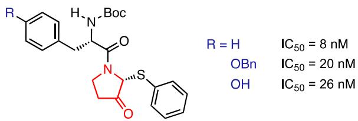  
Figure 1. Representative pyrrolidin-3-one derivatives showing anti-HIV activity.

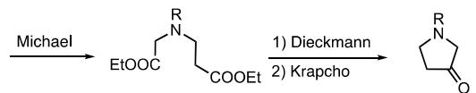

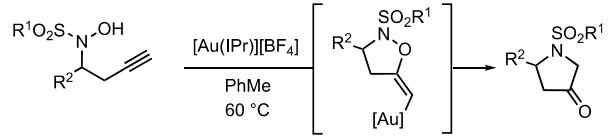  
(c) Cycloaddition of nitrones with electron-deficient allenes

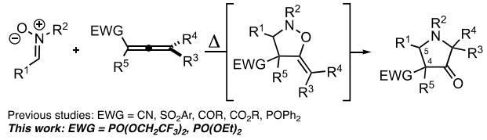  
Scheme 1. Representative methods for the synthesis of pyrrolidin-3-ones. a) Michael/Dieckman/Krapcho. b) Au-catalyzed rearrangement of homopropargylic N-sulfonylhydroxylamines. c) Cycloaddition of nitrones with electron-deficient allenes.

Bis(trifluoroethyl) allenylphosphonates 2 (EWG = PO(OCH CF ) ) were thus selected as potential candidates. To the best of our knowledge, no example of such reagent has been reported in the literature. Fluorinated allenylphosphonates 2 were synthesized in two steps. Prior to the formation of allene, bis(2,2,2-trifluoroethyl) chlorophosphite was synthesized according to a procedure described in the literature,[11] by reacting phosphorus trichloride with trifluoroethanol in the presence of N,N-diethylaniline as a base. The resulting chlorophosphite was then reacted with three different propargyl alcohols $\mathsf { a t } - 7 8 ^ { \circ } \mathsf C$ yielding the corresponding allenes 2a–c after a spontaneous [2,3]-sigmatropic rearrangement, in nonoptimized low to moderate yields (Scheme 2).

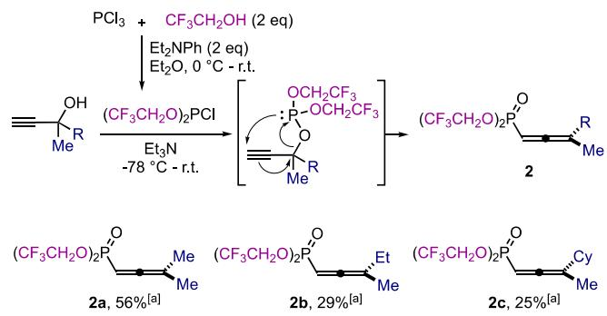  
Scheme 2. Synthesis of fluorinated allenylphosphonates 2a–c. a) Isolated yields after silica gel column chromatography. Cy = cyclohexyl.

With these fluorinated allenylphosphonates 2a–c in hand, we decided to explore their reactions with nitrones. Initially, we evaluated the cycloaddition of (Z)-N-methyl-phenylnitrone with allene 2a using the optimal conditions developed in our precedent report.[9] While the diethyl phosphonate analog delivered the expected product in only 34% yield,[12] the use of fluorinated allenylphosphonate 2a resulted in a significantly improved 78% isolated yield of the pyrrolidine-3-one 3a (Scheme 3). Noteworthy, the reaction exhibited a complete regio- and stereoselectivity, 3a being formed exclusively as the $C ^ { 4 } , C ^ { 5 } .$ -trans isomer. Encouraged by the improved reactivity, reactions of allenylphosphonates 2a–c were then explored under these conditions.

Nitrones bearing different aromatic substituents were firsttested with allene 2a. The reaction proceeded smoothly with complete diastereoselectivity, yielding only the trans-products in moderate to good yields. The presence of -electron-donatingor withdrawing groups in the para or meta position (3b–3f) of the aromatic moiety has little influence on the reaction outcome. However, the yield decreased when the phenyl group of the nitrone was replaced by a furyl group (3g). It has also been possible to replace the N-methyl group of the nitrone by N-benzyl, with a slight decrease in yield (78% for 3a vs. 66% for 3h). The reaction of cyclic nitrone, 5,5-dimethyl-1-pyrroline-N-oxide (DMPO) with the allene 2a successfully delivered the pyrrolidinone product 3j in 58% yield. We subsequently evaluated the outcome of this transformation using racemic allenes 2b and 2c. Products 3k and 3l were also obtained with a complete C4,

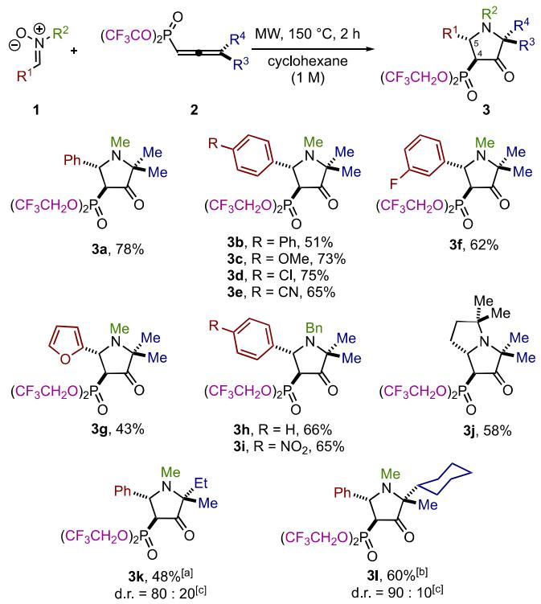  
Scheme 3. Reaction of fluorinated allenylphosphonates with nitrones. Reaction conditions: a solution of 1 (0.500 mmol) and 2 (0.500 mmol) in cyclohexane (0.5 mL) was stirred for 2 h at 150 °C under MW irradiation. Isolated yields after silica gel column chromatography. a) Yield for the mixture of the two diastereoisomers. b) Yield of the major diastereoisomer. c) d.r. were determined by (1H NMR) nuclear magnetic resonance of the crude mixture.

$C ^ { 5 } \cdot$ trans selectivity as a mixture of two diastereoisomers, the major diastereoisomer possessing the bulkiest substituent at the $C ^ { 2 }$ position in trans related to the phosphorus moiety at $C ^ { 4 } .$ The bis(trifluoroethoxy)phosphonyl moiety also proved to have a beneficial influence on the diastereoselectivity compared to the previously reported diphenylphosphinoxy moiety.[9] The phosphine oxide analog of 2b afforded a lower diastereoisomeric ratio $( { \mathsf { d } } . { \mathsf { r } } . = 8 0 { : } 2 0$ for 3k vs. 65:35 for the analog). In addition, a sterically more demanding substituent at the $C ^ { 2 }$ position also induced a greater diastereoselectivity, as the ethyl derivative 3k was obtained with an 80:20 diastereoisomeric ratio, while the corresponding cyclohexyl pyrrolidinone 3l showed a better 90:10 diastereoisomeric ratio.

To demonstrate the synthetic potential of this transformation, a scale-up reaction was performed (Scheme 4). Starting from 3 mmol of nitrone 1a and allene 2a $( \mathfrak { i . e . } ,$ 6 times the usual scale), the expected pyrrolidine-3-one 3a was obtained in a good, though slightly decreased 60% yield, validating the scalability of this reaction.

Building on these positive outcomes, we investigated whether this MW-assisted (3 2) cycloaddition involving nitrones could be applied to allenylphosphonate 6 containing a basic piperidine functional group. If successful, this approach could streamline the synthesis of valuable new spirocyclic piperidinyl–pyrrolidinyl phosphonates, offering an unprecedented scaffold. Indeed, many spirocyclic piperidines have been developed as drugs or have demonstrated highly promising activities in preclinical and clinical studies. Notable examples include Fenspiride,[13] marketed as Pneumorel, which acts as an alpha-1 blocker. Spiperone is a selective $\mathsf { D } _ { 2 }$ dopamine receptor antagonist,[14] and Liproxstatin-1 is a ferroptosis inhibitor which reduces iron deposition, thereby alleviating renal fibrosis induced by unilateral ureteral obstruction (Figure 2).[15] Therefore, as outlined in this study, the development of phosphonate-based bioisosteres within this important class of compounds holds particular promise. To the best of our knowledge, spirocyclic piperidine phosphonates have not been previously reported.[16]

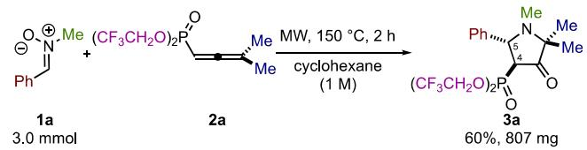  
Scheme 4. Larger-scale reaction.

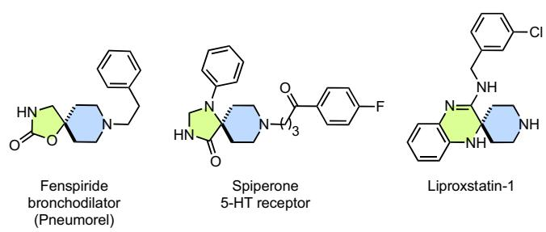  
Figure 2. Representative marketed spirocyclic piperidines with potent biological activities.

To test this hypothesis, our first objective was to prepare piperidinylallenylphosphonate 6 using the classical two-step sequence from ketone 4 (Scheme 5). The N-benzyl-protected 4-piperidinone 4 was treated with ethynylmagnesium bromide, yielding the corresponding propargyl alcohol 5 (68% yield). This intermediate 5 was then reacted with diethyl chlorophosphite in the presence of triethylamine in refluxing THF. Under these conditions, the intermediately formed propargylpiperidinyl phosphite spontaneously rearranged, delivering the diethyl allenylphosphonate 6 (77% yield on gram-scale).

With a gram-scale synthesis of allenylphosphonate 6 in hand, we then explored its MW-assisted (3 2) cycloaddition reaction with nitrones. Using nitrone 1g bearing a naphthyl substituent, under the previously optimized conditions for synthesizing pyrrolidin-3-ones 3 $( 1 5 0 ^ { \circ } \mathsf C$ for 2 h in cyclohexane (1.0 M) under MW irradiation), only 57% of the desired cycloaddition product 7h could be isolated (Scheme 6). The decrease in yield was likely due to the formation of numerous by-products with similar polarity to the desired spirocyclic pyrrolidin-3-one 7h, including unreacted starting material 1g. To address this issue, we reinvestigated some parameters of this MW-assisted (3 2) cycloaddition. Gratifyingly, increasing the amount of nitrone 1g to 1.5 equivalents significantly reduced the formation of polar by-products. The chemical outcome of the reaction was further improved by conducting the reaction under more diluted conditions (0.2 vs. 1.0 M), extending the reaction time to 3 h, and replacing cyclohexane with toluene, leading to the spirocyclic pyrrolidin-3- one 7h with an optimal 74% yield.

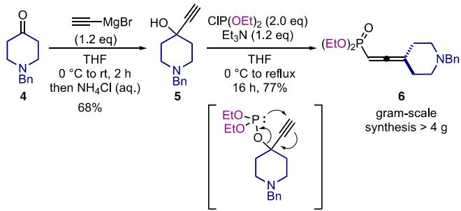  
Scheme 5. Gram-scale synthesis of piperidinylallenylphosphonate 6.

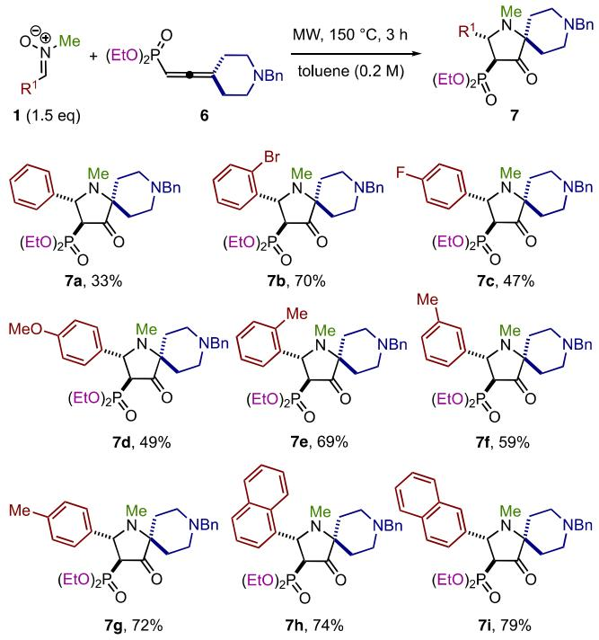  
Scheme 6. Reaction of piperidinylallenylphosphonate 6 with nitrones 1.

Having established the optimized reaction conditions for the MW-assisted (3 2) cycloaddition of nitrone 1g with piperidinesubstituted allenylphosphonate 6, we then investigated the substrate scope. As shown in Scheme 6, with the exception of the phenyl derivative, nitrones bearing either electron-donating (methoxy) or electron-withdrawing functional groups (fluorine, and bromine) performed well in this reaction, producing the desired products 7a–i in moderate to good yields (47%–79%) with a trans relative configuration. Interestingly, when substituents were present in the ortho-position of the aryl moiety, the spirocyclic derivatives were obtained in good to high isolated yields (7b,e,h 69%–79%), suggesting that steric hindrance had a negligible impact on the reaction.

To evaluate the synthetic potential of phosphonopyrrolidinones 3 for further modifications, we evaluated their reactivity as Still– Gennari olefination partners. In the presence of paraformaldehyde, diisopropylethylamine (DIPEA) and LiCl, phosphonopyrrolidinone 3a afforded the corresponding 4-methylydenepyrrolidin-3-one 8a (78% yield, Scheme 7). While the reaction of the diphenylphosphinoxy analog was efficient with paraformaldehyde,[9] it failed to deliver

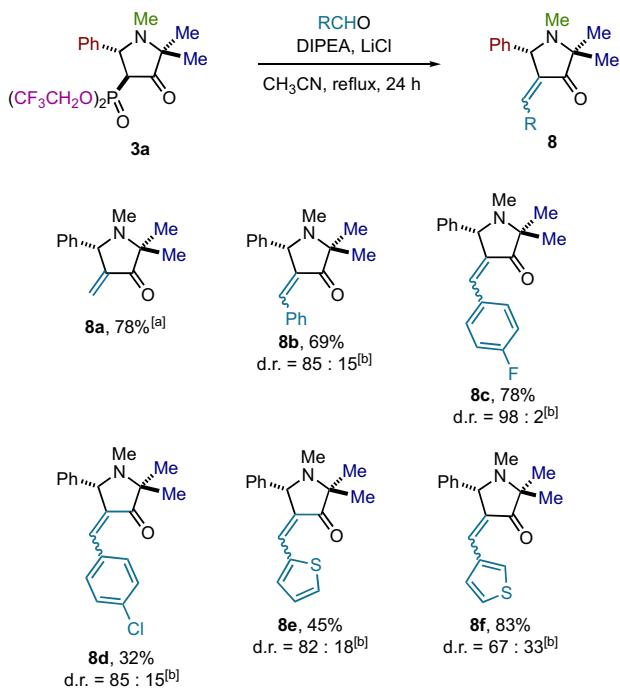

Scheme 7. Synthesis of ylidene pyrrolidin-3-one 8a–f by Still–Gennari olefination. a) The reaction was carried out at 40 °C for 24 h. b) Diastereoisomeric ratios (d.r.) were determined by 1H NMR on the crude reaction mixture.

the expected ylidene products when using aromatic aldehydes. Interestingly, when tested with the fluorinated phosphinylpyrrolidin-3-one 3a, the reaction proceeded smoothly. Using benzaldehyde, the corresponding product 8b was obtained in 69% yield as a Z:E (85:15) mixture of diastereoisomers. The transformation was further extended to other aromatic and heteroaromatic aldehydes, and the expected products 8b–f were obtained in low to good yields and average to excellent diastereoselectivities. The Z-configuration of the major diastereoisomers was determined by (NOESY) nuclear overhauser effect spectroscopy experiments.

In summary, we successfully synthesized two series of phosphonopyrrolidinones using a general and affordable approach to introduce diastereoselectively structural diversity. The first series demonstrated that bis(2,2,2-trifluoroethyl) allenylphosphonates are effective reagents in the (3 2) cycloaddition with nitrones, achieving moderate to good yields and good diastereoselectivity. Pyrrolidinone 3a also showed good reactivity in the Still–Gennari olefination leading to the vinylidene pyrrolidinones 8 even using aromatic aldehydes. Additionally, we successfully applied this MWassisted (3 2) cycloaddition reaction with nitrones to piperidinyl allenylphosphonate 6. This highly convergent reaction led in one step to valuable and complex spirocyclic piperidinyl-pyrrolidin-3- ones 7 in yields ranging from 33% to 79%. Further studies to evaluate the biological properties of these new compounds are currently underway and will be reported in due course.

## 2. Experimental Section

General procedure for synthesis of fluorinated phosphinylpyrrolidin-3-one 3: in a sealed tube, nitrone 1 (0.500 mmol), fluorinated allenylphosphonates 2 (0.500 mmol), and cyclohexane (0.5 mL) were heated at 150 °C under MW irradiation for 2 h. After the completion of the reaction, the mixture was concentrated under reduced pressure and the crude material was purified by column chromatography over silica gel (pentane/EtOAc) to afford pure fluorinated phosphonopyrrolidinones 3.

General procedure for synthesis of spirocyclic phosphonopyrrolidinones 7: in a 7 mL MW tube, nitrone 1 (0.600 mmol), diethyl (2-(1-benzylpiperidin-4-ylidene)vinyl)phosphonate 6 (140 mg, 0.400 mmol), and toluene (2.0 mL) were heated at 150 °C under MW irradiation for 3 h. After the completion of the reaction, the mixture was concentrated under reduced pressure and the crude material was purified by column chromatography over silica gel (dichloromethane/MeOH 99:1 to 95:5) to afford pure spirocyclic phosphonopyrrolidinones 7.

## Acknowledgements

R.H., S.T., J.-F.P., and B.D. wish to thank the Labex ARCANE and CBH-EUR-GS (ANR-17-EURE-0003) and the Ministry of Higher Education and Scientific Research of Tunisia for financial support (R.H.). L.M., D.V., and T.A. wish to thank the Ministère de l’Enseignement Supérieur, de la Recherche et de l’Innovation for a Ph.D. grant (L.M). The authors from DCM are also thankful for support from ICMG FR 2607, Grenoble, through which NMR,

MS, and X-Ray analyses have been performed. The authors from ICGM greatly acknowledge the Analytic Platform for NMR, massspectra analyses performed during this work.

## Conflict of Interest

The authors declare no conflict of interest.

## Author Contributions

Rayhane Hammami performed experiments present in Schemes 2, 3, 4 and 7, and Lucas Mele performed experiments present in Scheme 5 and 6.

## Data Availability Statement

The data that support the findings of this study are available in the supplementary material of this article.

Keywords: (3  2) cycloaddition · allenylphosphonates · nitrones · pyrrolidinone · rearrangement · spiro piperidinylpyrrolidinone

[1] a) C. M. Marshall, J. G. Federice, C. N. Bell, P. B. Cox, J. T. Njardarson, J. Med. Chem. 2024, 67, 11622; b) E. Vitaku, D. T. Smith, J. T. Njardarson, J. Med. Chem. 2014, 57, 10257.

[2] a) R. Sahu, K. Shah, R. Malviya, D. Paliwal, S. Sagar, S. Singh, B. G. Prajapati, Results Chem. 2024, 7, 101359; b) S. Poyraz, H. A. Döndaş, N. Y. Döndaş, J. M. Sansano, Front. Pharmacol. 2023, 14, 1239658; c) A. A. Bhat, I. Singh, N. Tandon, R. Tandon, Eur. J. Med. Chem. 2023, 246, 114954; d) N. Jeelan Basha, S. M. Basavarajaiah, K. Shyamsunder, Mol. Divers 2022, 26, 2915; e) G. Li Petri, M. V. Raimondi, V. Spanò, R. Holl, P. Barraja, A. Montalbano, Top. Curr. Chem. 2021, 379, 34.

[3] a) G. D. Yadav, P. Chaudhary, B. Pani, S. Singh, Tetrahedron Lett. 2024, 134, 154835; b) A. Quintavalla, D. Carboni, M. Lombardo, Molecules 2023, 28, 2234; c) M. H. Samha, J. L. H. Wahlman, J. A. Read, J. Werth, E. N. Jacobsen, M. S. Sigman, ACS Catal. 2022, 12, 14836; d) A. Vega-Penaloza, S. Paria,˜

M. Bonchio, L. Dell’Amico, X. Companyó, ACS Catal. 2019, 9, 6058; e) J. Li, Y. Ye, Y. Zhang, Org. Chem. Front. 2018, 5, 864; f) C. Bhat, S. G. Tilve, RSC Adv. 2014, 4, 5405.

[4] a) J. L. Kraus, M. Bouygues, J. Courcambeck, J. C. Chermann, Bioorg. Med. Chem. Lett. 2000, 10, 2023; b) M. Bouygues, M. Medou, J.-C. Chermann, M. Camplo, J.-L. Kraus, Eur. J. Med. Chem. 1998, 33, 445.

[5] a) F. A. Davis, J. Zhang, Y. Wu, Tetrahedron Lett. 2011, 52, 2054; b) K. C. Nicolaou, A. Krasovskiy, U. Majumder, V. É. Trépanier, D. Y.-K. Chen, J. Am. Chem. Soc. 2009, 131, 3690; c) T. Gallagher, M. Giles, R. S. Subramanian, M. S. Hadley, J. Chem. Soc., Chem. Commun. 1992, 166.

[6] A. F. Casy, H. Birnbaum, G. H. Hall, B. J. Everitt, J. Pharm. Pharmacol. 2011, 17, 157.

[7] H.-S. Yeom, E. So, S. Shin, Chem. Eur. J. 2011, 17, 1764.

[8] a) N. G. Khusainova, E. A. Irtuganova, R. A. Cherkasov, Russ. J. Gen. Chem. 1995, 65, 1017; b) A. Padwa, M. Matzinger, Y. Tomioka, M. K. Venkatramanan, J. Org. Chem. 1988, 53, 955; c) A. Padwa, D. N. Kline, K. F. Koehler, M. Matzinger, M. K. Venkatramanan, J. Org. Chem. 1987, 52, 3909; d) J. J. Tufariello, S. A. Ali, H. O. Klingele, J. Org. Chem. 1979, 44, 4213; e) M. C. Aversa, G. Cum, N. Uccella, J. Chem. Soc. D. 1971, 156.

[9] R. Hammami, P. Maldivi, C. Philouze, S. Carret, B. Darses, S. Touil, J. Poisson, Adv. Synth. Catal. 2023, 365, 1385.

[10] M. C. Mayorquín-Torres, A. Simoens, E. Bonneure, C. V. Stevens, Chem. Rev. 2024, 124, 7907.

[11] P. Devulapalli, B. Wang, R. H. Neilson, Phosphorus Sulfur Silicon Relat. Elem. 2015, 190, 2154.

[12] Replacing cyclohexane by toluene gave a similar 33% yield.

[13] B. Montes, M. Catalan, A. Roces, J. P. Jeanniot, J. M. Honorato, Eur. J. Clin. Pharmacol. 1993, 45, 169.

[14] D. Im, A. Inoue, T. Fujiwara, T. Nakane, Y. Yamanaka, T. Uemura, C. Mori, Y. Shiimura, K. T. Kimura, H. Asada, N. Nomura, T. Tanaka, A. Yamashita, E. Nango, K. Tono, F. M. N. Kadji, J. Aoki, S. Iwata, T. Shimamura, Nat. Commun. 2020, 11, 6442.

[15] B. Zhang, X. Chen, F. Ru, Y. Gan, B. Li, W. Xia, G. Dai, Y. He, Z. Chen, Cell Death Dis. 2021, 12, 843.

[16] a) J. K. E. T. Berton, H. Salemi, J.-L. Pirat, D. Virieux, C. V. Stevens, J. Org. Chem. 2017, 82, 12439; b) P. Fourgeaud, J.-N. Volle, J.-P. Vors, Y.-A. Békro, J.-L. Pirat, D. Virieux, Tetrahedron 2016, 72, 7912.