RESEARCH ARTICLE

View Article Online View Journal | View Issue

Check for updates

Cite this: Org Chem Front , 2025, 12, 185

Received 25th September 2024,

Accepted 31st October 2024

DOI: 10.1039/d4qo01802h

# Regio- and stereoselective azidation of activated N-allenamides: an entry to α, β, γ and δ-amidoazides†

Dorian Schutz, ‡ Maxime Hourtoule ‡ and Laurence Miesch \*

rsc.li/frontiers-organic

A totally controlled regiodivergent azidation of activated N-allenamides is presented. Using TMSN /TBAF, β-azidation of N-allenamides occurs exclusively, yielding vinyl azides. Conversely, employing a TFA/ TMSN mixture results solely in the formation of γ-azides. A subsequent [1,3] azide shift of the latter with DBU produces α-amido vinyl azides. Additionally, δ-difluorinated azides featuring an ynamide are selectively synthesized from ene-ynamides. The practical applicability of these transformations is demonstrated through the formation of cyanide derivatives, trifluoromethyl ketones and primary enamines.

## Introduction

Organic azides are versatile synthetic intermediates.1 As efective ammonia surrogates,2 they serve as keystones for the synthesis of N-heterocycles,3 and ofer access to essential bioactive molecules.4 Among them, the unique features of vinylazides have turned these compounds into critical building blocks for the construction of N-heterocycles.5 The remarkable properties of the azide group connected to an alkene moiety6 allows this functional group to act as an electrophile,7 an enamine-type nucleophile8 or a radical acceptor.9 The multifaced reactivity of this highly versatile synthons have generated a great inspiring variety of intermediates such as iminodiazonium ions, nitrilium ions,10 iminyl radicals11 and metal enaminyl radicals12 upon heating-, metal-or light-induced processes.5d Classical procedures to prepare vinyl azides involve basepromoted elimination of haloazidoalkanes13 and hydroazidation of alkynes.14 The incorporation of a trifluoromethyl group into biologically active compounds frequently enhances their physicochemical properties, including lipophilicity and metabolic stability.15 Consequently, molecules that contain both a fluorine group and an azide moiety serve as highly efective building blocks in life science and agrochemistry.16 Following our interest in the preparation of nitrogen-containing building blocks, we envisioned that N-allenamides would be ideal candidates to generate vinyl azides. Copper-catalyzed carboazidation of allenes allowed the formation of 3-(azidomethyl)-2Hazirines (Scheme 1a).17 Allyl azides have been obtained either from allenes, (Scheme 1b and ${ \mathrm { c } } ) ^ { 1 8 }$ or N-allenamides through metal-catalyzed processes (Scheme 1d).19 To obtain trifluoromethylated azides, another alternative consists in performing a trifluoromethyl azidation.20 Likewise a copper-catalyzed trifluoromethylazidation of allenes predominantly led to $\mathrm { C F } _ { 3 }$ containing allyl azides (Scheme 1e).

## Results and discussion

We initially investigated the azidation of CF -substituted N-allenamides. Trifluoromethylated N-allenamides were obtained by treatment of terminal ynamides with trifluoromethylated diazomethane according to our previously developed strategy.22 Based on our previous findings regarding the addition of a nucleophile on activated N-allenamides,23 we anticipated that a nucleophilic azide would add on the central sp carbon of CF -N-allenamides to form vinyl azides equipped with a tosylsulfonamide and a trifluoromethylated moiety. When we treated CF -substituted N-allenamide 1a with sodium azide and 15-Crown-5, the targeted vinyl azide 2a was obtained although with a moderate yield of 28% (Table 1, entry 1). Modification of the solvent did not improve the result (Table 1, entries 2–5). The reaction failed to proceed without crown-ether (Table 1, entry 6). However, using tetrabutylazide as an azide source revealed to be more eficient for this transformation (Table 1, entry 7). Finally, a mixture of TMSN and TBAF proved to be the optimal choice, afording the corresponding vinyl azide 2a in 84% yield (Table 1, entry 8). X-ray analyses of 2c confirmed the structure of the β-amido-vinyl azide obtained (CCDC 2384608 contains the ESI† for the structure).24

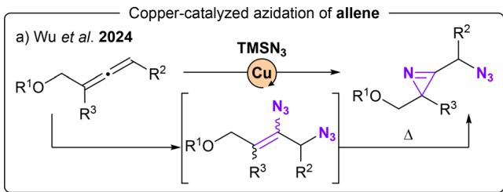

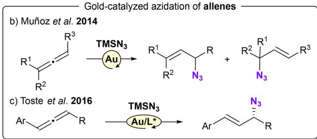

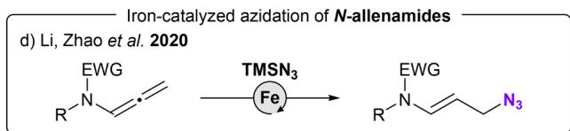

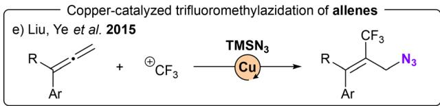

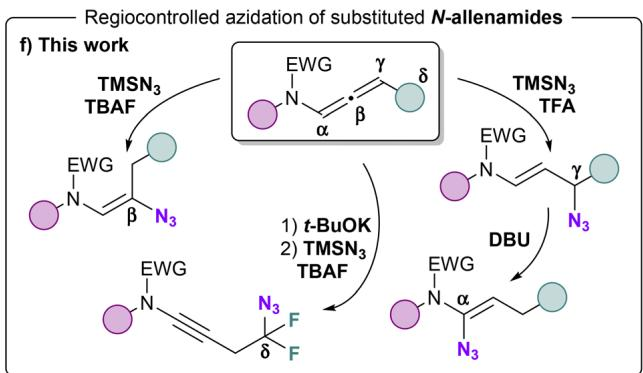  
Scheme 1 Azidation of allene derivatives.

With the optimized reaction conditions in hand, the substrate scope was investigated (Scheme 2). First, we examined diferent side chains on the nitrogen atom. Aryl substituents (2a, 2b, 2c) were tolerated for this transformation. Pleasingly, functionalized side chains suitable for late-stage transformations could be accommodated. In particular, unsaturated side chains (2d, 2e), tri-fluorinated side chains (2f) imides (2g) and cycloalkanones (2h) were successfully adapted. Mesylated as well as cyclic sulfonamides and oxazolidinone were appropriate substrates and provided the corresponding alkenyl azides with a total site and stereoselectivity (2i–k).

The process has been applied to N-allenamides equipped with an ester function to provide the corresponding vinyl azides (2l–n) in similar yields. Due to instability of ester-substituted N-allenamides, the latter has not been isolated before hydroazidation and the alkenyl azides are obtained sequentially from the corresponding ynamides. X-ray analyses of 2l confirmed the structure of the vinyl azides 2l–n bearing an ester function (CCDC 2384809 contains the ESI† for the structure).25 For difluorinated N-allenamides, an additional β-fluoride elimination takes place, resulting in the formation of an E/Z mixture of vinyl azides (2o–q) equipped with a Z-configurated monofluorinated alkene.26 This outcome is significant, since the monofluoroalkene motif represents an appealing target for drug design because it serves as a peptide and enol bond isostere.27 It is important to notice that the hydroazidation reaction on the central sp carbon is totally regio- and stereo-selective for $\mathrm { C F } _ { 3 ^ { - } }$ and $\mathrm { C O } _ { 2 } \mathrm { R } \mathrm { - }$ substituted N-allenamides. Another question that emerged from our study is whether it would be possible to introduce the azide moiety on the α-position of the nitrogen. Delocalization of the nitrogen lone pair toward the allenic moiety confers a dual reactivity to these entities leading to proximal or distal adducts in a regio- and stereo-controlled manner.28 Halogenofunctionalization,29 metal-catalyzed hydrofunctionalizations30 as well as acid-promoted hydrocarboxylation31 favor this mode of activation of N-allenamides. When we exposed our $\mathrm { C F } _ { 3 } .$ -substituted N-allenamides to a mixture of $\mathbf { T M S N } _ { 3 }$ and TFA, we wondered whether a 1,2-addition would occur on the iminium ion to generate α-azido-enamides. In this case, allylic azide 3a was exclusively observed (Scheme 3). The combination of TFA and TMSN likely generates HN in situ which is presumably the active reagent.32 Considering literature precedents,18,31 the observed results could have been anticipated although, solely terminal N-allenamides have been investigated.

Table 1 Optimization of the azidation process on the central sp carbon of N-allenamides
<table><tr><td rowspan="2"></td><td rowspan="2"></td><td colspan="2"></td><td rowspan="2"></td><td rowspan="2"></td></tr><tr><td>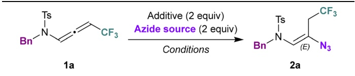</td></tr><tr><td>Entryª</td><td>Azide source Additive</td><td></td><td>Solvent</td><td>Temp. (°C)</td><td>Yield 2ab (%)</td></tr><tr><td>1</td><td> $\mathbf { N a N } _ { 3 }$ </td><td>15-Crown-5</td><td>CH2Cl2</td><td>23</td><td>28</td></tr><tr><td>2</td><td> $\mathbf { N a N } _ { 3 }$ </td><td>15-Crown-5</td><td>CH3CN</td><td>0</td><td>30</td></tr><tr><td>3</td><td> $\mathbf { N a N } _ { 3 }$ </td><td>15-Crown-5</td><td>THF</td><td>23 23</td><td>Traces</td></tr><tr><td>4</td><td> $\mathbf { N a N } _ { 3 }$ </td><td>15-Crown-5</td><td>PhMe</td><td>23</td><td>Traces</td></tr><tr><td>5</td><td> $\mathbf { N a N } _ { 3 }$ </td><td>15-Crown-5</td><td>DMF</td><td>23</td><td>Traces 0c</td></tr><tr><td>6</td><td> $\mathbf { N a N } _ { 3 }$ </td><td>一</td><td>CH₂Cl₂</td><td>0</td><td>60</td></tr><tr><td>7</td><td> $\mathrm { T B A N } _ { 3 }$ </td><td> $\mathbf { T B A F } ^ { d }$ </td><td>THF</td><td>0</td><td>84</td></tr><tr><td>8</td><td> $\mathbf { T M S N } _ { 3 }$ </td><td></td><td>THF</td><td>0</td><td>79</td></tr><tr><td>9</td><td> $\mathrm { T M S N } _ { 3 }$ </td><td> $\mathrm { T B A F } ^ { d }$ </td><td> $\mathrm { C H } _ { 3 } \mathrm { C N }$ </td><td></td><td></td></tr></table>

a Reaction conditions: 1a (0.1 mmol), azide reagent (0.2 mmol), additive (0.2 mmol), in solvent (0.1 M) under $\mathbf { N } _ { 2 }$ atmosphere. b Isolated yields. c Starting material was fully recovered. ${ \bar { d _ { 1 } } }$ M solution in THF.

The distal hydroazidation was investigated with respect to the side chain on the nitrogen atom (Scheme 3). Benzylic derivatives bearing either an electron-withdrawing (3b) and an electron-donating (3c) substituent were suitable compounds. Pyridine derivative provided the γ-amido azide 3d in 83% yield. Linear alkyls (3e) and cyclic alkyls (3f) could be adapted while a nitrile-containing side led to the corresponding azide 3g with an erosion of the yield compared to other substrates.

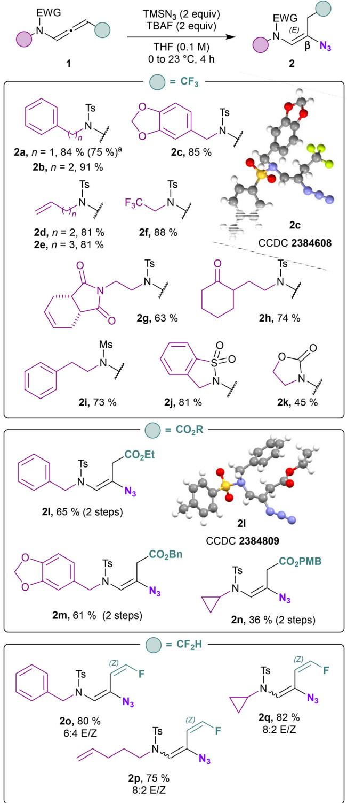  
Scheme 2 Scope for the synthesis of β-amido azides. aThis reaction was carried out on a 1 mmol scale.

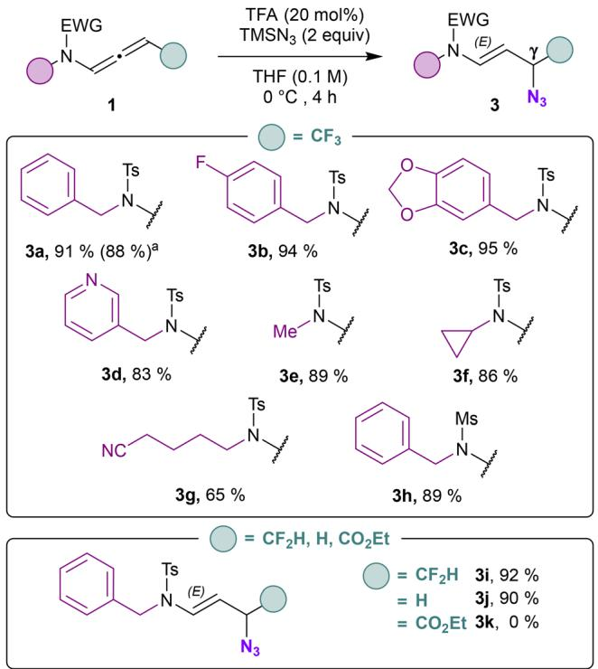  
Scheme 3 Scope for the synthesis of γ-amido azides. aThis reaction was carried out on a 1 mmol scale.

Mesylated derivative also led to the formation of an γ-amido azide 3h with 89% yield. Of note, difluorinated N-allenamide provided allylic azide 3i in excellent yield (92%). Terminal N-allenamides also led to the corresponding allyl azide 3j with TMSN and Brønsted acid (TFA). The ester derivative proved to be unstable under these conditions and only degradation was observed (3k). When we treated the γ-azido derivative 3a with a base, surprisingly, a [1,3] azide shift took place (Scheme 4). Only DBU provided exclusively E-configurated vinyl azide 4a. 33 X-ray analyses of 4a confirmed the structure of the α-amidovinyl azide obtained (CCDC 2384604 contains the ESI† for the structure).34 TMG provided a similar result albeit with a much lower yield of 43%. t-BuOK, NaH, led partly to hydrolysis of the allyl azide whereas with DMAP no conversion was observed. While vinyl azides have found extensive utility in organic synthesis, in contrast, allylic azides have often been avoided due to the propensity of the Winstein rearrangement. The latter leads to the presence of mixture of isomers through allylic azide equilibrium, thereby complicating the use of these intermediates in synthesis. The proximity of the heteroatom seems to alleviate those dificulties allowing to orientate the position of the azido moiety in α position.32 With the optimized reaction conditions in hand, we evaluated the scope of this transformation. Benzylic derivatives (4a–c), heterocyclic derivatives (4d), linear alkyls (4e), cyclic alkyls (4f), functionalized side chains (4g), as well as mesylated derivatives (4h) underwent this transformation with yields ranging from 59 to 81% with total regio- and stereo-selectivity. CF H-substituted N-allenamides led to fluorinated vinyl-azides 4i albeit with a moderate yield (32%) probably due to concomitant elimination of a fluoride before [1,3]-azide shift. Terminal N-allenamides constitute the limit of this transformation, in this case the [1,3]-azide shift did not take place (4j). Having found that gemdifluorinated ene-ynamides could be obtained via deprotonation of trifluoromethylated N-allenamides and δ extrusion of fluorine,35 we wondered whether the azide moiety could be installed via activation of the ynamide moiety in those substrates. When we treated ene-ynamide 5a with TMSN , TBAF, surprisingly, the azide moiety was incorporated at δ-position in compound 6a while the ynamide moiety remained unchanged (Scheme 5). In contrast to simple fluorinated organic azides, α-fluorinated azidoalkanes have been less studied, despite their much higher stability compared to their non-fluorinated counterparts.36 Benzyl, mesyl as well as cyclic sulfonamides could be adapted and the corresponding homopropagylic azide (6a–c) could be isolated with 52, 44 and 47% yields respectively.

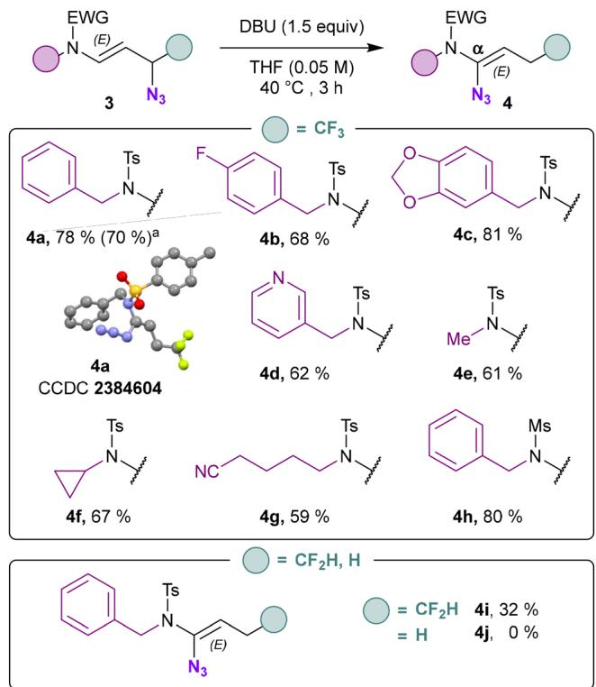  
Scheme 4 Scope for the synthesis of α-amido azides. aThis reaction was carried out on a 1 mmol scale.

To further highlight these transformations, it is noteworthy that allyl-azide 3a could be eficiently hydrolyzed providing the corresponding trifluorinated ketone 7 using Triton B in excellent yield (91%). These latter compounds are valuable synthetic intermediates for constructing fluorinated pharmacons, which typically require harsh conditions for their synthesis.37 It should be noted that only benzylic azides have been reported as suitable substrates for hydrolysis.38 Nitriles were also efective as nucleophiles and addition on the central sp carbon of a CF -N-allenamide provided exclusively the

Organic Chemistry Frontiers

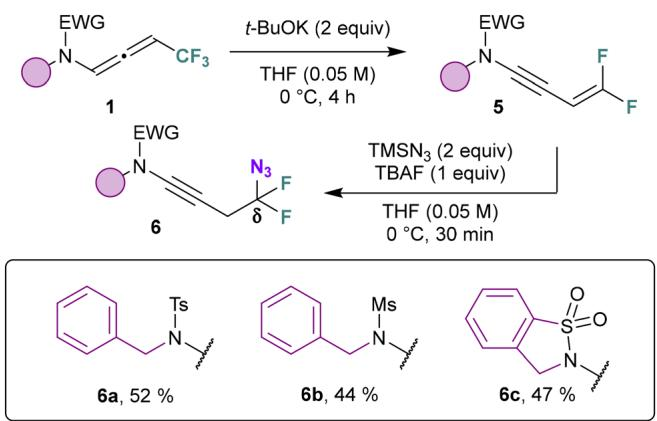  
Scheme 5 Scope for the synthesis of δ-amido azides.

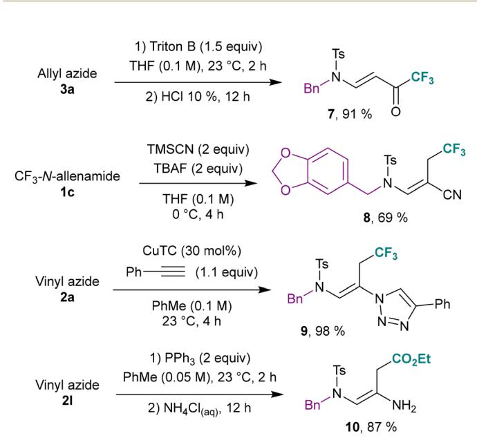  
Scheme 6 Extensions and post-functionalization.

E-configurated vinyl cyanide 8. Vinyl azide 2a also proved to be an excellent partner to ethynyl benzene for click chemistry, under copper catalysis afording 1,4-triazole 9 almost quantitatively.14b Furthermore, primary enamines 10 could be isolated by reduction of vinyl azides leading to interesting building blocks bearing a free amine function (Scheme 6).

## Conclusion

A totally regio- and stereoselective azidation of activated N-allenamides has been developed. Azidation of central sp carbon takes place with CF and ester substituted N-allenamides. Difluorinated N-allenamides produced an E/Z mixture of vinyl azides bearing a monofluorinated alkene with good overall yields. γ-Azidation was tolerated for terminal as well as CF -substituted N-allenamides. A [1,3] azide shift with DBU provided α-substituted amido-vinyl azides starting from fluorinated N-allenamides. Hydroazidation via an ene-ynamide took place exclusively on the alkenyl gem-difluorinated moiety delivering difluorinated products while leaving the ynamide part intact. Finally, it was demonstrated that this transformation could be adapted to form vinyl cyanids. More importantly, trifluoromethylated ketones and primary enamines, valuable building blocks for drug design could be formed easily.

## Author contributions

L.M, D.S, and M.H conceived and designed the experiments. L.M directed the project. D.S and M.H performed the experiments. L.M wrote the paper. L.M, D.S, and M.H discussed the results and commented on the manuscript.

## Data availability

All experimental data and detailed procedures, including computational details, are available in the ESI.†

## Conflicts of interest

There are no conflicts to declare.

## Acknowledgements

Support for this work was provided by CNRS and Université de Strasbourg. D. S. and M. H. thanks M.R.T. for a research fellowship.

## References

1 (a) A. H. El-Sagheer and T. Brown, Click Nucleic Acid Ligation: Applications in Biology and Nanotechnology, Acc. Chem. Res., 2012, 45, 1258–1267; (b) X. Wang, B. Huang, X. Liu and P. Zhan, Discovery of bioactive molecules from CuAAC click-chemistry-based combinatorial libraries, Drug Discovery Today, 2016, 21, 118–132; (c) C. J. Pickens, S. N. Johnson, M. M. Pressnall, M. A. Leon and C. J. Berkland, Practical Considerations, Challenges, and Limitations of Bioconjugation via Azide–Alkyne Cycloaddition, Bioconjugate Chem., 2018, 29, 686–701; (d) M. Shee and N. D. P. Singh, Chemical versatility of azide radical: journey from a transient species to synthetic accessibility in organic transformations, Chem. Soc. Rev., 2022, 51, 2255–2312.

2 Y. G. Gololobov and L. F. Kasukhin, Recent advances in the staudinger reaction, Tetrahedron, 1992, 48, 1353–1406.

3 (a) S. Bräse, C. Gil, K. Knepper and V. Zimmermann, Organic Azides: An Exploding Diversity of a Unique Class of Compounds, Angew. Chem., Int. Ed., 2005, 44, 5188– 5240; (b) A. Padwa, Aziridines and Azirines: Monocyclic, in

Comprehensive Heterocyclic Chemistry III, ed. A. R. Katritzky, C. A. Ramsden, E. F. V. Scriven and R. J. K. Taylor, Elsevier Science, Oxford, 2008, ch. 1.01.6.2, vol. 1, pp. 50–64.

4 (a) M. S. Kim, M. H. Yoo, J. K. Rhee, Y. J. Kim, S. J. Park, J. H. Choi, S. Y. Sung, H. G. Lim and D. W. Cha, Synthetic Intermediates, Process for Preparing Pyrrolylheptanoic Acid Deriva-tives Therefrom, Int. Patent Appl WO2009084827A2, July 9, 2009; (b) Y. L. Li and A. P. Combs, Bicyclic Heteroarylaminoalkyl PhenylDerivatives as PI3K Inhibitors, Int. Patent Appl WO2015191677A1, Dec 17, 2015; (c) K. L. Ivanov, E. V. Villemson, E. M. Budynina, O. A. Ivanova, I. V. Trushkov and M. Ya, Melnikov, Ring Opening of Donor–Acceptor Cyclopropanes with the Azide Ion: A Tool for Construction of N-Heterocycles, Chem. – Eur. J., 2015, 21, 4975–4987.

5 For selected reviews on vinyl azides, see: (a) B. Hu and S. G. DiMagno, Reactivities of vinyl azides and their recent applications in nitrogen heterocycle synthesis, Org. Biomol. Chem., 2015, 13, 3844–3855; (b) H. Hayashi, A. Kaga and S. Chiba, Application of Vinyl Azides in Chemical Synthesis: A Recent Update, J. Org. Chem., 2017, 82, 11981– 11989; (c) J. Fu, G. Zanoni, E. A. Anderson and X. Bi, α-Substituted vinyl azides: an emerging functionalized alkene, Chem. Soc. Rev., 2017, 46, 7208–7228; (d) F. Gholami, F. Yousefnejad, B. Larijani and M. Mahdavi, Vinyl azides in organic synthesis: an overview, RSC Adv., 2023, 13, 990–1018.

6 (a) G. Smolinsky and C. A. Pryde, Vinyl azide chemistry. Thermally induced reactions, J. Org. Chem., 1968, 33, 2411– 2416; (b) J. Cen, J. Li, Y. Zhang, Z. Zhu, S. Yang and H. Jiang, Direct Assembly of 4-Substituted Quinolines with Vinyl Azides as a Dual Synthon via C═C and C–N Bond Cleavage, Org. Lett., 2018, 20, 4434–4438.

7 (a) B. Chen, S. Guo, X. Guo, G. Zhang and Y. Yu, Selective Access to 4-Substituted 2-Aminothiazoles and 4-Substituted 5-Thiocyano-2-aminothiazoles from Vinyl Azides and Potassium Thiocyanate Switched by Palladium and Iron Catalysts, Org. Lett., 2015, 17, 4698–4701;

(b) N. N. K. Reddy, S. N. Rao, C. Ravi and S. Adimurthy, Catalyst-Free Synthesis of 2,4-Disubstituted-1H-imidazoles through [3+2] Cyclization of Vinyl Azides with Amidines, ACS Omega, 2017, 2, 5235–5241; (c) Z. Zhu, X. Tang, J. Li, X. Li, W. Wu, G. Deng and H. Jiang, Iron-Catalyzed Synthesis of 2H-Imidazoles from Oxime Acetates and Vinyl Azides under Redox-Neutral Conditions, Org. Lett., 2017, 19, 1370–1373.

8 (a) A. N. Thakore, J. Buchshriber and A. C. Oehlschlager, Vinyl Azides as Diazoenamines, Can. J. Chem., 1973, 51, 2406–2414; (b) Z. Zhang, R. K. Kumar, G. Li, D. Wu and X. Bi, Synthesis of 4-Ynamides and Cyclization by the Vilsmeier Reagent to Dihydrofuran-2(3H)-ones, Org. Lett., 2015, 17, 6190–6193; (c) R. Dey and P. Banerjee, Lewis Acid Catalyzed Diastereoselective Cycloaddition Reactions of Donor–Acceptor Cyclopropanes and Vinyl Azides: Synthesis of Functionalized Azidocyclopentane and

Tetrahydropyridine Derivatives, Org. Lett., 2017, 19, 304– 307.

9 (a) Y.-F. Wang, G. H. Lonca, M. Le Runigo and S. Chiba, Synthesis of Polyfluoroalkyl Aza-Polycyclic Aromatic Hydrocarbons Enabled by Addition of Perfluoroalkyl Radicals onto Vinyl Azides, Org. Lett., 2014, 16, 4272–4275; (b) K. R. Dworakowski, S. Pisarek, S. Hassan and D. Gryko, Vinyl Azides as Radical Acceptors in the Vitamin B12- Catalyzed Synthesis of Unsymmetrical Ketones, Org. Lett., 2021, 23, 9068–9072.

10 (a) A. Hassner, E. S. Ferdinandi and R. J. Isbister, Stereochemistry. XLVII. Hydrolysis of vinyl azides. Comparison with the Schmidt reaction, J. Am. Chem. Soc., 1970, 92, 1672–1675; (b) F.-L. Zhang, Y.-F. Wang, G. H. Lonca, X. Zhu and S. Chiba, Amide Synthesis by Nucleophilic Attack of Vinyl Azides, Angew. Chem., Int. Ed., 2014, 53, 4390–4394.

11 (a) P. C. Montevecchi, M. L. Navacchia and P. Spagnolo, Generation of Iminyl Radicals through Sulfanyl Radical Addition to Vinyl Azides, J. Org. Chem., 1997, 62, 5846– 5848; (b) Y.-F. Wang, K. K. Toh, S. Chiba and K. Narasaka, Mn(III)-Catalyzed Synthesis of Pyrroles from Vinyl Azides and 1,3-Dicarbonyl Compounds, Org. Lett., 2008, 10, 5019– 5022; (c) J. R. Donald and S. L. Berrell, Radical cyanomethylation via vinyl azide cascade-fragmentation, Chem. Sci., 2019, 10, 5832–5836.

12 Y.-F. Wang, K. K. Toh, J.-Y. Lee and S. Chiba, Synthesis of Isoquinolines from α-Aryl Vinyl Azides and Internal Alkynes by Rh–Cu Bimetallic Cooperation, Angew. Chem., Int. Ed., 2011, 50, 5927–5931.

13 (a) F. W. Fowler, A. Hassner and L. A. Levy, Stereospecific Introduction of Azide Functions into Organic Molecules, J. Am. Chem. Soc., 1967, 89, 2077–2082; (b) G. L′abbé and A. Hassner, New Methods for the Synthesis of Vinyl Azides, Angew. Chem., Int. Ed. Engl., 1971, 10, 98–104; (c) A. Kirschning, H. Monenschein and C. Schmeck, Stable Polymer-Bound Iodine Azide, Angew. Chem., Int. Ed., 1999, 38, 2594–2596; (d) D. Cantillo, B. Gutmann and C. O. Kappe, Safe generation and use of bromine azide under continuous flow conditions – selective 1,2-bromoazidation of olefins, Org. Biomol. Chem., 2016, 14, 853–857.

14 (a) C. Qin, P. Feng, Y. Ou, T. Shen, T. Wang and N. Jiao, Silver-Catalyzed Nitrogenation of Alkynes: A Direct Approach to Nitriles through CuC Bond Cleavage, Angew. Chem., Int. Ed., 2013, 52, 7850–7854; (b) Z. Liu, P. Liao and X. Bi, General Silver-Catalyzed Hydroazidation of Terminal Alkynes by Combining TMS-N3 and H O: Synthesis of Vinyl Azides, Org. Lett., 2014, 16, 3668–3671; (c) X. Li, S. Liao, Z. Wang and L. Zhang, Ligand-Accelerated Gold-Catalyzed Addition of in Situ Generated Hydrazoic Acid to Alkynes under Neat Conditions, Org. Lett., 2017, 19, 3687–3690.

15 A. Abula, Z. Xu, Z. Zhu, C. Peng, Z. Chen, W. Zhu and H. A. Aisa, Substitution Efect of the Trifluoromethyl Group on the Bioactivity in Medicinal Chemistry: Statistical Analysis and Energy Calculations, J. Chem. Inf. Model., 2020, 60, 6242–6250.

16 (a) J.-P. Bégué and D. Bonnet-Delpon, Bioorganic and MedicinalChemistry of Fluorine, Wiley, Hoboken, NJ, 2008; (b) W. K. Hagmann, The Many Roles for Fluorine in Medicinal Chemistry, J. Med. Chem., 2008, 51, 4359–4369; (c) P. Kirsch, Modern FluoroorganicChemistry: Synthesis, Reactivity, Applications, Wiley-VCH, Weinheim, Germany, 2nd edn, 2013.

17 S. Zhang, L. Hu, Y. Li, Y. Li, K. Luo and L. Wu, Copper-Catalyzed Diazidation of Allenes: Access to 3- (Azidomethyl)-2H-Azirines, Adv. Synth. Catal., 2024, 366, 444–449.

18 (a) C. Hurtado-Rodrigo, S. Hoehne and M. P. Muñoz, A new gold-catalysed azidation of allenes, Chem. Commun., 2014, 50, 1494–1496; (b) D. A. Khrakovsky, C. Tao, M. W. Johnson, R. T. Thornbury, S. L. Shevick and F. D. Toste, Enantioselective, Stereodivergent Hydroazidation and Hydroamination of Allenes Catalyzed by Acyclic Diaminocarbene (ADC) Gold(I) Complexes, Angew. Chem., Int. Ed., 2016, 55, 6079–6083.

19 Y. Liu, N. Ding, X. Tan, X. Li and Z. Zhao, Iron(II)-chloridecatalyzed regioselective azidation of allenamides with TMSN3, Chem. Commun., 2020, 56, 7507–7510.

20 A. Carboni, G. Dagousset, E. Magnier and G. Masson, Photoredox-Induced Three-Component Oxy-, Amino-, and Carbotrifluoromethylation of Enecarbamates, Org. Lett., 2014, 16, 1240–1243.

21 N. Zhu, F. Wang, P. Chen, J. Ye and G. Liu, Copper-Catalyzed Intermolecular Trifluoromethylazidation and Trifluoromethylthiocyanation of Allenes: Eficient Access to CF3-Containing Allyl Azides and Thiocyanates, Org. Lett., 2015, 17, 3580–3583.

22 Y. Zheng, B. Moegle, S. Ghosh, A. Perfetto, D. Luise, I. Ciofini and L. Miesch, Copper-Catalyzed Synthesis of Terminal vs. Fluorine-Substituted N-Allenamides via Addition of Diazo Compounds to Terminal Ynamides, Chem. – Eur.J., 2022, 28, e202103598.

23 M. Hourtoule, Y. Zheng, A. Perfetto, D. Luise, I. Ciofini and L. Miesch, One-Pot anti-Michael Regio- and Stereoselective Hydroamination of Activated N-Allenamides, J. Org. Chem., 2022, 87, 5404–5411.

24 CCDC 2384608 (2c) contains the ESI† for this paper. 25 CCDC 2384809 (2l) contains the ESI† for this paper.

26 The configuration of the fluorinated double bond was attributed with NMR 1H coupling constants. This result was expected since fluorinated 1-substituted propenes are more stable in their Z configuration. For more details see: K. B. Wiberg, Y. Wang, G. A. Petersson and W. F. Bailey, Intramolecular Nonbonded Attractive Interactions: 1-Substituted Propenes, J. Chem. Theory Comput., 2009, 5, 1033–1037.

27 (a) M. Drouin and J.-F. Paquin, Recent progress in the racemic and enantioselective synthesis of monofluoroalkene-based dipeptide isosteres, Beilstein J. Org. Chem., 2017, 13, 2637–2658; (b) R. A. Altman, K. K. Sharma, L. G. Rajewski, P. C. Toren, M. J. Baltezor, M. Pal and S. N. Karad, Tyr1-ψ[(Z)CFvCH]-Gly2 Fluorinated

Peptidomimetic Improves Distribution and Metabolism Properties of Leu-Enkephalin, ACS Chem. Neurosci., 2018, 9, 1735–1742.

28 M. Hourtoule and L. Miesch, Construction of C–N and C–O bonds based on N-allenamide functionalization, Org. Biomol. Chem., 2022, 20, 9069–9084.

29 (a) X. Li, Y. Liu, N. Ding, X. Tan and Z. Zhao, Recent progress in transition-metal-free functionalization of allenamides, RSC Adv., 2020, 10, 36818–36827; (b) T. R. Pradhan, M. Paudel, J. L. Harper, P. H.-Y. Cheong and J. K. Park, Characterization and Utilization of the Elusive α,β-Unsaturated N-Tosyliminium: the Synthesis of Highly Functionalizable Skipped Halo Enynes, Org. Lett., 2021, 23, 1427–1433.

30 (a) T. Wei, M.-S. Xie, G.-R. Qu, H.-Y. Niu and H.-M. Guo, A New Strategy To Construct Acyclic Nucleosides via Ag(I)- Catalyzed Addition of Pronucleophiles to 9-Allenyl-9Hpurines, Org. Lett., 2014, 16, 900–903; (b) L. A. Perego, R. Blieck, A. Groué, F. Monnier, M. Taillefer, I. Ciofini and L. Grimaud, Copper-Catalyzed Hydroamination of Allenes: from Mechanistic Understanding to Methodology Development, ACS Catal., 2017, 7, 4253–4264; (c) D. Liu, Q. Nie, R. Zhang and M. Cai, Regiospecific Hydroamination of Unsymmetrical Electron-Rich and Electron-Poor Alkynes with Anilines Catalyzed by Gold(I) Immobilized in MCM-41, Adv. Synth. Catal., 2018, 360, 3940–3948.

31 T. R. Pradhan, H. E. Lee, G. A. Gonzalez-Montiel, P. H.-Y. Cheong and J. K. Park, Highly Chemoselective Esterification from O-Aminoallylation of Carboxylic Acids: Metal- and Reagent-Free Hydrocarboxylation of Allenamides, Chem. – Eur.J., 2020, 26, 13826–13831.

32 A. S. Carlson and J. J. Topczewski, Allylic azides: synthesis, reactivity, and the Winstein rearrangement, Org. Biomol. Chem., 2019, 17, 4406–4429.

33 For selected references of winstein rearrangement, see: (a) A. A. Tjeng, K. L. Handore and R. A. Batey, Stereocontrolled Microwave-Assisted Domino [3,3]- Sigmatropic Reactions: A Winstein–Overman Rearrangement for the Formation of Diferentiated Contiguous C–N Bonds, Org. Lett., 2020, 22, 3050–3055;

(b) T. Abegg, J. Cossy and C. Meyer, Cascade Cope/Winstein Rearrangements: Synthesis of Azido-Cycloheptadienes from Dialkenylcyclopropanes Possessing a Vinyl Azide, Org. Lett., 2022, 24, 4954–4959; (c) K. A. Nicastri, N. C. Gerstner and J. M. Schomaker, Progress toward the Total Synthesis of Jogyamycin Using a Tandem Ichikawa/Winstein Rearrangement, Org. Lett., 2023, 25, 8279–8283.

34 CCDC 2384604 (4a) contains the ESI† for this paper.

35 M. Hourtoule and L. Miesch, Regio- and Stereoselective Addition to gem-Difluorinated Ene–Ynamides: Access to Stereodefined Fluorinated Dienes, Org. Lett., 2022, 24, 3896–3900.

36 O. Bakhanovich and P. Beier, Synthesis, Stability and Reactivity of α-Fluorinated Azidoalkanes, Chem. – Eur. J., 2020, 26, 773–782.

37 C. B. Kelly, M. A. Mercadante and N. E. Leadbeater, Trifluoromethyl ketones: properties, preparation, and application, Chem. Commun., 2013, 49, 11133–11148.

38 D. González-Calderón, M. A. Morales-Reza, E. Díaz-Torres, A. Fuentes-Benítes and C. González-Romero, A straightforward and versatile protocol for the direct conversion of benzylic azides to ketones and aldehydes, RSC Adv., 2016, 6, 83547–83550.