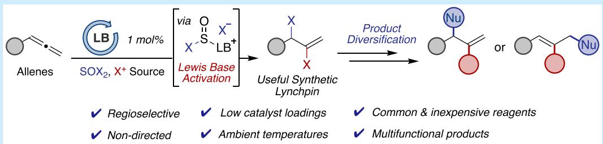
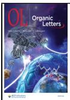
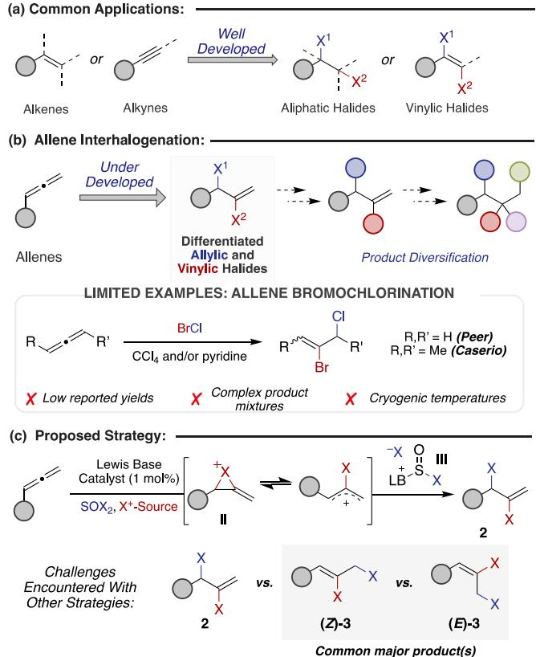
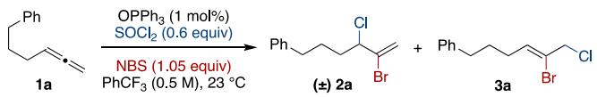
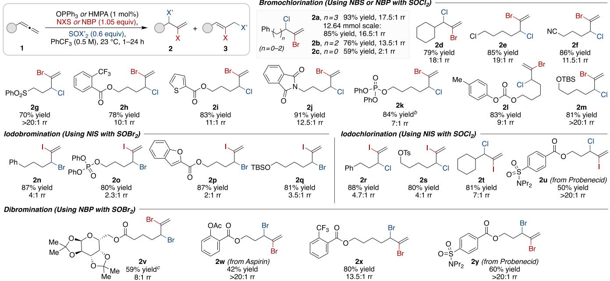
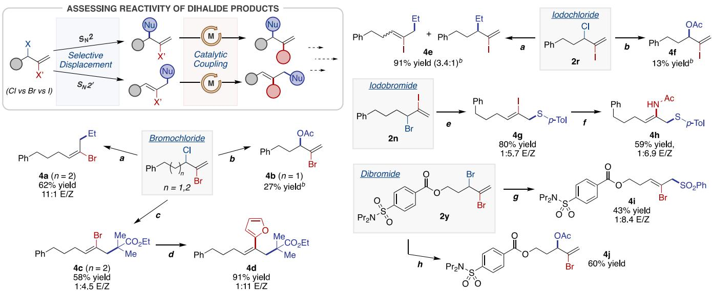

pubs.acs.org/OrgLett

Letter

# Lewis Base-Catalyzed Interhalogenation of Terminal Allenes: Selective Strategy for Accessing Vicinal Vinylic, Allylic Heterodihalides

Alexandra E. Lubaev, Favour Eze, Manjula D. Rathnayake, and Liela Bayeh-Romero\*

Cite This: Org. Lett. 2025, 27, 3527−3531

Read Online

ACCESS

Metrics & More

Article Recommendations

\*sı Supporting Information

ABSTRACT: Though precedent remains limited, the selective interhalogenation of allenes ofers a valuable synthetic strategy to access products where each halide exhibits orthogonal reactivity. Here, we describe a Lewis base-catalyzed approach for the dihalogenation (bromochlorination, iodochlorination, iodobromination, and dibromination) of terminal allenes. By employing just 1 mol % of triphenylphosphine oxide or hexamethylphosphoramide to activate thionyl halides in the presence of electrophilic halogenation reagents, we achieve the conversion of monosubstituted allenes to vicinal allylic, vinylic dihalides with up to 93% yield and >20:1 regioisomeric ratio, favoring the branched dihalogenated product. A range of functional groups is tolerated, including nitrile, ester, phosphate, sulfonamide, and silyl groups, and the reaction proved to be scalable. The utility of various dihalide products was investigated in substitution and cross-coupling chemistry, highlighting the distinct reactivity among the diferent classes.

and agrochemicals.1−4 With the continual discovery of bioactive, organohalogen natural products, many of which feature vicinal heterodihalide motifs, designing elegant approaches for the incorporation of halogens into organic frameworks is of increasing importance. Consequently, much progress has been made over the past decade, including recent work by our group, for the preparation of heterodihalides from alkenes and alkynes (Figure 1a).5,6

By comparison, the interhalogenation of allenes is hardly developed, despite recent advances in their selective functionalization (Figure 1b).7 Further, the utility of the resulting heterodihalide products is apparent when one considers the divergent reactivity profiles innate to allylic and vinylic halides (e.g., nucleophilic displacement, cross coupling chemistry, etc.) and the broad utility of alkenes as synthetic handles. For these reasons, vicinal vinylic, allylic heterodihalides, though underexplored, bear the capacity to serve as prized synthetic lynchpins.

Strategies for allene interhalogenation are generally plagued by issues of regio-, stereo-, and site-selectivity.7e,8 The onerous nature of these transformations is exemplified in the limited number of reports detailing the bromochlorination of allenes (Figure 1b). Two independent examples disclosed the use of

BrCl for the bromochlorination of propadiene or 2,3- pentadiene.9 However, these reactions sufer from low yields and the presence of solvent-incorporated byproducts. In some cases, solvolysis represented the major reaction pathway or no yields were reported altogether, raising concerns as to the overall eficiency of this transformation. During the course of our studies, Katayev and co-workers disclosed a unique transfer dihalogenation strategy applicable to allenes. However, only a singular example of vicinal bromochlorination on an arylsubstituted allene was demonstrated.10

We sought to develop a strategy for the interhalogenation of terminal allenes by utilizing sulfinyl halides, thereby permitting catalyst control in the availability of the nucleophilic halide anion (Figure 1c). Based on our prior work and the studies of others, we surmised that a transient methylenehaliranium species (II) could be intercepted by a halide anion salt (III) generated through Lewis base activation of thionyl chloride or thionyl bromide.6,11,12 This strategy would allow for the precise installation of two diferent halides across the three consecutive sp2-hybridized carbons of an allene to furnish dihalogenated product 2. To date, common methods employed for allene dihalogenation are either unselective or primarily feature linear product (3) selectivity with varying levels of stereoselectivity.13,14

  
Figure 1. Allene interhalogenation�prevalence, strategy, and limitations.

We commenced our investigations by surveying conditions for allene bromochlorination. When 4,5-hexadienylbenzene (1a) was subjected to thionyl chloride and a slight excess of Nbromosuccinimide (NBS) in the absence of a catalyst, only trace quantities of isomeric bromochlorides 2a and 3a were observed (Table 1, entry 1). Instead, a significant amount of undesired dibromination byproduct was observed. Under the same conditions, but in the presence of 1 mol % triphenylphosphine oxide, product was formed in 82% yield, favoring branched bromochloride 2a with a 13:1 regioisomeric ratio (rr) (entry 2).

While various solvents were generally suitable, trifluorotoluene proved optimal with respect to reaction eficiency and selectivity (entries 2−4).15 A survey of Lewis base catalysts revealed triphenylphosphine oxide and hexamethylphosphoramide (HMPA) as superior catalysts, delivering up to 85% yield (18:1 rr) at minimal loadings (entries 5−8). In the examination of alternative bromenium sources, N-bromophthalimide (NBP) provided optimal results, particularly when used in combination with HMPA, afording bromochloride 2a in 93% yield with 17.5:1 rr (entries 9−11). Further, the reaction displays similar eficiency under noninert conditions (entry 12).

With the optimized conditions established, we next examined the scope of this transformation (Table 2). In all cases, compound 2 was obtained as the major product, with varying levels of linear-to-branched regioselectivity. Monosubstituted allenes, both with and without alpha-branching substituents, provided similar regioisomeric ratios (rr), yielding branched dihalide products (2a, 2b, and 2d). Furthermore, the reaction demonstrated scalability, allowing for the isolation of 2.9 g of 2a with minimal loss of eficiency and selectivity. One exception, aryl allene 1c, resulted in both poor yield and selectivity, likely due to conjugation modulating the reactivity of the internal alkene. However, this strategy enabled the synthesis of the branched bromochloride product 2c as the major isomer, notably in contrast to previous methods that typically favor the formation of linear dihalide products.

Table 1. Reverse Optimization of Allene a Bromochlorination  

<table><tr><td>Entry</td><td>Variation from std. conditions</td><td>Conv. (%)</td><td>Yield (%)b</td><td>2a:3a</td></tr><tr><td>1</td><td>No OPPh3</td><td>75</td><td>6</td><td>■</td></tr><tr><td>2</td><td>None</td><td>&gt;99</td><td>82</td><td>13:1</td></tr><tr><td>3</td><td>Using PhMe as solvent</td><td>73</td><td>50</td><td>12.5:1</td></tr><tr><td>4</td><td>Using CH2Cl2 as solvent</td><td>&gt;99</td><td>73</td><td>12.5:1</td></tr><tr><td>5</td><td>PPh3 instead of OPPh3</td><td>86</td><td>73</td><td>11:1</td></tr><tr><td>6</td><td>DMAP instead of OPPh3</td><td>92</td><td>56</td><td>15:1</td></tr><tr><td>7</td><td>HMPA instead of OPPh₃</td><td>98</td><td>85</td><td>18:1</td></tr><tr><td>8</td><td>TPPA instead of OPPh₃</td><td>91</td><td>71</td><td>17:1</td></tr><tr><td>9</td><td>NBP instead of NBS</td><td>97</td><td>88</td><td>14:1</td></tr><tr><td>10c</td><td>DBDMH instead of NBS</td><td>95</td><td>58</td><td>12:1</td></tr><tr><td>11</td><td>HMPA and NBP</td><td>&gt;99</td><td>93d</td><td>17.5:1</td></tr><tr><td>12</td><td>Non-dried glassware, under air</td><td>&gt;99</td><td>83</td><td>17:1</td></tr></table>

aReactions were carried out under an atmosphere of $\Nu _ { 2 }$ using 0.2−0.3 mmol of 1a (1.0 equiv). Reactions were run for a duration of 3−4 h. DMAP = 4-dimethylaminopyridine, HMPA = hexamethylphosphoramide, TPPA = tripyrrolidinophosphoric acid triamide, NBP = Nbromophthalimide, DBDMH = 1,3-dibromo-5,5-dimethylhydantoin. bYields and regiomeric ratios were determined by 1H NMR spectroscopy of the crude reaction mixture, using mesitylene (0.1 mmol) as an internal standard. c0.52 equiv of DBDMH was used instead. dRepresents the isolated yield on a 1 mmol scale.

Allenes bearing a variety of functional groups were welltolerated regardless of their proximity to the reactive site (2e− 2m).16 In all cases, the desired products were obtained in good-to-high yields with generally high selectivity. Though many products were isolated with improved yield and/or selectivity using the HMPA/NBP conditions (2a, 2b, 2j, and 2m), some substrates (e.g., 1h and 1i) performed better with the OPPh /NBS conditions instead. Furthermore, substrate 1k, which contains a Lewis basic phosphate substituent, did not require the addition of a catalyst.

By modifying the electrophilic and nucleophilic halogenating reagents to N-iodosuccinimide (NIS) and SOBr or NIS and SOCl , a range of iodobrominated and iodochlorinated products were isolated (2n−2u), albeit with reduced selectivity. For comparison, optimization substrate 1a yielded iodobromide 2n in 87% yield with a 4:1 rr and iodochloride 2r in 88% yield with a 4.7:1 rr. Notably, although allene 1u, derived from the uric acid reducer probenecid, formed a crude product mixture with a 1.5:1 ratio of 2u to 3u, the branched product could be cleanly isolated, yielding iodochloride 2u as a pure isomer in 50% yield.

Historically, methods for the dibromination of allenes have been plagued by poor yields and/or selectivity.13b,17 Therefore, we were interested in evaluating the selectivity of this catalytic manifold by comparison. Using NBP with thionyl bromide under the standard catalytic conditions developed here, the dibromination of allenes 1v−1y largely favored halogenation at the internal alkene, including substrates featuring substructures derived from marketed therapeutics (1w, 1y). These results demonstrate, in some cases, the orthogonal selectivity imparted by this catalyst-controlled strategy (see Supporting Information for additional examples).

Table 2. Scope of Catalytic Allene Dihalogenation  
  
aUnless specified otherwise, reactions were carried out under a N atmosphere on a 0.5−12.64 mmol scale (see the Supporting Information). Regiomeric ratios (rr) were determined by analysis of the 1H NMR spectra of the purified products. Reported yields represent the combined mixture of regioisomers. bReaction was carried out without addition of catalyst. cReaction was carried out using NBP as the limiting reagent instead.

Scheme 1. Diversification of Interhalidesa  
  
aUnless specified otherwise, reactions were carried out under a $\Nu _ { 2 }$ atmosphere. Regiomeric ratios (rr) were determined by analysis of the $^ 1 \mathrm { H }$ NMR spectra of the purified products. E/Z selectivity was determined via NOESY analysis. bYield was determined by 1H NMR spectroscopy of the crude reaction mixture, using mesitylene (0.1 mmol) as an internal standard. Conditions a: CuCN (5 mol %), EtMgBr (1.2 equiv), CH Cl (0.1 M), −78 $^ { \circ } \mathrm { C } , 2 2 { - } 2 3$ h. Conditions b: AcOK (7.0 equiv), 18-crown-6 (7.5 equiv), DMF (0.025 M), 23 °C, 21 h. Conditions c: n-BuLi (1.1 equiv), HNEt (1.2 equiv), ethyl isobutyrate (1.0 equiv), THF (0.5 M), −78 to 23 °C, 22 h. Conditions d: $\mathrm { P d } \mathrm { ( P P h } _ { 3 } \mathrm { ) } _ { 4 } \mathrm { ~ } ( 5$ mol %), 2-(tributylstannyl)furan (1.2 equiv), 1,4-dioxane (0.2 M), 100 °C, 15 h. Conditions e: NEt (1.0 equiv), p-thiocresol (1.0 equiv), benzene (0.25 M), 12 h. Conditions f: CuI (5 mol %), $\mathrm { C s } _ { 2 } \mathrm { C O } _ { 3 } \ \left( 1 . 5 \right.$ equiv), acetamide (1.2 equiv), N,N-dimethylethylenediamine (10 mol %), THF (0.33 M), ${ 7 0 } \ ^ { \circ } \mathrm { C } ,$ 17 h. Conditions g: PhSO Na (4.0 equiv), $\mathrm { P d } ( \mathrm { P P h } _ { 3 } ) _ { 4 }$ (5 mol %), DMSO (375 μL), THF (0.2 M), 60 °C, 17 h. Conditions h: AcOK (2.0 equiv), 18-crown-6 (2.5 equiv), DMF (0.3 M), 23 °C, 1 h.

To investigate the utility of these uncommon vicinal vinylic, allylic heterodihalides in organic synthesis, we chose to explore the innate reactivity diferences between each class of dihalide (Scheme 1).18 Focusing initially on bromochlorides 2a and 2b, we applied copper-catalyzed $S _ { \mathrm { N } } \dot { 2 } ^ { \prime }$ allylic alkylation, yielding 4a in 62% with an E/Z ratio >10:1.19 In contrast, $S _ { \mathrm { N } } 2$ displacement proved more challenging, though acetate 4b was obtained in low yield.20 To illustrate the utility of these products for consecutive functionalization, enolate alkylation to aford vinyl bromide 4c followed by Stille cross-coupling gave an overall two-step yield of 53% of ester 4d.

Comparatively, the analogous iodochloride 2r demonstrated poorer selectivity both in the copper-catalyzed allylic alkylation (4e) and the direct substitution with KOAc (4f). A limitation of the iodohalides, in general, is their bench instability, necessitating rapid purification of the dihalide followed by immediate setup for subsequent diversification reactions. Nevertheless, iodobromide 2n exhibited superior $S _ { \mathrm { N } } 2 ^ { \prime }$ reactivity with p-thiocresol (4g, 80% yield 1:5.7 E/Z) followed by copper-catalyzed amide coupling of the vinyl iodide to aford enamide 4h in 59% isolated yield.21,22

As anticipated, vicinal vinylic, allylic dibromides proved to be the best compromise between the bromochlorides and the iodohalides, owing to the lability of the allylic bromide combined with the better stability of the vinyl bromide. Probenecid-derived dibromide 2y could undergo highly selective regiodivergent substitutions to aford vinyl bromides 4i and 4j in synthetically useful yields. Notably, palladiumcatalyzed Tsuji-Trost substitution with benzenesulfinate was feasible without significant β-halo elimination to the allene, as observed with other dihalide variants.23

In conclusion, we have developed a catalytic dihalogenation of monosubstituted allenes, leading to vicinal vinylic and allylic dihalides. Products were isolated in up to 93% yield and >20:1 regioselectivity using common electrophilic reagents in combination with thionyl halides as latent nucleophiles activated by simple Lewis base catalysts. This convenient strategy for the synthesis of bromochlorides, iodochlorides, iodobromides, and dibromides employs noncryogenic reaction temperatures and low catalyst loadings of 1 mol %. The resulting dihalides were evaluated as useful building blocks for the preparation of a diverse range of functionalized di- and trisubstituted alkenes.

## ■ ASSOCIATED CONTENT

## Data Availability Statement

The data underlying this study are available in the published article and its Supporting Information.

## \*sı Supporting Information

The Supporting Information is available free of charge at https://pubs.acs.org/doi/10.1021/acs.orglett.5c00422.

General procedural information, mechanistic studies, characterization data and spectra (PDF)

## ■ AUTHOR INFORMATION

## Corresponding Author

Liela Bayeh-Romero − Department of Chemistry and Biochemistry, Baylor University, Waco, Texas 76706, United States; orcid.org/0000-0001-5532-756X; Email: Liela\_Romero@Baylor.edu

## Authors

Alexandra E. Lubaev − Department of Chemistry and Biochemistry, Baylor University, Waco, Texas 76706, United States

Favour Eze − Department of Chemistry and Biochemistry, Baylor University, Waco, Texas 76706, United States

Manjula D. Rathnayake − Department of Chemistry and Biochemistry, Baylor University, Waco, Texas 76706, United States

Complete contact information is available at: https://pubs.acs.org/10.1021/acs.orglett.5c00422

## Notes

The authors declare no competing financial interest.

## ■ ACKNOWLEDGMENTS

The authors are grateful for financial support from the National Institutes of Health (R35GM150904-01) and the Cancer Prevention and Research Institute of Texas (CPRIT, RR200039). This content is solely the responsibility of the authors and does not necessarily represent the oficial views of these funding agencies. The authors would also like to thank Dr. X. Xu (the Center for NMR Spectroscopy, Baylor University, Texas) for technical support.

## ■ REFERENCES

(1) For selected references on the utility of the organohalides in synthetic chemistry, see: (a) Saikia, I.; Borah, A. J.; Phukan, P. Use of Bromine and Bromo-Organic Compounds in Organic Synthesis. Chem. Rev. 2016, 116, 6837−7042. (b) Landry, M. L.; Burns, N. Z. Catalytic Enantioselective Dihalogenation in Total Synthesis. Acc. Chem. Res. 2018, 51, 1260−1271. (c) Pak, B. S.; Supantanapong, N.; Vanderwal, C. D. The Recurring Roles of Chlorine in Synthetic and Biological Studies of the Lissoclimides. Acc. Chem. Res. 2021, 54, 1131−1142. (d) Wang, W.; Song, S.; Jiao, N. Late-Stage Halogenation of Complex Substrates with Readily Available Halogenating Reagents. Acc. Chem. Res. 2024, 57, 3161−3181.

(2) For selected references on the utility of organohalides in pharmaceuticals, see: (a) Lu, Y.; Liu, Y.; Xu, Z.; Li, H.; Liu, H.; Zhu, W. Halogen bonding for rational drug design and new drug discovery. Expert Opin Drug Discov 2012, 7, 375−383. (b) Smith, B. R.; Eastman, C. M.; Njardarson, J. T. Beyond C, H, O, and N! Analysis of the Elemental Composition of U.S. FDA Approved Drug Architectures. J. Med. Chem. 2014, 57, 9764−9773. (c) Xu, Z.; Yang, Z.; Liu, Y.; Lu, Y.; Chen, K.; Zhu, W. Halogen Bond: Its Role beyond Drug−Target Binding Affinity for Drug Discovery and Development. J. Chem. Inf. Model. 2014, 54, 69−78. (d) Benedetto Tiz, D.; Bagnoli, L.; Rosati, O.; Marini, F.; Sancineto, L.; Santi, C. New Halogen-Containing Drugs Approved by FDA in 2021: An Overview on Their Syntheses and Pharmaceutical Use. Molecules 2022, 27, 1643.

(3) For selected references on the utility of organohalides in agrochemicals, see: (a) Jeschke, P. The unique role of halogen substituents in the design of modern agrochemicals. Pest Management Science 2010, 66, 10−27. (b) Jeschke, P. Latest generation of halogencontaining pesticides. Pest Management Science 2017, 73, 1053−1066.

(4) For selected reviews on halogenated natural products, see: (a) Gribble, G. W. Newly discovered naturally occurring organohalogens. ARKIVOC 2019, 2018, 372−410. (b) Gribble, G. W. A Survey of Recently Discovered Naturally Occurring Organohalogen Compounds. J. Nat. Prod. 2024, 87, 1285−1305.

(5) For selected reviews on the preparation of dihalides from alkenes and alkynes, see: (a) Hennecke, U. New Catalytic Approaches towards the Enantioselective Halogenation of Alkenes. Chemistry - An Asian Journal 2012, 7, 456−465. (b) Cresswell, A. J.; Eey, S. T.-C.;

Denmark, S. E. Catalytic, Stereoselective Dihalogenation of Alkenes: Challenges and Opportunities. Angew. Chem., Int. Ed. 2015, 54, 15642−15682. (c) Chung, W.-j.; Vanderwal, C. D. Stereoselective Halogenation in Natural Product Synthesis. Angew. Chem., Int. Ed. 2016, 55, 4396−4434. (d) Bock, J.; Guria, S.; Wedek, V.; Hennecke, U. Enantioselective Dihalogenation of Alkenes. Chemistry 2021, 27, 4517−4530. (e) Zheng, Y.; Lu, W.; Chen, C.; Lu, Y.; Huang, S. Recent advances in electrochemical difunctionalization of alkenes and alkynes for the synthesis of organohalides. Organic Chemistry Frontiers 2024, 11, 5306−5324.

(6) Lubaev, A. E.; Rathnayake, M. D.; Eze, F.; Bayeh-Romero, L. Catalytic Chemo-, Regio-, Diastereo-, and Enantioselective Bromochlorination of Unsaturated Systems Enabled by Lewis Base-Controlled Chloride Release. J. Am. Chem. Soc. 2022, 144, 13294− 13301.

(7) For reviews on the selective functionalization of allenes, see: (a) Pasto, D. J. Recent developments in allene chemistry. Tetrahedron 1984, 40, 2805−2827. (b) Zimmer, R.; Dinesh, C. U.; Nandanan, E.; Khan, F. A. Palladium-catalyzed reactions of allenes. Chem. Rev. 2000, 100, 3067−3126. (c) Ma, S. Some Typical Advances in the Synthetic Applications of Allenes. Chem. Rev. 2005, 105, 2829−2872. (d) Ma, S.-M. Recent Advances in the Chemistry of Allenes. Aldrichimica acta 2007, 40 (4), 91−102. DOI: none (e) Ma, S. Electrophilic Addition and Cyclization Reactions of Allenes. Acc. Chem. Res. 2009, 42, 1679− 1688. (f) Alcaide, B.; Almendros, P. Progress in allene chemistry. Chem. Soc. Rev. 2014, 43, 2886−2887. (g) Qiu, G.; Zhang, J.; Zhou, K.; Wu, J. Reprint of: Recent advances in the functionalization of allenes via radical process. Tetrahedron 2019, 75, 1578−1589.

(8) (a) Lenoir, D.; Chiappe, C. What is the Nature of the First-Formed Intermediates in the Electrophilic Halogenation of Alkenes, Alkynes, and Allenes? Chemistry - A European Journal 2003, 9, 1036− 1044. (b) Nilewski, C.; Geisser, R. W.; Ebert, M.-O.; Carreira, E. M. Conformational and Configurational Analysis in the Study and Synthesis of Chlorinated Natural Products. J. Am. Chem. Soc. 2009, 131, 15866−15876.

(9) (a) Peer, H. G. The chemistry of propadiene: Some investigations on the addition of Br2, BrCl, and Cl2. Recueil des Travaux Chimiques des Pays-Bas 1962, 81, 113−123. (b) Caserio, M. C.; Findlay, M. C.; Waters, W. L. Stereochemistry of addition reactions of allenes. IV. Stereospecificity of iodination of 2,3- pentadiene. Journal of Organic Chemistry 1971, 36, 275−278.

(10) Giri, R.; Zhilin, E.; Kissling, M.; Patra, S.; Fernandes, A. J.; Katayev, D. Visible-Light-Mediated Vicinal Dihalogenation of Unsaturated C−C Bonds Using Dual-Functional Group Transfer Reagents. J. Am. Chem. Soc. 2024, 146, 31547−31559.

(11) For discussions regarding the reactivity of allenes, see: (a) Waters, W. L.; Linn, W. S.; Caserio, M. C. Stereochemistry of additions of allenes. I. Methoxymercuration and halogenation of 1,3- dimethylallene. J. Am. Chem. Soc. 1968, 90, 6741−6749. (b) Bollinger, J. M.; Brinich, J. M.; Olah, G. A. Stable carbonium ions. XCVI. Propadienylhalonium ions and 2-haloallyl cations. J. Am. Chem. Soc. 1970, 92, 4025−4033.

(12) For mechanistic support, see: (a) Klein, H.-F.; Kuhn, A.; Kuhn, N.; Laufer, S.; Ströbele, M. Zur Reaktion von Triphenylphosphan mit Thionylchlorid. Zeitschrift für anorganische und allgemeine Chemie 2012, 638, 1784−1786. (b) Jang, Y.; Kim, K. T.; Jeon, H. B. Deoxygenation of Sulfoxides to Sulfides with Thionyl Chloride and Triphenylphosphine: Competition with the Pummerer Reaction. Journal of Organic Chemistry 2013, 78, 6328−6331. (c) Zeng, X.; Gong, C.; Zhang, J.; Xie, J. A simple and highly diasteroselective approach for the vicinal dichlorination of functional olefins. RSC Adv. 2016, 6, 85182−85185.

(13) For examples of unselective allene dihalogenation, see: (a) Ma, S.; Wei, Q.; Wang, H. Unique Selectivity of Iodohydroxylation Reaction of Allenyl Phenyl Sulfoxides in Aqueous MeCN. A Stereodefined Synthesis of (E)-2-Iodo-3-hydroxy-1-alkenyl Sulfoxides. Org. Lett. 2000, 2, 3893−3895. (b) Shao, L.-X.; Shi, M. N-Bromosuccinimide and Lithium Bromide: An Efficient Combination for the Dibromination of Carbon-Carbon Unsaturated Bonds. Synlett

2006, 2006, 1269−1271. (c) Xue, C.; Jiang, X.; Fu, C.; Ma, S. C−F bond formation with fluoride anions − highly selective iodofluorination of simple allenes. Chem. Commun. 2013, 49, 5651−5653. (d) Laali, K. K.; Nandi, G. C.; Bunge, S. D. Selectfluor-mediated mild oxidative halogenation and thiocyanation of 1-aryl-allenes with TMSX (X = Cl, Br, I, NCS) and NH4SCN. Tetrahedron Lett. 2014, 55, 2401−2405. (e) Liu, T.; Sun, J.; Wang, Q.; Li, L.; Zhou, M.-D. CuBr2/TBHP-Promoted Selective Dibromination and Bromohydroxylation of (Diphenylphosphoryl)allenes. Eur. J. Org. Chem. 2017, 2017, 1915−1921. (f) Zhao, Z.; Murphy, G. K. Chlorination of phenylallene derivatives with 1-chloro-1,2-benziodoxol-3-one: synthesis of vicinal-dichlorides and chlorodienes. Beilstein J. Org. Chem. 2018, 14, 796−802. (g) Anitha, M.; Kumara Swamy, K. C. Highly functionalised (γ-azido/γ-fluoro-β-iodo/)vinyl derivatives from phosphorus based allenes or allenoates: I···O halogen bonding interactions. Organic & Biomolecular Chemistry 2019, 17, 5736−5748.

(14) Ma, S. Ionic Additions to Allenes. Modern Allene Chemistry 2004, 595−699.

(15) Ogawa, A.; Curran, D. P. Benzotrifluoride: A Useful Alternative Solvent for Organic Reactions Currently Conducted in Dichloromethane and Related Solvents. J. Org. Chem. 1997, 62, 450−451.

(16) The alternate bromochlorination to generate the vinyl chloride, allylic bromide was not successful. Using DCDMH or TCCA with SOBr yielded exclusively the dibrominated product.

(17) Bäckvall, J.-E.; Jonasson, C. Palldium-catalyzed 1,2-oxidation of allenes. Tetrahedron Lett. 1997, 38, 291−294.

(18) Hansen, T.; Vermeeren, P.; de Jong, L.; Bickelhaupt, F. M.; Hamlin, T. A. SN2 versus SN2′ Competition. Journal of Organic Chemistry 2022, 87, 8892−8901.

(19) (a) Falciola, C. A.; Alexakis, A. Copper-Catalyzed Asymmetric Allylic Alkylation. Eur. J. Org. Chem. 2008, 2008, 3765−3780.

(b) Manna, M. S.; Yoo, S. Y.; Sharique, M.; Choi, H.; Pudasaini, B.; Baik, M.-H.; Tambar, U. K. Copper-Catalyzed Regiodivergent Internal Allylic Alkylations. Angew. Chem., Int. Ed. 2023, 62, No. e202304848. (c) Li, J.; Huang, J.; Wang, Y.; Liu, Y.; Zhu, Y.; You, H.; Chen, F.-E. Copper-catalyzed asymmetric allylic substitution of racemic/meso substrates. Chemical Science 2024, 15, 8280−8294.

(20) (a) Sekiya, S.; Okumura, M.; Kubota, K.; Nakamura, T.; Sekine, D.; Hosokawa, S. Remote Asymmetric Bromination Reaction with Vinylketene Silyl N,O-Acetal and Its Application to Total Synthesis of Pellasoren A. Org. Lett. 2017, 19, 2394−2397. (b) Moins, S.; Henoumont, C.; De Roover, Q.; Laurent, S.; De Winter, J.; Coulembier, O. Accelerating effect of crown ethers on the lactide polymerization catalysed by potassium acetate. Catalysis Science & Technology 2021, 11, 4387−4391.

(21) Marson, C. M.; Savy, P.; Rioja, A. S.; Mahadevan, T.; Mikol, C.; Veerupillai, A.; Nsubuga, E.; Chahwan, A.; Joel, S. P. Aromatic Sulfide Inhibitors of Histone Deacetylase Based on Arylsulfinyl-2,4- hexadienoic Acid Hydroxyamides. J. Med. Chem. 2006, 49, 800−805.

(22) Jiang, L.; Job, G. E.; Klapars, A.; Buchwald, S. L. Copper-Catalyzed Coupling of Amides and Carbamates with Vinyl Halides. Org. Lett. 2003, 5, 3667−3669.

(23) (a) Kim, B.-S.; Hussain, M. M.; Hussain, N.; Walsh, P. J. Palladium-Catalyzed Chemoselective Allylic Substitution, Suzuki− Miyaura Cross-Coupling, and Allene Formation of Bifunctional 2- B(pin)-Substituted Allylic Acetate Derivatives. Chemistry - A European Journal 2014, 20, 11726−11739. (b) Endo, N.; Kanaura, M.; Iwasawa, T. Elucidation of reaction process through β-halogen elimination in CuCN-mediated cyanation of (E)-1-bromo-2-iodoalkene. Tetrahedron Lett. 2016, 57, 483−486.