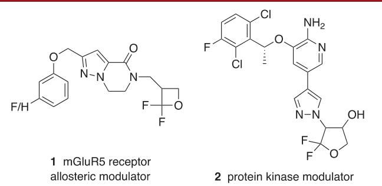
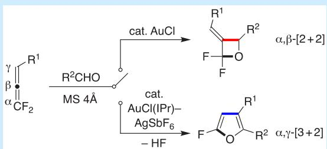
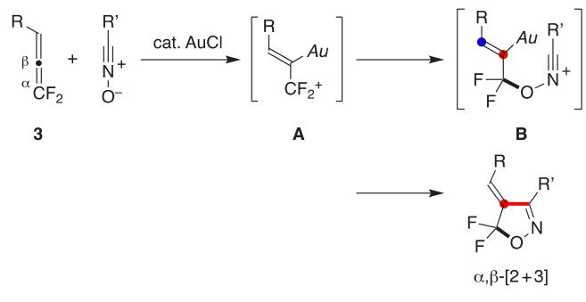
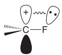
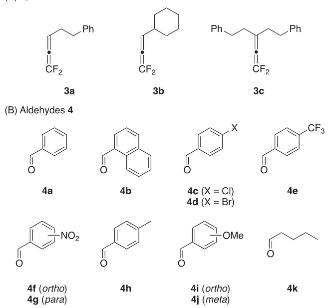
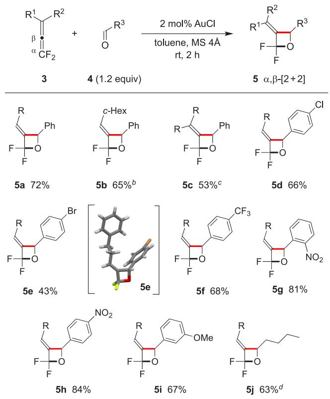
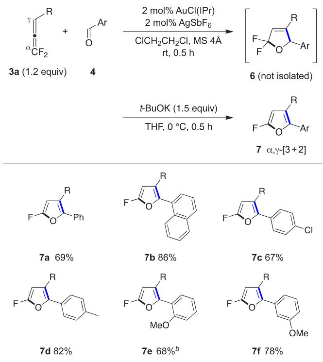
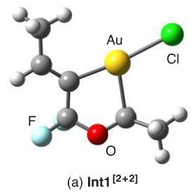
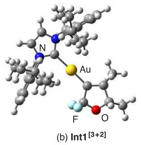
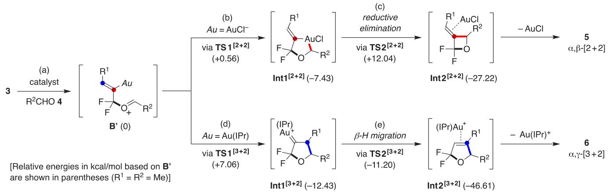

pubs.acs.org/OrgLett

Letter

# Gold(I)-Catalyzed [2 + 2] and [3 + 2] Cycloadditions of 1,1- Difluoroallenes with Aldehydes: Switchable Syntheses of Fluorinated Oxetanes and Furans

Daisuke Miyazaki, Konami Kudo, Yusuke Fujiki, Natsumi Watanabe, Toru Matsui,\* Junji Ichikawa,\* and Kohei Fuchibe\*

Cite This: Org. Lett. 2025, 27, 3807−3812

Read Online

## ACCESS

Metrics & More

Article Recommendations

ABSTRACT: 1,1-Difluoroallenes underwent regioselective [2 + 2] and $[ 3 ~ +$ 2] cycloadditions with aldehydes using Au(I) catalysts. An AuCl catalyst enabled an α,β-selective [2 + 2] cycloaddition of 1,1-difluoroallenes, yielding (E)-3-alkylidene-2,2-difluorooxetanes. Conversely, an AuCl(IPr)−AgSbF catalyst facilitated an α,γ-selective [3 + 2] cycloaddition, followed by dehydrofluorination to produce aromatized 2-fluorofurans. DFT calculations (B3LYP level) suggested that the former reaction proceeded through Au(III)- containing metallacycles, while the latter involved cyclic Au(I) carbenoids.

Ring-fluorinated oxetane and furan derivatives are promis- ing core scafolds for pharmaceuticals and agrochemicals. For example, 2,2-difluorooxetane 1 acts as an allosteric modulator of the mGluR5 receptor, which is relevant for treating neurological and psychiatric disorders linked to glutamate dysfunction (Figure 1).1 Additionally, 2,2-difluoro-

  
Figure 1. Valuable ring-fluorinated oxetane and furan derivatives.

tetrahydrofuran 2 functions as a protein kinase modulator and is considered a potential antitumor agent.2 Despite their considerable potential as medicinal and agrochemical agents, synthetic methods for these ring-fluorinated four-3 and fivemembered4 oxygen heterocycles remain underexplored. Advancing synthetic strategies for these fluorinated oxacycles could facilitate their practical applications.

\*sı Supporting Information

We recently reported the AuCl-catalyzed [2 + 3] cycloaddition of 1,1-difluoroallenes $3 ^ { 5 , 6 }$ with nitrile (or imine) oxides, a method for constructing ring-fluorinated heterocycles (Scheme 1).7 During this reaction, aurated, charge-localized difluoroallylic cations A with a Z configuration were formed, 8a a result of the distinctive α-carbocation stabilization efect of

Scheme 1. $\alpha , \beta \mathrm { . }$ Selective [2 + 3] Cycloaddition of $^ { 1 , 1 \cdot }$ Difluoroallenes with Nitrile Oxides

the fluorine substituents (Figure $2 ) . ^ { 9 }$ These $\mathrm { C F } _ { 2 }$ cations A subsequently underwent regioselective attack of the oxygen of nitrile (or imine) oxides, followed by ring closure of the resulting adducts B at the aurated (red) position, resulting in the formation of 5,5-difluoroisoxazolines (or 5,5-difluoro

  
Figure 2. α-Carbocation stabilizing efect of fluorine substituent.

Received: November 6, 2024   
Revised: December 6, 2024   
Accepted: December 26, 2024   
Published: January 18, 2025

isoxazolidines) in a regioselective manner $\left( \alpha , \beta { - } [ 2 ~ + ~ 3 ] \right)$ cycloaddition).

Notably, alkenylgold species, such as the adducts B, are known to react with electrophiles not only at the aurated (red) carbon $( \mathbf { e . g . } , $ protodeauration,10 nucleophilic addition,11 halogenation,12 and cross-coupling reaction13) but also at the vinylic (blue) carbon adjacent to the aurated one, forming $\mathrm { { A u } ( I ) }$ carbenoid species (e.g., intra-14 and intermolecular15 alkylations). Consequently, we explored two types of reactions between 1,1-difluoroallenes 3 and aldehydes using Au catalysts, leading to the formation of two distinct ring-fluorinated oxacycles. This report details the switchable syntheses of 2,2- difluorooxetanes $\bar { ( \alpha , \beta { \mathrm { - } } s { \mathrm { e l e c t i v } } }$ e $[ 2 + 2 ]$ cycloaddition) and 2- fluorofurans (α,γ-selective $[ 3 + 2 ]$ cycloaddition followed by dehydrofluorination) by selecting appropriate Au catalysts, which leverage the ambident reactivity of the alkenylgold intermediates formed from difluoroallenes 3 and aldehydes. 16,17

After evaluating various gold catalysts, we discovered that 2,2-difluorooxetane 5a could be selectively synthesized from 1,1-difluoroallene 3a and benzaldehyde (4a, 1.2 equiv) using 2 mol% AuCl catalyst and molecular sieves 4Å $\mathrm { ( M S \ 4 \mathring { A } ) } ^ { \mathrm { 1 8 } }$ in 1,2- dichloroethane at room temperature via $\alpha { , } \beta$ -selective $[ 2 + 2 ]$ cycloaddition, achieving a 51% yield of 5a (Table 1, entry 1;

Table 1. Efects of Gold Catalysts on Cycloaddition of $^ { 1 , 1 \cdot }$ Difluoroallenes with Benzaldehydea
<table><tr><td>R γ β + ● α CF2 3a</td><td>R Ph Ph 2 mol% catalyst CICH2CH2Cl O F ó MS 4Å, rt, 2 h F 4a</td></tr><tr><td>(1.2 equiv)</td><td>5a α,β-[2+2] 6a α,γ-[3+2] 6a (%) 3a (%)b</td></tr><tr><td>entry 1 AuCl</td><td>catalyst 5a (%)</td></tr><tr><td></td><td>51 nd nd</td></tr><tr><td> $2 ^ { c }$  AuCl  $3$  AuCl3</td><td>77 nd nd</td></tr><tr><td> $4 ^ { d }$   $\mathrm { H A u C l } _ { 4 } { \cdot } 4 \mathrm { H } _ { 2 } \mathrm { O }$ </td><td>17 nd nd 36 nd nd</td></tr><tr><td> $5 ^ { e }$   $\operatorname { A u C l } ( \operatorname { I P r } )$ </td><td>nd nd 98</td></tr><tr><td>6  $\operatorname { A u C l } ( \operatorname { I P r } ) - \operatorname { A g S b F } _ { 6 } ^ { \textit { f } }$   ${ } ^ { a } \mathrm { R } \ = \ \mathrm { C H } _ { 2 } \mathrm { C H } _ { 2 } \mathrm { P h }$   $\operatorname { I P r } \ = \ 1 , 3 \cdot$ </td><td>nd 48 nd</td></tr><tr><td>ylidene. nd = not detected by</td><td>-bis(2,6-diisopropylphenyl)imidazol-2-  $^ { 1 9 } \mathrm { F }$  NMR.  $^ { 1 9 } \mathrm { { F } } ^ { \bullet }$  NMR yield based on an Recovery. &#x27;In toluene.  $^ d 8$  h. e4a (1.5</td></tr><tr><td>internal standard  $\mathrm { P h C F } _ { 3 } .$  equiv).  $f _ { \mathrm { A u / A g } } = 1 { : } 1$ </td><td></td></tr></table>

see Supporting Information for details). The reaction was more eficient in toluene (a 77% yield of 5a), exhibiting (i) regioselectivities in terms of both 1,1-difluoroallenes 3 and aldehydes 4 and (ii) diastereoselectivity in terms of the formation of the alkylidene moiety (entry 2). The $[ 2 ~ + ~ 2 ]$ cycloaddition of 1,1-difluoroallenes 3a−c (Figure 3A) with 4a yielded (E)-3-alkylidene-2,2-difluorooxetanes 5a−c in 53%− 72% yields (Table 2). Aldehydes 4c−g, 4j, and 4k (Figure 3B) similarly reacted with 3a to produce the corresponding 2,2- difluorooxetanes 5d−j in 43%−84% yields (Table 2).19 The four-membered cyclic structure and the geometry of the alkylidene moiety in the products were confirmed by singlecrystal X-ray structural analysis of 5e (CCDC 2141882).

The reaction pathway was considerably changed depending on the catalyst used. An electronically neutral AuCl(IPr) catalyst resulted in no reaction, with a 98% recovery of 3a (Table 1, entry 5). In contrast, when using an AuCl(IPr)−

(A) 1,1-Difluoroallenes 3

  
Figure 3. Lists of 1,1-difluoroallenes 3 and aldehydes 4.

Table 2. AuCl-Catalyzed $\alpha , \beta \mathrm { . }$ Selective $[ 2 + 2 ]$ Cycloaddition of $^ { 1 , 1 }$ -Difluoroallenes with Aldehydes: Synthesis of (E)-3- Alkylidene-2,2-difluorooxetanes a

  
${ } ^ { \alpha } \mathrm { R } = \mathrm { C H } _ { 2 } \mathrm { C H } _ { 2 } \mathrm { P h } .$ Isolated yield. $^ b 3$ (1.1 equiv), 4 (1.0 equiv), rt, 14 h. c10 mol% AuCl. d4k (1.5 equiv).

${ \tt A g S b F } _ { 6 }$ catalyst in 1,2-dichloroethane at room temperature, $^ { 2 , 2 }$ -difluorodihydrofuran 6a was formed via the $\alpha , \gamma \mathrm { . }$ -selective [3 $+ \ 2 ]$ cycloaddition of 1,1-difluoroallene 3a with benzaldehyde (4a) (Table 1, entry 6). The formed 6a proved to be unstable during isolation and our attention was shifted to the study of dehydrofluorination of $\mathbf { 6 , }$ as the resulting aromatized 2- fluorofurans 7 are stable and promising both as pharmaceuticals and as synthetic intermediates. This $\left[ 3 + 2 \right]$ cycloaddition, followed by dehydrofluorination, enabled the synthesis of aromatized 2-fluorofurans 7. 1,1-Difluoroallene 3a was reacted with various aldehydes 4a−c and 4h−j in the presence of a catalytic amount of $\operatorname { A u C l } ( \operatorname { I P r } )$ (2 mol%), ${ \tt A g S b F } _ { 6 }$ (2 mol%), and MS 4Å. The resulting difluorodihydrofurans 6 were then subjected to dehydrofluorination using potassium tert-butoxide in THF at $0 ~ ^ { \circ } \mathrm { C } .$ . This process readily aforded aromatized 2- fluorofurans 7a−f in 67%−86% yields (Table 3).20

Table 3. AuCl(IPr)− $\mathbf { \partial } \cdot \mathbf { A g S b F } _ { 6 ^ { - } }$ Catalyzed $\mathbf { \delta } _ { \alpha , \gamma } .$ Selective $\left[ 3 + 2 \right]$ Cycloaddition of 1,1-Difluoroallenes with Aldehydes Followed by Dehydrofluorination: Synthesis of 2- Fluorofuransa

  
${ } ^ { a } \mathrm { R } = \mathrm { C H } _ { 2 } \mathrm { C H } _ { 2 } \mathrm { P h } .$ Isolated yield. $\boldsymbol { b } _ { t - \mathrm { B u O K } }$ (2.0 equiv).

It is plausible that 1,1-difluoroallenes 3 are activated by a gold(I) catalyst [AuCl or $\mathrm { A u C l ( I P r ) { \mathrm { - } } A g S b F _ { 6 } ] }$ and react with aldehydes 4 at the α-position to the fluorine substituents,

## Scheme 2. Proposed Mechanism

forming a C−O bond regioselectively on the $\mathrm { C F } _ { 2 }$ carbon to produce the key adducts $\mathbf { B } ^ { \prime }$ (Scheme 2, step ${ \bf { \bar { a } } } ) . ^ { 8 \mathrm { a } }$ DFT calculations (B3LYP, 6-31G\*\* for $\mathrm { C } , \mathrm { H } , \mathrm { C l } , \mathrm { F } , \hat { \mathrm { N } } , \mathrm { O } ;$ Lanl2dz for Au) suggest that the $\alpha { , } \beta { \cdot }$ -selective $[ 2 + 2 ]$ cycloaddition occurs via previously unreported auracycle intermediates (Scheme 2, top), while the α,γ-selective $[ 3 ^ { \cdot } + 2 ]$ cycloaddition proceeds via the expected cyclic $\mathrm { A u ( I ) }$ carbenoid intermediates (bottom). In the $\overline { { \alpha , \beta  – [ 2 \mathrm { ~ + ~ } 2 ] } }$ cycloaddition with an AuCl catalyst, the generated adducts $\mathbf { B } ^ { \prime }$ form tricoordinated auracycle intermediates $\mathbf { I n t 1 } ^ { [ 2 + 2 ] }$ , which are likely Au(III) complexes (Scheme 2, step b; Figure $4 \mathsf { a } ) . ^ { 2 1 , 2 2 }$ Reductive

  
Figure 4. Structures of the intermediates leading to 5 (a) and ${ \bf 7 } ~ ( { \bf b } )$ (DFT, B3LYP/6-31G\*\* for C, H, Cl, F, N, O; Lanl2dz for Au).

elimination then produces intermediates $\mathbf { I n t } 2 ^ { [ 2 + 2 ] }$ (5-AuCl π- complexes, step c), which undergo demetalation to yield $\alpha , \beta \mathrm { - } [ 2$ $+ ~ 2 ]$ cycloadducts ${ \mathfrak { s } } ,$ thereby regenerating the catalyst.

In the $\alpha , \gamma - \left[ 3 + 2 \right]$ cycloaddition, the adducts $\mathbf { B } ^ { \prime }$ with the IPr ligand (using an $\mathrm { A u \dot { C } l ( I P r ) \mathrm { - } A g S b F } _ { 6 }$ catalyst) undergo ring closure at the γ-position to the fluorine substituents, forming Int1[3+2], cyclic Au(I) carbenoid intermediates (Scheme $^ { 2 , }$ step ${ \mathrm { d } } ;$ Figure 4b). Subsequent $\beta \mathrm { \cdot }$ hydrogen migration leads to intermediates Int2[3+2] $( 6 { \cdot } \mathrm { { A u } ( I i p _ { I } ) ^ { + } }$ π-complexes, step e), which are then demetalated to yield the $\alpha , \gamma - \left[ 3 \mathrm { ~  ~ { ~ + ~ } ~ } 2 \right]$ cycloadducts 6 (see Supporting Information for details). The cationic $\mathrm { A u ( I P r ) ^ { + } }$ catalyst likely destabilizes the Au(III)- containing metallacycle intermediates, corresponding to Int1[2+2], thereby favoring the formation of the five-membered cyclic products $\mathbf { 6 , }$ not the four-membered cyclic products ${ \mathfrak { s } } .$

Toste et al. investigated the reaction pathways for intramolecular $[ 2 + 4 ]$ and $[ 3 + 4 ]$ cycloadditions of fluorine-free allenes with dienes. They found that $[ 2 + 4 ]$ cycloadducts were formed through the ring contraction of the common sevenmembered cyclic $\mathrm { A u ( I ) }$ carbenoid intermediates.23 However, for the formation of 2,2-difluorooxetanes 5, the ring contraction mechanism appears unlikely owing to (A) the low activation energy for the β-hydrogen migration step (1.23 kcal/mol, TS2[3+2], Scheme 2) and (B) the inherent ring strain of the forming four-membered oxetanes.24

In summary, gold(I)-catalyzed $[ 2 ~ + ~ 2 ]$ and $\left[ 3 \ + \ 2 \right]$ cycloadditions of 1,1-difluoroallenes with aldehydes were successfully achieved. An AuCl catalyst yielded (E)-3- alkylidene-2,2-difluorooxetanes as $\alpha , \beta - [ 2 { \it \Delta \phi } + 2 ]$ cycloadducts, while an $\mathrm { A u ( I P r ) { \mathrm { - A g S b F } } _ { 6 } }$ catalyst produced 2-fluorofurans as dehydrofluorinated $\alpha , \gamma - \left[ 3 + 2 \right]$ cycloadducts. The exceptional reactivity of 1,1-difluoroallenes as cycloaddition platforms, combined with the versatility of gold catalysts, enabled the selective syntheses of ring-fluorinated four-membered and fivemembered oxacycles.

## ■ ASSOCIATED CONTENT

## Data Availability Statement

The data underlying this study are available in the published article and its Supporting Information.

## \*sı Supporting Information

The Supporting Information is available free of charge at https://pubs.acs.org/doi/10.1021/acs.orglett.4c04185.

Optimizations of catalysts and reaction conditions, experimental procedures, NMR (1H, 13C, and 19F) data, and supplementary data of theoretical calculations such as structures of TS1[2+2], TS2[2+2], Int2[2+2], $\mathbf { T S 1 } ^ { [ 3 + 2 ] }$ , TS2[3+2], and Int2[3+2] and an energy diagram for Scheme 2 (PDF)

## Accession Codes

Deposition Number 2141882 contains the supplementary crystallographic data for this paper. These data can be obtained free of charge via the joint Cambridge Crystallographic Data Centre (CCDC) and Fachinformationszentrum Karlsruhe Access Structures service.

## ■ AUTHOR INFORMATION

## Corresponding Authors

Toru Matsui − Division of Chemistry, Faculty of Pure and Applied Sciences, University of Tsukuba, Tsukuba, Ibaraki 305−8571, Japan; orcid.org/0000-0001-9847-5925; Email: matsui@chem.tsukuba.ac.jp

Junji Ichikawa − Sagami Chemical Research Institute, Ayase, Kanagawa 252−1193, Japan; Email: jichikawa@ sagami.or.jp

Kohei Fuchibe − Division of Chemistry, Faculty of Pure and Applied Sciences, University of Tsukuba, Tsukuba, Ibaraki 305−8571, Japan; orcid.org/0000-0002-6759-7003; Email: kfuchibe@chem.tsukuba.ac.jp

## Authors

Daisuke Miyazaki − Division of Chemistry, Faculty of Pure and Applied Sciences, University of Tsukuba, Tsukuba, Ibaraki 305−8571, Japan

Konami Kudo − Division of Chemistry, Faculty of Pure and Applied Sciences, University of Tsukuba, Tsukuba, Ibaraki 305−8571, Japan

Yusuke Fujiki − Division of Chemistry, Faculty of Pure and Applied Sciences, University of Tsukuba, Tsukuba, Ibaraki 305−8571, Japan

Natsumi Watanabe − Division of Chemistry, Faculty of Pure and Applied Sciences, University of Tsukuba, Tsukuba, Ibaraki 305−8571, Japan

Complete contact information is available at: https://pubs.acs.org/10.1021/acs.orglett.4c04185

## Author Contributions

K.F. conceived the project and wrote the manuscript with J.I. and D.M. D.M., K.K., and Y.F. planned and carried out the experiments. N.W. and T.M. performed the theoretical calculations. All the authors discussed the experiments and results, and have given approval to the final version of the manuscript.

## Funding

This research was financially supported by JSPS KAKENHI Grant Number JP22H02071 (J.I.) in Grant-in-Aid for Scientific Research (B) and JSPS KAKENHI Grant Number JP20K21186 (J.I.) in Grant-in-Aid for Challenging Research (Exploratory). This work was partly supported by JSPS KAKENHI Grant Number JP20K05486 (K.F.) in Grant-in-Aid for Scientific Research (C) and by JSPS KAKENHI Grant Number JP23K04674 (T.M.) in Grant-in-Aid for Scientific Research (C). The authors appreciate the financial support from Iketani Science and Technology Foundation.

## Notes

The authors declare no competing financial interest.

## ■ ACKNOWLEDGMENTS

We thank Dr. Takeshi Fujita (The University of Tokyo) for single crystal X-ray structural analysis of 2,2-difluorooxetane 5e. We also thank the reviewers of this manuscript for fruitful discussion of the reaction mechanisms. Tosoh Finechem Corporation is acknowledged for the generous gift of $\mathrm { C F } _ { 3 } \mathrm { C H } _ { 2 } \mathrm { I }$

## ■ REFERENCES

(1) (a) Conn, P. J.; Lindsley, C. W.; Staufer, S. R.; Bartolome-Nebreda, J. M.; MacDonald, G. J.; Conde-Ceide, S.; Tong, H. M. Substituted Bicyclic Cycloalkylpyrazole Lactam Analogs as Allosteric modulators of mGluR5 Receptors. WO2013192347, 2013. (b) Conn, P. J.; Lindsley, C. W.; Staufer, S. R.; Bartolome-Nebreda, J. M.; Conde-Ceide, S.; MacDonald, G. J.; Tong, H. M. Preparation of Bicyclic Cycloalkylpyrazole Lactam Derivatives for Use as mGluR5 Receptor Allosteric modulators. US20130345204, 2013.

(2) Wang, T.; Yi, L. Substituted Cyclic Compounds and Methods of Use. WO2013138210, 2013.

(3) (a) Bargigia, G.; Tonelli, C.; Tato, M. Photocycloaddition of Perfluoroalkanoic Acid Fluorides to Perfluoroalkenes Perfluoroetheroxetanes. J. Fluorine Chem. 1987, 36, 449−459. (b) Petrov, V. A.; Davidson, F.; Smart, B. E. A New Synthesis of Fluorinated Oxetanes. J. Org. Chem. 1995, 60, 3419−3412. (c) Gomez Fernandez, M. A.; Lefebvre, C.; Sudau, A.; Genix, P.; Vors, J.-P.; Abe, M.; Hoffmann, N. Studies on The Application of The Paterno-Bù ̈chi Reaction to The Synthesis of Novel Fluorinated Scaffolds. Chem. Eur. J. 2021, 27, 15722−15729. (d) Ofuji, Y.; Kanbara, T.; Yajima, T. Radical Cyclization Reaction of Iodine Containing Fluoroolefines. J. Fluorine Chem. 2021, 247, 109805.

(4) (a) Ichikawa, J.; Wada, Y.; Fujiwara, M.; Sakota, K. The Nucleophilic 5-Endo-Trig Cyclization of 1,1-Difluoro-1-alkenes: Ring-Fluorinated Hetero- and Carbocycle Synthesis and Remarkable Effect of the Vinylic Fluorines on the Disfavored Process. Synthesis 2002, 2002, 1917−1936. (b) Serdyuk, O.; Butin, A.; Abaev, V. Synthesis of Fluorofurans and Perfluoroalkylfurans. J. Fluorine Chem. 2010, 131, 296−319. (c) O’Leary, E. M.; Jones, D. J.; O’Donovan, F. P.;

(d) Hua, M.-Q.; Wanga, W.; Liu, W.-H.; Wanga, T.; Zhang, Q.; Huang, Y.; Zhu, W.-H. Solvent-Controlled Difluoromethylation of 2′- Hydroxychalcones for Divergent Synthesis of 2′-Difluoromethoxychalcones and 2,2-Difluoro-3-styryl-2,3-dihydrobenzofuran-3-ols. J. Fluorine Chem. 2016, 181, 22−29. (e) Yuan, X.; Yao, J.-F.; Tang, Z.-Y. Decarboxylative Fluorination of Electron-Rich Heteroaromatic Carboxylic Acids with Selectfluor. Org. Lett. 2017, 19, 1410−1413.

(f) Morioka, R.; Fujita, T.; Ichikawa, J. Facile Synthesis of 2- Fluorobenzofurans: 5-Endo-Trig Cyclization of β,β-Difluoro-o-hydroxystyrenes. Helv. Chim. Acta 2020, 103, e2000159. (g) Ye, F.; Ge, Y.; Spannenberg, A.; Neumann, H.; Beller, M. The Role of Allyl Ammonium Salts in Palladium-Catalyzed Cascade Reactions Towards the Synthesis of Spiro-Fused Heterocycles. Nat. Commun. 2020, 11, 5383. (h) Jia, Y.; Yuan, Y.; Huang, J.; Jiang, Z.-X.; Yang, Z. Synthesis of Difluorinated Heterocyclics through Metal-Free [8 + 1] and [4 + 1] Cycloaddition of Difluorocarbene. Org. Lett. 2021, 23, 2670−2675. (i) Liu, J.; Yu, L.; Zheng, C.; Zhao, G. Asymmetric Synthesis of 2,2- Difluorotetrahydrofurans through Palladium-Catalyzed Formal [3 + 2] Cycloaddition. Angew. Chem., Int. Ed. 2021, 60, 23641−23645. (j) Liu, H.; Tian, L.; Wang, H.; Li, Z.-Q.; Zhang, C.; Xue, F.; Feng, C. A Novel Type of Donor−Acceptor Cyclopropane with Fluorine as the Donor: (3 + 2)-Cycloadditions with Carbonyls. Chem. Sci. 2022, 13, 2686−2691 and references cited therein..

(5) (a) Oh, K.; Fuchibe, K.; Yokota, M.; Ichikawa, J. Facile Synthesis of Substituted 1,1-Difluoroallenes via Carbonyl Difluorovinylidenation. Synthesis 2012, 44, 857−861. (b) Fuchibe, K.; Abe, M.; Oh, K.; Ichikawa, J. Preparation of 1,1-Difluoroallenes by Difluorovinylidenation of Carbonyl Compounds. Org. Synth. 2016, 93, 352−366.

(6) For reviews on 1,1-difluoroallenes, see: (a) Fuchibe, K.; Ichikawa, J. 1,1-Dihaloallenes (Update 2014). In Science of Synthesis Knowledge Updates 2014; Georg Thieme: 2014; pp 217−231. (b) Sathish, K.; Jain, S.; Sihag, N.; Yadav, M. R. gem-Difluoroallene (DFA): an Emerging Versatile Synthetic Precursor to Enable Diverse Fluorinated Molecules. Org. Biomol. Chem. 2024, 22, 8078.

(7) Fuchibe, K.; Sakon, K.; Suto, K.; Eto, R.; Nakazono, S.; Ichikawa, J. Fluorine-Activated and -Directed Allene Cycloadditions with Nitrile Oxides and Imine Oxides: Synthesis of Ring-Fluorinated Isoxazole Derivatives. Org. Lett. 2023, 25, 7258−7262.

(8) (a) Fuchibe, K.; Abe, M.; Sasaki, M.; Ichikawa, J. Gold-Catalyzed Electrophilic Activation of 1,1-Difluoroallenes: α-and γ-Selective Addition of Heteroatom Nucleophiles. J. Fluorine Chem. 2020, 232, 109452. For metalated difluoroallylic cations, see also: (b) Fuchibe, K.; Mayumi, Y.; Zhao, N.; Watanabe, S.; Yokota, M.; Ichikawa, J. Domino Synthesis of Fluorine-Substituted PAHs: 1,1-Difluoroallenes as Synthetic Platforms. Angew. Chem., Int. Ed. 2013, 52, 7825−7828.

(9) (a) Smart, B. E. Characteristics in C−F Systems. In Organofluorine Chemistry, Principles and Commercial Applications; Banks, R. E., Smart, B. E., Tatlow, J. C., Eds.; Plenum Press: 1994; pp 57−88. (b) Uneyama, K. Fundamentals in Organic Fluorine Chemistry. In Organofluorine Chemistry; Uneyama, K., Ed.; Blackwell Publishing: 2006; pp 1−100. (c) Bégué, J.-P.; Bonnet-Delpon, D. General Remarks on Structural, Physical, and Chemical Properties of Fluorinated Compounds. In Bioorganic and Medicinal Chemistry of Fluorine; Wiley: 2008; pp 1−22.

(10) (a) Hashmi, A. S. K.; Weyrauch, J. P.; Frey, W.; Bats, J. W. Gold Catalysis: Mild Conditions for the Synthesis of Oxazoles from N-Propargylcarboxamides and Mechanistic Aspects. Org. Lett. 2004, 6, 4391−4394. (b) Nishina, N.; Yamamoto, Y. Gold-Catalyzed Intermolecular Hydroamination of Allenes with Arylamines and Resulting High Chirality Transfer. Angew. Chem., Int. Ed. 2006, 45, 3314−3317.

(11) (a) Zhang, L. Tandem Au-Catalyzed 3,3-Rearrangement-[2 + 2] Cycloadditions of Propargylic Esters: Expeditious Access to Highly Functionalized 2,3-Indoline-Fused Cyclobutanes. J. Am. Chem. Soc. 2005, 127, 16804−16805. (b) Markham, J. P.; Staben, S. T.; Toste, F. D. Gold(I)-Catalyzed Ring Expansion of Cyclopropanols and Cyclobutanols. J. Am. Chem. Soc. 2005, 127, 9708−9709. (c) Dateer,

R. B.; Shaibu, B. S.; Liu, R.-S. Gold-Catalyzed Intermolecular [4 + 2] and [2 + 2+2] Cycloadditions of Ynamides with Alkenes. Angew. Chem., Int. Ed. 2012, 51, 113.

(12) (a) Hashmi, A. S. K.; Ramamurthi, T. D.; Rominger, F. Synthesis, Structure and Reactivity of Organogold Compounds of Relevance to Homogeneous Gold Catalysis. J. Organomet. Chem. 2009, 694, 592−597. (b) Liu, L.-P.; Hammond, G. B. Reactions of Cationic Gold(I) with Allenoates: Synthesis of Stable Organogold(I) Complexes and Mechanistic Investigations on Gold-Catalyzed Cyclizations. Chem. Asian J. 2009, 4, 1230−1236. (c) McGee, P.; Bellavance, G.; Korobkov, I.; Tarasewicz, A.; Barriault, L. Synthesis and Isolation of Organogold Complexes through a Controlled 1,2- Silyl Migration. Chem. Eur. J. 2015, 21, 9662−9665.

(13) (a) Shi, Y.; Ramgren, S. D.; Blum, S. A. Palladium-Catalyzed Carboauration of Alkynes and Palladium/Gold Cross-Coupling. Organometallics 2009, 28, 1275−1277. (b) Hashmi, A. S. K.; Lothschütz, C.; Döpp, R.; Rudolph, M.; Ramamurthi, T. D.; Rominger, F. Gold and Palladium Combined for Cross-Coupling. Angew. Chem., Int. Ed. 2009, 48, 8243−8246. (c) Peña-López, M.; Sarandeses, L. A.; Pérez Sestelo, J. Organogold(I) Phosphanes in Palladium-Catalyzed Cross-Coupling Reactions in Aqueous Media. Eur. J. Org. Chem. 2013, 2013, 2545−2554.

(14) Buzas, A.; Gagosz, F. Gold(I) Catalyzed Isomerization of 5-en-2-yn-1-yl Acetates: An Efficient Access to Acetoxy Bicyclo[3.1.0]- hexenes and 2-Cycloalken-1-ones. J. Am. Chem. Soc. 2006, 128, 12614−12615.

(15) Nguyen, J.; Duncan, N.; Lalic, G. Direct β-Selective Cross-Coupling of Alkenyl Gold Complexes with Alkyl Electrophiles. Eur. J. Org. Chem. 2016, 2016, 5803.

(16) For reviews on allenes as three- and two-carbon units, see: (a) Ma, S. Some Typical Advances in the Synthetic Applications of Allenes. Chem. Rev. 2005, 105, 2829−2872. (b) Lopez, F.; Mascarenas, J. L. Allenes as Three-Carbon Units in Catalytic Cycloadditions: New Opportunities with Transition-Metal Catalysts. Chem. Eur. J. 2011, 17, 418−428. (c) Lopez, F.; Mascarenas, J. L. [4 + 2] and [4 + 3] catalytic cycloadditions of allenes. Chem. Soc. Rev. 2014, 43, 2904−2915. (d) Muratore, M. E.; Homs, A.; Obradors, C.; Echavarren, A. M. Meeting the Challenge of Intermolecular Gold(I)- Catalyzed Cycloadditions of Alkynes and Allenes. Chem. Asian J. 2014, 9, 3066−3082. For [2 + 2] cycloaddition, see in particular: (e) Suarez-Pantiga, S.; Hernandez-Diaz, C.; Piedrafita, M.; Rubio, E.; Gonzalez, J. M. Phosphite-Gold(I)-Catalyzed [2 + 2] Intermolecular Cycloaddition of Enol Ethers with N-Allenylsulfonamides. Adv. Synth. Catal. 2012, 354, 1651−1657. (f) Faustino, H.; Bernal, P.; Castedo, L.; López, F.; Mascareñas, J. L. Gold(I)-Catalyzed Intermolecular [2 + 2] Cycloadditions Between Allenamides and Alkenes. Adv. Synth. Catal. 2012, 354, 1658−1664. (g) Bernal-Albert, P.; Faustino, H.; Gimeno, A.; Asensio, G.; Mascarenas, J. L.; Lopez, F. Gold(I)- Catalyzed Intermolecular Cycloaddition of Allenamides with α,β- Unsaturated Hydrazones: Efficient Access to Highly Substituted Cyclobutanes. Org. Lett. 2014, 16, 6196−6199.

(17) For reviews on gold-catalyzed reactions, see: (a) Hashmi, A. S. K.; Hutchings, G. J. Gold Catalysis. Angew. Chem., Int. Ed. 2006, 45, 7896−7936. (b) Hashmi, A. S. K. Gold-Catalyzed Organic Reactions. Chem. Rev. 2007, 107, 3180−3211. (c) Fürstner, A.; Davies, P. W. Catalytic Carbophilic Activation: Catalysis by Platinum and Gold π Acids. Angew. Chem., Int. Ed. 2007, 46, 3410−3449. (d) Liu, L.-P.; Hammond, G. B. Recent Advances in the Isolation and Reactivity of Organogold Complexes. Chem. Soc. Rev. 2012, 41, 3129−3139. (e) Qian, D.; Zhang, J. Gold-Catalyzed Cyclopropanation Reactions Using a Carbenoid Precursor Toolbox. Chem. Soc. Rev. 2015, 44, 677−698.

(18) MS 4Å was used to prevent hydrolysis of 3.

(19) The AuCl-catalyzed [2 + 2] cycloaddition of 3a with pmethoxybenzaldehyde and o-methoxybenzaldehyde (4i) resulted in a mixture of nonfluorinated unidentifiable materials. The [2 + 2] cycloaddition of 3a with i-PrCHO successfully aforded the corresponding 2,2-difluorooxetane, which rapidly decomposed upon isolation.

(20) The AuCl(IPr)−AgSbF -catalyzed [3 + 2] cycloaddition of 3a with p-methoxybenzaldehyde aforded the corresponding product, albeit in a decreased yield (30%). The difluoroallene 3a also reacted with i-PrCHO but did not aford the corresponding product.

(21) Our theoretical calculations indicated that the bond orders of the two Au−C “bonds” involved in Int1[2+2] are close to each other [0.615 for Au−C(difluoroallene) and 0.646 for Au−C(aldehyde)]. We thus consider that the intermediate Int1[2+2] should be recognized as a cyclic Au(III) complex rather than an Au(I) species with electronic interaction between the gold atom and the carbocation. See: (a) González, A. Z.; Benitez, D.; Tkatchouk, E.; Goddard, W. A., III; Toste, F. D. Phosphoramidite Gold(I)-Catalyzed Diastereo- and Enantioselective Synthesis of 3,4-Substituted Pyrrolidines. J. Am. Chem. Soc. 2011, 133, 5500−5507. (b) Montserrat, S.; Faustino, H.; Lledós, A.; Mascarenas, J. L.; López, F.; Ujaque, G. Mechanistic Intricacies of Gold-Catalyzed Intermolecular Cycloadditions Between Allenamides and Dienes. Chem. Eur. J. 2013, 19, 15248−15260. (c) Faustino, H.; Varela, I.; Mascarenas, J. L.; Lopez, F. Gold(I)- Catalyzed [2 + 2+2] Cycloaddition of Allenamides, Alkenes, and Aldehydes: a Straightforward Approach to Tetrahydropyrans. Chem. Sci. 2015, 6, 2903−2908.

(22) Schmidbaur, H.; Dash, K. C. 1,8-Naphthyridine Complexes of Dimethylgold Halides and Pseudohalides. A Simple Case of Fluxional Behavior. J. Am. Chem. Soc. 1973, 95, 4855−4860.

(23) (a) Mauleon, P.; Zeldin, R. M.; Gonzalez, A. Z.; Toste, F. D. Ligand-Controlled Access to [4 + 2] and [4 + 3] Cycloadditions in Gold-Catalyzed Reactions of Allene-Dienes. J. Am. Chem. Soc. 2009, 131, 6348−6349. (b) Benitez, D.; Tkatchouk, E.; Gonzalez, A. Z.; Goddard, W. A.; Toste, F. D. On the Impact of Steric and Electronic Properties of Ligands on Gold(I)-Catalyzed Cycloaddition Reactions. Org. Lett. 2009, 11, 4798−4801.

(24) Treatment of the isolated 2,2-difluorooxetane 5a with an AuCl(IPr)−AgSbF catalyst did not aford the corresponding 2,2- difluorodihydrofuran 6a.