pubs.acs.org/OrgLett

# Photoinduced Double 1,2-Carbon Migration toward All-Carbon Tetrasubstituted Olefins

Tianyu He, Chao Kong, Yukai Liu, Yu Zheng, Yanju Lu, Xiaoxiang Zhang, and Shenlin Huang\*

Cite This: Org. Lett. 2025, 27, 6244−6249

## ACCESS

Metrics & More

Read Online

ABSTRACT: A photochemical double 1,2-carbon migration approach was achieved as an eficient entry into all-carbon tetrasubstituted olefins from allenols. Key to the success is the use of FSO Cl, which plays a crucial triple role as an efective Cl+ synthon to facilitate semipinacol rearrangement, an electron

\*sı Supporting Information

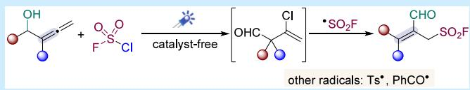

Article Recommendations

acceptor to form electron donor−acceptor complexes, and a FSO2• precursor to trigger 1,2-carbonyl migration. The synthetic utility is further showcased by extending it to other radical precursors and diverse follow-up reactions.

Table 1. Optimization of the Reaction Conditions

All-carbon tetrasubstituted olefins are important structuralmotifs that play a key role in pharmaceuticals, natural products, and organic functional materials.1 Consequently, a variety of classic synthetic strategies to access tetrasubstituted olefins have been developed, including the Wittig reaction, the Horner−Wadsworth−Emmons reaction, Peterson olefination, olefin metathesis, and hydroxy elimination.2 Over the past few decades, transition-metal-catalyzed cross-couplings have been identified as additional versatile approaches for the construction of these motifs.2b,c Recently, radical functionalization of alkynes and alkenes via photochemical methods has ofered alternative approaches for the synthesis of tetrasubstituted olefins.3 In particular, the Xie group demonstrated that metallophotoredox deoxygenative alkenylation of aromatic acids can efectively produce all-carbon tetrasubstituted alkenes (Scheme 1A, top).4 Very recently, Kleij reported a conceptually novel photoredox method of preparing all-carbon

Scheme 1. Context of the Work  
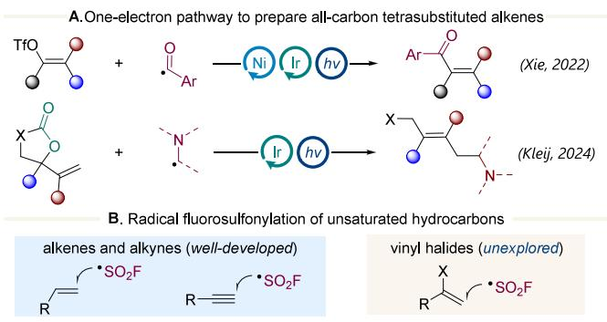

C.This work: fluorosulfonylation of allenes with FSO2CI

triple role FSO2Cl = Cl⁺ + •SO2F + EDA acceptor tetrasubstituted alkenes through decarboxylative coupling of vinyl cyclic carbonates and α-amino radicals (Scheme 1A, bottom).5 Nonetheless, these methods typically require transition metal catalysts, and radical approaches for the stereoselective construction of all-carbon tetrasubstituted olefins still remain rare.

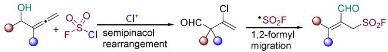

<table><tr><td>OH Ph Me 1a</td><td rowspan="2">FSO2Cl +</td><td>additive (20 mol%), solvent</td><td>CHO Ph SO2F Me</td></tr><tr><td></td><td>Blue LEDs, rt, 2 h</td></tr><tr><td>entry</td><td>additive</td><td>solvent (0.05 M)</td><td>yieldb</td></tr><tr><td>1</td><td> $\mathsf { A g O A c }$ </td><td> $\mathrm { E t } _ { 2 } \mathrm { O }$ </td><td>41%</td></tr><tr><td>2</td><td> ${ \tt A g } _ { 2 } { \tt S C } _ { 4 }$ </td><td>Et2O</td><td>20%</td></tr><tr><td>3</td><td> $\mathrm { \sf A g N O } _ { 2 }$ </td><td> $\mathrm { E t } _ { 2 } \mathrm { O }$ </td><td>43%</td></tr><tr><td>4</td><td> ${ \mathrm { A g } } _ { 2 } { \mathrm { C O } } _ { 3 }$ </td><td>Et2O</td><td>62%</td></tr><tr><td>5 6</td><td> ${ \mathrm { A g } } _ { 2 } { \mathrm { C O } } _ { 3 }$ </td><td>THF</td><td>0%</td></tr><tr><td></td><td> ${ \mathrm { A g } } _ { 2 } { \mathrm { C O } } _ { 3 }$ </td><td>2-Me-THF</td><td>&lt;10%</td></tr><tr><td>7</td><td> ${ \mathrm { A g } } _ { 2 } { \mathrm { C O } } _ { 3 }$ </td><td>CPME or MTBE</td><td>0%</td></tr><tr><td>8</td><td> ${ \mathrm { A g } } _ { 2 } { \mathrm { C O } } _ { 3 }$ </td><td>1,4-dioxane</td><td>50%</td></tr><tr><td>9</td><td> ${ \mathrm { A g } } _ { 2 } { \mathrm { C O } } _ { 3 }$ </td><td>1,4-dioxane (0.067 M)</td><td>19%</td></tr><tr><td>10</td><td> ${ \mathrm { A g } } _ { 2 } { \mathrm { C O } } _ { 3 }$ </td><td>1,4-dioxane (0.04 M)</td><td>42%</td></tr><tr><td>11</td><td> ${ \mathrm { A g } } _ { 2 } { \mathrm { C O } } _ { 3 }$ </td><td>1,4-dioxane/Et2O (20/1)</td><td>86%</td></tr><tr><td>12</td><td></td><td> $\mathbf { 1 } , 4 \mathbf { - } \mathbf { d i o x a n e } / \mathbf { E t } _ { 2 } \mathbf { O } \left( 2 0 / 1 \right)$ </td><td>86%</td></tr></table>

aStandard conditions: 1a (0.1 mmol) and FSO Cl (0.5 mmol, 5.0 equiv, 1 M in PhCF ), 1,4-dioxane (2 mL), Et O (0.1 mL), 35 W blue LEDs, 2 h, rt. CPME = cyclopentyl methyl ether. MTBE = methyl tert-butyl ether. bIsolated yield.

Received: May 15, 2025   
Revised: May 30, 2025   
Accepted: June 3, 2025   
Published: June 4, 2025

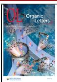

Scheme 2. Substrate Scope  
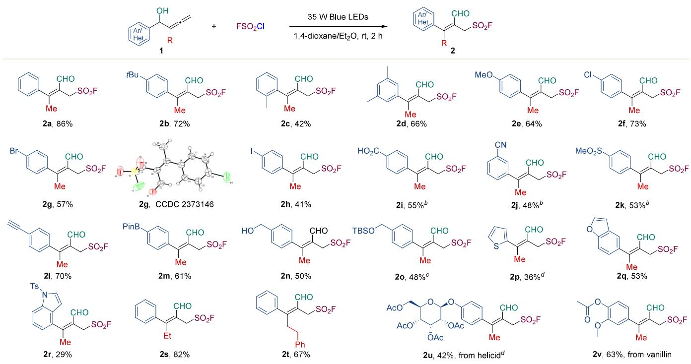  
aConditions: allenes (0.1 mmol) and $\mathrm { F S O } _ { 2 } \mathrm { C l }$ (0.5 mmol, 5.0 equiv, 1 M in $\mathrm { P h C F } _ { 3 } ) _ { \cdot }$ , 1,4-dioxane (0.05 M), $\mathrm { E t } _ { 2 } \mathrm { O }$ (1 M), 35 W blue LEDs, 2 h, rt. Isolated yields. bAdditional ${ \mathrm { A g } } _ { 2 } { \mathrm { C O } } _ { 3 }$ (1.5 equiv). cAdditional ${ \bf N a } _ { 2 } { \bf C O } _ { 3 }$ (2 equiv). dNBS was used for semipinacol rearrangement.

an allylic sulfonyl fluoride, thus bestowing diverse postsynthetic utilities.

In recent years, sulfonyl fluorides have been recognized as privileged building blocks, which undergo sulfur(VI) fluoride exchange (SuFEx) click reactions.6 Sulfuryl chlorofluoride $( \mathrm { F S O } _ { 2 } \mathrm { \bar { C } l } )$ , a useful solvent, has been successfully used as a dehydrating agent, an oxidant, and a source of $\mathrm { F } ^ { + } , \mathrm { F } { \mathrm { S O } _ { 2 } } ^ { + } ,$ or $\mathrm { C l ^ { + } } \overset { ? } { . }$ In 2020, Liao disclosed that $\mathrm { F S O } _ { 2 } \mathrm { C l }$ could act as a fluorosulfonyl radical $\left( \mathrm { F S O } _ { 2 } ^ { \bullet } \right)$ precursor for the synthesis of alkenyl sulfonyl fluorides.8 After that, a few radical fluorosulfonylation strategies were developed using $\mathrm { F S O } _ { 2 } \mathrm { C l }$ under photochemical9 or electrochemical10 conditions. Recently, we demonstrated that $\mathrm { F S O } _ { 2 } \mathrm { C l }$ can simultaneously serve as a source of $\mathrm { F S O } _ { 2 } ^ { \bullet }$ and as an electron acceptor to form electron donor−acceptor (EDA) complexes in the fluorosulfonylation transformation.11 However, $\mathrm { F S O } _ { 2 } \mathrm { C l }$ has been mainly used in a monofunctional fashion so far. We envisioned that it would be highly desirable and attractive to make full use of $\mathrm { F S O } _ { 2 } \mathrm { C l }$ as a multifunctional reagent to facilitate continuous reaction sequences.

Various synthetic methods have been developed for the introduction of the sulfonyl fluoride group,12 particularly via radical fluorosulfonylation of alkenes or alkynes,13 whereas the fluorosulfonylation of vinyl halides remains elusive (Scheme 1B). Herein, we report an unprecedented photochemical method to construct all-carbon tetrasubstituted olefins from allenols with $\mathrm { F S O } _ { 2 } \mathrm { C l }$ through double 1,2-carbon migration (Scheme 1C). In contrast to sulfonyl radicals, the fluorosulfonyl radical adds to the terminal carbon of allenes in our reaction. In this process, $\mathrm { F S O } _ { 2 } \mathrm { C l }$ plays a triple role: an efective Cl+ synthon to facilitate semipinacol rearrangement to provide the vinyl chloride intermediate,14 an electron acceptor to form EDA complexes, and a FSO • precursor to initiate radical carbonyl migration.15 In addition, the generated sulfonyl fluorides possess an aldehyde, a tetrasubstituted alkene, and

We started of by investigating the reaction of allenol 1a with $\mathrm { F S O } _ { 2 } \mathrm { C l }$ under blue LED irradiation at ambient temperature for 2 h (Table 1). Originally, we thought silver salts might function as Lewis acids or chloride scavengers to promote the reaction, and several silver salts were examined using diethyl ether as the solvent (entries 1−4). Much to our delight, the $\mathrm { F S O } _ { 2 }$ -functionalized tetrasubstituted olefin 2a was isolated in 62% yield when the reaction was performed in the presence of ${ \mathrm { A g } } _ { 2 } { \mathrm { C O } } _ { 3 }$ (20 mol %) in diethyl ether (entry 4). Other solvents, such as THF, 2-Me-THF, CPME, and MTBE, delivered the desired product 2a in 0−10% yields (entries 5−7). Using 1,4- dioxane as the solvent, the desired product 2a was isolated in 50% yield (entry 8). Increasing or reducing the reaction concentration led to diminished yields (entries 9 and 10). Further optimization revealed that the mixed solvent 1,4- dioxane $/ \mathrm { E t } _ { 2 } \mathrm { O }$ (20/1) was found to be optimal (entry 11). A control experiment demonstrated that ${ \mathrm { A g } } _ { 2 } { \mathrm { C O } } _ { 3 }$ was unnecessary for this reaction (entry 12). No conversion of 1a was observed when the 1-fluorosulfonyl benzimidazolium salts developed by $\mathrm { L i a o } ^ { 1 6 }$ and $\mathrm { W a n g ^ { 1 7 } }$ independently were used as $\mathrm { F S O } _ { 2 }$ radical precursors, further demonstrating the unique role of $\mathrm { F S O } _ { 2 } \mathrm { C l }$ in our reaction.

Having identified suitable reaction conditions for tetrasubstituted olefin synthesis, the substrate scope of allenols was investigated (Scheme 2). The aryl ring was initially modulated with regard to electronic properties and the substitution pattern $\left( 2 \mathbf { a } \mathbf { - } 2 \mathbf { o } \right)$ . Electron-donating groups (tBu, Me, and $\mathsf { \bar { M } e O } )$ were well accommodated, providing desired products 2b−2e in moderate to good yields. Introducing a methyl group at the ortho position of the benzene ring led to a notable decrease in yield (2c) compared to para- and meta-substituted derivatives (2b, 2d, and 2e), presumably due to the steric efect. Halogens (Cl, Br, and I) and electron-withdrawing groups (CO H, CN, and SO Me) were tolerated, delivering desired sulfonyl fluorides 2f−2k. Other useful functional groups, including alkyne and boronic ester, were well-tolerated to aford 2l and $^ { 2 \mathbf { m } , }$ which are poised for further derivatization. Notably, the reactive benzyl alcohol (2n) and silyl ether (2o) also remained intact under our reaction conditions. Moreover, allenols bearing thiophene (2p), benzofuran (2q), and indole (2r) heterocycles are competent substrates for this cascade reaction. Subsequently, the presence of a methyl group on the terminal allene carbon was found to be not mandatory, since the method is applicable to ethyl- and phenylethyl-substituted allenols (2s and 2t). Delightedly, allenols from the naturally occurring aldehydes helicid and vanillin could be easily converted into sulfonyl fluorides 2u and ${ \bf 2 v , }$ respectively. In addition, NBS was used to form more reactive vinyl bromide intermediates through semipinacol rearrangement of 1p and 1u, thus providing $\mathbf { 2 p }$ and 2u in reasonable yields.

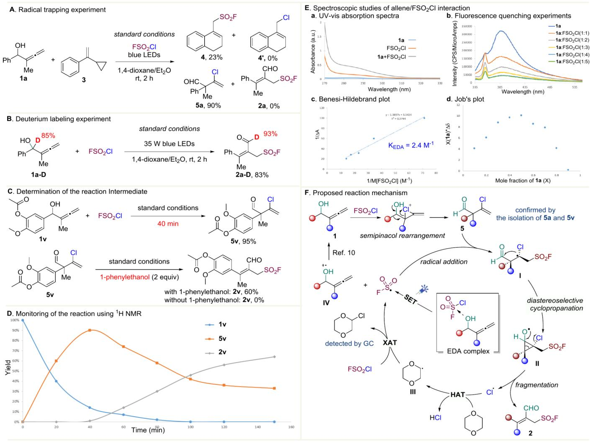

Scheme 3. Mechanistic Investigations and Plausible Reaction Mechanism  
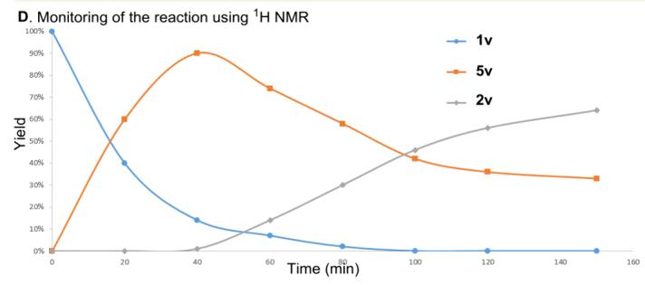

Scheme 4. Use of Other Radical Precursors  
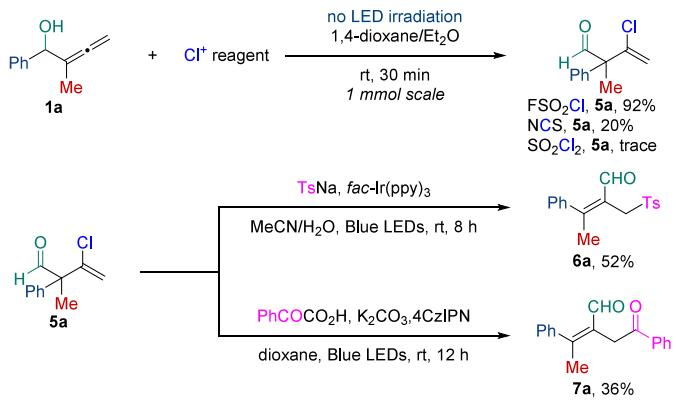

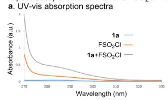

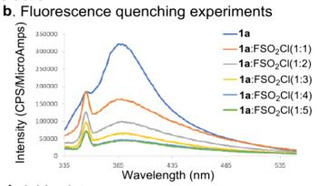

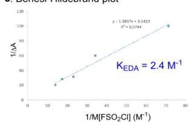

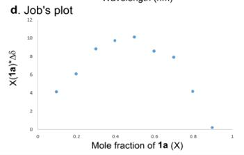

Scheme 5. Product Derivatizations  
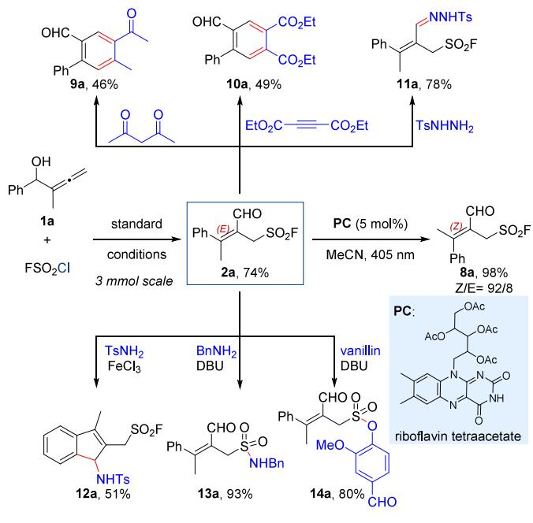

We initiated our mechanistic investigations by conducting a radical trapping experiment (Scheme 3A). When (1- cyclopropylvinyl)benzene 3 was added to the standard reaction of 1a with $\mathrm { F S O } _ { 2 } \mathrm { C l } _ { \cdot }$ , dihydronaphthalene 4 was isolated in 23% yield, thereby indicating the involvement of a reaction sequence of fluorosulfonyl radical addition/cyclopropyl ringopening/cyclization. Meanwhile, 1a was converted to intermediate 5a by the reaction with $\mathrm { F S O } _ { 2 } \mathrm { C l }$ via semipinacol rearrangement, and $4 ^ { \prime }$ or 2a was not obtained. In addition, when 1a-D was subjected to the standard conditions, 2a-D was isolated in 83% yield, strongly supporting the formyl migration is involved in the reaction (Scheme 3B). Interestingly, when the reaction of 1v and $\mathrm { F S O } _ { 2 } \mathrm { C l }$ was quenched after 40 min, vinyl chloride 5v could be isolated in 95% yield (Scheme 3C). Resubjecting $\pmb { 5 } \mathbf { v }$ to the standard conditions with additional 1- phenylethanol as the electron donor produced desired product 2v in 60% yield, suggesting that 5v is a plausible reaction intermediate. When the reaction 1v and $\mathrm { F S O } _ { 2 } \mathrm { C l }$ was monitored by 1H NMR throughout its entire course, the conversion of allenol 1v to 5v and further to sulfonyl fluoride 2v as the final product was observed clearly (Scheme 3D).

Moreover, several spectroscopic studies were also performed to probe the generation of $\mathrm { F } \bar { \mathrm { S } } \mathrm { O } _ { 2 } ^ { \bullet }$ via EDA photoactivation (Scheme 3E). The ultraviolet−visible $\left( \mathrm { U V - v i s } \right)$ absorption experiments showed a significant red shift for the mixture of 1a and $\mathrm { F S O } _ { 2 } \mathrm { C l }$ (Scheme 3E(a)). The fluorescence quenching studies showed that allenol 1a could be eficiently quenched by $\mathrm { F S O } _ { 2 } \mathrm { C l }$ (Scheme 3E(b)). Based on the Benesi−Hildebrand method, an association constant $\left( K _ { \mathrm { E D A } } \right)$ of $2 . 4 \mathbf { M } ^ { - 1 }$ between 1a and $\mathrm { F S O } _ { 2 } \mathrm { C l }$ in $\mathrm { P h C F } _ { 3 }$ was obtained (Scheme $3 \mathrm { E } ( \mathrm { c } ) )$ Additionally, $\texttt { a } 1 : 1$ EDA complex between 1a and $\mathrm { F S O } _ { 2 } \mathrm { C l }$ was demonstrated by Job’s plot analysis (Scheme 3E(d)).

Based on these mechanistic studies, a plausible mechanism is outlined in Scheme 3F. Allenol 1 would first undergo semipinacol rearrangement with FSO Cl as the efective ${ \check { \mathrm { C l } } } ^ { + }$ synthon,18 resulting in vinyl chloride 5. Meanwhile, visible light irradiation of the EDA complex, formed by the association of donor 1 with acceptor $\mathrm { F S } \bar { \mathrm { O } } _ { 2 } \mathrm { C l } ,$ generated the $\mathrm { F S O } _ { 2 }$ radical. Then, radical addition to the terminal olefin would occur, afording the alkyl radical I. Radical I underwent a diastereoselective cyclization to the aldehyde group, leading to alkoxy radical II. Subsequent fragmentation of the halogensubstituted cyclopropane II provided the desired sulfonyl fluoride 2 along with a chlorine radical. The resulting chlorine radical could then facilitate hydrogen atom transfer (HAT) with 1,4-dioxane to give α-oxo carbon-centered radical III, which engaged in halogen atom transfer (XAT) with $\mathrm { F S O } _ { 2 } \mathrm { C l }$ to deliver the $\mathrm { F S O } _ { 2 }$ radical.

We continued the studies by extending the reaction partners to other sources of radicals using a two-step procedure (Scheme 4). While halogen-promoted semipinacol rearrangement of allenols has been reported by $\dot { \mathbf { M } } \mathbf { a } , ^ { 1 8 }$ electrophilic halogenated reagents are restricted to $^ { \omega } \mathrm { B } \mathrm { \dot { r } } ^ { + \mathfrak { n } }$ and $^ { \omega } \mathrm { I } ^ { + \mathfrak { p } }$ . We found that $\mathrm { F S O } _ { 2 } \mathrm { C l }$ could function as an eficient $\mathrm { C l ^ { + } }$ reagent to facilitate the 1,2-aryl migration of allenols. Vinyl chloride 5a was isolated in 92% yield from the reaction of 1a with $\mathrm { F S O } _ { 2 } \mathrm { C l } .$ In contrast, the use of NCS and $S O _ { 2 } C \mathrm { l } _ { 2 }$ as halogenated reagents resulted in ineficient rearrangement, leading to the desired product 5a in 20% yield and a trace, respectively. Both sodium p-toluenesulfonate and phenylglyoxylic acid proved to be suitable radical precursors to react with ${ \mathfrak { s a } } ,$ furnishing the corresponding tetrasubstituted olefins 6a and 7a.

To demonstrate the synthetic utility of our methodology, we performed several synthetic transformations on product 2a (Scheme 5). Photosensitized alkene isomerization is a powerful synthetic strategy,20 which ofers the opportunity for the stereodivergent synthesis of both E and Z isomers. Thus, we developed the isomerization conditions using riboflavin tetraacetate as the photosensitizer under 405 nm irradiation and converted the thermodynamically favored E-isomer 2a to less stable Z-isomer 8a. Next, 2a underwent $[ 4 + 2 ]$ annulation with acetylacetone or diethyl acetylenedicarboxylate, leading to tetrasubstituted arenes 9a or $\mathbf { 1 0 a } ,$ respectively. The aldehyde group within 2a was then condensed with TsNHNH to give N-Tosylhydrazone 11a, setting the stage for diverse follow-up functionalization. Treatment of 2a with TsNH in the presence of $\mathrm { F e C l } _ { 3 }$ resulted in aminoindene 12a through tandem condensation/Friedel−Crafts cyclization.21 Finally, sulfonamide 13a and sulfonate 14a could be obtained in high yields from SuFEx reactions of 2a.

In conclusion, we have developed an unprecedented photochemical method to construct all-carbon tetrasubstituted olefins from allenols with $\mathrm { F S O } _ { 2 } \mathrm { C l } .$ The operationally simple protocol proceeds via a semipinacol rearrangement/radical 1,2- formyl migration cascade in an excellent regio- and stereoselective manner in the absence of any catalysts and additives. Mechanistic studies point out that $\mathrm { F S O } _ { 2 } \mathrm { C l }$ acts as an efective Cl+ synthon to facilitate semipinacol rearrangement, an electron acceptor to form EDA complexes, and a $\mathrm { F S O } _ { 2 } ^ { \bullet }$ precursor to initiate radical 1,2-carbonyl migration. Furthermore, other types of radical precursors can be also applicable to this method, and the multifunctional tetrasubstituted olefins bestow diverse postsynthetic utilities.

## ■ ASSOCIATED CONTENT

## Data Availability Statement

The data underlying this study are available in the published article and its Supporting Information.

## \*sı Supporting Information

The Supporting Information is available free of charge at https://pubs.acs.org/doi/10.1021/acs.orglett.5c01982.

Experimental procedures, characterization data, mechanistic studies, crystallographic data for ${ \bf 2 9 }$ (2373146), and NMR spectra (PDF)

## Accession Codes

Deposition Number 2373146 contains the supplementary crystallographic data for this paper. These data can be obtained free of charge via the joint Cambridge Crystallographic Data Centre (CCDC) and Fachinformationszentrum Karlsruhe Access Structures service.

## ■ AUTHOR INFORMATION

## Corresponding Author

Shenlin Huang − Jiangsu Co-Innovation Center of Eficient Processing and Utilization of Forest Resources, International Innovation Center for Forest Chemicals and Materials, Nanjing Forestry University, Nanjing 210037, China;

orcid.org/0000-0001-7322-6981; Email: shuang@ njfu.edu.cn

## Authors

Tianyu He − Jiangsu Co-Innovation Center of Eficient Processing and Utilization of Forest Resources, International Innovation Center for Forest Chemicals and Materials, Nanjing Forestry University, Nanjing 210037, China

Chao Kong − Jiangsu Co-Innovation Center of Eficient Processing and Utilization of Forest Resources, International Innovation Center for Forest Chemicals and Materials, Nanjing Forestry University, Nanjing 210037, China

Yukai Liu − Jiangsu Co-Innovation Center of Eficient Processing and Utilization of Forest Resources, International Innovation Center for Forest Chemicals and Materials, Nanjing Forestry University, Nanjing 210037, China

Yu Zheng − Jiangsu Co-Innovation Center of Eficient Processing and Utilization of Forest Resources, International Innovation Center for Forest Chemicals and Materials, Nanjing Forestry University, Nanjing 210037, China; orcid.org/0000-0002-1683-5577

Yanju Lu − Jiangsu Co-Innovation Center of Eficient Processing and Utilization of Forest Resources, International Innovation Center for Forest Chemicals and Materials, Nanjing Forestry University, Nanjing 210037, China

Xiaoxiang Zhang − Jiangsu Co-Innovation Center of Eficient Processing and Utilization of Forest Resources, International Innovation Center for Forest Chemicals and Materials, Nanjing Forestry University, Nanjing 210037, China; orcid.org/0000-0001-9811-0221

Complete contact information is available at: https://pubs.acs.org/10.1021/acs.orglett.5c01982

## Notes

The authors declare no competing financial interest.

## ■ ACKNOWLEDGMENTS

Financial support from the National Natural Science Foundation of China (32171724, 22201133, and 32271818) is gratefully acknowledged.

## ■ REFERENCES

(1) (a) McCague, R.; Leclercq, G.; Legros, N.; Goodman, J.; Blackburn, G. M.; Jarman, M.; Foster, A. B. Derivatives of tamoxifen. Dependence of antiestrogenicity on the 4-substituent. J. Med. Chem. 1989, 32, 2527. (b) Clark, B.; Capon, R. J.; Lacey, E.; Tennant, S.; Gill, J. H.; Bulheller, B.; Bringmann, G. Gymnoascolides A−C: Aromatic Butenolides from an Australian Isolate of the Soil Ascomycete Gymnoascus reessii. J. Nat. Prod. 2005, 68, 1226. (c) Williams, R. B.; Norris, A.; Slebodnick, C.; Merola, J.; Miller, J. S.; Andriantsiferana, R.; Rasamison, V. E.; Kingston, D. G. I. Cytotoxic Sesquiterpene Lactones from Vernonia pachyclada from the Madagascar Rainforest. J. Nat. Prod. 2005, 68, 1371. (d) Lai, A.; Kahraman, M.; Govek, S.; Nagasawa, J.; Bonnefous, C.; Julien, J.; Douglas, K.; Sensintaffar, J.; Lu, N.; Lee, K.-j.; Aparicio, A.; Kaufman, J.; Qian, J.; Shao, G.; Prudente, R.; Moon, M. J.; Joseph, J. D.; Darimont, B.; Brigham, D.; Grillot, K.; Heyman, R.; Rix, P. J.; Hager, J. H.; Smith, N. D. Identification of GDC-0810 (ARN-810), an Orally Bioavailable Selective Estrogen Receptor Degrader (SERD) that Demonstrates Robust Activity in Tamoxifen-Resistant Breast Cancer Xenografts. J. Med. Chem. 2015, 58, 4888.

(2) (a) Flynn, A. B.; Ogilvie, W. W. Stereocontrolled Synthesis of Tetrasubstituted Olefins. Chem. Rev. 2007, 107, 4698−4745. (b) Polák, P.; Váňová, H.; Dvorák, ̌ D.; Tobrman, T. Recent progress

in transition metal-catalyzed stereoselective synthesis of acyclic allcarbon tetrasubstituted alkenes. Tetrahedron Lett. 2016, 57, 3684. (c) Lecourt, C.; Dhambri, S.; Allievi, L.; Sanogo, Y.; Zeghbib, N.; Ben Othman, R.; Lannou, M. I.; Sorin, G.; Ardisson, J. Natural products and ring-closing metathesis: synthesis of sterically congested olefins. Nat. Prod. Rep. 2018, 35, 105. (d) Buttard, F.; Sharma, J.; Champagne, P. A. Recent advances in the stereoselective synthesis of acyclic all-carbon tetrasubstituted alkenes. Chem. Commun. 2021, 57, 4071.

(3) (a) Ren, X.; Lu, Z. Visible light promoted difunctionalization reactions of alkynes. Chin. J. Catal. 2019, 40, 1003. (b) Chen, Y.; Wang, J.; Wu, X.; Zhu, C. Radical-Mediated Functionalization of Internal Alkenes: Synthesis of Multisubstituted Allylic and Homoallylic Azides. ACS Org. & Inorg. Au 2022, 2, 392. (c) He, C. L.; Wang, M.; Wang, Y. L.; Zhao, L. R.; Zhou, Y. K.; Zhang, K. Y.; Shen, S. Y.; Su, Y. Q.; Duan, X. H.; Liu, L. Photoredox catalytic alkylarylation of alkynes with arylsulfonylacetate as bifunctional reagent. Sci. China Chem. 2024, 67, 2022. (d) Li, Y.; Bai, H.; Gao, Q.; Liu, K.; Han, J.; Li, W.; Zhu, C.; Xie, J. Stereoselective benzylic C(sp3)−H alkenylation enabled by metallaphotoredox catalysis. Chem. Sci. 2024, 15, 12511.

(4) Li, Y. T.; Shao, Q. Z.; He, H. C.; Zhu, C. J.; Xue, X. S.; Xie, J. Highly selective synthesis of all-carbon tetrasubstituted alkenes by deoxygenative alkenylation of carboxylic acids. Nat. Commun. 2022, 13, 10.

(5) Zeng, Q.; Nirwan, Y.; Benet-Buchholz, J.; Kleij, A. W. An Expedient Radical Approach for the Decarboxylative Synthesis of Stereodefined All-Carbon Tetrasubstituted Olefins. Angew. Chem., Int. Ed. 2024, 63, No. e202403651.

(6) (a) Dong, J.; Krasnova, L.; Finn, M. G.; Sharpless, K. B. Sulfur(VI) Fluoride Exchange (SuFEx): Another Good Reaction for Click Chemistry. Angew. Chem., Int. Ed. 2014, 53, 9430. (b) Yatvin, J.; Brooks, K.; Locklin, J. SuFEx Click: New Materials from SOxF and Silyl Ethers. Chem.-Eur. J. 2016, 22, 16348. (c) Chinthakindi, P. K.; Arvidsson, P. I. Sulfonyl Fluorides (SFs): More Than Click Reagents? Eur. J. Org. Chem. 2018, 2018, 3648. (d) Barrow, A. S.; Smedley, C. J.; Zheng, Q.; Li, S.; Dong, J.; Moses, J. E. The growing applications of SuFEx click chemistry. Chem. Soc. Rev. 2019, 48, 4731. (e) Meng, Y.- P.; Wang, S.-M.; Fang, W.-Y.; Xie, Z.-Z.; Leng, J.; Alsulami, H.; Qin, H.-L. Ethenesulfonyl Fluoride (ESF) and Its Derivatives in SuFEx Click Chemistry and More. Synthesis 2020, 52, 673. (f) Marra, A.; Nativi, C.; Dondoni, A. On the scope of SuFEx as a bioorthogonal click process. New J. Chem. 2020, 44, 4678. (g) Xu, L.; Dong, J. Click Chemistry: Evolving on the Fringe. Chin. J. Chem. 2020, 38, 414. (h) Zhong, T.; Chen, Z.; Yi, J.; Lu, G.; Weng, J. Recent progress in the synthesis of sulfonyl fluorides for SuFEx click chemistry. Chin. Chem. Lett. 2021, 32, 2736. (i) Homer, J. A.; Xu, L.; Kayambu, N.; Zheng, Q.; Choi, E. J.; Kim, B. M.; Sharpless, K. B.; Zuilhof, H.; Dong, J.; Moses, J. E. Sulfur fluoride exchange. Nat. Rev. Methods Primers 2023, 3, 58.

(7) (a) Prakash Reddy, V.; Bellew, D. R.; Prakash, G. K. S. A convenient preparation of sulfuryl chloride fluoride. J. Fluorine Chem. 1992, 56, 195. (b) Ma, T.; Zheng, Y.; Huang, S. SO2ClF: A Reagent for Controllable Chlorination and Chlorooxidation of Simple Unprotected Indoles. J. Org. Chem. 2023, 88, 4839. (c) Zheng, Y.; Ma, T.; Liu, B.; Huang, S. SO2ClF-promoted chlorination-oxidation of 2-methylindoles: a one-step synthetic method to access 2,3- difunctionalized indoles. Org. Chem. Front. 2023, 10, 4100.

(8) Nie, X.; Xu, T.; Song, J.; Devaraj, A.; Zhang, B.; Chen, Y.; Liao, S. Radical Fluorosulfonylation: Accessing Alkenyl Sulfonyl Fluorides from Alkenes. Angew. Chem., Int. Ed. 2021, 60, 3956.

(9) (a) Nie, X.; Xu, T.; Hong, Y.; Zhang, H.; Mao, C.; Liao, S. Introducing A New Class of Sulfonyl Fluoride Hubs via Radical Chloro-Fluorosulfonylation of Alkynes. Angew. Chem., Int. Ed. 2021, 60, 22035. (b) He, F.-S.; Li, Y.; Wu, J. Fluorosulfonyl radicals: new horizons for the synthesis of sulfonyl fluorides. Org. Chem. Front. 2022, 9, 5299.

(10) (a) Chen, D.; Nie, X.; Feng, Q.; Zhang, Y.; Wang, Y.; Wang, Q.; Huang, L.; Huang, S.; Liao, S. Electrochemical Oxo-

Fluorosulfonylation of Alkynes under Air: Facile Access to β-Keto Sulfonyl Fluorides. Angew. Chem., Int. Ed. 2021, 60, 27271. (b) Feng, $\mathrm { Q . ; }$ Fu, Y.; Zheng, Y.; Liao, S.; Huang, S. Electrochemical Synthesis of β-Keto Sulfonyl Fluorides via Radical Fluorosulfonylation of Vinyl Triflates. Org. Lett. 2022, 24, 3702. (c) Feng, Q.; He, T.; Qian, S.; Xu, P.; Liao, S.; Huang, S. Electroreductive hydroxy fluorosulfonylation of alkenes. Nat. Commun. 2023, 14, 8278.

(11) (a) Zhao, X.; Chen, D.; Zhu, S.; Luo, J.; Liao, S.; Zheng, B.; Huang, S. Fluorosulfonylvinylation of Unactivated C(sp3)−H via Electron Donor−Acceptor Photoactivation. Org. Lett. 2023, 25, 3109. (b) Zhang, Y.; Feng, Q.; Zheng, Y.; Lu, Y.; Liao, S.; Huang, S. Radical Hydro-Fluorosulfonylation of Propargylic Alcohols via Electron Donor−Acceptor Photoactivation. Org. Lett. 2024, 26, 1410.

(12) (a) Lee, C.; Cook, A. J.; Elisabeth, J. E.; Friede, N. C.; Sammis, G. M.; Ball, N. D. The Emerging Applications of Sulfur(VI) Fluorides in Catalysis. ACS Catal. 2021, 11, 6578. (b) Lou, T. S.-B.; Willis, M. C. Sulfonyl fluorides as targets and substrates in the development of new synthetic methods. Nat. Rev. Chem. 2022, 6, 146. (c) Lou, T. S. B.; Kawamata, Y.; Ewing, T.; Correa-Otero, G. A.; Collins, M. R.; Baran, P. S. Scalable, Chemoselective Nickel Electrocatalytic Sulfinylation of Aryl Halides with SO2. Angew. Chem., Int. Ed. 2022, 61, No. e202208080. (d) Zeng, D.; Deng, W.-P.; Jiang, X. Advances in the construction of diverse SuFEx linkers. Natl. Sci. Rev. 2023, 10, nwad123. (e) Kong, X.; Chen, Y.; Chen, X.; Ma, C.; Chen, M.; Wang, W.; Xu, Y.-Q.; Ni, S.-F.; Cao, Z.-Y. Organomediated electrochemical fluorosulfonylation of aryl triflates via selective C−O bond cleavage. Nat. Commun. 2023, 14, 6933.

(13) (a) Frye, N. L.; Daniliuc, C. G.; Studer, A. Radical 1- Fluorosulfonyl-2-alkynylation of Unactivated Alkenes. Angew. Chem., Int. Ed. 2022, 61, No. e202281261. (b) Erchinger, J. E.; Hoogesteger, R.; Laskar, R.; Dutta, S.; Hümpel, C.; Rana, D.; Daniliuc, C. G.; Glorius, F. EnT-Mediated N−S Bond Homolysis of a Bifunctional Reagent Leading to Aliphatic Sulfonyl Fluorides. J. Am. Chem. Soc. 2023, 145, 2364. (c) Zheng, Y.; Lu, W.; Ma, T.; Huang, S. Recent advances in photochemical and electrochemical strategies for the synthesis of sulfonyl fluorides. Org. Chem. Front. 2023, 11, 217.

(14) (a) Song, Z.-L.; Fan, C.-A.; Tu, Y.-Q. Semipinacol Rearrangement in Natural Product Synthesis. Chem. Rev. 2011, 111, 7523. (b) Zhang, X.-M.; Li, B.-S.; Wang, S.-H.; Zhang, K.; Zhang, F.-M.; Tu, Y.-Q. Recent development and applications of semipinacol rearrangement reactions. Chem. Sci. 2021, 12, 9262.

(15) (a) Li, Z. L.; Li, X. H.; Wang, N.; Yang, N. Y.; Liu, X. Y. Radical-Mediated 1,2-Formyl/Carbonyl Functionalization of Alkenes and Application to the Construction of Medium-Sized Rings. Angew. Chem., Int. Ed. 2016, 55, 15100. (b) Wu, X.; Zhu, C. Radical-Mediated Remote Functional Group Migration. Acc. Chem. Res. 2020, 53, 1620. (c) Wu, X.; Ma, Z.; Feng, T.; Zhu, C. Radical-mediated rearrangements: past, present, and future. Chem. Soc. Rev. 2021, 50, 11577.

(16) Wang, P.; Zhang, H.; Nie, X.; Xu, T.; Liao, S. Photoredox catalytic radical fluorosulfonylation of olefins enabled by a benchstable redox-active fluorosulfonyl radical precursor. Nat. Commun. 2022, 13, 3370.

(17) Zhang, W.; Li, H.; Li, X.; Zou, Z.; Huang, M.; Liu, J.; Wang, X.; Ni, S.; Pan, Y.; Wang, Y. A practical fluorosulfonylating platform via photocatalytic imidazolium-based SO2F radical reagent. Nat. Commun. 2022, 13, 3515.

(18) (a) Fu, C.; Li, J.; Ma, S. Efficient two-step synthesis of 3-halo-3- enals or 2-halo-2-alkenyl ketones from propargylic bromides via a unique cationic 1,2-aryl or proton shift in electrophilic addition reaction of 2,3-allenols with X+. Chem. Commun. 2005, 4119. (b) Li, J.; Fu, C.; Chen, $\mathrm { G } . { \mathrm { ; } }$ Chai, G.; Ma, S. Studies on Electrophilic Interaction of 2,3-Allenols with Electrophilic Halogen Reagents: Selective Synthesis of 2,5-Dihydrofurans, 3-Halo-3-alkenals, or 2- Halo-2-alkenyl Ketones. Adv. Synth. Catal. 2008, 350, 1376.

(19) (a) Blanco, L.; Amice, P.; Conia, J.-M. Reaction of Chloromethylcarbene with Trimethylsilyl Enol Ethers; Conversion of Cycloalkanones into Higher α-Methylcycloalkenones. Synthesis 1981, 1981, 289. (b) Slougui, N.; Rousseau, G. Etude de la reaction

chlorocarbene-acetals de cetenes. Tetrahedron 1985, 41, 2643. (c) Fouque, E.; Rousseau, G.; Seyden-Penne, J. Iterative synthesis of selectively substituted.alpha.,.beta.-unsaturated and saturated medium-ring lactones. J. Org. Chem. 1990, 55, 4807.

(20) Nevesely,́ T.; Wienhold, M.; Molloy, J. J.; Gilmour, R. Advances in theE → ZIsomerization of Alkenes Using Small Molecule Photocatalysts. Chem. Rev. 2022, 122, 2650.

(21) Fan, X.; Lv, H.; Guan, Y.-H.; Zhu, H.-B.; Cui, X.-M.; Guo, K. Assembly of indenamine derivatives through in situ formed Nsulfonyliminium ion initiated cyclization. Chem. Commun. 2014, 50, 4119.