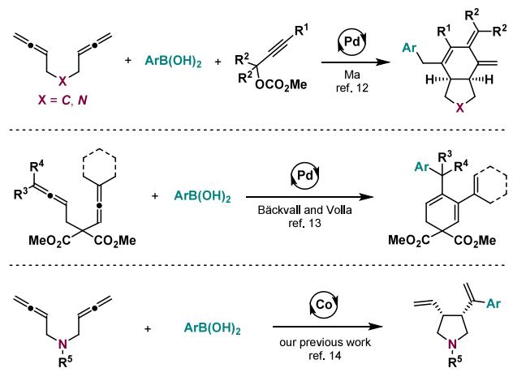
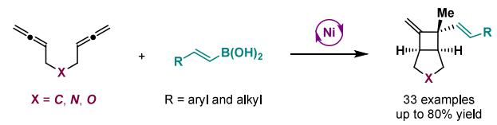
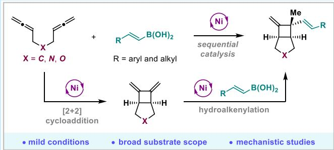
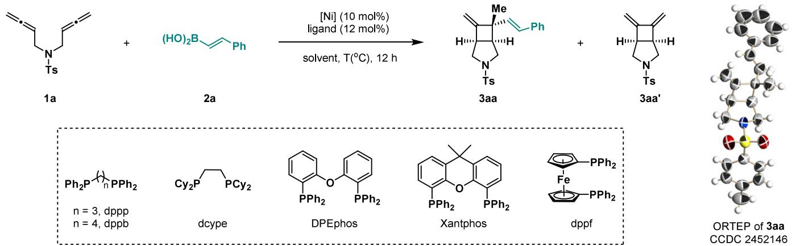
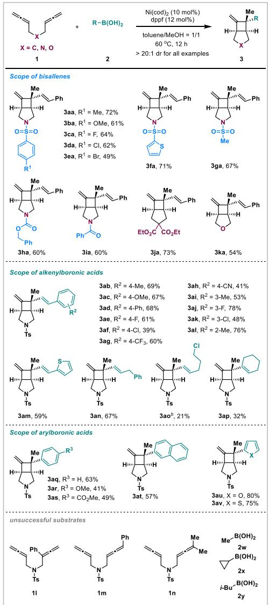
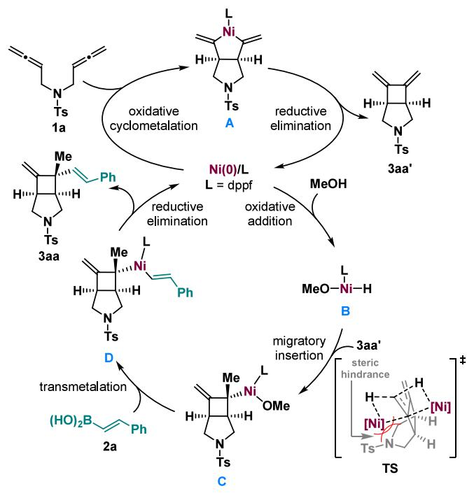
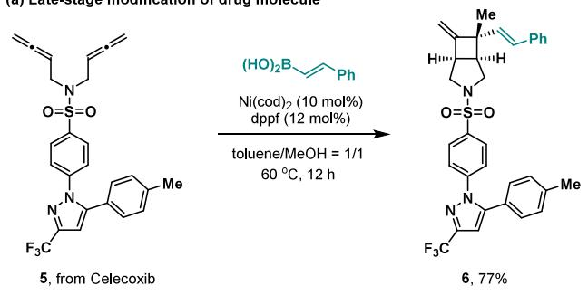
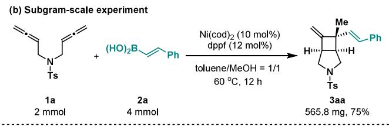
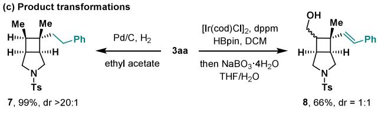

pubs.acs.org/OrgLett

# Nickel-Catalyzed Cascade Carbocyclization/Alkenylation of Bisallenes and Organoboronic Acids

Xiao-Die An, Tao Wang, Ji-Xun Guan, Yun-Xuan Tan,\* and Ping Tian\*

Cite This: Org. Lett. 2025, 27, 7614−7619

Read Online

ACCESS

Metrics & More

Article Recommendations

ABSTRACT: The transition metal-catalyzed cascade carbocyclization of bisallenes represents an eficient strategy for constructing versatile carbo- and heterocycles. Herein, we report a nickelcatalyzed cascade carbocyclization/alkenylation of bisallenes and organoboronic acids, enabling the synthesis of diverse bicyclo[3.2.0]heptanes with a broad substrate scope and high selectivity. Mechanistic experiments suggest that this transformation proceeds through a unique sequential nickel-catalyzed process: first, a nickel-catalyzed regioselective [2 + 2] cycloaddition of bisallenes, followed by the nickel-catalyzed hydroalkenylation of the diene intermediate with alkenylboronic acids.

C arbo- and heterocyclic skeletons are important structural components of bioactive natural products, drug mole-

Scheme 1. Transition Metal-Catalyzed Carbocyclization of Bisallenes and Organoboronic Acids

(a) Previous works: Pd or Co-catalyzed carbocyclization/arylation of bisallenes

(b) This work: Ni-catalyzed carbocyclization/alkenylation of 1,5-bisallenes

• mild conditions • broad substrate scope

• high selectivity • mechanistic studies

\*sı Supporting Information

cules, and functional materials. The development of highly eficient, practical, and selective cyclization methods has garnered significant attention in modern organic synthesis.1,2 Among various synthetic strategies, the transition metalcatalyzed cascade cyclization of readily accessible linear 1,n bifunctional substrates has emerged as a robust approach for synthesizing complex and diverse cyclic compounds with remarkable step and atom economy.3 Nevertheless, the transition metal-catalyzed cascade cyclization of 1,n-bisallenes comprising two discontinuous allene units remains relatively underexplored.4 This is likely attributed to the dificulty in controlling the reactivity and selectivity.5 Recent progress has been made in the transition metal-catalyzed cycloisomerization of bisallenes6 and their cascade carbocyclization reactions with unsaturated compounds (e.g., allenes, carbon monoxide, alkenes, and alkynes).7 However, the functionalized carbocyclization of bisallenes to produce versatile carbo- and heterocycles is highly demanding.8−14 For instance, palladiumcatalyzed bisfunctional cyclization (e.g., silastannylation, distannylation, and germastannylation),8 borylation carbocyclization,9 and multicomponent cascade carbocyclization of bisallenes10 have been reported.11 Furthermore, the transition metal-catalyzed carbocyclization/arylation of bisallenes has also been gradually implemented (Scheme 1a).12−14 In 2009, Ma and co-workers reported a palladium-catalyzed regioselective cascade carbocyclization of 1,5-bisallenes with propargylic carbonates and arylboronic acids, ofering an eficient route to bicyclo[4.3.0]nonenes.12 Subsequently, Backvall ̈ and Volla realized a palladium-catalyzed carbocyclization/arylation of 1,4-bisallenes for preparing six-membered carbocycles. 13 More recently, our group achieved the first earth-abundant cobalt- catalyzed regio- and diastereoselective carbocyclization/arylation of 1,5-bisallenes, yielding cis-disubstituted pyrrole derivatives.14 Despite the aforementioned advances, the investigation of carbocyclization/alkenylation of bisallenes with alkenylboronic acids is limited, and new methods for constructing diferent cyclic skeletons are also in high demand.12−14 Herein, we present a nickel-catalyzed cascade carbocyclization/alkenylation of bisallenes and alkenylboronic acids (Scheme 1b). This catalytic system accommodates not only carbon-, nitrogen-, and oxygen-linked bisallenes but also alkenyl and arylboronic acids, producing bicyclo[3.2.0]- heptanes under mild conditions with high selectivity.

Table 1. Reaction Developmenta  

<table><tr><td>entry</td><td>[Ni]</td><td>ligand</td><td>solvent</td><td>T (°C)</td><td>yield of 3aa (%)b</td><td>yield of 3aa&#x27; (%)b</td></tr><tr><td>1</td><td> $\operatorname { N i } ( \operatorname { c o d } ) _ { 2 }$ </td><td>dppp</td><td>MeOH</td><td>60</td><td>0</td><td>0</td></tr><tr><td>2</td><td> $\operatorname { N i } ( \operatorname { c o d } ) _ { 2 }$ </td><td>dppb</td><td>MeOH</td><td>60</td><td>52</td><td>0</td></tr><tr><td>3</td><td> $\operatorname { N i } ( \operatorname { c o d } ) _ { 2 }$ </td><td>dcype</td><td>MeOH</td><td>60</td><td>0</td><td>0</td></tr><tr><td>4</td><td> $\operatorname { N i } ( \operatorname { c o d } ) _ { 2 }$ </td><td>DPEphos</td><td>MeOH</td><td>60</td><td>36</td><td>0</td></tr><tr><td>5</td><td> $\operatorname { N i } ( \operatorname { c o d } ) _ { 2 }$ </td><td>Xantphos</td><td>MeOH</td><td>60</td><td>53</td><td>0</td></tr><tr><td>6</td><td> $\operatorname { N i } ( \operatorname { c o d } ) _ { 2 }$ </td><td>dppf</td><td>MeOH</td><td>60</td><td>68</td><td>0</td></tr><tr><td>7</td><td> ${ \mathrm { N i } } { \left( \mathrm { a c a c } \right) } _ { 2 } { \cdot } { \mathrm { H } } _ { 2 } { \mathrm { O } }$ </td><td>dppf</td><td>MeOH</td><td>60</td><td>23</td><td>39</td></tr><tr><td>8</td><td> $\mathrm { N i } ( \mathrm { O A c } ) _ { 2 } { \cdot } 4 \mathrm { H } _ { 2 } \mathrm { O }$ </td><td>dppf</td><td>MeOH</td><td>60</td><td>60</td><td>0</td></tr><tr><td>9</td><td> $\operatorname { N i } ( \operatorname { c o d } ) _ { 2 }$ </td><td>dppf</td><td>MeOH</td><td>50</td><td>29</td><td>0</td></tr><tr><td>10</td><td> $\operatorname { N i } ( \operatorname { c o d } ) _ { 2 }$ </td><td>dppf</td><td>MeOH</td><td>70</td><td>66</td><td>0</td></tr><tr><td>11</td><td> $\operatorname { N i } ( \operatorname { c o d } ) _ { 2 }$ </td><td>dppf</td><td>EtOH</td><td>60</td><td>54</td><td>0</td></tr><tr><td>12</td><td> $\operatorname { N i } ( \operatorname { c o d } ) _ { 2 }$ </td><td>dppf</td><td>i-PrOH</td><td>60</td><td>24</td><td>0</td></tr><tr><td>13</td><td> $\operatorname { N i } ( \operatorname { c o d } ) _ { 2 }$ </td><td>dppf</td><td>toluene</td><td>60</td><td>4</td><td>45</td></tr><tr><td>14</td><td> $\operatorname { N i } ( \operatorname { c o d } ) _ { 2 }$ </td><td>dppf</td><td>DCE</td><td>60</td><td>0</td><td>36</td></tr><tr><td>15</td><td> $\operatorname { N i } ( \operatorname { c o d } ) _ { 2 }$ </td><td>dppf</td><td>THF</td><td>60</td><td>6</td><td>38</td></tr><tr><td>16</td><td> $\operatorname { N i } ( \operatorname { c o d } ) _ { 2 }$ </td><td>dppf</td><td>toluene/MeOH (1/1)</td><td>60</td><td>75</td><td>0</td></tr></table>

aReactions were performed with 1a (0.1 mmol, 1.0 equiv), 2a (0.2 mmol, 2.0 equiv), [Ni] (10 mol %), a ligand (12 mol %), and a solvent (1.0 mL) under a $\Nu _ { 2 }$ atmosphere for 12 h. The conversion of 1a exceeded 95% in all cases. bYield detected by 1H nuclear magnetic resonance (1H NMR) analysis of unpurified mixtures with $\mathrm { C H } _ { 2 } \mathrm { B r } _ { 2 }$ as the internal standard.

The reaction conditions were optimized with bisallene 1a and (E)-styrylboronic acid 2a serving as model substrates, and the selected results are summarized in Table 1. Diferent commercially available bisphosphine ligands were tested in the presence of 10 mol % Ni(cod) (Table 1, entries 1−6). To our delight, carbocyclization/alkenylation product 3aa was successfully obtained, and no potential $[ 2 + { \bar { 2 } } ]$ cycloaddition product $3 \mathbf { a } \mathbf { \dot { a } } ^ { \prime }$ was detected.6 Notably, the bisphosphine ligand with a small natural bite angle failed to generate 3aa (Table 1, entries 1 and 3).15 The relative configuration of 3aa was determined by X-ray crystallography (CCDC 2452146). Then, nickel(II) catalysts were examined, but the yield could not be obviously enhanced (Table 1, entries 7 and 8). Both 3aa and ${ \bf 3 } { \bf a } { \bf a } ^ { \prime }$ were observed when ${ \mathrm { N i } } ( \mathrm { a c a c } ) _ { 2 } { \cdot } { \mathrm { H } } _ { 2 } { \mathrm { O } }$ was used as the catalyst. Reaction temperature studies revealed that either increasing or decreasing the temperature reduced the yield (Table 1, entry 9 or 10, respectively). Subsequently, several diferent solvents, including alcohol, nonpolar and polar solvents, and ether, were further screened (Table 1, entries 11−15). In the absence of an alcohol as the solvent, the formation of 3aa was nearly negligible, indicating that the solvent played an important role in the reaction. The oxidative addition of $\mathrm { N i } ( \mathrm { c o d } ) _ { \mathrm { 2 } }$ and alcohol might be involved in the critical step of the reaction.16 Finally, diferent mixed solvents were examined, and the yield was efectively improved using a toluene/MeOH solvent (Table 1, entry 16).

With the optimal conditions established, we explored the substrate scope of this nickel-catalyzed cascade carbocyclization/alkenylation of bisallenes (Scheme 2). First, the scope of 1,5-bisallenes was investigated, and all of the reactions proceeded smoothly to produce the bicyclo[3.2.0]heptanes in moderate to good yields (49−73%, 3aa−3ka). Diferent protecting groups on the nitrogen, such as sulfonyl, carboxybenzyl, and benzoyl groups, were all suitably employed in this transformation (3aa−3ia). The electronic efects of arylsulfonyl groups had no significant impact on the reaction eficiency. Moreover, apart from nitrogen-linked bisallenes, carbon- and oxygen-linked substrates were equally feasible to form the corresponding carbocyclization/alkenylation products in good yields (3ja and 3ka, respectively). When multisubstituted bisallenes 1l−1n were subjected to the standard conditions, they failed to generate either [2 + 2] cycloaddition products or the desired carbocyclization/alkenylation products. Next, the scope of alkeylboronic acids was explored. With a wide range of substituents, including electron-donating and electron-withdrawing groups, at the para position of (E)- styrylboronic acids, the reactions proceeded to generate the desired products with high regio- and diastereoselectivity (3ab−3ah). meta- and ortho-substituted (E)-styrylboronic acids were well tolerated, afording the carbocyclization/ alkenylation products in moderate to good yields (48−78%,

Scheme 2. Substrate Scope of 1,5-Bisallenes and Organoboronic Acidsa  
  
aReactions were conducted with bisallenes 1 (0.2 mmol, 1.0 equiv), boronic acids 2 (0.4 mmol, 2.0 equiv), Ni(cod) (10 mol %), dppf (12 mol %), and a toluene/MeOH solvent (1.0 mL/1.0 mL) under a $\Nu _ { 2 }$ atmosphere at 60 °C for 12 h. Isolated yields of products 3. bOn a 0.1 mmol scale.

## Scheme 3. Possible Reaction Mechanism

  
Scheme 4. Synthetic Applications

3ai−3al). The aryl chloride might undergo oxidative addition with the nickel(0) catalyst, causing a sharp decrease in yields (3af and 3ak). Besides, thiophene could also be introduced into the bicyclo[3.2.0]heptane skeleton (3am). Alkyl-substituted alkenylboronic acids (acyclic and cyclic) were still favorable in this reaction, albeit in relatively low yields (21− 67%, 3an−3ap). Furthermore, when kinds of arylboronic acids, including heterocycle-substituted boronic acids, were subjected to the standard conditions, the corresponding carbocyclization/arylation products were obtained in moderate to high yields (41−80%, 3aq−3av). However, only [2 + 2] cycloaddition product 3aa′ was formed when alkylboronic acids were used (2w−2y). Notably, a variety of functional groups, such as halogen, amide, ester, and cyano groups, were found to be compatible under this mild catalytic system. Although the nickel-catalyzed hydroarylation of 1,1- and 1,2- disubstituted alkenes with organoboronic acids has been achieved,17 even with an excess of boronic acid employed in our reactions, no further hydroarylation or hydroalkenylation occurred at the alkenes of the cyclic product.

Based on our comprehensive mechanistic studies (for details, see Scheme S1) and previous works,6,17,18 the possible reaction mechanism of this nickel-catalyzed cascade carbocyclization/alkenylation of bisallenes and alkenylboronic acids is shown in Scheme 3. Initially, 1a undergoes regioselective oxidative cyclometalation with nickel(0)/dppf to yield fivemembered nickelacycle A. Next, the reductive elimination of complex A forms 3aa′, while regenerating the nickel catalyst. Notably, the nickel-catalyzed [2 + 2] cycloaddition of bisallene 1a is a fast process, and it would not be obstructed by the addition of 2a. After the complete conversion of 1a, the nickel(0) species proceeds to initiate a second catalytic cycle. The oxidative addition of nickel(0) species with MeOH produces nickel hydride complex B. Then, coordination and regioselective migratory insertion of 3aa′ with nickel hydride complex B result in the formation of allylic nickel complex C. The transition state for this process shows that nickel hydride insertion from the front side encounters more steric hindrance than that from the back side. Subsequently, complex C undergoes transmetalation with 2a to yield complex D. Finally, complex D undergoes reductive elimination to aford 3aa and regenerate the nickel(0) species. The overall reaction mechanism contains two catalytic cycles. The first is the nickel-catalyzed regioselective [2 + 2] cycloaddition of bisallenes, and the second involves the subsequent hydroalkenylation of the diene intermediate with alkenylboronic acids. This represents a unique cascade process for the transition metal-catalyzed carbocyclization/alkenylation of bisallenes.12−14

To demonstrate the synthetic utility of this method, we first performed late-stage modification of a drug molecule (Scheme 4a). When celecoxib-derived bisallene 5 was subjected to the standard conditions, cascade carbocyclization/alkenylation product 6 was successfully obtained in good yield. Significantly, the reaction between 1a and 2a could be scaled up to the subgram level, yielding 3aa with sustained eficiency (Scheme 4b). Furthermore, downstream transformations of 3aa were conducted (Scheme 4c). Under a hydrogen atmosphere, the 1,1- and 1,2-disubstituted alkenes in 3aa could be readily reduced to form bicyclo[3.2.0]heptane 7 in quantitative yield with excellent diastereoselectivity. Additionally, in the presence of an iridium catalyst, one-pot hydroboration/oxidation selectively occurred at the 1,1-disubstituted alkene of 3aa, although with relatively low diastereoselectivity.

In conclusion, we achieved the first nickel-catalyzed cascade carbocyclization/alkenylation of bisallenes and organoboronic acids. Carbon-, nitrogen-, and oxygen-linked bisallenes and alkenyl and arylboronic acids are well tolerated in this reaction, resulting in the formation of various bicyclo[3.2.0]heptane derivatives with high selectivity and eficiency. Mechanistic experiments indicate that this reaction occurs through a unique two-step cascade process. It starts with a nickel-catalyzed [2 + 2] cycloaddition of bisallenes, followed by a nickel-catalyzed regioselective hydroalkenylation of the diene intermediate with alkenylboronic acids. Moreover, the practical utility of this method is showcased through the late-stage modification of drug molecules, scale-up experiments, and downstream transformations. Further investigations of the nickel-catalyzed carbocyclization of bisallenes are ongoing in our laboratory and will be reported in the near future.

## ■ ASSOCIATED CONTENT

## Data Availability Statement

The data underlying this study are available in the published article and its Supporting Information.

## \*sı Supporting Information

The Supporting Information is available free of charge at https://pubs.acs.org/doi/10.1021/acs.orglett.5c02170.

Experimental procedures, characterizations, and analytical data of new compounds, X-ray difraction data for 3aa, and NMR spectra of new compounds (PDF)

## Accession Codes

Deposition Number 2452146 contains the supplementary crystallographic data for this paper. These data can be obtained free of charge via the joint Cambridge Crystallographic Data Centre (CCDC) and Fachinformationszentrum Karlsruhe Access Structures service.

## ■ AUTHOR INFORMATION

## Corresponding Authors

Yun-Xuan Tan − State Key Laboratory of Discovery and Utilization of Functional Components in Traditional Chinese Medicine, Innovation Research Institute of Traditional Chinese Medicine, Shanghai University of Traditional Chinese Medicine, Shanghai 201203, China; orcid.org/ 0000-0002-5114-0359; Email: tanyx1993@shutcm.edu.cn

Ping Tian − State Key Laboratory of Discovery and Utilization of Functional Components in Traditional Chinese Medicine, Innovation Research Institute of Traditional Chinese Medicine, Shanghai University of Traditional Chinese Medicine, Shanghai 201203, China; orcid.org/ 0000-0002-5612-0664; Email: tianping@shutcm.edu.cn

## Authors

Xiao-Die An − State Key Laboratory of Discovery and Utilization of Functional Components in Traditional Chinese Medicine, Innovation Research Institute of Traditional Chinese Medicine, Shanghai University of Traditional Chinese Medicine, Shanghai 201203, China

Tao Wang − State Key Laboratory of Discovery and Utilization of Functional Components in Traditional Chinese Medicine, Innovation Research Institute of Traditional Chinese Medicine, Shanghai University of Traditional Chinese Medicine, Shanghai 201203, China

Ji-Xun Guan − State Key Laboratory of Discovery and Utilization ofFunctional Components in Traditional Chinese Medicine, Innovation Research Institute of Traditional Chinese Medicine, Shanghai University of Traditional Chinese Medicine, Shanghai 201203, China

Complete contact information is available at: https://pubs.acs.org/10.1021/acs.orglett.5c02170

## Notes

The authors declare no competing financial interest.

## ■ ACKNOWLEDGMENTS

Financial support was generously provided by the National Key R&D Program of China (2022YFF1202600), the National Natural Science Foundation of China (22371188 and 22401191), the Shanghai Sailing Program (23YF1447200), the Chenguang Program of Shanghai Education Development Foundation and Shanghai Municipal Education Commission (23CGA54), the Shanghai Leading Talent Program of Eastern Talent (LJ2024077), the Shanghai Municipal Health Commission (2024ZZ1010), the Shanghai Frontiers Science Center of TCM Chemical Biology, and the Organizational Key R&D Program of SHUTCM (2023YZZ01). The authors thank Prof. Xiaodi Yang (Shanghai University of Traditional Chinese Medicine) for assistance with the structural determination by X-ray crystallography.

## ■ REFERENCES

(1) (a) Quin, L. D., Tyrell, J. Fundamentals of Heterocyclic Chemistry: Importance in Nature and in the Synthesis of Pharmaceuticals; John Wiley & Sons Inc.: New York, 2010. (b) Jampilek, J. Heterocycles in Medicinal Chemistry. Molecules 2019, 24, 3839. (c) Gao, H.; Zhang, Q.; Shreeve, J. M. Fused Heterocycle-Based Energetic Materials (2012−2019). J. Mater. Chem. A 2020, 8, 4193−4216.

(2) (a) Mc Cartney, D.; Guiry, P. J. The Asymmetric Heck and Related Reactions. Chem. Soc. Rev. 2011, 40, 5122−5150. (b) Gulevich, A. V.; Dudnik, A. S.; Chernyak, N.; Gevorgyan, V. Transition Metal-Mediated Synthesis of Monocyclic Aromatic Heterocycles. Chem. Rev. 2013, 113, 3084−3213. (c) Xuan, J.; Studer, A. Radical Cascade Cyclization of 1,n-Enynes and Diynes for The Synthesis of Carbocycles and Heterocycles. Chem. Soc. Rev. 2017, 46, 4329−4346. (d) Bhakta, S.; Ghosh, T. Nickel-Catalyzed Cascade Reactions. Eur. J. Org. Chem. 2021, 2021, 4201−4215. (e) Nguyen, A. T.; Kim, H.-K. Recent Advances in Synthetic Routes to Azacycles. Molecules 2023, 28, 2737.

(3) (a) Yamamoto, Y. Transition-Metal-Catalyzed Cycloisomerizations of α,ω-Dienes. Chem. Rev. 2012, 112, 4736−4769. (b) Aïssa, C. Stereoselectivity of Metal-Catalyzed Cyclizations of 1,6-Dienes. Synlett 2014, 25, 2379−2384. (c) Chen, B.; He, C.-Y.; Chu, W.-D.; Liu, Q.-Z. Recent Advances in the Asymmetric Transformations of Achiral Cyclohexadienones. Org. Chem. Front. 2021, 8, 825−843.

(d) Gillbard, S. M.; Lam, H. W. Nickel-Catalyzed Arylative Cyclizations of Alkyne- and Allene-Tethered Electrophiles Using Arylboron Reagents. Chem. - Eur. J. 2022, 28, No. e202104230. (e) Zhang, X.-S.; Han, Y.-P.; Liang, Y.-M. Recent Advances in the Cascade Cyclization Reactions of 1,7-Enynes. Adv. Synth. Catal. 2024, 366, 324−356. (f) Liu, J.-X.; Xu, S.-Q.; Han, Y.-P.; Liang, Y.-M. Recent Advances in Cyclization Reactions of 1,6-Enynes. Adv. Synth. Catal. 2024, 366, 1220−1268.

(4) (a) Aubert, C.; Fensterbank, L.; Garcia, P.; Malacria, M.; Simonneau, A. Transition Metal Catalyzed Cycloisomerizations of 1,n-Allenynes and -Allenenes. Chem. Rev. 2011, 111, 1954−1993. (b) Alcaide, B.; Almendros, P.; Aragoncillo, C. Cyclization Reactions of Bis(allenes) for The Synthesis of Polycarbo(hetero)cycles. Chem. Soc. Rev. 2014, 43, 3106−3135.

(5) (a) Chen, G.; Jiang, X.; Fu, C.; Ma, S. The Diversified Reactivities of 1,5-Bisallenes. Chem. Lett. 2010, 39, 78−81. (b) Hopf, H.; Markopoulos, G. The Chemistry of Bisallenes. Beilstein J. Org. Chem. 2012, 8, 1936−1998. (c) Lledó, A.; Pla-Quintana, A.; Roglans, A. Allenes, Versatile Unsaturated Motifs in Transition-Metal-Catalysed [2 + 2 + 2] Cycloaddition Reactions. Chem. Soc. Rev. 2016, 45, 2010−2023.

(6) (a) Jiang, X.; Cheng, X.; Ma, S. Controllable [2 + 2] Cycloadditions of 1,5-Bisallenyl-Substituted Compounds. Angew. Chem., Int. Ed. 2006, 45, 8009−8013. (b) Lu, P.; Ma, S. Observation

of New Cycloisomerization Pattern of 1,5-Bisallenes. Catalyst and Substituent Effects. Org. Lett. 2007, 9, 2095−2097. (c) Kim, S. M.; Park, J. H.; Kang, Y. K.; Chung, Y. K. N-Heterocyclic Carbene Gold(I) Catalyzed Transformation of N-Tethered 1,5-Bisallenes to 6,7-Dimethylene-3-azabicyclo[3.1.1]heptanes. Angew. Chem., Int. Ed. 2009, 48, 4532−4535. (d) Lu, P.; Ma, S. The [2 + 2]-Cycloaddition Reaction of Bisallenes: A Dramatic Substituent Effect. Chin. J. Chem. 2010, 28, 1600−1606. (e) Kitagaki, S.; Kajita, M.; Narita, S.; Mukai, C. Cu-Promoted [2 + 2] Cycloaddition of 1,4-Bisallenes. Org. Lett. 2012, 14, 1366−1369. (f) Arai, S.; Kawata, Y.; Amako, Y.; Nishida, A. Nickel-Catalyzed [2 + 2] Cycloaddition Reaction Using Bisallenes. Tetrahedron Lett. 2019, 60, No. 151168.

(7) (a) Ma, S.; Lu, P.; Lu, L.; Hou, H.; Wei, J.; He, Q.; Gu, Z.; Jiang, X.; Jin, X. What Can a Metal Catalyst Do with Allenes? One-Step Formation of Steroid Scaffolds from Readily Available Starting Materials. Angew. Chem., Int. Ed. 2005, 44, 5275−5278. (b) Lu, P.; Ma, S. Rh-Catalyzed Triple Allene Approach to Bicyclo[4.4.0]decene Derivatives and Its Application for the Stepwise Synthesis of Steroid-Like Tetracyclic Skeletons. Org. Lett. 2007, 9, 5319−5321. (c) Inagaki, F.; Narita, S.; Hasegawa, T.; Kitagaki, S.; Mukai, C. Rhodium(I)- Catalyzed Intramolecular Carbonylative [2 + 2 + 1] Cycloaddition of Bis(allene)s: Bicyclo[6.3.0]undecadienones and Bicyclo[5.3.0]- decadienones. Angew. Chem., Int. Ed. 2009, 48, 2007−2011.

(d) Lian, X.; Ma, S. Palladium(II)-Catalyzed Highly Stereoselective Sandwich-Type Triple Cyclization Reaction of 1,5-Bisallenes and 2,3- Allenoic Acids. Chem. - Eur. J. 2010, 16, 7960−7964. (e) Zhu, C.; Yang, B.; Qiu, Y.; Bäckvall, J. E. Highly Selective Construction of Seven-Membered Carbocycles by Olefin-Assisted Palladium-Catalyzed Oxidative Carbocyclization-Alkoxycarbonylation of Bisallenes. Angew. Chem., Int. Ed. 2016, 55, 14405−14408. (f) Artigas, A.; Vila, J.; Lledó, A.; Sola,̀ M.; Pla-Quintana, A.; Roglans, A. A Rh-Catalyzed Cycloisomerization/Diels−Alder Cascade Reaction of 1,5-Bisallenes for the Synthesis of Polycyclic Heterocycles. Org. Lett. 2019, 21, 6608−6613. (g) Vila, J.; Vinardell, R.; Sola,̀ M.; Pla-Quintana, A.; Roglans, A. A Rh(I)-Catalyzed Cascade Cyclization of 1,5-Bisallenes and Alkynes for the Formation of cis-3,4-Arylvinyl Pyrrolidines and Cyclopentanes. Adv. Synth. Catal. 2022, 364, 206−217. (h) Vila, J.; Sola,̀ M.; Pla-Quintana, A.; Roglans, A. Highly Selective Synthesis of Seven-Membered Azaspiro Compounds by a Rh(I)-Catalyzed Cycloisomerization/Diels−Alder Cascade of 1,5-Bisallenes. J. Org. Chem. 2022, 87, 5279−5286. (i) Vila, J.; Sola,̀ M.; Achard, T.; Bellemin-Laponnaz, S.; Pla-Quintana, A.; Roglans, A. Rh(I) Complexes with Hemilabile Thioether-Functionalized NHC Ligands as Catalysts for [2 + 2 + 2] Cycloaddition of 1,5-Bisallenes and Alkynes. ACS Catal. 2023, 13, 3201−3210.

(8) (a) Kang, S.-K.; Baik, T.-G.; Kulak, A. N.; Ha, Y.-H.; Lim, Y.; Park, J. Palladium-Catalyzed Carbocyclization/Silastannylation and Distannylation of Bis(allenes). J. Am. Chem. Soc. 2000, 122, 11529− 11530. (b) Hong, Y. T.; Yoon, S. K.; Kang, S. K.; Yu, C. M. A Stereoselective Carbocyclization of Bis(allenes) with Germylstannane Catalyzed by Palladium Complexes. Eur. J. Org. Chem. 2004, 2004, 4628−4635.

(9) (a) Naidu, V. R.; Posevins, D.; Volla, C. M. R.; Bäckvall, J. E. Selective Cascade Reaction of Bisallenes via Palladium-Catalyzed Aerobic Oxidative Carbocyclization-Borylation and Aldehyde Trapping. Angew. Chem., Int. Ed. 2017, 56, 1590−1594. (b) Zhu, C.; Yang, B.; Mai, B. K.; Palazzotto, S.; Qiu, Y.; Gudmundsson, A.; Ricke, A.; Himo, F.; Bäckvall, J.-E. Highly Selective Palladium-Catalyzed Hydroborylative Carbocyclization of Bisallenes to Seven-Membered Rings. J. Am. Chem. Soc. 2018, 140, 14324−14333. (c) Liu, J.; Bäckvall, J. E. Efficient Palladium-Catalyzed Aerobic Oxidative Carbocyclization to Seven-Membered Heterocycles. Chem. - Eur. J. 2020, 26, 15513−15518.

(10) Cheng, J.; Jiang, X.; Ma, S. Palladium-Catalyzed Approach to Stereodefined Ten-Membered Cycles from 1,5-Bisallenes. Org. Lett. 2011, 13, 5200−5203.

(11) For other works on transition metal-catalyzed functionalized carbocyclization of bisallenes, see: (a) Amako, Y.; Hori, H.; Arai, S.; Nishida, A. Regioselective Hydronickelation of Allenes and Its

Application to the Hydrocyanative Carbocyclization Reaction of Allene−Ynes and Bis-Allenes. J. Org. Chem. 2013, 78, 10763−10775.

(b) Quirós, M. T.; Hurtado-Rodrigo, C.; Muñoz, M. P. Nucleophile Dependent Formation of 6- and 7-Membered N-Heterocycles by Platinum-Catalysed Cyclisation of 1,5-Bisallenes. Org. Biomol. Chem. 2017, 15, 6731−6737. (c) Zhang, J.; Shan, C.; Lv, K.; Zhu, L.; Li, Y.; Liu, T.; Lan, Y. Mechanistic Insight into Palladium-Catalyzed Carbocyclization-Functionalization of Bisallene: A Computational Study. ChemCatChem 2019, 11, 1228−1237.

(12) Shu, W.; Jia, G.; Ma, S. Palladium-Catalyzed Three-Component Cascade Cyclization Reaction of Bisallenes with Propargylic Carbonates and Organoboronic Acids: Efficient Construction of cis-Fused Bicyclo[4.3.0]nonenes. Angew. Chem., Int. Ed. 2009, 48, 2788− 2791.

(13) Volla, C. M. R.; Bäckvall, J.-E. Palladium-Catalyzed Oxidative Domino Carbocyclization−Arylation of Bisallenes. ACS Catal. 2016, 6, 6398−6402.

(14) Wang, T.; Huang, H.; Guan, J.-X.; An, X.-D.; Tan, Y.-X.; Tian, P. Cobalt-Catalyzed Regio- and Diastereoselective Carbocyclization/ Arylation of 1,5-Bisallenes. Org. Chem. Front. 2025, 12, 886−891.

(15) The natural bite angles for the used ligands: 91° for dppp, 98° for dppb, ∼85° for dcype, 102° for DPEphos, 111° for Xantphos, and 96° for dppf: (a) van Leeuwen, P. W. N. M.; Kamer, P. C. J.; Reek, J. N. H.; Dierkes, P. Ligand Bite Angle Effects in Metal-catalyzed C−C Bond Formation. Chem. Rev. 2000, 100, 2741−2770. (b) Mansell, S. M. Catalytic Applications of Small Bite-Angle Diphosphorus Ligands with Single-Atom Linkers. Dalton Trans. 2017, 46, 15157−15174.

(16) González-Sebastián, L.; Flores-Alamo, M.; García, J. J. Nickel-Catalyzed Reductive Hydroesterification of Styrenes Using CO and MeOH. Organometallics 2012, 31, 8200−8207.

(17) (a) Xiao, L. J.; Cheng, L.; Feng, W. M.; Li, M. L.; Xie, J. H.; Zhou, Q. L. Nickel(0)-Catalyzed Hydroarylation of Styrenes and 1,3- Dienes with Organoboron Compounds. Angew. Chem., Int. Ed. 2018, 57, 461−464. (b) Chen, Y.-G.; Shuai, B.; Xu, X.-T.; Li, Y.-Q.; Yang, Q.-L.; Qiu, H.; Zhang, K.; Fang, P.; Mei, T.-S. Nickel-Catalyzed Enantioselective Hydroarylation and Hydroalkenylation of Styrenes. J. Am. Chem. Soc. 2019, 141, 3395−3399. (c) Lv, X.-Y.; Fan, C.; Xiao, L.-J.; Xie, J.-H.; Zhou, Q.-L. Ligand-Enabled Ni-Catalyzed Enantioselective Hydroarylation of Styrenes and 1,3-Dienes with Arylboronic Acids. CCS Chem. 2019, 1, 328−334. (d) Wang, D.-M.; She, L.-Q.; Wu, Y.; Zhu, C.; Wang, P. Ligand-Enabled Ni-Catalyzed Hydroarylation and Hydroalkenylation of Internal Alkenes with Organo borons. Nat. Commun. 2022, 13, 6878. (e) Wang, Z.-C.; Gao, L.; Liu, S.-Y.; Wang, P.; Shi, S.-L. Facile Access to Quaternary Carbon Centers via Ni-Catalyzed Arylation of Alkenes with Organoborons. J. Am. Chem. Soc. 2025, 147, 3023−3031.

(18) For selected works on nickel-catalyzed hydroarylation of 1,3- dienes with organoboronic acids, see: (a) Shirakawa, E.; Takahashi, G.; Tsuchimoto, T.; Kawakami, Y. Nickel-Catalysed Addition of Organoboronates to 1,3-Dienes. Chem. Commun. 2002, 2210−2211. (b) Hamaguchi, T.; Takahashi, Y.; Tsuji, H.; Kawatsura, M. Nickel-Catalyzed Hydroarylation of in Situ Generated 1,3-Dienes with Arylboronic Acids Using a Secondary Homoallyl Carbonate as a Surrogate for the 1,3-Diene and Hydride Source. Org. Lett. 2020, 22, 1124−1129. (c) Marcum, J. S.; Taylor, T. R.; Meek, S. J. Enantioselective Synthesis of Functionalized Arenes by Nickel-Catalyzed Site-Selective Hydroarylation of 1,3-Dienes with Aryl Boronates. Angew. Chem., Int. Ed. 2020, 59, 14070−14075. (d) Chen, K.; Zhu, H. D.; Liu, S.; Bai, J. H.; Guo, Y. L.; Ding, K. L.; Peng, Q.; Wang, X. M. Switch in Selectivities by Dinuclear Nickel Catalysis: 1,4- Hydroarylation of 1,3-Dienes to Z-Olefins. J. Am. Chem. Soc. 2023, 145, 24877−24888. For a selected review, see: (e) Flaget, A.; Zhang, C.; Mazet, C. Ni-Catalyzed Enantioselective Hydrofunctionalizations of 1,3-Dienes. ACS Catal. 2022, 12, 15638−15647.