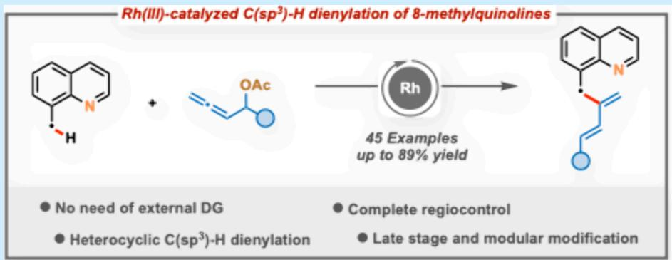
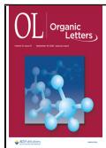
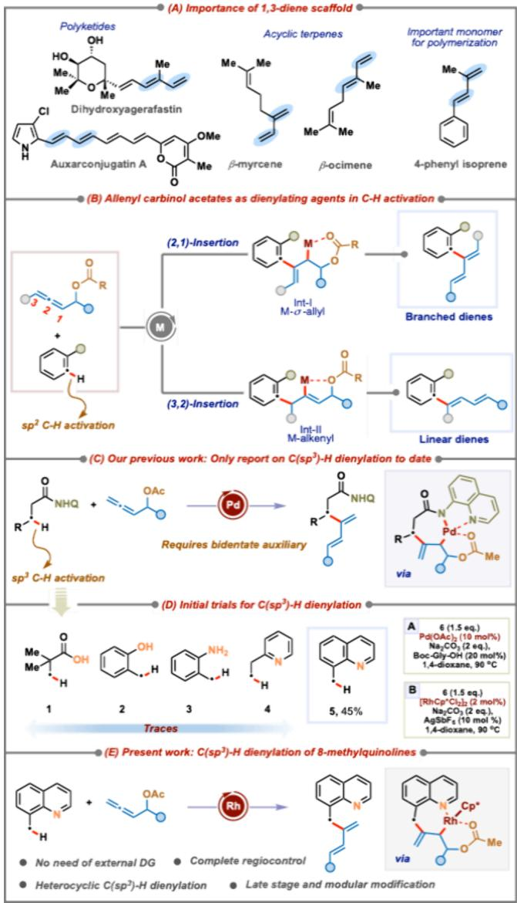
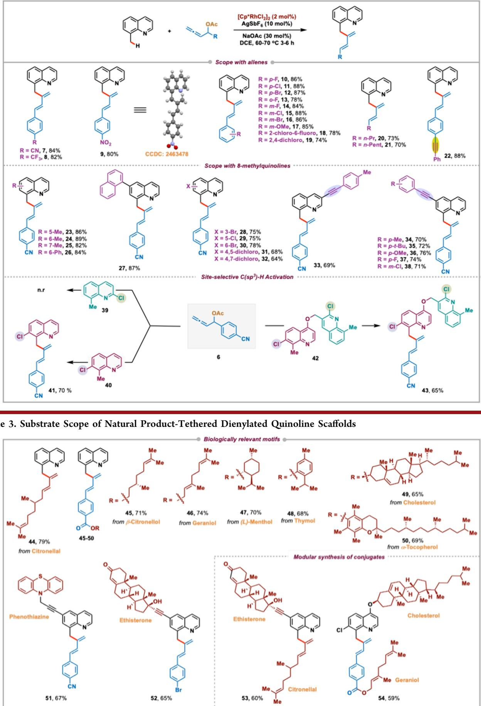
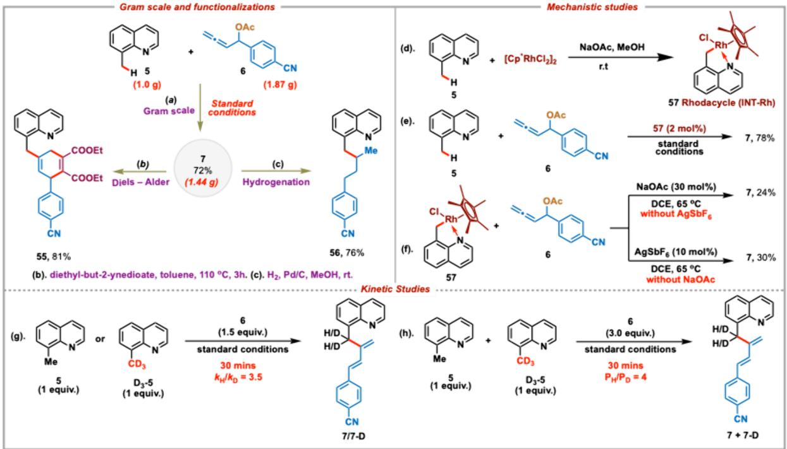

pubs.acs.org/OrgLett

Letter

# Access to Branched 1,3-Dienes via Innate C(sp3)−H Functionalization of 8‑Methylquinolines

Shivam Pandey,+ Rahul K. Shukla,+ Atul K. Chaturvedi, and Chandra M. R. Volla\*

Cite This: Org. Lett. 2025, 27, 10281−10286

Read Online

ACCESS

Metrics & More

Article Recommendations

\*sı Supporting Information

  
ABSTRACT: Allenes have gained prominence in transition metal-catalyzed C−H activation reactions due to their versatile reactivity. While C(sp2)−H functionalization with allenes has been well explored, the functionalization of more challenging C(sp3)− H bonds with allenes remains largely underexplored. Herein, we present a scalable Rh(III)-catalyzed strategy for the site-selective C(sp3)−H dienylation of biologically relevant 8-methylquinolines employing allenyl carbinol acetates for accessing structurally diverse 1,3-dienes. Leveraging the innate directing group ability of the quinoline nitrogen, our protocol promotes the selective 2,1- migratory insertion of allenes. The transformation exhibits a broad substrate scope and enables the late-stage construction of densely functionalized 1,3-diene conjugates with biologically relevant motifs, highlighting the synthetic utility and broad applicability of this method.

C onjugated dienes are ubiquitous scafolds widely present in biologically active natural products and serve as key synthetic precursors in the preparation of functional polymers and complex molecular frameworks (Scheme 1A).1 Also, their distinctive reactivity makes them valuable substrates in a variety of organic transformations, including 1,4-functionalizations, cycloadditions, and other pericyclic reactions.2 Conventional approaches for diene synthesis such as Wittig olefination, enyne metathesis, and transition metal-catalyzed crosscoupling reactions rely on prefunctionalized substrates such as carbonyl compounds, halides, or boronic acids, limiting modularity and substrate diversity.3,4 Consequently, strategies enabling modular access to structurally diverse conjugated dienes from simple substrates are highly desirable. In this context, catalytic dienylations leveraging reactive π-systems as dienylating agents have recently been investigated.5

On the other hand, allenes have garnered particular attention due to their unique structure and versatile reactivity. In particular, allenyl carbinol derivatives bearing a heteroatom at the α-position are found to be useful substrates in transition metal catalysis.7 The heteroatom guides the insertion pathway by coordinating with the metal catalyst and facilitates the β- elimination. In parallel, transition metal-catalyzed C−H functionalization has emerged as a powerful approach in organic synthesis, allowing the direct transformation of otherwise inert C−H bonds into valuable functionalities.8 Integration of this prevailing strategy with allene chemistry ofers a modular route for accessing conjugated dienes from simple substrates (Scheme 1B). A pioneering report by Glorius and co-workers demonstrated Rh(III)-catalyzed C(sp2)−H dienylation of benzamides employing allenyl carbinol carbonates.9 Building on this, our group10 and the Ma group11 explored Co(III)-catalyzed C8 dienylation of quinoline Noxides and Rh(III)-catalyzed stereoselective C2 dienylation of indoles, respectively. All three protocols involve the selective formation of M-σ-allyl species Int-I via regioselective 2,1- migratory insertion. In sharp contrast, recently Cembellıń and co-workers demonstrated a mechanistically distinct 3,2-

## Scheme 1. Overview

  
migratory insertion, afording linear dienes through M-alkenyl intermediate Int-II under Mn catalysis (Scheme 1B).12 Despite these advances, C−H dienylation with allenes remains largely confined to $\mathrm { C } \left( \mathrm { s p } ^ { 2 } \right)$ −H bonds. Extension of this transformation to aliphatic $\dot { \mathrm { C } } ( \mathsf { s p } ^ { 3 } ) \mathrm { - H }$ bonds is particularly appealing but remains challenging due to the intrinsically lower reactivity, the lack of π-coordination, and the weaker overlap of $\mathrm { C } ( \mathrm { s p } ^ { \dot { 3 } } ) \mathrm { - H }$ bonds with metal centers.13 Our group addressed this gap by reporting the first example of $\beta -$ and $\bar { \gamma } { \cdot } \mathrm { C } ( \mathsf { s p } ^ { 3 } ) { \ - } \mathrm { H }$ dienylation of aliphatic amides using allenyl carbinol acetates to access $\mathsf { s p } ^ { 3 } \cdot$ functionalized conjugated dienes (Scheme 1C).14 However, this strategy still relied on an 8-aminoquinoline directing group and finely tuned ligands, limiting its practicality. To overcome these constraints, we sought a more straightforward $\mathrm { C } ( \mathsf { s p } ^ { 3 } ) \mathrm { - H }$ dienylation protocol leveraging the inherent directing capabilities of native functional groups. The key challenge is the weak coordination ability of these groups, which hampers metallacycle formation that is critical for efective $\bar { \mathrm { C } } \mathrm { - } \bar { \mathrm { H } }$ activation and allene insertion. Toward this end, we evaluated a series of substrates bearing native functionalities with allenyl carbinol acetate 6 under Pd(II) and Rh(III) catalysis (Scheme 1D). Substrates containing weakly coordinating groups such as

pivalic acid 1, o-methylphenol $^ { 2 , }$ and o-methylaniline 3 failed to show any reactivity. 2-Ethylpyridine 4 having a strongly coordinating nitrogen donor is also inefective, likely due to the conformational flexibility hindering stable metallacycle formation. These cumulative findings pointed toward the necessity of a more rigid system capable of fostering stable metal−substrate interactions. We then turned toward 8- methylquinoline $^ { 5 , }$ a structurally constrained system featuring a benzylic $\mathrm { C } ( \mathrm { s p } ^ { 3 } )$ −H bond amenable to C−H activation and a nitrogen atom capable of coordinating to a metal catalyst. 15 This built-in coordination could facilitate cyclometalation resulting in five-membered metallacycle formation. Moreover, quinoline-based motifs are highly prevalent in biologically active molecules and pharmaceutical agents, thereby rendering them highly valuable targets for selective functionalization and late-stage molecular diversification.16 To our delight, 8- methylquinoline 5 was found to be an amenable substrate, afording the desired product 7 in 45% yield when treated with allene 6 and 2 mol % $\mathrm { [ R h C p ^ { * } C l _ { 2 } ] } _ { 2 }$ (condition B). Encouraged by this preliminary result, we undertook a comprehensive optimization study, which ultimately identified a rhodiumbased catalytic system as optimal, enabling the eficient and selective C(sp3)−H dienylation of 8-methylquinoline derivatives (Scheme 1E).

After the encouraging observation, various reaction parameters such as the solvent, additive, base, and catalyst were extensively optimized employing 8-methylquinoline 5 and allene 6 to identify the optimal conditions (see the Supporting Information for optimization details). The desired product 7 was isolated in 84% yield under the optimized reaction conditions: 2 mol % $[ \mathrm { C \dot { p } ^ { * } R h ( I I I ) C l _ { 2 } } ] _ { 2 } ,$ 10 mol % $\mathrm { \bf A g S b F } _ { 6 } ,$ and 30 mol % NaOAc in DCE at 65 $^ \circ \mathrm { C }$ (see the Supporting Information for the optimization details). While solvents such as DCM and TFE resulted in slightly inferior yields, other solvents such as MeCN and THF led to the formation of dienylated product 7 in lower yields. The choice of base was also crucial, as replacing NaOAc with either AgOAc or NaOPiv led to reduced conversions. In addition, the use of additives like AgOTf and $\mathrm { \sf A g B F _ { 4 } }$ could not enhance the yield, suggesting ${ \tt A g S b F } _ { 6 }$ is the best additive. Notably, the yield of 7 decreased considerably when the reaction was carried out in the absence of NaOAc or AgSbF . Other metal catalysts such as $\mathrm { P d } ( \mathrm { O A c } ) _ { 2 }$ and $[ \mathrm { C p } { } ^ { * } \mathrm { C o } ( \mathrm { C O } ) \mathrm { I } _ { 2 } ]$ were found to be inefective, highlighting the efectiveness of Rh(III) for the transformation.

After establishing the optimized reaction conditions, we proceeded to investigate the generality of the developed protocol with diversely substituted allenyl carbinol acetates employing 8-methylquinoline 5 (Scheme 2). Allenes having electron-withdrawing groups or halogens at the para position of the phenyl ring aforded the desired products ${ \bf 7 - 1 2 }$ in good to excellent yields (80−88%). However, the o-fluoro derivative showed slightly reduced eficiency, delivering product 13 in 78% yield. Single-crystal X-ray difraction analysis of nitro compound 9 unambiguously confirmed the structure and stereochemistry of the diene. Next, we tested the presence of halogens and the methoxy group at the meta position of the phenyl ring, and these were also found to be compatible under the reaction conditions to furnish 14−17 in good yields (84− 88%). Furthermore, $^ { 2 , 6 - }$ and 2,4-dihalosubstituted substrates were well tolerated, delivering products 18 and 19 in moderate to good yields. Notably, allenyl carbinol acetates bearing aliphatic groups were also found to be amenable under our conditions to provide 20 and 21 in moderate yields (70−73%).

Scheme 2. Substrate Scope of Dienylation of 8-Methylquinolines  

Scheme 4. Gram-Scale, Functionalization, and Mechanistic Studies  

It is worth mentioning that allene having an alkynyl functionality reacted smoothly as a dienylating agent (22, 88%), keeping the alkyne functionality intact showing the superior reactivity of allene over alkyne.

We then embarked on exploring the scope of 8- methylquinolines under the optimized conditions employing allene 6 to synthesize functionalized 8-methylquinolines featuring the 1,3-diene motif. Quinolines having a methyl group at various positions yielded the desired dienylation products 23−25 in good to excellent yields ranging from 82% to 89%. Both phenyl and naphthyl groups at the C6 position of 8-methylquinoline were found to be compatible to furnish dienylated products 26 and $^ { 2 7 , }$ respectively, in 84−87% yields. However, the use of Br- or Cl-substituted 8-methylquinolines led to a slight decrease in the yield of products 28−32 (64− 78%). A variety of C3- and C6-alkynylated quinoline derivatives 33−38 having electron-donating or electronwithdrawing groups on the alkynyl system were synthesized in 69−76% yields. Unfortunately, substitution at the C2 position (with methyl or chloro) completely suppressed reactivity, which might be due to impeding Rh coordination with the quinoline nitrogen. Interestingly, treating 7-chloro-8- methylquinoline 40 with 6 provided the desired product 41 in 70% yield. With this observation, we envisioned that this substrate-dependent reactivity could be exploited in a sterically selective manner and tested bisquinoline substrate 42 having two diferent potential sites for the reaction. Pleasingly, when 42 was subjected to the optimized reaction conditions, monodienylated product 43 was obtained selectively in 65% yield with the 8-methylquinoline scafold having the 2-Cl substitution unperturbed.

To demonstrate the applicability of our developed protocol, allenes tethered with biologically relevant and naturally occurring alcohol derivatives such as citronellal, β-citronellol, geraniol, menthol, thymol, cholesterol, and tocopherol were tested. Conjugated dienes 44−50 were obtained in good yields of up to 79% (Scheme 3). Owing to the appealing biological properties of phenothiazine and ethisterone, 8-methylquinolines tethered with these entities were prepared and subjected to dienylation with allenyl carbinol acetates to furnish conjugates 51 and 52 in 67% and 65% yields, respectively. Application of our Rh(III)-catalyzed dienylation protocol for the modular synthesis of conjugates was then assessed by subjecting 8-methylquinoline tethered with ethisterone and citronellal-derived allenyl carbinol acetate under the optimized conditions to isolate complex heterocyclic scafold 53 in 60% yield. Similarly, cholesterol-conjugated 8-methylquinoline was coupled with geraniol-derived allene to synthesize 54 in 59% yield.

To illustrate the practicality of the present reaction protocol, a gram-scale reaction was conducted with 1.0 g of 8- methylquinoline 5 and $1 . 8 7 ~ \mathrm { g }$ of allene 6 to isolate 1.44 g of dienylation product 7 (72% yield) (Scheme 4a). To gain insights into the reaction mechanism, rhodacyclic complex 57 was synthesized via the cyclometalation of 8-methylquinoline 5 at room temperature in MeOH, which was then employed as a catalyst precursor (2 mol %) in place of $[ \mathrm { C p } ^ { * } \mathrm { R h } \hat { \mathrm { C l } } _ { 2 } ] _ { 2 }$ under the standard reaction conditions (Scheme 4d,e). The reaction resulted in the formation of 7 in 78% yield, highlighting its catalytic eficiency and significance in C−H activation. A stoichiometric reaction using complex 57 and allene 6 in the absence of ${ \tt A g S b F } _ { 6 }$ produced product 7 in a diminished yield of 24% (Scheme 4f). Similarly, the reaction led to a poor yield of 30% in the absence of NaOAc, highlighting the importance of a cationic rhodacycle for allene coordination and carborhodation. Additionally, kinetic isotope efect (KIE) studies were performed with 5 and 8-(methyl-d ) quinoline $\mathbf { D } _ { 3 } – 5$ (Scheme $_ { 4 \underline { { \mathbf { g } } } } )$ . Parallel KIE experiments with 5 and $\mathbf { D } _ { 3 } – 5$ using 6 gave a value of $3 . 5 ,$ and the competitive experiment between 5 and $\mathbf { D } _ { 3 } – 5$ yielded a product distribution value of 4 (Scheme 4h). Both of these experimental KIE values suggest that the C−H bond cleavage is likely to be involved in the rate-determining step. Based on these preliminary studies, the plausible mechanism for the dienylation reaction is proposed (see the Supporting Information).

In summary, we have developed Rh(III)-catalyzed dienylation of 8-methylquinolines employing allenyl carbinol acetates via challenging C(sp3)−H bond activation in the absence of any exogenous directing group and ligand. The innovative use of these reactive allenes opened a new avenue for expanding the scope of more challenging C(sp3)−H bond activation, and a variety of 8-methylquinoline derivatives were eficiently functionalized to aford diversely functionalized 1,3- dienes. The value of the developed catalytic approach was exemplified by successful modification of biologically active scafolds. Furthermore, the utility of the developed methodology was demonstrated through its seamless scalability and various synthetic transformations of the product.

## ■ ASSOCIATED CONTENT

## Data Availability Statement

The data underlying this study are available in the published article and its Supporting Information.

## \*sı Supporting Information

The Supporting Information is available free of charge at https://pubs.acs.org/doi/10.1021/acs.orglett.5c02926.

Additional experimental procedures and spectroscopic data for the synthesized compounds (PDF)

## Accession Codes

Deposition Number 2463478 contains the supplementary crystallographic data for this paper. These data can be obtained free of charge via the joint Cambridge Crystallographic Data Centre (CCDC) and Fachinformationszentrum Karlsruhe Access Structures service.

## ■ AUTHOR INFORMATION

## Corresponding Author

Chandra M. R. Volla − Department of Chemistry, Indian Institute of Technology Bombay, Mumbai 400076, India; orcid.org/0000-0002-8497-1538; Email: Chandra.volla@chem.iitb.ac.in

## Authors

Shivam Pandey − Department of Chemistry, Indian Institute of Technology Bombay, Mumbai 400076, India

Rahul K. Shukla − Department of Chemistry, Indian Institute of Technology Bombay, Mumbai 400076, India

Atul K. Chaturvedi − Department of Chemistry, Indian Institute of Technology Bombay, Mumbai 400076, India; orcid.org/0000-0002-1065-9437

Complete contact information is available at: https://pubs.acs.org/10.1021/acs.orglett.5c02926

## Author Contributions

+S.P. and R.K.S. contributed equally to this work.

## Notes

The authors declare no competing financial interest.

## ■ ACKNOWLEDGMENTS

This activity is supported by ANRF, India (CRG/2023/ 004060). S.P. thanks UGC for a fellowship.

## ■ REFERENCES

(1) (a) Erb, W.; Zhu, J. From natural product to marketed drug: the tiacumicin odyssey. Nat. Prod. Rep. 2013, 30, 161−174. (b) Takenaka, K.; Amamoto, S.; Kishi, H.; Takeshita, H.; Miya, M.; Shiomi, T. Anionic Polymerization of 2-Phenyl [3] dendralene and 2-(4- Methoxyphenyl) [3] dendralene. Macromolecules 2013, 46, 7282− 7289. (c) Woerly, E. M.; Roy, J.; Burke, M. D. Synthesis of most polyene natural product motifs using just 12 building blocks and one coupling reaction. Nat. Chem. 2014, 6, 484−491. (d) Hubert, P.; Seibel, E.; Beemelmanns, C.; Campagne, J. M.; de Figueiredo, R. M. Stereoselective Construction of (E, Z)-1,3-Dienes and Its Application in Natural Product Synthesis. Adv. Synth. Catal. 2020, 362, 5532− 5575. (e) Huang, Y.; Hayashi, T. Chiral Diene Ligands in Asymmetric Catalysis. Chem. Rev. 2022, 122, 14346−14404.

(2) (a) Bäckvall, J. E.; Chinchilla, R.; Nájera, C.; Yus, M. The Use of Sulfonyl 1,3-Dienes in Organic Synthesis. Chem. Rev. 1998, 98, 2291− 2312. (b) Holmes, M.; Schwartz, L. A.; Krische, M. J. Intermolecular Metal Catalyzed Reductive Coupling of Dienes, Allenes, and Enynes with Carbonyl Compounds and Imines. Chem. Rev. 2018, 118, 6026− 6052. (c) Perry, G. J. P.; Jia, T.; Procter, D. J. Copper-Catalyzed Functionalization of 1,3-Dienes: Hydrofunctionalization, Borofunctionalization, and Difunctionalization. ACS Catal. 2020, 10, 1485− 1499.

(3) (a) Miyaura, N.; Suzuki, A. Palladium-Catalyzed Cross-Coupling Reactions of Organoboron Compounds. Chem. Rev. 1995, 95, 2457− 2483. (b) Hansen, A. L.; Ebran, J. P.; Ahlquist, M.; Norrby, P. O.; Skrydstrup, T. Heck Coupling with Nonactivated Alkenyl Tosylates and Phosphates: Examples of Effective 1,2-Migrations of the Alkenyl Palladium (II) Intermediates. Angew. Chem., Int. Ed. 2006, 45, 3349− 3353. (c) Shang, X.; Liu, Z.-Q. Transition metal-catalyzed Cvinyl− Cvinyl bond formation via double Cvinyl−H bond activation. Chem. Soc. Rev. 2013, 42, 3253−3260.

(4) (a) Zheng, C.; Wang, D.; Stahl, S. S. Catalyst-Controlled Regioselectivity in the Synthesis of Branched Conjugated Dienes via Aerobic Oxidative Heck Reactions. J. Am. Chem. Soc. 2012, 134, 16496−16499. (b) Olivares, A. M.; Weix, D. J. Multimetallic Ni- and Pd-Catalyzed Cross-Electrophile Coupling to Form Highly Substituted 1,3-Dienes. J. Am. Chem. Soc. 2018, 140, 2446−2449. (c) Nguyen, V. T.; Dang, H. T.; Pham, H. H.; Nguyen, V. D.; Flores-Hansen, C.; Arman, H. D.; Larionov, O. V. Highly Regio- and Stereoselective Catalytic Synthesis of Conjugated Dienes and Polyenes. J. Am. Chem. Soc. 2018, 140, 8434−8438.

(5) Ahmed, J.; Haug, G. C.; Nguyen, V. D.; Porey, A.; Trevino, R.; Larionov, O. V. Catalytic Dienylation: An Emergent Strategy for the Stereoselective Construction of Conjugated Dienes and Polyenes. Synthesis 2023, 55, 1642−1651.

(6) (a) Zimmer, R.; Dinesh, C. U.; Nandanan, E.; Khan, F. A. Palladium-Catalyzed Reactions of Allenes. Chem. Rev. 2000, 100, 3067−3126. (b) Ye, J.; Ma, S. Palladium-Catalyzed Cyclization Reactions of Allenes in the Presenc of Unsaturated Carbon−Carbon Bonds. Acc. Chem. Res. 2014, 47, 989−1000. (c) Alonso, J. M.; Almendros, P. Deciphering the Chameleonic Chemistry of Allenols: Breaking the Taboo of a Onetime Esoteric Functionality. Chem. Rev. 2021, 121, 4193−4252. (d) Hashmi, A. S. K. New and Selective Transition Metal Catlyzed Reactions of Allenes. Angew. Chem., Int. Ed. 2000, 39, 3590−3593. (e) Ma, S. Some Typical Advances in the Synthetic Applications of Allenes. Chem. Rev. 2005, 105, 2829−2871. (f) Aubert, C.; Fensterbank, L.; Garcia, P.; Malacria, M.; Simonneau, A. Transition Metal Catalyzed Cycloisomerizations of 1,n-Allenynes and-Allenes. Chem. Rev. 2011, 111, 1954−1993.

(7) (a) Singh, A.; Shukla, R. K.; Volla, C. M. R. Rh(III)-Catalyzed [5 + 1] annulation of 2-alkenylanilides and 2-alkenylphenols with allenyl acetates. Chem. Sci. 2022, 13, 2043−2049. (b) Brzeskiewicz, ́ J.; Loska, R. Construction of Nitrogen Spirocycles in a Tandem Co(III)- catalyzed C−H Activation/Dipolar Cycloaddition Reaction. Adv. Synth. Catal. 2023, 365, 4241−4247. (c) Jana, D.; Sontakke, G. S.; Volla, C. M. R. Ru(II)-Catalyzed Decarboxylative (4 + 2)-Annulation of Benzoic Acids and Benzamides with Propargyl Cyclic Carbonates. Org. Lett. 2024, 26, 7590−7595.

(8) (a) Lyons, T. W.; Sanford, M. S. Palladium-Catalyzed Ligand-Directed C-H Functionalization Reactions. Chem. Rev. 2010, 110, 1147−1169. (b) Rej, S.; Das, A.; Chatani, N. Strategic evolution in transition metal catalyzed directed C−H bond activation and future directions. Coord. Chem. Rev. 2021, 431, No. 213683. (c) Rogge, T.; Kaplaneris, N.; Chatani, N.; Kim, J.; Chang, S.; Punji, B.; Schafer, L. L.; Musaev, D. G.; Wencel-Delord, J.; Roberts, C. A.; Sarpong, R.; Wilson, Z. E.; Brimble, M. A.; Johansson, M. J.; Ackermann, L. C−H activation. Nat. Rev. Methods Primers 2021, 1, 43.

(9) Wang, H.; Beiring, B.; Yu, D.-G.; Collins, K. D.; Glorius, F. [3]Dendralene Synthesis: Rhodium(III)-Catalyzed Alkenyl C-H Activation and Coupling Reaction with Allenyl Carbinol Carbonate. Angew. Chem., Int. Ed. 2013, 52, 12430−12434.

(10) Shukla, R. K.; Nair, A. M.; Khan, S.; Volla, C. M. R. Cobalt-Catalyzed C8-Dienylation of Quinoline-N-Oxides. Angew. Chem., Int. Ed. 2020, 59, 17042−17048.

(11) Zhai, Y.; Zhang, X.; Ma, S. Stereoselective rhodium-catalyzed 2- C−H 1,3-dienylation of indoles: dual functions of the directing group. Chem. Sci. 2021, 12, 11330−11337.

(12) Matesanz, D. G.; Gamarra, L.; del Campo, T. M. D.; Almendros, P.; Cembellín, S. Regioselectivity Control in the Synthesis of Linear Conjugated Dienes Enabled by Manganese(I)-Catalyzed C−H Activation. ACS Catal. 2023, 13, 14523−14529.

(13) (a) Baudoin, O. Transition metal-catalyzed arylation of unactivated C(sp3)−H bonds. Chem. Soc. Rev. 2011, 40, 4902− 4911. (b) He, J.; Wasa, M.; Chan, K. S. L.; Shao, Q.; Yu, J. Q. Palladium-Catalyzed Transformations of Alkyl C−H Bonds. Chem. Rev. 2017, 117, 8754−8786.

(14) Shukla, R. K.; Nair, A. M.; Volla, C. M. R. Pd(II)-catalyzed band g-C-(sp3)−H dienylation with allenyl acetates. Chem. Sci. 2023, 14, 955−962.

(15) (a) Liu, B.; Zhou, T.; Li, B.; Xu, S.; Song, H.; Wang, B. Rhodium(III)-Catalyzed Alkenylation Reactions of 8-Methylquinolines with Alkynes by C(sp3)-H Activation. Angew. Chem., Int. Ed. 2014, 53, 4191−4195. (b) Han, S.; Park, J.; Kim, S.; Lee, S. H.; Sharma, S.; Mishra, N. K.; Jung, Y. H.; Kim, I. S. Rhodium(III)- Catalyzed C(sp3)−H Alkylation of 8-Methylquinolines with Maleimides. Org. Lett. 2016, 18, 4666−4669. (c) Jeong, T.; Mishra, N. K.; Dey, P.; Oh, H.; Han, S.; Lee, S. H.; Kim, H. S.; Park, J.; Kim, I. S. C(sp3)−H amination of 8-methylquinolines with azodicarboxylates under Rh(III) catalysis: cytotoxic evaluation of quinolin-8-ylmethanamines. Chem. Commun. 2017, 53, 11197−11200. (d) Chaturvedi, A. K.; Shukla, R. K.; Volla, C. M. R. Rh(III)-catalyzed sp3/sp2−C−H heteroarylations via cascade C−H activation and cyclization. Chem. Sci. 2024, 15, 6544−6551.

(16) (a) Lödige, M.; Lewis, M. D.; Paulsen, E. S.; Esch, H. L.; Pradel, G.; Lehmann, L.; Brun, R.; Bringmann, G.; Mueller, A. K. A primaquine−chloroquine hybrid with dual activity against Plasmodium liver and blood stages. Int. J. Med. Microbiol. 2013, 303, 539− 547. (b) Chung, P. Y.; Bian, Z. X.; Pun, H. Y.; Chan, D.; Chan, A. S. C.; Chui, C. H.; Tang, J. C. O.; Lam, K. H. Recent Advances in Research of Natural and Synthetic Bioactive Quinolines. Future Med. Chem. 2015, 7, 947−967. (c) Matada, B. S.; Pattanashettar, R.; Yernale, N. G. A comprehensive review on the biological interest of quinoline and its derivatives. Bioorg. Med. Chem. 2021, 32, No. 115973.