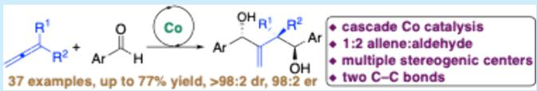
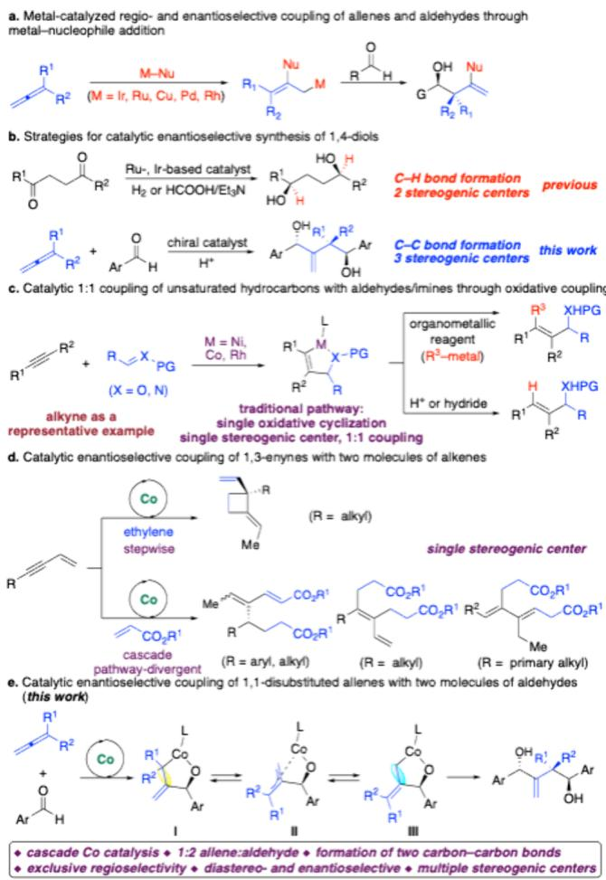
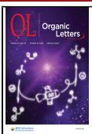
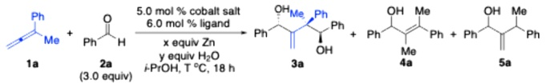
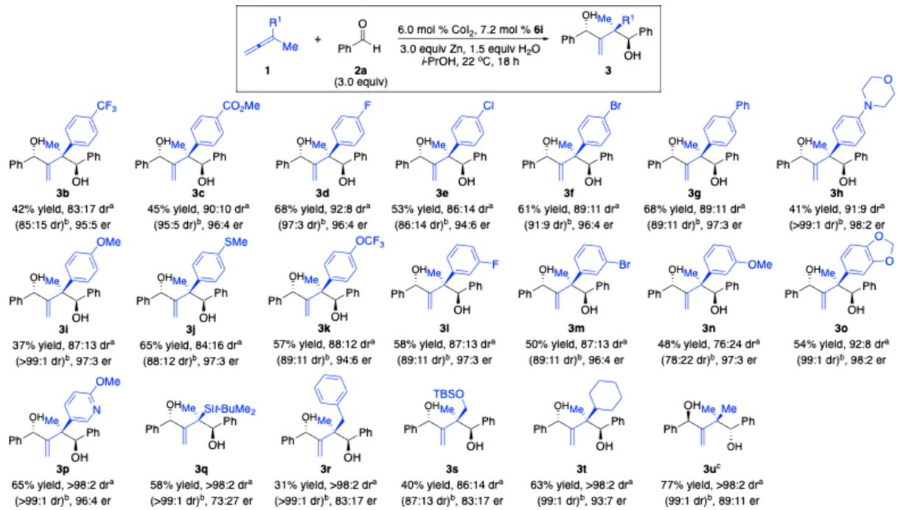
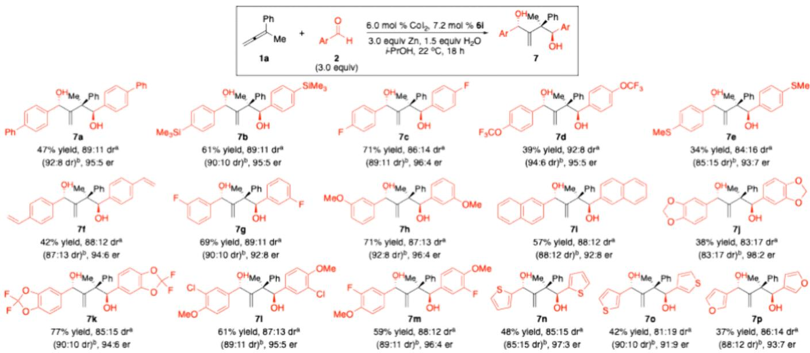
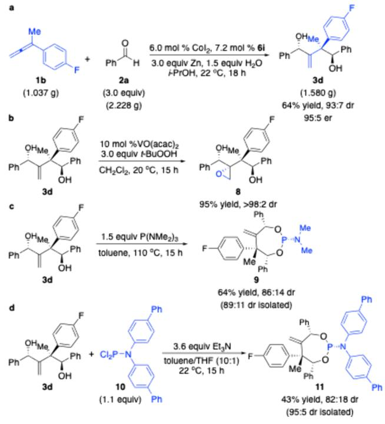
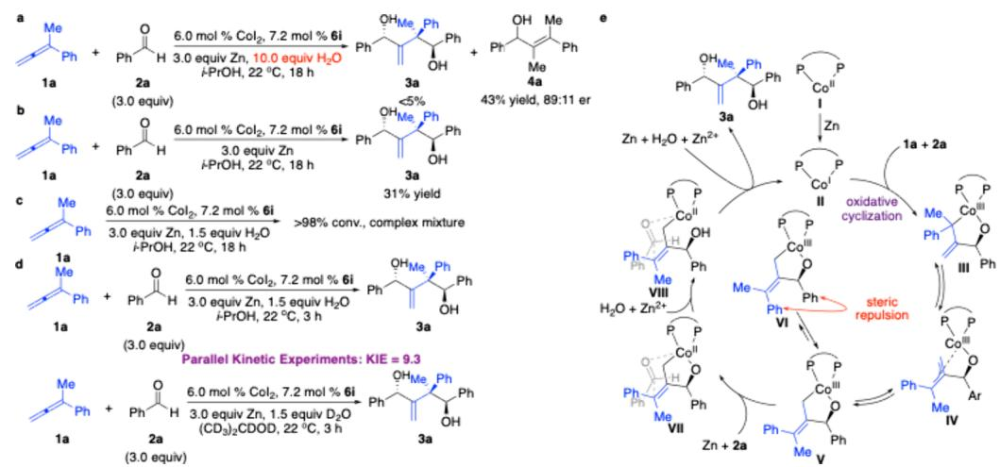

pubs.acs.org/OrgLett

Letter

# Cobalt-Catalyzed Chemo‑, Regio‑, Diastereo‑, and Enantioselective Cascade Coupling of 1,1-Disubstituted Allenes and Aldehydes

Shilin Wang, Wei Huang, Qinglei Chong,\* and Fanke Meng\*

Cite This: Org. Lett. 2025, 27, 12117−12123

Read Online

## ACCESS

Metrics & More

ABSTRACT: A cobalt-catalyzed protocol for cascade coupling of 1,1-disubstituted allenes with aldehydes initiated by chemo-, regio-, diastereo-, and enantioselective oxidative cyclization of allenes and aldehydes followed by chemo-, regio-, and stereoselective addition of the resulting allyl−cobalt intermediates to the second molecule

Article Recommendations

\*sı Supporting Information

of aldehydes promoted by a chiral bisphosphine−cobalt complex is presented. Such processes represent an unprecedented reaction pathway for cobalt catalysis that enables simultaneous and precise incorporation two molecules of aldehydes onto the more sterically congested alkene of the allenes and construction of three stereogenic centers, delivering a range of enantioenriched 1,4-diols in up to 77% yield, >98:2 dr, and 98:2 er.

## Scheme 1. Background and Reaction Design

T ransition metal-catalyzed enantioselective coupling of unsaturated hydrocarbons and aldehydes provides a straightforward and modular approach for the construction of chiral alcohols without the need for prefunctionalization. Compared with reactions of unsaturated hydrocarbons with a single reactive site such as alkynes, multiple reactive sites of allenes complicated the chemo-, regio-, and stereoselectivity issues. Therefore, transformations of allenes have remained rare and more challenging. Significant progresses on catalytic enantioselective coupling of allenes and aldehydes promoted by Ir-based,2 Ru-based,3 Cu-based,4 Pd-based,5 and Rh-based6 catalysts have been made (Scheme 1a). Such reactions proceeded through sequential nucleophile−metal addition to allenes followed by enantioselective reactions of the resulting allyl−metal species with aldehydes. Based on the reaction mechanism, only one molecule of aldehyde was able to be fused with one molecule of allene, enabling the formation of a single hydroxyl group. In contrast, the simultaneous incorporation of two molecules of electrophilic aldehydes onto allenes to generate enantioenriched diols in a cascade process remained unknown. Enantioenriched diols are important skeletons of various natural products, drugs, and chiral building blocks in organic synthesis. The development of eficient and stereoselective methods to construct enantioenriched diols is thus sought after in both academia and industry. Compared with multiple strategies for catalytic enantioselective synthesis of 1,2- and 1,3-diols, access to enantioenriched 1,4-diols containing remote stereogenic centers relied on catalytic enantioselective hydrogenation of 1,4-diketones, generating two stereogenic centers by C−H bond-forming reactions (Scheme $1 \check { \boldsymbol { \mathsf { b } } } ) . ^ { 7 }$ However, catalytic enantioselective preparation of 1,4-diols through carbon−carbon bond-forming reactions has remained elusive.

Table 1. Optimization of the Reaction Conditions
<table><tr><td></td><td></td><td></td><td></td><td></td><td></td><td></td><td></td><td></td><td></td><td></td><td></td><td></td></tr><tr><td></td><td></td><td></td><td></td><td></td><td></td><td colspan="2"></td><td></td><td colspan="4"></td><td></td></tr><tr><td>entry</td><td>ligand</td><td>x</td><td>y</td><td>cobalt salt</td><td>T (°C)</td><td colspan="4">yield of 3a (%)ª</td><td>yield of 4a + 5a (%)b</td><td>dr of 3ab</td><td>er of 3aº</td></tr><tr><td>1</td><td>6a</td><td>2.0</td><td>2.0</td><td> $\mathrm { C o I } _ { 2 }$ </td><td>25</td><td colspan="4">&lt;5</td><td>93</td><td>NAd</td><td>NAd</td></tr><tr><td>2</td><td>6b</td><td>2.0</td><td>2.0</td><td> $\mathrm { C o I } _ { 2 }$ </td><td>25</td><td colspan="4">&lt;5</td><td>&lt;5</td><td> $\mathrm { N A } ^ { d }$ </td><td>NAd</td></tr><tr><td>3</td><td>6c</td><td>2.0</td><td>2.0</td><td> $\mathrm { C o I } _ { 2 }$ </td><td>25</td><td colspan="4">&lt;5</td><td>58</td><td> $\mathrm { N A } ^ { d }$ </td><td>NAd</td></tr><tr><td>4</td><td>6d</td><td>2.0</td><td>2.0</td><td> $\mathrm { C o I } _ { 2 }$ </td><td>25</td><td colspan="4">&lt;5</td><td>20</td><td>NAd</td><td>NAd</td></tr><tr><td>5</td><td>6e</td><td>2.0</td><td>2.0</td><td> $\mathrm { C o I } _ { 2 }$ </td><td>25</td><td colspan="4">&lt;5</td><td>89</td><td> $\mathrm { N A } ^ { d }$ </td><td>NAd</td></tr><tr><td>6</td><td>6f</td><td>2.0</td><td>2.0</td><td> $\mathrm { C o I } _ { 2 }$ </td><td>25</td><td colspan="4">25</td><td>57</td><td>68:32</td><td>78:22</td></tr><tr><td>7</td><td>6g</td><td>2.0</td><td>2.0</td><td> $\mathrm { C o I } _ { 2 }$ </td><td>25</td><td colspan="4">&lt;5</td><td>46 66</td><td> $\mathrm { N A } ^ { d }$ </td><td>NAd</td></tr><tr><td>8</td><td>6h</td><td>2.0</td><td>2.0</td><td> $\mathrm { C o I } _ { 2 }$ </td><td>25</td><td colspan="4">&lt;5</td><td>&lt;5</td><td> $\mathrm { N A } ^ { d }$ </td><td> $\mathrm { N A } ^ { d }$ </td></tr><tr><td>9</td><td>6i</td><td>2.0</td><td>2.0</td><td> $\mathrm { C o I } _ { 2 }$ </td><td>25</td><td colspan="4">55</td><td>&lt;5</td><td>88:12</td><td>95:5</td></tr><tr><td>10</td><td>6i</td><td>2.0</td><td>2.0</td><td> $\mathrm { C o B r } _ { 2 }$ </td><td>25</td><td colspan="4">63</td><td>&lt;5</td><td>88:12</td><td>94:6</td></tr><tr><td>11</td><td>6i</td><td>2.0</td><td>2.0</td><td> $\mathrm { C o C l } _ { 2 }$ </td><td>25</td><td colspan="4">52</td><td>&lt;5</td><td>87:13</td><td>92:8</td></tr><tr><td>12</td><td>6i 6i</td><td>3.0</td><td>2.0</td><td> $\mathrm { C o I } _ { 2 }$ </td><td>25</td><td colspan="4">66 61</td><td>&lt;5</td><td>88:12</td><td>96:4</td></tr><tr><td>13</td><td>6i</td><td>4.0</td><td>2.0</td><td> $\mathrm { C o I } _ { 2 }$ </td><td>25</td><td colspan="4">65</td><td>&lt;5</td><td>87.5:12.5</td><td>96:4</td></tr><tr><td>14</td><td></td><td>3.0</td><td>2.0</td><td> $\mathrm { C o I } _ { 2 }$ </td><td>22</td><td colspan="4">61</td><td>&lt;5</td><td>89:11</td><td>97:3</td></tr><tr><td>15</td><td>6i 6i</td><td>3.0</td><td>2.0</td><td> $\mathrm { C o I } _ { 2 }$ </td><td>30</td><td colspan="4">63</td><td>&lt;5</td><td>85:15</td><td>96:4</td></tr><tr><td>16</td><td></td><td>3.0</td><td>2.0</td><td> $\mathrm { C o I } _ { 2 }$ </td><td>40</td><td colspan="4"></td><td>&lt;5</td><td>76:24</td><td>95:5</td></tr><tr><td>17</td><td>6i</td><td>3.0</td><td>1.5</td><td> $\mathrm { C o I } _ { 2 }$ </td><td>22</td><td colspan="4">69</td><td>&lt;5</td><td>89:11</td><td>97:3</td></tr><tr><td>18</td><td>6i</td><td>3.0</td><td>1.0</td><td> $\mathrm { C o I } _ { 2 }$ </td><td>22</td><td colspan="4">58</td><td>&lt;5</td><td>89:11</td><td>97:3</td></tr><tr><td>19</td><td>6i</td><td>3.0</td><td>4.0</td><td> $\mathrm { C o I } _ { 2 }$ </td><td>22</td><td colspan="4">52</td><td></td><td>80:20</td><td>92:8</td></tr><tr><td>20e</td><td>6i</td><td>3.0</td><td>1.5</td><td>CoI2</td><td>22</td><td colspan="4">72</td><td>&lt;5</td><td>89:11</td><td>97:3</td></tr></table>

aYield of the isolated product. bDetermined by analysis of 1H NMR spectra of the unpurified mixture. cDetermined by analysis of HPLC spectra of the purified products. dNot available. eThe reaction was performed in the presence of 6.0 mol % CoI and 7.2 mol % 6i.

An alternative pathway for reactions of allenes and aldehydes is oxidative cyclization. Oxidative cyclization of two π-bonds promoted by low-valent transition metal complexes represents a classical elementary step in organometallic chemistry. Transition metal-catalyzed transformations through oxidative cyclization constitute one of the most important approaches for carbon−carbon bond-forming reactions in organic synthesis. Although protocols for catalytic enantioselective coupling of various unsaturated hydrocarbons and aldehydes/imines through oxidative cyclization have been reported, only one molecule of electrophilic aldehydes/imines could be incorporated (Scheme 1c).8 In contrast to reactions of alkynes and 1,3-dienes, we developed the only example of cobalt-catalyzed divergent enantioselective 1:1 coupling of allenes and aldehydes through oxidative cyclization.9 For 1:2 transformations of unsaturated hydrocarbons with electrophiles, pioneering work on cobalt-catalyzed enantioselective sequential coupling of $^ { 1 , 3 \cdot }$ -enynes with two molecules of ethylene was described by RajanBabu and co-workers (Scheme 1d).10 Subsequently, our group developed a cobalt-catalyzed protocol for enantioselective divergent coupling of 1,3-enynes with two molecules of acrylates.11 In both cases, two carbon− carbon bonds were formed at the alkyne moiety. Connecting two molecules of aldehydes to unsaturated hydrocarbons and incorporating two molecules of electrophiles onto an alkene moiety remained unknown. We imagined that taking advantage of our previous work on cobalt-catalyzed regiodivergent and enantioselective coupling of 1,1-disubstituted allenes and aldehydes,9 the metallacycle (I, II, or III) containing an allyl−cobalt unit generated from oxidative cyclization of allenes and aldehydes might undergo allyl addition to the second molecule of aldehyde, enabling double functionalization of the more sterically congested alkene of the allenes (Scheme 1e). However, such a process is challenging. One of the key issue is chemoselectivity. The lower-lying LUMO of allenes led to a higher afinity for the metal center, and inherently, allenes have higher reactivity. Scarce examples of Rh-catalyzed and Cocatalyzed 2:1 coupling of allenes and aldehydes have been reported.12 Moreover, an alcoholic solvent and water are required for catalyst turnover. Competitive protonation of the allyl−cobalt intermediate must be suppressed. In addition, a single chiral catalyst has to precisely control the regio- and stereoselectivity of the oxidative cyclization and aldehyde addition processes. Herein, we present an unprecedented protocol for chemo-, regio-, and enantioselective cascade reductive coupling of 1,1-disubstituted allenes with two molecules of aldehydes to aford a broad scope of 1,4-diols containing three stereogenic centers that are otherwise dificult to access.

Scheme 2. Scope of 1,1-Disubstituted Allenes  
  
aDetermined by analysis of 1H NMR spectra of the unpurified mixture. bDetermined by analysis of HPLC spectra of the isolated products. cThe reaction was performed in the presence of 5.0 mol % $\mathrm { \dot { C } o I } _ { 2 } ,$ 6.0 mol % 6f, and 3.0 equiv of Zn in i-PrOH at $2 5 ~ ^ { \circ } \mathrm { C }$ for 18 h.

Scheme 3. Scope of Aryl Aldehydes  
  
aDetermined by analysis of 1H NMR spectra of the unpurified mixture. bDetermined by analysis of HPLC spectra of the isolated products.

We commenced our studies with the reaction of 1,1- disubstituted allene 1a with benzaldehyde 2a in the presence of various Co complexes (Table 1). Zn powder was required as the stoichiometric reductant. Axially stereogenic bisphosphine ${ \bf 6 a } ,$ which was the optimal ligand for enantioselective 1:1 reductive coupling of 1,1-disubstituted allene 1a and benzaldehyde 2a to aford chiral allylic alcohol 4a, provided only 1:1 coupling products (4a and 5a) in our previous work (entry 1).9 Similarly, bisphosphines containing stereogenic centers at the alkyl backbone (6c and 6d), chiral phospholane fragments (6e and 6g), and P-stereogenic centers (6h) cannot promote the 1:2 coupling reaction (entries 3−5, 7, and $^ { 8 , }$ respectively). No reaction occurred with phosphinooxazoline ligand 6b (entry 2). 1,4-Diol 3a was obtained in 25% yield with 68:32 dr and 78:22 er for the major diastereomer in the

Scheme 4. Gram Scale Reaction and Functionalization

presence of optimal ligand 6f for enantioselective 1:1 reductive coupling of disubstituted allene 1a and benzaldehyde 2a to aford allylic alcohol 5a in our previous study (entry 6).9 Cascade reaction of 1,1-disubstituted allene 1a and benzalde hyde 2a promoted by the Co complex derived from bisphosphine 6i bearing a ferrocene skeleton delivered 1,4- diol 3a exclusively in 55% yield with 88:12 dr and 95:5 er for the major diastereomer, enabling simultaneous establishment of three stereogenic centers (entry 9). Optimization of cobalt salts revealed that only cobalt halides could promote the reaction, albeit with erosion of enantioselectivity (entries 10 and 11). Increasing the amount of Zn led to an improvement in eficiency (entries 12 and 13). An increased reaction temperature resulted in a decrease in diastereoselectivity, whereas performing the reaction at $2 2 ~ ^ { \circ } \mathrm { C }$ furnished 1,4-diol 3a in 65% yield with 89:11 dr and 97:3 er for the major diastereomer (entries 14−16). Alteration of the amount of water suggested that the highest eficiency was obtained with

1.5 equiv of water (entries 17−19). A slight increase in the catalyst loading to 6.0 mol % CoI and 7.2 mol % 6i improved the eficiency, whereas further increasing the amount of the catalyst did not provide a better yield (entry 20).

With the optimal conditions in hand, we investigated the scope of allenes (Scheme 2). 1,1-Disubstituted allenes bearing electron-deficient (3b−d and 3l), electron-rich (3g−k, 3n, and 3o), halogenated (3d−f, 3l, and 3m), and sterically congested (3g and 3o) aryl groups underwent the cascade 1:2 reductive coupling, afording the enantioenriched 1,4-diols in 37−68% yields with 76:24−92:8 dr and 94:6−98:2 er for the major diastereomer. Pyridyl-substituted allene was well tolerated (3p). Functional groups such as ester (3c) and amine (3h) are compatible with the reaction conditions. Reaction of silylsubstituted allene delivered 1,4-diol 3q in 58% yield with >98:2 dr albeit 73:27 er for the major diastereomer. Allenes substituted with two alkyl groups could be transformed into the desired 1,4-diols (3r−t) in 31−63% yields with 86:14 to >98:2 dr and 83:17−93:7 er for the major diastereomer. Bisphosphine 6f was optimal for the transformation of commercially available dimethyl-substituted allene without the need for the addition of water, furnishing 1,4-diol 3u in 77% yield with >98:2 dr and 89:11 er. It should be mentioned that in some cases (3c, 3d, 3h, 3i, and 3o), diastereomers could be separated by silica gel chromatography. Monosubstituted allenes could not be converted into the desired products. Oligomerization of allenes occurred preferentially.

We next explored the scope of the aldehydes (Scheme 3). Only aryl aldehydes could participate in the cascade reaction. Aliphatic aldehydes were unreactive under the reaction conditions. A variety of aldehydes containing electron-rich (7a, 7d, 7e, and 7h−m), electron-deficient (7c and 7g), halogenated (7c, 7g, 7l, and 7m), and sterically congested (7a and 7i−m) aryl groups could be converted into the desired 1,4-diols in 34−77% yields with 83:17−92:8 dr and 92:8−98:2 er for the major diastereomer. Functional groups such as silyl (7b), thiol ether (7e), and styrene (7f) are quite compatible. Although sizable 3,4-disubstituted benzaldehydes were able to be transformed into the desired 1,4-diols (7j−m), aryl aldehydes bearing a substituent at position 2 were unreactive. Reactions of heteroaryl aldehydes (7n and 7o) delivered the enantioenriched 1,4-diols in 37−48% yields with 81:19−86:14 dr and 91:9−97:3 er for the major diastereomer.

Scheme 5. Mechanistic Studies  
  
12120

The cascade reaction can be performed on a gram scale (Scheme 4a). Transformation of 1,1-disubstituted allene 1b (1.037 g) with benzaldehyde 2a (2.228 g) promoted by the Co complex derived from 6i furnished 1,4-diol 3d (1.580 g) in 64% yield with 93:7 dr and 95:5 er. Directed epoxidation of the 1,1-disubstituted alkene moiety induced by VO(acac) enabled highly diastereoselective construction of other stereogenic centers in 95% yields (Scheme 4b).13 Cyclization of 1,4- diol 3d aforded P-stereogenic phosphoramidites 9 and 11 in 64% and 43% yields with 86:14 and 82:18 dr, respectively (Scheme 4c,d).14,15 In particular, phosphoramidite 11 could be isolated with 95:5 dr, showing its potential as a new class of Pstereogenic phosphoramidite ligands.

To gain some mechanistic insight, we conducted a series of experiments (Scheme 5). Increasing the amount of water to 10 equiv led to complete suppression of the cascade 1:2 coupling reaction (Scheme 5a). Competitive 1:1 coupling product 4a was formed exclusively. Such a result indicated that 3a and 4a were generated via the same metallacycle intermediate. The stereochemical control of the oxidative cyclization was not exclusive, causing diastereomers after the second aldehyde addition. Removal of water from the reaction conditions resulted in a significant decrease in the reaction eficiency, suggesting that water was crucial for the second aldehyde addition and/or catalyst turnover (Scheme 5b). Transformation of allene 1a in the absence of aldehyde 2a provided a complex mixture of self-oligomerization products, implying that the catalyst accurately controlled the chemoselectivity of the initial oxidative cyclization process (Scheme 5c). Parallel isotope kinetic experiments illustrated that cleavage of the O− H bond of water might be the rate-determining step (Scheme 5d).

Based on all of the experimental observations and literature precedents, we propose the possible catalytic cycle (Scheme 5e). Oxidative cyclization of allene 1a and benzaldehyde 2a promoted by Co(I) complex II in situ generated from Co(II) precursor I aforded Co(III) metallacycle III bearing an allyl− Co(III) moiety, which was able to undergo allyl isomerization via π-allyl−Co(III) intermediate IV to aford more stable allyl−Co(III) complex V containing a tetrasubstituted alkene. The 1,3-allylic strain in VI led to a more favorable formation of intermediate V. One-electron reduction of Co(III) metallacycle V to Co(II) species VII followed by allyl addition to benzaldehyde 2a and subsequent protonation/exchange with a Zn salt released product 3a. The second allyl addition might be accelerated by detaching the OH group and assisted by Zn salt and water (VII → VIII). Reduction of the Co(II) species with Zn regenerated the catalyst.

In conclusion, we have disclosed an unprecedented protocol for chemo-, regio-, diastereo-, and enantioselective cascade coupling of 1,1-disubstituted allenes and aldehydes promoted by a Co complex derived from a commercially available bisphosphine ligand, afording a broad scope of enantioenriched 1,4-diols that are otherwise dificult to access and enabling simultaneous construction of three stereogenic centers. The synthetic utility was demonstrated by functionalization of the products, delivering densely functionalized 1,4- diols and P-stereogenic phosphoramidites. Mechanistic studies revealed a novel cascade reaction pathway for cobalt catalysis. Such discoveries unveiled new opportunities for designing new cobalt-catalyzed enantioselective reactions and pushing forward the development of organocobalt chemistry. Further investigations of other cobalt-catalyzed enantioselective cascade transformations are underway.

## ■ ASSOCIATED CONTENT

## Data Availability Statement

The data underlying this study are available in the published article and its Supporting Information.

## \*sı Supporting Information

The Supporting Information is available free of charge at https://pubs.acs.org/doi/10.1021/acs.orglett.5c03902.

Experimental details and full spectroscopic data for all new compounds (PDF)

## Accession Codes

Deposition Numbers 2391013, 2425175, 2441131, and 2441142 contain the supplementary crystallographic data for this paper. These data can be obtained free of charge via the joint Cambridge Crystallographic Data Centre (CCDC) and Fachinformationszentrum Karlsruhe Access Structures service.

## ■ AUTHOR INFORMATION

## Corresponding Authors

Fanke Meng − State Key Laboratory of Organometallic Chemistry, Center for Excellence in Molecular Synthesis, Shanghai Institute of Organic Chemistry, Chinese Academy of Sciences, Shanghai, China 200032; Beijing National Laboratory for Molecular Sciences, Beijing 100871, China; School of Chemistry and Material Science, Hangzhou Institute for Advanced Study, University of Chinese Academy of Sciences, Hangzhou, China 310024; orcid.org/0000- 0003-1009-631X; Email: mengf@sioc.ac.cn

Qinglei Chong − State Key Laboratory of Organometallic Chemistry, Center for Excellence in Molecular Synthesis, Shanghai Institute of Organic Chemistry, Chinese Academy of Sciences, Shanghai, China 200032; Email: chongql@ sioc.ac.cn

## Authors

Shilin Wang − State Key Laboratory of Organometallic Chemistry, Center for Excellence in Molecular Synthesis, Shanghai Institute of Organic Chemistry, Chinese Academy of Sciences, Shanghai, China 200032

Wei Huang − Department of Chemistry and Biochemistry, University of California Santa Barbara, Santa Barbara, California 93106, United States; orcid.org/0009-0000- 9476-8931

Complete contact information is available at: https://pubs.acs.org/10.1021/acs.orglett.5c03902

## Notes

The authors declare no competing financial interest.

## ■ ACKNOWLEDGMENTS

The authors are grateful for the financial support from the National Key R&D Program of China (2022YFA1506100), the National Natural Science Foundation of China (Grant 22371294), the Strategic Priority Research Program of the Chinese Academy of Sciences (Grant XDB0610000), the Beijing National Laboratory for Molecular Sciences (BNLMS202304), and the Shanghai Science and Technology Committee (Grant 20XD1425000).

## ■ REFERENCES

(1) For selected reviews, see: (a) Meyer, C. C.; Krische, M. J. Iridium-, Ruthenium-, and Nickel-Catalyzed C−C Couplings of Methanol, Formaldehyde, and Ethanol with π-Unsaturated Pronucleophiles via Hydrogen Transfer. J. Org. Chem. 2023, 88, 4965− 4974. (b) Ortiz, E.; Shezaf, J. Z.; Shen, W.; Krische, M. J. Historical Perspective on Ruthenium-Catalyzed Hydrogen Transfer and Survey of Enantioselective Hydrogen Auto-Transfer Processes for the Conversion of Lower Alcohols to Higher Alcohols. Chem. Sci. 2022, 13, 12625−12633. (c) Holmes, M.; Schwartz, L. A.; Krische, M. J. Intermolecular Metal-Catalyzed Reductive Coupling of Dienes, Allenes, and Enynes with Carbonyl Compounds and Imines. Chem. Rev. 2018, 118, 6026−6052. (d) Xiang, M.; Pfaffinger, D. E.; Krische, M. J. Allenes and Dienes as Chiral Allylmetal Pronucleophiles in Catalytic Enantioselective C = X Addition: Historical Perspective and State-of-The-Art Survey. Chem. - Eur. J. 2021, 27, 13107−13116.

(2) (a) Xiang, M.; Ghosh, A.; Krische, M. J. Diastereo- and Enantioselective Ruthenium-Catalyzed C−C Coupling of 1-Arylpropynes and Alcohols: Alkynes as Chiral Allylmetal Precursors in Carbonyl anti-(α-Aryl)allylation. J. Am. Chem. Soc. 2021, 143, 2838− 2845. (b) Spielmann, K.; Xiang, M.; Schwartz, L. A.; Krische, M. J. Direct Conversion of Primary Alcohols to 1,2-Amino Alcohols: Enantioselective Iridium-Catalyzed Carbonyl Reductive Coupling of Phthalimido-Allene via Hydrogen Auto-Transfer. J. Am. Chem. Soc. 2019, 141, 14136−14141. (c) Kim, S. W.; Meyer, C. C.; Mai, B. K.; Liu, P.; Krische, M. J. Inversion of Enantioselectivity in Allene Gas versus Allyl Acetate Reductive Aldehyde Allylation Guided by Metal-Centered Stereogenicity: An Experimental and Computational Study. ACS Catal. 2019, 9, 9158−9163. (d) Holmes, M.; Nguyen, K. D.; Schwartz, L. A.; Luong, T.; Krische, M. J. Enantioselective Formation of CF -Bearing All-Carbon Quaternary Stereocenters via C−H Functionalization of Methanol: Iridium Catalyzed Allene Hydrohydroxymethylation. J. Am. Chem. Soc. 2017, 139, 8114−8117. (e) Han, S. B.; Kim, I. S.; Han, H.; Krische, M. J. Enantioselective Carbonyl Reverse Prenylation from the Alcohol or Aldehyde Oxidation Level Employing 1,1-dimethylallene as the Prenyl Donor. J. Am. Chem. Soc. 2009, 131, 6916−6917. (f) Schwartz, L. A.; Holmes, M.; Brito, G. A.; Gonçalves, T. P.; Richardson, J.; Ruble, J. C.; Huang, K.-W.; Krische, M. J. Cyclometalated Iridium-PhanePhos Complexes Are Active Catalysts in Enantioselective Allene-Fluoral Reductive Coupling and Related Alcohol-Mediated Carbonyl Additions That Form Acyclic Quaternary Carbon Stereocenters. J. Am. Chem. Soc. 2019, 141, 2087−2096.

(3) (a) Liang, T.; Nguyen, K. D.; Zhang, W.; Krische, M. J. Enantioselective Ruthenium-Catalyzed Carbonyl Allylation via Alkyne−Alcohol C−C Bond-Forming Transfer Hydrogenation: Allene Hydrometalation vs Oxidative Coupling. J. Am. Chem. Soc. 2015, 137, 3161−3164. (b) Ortiz, E.; Shezaf, J. Z.; Chang, Y.-H.; Gonçalves, T. P.; Huang, K.-W.; Krische, M. J. Understanding Halide Counterion Effects in Enantioselective Ruthenium-Catalyzed Carbonyl (α-Aryl)allylation: Alkynes as Latent Allenes and Trifluoroethanol-Enhanced Turnover in The Conversion of Ethanol to Higher Alcohols via Hydrogen Auto-transfer. J. Am. Chem. Soc. 2021, 143, 16709−16717. (c) Xiang, M.; Pfaffinger, D. E.; Ortiz, E.; Brito, G. A.; Krische, M. J. Enantioselective Ruthenium-BINAP-Catalyzed Carbonyl Reductive Coupling of Alkoxyallenes: Convergent Construction of syn-sec, tert-Diols via (Z)-σ-Allylmetal Intermediates. J. Am. Chem. Soc. 2021, 143, 8849−8854. (d) Ortiz, E.; Spinello, B. J.; Cho, Y.; Wu, J.; Krische, M. J. Stereo- and Site-Selective Crotylation of Alcohol Proelectrophiles via Ruthenium-Catalyzed Hydrogen Auto-Transfer Mediated by Methylallene and Butadiene. Angew. Chem., Int. Ed. 2022, 61, No. e202212814.

(4) Meng, F.; Jang, H.; Jung, B.; Hoveyda, A. H. Cu-Catalyzed Chemoselective Preparation of 2-(Pinacolato)boron-Substituted Allylcopper Complexes and their In Situ Site-, Diastereo-, and Enantioselective Additions to Aldehydes and Ketones. Angew. Chem., Int. Ed. 2013, 52, 5046−5051.

(5) (a) Yu, X.; Lu, X. Cationic Palladium Complex Catalyzed Diastereo- and Enantioselective Tandem Annulation of 2-Formylar-

ylboronic Acids with Allenoates. Org. Lett. 2009, 11, 4366−4369. (b) Zhang, X.; Han, X.; Lu, X. Cationic Pd(II)-Catalyzed Cyclization of N-Tosyl-aniline Tethered Allenyl Aldehydes with Arylboronic Acids: Diastereo- and Enantioselective Synthesis of Tetrahydroquinoline Derivatives. Org. Lett. 2015, 17, 3910−3913.

(6) Guo, X.-X.; Sawano, T.; Nishimura, T.; Hayashi, T. Rhodium-Catalyzed Enantioselective Alkynylative Cyclization of Allenyl Aldehydes with Terminal Alkynes. Tetrahedron: Asymmetry 2010, 21, 1730−1736.

(7) Yang, S.; Fang, X. Asymmetric Hydrogenation and Transfer Hydrogenation of Diketones. Tetrahedron 2023, 145, 133609.

Catalyzed Fragment Couplings of Aldehydes, Dienes, and Organoborons. J. Am. Chem. Soc. 2022, 144, 19231−19237. (r) Ma, J.-T.;

Zhang, T.; Yao, B.-Y.; Xiao, L.-J.; Zhou, Q.-L. Diastereodivergent and Enantioselective Synthesis of Homoallylic Alcohols via Nickel-Catalyzed Borylative Coupling of 1,3-Dienes with Aldehydes. J. Am. Chem. Soc. 2023, 145, 19195−19201. (s) Parsutkar, M. M.; Chem. Soc. 2023, 145, 19195-19201. (s) Parsutkar, M. M.;

RajanBabu, T. V. α- and β-Functionalized Ketones from 1,3-Dienes and Aldehydes: Control of Regio- and Enantioselectivity in Hydroacylation of 1,3-Dienes. J. Am. Chem. Soc. 2021, 143, 12825−12835.

(t) Wang, Y.; Wang, D.; Wang, S.; Chong, Q.; Zhang, Z.; Meng, F. Cobalt-Catalyzed Regio-, Diastereo- and Enantioselective Reductive Coupling of 1,3-Dienes and Aldehydes. Angew. Chem., Int. Ed. 2025, 64, No. e202413313.

(9) Huang, W.; Bai, J.; Guo, Y.; Chong, Q.; Meng, F. Cobalt-Catalyzed Regiodivergent and Enantioselective Intermolecular Coupling of 1,1-Disubstituted Allenes and Aldehydes. Angew. Chem., Int. Ed. 2023, 62, No. e202219257.

(10) Pagar, V. V.; RajanBabu, T. V. Tandem Catalysis for Asymmetric Coupling of Ethylene and Enynes to Functionalized Cyclobutanes. Science 2018, 361, 68−72.

(11) Wang, H.; Jie, X.; Chong, Q.; Meng, F. Pathway-Divergent Coupling of 1,3-Enynes with Acrylates through Cascade Cobalt Catalysis. Nat. Commun. 2024, 15, 3427.

(12) (a) Ding, W.; Ho, Y. K. T.; Okuda, Y.; Wijaya, C. K.; Tan, Z. H.; Yoshikai, N. Cobalt-Catalyzed Hydroacylative Dimerization of Allenes Leading to Skipped Dienes. Org. Lett. 2019, 21, 6173−6178.

(b) Toyoshima, T.; Miura, T.; Murakami, M. Selective 1:2 Coupling of Aldehydes and Allenes with Control of Regiochemistry. Angew. Chem., Int. Ed. 2011, 50, 10436−10439.

(13) Hoveyda, A. H.; Evans, D. A.; Fu, G. C. Substrate-Directable Chemical Reactions. Chem. Rev. 1993, 93, 1307−1370.

(14) Hodgkinson, R.; Del Grosso, A.; Clarkson, G.; Wills, M. Iron Cyclopentadienone Complexes Derived from C -Symmetric bis-Propargylic Alcohols; Preparation and Applications to Catalysis. Dalton Trans. 2016, 45, 3992−4005.

(15) Liu, W.-B.; Zheng, C.; Zhuo, C.-X.; Dai, L.-X.; You, S.-L. Iridium-Catalyzed Allylic Alkylation Reaction with N-Aryl Phosphoramidite Ligands: Scopes and Mechanistic Studies. J. Am. Chem. Soc. 2012, 134, 4812−4821.