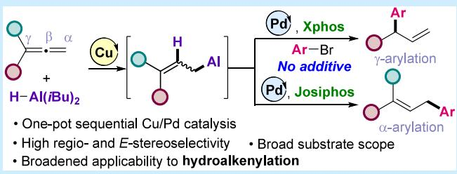
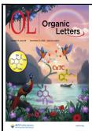
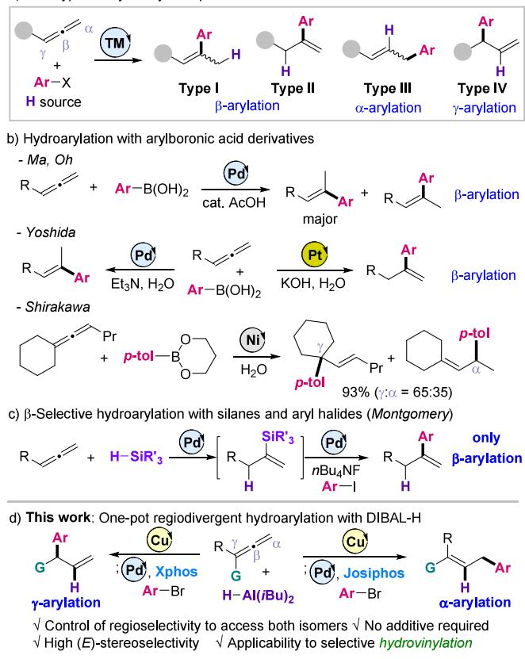
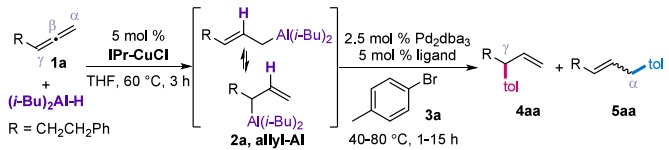
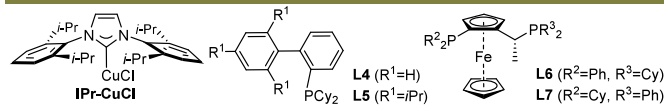
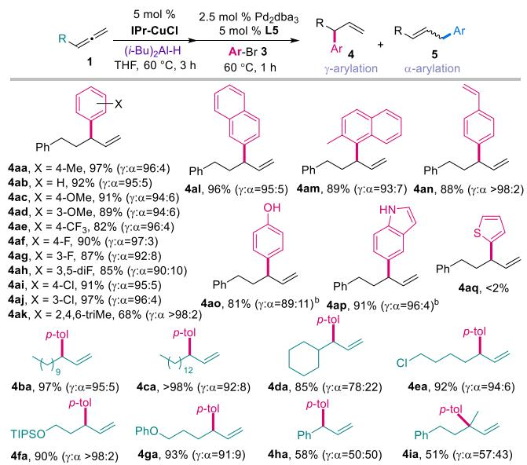
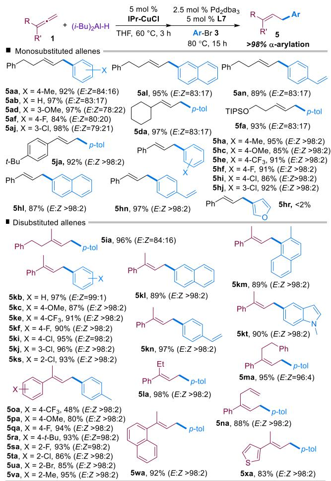
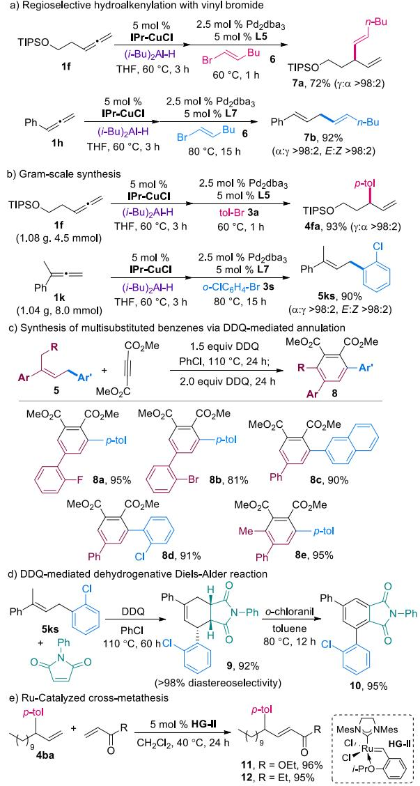
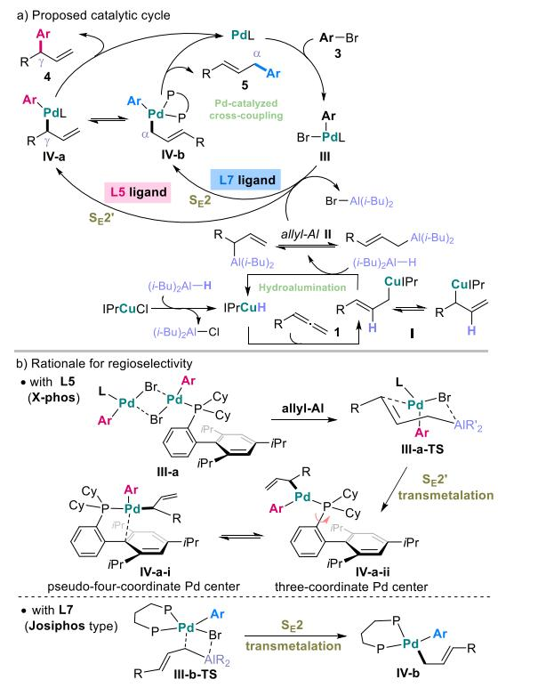

pubs.acs.org/OrgLett

Letter

# Cu/Pd-Catalyzed Ligand-Controlled Regiodivergent Hydroarylation of Allenes Using Diisobutylaluminum Hydride

Seungho Kim,‡ Kyeongmin Lee,‡ Seeun Lim, and Yunmi Lee\*

Cite This: Org. Lett. 2025, 27, 12945−12950

Read Online

## ACCESS

Metrics & More

ABSTRACT: We report a ligand-controlled, regiodivergent Cu/Pdcatalyzed hydroarylation of unactivated allenes. The reaction proceeds via Cu-catalyzed hydroalumination with DIBAL-H and subsequent additive-free Pd-catalyzed cross-coupling with aryl bromides. The key feature of this work is the discovery that modulation of the palladium ligand decisively enables complete regiodivergence. Bulky monodentate Xphos ligands promote exclusive γ-selective arylation, while bidentate Josiphos-type ligands switch the pathway to aford α-selective arylation. The method

Article Recommendations

\*sı Supporting Information

features mild conditions, scalability, and broad utility for synthesizing polysubstituted aromatic compounds.

H ydroarylation of unsaturated substrates has emerged as a powerful strategy for constructing aryl-substituted alkenes with precise control over regio- and stereochemistry. These arylated alkenes represent key structural motifs in pharmaceuticals, agrochemicals, natural products, and advanced materials.2 Accordingly, the development of eficient and selective hydroarylation methods is essential for the streamlined synthesis of complex molecular architectures. Hydroarylation has advanced significantly through transition metal catalysis, enabling high levels of regio- and stereocontrol with Pd-, Rh-, Ni-, Fe-, and Co-based catalysts, and employing diverse aryl sources such as aryl halides, arylboronic acids, and arenes.3 However, compared with alkenes4 and alkynes,5 the hydroarylation of allenes6 remains relatively underexplored. Allenes, with their unique cumulative diene structures, can provide direct access to allylic or vinylic aryl compounds, yet controlling regio- and stereoselectivity is challenging due to the formation of multiple possible isomers (Scheme 1a).7 Conventional approaches relying on directing groups or specific substrate designs through aromatic C−H activation8 often sufer from limited generality. Thus, the development of broadly applicable catalytic systems for regioselective hydroarylation of unactivated allenes remains a desirable goal.

Another major approach for the hydroarylation of allenes involves the use of preactivated aryl reagents for transition metal catalysis (Scheme 1b). The Ma and Oh groups independently reported Pd-catalyzed hydroarylations of allenes using arylboronic acids with catalytic acetic acid, which predominantly yielded β-arylated alkenes (Type I).9 Yoshida et al. described a related regiocontrolled addition of arylboronic acids to allenes, demonstrating that diferent β- arylated regioisomers (Type I vs II) could be obtained by switching the catalyst from Pd to Pt; however, both the Pd and Pt systems still predominantly produced β-arylation products, and the substrate scope remained limited to monosubstituted allenes.10 Shirakawa et al. disclosed the nickel-catalyzed hydroarylation of an allene with tolylboronate, which proceeded via γ-selective arylation with only moderate regioselectivity (65% γ-product and 35% α-product).11 As another approach, Miller and Montgomery developed allene hydroarylation in which an N-heterocyclic carbene (NHC)− Pd catalyst promotes regioselective hydrosilylation using silanes as the hydride source to generate alkenylsilane intermediates that subsequently undergo Pd-catalyzed crosscoupling with aryl iodides in the presence of n-Bu NF, afording β-arylated alkenes (Type II) (Scheme 1c).12 Despite these advances, current catalytic systems still predominantly deliver β-arylation products, and truly regiodivergent catalytic systems that enable selective access to multiple regioisomers from the same substrates remain exceedingly rare.

Herein, we report a ligand-controlled, regiodivergent hydroarylation of unactivated allenes through a dual Cu/Pd catalytic system. The reaction involves Cu-catalyzed hydroalumination of allenes with diisobutylaluminum hydride (DIBAL-H),13 followed by Pd-catalyzed cross-coupling with aryl bromides in a single vessel (Scheme 1d). This approach delivers two distinct regioisomeric products, α- and γ-arylated alkenes (Type III and IV), from a single allene substrate, representing a rare example of true ligand-controlled regiodivergence. Although Pd-catalyzed cross-couplings of aryl halides with allylic organometallic reagents such as allylaluminums and allylboronates have been reported,14 these methods typically rely on preformed metallic reagents, requiring additional synthetic steps. Moreover, allylboronatebased reactions often necessitate external additives, while the use of allylaluminum reagents has been limited due to the lack of mild and general methods for their preparation, thereby restricting substrate scope. In contrast, allenes provide a straightforward and versatile entry to allylic metal intermediates through in situ catalytic hydrometalation.

Scheme 1. Transition-Metal-Catalyzed Hydroarylation of Allenes  

We optimized the regiodivergent hydroarylation of allene 1a using DIBAL-H as the hydride source and 4-bromotoluene (3a) as the aryl coupling partner (Table 1). Allene 1a underwent smooth hydroalumination in the presence of 5 mol % IPr-CuCl catalyst, forming allylaluminum intermediate 2a with >98% conversion in situ.13 Subsequently, we evaluated various Pd-catalyzed coupling conditions using 3a to identify the optimal reaction parameters, focusing on the ligand choice to control the regioselectivity of the arylation step. In the absence of an additional phosphine ligand, using Pd dba alone, no coupling product was observed (entry 1). Introduction of monodentate phosphines such as PPh and $\mathrm { P C } _ { \mathbf { \nabla } y _ { 3 } }$ enabled Pd-catalyzed coupling, delivering γ-arylated product 4aa in moderate yields (32−40%) alongside α- arylated product 5aa in 7−18% yields (entries 2 and 3). Screening of various bidentate phosphine ligands (L1−L3) resulted in a low eficiency and poor regioselectivity (entries 4−6). In contrast, the use of bulky Buchwald-type monodentate phosphine ligands (L4 and L5) significantly improved both the reactivity and γ-selectivity of Pd-catalyzed coupling (entries 7 and 8). Further optimization revealed that increasing the amount of the allylaluminum intermediate and adjusting the reaction conditions to $6 0 ~ ^ { \circ } \mathrm { C }$ for 1 h in the presence of L5 aforded γ-arylated product 4aa predominantly, with excellent regioselectivity (96:4 $\gamma / \alpha ;$ entries 9 and 10). However, lowering the temperature to $4 0 ~ ^ { \circ } \mathrm { C }$ reduced this eficiency (entry 11). Notably, shifting to the Josiphos-type bidentate ligands (L6 and L7) altered the reaction outcome, favoring α- arylation (entries 12 and 13). Ultimately, the combination of ligand L7 with the $\mathrm { P d } _ { 2 } \mathrm { d } { \bf b } { \sf a } _ { 3 }$ catalyst delivered α-arylated product 5aa in 94% yield with an E/Z ratio of 84:16 (entry 14), thus demonstrating the capacity of ligand choice to switch the regioselectivity of the hydroarylation process. Notably, when allene 1a, DIBAL-H, 3a, IPrCuCl, and the Pd catalyst were combined in a single operation, the β-selective hydroarylation proceeded smoothly to aford a mixture of β-arylated alkenes (Type I and II, 90% yield).

Table 1. Optimization of Reaction Conditionsa
<table><tr><td colspan="5"></td></tr><tr><td colspan="5"></td></tr><tr><td>entry</td><td>equiv of 2</td><td>temp. ligand (mol %) (°C)</td><td>time (h)</td><td>yield of 4aa:5aa (%)b</td></tr><tr><td>1</td><td>1.2</td><td>no</td><td>80 12</td><td>&lt;2:&lt;2</td></tr><tr><td>2</td><td>1.2</td><td> $\mathrm { P P h } _ { 3 } \ ( 1 0 )$ </td><td>80 12</td><td>40:18</td></tr><tr><td>3</td><td>1.2</td><td> $\mathrm { P C y } _ { 3 } \ ( 1 0 )$ </td><td>80 12</td><td>32:7</td></tr><tr><td>4</td><td>1.2</td><td>dppBz, L1 (5)</td><td>80 12</td><td>17:22</td></tr><tr><td>5</td><td>1.2</td><td>binap, L2 (5)</td><td>80 12</td><td>20:30</td></tr><tr><td>6</td><td>1.2</td><td>DPEphos, L3 (5)</td><td>80 12</td><td>29:22</td></tr><tr><td>7</td><td>1.2</td><td>L4 (5)</td><td>80 12</td><td>64:5</td></tr><tr><td>8</td><td>1.2</td><td>L5 (5)</td><td>80 12</td><td>67:5</td></tr><tr><td>9c</td><td>1.5</td><td>L5 (5)</td><td>80 12</td><td>85:7</td></tr><tr><td>10c</td><td>1.5</td><td>L5 (5)</td><td>60 1</td><td>96:4</td></tr><tr><td>11º</td><td>1.5</td><td>L5 (5)</td><td>40 1</td><td>48:7</td></tr><tr><td>12</td><td>1.2</td><td>L6 (5)</td><td>80 12</td><td>6:50</td></tr><tr><td>13</td><td>1.2</td><td>L7 (5)</td><td>80 12</td><td>&lt;2:72</td></tr><tr><td>14º</td><td></td><td></td><td></td><td>&lt;2:94d</td></tr><tr><td></td><td>1.5</td><td>L7 (5)</td><td>80 15</td><td></td></tr></table>

aReaction conditions: allene (1a, 0.30 mmol), (i-Bu) Al−H (0.30 mmol), IPr-CuCl (5 mol %), Pd dba (2.5 mol %), ligand (5−10 mol %), tol-Br (3a, 0.25 mmol), THF (0.20 M). bDetermined by1H NMR spectral analysis using 1,3,5-trimethoxybenzene as the internal standard. cTol-Br 3a was used in an amount of 0.20 mmol. d84:16 E/Z of 5aa.

With these optimal conditions, the substrate scope was examined with respect to both allenes and aryl bromides (Scheme 2). The γ-selective arylation proceeded eficiently with ligand L5, afording γ-arylated alkenes 4aa−4aj in high yields (82−97%) and excellent regioselectivity $\left( \gamma { : } \alpha > 9 0 { : } 1 0 \right)$ from diverse aryl bromides 3a−3j bearing electron-donating or electron-withdrawing groups (e.g., MeO, CF , Cl, F). Sterically hindered mesityl and naphthyl bromides were also compatible, delivering 4ak−4am predominantly as γ-arylated products with slightly reduced eficiency for 4ak (68% yield). Furthermore, the reaction tolerated various functional groups on aryl bromides, such as alkenes and alcohols, afording 4an and 4ao in good yields. The method was also applicable to heteroaryl bromides: indolyl bromide underwent smooth coupling to give 4ap in 91% yield, whereas thienyl bromide failed to aford 4aq, likely due to the incompatibility of sulfurcontaining heterocycles under the reaction conditions.15 Alkylsubstituted allenes 1b−1d bearing long-chain nonyl, tridecyl, or bulky cyclohexyl groups underwent γ-arylation to aford 4ba−4da in high yields, though 1d gave moderate regioselectivity (γ:α = 78:22). Functionalized allenes 1e−1g bearing chloro, silyl ether, or phenyl ether groups were well tolerated, providing 4ea−4ga with consistently high γ- selectivity. In contrast, phenylallene 1h and disubstituted allene 1i exhibited diminished selectivity, giving nearly statistical mixtures of regioisomers (γ:α = 50:50 and 57:43, respectively).

Scheme 2. Scope for γ-Selective Hydroarylation  
  
aReaction conditions: allene (1, 0.30 mmol), (i-Bu) Al−H (0.30 mmol), Ar−Br (3, 0.20 mmol), THF (0.20 M). Yields of the isolated products were obtained. bAllene and DIBAL-H were used as 2.5 equiv each. Under the standard conditions, the yields of 4ao and 4ap were 25% and 56%, respectively.

Next, the scope of the α-selective arylation was examined (Scheme 3). All transformations furnished the α-arylated products with >98% regioselectivity and good-to-excellent Eselectivity. Phenethyl allene 1a in the presence of ligand L7 reacted smoothly with diverse aryl bromides bearing Me, MeO, F, Cl, alkene, or naphthyl groups to aford 5aa−5an in high yields (84−98%, E:Z > 78:22). Cyclohexyl (1d) and silyl ether-substituted (1f) allenes also underwent α-arylation eficiently, providing 5da and 5fa. Notably, aryl allene 1j gave 5ja in 92% yield with >98% E-selectivity. Furthermore, phenylallene 1h reacted with various aryl bromides (Me, MeO, CF , F, Cl, naphthyl, or alkene groups) to furnish α-arylated products 5ha−5hn in 85−99% yields, whereas coupling with furyl bromide was inefective (<2% yield of 5hr), instead producing dimerization products derived from the allylaluminum intermediate 2h (Scheme S1).

In addition, α-selective hydroarylation of disubstituted allenes was examined, predominantly yielding E-trisubstituted alkenes. Dialkyl allene 1i underwent exclusive α-arylation to give 5ia in 96% yield (E:Z = 84:16). Disubstituted allenes bearing aryl groups consistently aforded single regioisomers with excellent E-selectivity (>98%). This transformation provides an eficient route to E-trisubstituted alkenes, challenging motifs in pharmaceuticals, natural products, and functional materials.16 The α-arylation of phenyl, methylsubstituted allene 1k with various aryl- and naphthyl bromides bearing MeO, CF , F, Cl and alkene substituents aforded α- arylated E-alkenes 5kb−5kn in 87−97% yields. Indolyl bromide was also tolerated to furnish 5kt in 90% yield. Disubstituted allenes 1l−1n bearing phenyl and alkyl groups such as ethyl, phenethyl, or allyl groups provided 5la−5na in 88−98% yields. Similarly, aryl-substituted allenes 1p−1v with MeO, t-Bu, Me, F, Cl, or Br groups yielded 5pa−5va in 80− 95% yields. Interestingly, CF -phenyl allene 1o gave 5oa in moderate yield (48%) due to unexpected dimerization side reactions, whereas naphthyl and thienyl allenes 1w and 1x aforded 5wa (92%) and 5xa (83%), respectively.

Scheme 3. Scope for α-Selective Hydroarylationa  
  
aReaction conditions: allene 1 (0.30 mmol), (i-Bu) Al−H (0.30 mmol), Ar−Br 3 (0.20 mmol), THF (0.20 M). Yields of the isolated products were obtained.

We also investigated the regiodivergent hydroalkenylation of allenes using vinyl bromides 6 (Scheme 4a). While the alkenylation of 1f with vinyl bromide 6 in the presence of L5 provided γ-alkenylated product 7a in 72% yield, the use of the L7 ligand enabled α-alkenylation of 1h, afording E-selective diene product 7b in 92% yield.

The practical utility and scalability of this method were further demonstrated by the successful gram-scale syntheses of 4fa and 5ks (Scheme 4b). The γ-arylation of allene 1f (1.08 g) proceeded smoothly to deliver the γ-arylated alkene 4fa in 93% yield. Likewise, the α-arylation of allene 1k (1.04 g) aforded the E-trisubstituted alkene 5ks in 90% yield. To further highlight the applicability of our method, a one-pot transformation of trisubstituted alkene 5sa into a polysubstituted aromatic compound was investigated. Treatment of 5sa with 2,3-dichloro- $^ { - 5 , 6 }$ -dicyanobenzoquinone (DDQ) and dimethyl acetylenedicarboxylate under heating conditions induced in situ oxidation to a diene intermediate, which subsequently underwent a Diels−Alder reaction followed by oxidation to aford tetrasubstituted arene 8a in 95% yield (Scheme 4c). Various trisubstituted alkenes were successfully transformed into the corresponding arenes 8b−8d in 81−91% yield, along with the formation of the pentasubstituted arene 8e in 95% yield. Additionally, the tandem oxidative annulation of 5ks with N-phenylmaleimide in the presence of $\mathrm { D D Q }$ proceeded via Diels−Alder cycloaddition, furnishing cycloadduct 9 in 92% yield (Scheme 4d).17 The subsequent oxidation of 9 with o-chloranil provided the aromatic compound 10 in 95% yield. Moreover, the synthetic versatility of the γ-arylated products was further demonstrated by Ru-catalyzed metathesis of alkene 4ba with ethyl acrylate or ethyl vinyl ketone in the presence of the Hoveyda−Grubbs catalyst, which aforded the corresponding trans-disubstituted alkenes 11 and 12 in excellent yields (Scheme 4e).

Scheme 4. Synthetic Applications  

The proposed mechanism (Scheme $\mathfrak { s a } )$ involves initial Cucatalyzed hydroalumination of allene 1 with $\mathrm { D I B A L \cdot H , }$

## Scheme 5. Plausible Mechanism

generating allylaluminum intermediate $\mathbf { I I } ^ { 1 3 }$ via regioselective insertion of in situ-formed $\mathbf { I P r C u H . } ^ { 1 8 }$ Subsequent Pdcatalyzed transmetalation between II and the aryl-Pd(II) complex III delivers σ-allylpalladium intermediates IV through either the $S _ { \mathrm { E } } 2$ or $S _ { \mathrm { E } } 2 ^ { \prime }$ pathway, depending on the ligand.19 Reductive elimination then furnishes the α- or γ-arylated product under ligand conotrol.14 Although the reaction likely proceeds via direct reductive elimination, interconversion between $\sigma \mathrm { - }$ and π-allylpalladium intermediates cannot be completely ruled $\mathrm { o u t . } ^ { 2 0 }$ With bulky, electron-rich Xphos $\mathbf { L } 5 ,$ the conformation of aryl-Pd(II) complex III-a, supported by an X-ray crystal $\mathrm { s t r u c t u r e } , ^ { 2 1 }$ provides steric accessibility for the allylaluminum to approach the Pd center and facilitates $S _ { \mathrm { E } } 2 ^ { \prime }$ transmetalation through a six-membered transition state III-a-TS (Scheme 5b). The resulting three-coordinate Pd(II) complex VI-a-ii rearranges to a pseudo-four-coordinate species $\mathbf { V } \mathbf { I - a - i } ^ { 2 2 }$ that undergoes rapid reductive elimination to aford the γ-arylated product 4. In contrast, with the chelating ligand $\mathbf { L 7 } ,$ the $S _ { \mathrm { E } } 2$ pathway (III-b-TS) is favored, forming σ-allyl-Pd(II) complex IV-b and yielding α-arylated products. The rigid bite angle and constrained coordination geometry imposed by the L7 ligand23 likely stabilize the $S _ { \mathrm { E } ^ { 2 } }$ transition state and suppress $\sigma { - } \pi { - } \sigma$ isomerization, resulting in high α- selectivity. Thus, ligand-dependent regioselectivity arises from the preferred transmetalation pathway $( S _ { \mathrm { E } } 2$ vs $\dot { \bf S } _ { \mathrm { E } } ^ { \mathrm { ~ } } 2 ^ { \prime } )$ , dictated by the coordination environment around palladium.

In summary, we have developed a Cu/Pd dual-catalyzed, ligand-controlled regiodivergent hydroarylation of unactivated allenes using DIBAL-H and aryl bromides. This approach enables the selective synthesis of otherwise inaccessible α- and γ-arylated alkenes from a common allene substrate. The regioselectivity is precisely dictated by the phosphine ligand in the Pd-catalyzed step, allowing mild, broad-scope reactions with excellent regio- and stereocontrol. The same strategy is also efective for hydroalkenylation, furnishing 1,4-dienes with high selectivity, and the synthetic versatility of the products was showcased via Diels−Alder/oxidative aromatization sequences. This study establishes a new ligand-directed platform for achieving regiodivergent C−C bond formation from allenes beyond the reach of conventional hydroarylation chemistry.

## ■ ASSOCIATED CONTENT

## Data Availability Statement

The data underlying this study are available in the published article and its Supporting Information.

## \*sı Supporting Information

The Supporting Information is available free of charge at https://pubs.acs.org/doi/10.1021/acs.orglett.5c04396.

Experimental procedures, characterization of products, and spectral data (PDF)

## ■ AUTHOR INFORMATION

## Corresponding Author

Yunmi Lee − Department of Chemistry, Kwangwoon University, Seoul 01897, Republic of Korea; orcid.org/ 0000-0003-1315-4001; Email: ymlee@kw.ac.kr

## Authors

Seungho Kim − Department of Chemistry, Kwangwoon University, Seoul 01897, Republic of Korea

Kyeongmin Lee − Department of Chemistry, Kwangwoon University, Seoul 01897, Republic of Korea

Seeun Lim − Department of Chemistry, Kwangwoon University, Seoul 01897, Republic of Korea

Complete contact information is available at: https://pubs.acs.org/10.1021/acs.orglett.5c04396

## Author Contributions

‡S.K. and K.L. contributed equally.

## Notes

The authors declare no competing financial interest.

## ■ ACKNOWLEDGMENTS

This research was supported by the Basic Science Research Program through the National Research Foundation of Korea (NRF-2020R1A2C1005817, RS-2025-16070809). This work was also partially supported by a research grant from Kwangwoon University in 2024.

## ■ REFERENCES

(1) (a) Cacchi, S. The Palladium-catalyzed Hydroarylation and Hydrovinylation of Carbon−Carbon Multiple Bonds: New Perspectives in Organic Synthesis. Pure Appl. Chem. 1990, 62, 713−722. (b) Ackermann, L.; Gunnoe, T.; Habgood, L. Catalytic Hydroarylation of Carbon-Carbon Multiple Bonds; Wiley-VCH: Weinheim, Germany, 2018.

(2) (a) Yoshida, M.; Shoji, Y.; Shishido, K. Total Syntheses of Enokipodins A and B Utilizing Palladium-Catalyzed Addition of an Arylboronic Acid to an Allene. Org. Lett. 2009, 11, 1441−1443. (b) Yoshida, M.; Shoji, Y.; Shishido, K. Enantioselective Formal Total Synthesis of Aplysin Utilizing a Palladium-catalyzed Addition of an Arylboronic Acid to an Allenic Alcohol-Eschenmoser/Claisen

rearrangement. Tetrahedron 2010, 66, 5053−5058. (c) Ballarotto, M.; Cerra, B.; Temperini, A. Multicomponent and Metal-Free Diels− Alder/Aromatization Approach to the Stereospecific Synthesis of E-(Hetero)Stilbenes and Diarylacetylenes. Eur. J. Org. Chem. 2023, 26, No. e202300552. (d) Wang, M.; Cheng, D.; Pu, Y.; Xu, X. Synthesis of Azaxanthones via DDQ-Mediated Tandem Oxidative Annulation. Tetrahedron Lett. 2021, 79, No. 153302.

(3) (a) Jia, C.; Piao, D.; Oyamada, J.; Lu, W.; Kitamura, T.; Fujiwara, Y. Efficient Activation of Aromatic C−H Bonds for Addition to C−C Multiple Bonds. Science 2000, 287, 1992−1995. (b) Maayuri, R.; Gandeepan, P. Manganese-Catalyzed Hydroarylation of Multiple Bonds. Org. Biomol. Chem. 2023, 21, 441−464. (c) Bhakta, S.; Ghosh, T. Nickel-catalyzed Hydroarylation Reaction: a Useful Tool in Organic Synthesis. Org. Chem. Front. 2022, 9, 5074−5103. (d) Nishimura, T. Iridium-Catalyzed Hydroarylation via C−H Bond Activation. Chem. Rec. 2021, 21, 3532−3545. (e) De Angelis, M.; Iazzetti, A.; Serraiocco, A.; Ciogli, A. Asymmetric Hydroarylation Reactions Catalyzed by Transition Metals: Last 10 Years in a Mini Review. Catalysts 2022, 12, No. 1289.

(4) Dong, Z.; Ren, Z.; Thompson, S. J.; Xu, Y.; Dong, G. Transition-Metal-Catalyzed C−H Alkylation Using Alkenes. Chem. Rev. 2017, 117, 9333−9403.

(5) (a) Yamamoto, Y. Synthesis of Heterocycles via Transition-Metal-Catalyzed Hydroarylation of Alkynes. Chem. Soc. Rev. 2014, 43, 1575−1600. (b) Kitamura, T. Transition Metal-Catalyzed Hydroarylation Reactions of Alkynes Through Direct Functionalization of C−B Bonds: A Convenient Tool for Organic Synthesis. Eur. J. Org. Chem. 2009, 2009, 1111−1125. (c) Nevado, C.; Echavarren, A. M. Transition Metal-Catalyzed Hydroarylation of Alkynes. Synthesis 2005, 2005, 167−182.

(6) (a) Pages,̀ L.; Abed Ali Abdine, R.; Monnier, F.; Taillefer, M. Transition Metal-Catalyzed Intermolecular Hydroarylation of Allenes. Eur. J. Org. Chem. 2022, 2022, No. e202200724. (b) Bubnova, A. S.; Philippova, A. N.; Gribanov, P. S.; Smol’yakov, A. F.; Osipov, S. N.; Vorobyeva, D. V. Pd(II)-Catalyzed Regioselective Hydroarylation of Allenyl-containing α-Amino Acid Derivatives with Aryl Boronic Acids. Org. Biomol. Chem. 2025, 23, 5396−5400.

(7) (a) Li, G.; Huo, X.; Jiang, X.; Zhang, W. Asymmetric Synthesis of Allylic Compounds via Hydrofunctionalisation and Difunctionalisation of Dienes, Allenes, and Alkynes. Chem. Soc. Rev. 2020, 49, 2060−2118. (b) Blieck, R.; Taillefer, M.; Monnier, F. Metal-Catalyzed Intermolecular Hydrofunctionalization of Allenes: Easy Access to Allylic Structures via the Selective Formation of C−N, C− C, and C−O Bonds. Chem. Rev. 2020, 120, 13545−13598. (c) Du, X.; Zhao, H.; Li, X.; Zhang, L.; Dong, Y.; Wang, P.; Zhang, D.; Liu, Q.; Liu, H. Ligand-Regulated Palladium-Catalyzed Regiodivergent Hydroarylation of the Distal Double Bond of Allenamides with Aryl Boronic Acid. J. Org. Chem. 2021, 86, 13276−13288.

(8) For representative examples, see: (a) Nakanowatari, S.; Mei, R.; Feldt, M.; Ackermann, L. Cobalt(III)-Catalyzed Hydroarylation of Allenes via C-H Activation. ACS Catal. 2017, 7, 2511−2515. (b) Nakanowatari, S.; Müller, T.; Oliveira, J. C. A.; Ackermann, L. Bifurcated Nickel-Catalyzed Functionalizations: Heteroarene C−H Activation with Allenes. Angew. Chem., Int. Ed. 2017, 56, 15891− 15895. (c) Berthold, D.; Klett, J.; Breit, B. Rhodium-Catalyzed Asymmetric Intramolecular Hydroarylation of Allenes: Access to Functionalized Benzocycles. Chem. Sci. 2019, 10, 10048−10052. (d) Messinis, A. M.; Finger, L. H.; Hu, L.; Ackermann, L. Allenes for Versatile Iron-Catalyzed C−H Activation by Weak O-Coordination: Mechanistic Insights by Kinetics, Intermediate Isolation, and Computation. J. Am. Chem. Soc. 2020, 142, 13102−13111. (e) Ghazvini, H. J.; Khosravi, H.; Mirzaei, S.; Balalaie, S.; Breit, B. Rhodium-Catalyzed Regio- and Diastereoselective Hydroarylation of Allenes: An Unprecedented Ene Reaction. ACS Catal. 2021, 11, 14570−14574.

(9) (a) Ma, S.; Jiao, N.; Ye, L. Palladium-Catalyzed Highly Regioand Stereoselective Addition of Organoboronic Acids to Allenes in the Presence of AcOH. Chem.�Eur. J. 2003, 9, 6049−6056. (b) Oh,

C. H.; Ahn, T. W.; Reddy V, R. Palladium-Catalyzed Addition of Organoboronic Acids to Allenes. Chem. Commun. 2003, 2622−2623.

(10) (a) Yoshida, M.; Matsuda, K.; Shoji, Y.; Gotou, T.; Ihara, M.; Shishido, K. Regiocontrolled Addition of Arylboronic Acids to Allenes Using Palladium and Platinum Catalysts. Org. Lett. 2008, 10, 5183− 5186. (b) Hopkins, C. D.; Malinakova, H. C. Synthesis of Homoallylic Alcohols via Palladium-Catalyzed Three-Component Coupling of an Arylboronic Acid with Allenes and Aldehydes. Org. Lett. 2004, 6, 2221−2224.

(11) Takahashi, G.; Shirakawa, E.; Tsuchimoto, T.; Kawakami, Y. Nickel-Catalyzed Addition of Organoboronates to 1,2-Dienes and the Corresponding Three-Component Reaction with an Alkyne. Adv. Synth. Catal. 2006, 348, 837−840.

(12) Miller, Z. D.; Montgomery, J. Regioselective Allene Hydroarylation via One-Pot Allene Hydrosilylation/Pd-Catalyzed Cross-Coupling. Org. Lett. 2014, 16, 5486−5489.

(13) (a) Lee, S.; Lee, S.; Lee, Y. Copper-Catalyzed Hydroalumination of Allenes with Diisobutylaluminum Hydride: Synthesis of Allylic Ketones with α-Quaternary Centers via Tandem Allylation/ Oppenauer Oxidation. Org. Lett. 2020, 22, 5806−5810. (b) Lee, S.; Lee, Y. Synthesis of α-Quaternary Carboxylic Acids through Cu-Catalyzed Hydrocarboxylation of Allenes with Diisobutylaluminum Hydride and Carbon Dioxide. Adv. Synth. Catal. 2023, 365, 4641− 4646. (c) Lee, K.; Cho, S.; Lim, S.; Lee, Y. Access to α-All-carbon Quaternary Amides Through the Hydroamidation of Allenes Using DIBAL-H and Isocyanates. Org. Chem. Front. 2024, 11, 1366−1371. (d) Lim, S.; Kim, T.; Lee, Y. Regioselective Formal Hydrocyanation of Allenes: Synthesis of β,γ-Unsaturated Nitriles with α-All-carbon Quaternary Centers. Beilstein J. Org. Chem. 2025, 21, 800−806.

(14) (a) Schumann, H.; Kaufmann, J.; Schmalz, H.-G.; Böttcher, A.; Gotov, B. Pd-Catalyzed Cross-Coupling of Haloarenes and Chloroarene-Cr(CO) Complexes with Stabilized Vinyl- and Allylaluminium Reagents. Synlett 2003, 12, 1783−1788. (b) Farmer, J. L.; Hunter, H. N.; Organ, M. G. Regioselective Cross-Coupling of Allylboronic Acid Pinacol Ester Derivatives with Aryl Halides via Pd-PEPPSI-IPent. J. Am. Chem. Soc. 2012, 134, 17470−17473. (c) Yang, Y.; Buchwald, S. L. Ligand-Controlled Palladium-Catalyzed Regiodivergent Suzuki− Miyaura Cross-Coupling of Allylboronates and Aryl Halides. J. Am. Chem. Soc. 2013, 135, 10642−10645. (d) Chausset-Boissarie, L.; Ghozati, K.; LaBine, E.; Chen, J. L.-Y.; Aggarwal, V. K.; Crudden, C. M. Enantiospecific Regioselective Cross-Coupling Reactions of Secondary Allylic Boronic Esters. Chem.�Eur. J. 2013, 19, 17698−17701. (e) Ding, J.; Rybak, T.; Hall, D. G. Synthesis of Chiral Heterocycles by Ligand-Controlled Regiodivergent and Enantiospecific Suzuki Miyaura Cross-coupling. Nat. Commun. 2014, 5, No. 5474.

(15) (a) Hooper, M. W.; Hartwig, J. F. Understanding the Coupling of Heteroaromatic Substrates: Synthesis, Structures, and Reductive Eliminations of Heteroarylpalladium Amido Complexes. Organometallics 2003, 22, 3394−3403. (b) Hartwig, J. F. Electronic Effects on Reductive Elimination To Form Carbon−Carbon and Carbon− Heteroatom Bonds from Palladium(II) Complexes. Inorg. Chem. 2007, 46, 1936−1947.

(16) (a) Eissen, M.; Lenoir, D. Mass Efficiency of Alkene Syntheses with Tri- and Tetrasubstituted Double Bonds. ACS Sustainable Chem. Eng. 2017, 5, 10459−10473. (b) Li, M. Y.; Zhai, S.; Nong, X. M.; Gu, A.; Li, J.; Lin, G. Q.; Liu, Y. Trisubstituted Alkenes Featuring Aryl Groups: Stereoselective Synthetic Strategies and Applications. Sci. China: Chem. 2023, 66, 1261−1287.

(17) Xu, W.-L.; Tang, L.; Ge, C.-Y.; Chen, J.; Zhou, L. Synthesis of Tetrahydroisoindolinones via a Metal-Free Dehydrogenative Diels-Alder Reaction. Adv. Synth. Catal. 2019, 361, 2268−2273.

(18) (a) Jordan, A. J.; Lalic, G.; Sadighi, J. P. Coinage Metal Hydrides: Synthesis, Characterization, and Reactivity. Chem. Rev. 2016, 116, 8318−8372. (b) Bai, T.; Yang, Y.; Han, C. Isolation and Characterization of Hydrocarbon Soluble NHC Copper(I) Phosphoranimide Complex and Catalytic Application for Alkyne Hydroboration Reaction. Tetrahedron Lett. 2017, 58, 1523−1527.

(19) (a) Yamamoto, Y.; Takada, S.; Miyaura, N.; Iyama, T.; Tachikawa, H. γ-Selective Cross-Coupling Reactions of Potassium Allyltrifluoroborates with Haloarenes Catalyzed by a Pd(0)/D-t-BPF or Pd(0)/Josiphos ((R,S)-CyPF-t-Bu) Complex: Mechanistic Studies on Transmetalation and Enantioselection. Organometallics 2009, 28, 152−160. (b) Roh, B.; Lee, H. G. Stereospecific Palladium-Catalyzed Cross-Coupling of Alkylboron Compounds: A Short Account. Synthesis 2024, 56, 2614−2626.

(20) (a) Trost, B. M.; Van Vranken, D. L. Asymmetric Transition Metal-Catalyzed Allylic Alkylations. Chem. Rev. 1996, 96, 395−422.

(b) Pregosin, P. S.; Salzmann, R. Structure and Dynamics of Chiral Allyl Complexes of Pd(II): NMR Spectroscopy and Enantioselective Allylic Alkylation. Coord. Chem. Rev. 1996, 155, 35−68.

(21) Huang, J.; Ho, D. B.; Gaube, G.; Celuszak, H.; Becica, J.; Thomas, G. T.; Schley, N. D.; Leitch, D. C. A Thermally Stable, Alkene-Free Palladium Source for Oxidative Addition Complex Formation and High-Turnover Catalysis. Organometallics 2024, 43, 2403−2412.

(22) (a) Barder, T. E.; Buchwald, S. L. Insights into Amine Binding to Biaryl Phosphine Palladium Oxidative Addition Complexes and Reductive Elimination from Biaryl Phosphine Arylpalladium Amido Complexes via Density Functional Theory. J. Am. Chem. Soc. 2007, 129, 12003−12010. (b) Melvin, P. R.; Nova, A.; Balcells, D.; Hazari, N.; Tilset, M. DFT Investigation of Suzuki−Miyaura Reactions with Aryl Sulfamates Using a Dialkylbiarylphosphine-Ligated Palladium Catalyst. Organometallics 2017, 36, 3664−3675.

(23) (a) Kobayashi, K.; Yamamoto, Y.; Miyaura, N. Pd/Josiphos-Catalyzed Enantioselective α-Arylation of Silyl Ketene Acetals and Mechanistic Studies on Transmetalation and Enantioselection. Organometallics 2011, 30, 6323−6327. (b) Hu, B.; Zhao, H.; Wu, Y.; Walsh, P. J. Palladium-Catalyzed Benzylic C(sp3)−H Carbonylative Arylation with Aryl Bromides. Angew. Chem., Int. Ed. 2023, 62, No. e202300073.