RESEARCH ARTICLE

View Article Online View Journal | View Issue

Check for updates

Cite this: Org Chem Front , 2025, 12, 2305

# Enantioselective synthesis of isoxazolines bearing allenes by palladium-catalyzed carboetherification of β,γ-unsaturated ketoximes with propargylic acetates†

Feifei Jin,a Cangzhu Hu,a Shuaijie Wu,a Guodong Zhang, a Ying Han,a Chao-Guo Yan, a Wenbo Li,\*b Chaoshen Zhang\*c and Lei Wang \*a

Received 11th December 2024, Accepted 23rd January 2025

DOI: 10.1039/d4qo02319f

A highly eficient Pd-catalyzed enantioselective carboetherification reaction of β,γ-unsaturated ketoximes with propargylic acetates is demonstrated. This method provides various chiral isoxazolines bearing multisubstituted allene groups in good yields with excellent enantioselectivities. The sterically electron-rich BINOL-derived phosphoramidite ligand exhibits highly eficient control over both chemoselectivity and enantioselectivity. The salient features of this reaction include readily available starting materials, broad functional group tolerance, an easy scale-up, versatile transformations and promising photo-physical properties. DFT calculations were carried out to disclose the detailed mechanism and origins of the enantioselectivity.

rsc.li/frontiers-organic

## Introduction

Over the past decades, transition-metal-catalyzed carboheterofunctionalization reactions of alkenes have become a powerful method for the construction of heterocyclic compounds.1–3 In this regard, palladium-catalyzed carboetherification of alkenes with aryl/alkenyl halides allows the construction of a new C–C bond and a new C–O bond in a single reaction, which has greatly expanded its scope.4 Despite significant progress, the development of such an asymmetric reaction still remains a challenge, and only a few strategies have been explored so far. For instance, Mazet and co-workers developed an elegant Pdcatalyzed intermolecular carboetherification of dihydrofurans, which provided access to a variety of chiral-fused tetrahydrofurobenzofurans (Scheme 1a).5 On the other hand, Pd-catalyzed enantioselective carboetherification of alkenes bearing a nucleophilic moiety with aryl/alkenyl halides was also developed.6–10 For example, the first palladium-catalyzed enantioselective carboetherification reaction of alkenols to aford chiral tetrahydrofuran was realized by Wolfe in 2015 (Scheme 1b).6 Later, Tang’s group developed enantioselective palladium-catalyzed alkene aryloxyarylation to give a series of chiral $^ { 1 , 4 \cdot }$ -benzodioxanes, chromans, and $^ { 1 , 4 }$ -benzooxazines.8 Recently, the group of Zhang reported an eficient Pd/Xiang-Phos catalyzed carboetherification of alkenyl oximes to aford isoxazolines with good enantioselectivity.9 Despite remarkable progress, however, these electrophiles in the carboetherification reaction are limited to aryl/alkenyl halides. With regard to the significance for increasing the diversity of compounds, developing new electrophile variants and widespread applications of specialized structural units would be highly valuable.

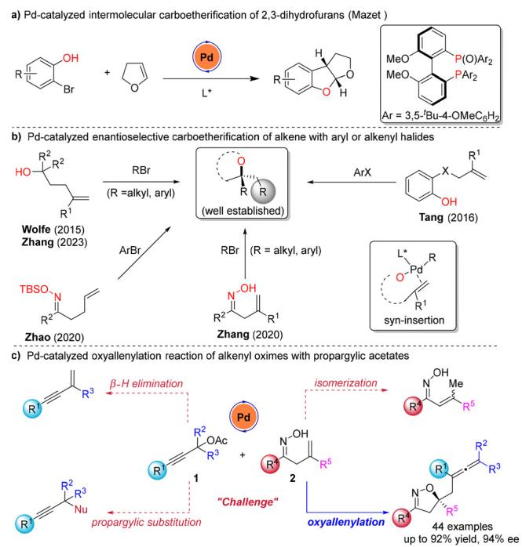  
Scheme 1 Pd-catalyzed asymmetric carboetherification of alkenes.

Allenes are key structural motifs in natural products and also serve as potential precursors in the synthesis of many bioactive molecules, drugs and target molecules.11,12 Consequently, the development of novel methodologies to synthesize allenes has attracted enormous attention.13 Among many strategies, high progress has been achieved in the transition-metal-catalyzed cross-coupling of propargyl electrophiles with various nucleophiles for the preparation of allenes.14 Remarkably, Zhou and co-workers developed an eficient palladium-catalyzed asymmetric Wacker-type coupling of threecomponent allenylation reactions.15 Very recently, our group developed a novel palladium-catalyzed asymmetric alleneamination of $\beta , \gamma \cdot$ -unsaturated hydrazones with propargylic acetates, which provides facile access to the installation of various multisubstituted allene groups onto chiral dihydropyrazoles.16 In continuation of our interest in the allenylation reaction, we are curiously interested in whether the reaction might be extended to an asymmetric version of carboetherification of alkenyl oximes with propargylic acetates for the synthesis of allenyl substituted chiral isoxazolines. To achieve this carboetherification reaction, several side reactions must be prevented, and several intricate challenges should be conquered: (1) how to eficiently control the isomerization of $\beta , \gamma \cdot$ -unsaturated oximes to α,β-unsaturated oximes and prevent propargylic substitution with nucleophilic oximes; (2) minimize β-hydrogen elimination of propargylic acetate atoms to give byproduct enynes; and (3) how to sequentially and eficiently control both chemoselectivity and enantioselectivity in one pot. Herein, we describe an eficient palladium-catalyzed enantioselective carboetherification of alkenyl oximes with propargylic acetates, delivering enantioenriched isoxazolines bearing allenyl groups in good yields with excellent enantioselectivities (Scheme 1c).

At the onset of our study, 2-methyl-4-phenylbut-3-yn-2-yl acetate 1a with β,γ-unsaturated oximes 2a were selected as the model substrates to optimize this asymmetric carboetherification reaction. We envisioned that our previously developed palladium-catalyzed asymmetric alleneamination of β,γ-unsaturated hydrazones with propargylic acetates would be capable of controlling the stereochemistry of this asymmetric carboetherification reaction. However, we were disappointed to not observe even traces of the desired product 3a by using Pd $( \mathrm { c o d } ) \mathrm { C l } _ { 2 }$ as the catalyst, L1 as the ligand, and $\mathbf { K } _ { 2 } \mathbf { C O } _ { 3 }$ as the base in CPME (cyclopentyl methyl ether) at 50 °C under an argon atmosphere (Table 1, entry 1). Screening of bisphosphine ligands (L2 and L3) and P-chiral ligand L4 led to the desired product 3a in poor yields with low enantioselectivities (Table 1, entries 2–4). We then investigated the TADDOLderived chiral phosphite ligand L5, and the desired product 3a was obtained in 55% yield with a poor ee value (Table 1, entry 5). It was found that BINOL-derived phosphoramidites (L6 and L7) failed to improve yields and enantioselectivities (Table 1, entries 6 and 7). On further screening more sterically hindered ligands (L8 and L9), we found that L9 was the best ligand, afording 3a in 82% yield with 89% ee (Table 1, entry 9). With the best ligand (L9) in hand, we then focused on exploring various palladium sources. The efect of palladium sources such as Pd2(dba)3, Pd(OAc)2 and allylpalladium(II) chloride failed to improve the yield and enantioselectivity of 3a (Table 1, entries 10–12). However, the substrate has relatively good reactivity in THF and toluene, leading to 3a with a relatively lower ee value (Table 1, entries 13 and 14). Notably, a range of bases such as NaOtBu, $\mathrm { { K O } } ^ { t } \mathrm { { B u } } ,$ , and $\mathbf { N a } _ { 2 } \mathbf { C O } _ { 3 }$ did not give good results (for additional details, please see the ESI†). Finally, the enantioselectivity could be further improved to 92% ee by the use of CPME (5.0 mL) at $5 0 ~ ^ { \circ } \mathrm { C }$ under argon for 48 h.

Table 1 Optimization of the reaction conditionsa  
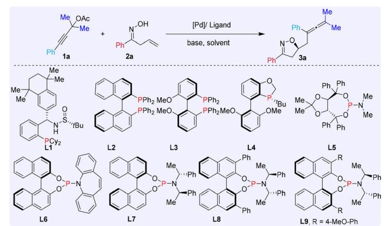

<table><tr><td>Entry</td><td>Pd catalyst</td><td>Ligand</td><td>Solvent</td><td> $\mathrm { Y i e l d } ^ { b } \left( \% \right)$ </td><td> $\mathsf { e e } ^ { c } \left( \% \right)$ </td></tr><tr><td>1</td><td> $\mathbf { P d } ( \mathbf { c o d } ) \mathbf { C l } _ { 2 }$ </td><td>L1</td><td>CPME</td><td>NR</td><td>NR</td></tr><tr><td>2</td><td> $\mathbf { P d } ( \mathbf { c o d } ) \mathbf { C l } _ { 2 }$ </td><td>L2</td><td>CPME</td><td>5</td><td>9</td></tr><tr><td>3</td><td> $\mathbf { P d } ( \mathbf { c o d } ) \mathbf { C l } _ { 2 }$ </td><td>L3</td><td>CPME</td><td>10</td><td>&lt;5</td></tr><tr><td>4</td><td> $\mathbf { P d } ( \mathbf { c o d } ) \mathbf { C l } _ { 2 }$ </td><td>L4</td><td>CPME</td><td>28</td><td>-19</td></tr><tr><td>5</td><td> $\mathbf { P d } ( \mathbf { c o d } ) \mathbf { C l } _ { 2 }$ </td><td>L5</td><td>CPME</td><td>55</td><td>19</td></tr><tr><td>6</td><td> $\mathbf { P d } ( \mathbf { c o d } ) \mathbf { C l } _ { 2 }$ </td><td>L6</td><td>CPME</td><td>10</td><td>-14</td></tr><tr><td>7</td><td> $\mathbf { P d } ( \mathbf { c o d } ) \mathbf { C l } _ { 2 }$ </td><td>L7</td><td>CPME</td><td>16</td><td>&lt;5</td></tr><tr><td>8</td><td> $\mathbf { P d } ( \mathbf { c o d } ) \mathbf { C l } _ { 2 }$ </td><td>L8</td><td>CPME</td><td>82</td><td>85</td></tr><tr><td>9</td><td> $\mathbf { P d } ( \mathbf { c o d } ) \mathbf { C l } _ { 2 }$ </td><td>L9</td><td>CPME</td><td>82</td><td>89</td></tr><tr><td> $\bar { 1 } 0 ^ { d }$ </td><td> $\mathrm { P d } _ { 2 } ( \mathrm { d b a } ) _ { 3 }$ </td><td>L9</td><td>CPME</td><td>22</td><td>90</td></tr><tr><td>11</td><td> ${ \mathrm { P d } } ( \mathrm { O A c } ) _ { 2 }$ </td><td>L9</td><td>CPME</td><td>74</td><td>90</td></tr><tr><td> $1 2 ^ { d }$ </td><td> $[ \mathrm { P d } ( \mathrm { a l l y l } ) ] _ { 2 }$ </td><td>L9</td><td>CPME</td><td>76</td><td>91</td></tr><tr><td>13</td><td> $\bar { \bf P } \bar { \bf d } ( \bar { \bf c o d } ) \bar { \bf C l _ { 2 } }$ </td><td>L9</td><td>THF</td><td>94</td><td>87</td></tr><tr><td>14</td><td> $\mathbf { P d } ( \mathbf { c o d } ) \mathbf { C l } _ { 2 }$ </td><td>L9</td><td>Toluene</td><td>83</td><td>71</td></tr><tr><td> $1 5 ^ { e }$ </td><td> $\mathbf { P d } ( \mathbf { c o d } ) \mathbf { C l } _ { 2 }$ </td><td>L9</td><td>CPME</td><td>82</td><td>92</td></tr></table>

a Reaction conditions: 1a (0.2 mmol), 2a (0.3 mmol, 1.5 equiv.), $\mathbf { K } _ { 2 } \mathbf { C O } _ { 3 }$ (0.3 mmol, 1.5 equiv.), Pd catalyst (8 mol%) and ligand (10 mol%) in 2.0 mL CPME (cyclopentyl methyl ether) at 50 °C under argon for 24 h. b Isolated yield. c ee was determined by HPLC analysis. $\breve { a } _ { 4 }$ mol% Pd catalyst was used. e 1a (0.3 mmol), 2a (0.45 mmol, 1.5 equiv.), $\mathbf { K } _ { 2 } \mathbf { C O } _ { 3 }$ (0.45 mmol), Pd(cod)Cl (8 mol%) and L9 (10 mol%) in 5.0 mL CPME at 50 °C under argon for 48 h.

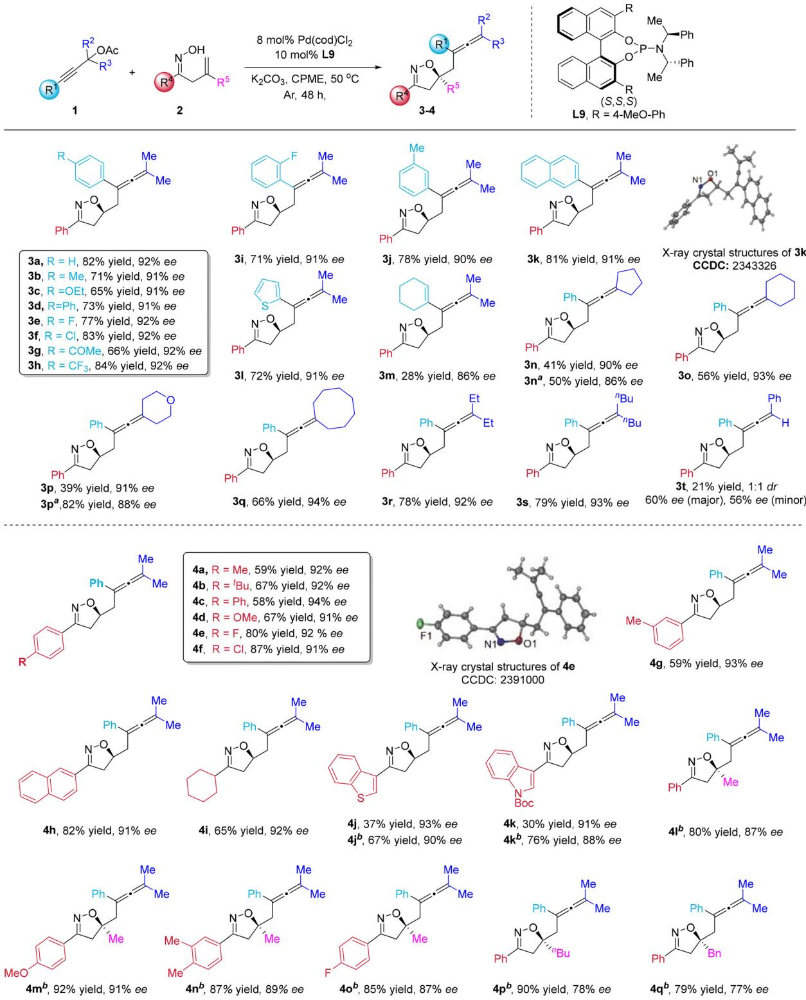  
Scheme 2 Enantioselective synthesis of isoxazolines. Unless otherwise noted, all reactions were carried out with 1 (0.3 mmol), 2 (0.45 mmol, 1.5 equiv.), ${ \sf K } _ { 2 } { \sf C } { \sf O } _ { 3 }$ (0.45 mmol, 1.5 equiv.), Pd(cod $O C l _ { 2 }$ (8 mol%) and L9 (10 mol%) in CPME (5.0 mL) at $5 0 ~ ^ { \circ } \mathsf { C }$ under argon for 48 ${ \sf h . \Sigma } ^ { a } { \bf 1 } ( 0 . 3$ mmol), 2 (0.45 mmol, 1.5 equiv.), $K _ { 2 } C O _ { 3 } ( 0 . 4 5$ mmol, 1.5 equiv.), Pd(cod)Cl (8 mol%) and L9 (10 mol%) in THF (5.0 mL) at $5 0 ~ ^ { \circ } \mathsf { C }$ under argon for $4 8 \ \mathsf { h } . \ ^ { b } \pmb { 1 }$ (0.3 mmol), 2 (0.45 mmol, 1.5 equiv.), ${ \sf K } _ { 2 } { \sf C O } _ { 3 } \left( 0 . 4 5 \right.$ mmol, 1.5 equiv.), Pd(cod)Cl (8 mol%) and L9 (10 mol%) in THF $( 2 . 0$ mL) at $5 0 ~ ^ { \circ } \mathsf { C }$ under argon for 48 h.

## Results and discussion

With the optimized conditions in hand, the scope of propargylic acetates 1 was first examined as shown in Scheme 2. For example, a variety of propargylic acetates bearing electrondonating or electron-withdrawing groups at the para position of the phenyl ring were all well tolerated, and aforded the desired products 3b–3h in moderate to excellent yields with 91–92% ees. Notably, substrates with aryl groups bearing ortho- and meta-substituents were also applicable to give the desired products 3i and 3j in 71–78% yields with 90–91% ees.

Moreover, 2-naphthyl propargylic acetates could be employed to deliver the corresponding product 3k in 81% yield with 91% ee. The absolute configuration of 3k was confirmed by X-ray crystallography analysis.17 Heteroarene and 1-ethynylcyclohex-1-ene substituted propargylic acetates also proved to be good substrates in this transformation, afording 3l and 3m with comparable enantioselectivities. In addition, the propargylic carbonates containing five-, six- and eightmembered cyclic alkyl scafolds reacted smoothly to provide 3n–3q in moderate yields with excellent enantioselectivities (86–94% ees). Substrates with the ethyl or n-butyl located on the tertiary carbon atom of the propargylic acetates were also good reaction partners and led to the corresponding products 3r and 3s in good results.

Next, we then investigated the scope of unsaturated ketoximes in this asymmetric reaction. A wide range of β,γ-unsaturated ketoximes with phenyl rings containing electron-donating or electron-withdrawing groups at diferent positions were tolerated well, providing the desired products 4a–4g in 58–87% yields with 91–94% ees. Moreover, polycyclic aryl, heteroaryl and alkyl-substituted ketoximes could be employed to aford 4h–4k in moderate yields with good enantioselectivities (88–93% ees). In addition, gem-disubstituted alkenes ketoximes were successful in producing 4l–4o in excellent yields with 87–91% ees. However, replacing the methyl groups with other alkyl groups led to 4p and 4q in acceptable yields with relatively lower enantioselectivities of 77–78% ees.

To demonstrate potential applications, late-stage modification of pharmaceuticals and natural products was then conducted (Scheme 3). The clofibrate and fenofibrate derivative products 4r and 4s were obtained in moderate yields with high ees. In particular, estrone menthol, carbohydrate and cholesterol derived 4t–4w were aforded in good yields with high diastereoselectivities.

To further explore the utility of this protocol, we carried out experiments to probe a 5 mmol scale reaction of 1a under the standard conditions, and the desired product 3a was obtained in 78% yield (1.18 g) with 92% ee (Scheme 4a). First, allene 3a allowed the formation of ketone 5 in 79% yield with 91% ee by the use of a $\mathrm { N a I O _ { 4 } / R u C l _ { 3 } }$ oxidation system. Moreover, the enantioenriched isoxazolines can be transformed into β-hydroxy ketones 6 in 60% yield with 91% ee. In addition, N-iodosuccinimide (NIS)-mediated cyclization of 3a provided the 2-iodoindene framework 7 in 95% yield without loss of enantioselectivity. Subsequently, the product 7 was subjected

Organic Chemistry Frontiers

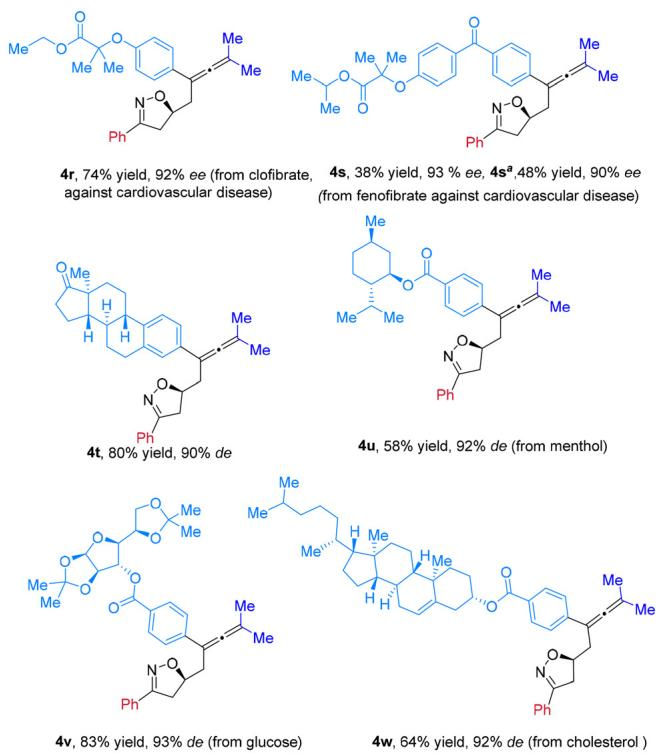  
Scheme 3 Late-stage modification of pharmaceuticals and natural products. Unless otherwise noted, all reactions were carried out with 1 (0.3 mmol), 2 (0.45 mmol, 1.5 equiv.), K CO (0.45 mmol, 1.5 equiv.), Pd (cod)Cl (8 mol%) and L9 (10 mol%) in CPME (5.0 mL) at $5 0 ~ ^ { \circ } \mathsf { C }$ under argon for 48 h. a 1 (0.3 mmol), 2 (0.45 mmol, 1.5 equiv.), ${ \sf K } _ { 2 } { \sf C } { \sf O } _ { 3 }$ (0.45 mmol, 1.5 equiv.), Pd(cod)Cl (8 mol%) and L9 (10 mol%) in THF (5.0 mL) at 50 °C under argon for 48 h.

to palladium-catalyzed Sonogashira or Suzuki–Miyaura reactions to aford products 8 and 9, respectively, in excellent enantioselectivities (Scheme 4b). More reactions of β,γ-unsaturated ketoxime 2a-D with propargylic acetates 1d were conducted, the product 3d-D was obtained in good yield with >20 : 1 dr, and syn-addition pathways were possible in this reaction supported by the $J _ { \mathrm { H - H } }$ coupling constant (9.4 Hz) (Scheme 4c).4f Notably, the linear relationship analysis of the ee values of products 3a and L9 with various degrees of enantiomeric excess was conducted, as shown in Scheme 4d, suggesting that monomeric L9–Pd might be the actual catalytic species. Moreover, the photo-physical properties of 3u were further investigated by ultraviolet–visible (UV/vis) absorption, photoluminescence and CD spectroscopy, indicating its potential application in organic optoelectronic materials (Scheme 4e).

To fully understand the catalytic transformation and gain deep insight into the enantiodetermining transition states, density functional theory (DFT) calculations were carried out on the model reaction of propargylic acetates 1a and β,γ-unsaturated ketoximes 2a, as shown in Fig. 1 (see the ESI† for details). Initially, the generated pre-cat undergoes substrate–ligand exchange with 1a, to aford active species INT1. Then, Pd(0)L\* could undergo oxidative addition with 1a to

e) CD spectra of 3u

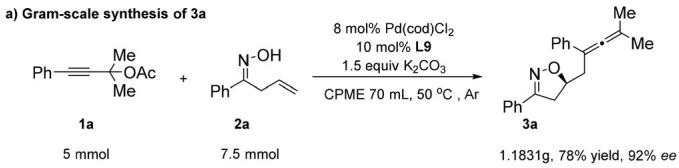

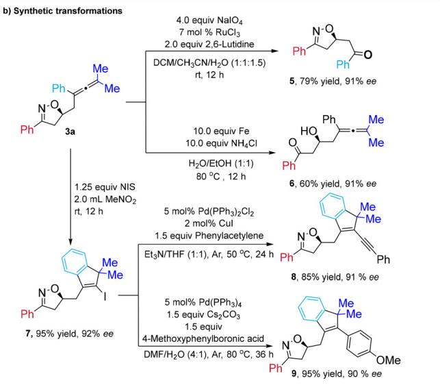

c) Mechanism study  
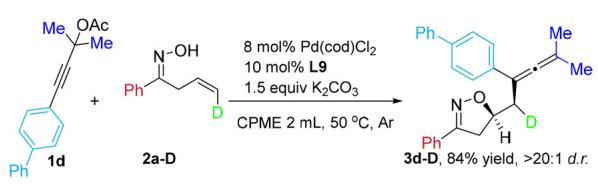

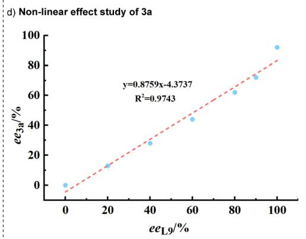

Scheme 4 (a) Gram-scale synthesis. (b) Synthetic applications. (c) Mechanistic studies. (d) Non-linear efect study of 3a. (e) Photophysical property investigations: emission spectra of 3u (10−4 (M)) at room temperature $\lambda _ { \mathrm { e x c } } = 3 4 0$ nm; slits, 2.5/2.5 nm); CD spectra of 3u $( 1 0 ^ { - 4 } \left( M \right) )$ were investigated.  
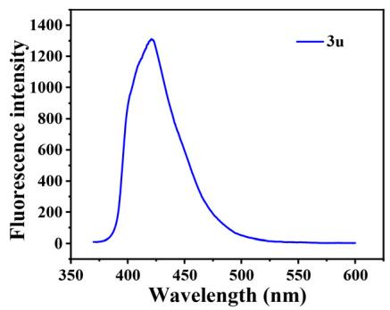

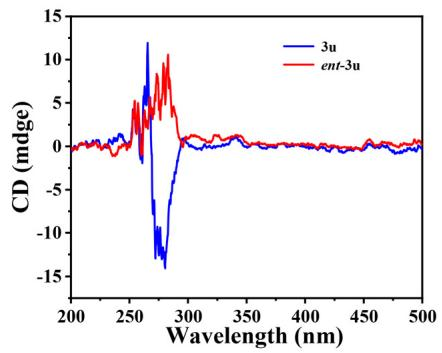

form the Pd(II)-complex. A general transition state $\mathbf { T S 1 } ^ { \prime \prime }$ to break the C–O bond of 1a was first examined but failed to locate, which prompted us to consider other possibilities. Specifically, an unusual five-membered ring transition state TS1′ was elaborated, but with an energy barrier of 28.1 kcal mol−1 (TS1′ relative to INT1). More importantly, the sevenmembered ring TS1 could significantly reduce the barrier for oxidative addition to 14.7 kcal $\mathrm { m o l ^ { - 1 } }$ , yielding INT2. Subsequently, the concerted metalation–deprotonation (CMD) mechanism occurs directly from INT2 via $\mathbf { K } _ { 2 } \mathbf { C O } _ { 3 }$ -mediated TS2 to deliver INT3, and the by-product $\operatorname { K O A c } { \cdot } \operatorname { K H C O } _ { 3 } .$ It was noteworthy that the double bond in INT3 could coordinate with the Pd(II) center via two possibilities to generate INT4, depending on the diferent coordination directions of the double bond and the Pd-center. The following olefin insertion is the key step to control the enantioselectivity. Therefore, we carefully consider four possible transition states in the process, namely TS3-S, TS3-S’, TS3-R and TS3-R′, to form the C–O bond. The calculated energy diference (2.2 kcal mol−1) between TS3- S and TS3-R′ reasonably agrees with the experimental ee value of 3a. Finally, the resulting INT5-S undergoes reductive elimination via TS4-S to aford the coupling product 3a and recover the substrate coordinated-Pd(0) species (INT1). Notably, although TS4-S is not inferior to TS3-S but not as good as TS3- $R ^ { \prime } ,$ we believed that the generated INT5-S could smoothly pass through reductive elimination instead of returning to INT4-S, due to the greater thermodynamic driving force backward.

To further understand how the chiral ligand L\* induces the enantioselective transition states, we performed detailed structural analyses. As shown in Fig. 1B, in the well-organized TS3-S and TS4-S, the unfavorable $\mathrm { H } ^ { \delta ^ { + } } { \cdots } \mathrm { H } ^ { \delta ^ { + } }$ steric repulsion between the chiral ligand L\* and the substrates 1a and 2a is minimized,

(A) Free-energy profile

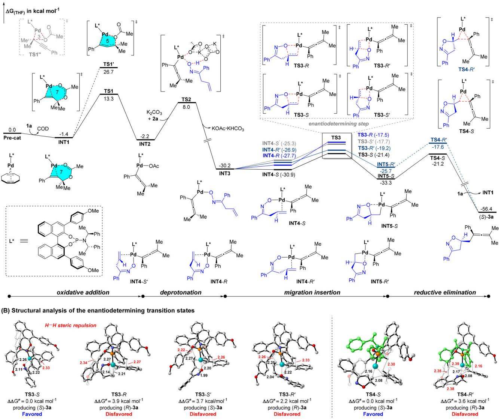  
Fig. 1 Free energy profiles (in kcal mol−1) for the enantioselective coupling of 1a and 2a via the Pd(0)/Pd( ) cycle. The key bond lengths in the enantioselective transition states are given in angstroms.

as reflected in the sum of the H⋯H van der Waals radius distances of 2.33 Å and 2.30 Å, respectively. In contrast, the corresponding enantioselective isomers are subject to stronger Hδ+⋯Hδ+ steric hindrance, which is the key factor controlling the formation of the major (S)-enantiomer in the enantioselective stage.

## Conclusion

In summary, we have developed a novel Pd-catalyzed enantioselective carboetherification reaction of β,γ-unsaturated ketoximes with propargylic acetates to aford various chiral isoxazolines bearing multisubstituted allene groups in good yields with excellent enantioselectivities. This reaction ofers advantages including a general substrate scope, broad functional group tolerance, good yields and high enantioselectivity. These highly enantioenriched products are precursors of other useful chiral building blocks. The photo-physical properties were further investigated, indicating their potential application in organic optoelectronic materials. DFT calculations further indicated that the stereochemistry was regulated by the chiral ligand-promoted olefin insertion step, wherein the favored transition state is stabilized by less steric hindrance in the chiral ligand and the substrates. Further expansion of the scope of asymmetric Pd-catalyzed reactions is ongoing in our laboratory.

## Author contributions

L.W. and W. L. conceived the project. C.Z. and W.L. wrote the paper. F.J. performed the experiments and analyzed the data. C.Z. conducted the computational studies. F.J., C.H., S.W., G.

Z., Y.H., and C.Y. analyzed the data. All authors discussed the results and commented on the paper.

## Data availability

The data supporting this article have been included as part of the ESI.† All detailed procedures, characterization data and NMR spectra are available in the ESI.†

## Conflicts of interest

There are no conflicts to declare.

## Acknowledgements

We thank the National Natural Science Foundation of China (22101249 and 22071060) and the Natural Science Foundation of Jiangsu Province (BK20200918).

## References

1 For reviews, see: (a) J. P. Wolfe, Palladium-Catalyzed Carboetherification and Carboamination Reactions of γ-Hydroxy- and γ-Aminoalkenes for the Synthesis of Tetrahydrofurans and Pyrrolidines, Eur.J. Org. Chem., 2007, 571; (b) J. P. Wolfe, Stereoselective Synthesis of Saturated Heterocycles via Palladium-Catalyzed Alkene Carboetherification and Carboamination Reactions, Synlett, 2008, 2913; (c) Z. J. Garlets, D. R. White and J. P. Wolfe, Recent Developments in Pd0-Catalyzed Alkene-Carboheterofunctionalization Reactions, Asian J. Org. Chem., 2017, 6, 636.

2 For selected examples of carboamination, see: (a) N. C. Giampietro and J. P. Wolfe, Stereoselective Synthesis of cis- or trans-3,5-Disubstituted Pyrazolidines via Pd-Catalyzed Carboamination Reactions: Use of Allylic Strain to Control Product Stereochemistry Through N-Substituent Manipulation, J. Am. Chem. Soc., 2008, 130, 12907; (b) Y. Guo, J. Zhao and Q. Zhang, Synthesis of Tetrahydropyridazines via Pd-Catalyzed Carboamination of Alkenyl Hydrazones, Adv. Synth. Catal., 2020, 362, 1208; (c) M.-N. Yang, D.-M. Yan, Q.-Q. Zhao, J.-R. Chen and W.-J. Xiao, Synthesis of Dihydropyrazoles via Ligand-Free Pd-Catalyzed Alkene Aminoarylation of Unsaturated Hydrazones with Diaryliodonium Salts, Org. Lett., 2017, 19, 5208; (d) J. Chen, M.-N. Yang, J.-R. Chen and W.-J. Xiao, Palladium-Catalyzed Ring-Forming Alkene Aminoaroylation of Unsaturated Hydrazones and Sulfonamides, Org. Lett., 2018, 20, 3314; (e) Y. Wang, S. Wu, L. Wang, J. Sun, C.-G. Yan and Y. Han, Synthesis of dihydropyrazoles enabled by Pd-catalyzed carboamination of alkenyl hydrazones with alkenyl and aryl halides, Org. Chem. Front., 2022, 9, 4104; (f) Y. Wang, L. Wang, M. Chen, Y. Tu, Y. Liu

and J. Zhang, Palladium/Xu-Phos-catalyzed asymmetric carboamination towards isoxazolidines and pyrrolidines, Chem. Sci., 2021, 12, 8241.

3 For enantioselective examples of carboamination, see: (a) D. N. Mai and J. P. Wolfe, Asymmetric Palladium-Catalyzed Carboamination Reactions for the Synthesis of Enantiomerically Enriched 2-(Arylmethyl)- and 2- (Alkenylmethyl)pyrrolidines, J. Am. Chem. Soc., 2010, 132, 12157; (b) B. A. Hopkins and J. P. Wolfe, Synthesis of Enantiomerically Enriched Imidazolidin-2-Ones through Asymmetric Palladium-Catalyzed Alkene Carboamination Reactions, Angew. Chem., Int. Ed., 2012, 51, 9886; (c) N. R. Babij and J. P. Wolfe, Desymmetrization of meso-2,5-Diallylpyrrolidinyl Ureas through Asymmetric Palladium-Catalyzed Carboamination: Stereocontrolled Synthesis of Bicyclic Ureas, Angew. Chem., Int. Ed., 2013, 52, 9247; (d) B. A. Hopkins and J. P. Wolfe, Enantioselective synthesis of tetrahydroquinolines, tetrahydroquinoxalines, and tetrahydroisoquinolines via Pd-Catalyzed alkene carboamination reactions, Chem. Sci., 2014, 5, 4840; (e) Z. J. Garlets, K. R. Parenti and J. P. Wolfe, Asymmetric Palladium-Catalyzed Alkene Carboamination Reactions for the Synthesis of Cyclic Sulfamides, Chem. – Eur. J., 2016, 22, 5919; (f) V. Bizet, G. M. Borrajo-Calleja, C. Besnard and C. Mazet, Direct Access to Furoindolines by Palladium-Catalyzed Intermolecular Carboamination, ACS Catal., 2016, 6, 7183.

4 For selected examples of carboetherification, see: (a) J. P. Wolfe and M. A. Rossi, Stereoselective Synthesis of Tetrahydrofurans via the Palladium-Catalyzed Reaction of Aryl Bromides with γ-Hydroxy Alkenes: Evidence for an Unusual Intramolecular Olefin Insertion into a Pd(Ar)(OR) Intermediate, J. Am. Chem. Soc., 2004, 126, 1620; (b) M. B. Hay and J. P. Wolfe, Palladium-Catalyzed Synthesis of 2,1′-Disubstituted Tetrahydrofurans from γ-Hydroxy Internal Alkenes. Evidence for Alkene Insertion into a Pd−O Bond and Stereochemical Scrambling via β-Hydride Elimination, J. Am. Chem. Soc., 2005, 127, 16468; (c) J. S. Nakhla, J. W. Kampf and J. P. Wolfe, Intramolecular Pd-Catalyzed Carboetherification and Carboamination. Influence of Catalyst Structure on Reaction Mechanism and Product Stereochemistry, J. Am. Chem. Soc., 2006, 128, 2893; (d) D. Jiang, J. Peng and Y. Chen, Pd-Catalyzed Carboetherification of β,γ-Unsaturated Oximes: A Novel Approach to Δ2-Isoxazolines, Org. Lett., 2008, 10, 1695; (e) S. Hayashi, H. Yorimitsu and K. Oshima, Synthesis of Epoxides by Palladium-Catalyzed Reactions of Tertiary Allyl Alcohols with Aryl or Alkenyl Halides, J. Am. Chem. Soc., 2009, 131, 2052; (f) G. Zhang, L. Cui, Y. Wang and L. Zhang, Homogeneous Gold-Catalyzed Oxidative Carboheterofunctionalization of Alkenes, J. Am. Chem. Soc., 2010, 132, 1474; (g) J. T. Hutt and J. P. Wolfe, Synthesis of 2,3-dihydrobenzofurans via the palladium catalyzed carboalkoxylation of 2-allylphenols, Org. Chem. Front., 2016, 3, 1314; (h) D. R. White, M. I. Herman and J. P. Wolfe, Palladium-Catalyzed Alkene Carboalkoxylation Reactions of

Phenols and Alcohols for the Synthesis of Carbocycles, Org. Lett., 2017, 19, 4311; (i) T. Schitter, P. G. Jones and D. B. Werz, Intramolecular Pd-Catalyzed Formal anti-Carboalkoxylation of Alkynes: Access to Tetrasubstituted Enol Ethers, Chem. – Eur. J., 2018, 24, 13446; (j) B. Sun, S. Liu, M. Zhang, J. Zhao and Q. Zhang, Pd-Catalyzed carboannulation of γ,δ-alkenyl oximes: eficient access to 5-membered cyclic nitrones and dihydroazines, Org. Chem. Front., 2019, 6, 388; (k) B. Peng, L. Dai and R. Liu, Thianthrenation-Enabled Pyrrolidin-2-yl and Tetrahydrofuran-2-yl Methylation of (Hetero)Arenes, Org. Lett., 2023, 25, 2606; (l) S. Wu, S. Zhang, J. Sun, Y. Han, Y. Wang, C.-G. Yan and L. Wang, Synthesis of Multisubstituted Allenes by Palladium-Catalyzed Carboetherification of β,γ-Unsaturated Ketoximes with Propargylic Acetates, Org. Lett., 2023, 25, 4682; (m) C. Hu, S. Xu, Q. Wang, J. Sun, Y. Han, C.-G. Yan and L. Wang, The synthesis of isoxazolines and dihydrooxazines by Pd-catalyzed oxyalkynylation alkenyl oximes with alkynyl bromides, Org. Chem. Front., 2024, 11, 2768.

5 (a) G. M. Borrajo-Calleja, V. Bizet and C. Mazet, Palladium-Catalyzed Enantioselective Intermolecular Carboetherification of Dihydrofurans, J. Am. Chem. Soc., 2016, 138, 4014; (b) G. M. Borrajo-Calleja, V. Bizet, C. Besnard and C. Mazet, Mechanistic Investigation of the Pd-Catalyzed Intermolecular Carboetherification and Carboamination of 2,3-Dihydrofuran: Similarities, Diferences, and Evidence for Unusual Reaction Intermediates, Organometallics, 2017, 36, 3553; (c) M. Tao, Y. Tu, Y. Liu, H. Wu, L. Liu and J. Zhang, Pd/Xiang-Phos-catalyzed enantioselective intermolecular carboheterofunctionalization under mild conditions, Chem. Sci., 2020, 11, 6283.

6 B. A. Hopkins, Z. J. Garlets and J. P. Wolfe, Development of Enantioselective Palladium-Catalyzed Alkene Carboalkoxylation Reactions for the Synthesis of Tetrahydrofurans, Angew. Chem., Int. Ed., 2015, 54, 13390.

7 S. Zhu, Z. Ye, M.-J. Chen, L. Wang, Y. Wang, K. Zhang, W. Li, H.-M. Ding, Z. Li and J. Zhang, Mechanistic study on the side arm efect in a palladium/Xu-Phos-catalyzed enantioselective alkoxyalkenylation of γ-hydroxyalkenes, Nat. Commun., 2023, 14, 7611.

8 N. Hu, K. Li, Z. Wang and W. Tang, Synthesis of Chiral 1,4- Benzodioxanes and Chromans by Enantioselective Palladium-Catalyzed Alkene Aryloxyarylation Reactions, Angew. Chem., Int. Ed., 2016, 55, 5044.

9 L. Wang, K. Zhang, Y. Wang, W. Li, M. Chen and J. Zhang, Enantioselective Synthesis of Isoxazolines Enabled by Palladium-Catalyzed Carboetherification of Alkenyl Oximes, Angew. Chem., Int. Ed., 2020, 59, 4421.

10 N. Li, B. Sun, S. Liu, J. Zhao and Q. Zhang, Highly Enantioselective Construction of Dihydrooxazines via Pd-Catalyzed Asymmetric Carboetherification, Org. Lett., 2020, 22, 190.

11 Reviews on allenes in natural products, see: (a) A. Hofmann-Röder and N. Krause, Synthesis and Properties of Allenic Natural Products and Pharmaceuticals, Angew. Chem., Int. Ed., 2004, 43, 1196;

(b) P. Rivera-Fuentes and F. Diederich, Allenes in Molecular Materials, Angew. Chem., Int. Ed., 2012, 51, 2818.

12 (a) R. Zimmer, C. U. Dinesh, E. Nandanan and F. A. Khan, Palladium-Catalyzed Reactions of Allenes, Chem. Rev., 2000, 100, 3067; (b) S. Ma, Some Typical Advances in the Synthetic Applications of Allenes, Chem. Rev., 2005, 105, 2829; (c) S. Ma, Electrophilic Addition and Cyclization Reactions of Allenes, Acc. Chem. Res., 2009, 42, 1679; (d) T. Lu, Z. Lu, Z.-X. Ma, Y. Zhang and R. P. Hsung, Allenamides: A Powerful and Versatile Building Block in Organic Synthesis, Chem. Rev., 2013, 113, 4862; (e) J. Ye and S. Ma, Palladium-Catalyzed Cyclization Reactions of Allenes in the Presence of Unsaturated Carbon–Carbon Bonds, Acc. Chem. Res., 2014, 47, 989; (f) F. López and J. L. Mascareñas, [4+2] and [4+3] catalytic cycloadditions of allenes, Chem. Soc. Rev., 2014, 43, 2904.

13 (a) S. Yu and S. Ma, How easy are the syntheses of allenes, Chem. Commun., 2011, 47, 5384; (b) S. Yu and S. Ma, Allenes in Catalytic Asymmetric Synthesis and Natural Product Syntheses, Angew. Chem., Int. Ed., 2012, 51, 3074; (c) M. P. Muñoz, Silver and platinum-catalysed addition of O–H and N–H bonds to allenes, Chem. Soc. Rev., 2014, 43, 3164; (d) B. Alcaide, P. Almendros and C. Aragoncillo, Cyclization reactions of bis(allenes) for the synthesis of polycarbo(hetero)cycles, Chem. Soc. Rev., 2014, 43, 3106; (e) R. K. Nef and D. E. Frantz, Recent Advances in the Catalytic Syntheses of Allenes: A Critical Assessment, ACS Catal., 2014, 4, 519; (f) J. Ye and S. Ma, Conquering threecarbon axial chirality of allenes, Org. Chem. Front., 2014, 1, 1210; (g) R. K. Nef and D. E. Frantz, Recent Advances in the Catalytic Syntheses of Allenes: A Critical Assessment, ACS Catal., 2014, 4, 519; (h) S. Shirakawa, S. Liu and S. Kaneko, Organocatalyzed Asymmetric Synthesis of Axially, Planar, and Helical Chiral Compounds, Chem. - Asian J., 2016, 11, 330; (i) W.-D. Chu, Y. Zhang and J. Wang, Recent advances in catalytic asymmetric synthesis of allenes, Catal. Sci. Technol., 2017, 7, 4570; (j) X. Huang and S. Ma, Allenation of Terminal Alkynes with Aldehydes and Ketones, Acc. Chem. Res., 2019, 52, 1301; (k) M. Holmes, L. A. Schwartz and M. J. Krische, Intermolecular Metal-Catalyzed Reductive Coupling of Dienes, Allenes, and Enynes with Carbonyl Compounds and Imines, Chem. Rev., 2018, 118, 6026.

14 For selected examples, see: (a) H. Ohmiya, H. Ito and M. Sawamura, General and Functional Group-Tolerable Approach to Allenylsilanes by Rhodium-Catalyzed Coupling between Propargylic Carbonates and a Silylboronate, Org. Lett., 2009, 11, 5618; (b) D. J. Vyas, C. K. Hazra and M. Oestreich, Copper(I)-Catalyzed Regioselective Propargylic Substitution Involving Si–B Bond Activation, Org. Lett., 2011, 13, 4462; (c) S. Wu, X. Huang, W. Wu, P. Li, C. Fu and S. Ma, A C–H bond activation-based catalytic approach to tetrasubstituted chiral allenes, Nat. Commun., 2015, 6, 7946; (d) Q. Lu, S. Greβies, F. J. Klauck and F. Glorius, Manganese(I)-Catalyzed Regioselective C−H Allenylation: Direct Access to 2-Allenylindoles, Angew.

Chem., Int. Ed., 2017, 56, 6660; (e) X. Wu, J. Fan, C. Fu and S. Ma, A ruthenium(II)-catalyzed C–H allenylation-based approach to allenoic acids, Chem. Sci., 2019, 10, 6316; (f) W.-F. Zheng, W. Zhang, C. Huang, P. Wu, H. Qian, L. Wang, Y.-L. Guo and S. Ma, Tetrasubstituted allenes via the palladium-catalysed kinetic resolution of propargylic alcohols using a supporting ligand, Nat. Catal., 2019, 2, 997; (g) Y. Jin, H. Wen, F. Yang, D. Ding and C. Wang, Synthesis of Multisubstituted Allenes via Nickel-Catalyzed Cross-Electrophile Coupling, ACS Catal., 2021, 11, 13355; (h) H. Wang, H. Qian, J. Zhang and S. Ma, Catalytic Asymmetric Axially Chiral Allenyl C–P Bond Formation, J. Am. Chem. Soc., 2022, 144, 12619.

15 For selected examples, see: (a) S. Teng, Z. Jiao, Y. R. Chi and J. S. Zhou, Asymmetric Wacker-Type Oxyallenylation and Azaallenylation of Cyclic Alkenes, Angew. Chem., Int. Ed., 2020, 59, 2246; (b) S. Teng, Y. R. Chi and J. S. Zhou, Enantioselective Three-Component Coupling of Heteroarenes, Cycloalkenes and Propargylic Acetates, Angew. Chem., Int. Ed., 2021, 60, 4491.

16 S. Zhang, S. Wu, Q. Wang, S. Xu, Y. Han, C.-G. Yan, J. Zhang and L. Wang, Enantioselective Synthesis of Dihydropyrazoles by Palladium/Xu-Phos-Catalyzed Alleneamination of β,γ-Unsaturated Hydrazones with Propargylic Acetates, Angew. Chem., Int. Ed., 2023, 62, e202300309.

17 3k (CCDC 2343326) and 4e (CCDC 2391000†).