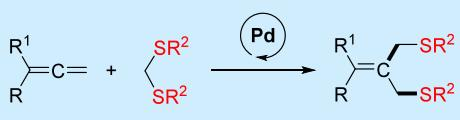
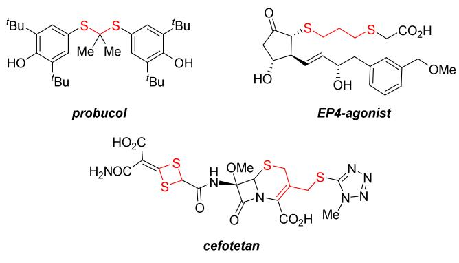
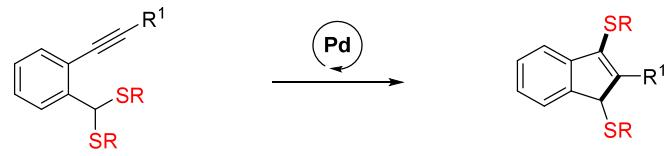
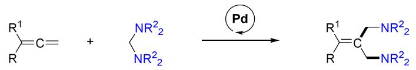
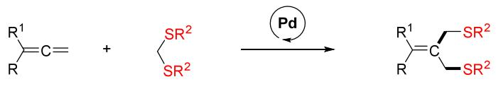
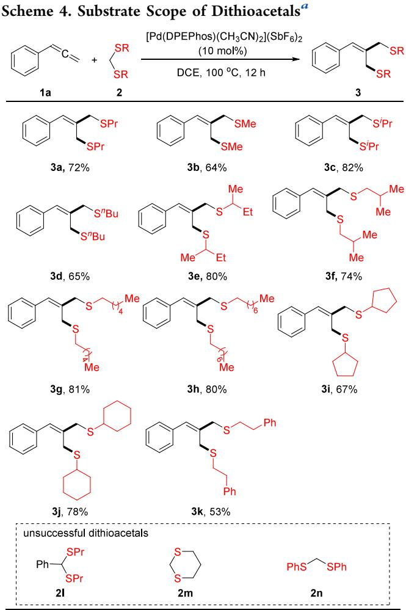
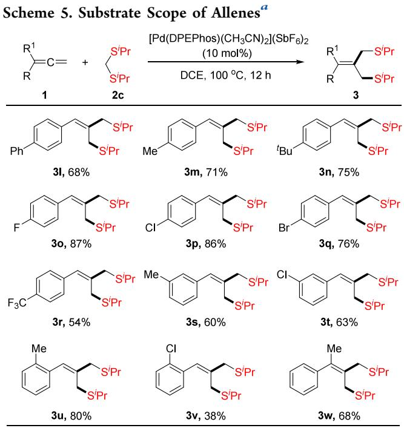
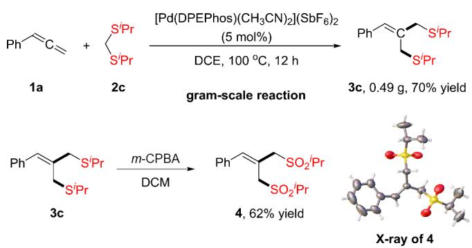
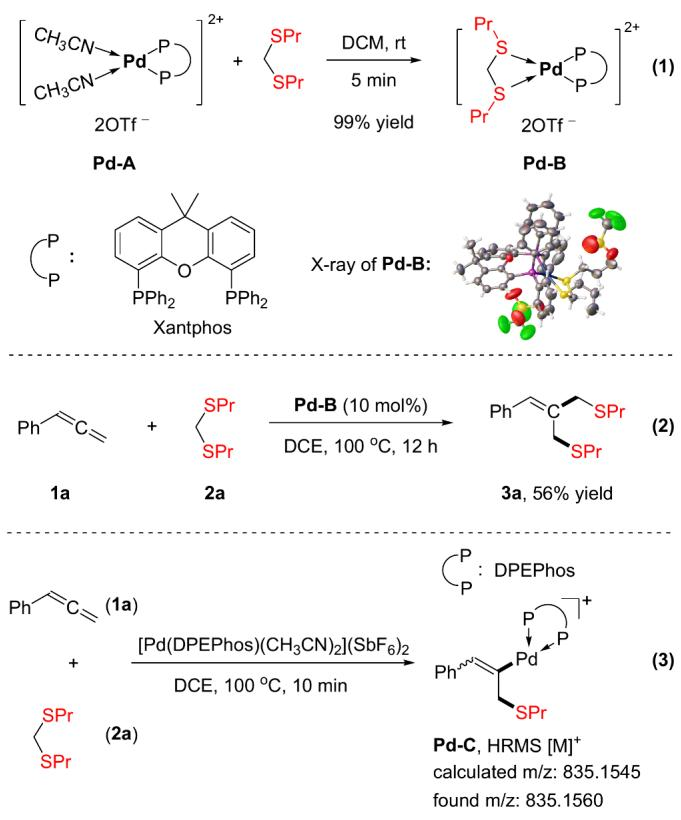
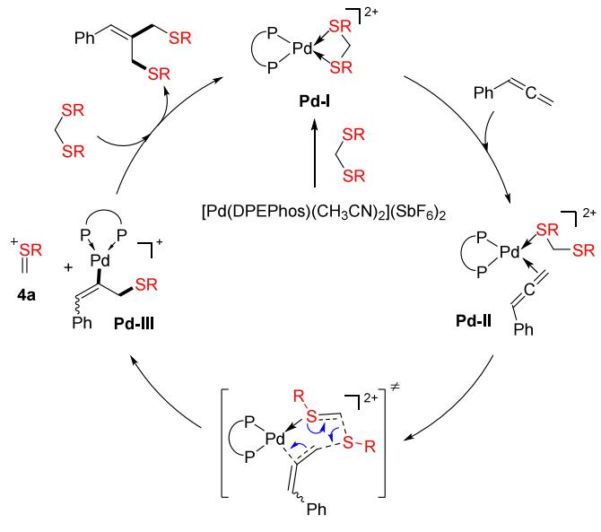

pubs.acs.org/OrgLett

Letter

# Palladium-Catalyzed Insertion of Allenes into Dithioacetals To Access 1,3-Dithioethers

Shoule Cai, Hongchi Liu, Yinjun Xie,\* and Hanmin Huang\*

Cite This: Org. Lett. 2025, 27, 2395−2399

Read Online

## ACCESS

Metrics & More

Article Recommendations

\*sı Supporting Information

T he carbon−sulfur linkage is one of the most fundamentalconnections omnipresent in numerous natural products,1−3 medicinal chemistry, sulfur-containing drugs were considered as the hallmarks of several antibiotic breakthroughs and continued to represent an important proportion of new U.S. Food and Drug Administration (FDA) approvals.4 Among all of the bioactive organosulfur compounds, dithioethers were gaining increasing attention due to their unique pharmaceutical properties.5 As shown in Scheme 1, probucol is a powerful

Scheme 1. Representative Dithioether Compounds in Bioactive Molecules  

antioxidant with modest lipid-lowering properties, which is of great clinical significance for coronary heart disease treatment. Besides, cefotetan is a semisynthetic cephamycin antibiotic with a board spectrum of activity against Gram-negative bacteria.7 As such, significant eforts have been dedicated to the synthesis of dithioethers, with the direct dithiolation of alkenes or alkynes being the most straightforward approach. However, in comparison to the elegant success for the synthesis of 1,1-dithioethers and 1,2-dithioethers,8,9 the direct difunctionalization of alkenes to access $^ { 1 , 3 \cdot }$ -dithioethers has not been developed, which is mainly due to the lack of an appropriate dithiolation system. Considering the significant importance of 1,3-dithioethers in medicinal chemistry, developing an eficient method for their synthesis is of great value.

Dithioacetals are versatile synthons frequently used as the mask of carbonyl groups as well as valuable synthetic precursors for certain organosulfur compounds in transition metal catalysis.10,11 The reactions involving insertion into the carbon−sulfur bond of dithioacetals provide a privileged platform for the rapid construction of functionalized dithioether compounds. Palladium-catalyzed thiol group migrations, which involve the formal insertion of unsaturated 2π units into the carbon−sulfur bond of dithioacetals, have already been developed (Scheme 2a).12 However, these transformations were limited to only intramolecular processes. Recently, isolated intermolecular cases had also been illustrated with isocyanides or diazo compounds.13 Nevertheless, the substrate scopes were still restricted to C1 sources, resulting in only 1,2-dithioether compounds rather than the desired 1,3- dithioethers.

Our group had previously demonstrated the feasibility of the intermolecular aminomethylamination of allenes with aminals to synthesize 1,3-diamines (Scheme 2b).14 Building upon this, we became particularly interested in exploring the potential of using dithioacetals as thiomethylthiolation reagents to construct $^ { 1 , 3 \cdot }$ -dithioethers. As part of our design concept, we

## Scheme 2. Strategy for the Synthesis of $^ { 1 , 3 \cdot }$ -Dithioethers

a) palladium-catalyzed intramolecular thiomethylthiolations of alkynes

b) palladium-catalyzed aminomethylaminations with aminals to furnish 1,3-diamines  

our previous work

c) palladium-catalyzed thiomethylthiolations with dithioacetals to furnish 1,3-dithioethers

  
Scheme 3. Optimization of Reaction Conditions

aimed for the concurrent introduction of both the thiomethyl motif and the thiol motif of dithioacetals into allenes in a single step, similar to the aminomethylamination process using aminals. Herein, we successfully implemented this idea and developed a palladium-catalyzed insertion of allenes into dithioacetals to access $^ { 1 , 3 }$ -dithioether compounds (Scheme 2c). Distinguished from previous dithiolation processes, which solely depended upon the carbon−sulfur bond formation, this method allowed for the simultaneous construction of one carbon−carbon bond as well as one carbon−sulfur bond. It should also be noted that alkyl sulfur sources, which could hardly be tolerated in preceding dithiolation reactions, were well amendable to this protocol. This method ofered an expedient solution for the rapid construction of a variety of structurally diverse $^ { 1 , 3 \cdot }$ -dithioethers, which can be used as valuable synthons and pharmacophores ubiquitously found in numerous natural products.

We embarked our investigations by treating propa-1,2- dienylbenzene 1a and dithioacetal 2a with the cationic palladium(II) complex in 1,2-dichloroethane (DCE) at 100 $^ { \mathrm { ~ \tiny ~ { ~ \circ ~ } ~ } } ( \mathrm { S c h e m e } 3 ) . ^ { 1 5 }$ To our delight, when [Pd(DPEPhos)- $\mathrm { ( C H _ { 3 } C N ) _ { 2 } ] ( O T f ) _ { 2 } }$ was used as the catalyst, desired $^ { 1 , 3 - }$ dithioether 3a was obtained in 34% yield (entry 1 in Scheme 3). Inspired by this result, a systematic screening of the counterion of the palladium complex was performed next, leading us to find that the counterion had a delicate influence on this transformation (entries 2−8 in Scheme 3). No reaction occurred when $\mathrm { P F } _ { 6 } ^ { - } , ~ \mathrm { O T s } ^ { - } ,$ , or $\mathrm { T F A ^ { - } }$ served as the counterions, whereas $\mathrm { C l O _ { 4 } ^ { - } , \Delta N T f _ { 2 } ^ { - } , }$ and $\mathrm { B F _ { 4 } } ^ { - }$ efectively promoted the transformation. Among all of the counterions, ${ \mathrm { S b F } } _ { 6 } { } ^ { - }$ was identified as optimal, afording desired $^ { 1 , 3 - }$ dithioether 3a in 52% yield. Next, the ligand efect was also investigated, showing that bidentate phosphine ligands, such as BINAP, DPPF, XantPhos, and DPPB, all facilitated the reaction, albeit with lower yields compared to DPEPhos (entries 9−12 in Scheme 3). Additionally, variations of the solvents suggested that this transformation also proceeded aReaction conditions: allene 1a (0.30 mmol), dithioacetal 2a (0.20 mmol), [Pd] (5 mol %, 0.01 mmol), and solvent (1.5 mL), at 100 °C, for 12 h; yields were determined by gas chromatography (GC) using dodecane as an internal standard. b[Pd] (10 mol %, 0.02 mmol); isolated yield was shown in parentheses.

<table><tr><td colspan="2"></td><td colspan="3">[Pd] (5 mol%) SPr solvent, 100 °C, 12 h SPr</td></tr><tr><td>1a entry</td><td colspan="2">2a [Pd]</td><td>solvent</td><td>3a yield (%)</td></tr><tr><td>1</td><td colspan="2"> $\mathsf { [ P d ( D P E P h o s ) ( C H _ { 3 } C N ) _ { 2 } ] ( O T f ) _ { 2 } }$ </td><td>DCE</td><td>34</td></tr><tr><td>2</td><td colspan="2"> $[ \mathsf { P d } ( \mathsf { D P E P h o s } ) ( \mathsf { C H } _ { 3 } \mathsf { C N } ) _ { 2 } ] ( \mathsf { P F } _ { 6 } ) _ { 2 }$ </td><td>DCE</td><td>trace</td></tr><tr><td>3</td><td colspan="2"> $\mathsf { [ P d ( D P E P h o s ) ( C H _ { 3 } C N ) _ { 2 } ] ( C l O _ { 4 } ) _ { 2 } }$ </td><td>DCE</td><td>43</td></tr><tr><td>4</td><td colspan="2"> $\mathsf { \Gamma } [ \mathsf { P d } ( \mathsf { D P E P h o s } ) ( \mathsf { C H } _ { 3 } \mathsf { C N } ) _ { 2 } ] ( \mathsf { N T f } _ { 2 } ) _ { 2 }$ </td><td>DCE</td><td>50</td></tr><tr><td>5</td><td colspan="2"> $[ \mathsf { P d } ( \mathsf { D P E P h o s } ) ( \mathsf { C H } _ { 3 } \mathsf { C N } ) _ { 2 } ] ( \mathsf { B F } _ { 4 } ) _ { 2 }$   $\mathsf { [ P d ( D P E P h o s ) ( C H _ { 3 } C N ) _ { 2 } ] ( O T s ) _ { 2 } }$ </td><td>DCE</td><td>42</td></tr><tr><td>6</td><td colspan="2"> $\mathsf { [ P d ( D P E P h o s ) ( C H _ { 3 } C N ) _ { 2 } ] ( T F A ) _ { 2 } }$ </td><td>DCE</td><td>trace</td></tr><tr><td>7</td><td colspan="2"> $\mathsf { \Gamma } [ \mathsf { P d } ( \mathsf { D P E P h o s } ) ( \mathsf { C H } _ { 3 } \mathsf { C N } ) _ { 2 } ] ( \mathsf { S b F } _ { 6 } ) _ { 2 }$ </td><td>DCE</td><td>trace</td></tr><tr><td>8</td><td colspan="2"></td><td>DCE</td><td>52</td></tr><tr><td>9</td><td colspan="2"> $[ \mathsf { P d } ( \mathsf { B } | \mathsf { N A P } ) ( \mathsf { C } \mathsf { H } _ { 3 } \mathsf { C N } ) _ { 2 } ] ( \mathsf { S } \mathsf { b } \mathsf { F } _ { 6 } ) _ { 2 }$ </td><td>DCE</td><td>26</td></tr><tr><td>10</td><td colspan="2"> $[ \mathsf { P d } ( \mathsf { D P P F } ) ( \mathsf { C H } _ { 3 } \mathsf { C N } ) _ { 2 } ] ( \mathsf { S b F } _ { 6 } ) _ { 2 }$ </td><td>DCE</td><td>48</td></tr><tr><td>11</td><td colspan="2"> $\mathsf { \Gamma } [ \mathsf { P d } ( \mathsf { X a n t p h o s } ) ( \mathsf { C } \mathsf { H } _ { 3 } \mathsf { C } \mathsf { N } ) _ { 2 } ] ( \mathsf { S } \mathsf { b } \mathsf { F } _ { 6 } ) _ { 2 }$ </td><td>DCE</td><td>50</td></tr><tr><td>12</td><td colspan="2"> $[ \mathsf { P d } ( \mathsf { D P P B } ) ( \mathsf { C H } _ { 3 } \mathsf { C N } ) _ { 2 } ] ( \mathsf { S b F } _ { 6 } ) _ { 2 }$ </td><td>DCE</td><td>34</td></tr><tr><td>13</td><td colspan="2"> $\mathsf { \Gamma } [ \mathsf { P d } ( \mathsf { D P E P h o s } ) ( \mathsf { C H } _ { 3 } \mathsf { C N } ) _ { 2 } ] ( \mathsf { S b F } _ { 6 } ) _ { 2 }$ </td><td>DCM</td><td>47</td></tr><tr><td>14</td><td colspan="2"> $\mathsf { \Gamma } [ \mathsf { P d } ( \mathsf { D P E P h o s } ) ( \mathsf { C H } _ { 3 } \mathsf { C N } ) _ { 2 } ] ( \mathsf { S b F } _ { 6 } ) _ { 2 }$ </td><td>CHCl3</td><td>35</td></tr><tr><td>15</td><td colspan="2"> $\mathsf { \Gamma } [ \mathsf { P d } ( \mathsf { D P E P h o s } ) ( \mathsf { C H } _ { 3 } \mathsf { C N } ) _ { 2 } ] ( \mathsf { S b F } _ { 6 } ) _ { 2 }$ </td><td>PhCl</td><td>42</td></tr><tr><td>16</td><td colspan="2"> $\mathsf { \Gamma } [ \mathsf { P d } ( \mathsf { D P E P h o s } ) ( \mathsf { C H } _ { 3 } \mathsf { C N } ) _ { 2 } ] ( \mathsf { S b F } _ { 6 } ) _ { 2 }$ </td><td>toluene</td><td>12</td></tr><tr><td></td><td colspan="2"> $\mathsf { \Gamma } [ \mathsf { P d } ( \mathsf { D P E P h o s } ) ( \mathsf { C H } _ { 3 } \mathsf { C N } ) _ { 2 } ] ( \mathsf { S b F } _ { 6 } ) _ { 2 }$ </td><td></td><td></td></tr><tr><td>17b</td><td colspan="2"></td><td>DCE</td><td>74 (72)</td></tr><tr><td>18</td><td colspan="2"> $\mathsf { P d } ( \mathsf { D P E P h o s } ) \mathsf { C l } _ { 2 }$ </td><td>DCE</td><td>0</td></tr></table>

smoothly in other chlorinated hydrocarbon solvents (entries 13−15 in Scheme 3). Finally, the optimal reaction conditions were then achieved by increasing the palladium catalyst loading to 10 mol $\% ,$ resulting in target $^ { 1 , 3 \cdot }$ -dithioether 3a in 72% yield (entry 17 in Scheme 3). The control experiment showed that no reaction took place when $\mathrm { P d } ( \mathrm { D P E P h o s } ) \mathrm { C l } _ { 2 }$ was used as the palladium catalyst (entry 18 in Scheme 3), indicating that an appropriate cationic palladium(II) complex was necessary.

With the optimized reaction conditions in hand, we next evaluated the scope of this transformation. The substrate scope of dithioacetals was first investigated. As shown in Scheme $^ { 4 , }$

  
aReaction conditions: allene 1a (0.30 mmol), dithioacetal 2 (0.20 mmol), [Pd(DPEPhos) $\mathrm { ( C H _ { 3 } C N ) _ { 2 } ] ( S b F _ { 6 } ) _ { 2 } }$ (10 mol %, 0.02 mmol), and DCE (1.5 mL), at $1 0 0 ~ ^ { \circ } \mathrm { C } ,$ for 12 h.

two methylthio functionalities were simultaneously introduced into allene 1a using 2,4-dithiapentane 2b as dithioacetal, afording desired 1,3-dithioether 3b in 64% yield. Additionally, dithioacetals prepared from structurally diverse alkyl thiols were investigated as well, furnishing the corresponding 1,3- dithioethers in 65−82% yields (3c−3f). Next, the insertion of allene 1a into long-chain thiol-derived dithioacetals also proceeded smoothly, providing the corresponding 1,3- dithioethers in excellent yields (3g and 3h). Furthermore, cyclopentylthiol- and cyclohexylthiol-derived dithioacetals were also well-tolerated in this catalytic system, giving the target 1,3-dithioethers 3i and 3j in 67 and 78% yields, respectively. Moreover, bis(phenethylthio)methane 2k was also amenable to this system, providing $^ { 1 , 3 }$ -dithioether product 3k in 53% yield. However, substituted dithioacetal (2l), cyclic dithioacetal (2m), and bis(phenylthio)methane (2n) did not yield the desired product in this system.

We next explored the scope of allenes using dithioacetal 2c as the coupling partner. As illustrated in Scheme $^ { 5 , }$ arylallenes

  
aReaction conditions: allene 1 (0.30 mmol), dithioacetal 2c (0.20 mmol), [Pd(DPEPhos) $) ( \mathrm { C H } _ { 3 } \mathrm { C N } ) _ { 2 } ] ( \mathrm { S b F } _ { 6 } ) _ { 2 }$ (10 mol %, 0.02 mmol), and DCE (1.5 mL), at ${ \mathrm { i } } 0 0 { \mathrm { ~ } } ^ { \circ } \mathrm { C } ,$ for 12 h.

bearing all sorts of functional groups on the phenyl ring were examined, which revealed that both electron-donating groups, such as phenyl (3l) and alkyl (3m, 3n, and 3s), as well as electron-withdrawing groups, such as fluoro (3o), chloro (3p and 3t), bromine (3q), and trifluoromethyl (3r), were all compatible with the reaction conditions. In addition, the presence of a methyl group at the ortho position of the aryl ring showed no significant influence on the reactivity of this transformation, whereas a bulkier chloro substituent evidently diminished the yield (3u versus 3v). Furthermore, gemdisubstituted allene 1w was also applicable to this system, afording corresponding 1,3-dithioether 3w in 68% yield. Unfortunately, the alkyl-substituted allenes failed to yield any desired products in our system.

To demonstrate the synthetic potential of this novel palladium-catalyzed thiomethylthiolation, a large-scale synthetic procedure were conducted. As illustrated in Scheme $^ { 6 , }$ the reaction proceeded smoothly on a gram scale when 5.0 mol % palladium catalyst was used, furnishing corresponding 1,3- dithioether 3c in 70% yield. Additionally, oxidation of 1,3- dithioether 3c with 3-chlorobenzoperoxoic acid (m-CPBA) took place successfully, afording 1,3-disulfone 4 in 62% yield. The solid structure of 1,3-disulfone 4 was characterized through X-ray crystallographic analysis.

Scheme 6. Synthetic Transformations  

To gain some insight into the mechanism of this transformation, a series of control experiments were next performed. As shown in Scheme 7, treating cationic palladium

Scheme 7. Mechanistic Studies  
  
complex Pd−A with 1.5 equiv of dithioacetal 2a in dichloromethane (DCM) at room temperature rapidly produced dithioacetal-coordinated cationic palladium complex Pd−B (eq 1 in Scheme 7). The solid structure of Pd−B was unambiguously characterized by X-ray crystallographic analysis. Subsequently, the standard reaction proceeded smoothly in the presence of Pd−B, furnishing the desired 1,3-dithioether product 3a in 56% yield (eq 2 in Scheme 7). These reactions collectively suggested that dithioacetal-coordinated cationic palladium complex Pd−B was most likely involved in this transformation. Furthermore, after 10 min of the standard reaction, we performed the high-resolution mass spectrometry (HRMS) analysis of the reaction mixture (eq 3 in Scheme 7), which detected that alkenyl palladium Pd−C was the main palladium species (see the Supporting Information for details).

On the basis of the aforementioned mechanistic studies and previous reports,16 we proposed a plausible mechanism for the palladium-catalyzed thiomethylthiolation of allenes with dithioacetals (Scheme 8). Initially, ligand exchange took place to form dithioacetal-coordinated cationic palladium complex Pd−I, which was considered to be the resting state of this transformation. Upon the decoordination of one thioether motif of dithioacetal, the terminal carbon−carbon double bond of allene was able to coordinate to the cationic

Scheme 8. Plausible Reaction Mechanism

palladium complex to form Pd−II. Subsequently, nucleophilic attack of the decoordinated thioether motif to activated allene formed alkenyl palladium Pd−III, which was exactly detected by HRMS analysis. In the meantime, sulfonium species 4a was formed via carbon−sulfur bond cleavage. Finally, migratory insertion of sulfonium 4a into the C(sp2)−Pd bond took place, yielding product 1,3-dithioether and regenerating cationic palladium complex Pd−I through dithioether exchange. The nucleophilic attack of the C(sp2)−Pd bond to sulfonium 4a also made it possible to complete the catalytic cycle.

In summary, we developed novel palladium-catalyzed thiomethylthiolations of allenes with dithioacetals, allowing for the rapid synthesis of a wide range of 1,3-dithioethers. A unique dithioacetal-coordinated cationic palladium complex was isolated and characterized, which was considered the crucial palladium intermediate for this transformation. Further application and the detailed mechanism of this transformation are currently ongoing in our laboratory and will be reported in due course.

## ■ ASSOCIATED CONTENT

## Data Availability Statement

The data underlying this study are available in the published article and its Supporting Information.

## \*sı Supporting Information

The Supporting Information is available free of charge at https://pubs.acs.org/doi/10.1021/acs.orglett.5c00257.

Experimental procedures, characterization data, and copies of nuclear magnetic resonance (NMR) spectra for all novel compounds (PDF)

## Accession Codes

Deposition numbers 2417175 and 2417177 contain the supplementary crystallographic data for this paper. These data can be obtained free of charge via the joint Cambridge Crystallographic Data Centre (CCDC) and Fachinformationszentrum Karlsruhe Access Structures service.

## ■ AUTHOR INFORMATION

## Corresponding Authors

Yinjun Xie − Key Laboratory of Advanced Fuel Cells and Electrolyzers Technology of Zhejiang Province, Ningbo Institute of Materials Technology and Engineering (NIMTE), Chinese Academy of Sciences, Ningbo 315201, People’s Republic of China; orcid.org/0000-0002-7162-1408; Email: xieyinjun@nimte.ac.cn

Hanmin Huang − State Key Laboratory of Precision and Intelligent Chemistry, Department of Chemistry, University of Science and Technology of China, Hefei 230026, People’s Republic of China; orcid.org/0000-0002-0108-6542; Email: hanmin@ustc.edu.cn

## Authors

Shoule Cai − State Key Laboratory of Precision and Intelligent Chemistry, Department of Chemistry, University of Science and Technology of China, Hefei 230026, People’s Republic of China

Hongchi Liu − State Key Laboratory of Precision and Intelligent Chemistry, Department of Chemistry, University of Science and Technology of China, Hefei 230026, People’s Republic of China

Complete contact information is available at: https://pubs.acs.org/10.1021/acs.orglett.5c00257

## Notes

The authors declare no competing financial interest.

## ■ ACKNOWLEDGMENTS

Financial support for this project was provided by the National Natural Science Foundation of China (21925111, 22301290, 22350008, 22301289, and 92356302), the Strategic Priority Research Program of Chinese Academy of Sciences (XDB0450301), the 3315 Program of Ningbo (2020A-32- C), and the National Key R&D Program of China (2023YFA1507500 and 2021YFA1501003).

## ■ REFERENCES

(1) (a) Devendar, P.; Yang, G.-F. Sulfur-Containing Agrochemicals. Top. Curr. Chem. 2017, 375, 82−126. (b) Wang, N.; Saidhareddy, P.; Jiang, X. Construction of sulfur-containing moieties in the total synthesis of natural products. Nat. Prod. Rep. 2020, 37, 246−275.

(2) (a) Cinar, M. E.; Ozturk, T. Thienothiophenes, dithienothiophenes, and thienoacenes: syntheses, oligomers, polymers, and properties. Chem. Rev. 2015, 115, 3036−3140. (b) Turkoglu, G.; Cinar, M. E.; Ozturk, T. Thiophene-Based Organic Semiconductors. Top. Curr. Chem. 2017, 375, 84−129.

(3) (a) Alegre-Cebollada, J.; Kosuri, P.; Rivas-Pardo, J. A.; Fernández, J. M. Direct observation of disulfide isomerization in a single protein. Nat. Chem. 2011, 3, 882−887. (b) Benavides, G. A.; Squadrito, G. L.; Mills, R. W.; Patel, H. D.; Isbell, T. S.; Patel, R. P.; Darley-Usmar, V. M.; Doeller, J. E.; Kraus, D. W. Hydrogen sulfide mediates the vasoactivity of garlic. Proc. Natl. Acad. Sci. U. S. A. 2007, 104, 17977−17982.

(4) (a) Teall, M.; Oakley, P.; Harrison, T.; Shaw, D.; Kay, E.; Elliott, J.; Gerhard, U.; Castro, J. L.; Shearman, M. R.; Ball, G.; Tsou, N. N. Aryl sulfones: a new class of γ-secretase inhibitors. Bioorg. Med. Chem. Lett. 2005, 15, 2685−2688. (b) Harrak, Y.; Casula, G.; Basset, J.; Rosell, G.; Plescia, S.; Raffa, D.; Cusimano, M. G.; Pouplana, R.; Pujol, M. D. Synthesis, anti-inflammatory activity, and in vitro antitumor effect of a novel class of cyclooxygenase inhibitors: 4- (aryloyl)phenyl methyl sulfones. J. Med. Chem. 2010, 53, 6560−6571. (c) Ilardi, E. A.; Vitaku, E.; Njardarson, J. T. Data-mining for sulfur

and fluorine: an evaluation of pharmaceuticals to reveal opportunities for drug design and discovery. J. Med. Chem. 2014, 57, 2832−2842.

(d) Feng, M.; Tang, B.; Liang, S. H.; Jiang, X. Sulfur containing scaffolds in drugs: Synthesis and application in Medicinal Chemistry. Curr. Top. Med. Chem. 2016, 16, 1200−1216.

(5) Mosberg, M. I.; Yeomans, L.; Anand, J. P.; Porter, V.; Sobczyk-Kojiro, K.; Traynor, J. R.; Jutkiewicz, E. M. Development of a Bioavailable μ Opioid Receptor (MOPr) Agonist, δ Opioid Receptor (DOPr) Antagonist Peptide That Evokes Antinociception without Development of Acute Tolerance. J. Med. Chem. 2014, 57, 3148− 3153.

(6) Fukami, T.; Ishii, T.; Io, T.; Suzuki, N.; Suzuki, T.; Yamamoto, K.; Xu, J.; Ramamoorthy, A.; Tomono, K. Nanoparticle processing inthe solid state dramatically increases the cell membrane permeation ofa cholesterol-lowering drug, probucol. Mol. Pharmaceutics 2009, 6, 1029−1035.

(7) Iwanami, M.; Maeda, T.; Fujimoto, M.; Nagano, Y.; Nagano, N.; Yamazaki, A.; Shibanuma, T.; Tamazawa, K.; Yano, K. Synthesis of New Cephamycin Derivatives and a Novel Rearrangement between Isothiazolethioacetamides and 1, 3-Dithietanecarboxamides. Chem. Pharm. Bull. Jpn. 1980, 28, 2629−2636.

(8) Zhu, J.; Ye, Y.; Yan, Y.; Sun, J.; Huang, Y. Highly Regioselective Dichalcogenation of Alkenyl Sulfonium Salts to Access 1,1- Dichalcogenalkenes. Org. Lett. 2023, 25, 5324−5328.

(9) (a) Dong, B.; Shen, J.; Xie, L.-G. Recent Developments on 1,2- Difunctionalization and Hydrofunctionalization of Unactivated Alkenes and Alkynes Involving C-S Bond Formation. Org. Chem. Front. 2023, 10, 1322−1345. (b) Wei, C.; He, Y.; Wang, J.; Ye, X.; Wojtas, L.; Shi, X. Hexafluoroisopropanol-Promoted Disulfidation and Diselenation of Alkyne, Alkene, and Allene. Org. Lett. 2020, 22, 5462−5465. (c) Yu, G.; Ou, Y.; Chen, D.; Huang, Y.; Yan, Y.; Chen, Q. Air-Induced Disulfenylation of Alkenes: Facile Synthesis of Vicinal Dithioethers. Synlett 2020, 31, 83−86.

(10) (a) Luh, T. Y. New synthetic applications of the dithioacetal functionality. Acc. Chem. Res. 1991, 24, 257−263. (b) Luh, T.-Y. Recent advances on the synthetic applications of the dithioacetal functionality. J. Organomet. Chem. 2002, 653, 209−214. (c) Yan, J.; Pozzo, J.-L.; Hamze, A.; Provot, O. Recent Progress on the Mild Deprotection of Dithioketals, Dithioacetals, and Oxathiolanes. Eur. J. Org. Chem. 2022, 2022, e202101460.

(11) (a) Yus, M.; Nájera, C.; Foubelo, F. The role of 1,3-dithianes in natural product synthesis. Tetrahedron 2003, 59, 6147−6212. (b) Bur, S. K.; Padwa, A. The Pummerer Reaction: Methodology and Strategy for the Synthesis of Heterocyclic Compounds. Chem. Rev. 2004, 104, 2401−2432. (c) Smith, L. H. S.; Coote, S. C.; Sneddon, H. F.; Procter, D. J. Beyond the Pummerer Reaction: Recent Developments in Thionium Ion Chemistry. Angew. Chem., Int. Ed. 2010, 49, 5832− 5844.

(12) Nakamura, I.; Bajracharya, G. B.; Wu, H.; Oishi, K.; Mizushima, Y.; Gridnev, I. D.; Yamamoto, Y. Catalytic Cyclization of o-Alkynylbenzaldehyde Acetals and Thioacetals. Unprecedented Activation of the Platinum Catalyst by Olefins. Scope and Mechanism of the Reaction. J. Am. Chem. Soc. 2004, 126, 15423−15430.

(13) (a) Tobisu, M.; Ito, S.; Kitajima, A.; Chatani, N. GaCl - and TiCl -Catalyzed Insertion of Isocyanides into a C-S Bond of Dithioacetals. Org. Lett. 2008, 10, 5223−5225. (b) Raskildina, G. Z.; Zlotsky, S. S.; Sultanova, R. M. Diazo Compounds in the Synthesis of O- and S-Containing Macroheterocycles. Macroheterocycles 2018, 11, 166−172.

(14) Hu, J.; Xie, Y.; Huang, H. Palladium-Catalyzed Insertion of an Allene into an Aminal: Aminomethylamination of Allenes by C−N Bond Activation. Angew. Chem., Int. Ed. 2014, 53, 7272−7275.

(15) Qin, G.; Li, L.; Li, J.; Huang, H. Palladium-Catalyzed FormalInsertion of Carbenoids into Aminals via C−N Bond Activation. J. Am. Chem. Soc. 2015, 137, 12490−12493.

(16) Hisano, N.; Kamei, Y.; Kansaku, Y.; Yamanaka, M.; Mori, K. Construction of 1,3-Dithio-Substituted Tetralins by [1,5]-Alkylthio Group Transfer Mediated Skeletal Rearrangement. Org. Lett. 2018, 20, 4223−4226.