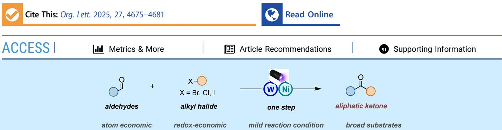
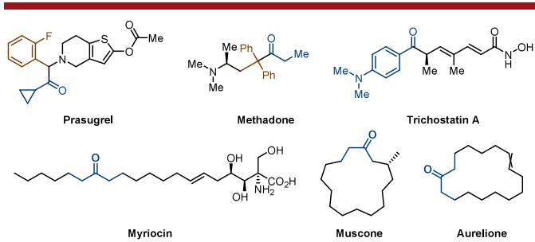
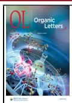
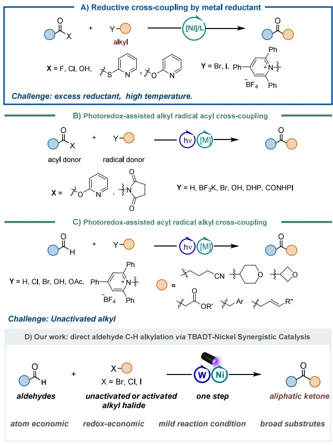
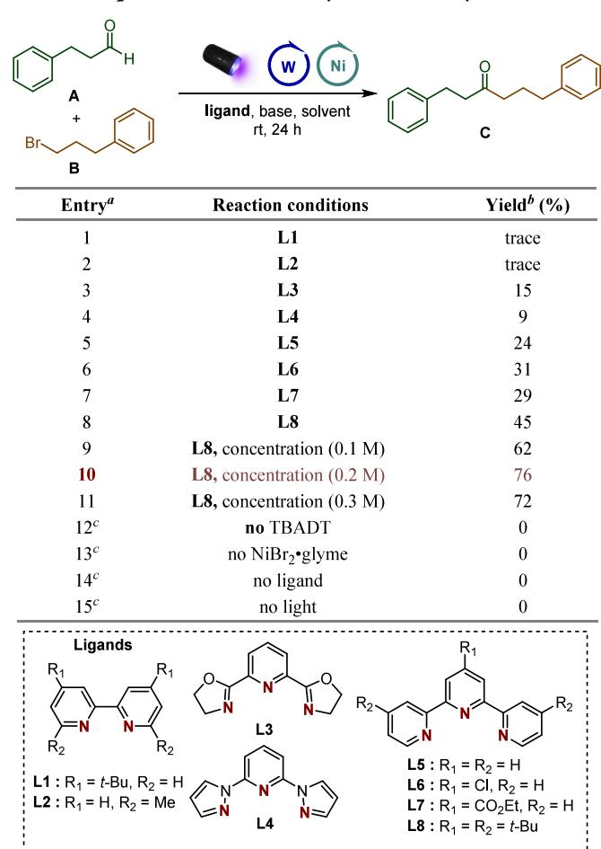
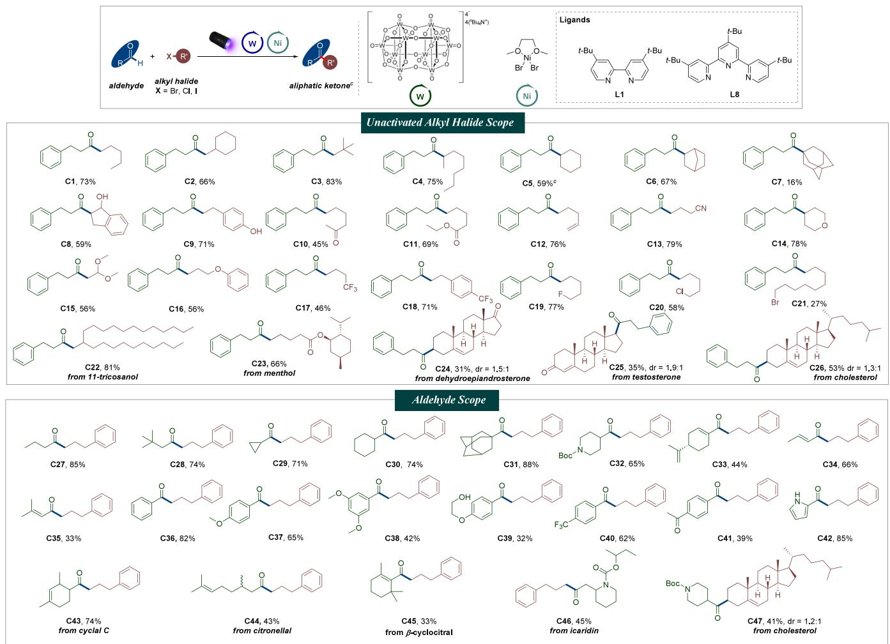
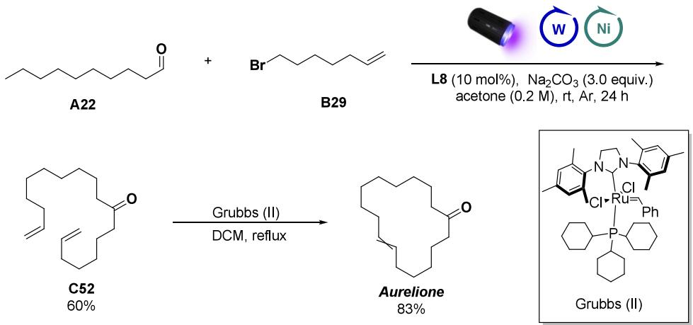

pubs.acs.org/OrgLett

Letter

# A General Direct Aldehyde C−H Alkylation via TBADT-Nickel Synergistic Catalysis

Zhimin Hu,† Ji-Wei Sang,† Shize Xie,† Yujia Song,† Qiuhao Li, Bing Wang, Zheng-Yang Xu, Yu Zhang, Runhui Liu,\* Wei-Dong Zhang,\* and Jinxin Wang\*

  
ABSTRACT: Herein, we present a nickel/tetrabutylammonium decatungstate (TBADT)-catalvzed protocol for general C-H alkylation of aldehydes, enabling the eficient synthesis of aliphatic ketones through ligand-controlled cross-coupling. This mild and cost-efective methodology demonstrates broad substrate compatibility with various commercially available aldehydes and both activated and unactivated alkyl bromides, delivering target products in high yields. Notably, the practical utility of this catalytic system has been highlighted through a concise two-step synthesis of the commercially valuable musk odorant Aurelione from readily available starting materials.

D evelopments in new synthetic methods continue to have an impact on the discovery and development of the next generation of medicines.1 Aliphatic ketones are kinds of skeletons that frequently appear in natural products, pharmaceuticals, and flavors, such as prasugrel, methadone, trichostatin A, myriocin, muscone, and Aurelione (Figure 1).

  
Figure 1. Selected examples of aliphatic ketones from natural products or drugs with biological activities.

They often serve as the key intermediates for the synthesis of various pharmaceutical skeletons, for instance, chiral alcohol, chiral amine, indole, imidazole, quinoline, and other heterocyclic skeletons.2 Although traditional nucleophilic addition of organometallic reagents to carbonyl moieties, including aldehyde, amides, anhydrides, and acid chlorides, or transition-metal-catalyzed cross-coupling of acyl electrophiles (e.g., acyl halides, anhydrides, esters, and amides) with organometallics or less reactive carbon nucleophiles are among the most widely used reactions in pharmaceutical and synthetic chemistry,3 the employment of (super)stoichiometric amounts of organometallics reagents limits the synthetic practicability and functional group compatibility and also does not meet sustainability standards. For these reasons, developing novel and eficient methods toward the synthesis of ketones has been a concern for the organic synthesis community (Scheme 1).

The reductive cross-coupling of two shelf-stable and readily accessible electrophiles catalyzed by nickel ofers a more eficient and selectively controllable pathway organic chemical synthesis method under mild conditions to overcome the high energy barrier steps encountered in traditional transformation by alkyl radical addition processes4,5 (Scheme 1a). Recently, metallaphotoredox has enabled the development of a wide variety of cross-coupling reactions.6 For forging C(acyl)− C(sp3) bonds,7 the alkyl radical can be accessed from alkyltrifluoroborates,7c−e alkyl bromides,7m activated esters,7a,q 1,4-dihydropyridines,7g,i,j,n alcohols,7s and alkanes7b,f,h,l,o,p by photoredox in the presence of a photocatalyst and organic reductants or an exogenous source of halide anions instead of the aforementioned metal reductants (Scheme 1b). An alternative yet equally attractive approach to ketone formation has emerged that involves direct C−H functionalization of aldehydes enabled by metallaphotoredox. This strategy takes

Table 1. Optimization of Aldehyde C−H Alkylation

Scheme 1. Ketone Synthesis Based on Transition-Metal-Catalyzed Cross-Coupling  

advantage of high regioselectivity toward formyl C−H bonds even in the presence of various C−H bonds with similar bond dissociation energies.8 In this system, preactivation of the acyl group is not required, and the production of the radical does not require additional oxidants or reducing agents. The seminal work was successfully accomplished by MacMillan via synergistic combination of iridium photoredox, nickel, and hydrogen atom transfer catalysis in a triple-catalytic activation mechanism that allows aryl, vinyl, or alkyl aldehydes to undergo direct C−H arylation and alkylation. For the benzylation, Murakami and Ishida10 developed a dehydrogenative coupling of aldehydes and alkylbenzenes by Ir/Ni dual catalysis. As an alternative to the use of an expensive noblemetal photocatalyst, arylations and alkenylations of aldehydes were achieved by merging tetrabutylammonium decatungstate (TBADT) with a nickel or palladium catalyst. Diferent activated alkylations also were disclosed. Wang et al.11 successfully employed diferent carbon nickel intermediates to couple with acyl radicals from aldehydes to construct the $\mathsf { C } ( \mathsf { s p } ^ { 2 } ) \mathsf { - C } ( \mathsf { s p } ^ { 3 } )$ bond. Rasappan et al.12 demonstrated a milder and eficient method for the cross-coupling of alkyl and aryl aldehydes with benzylic and allylic pyridinium salts via C−N bond cleavage for the first time (Scheme 1c). However, the substrate scope of direct C−H alkylation of aldehydes is still limited (only three examples), and a general and practical approach to achieve aliphatic ketones is still in high demand.

Our group focuses on developing practical reactions to synthesize and modify bioactive natural products to discover new drugs. Following up on our previous works,13 we aimed to develop direct aldehyde C−H functionalization reactions to obtain various ketones eficiently and conveniently. Herein we report a general aliphatic ketone synthesis method using nickel/TBADT synergistic-catalyzed coupling of aldehydes with alkyl halides via ligand control.

We initiated our investigation by coupling phenylpropanal A with unactivated alkyl bromides B to access ketone products C under the merged TBADT and nickel catalyst, and the results are summarized in Table 1 and Table S1 in the Supporting

  
aReaction conditions: TBADT (2 mol%), NiBr ·glyme (10 mol%), ligand (10 mol%), alkyl halide (1.0 equiv), aldehyde (3.0 equiv), Na CO (3.0 equiv), acetone (0.05 M), 40 W LED lamp (390 nm) at rt with cooling fan under argon atmosphere for 24 h. bIsolated yield. cL8, acetone (0.2 M).

Information). In contrast to the known reports on crosselectrophile couplings, the frequently used 2,2′-bipyridine ligands such as electron-rich dtbbpy (L1) and di(Me)bpy (L2) were did not accomplish the desired transformation, where primarily the alkyl bromide was recovered. A bipyridine ligand with steric encumbrance at the $^ { 6 , 6 ^ { \prime } }$ positions showed the same ineficiency. We noted that coordination of a heteroatom in the alkyl bromide with nickel might promote the generation of an acyl−alkylnickel(III) bromide complex via an oxidative addition or “radical rebound” mechanism.10,14,15 So, we supposed that the proper ligand could provide the same efect. Inspired by the clear and comprehensive computational analysis of the mechanisms of the photoredox-nickel-HATand the ability of the terpyridine ligand to stabilize alkyl complexes of nickel in

## Scheme 2. Substrate Scope for the Coupling of Alkyl Halides and Aldehydes

  
aTBADT (2 mol%), NiBr ·glyme (10 mol%), L8 (10 mol%), alkyl halide (1.0 equiv), aldehyde (3.0 equiv), Na CO (3.0 equiv), acetone (0.2 M), 40 W LED lamp (390 nm) at rt with cooling fan under argon atmosphere for 24 h. bYield of the isolated product after column chromatography. cHalide substrate is iodide.

ligands were examined, and 24%−45% yields were obtained (ligands L3−L8, Table 1, entries 3−8, and Table S1 in the Supporting Information). Notably, the ligand L8 showed the best results. After systematic screening of diferent bases, solvents (Table S1 in the Supporting Information), and reaction concentrations (Table 1, entries 9−11), we found optimal conditions for coupling an aldehyde with an unactivated alkyl halide (Table 1): TBADT (2 mol%), NiBr ·glyme (10 mol%), L8 (10 mol%), Na CO (3.0 equiv), and acetone (0.2 M) with exposure to 390 nm LEDs at ambient temperature. These conditions provided the aliphatic ketone product C in 76% isolated yield (entry 11, Table 1). Control experiments (entries 12−15) revealed that the photocatalyst, nickel catalyst, ligand, and irradiation were all essential for the success of this new aldehyde C−H alkylation.

With the optimized conditions, we next sought to determine the generality of the alkyl halide component in this new aliphatic ketone-forming reaction. The scope of these conditions is broad, as demonstrated by the 47 examples in Scheme 2. For the unactivated alkyl bromide, linear alkyl bromides, branched chain alkyl bromides, and cyclic and bridge-cyclic alkyl bromides were able to functionalize phenylpropyl aldehyde and aford various ketones in moderate to good yields (C1−C6, 59%−83% yield). Caged tertiary alkyl bromide was also used (C7, 16%). Under mild reaction conditions and with the high selectivity of TBADT for aldehyde, a variety of functional groups were well tolerated (C8−C18, 45%−79%). Importantly, substrates bearing hydroxyl, phenolic hydroxyl, and ketone carbonyl groups, which are incompatible in Grignard reactions and in crosscoupling reactions with metal reductants or active acyl donors, can be readily employed in this Ni/TBADT metallaphotoredox aldehyde direct alkylation. Groups such as esters, nitriles, alkenyls, cyclic ethers, phenol ethers, acetals, and both aliphatic and aryl trifluoromethyl delivered the products in acceptable to good yields. Through chemoselective cross-coupling of the bromide motif to aldehydes, the construction of halogensubstituted aliphatic ketones could efectively reduce the number of reaction steps (C19−C20, 77% and 58% yield, respectively), and 1,9-dibromnonan gave the homocoupling product in an acceptable yield (C21, 27%). Notably, these versatile products provide additional handles for further elaboration and diversification. To examine the potential for late-stage application of this coupling reaction, alkyl bromides derived from natural product or drugs, 11-tricosaniol (C22), (−)-menthol (C23), dehydroepiandrosterone (C24), testosterone (C25), and cholesterol (C26), successfully underwent coupling with phenylpropanal in acceptable to excellent yields (31%−81%). Activated alkyl bromides (benzyl, allyl, propargyl) served as efective substrates in cross-coupling with bidentate ligand L1 in dilute solution (0.05 M), afording products in up to 98% yield (Tables S2 and S3 in the Supporting Information). Electron-rich benzyl bromides containing alkyl, aryl, and methoxy groups performed well (C54−C59, 81%−95% yield). Moreover, a variety of electrondeficient benzyl bromides or chlorides containing groups such as trifluoromethoxy, nitro, sulfones, esters, nitriles, and trifluoromethyl, fluoro, and chloro groups were found to be efective electrophiles (C60−C68, 52%−93% yield). In addition to benzene rings, naphthyl, quinolone, and furan groups were suitable substrates (C69 and C71, 91% and 78% yield, respectively). Notably, the eficiency of the reaction was not impeded by ortho substituents on the aromatic ring (C63, C66, and C68) or by using secondary benzyl halides (C70, 96% yield). Perhaps most importantly, this transformation is not limited to benzyl halides; for example, allyl halides and propargyl halides can be readily employed in this alkylation (C72−C74, 59%−88% yield).

Scheme 3. Two-Step Synthesis of Aurelione  

We next turned our attention to the scope of the aldehyde component. As shown in Scheme 2, an assortment of aliphatic acetones could be obtained in good to excellent yields with a broad range of aldehydes. Aliphatic aldehydes including linear, branched-chain, and cyclic primary, secondary, and even tertiary aldehydes were efective coupling partners (C27− C31 and C75−C77, C82−C84 in the Supporting Information, 47%−94% yield). Moreover, aliphatic aldehydes containing N-Boc-piperidine, phthalimide, isopentyl, tertiary alcohols, and furan were also coupled with high levels of eficiency (C32 and C78−C81 in the Supporting Information, 61%−98% yield). Strikingly, $\alpha { , } \beta { \cdot }$ -unsaturated aldehydes were successfully subjected to cross-coupling for the first time, afording $\alpha { , } \beta { - }$ unsaturated ketones (C33−C35 and C93−C95 in the Supporting Information, 59%−87% yield) in moderate to excellent yields. This achievement is particularly significant given the inherent challenges in suppressing competing Giese addition pathways, a critical concern arising from the inherent electrophilicity of both the enal substrates and the resultant enone products. Lastly, aromatic aldehydes were found to couple with alkyl halides proficiently, despite the diminished hydridic nature of these C−H bonds. With the exception of unsubstituted benzaldehydes (C36 and C85 in the Supporting

Information, 82% and 94% yield), electron-donating groups such as alkoxy and methyl were eligible substituents on the aromatic ring (C37−C39 and C88−C89 in the Supporting Information, 32%−93% yields). Electron-withdrawing groups, including common substituents such as trifluoromethyl, acetyl, and nitro groups, could be coupled with this method (C40− C41 and C86−C87 in the Supporting Information, 39%−62% yields). With respect to heteroaromatic coupling partners, we found that a range of substituted heteroaryl aldehydes are also efective substrates (C42 and C90−C92 in the Supporting Information, 85%, 86%, 63%, and 46% yield, respectively). Perhaps more important was the finding that aldehydes from natural products or drugs can be successfully employed to generate ketones (C43−C47, 33%−74% yield). We believe that these results demonstrate the first broadly general approach to access aliphatic ketones from aldehydes and alkyl halides.

To highlight a potential application to valuable molecules, we accomplished a two-step synthesis of Aurelione, a wellestablished musk odorant.17 As shown in Scheme 3, 10- undecenal A22 and 7-bromo-1-heptene B29 were successfully combined using our aldehyde coupling protocol to forge ketone C52 in a good yield (60%). Exposure of the aforementioned octadeca-1,17-dien-8-one to the Grubbs catalyst (II) in dichloromethane under reflux resulted in the formation of Aurelione in 83% yield.

In summary, we have developed the first photoinduced nickel-catalyzed cross-coupling protocol enabling direct conjugation of aldehydes with diverse alkyl halides. This sustainable methodology features operationally simple and safe procedures conducted under environmentally benign conditions, demonstrating excellent functional group compatibility while eliminating the reliance on precious metal catalysts. The synthetic utility of this strategy has been demonstrated through an eficient two-step synthesis of the commercially valuable musk fragrance Aurelione from readily available starting materials. This catalytic paradigm not only establishes a practical platform for sustainable aliphatic ketone synthesis but also significantly expands accessible chemical space for medicinal chemistry exploration while addressing critical challenges in an environmentally conscious synthetic design.

## ■ ASSOCIATED CONTENT

## Data Availability Statement

The data underlying this study are available in the published article and its Supporting Information.

## \*sı Supporting Information

The Supporting Information is available free of charge at https://pubs.acs.org/doi/10.1021/acs.orglett.5c00949.

Experimental procedures, condition optimization, the substrate scope of the activated alkyl bromides and aldehydes, mechanism experiments, crystal data, and NMR spectra (PDF)

## Accession Codes

Deposition Number 2160760 contains the supplementary crystallographic data for this paper. These data can be obtained free of charge via the joint Cambridge Crystallographic Data Centre (CCDC) and Fachinformationszentrum Karlsruhe Access Structures service.

## ■ AUTHOR INFORMATION

## Corresponding Authors

Runhui Liu − Department of Phytochemistry, School of Pharmacy, Second Military Medical University, Shanghai 200433, China; Email: lyliurh@126.com

Wei-Dong Zhang − Department of Phytochemistry, School of Pharmacy, Second Military Medical University, Shanghai 200433, China; School of Pharmaceutical Sciences, Wenzhou Medical University, Wenzhou 325035 Zhejiang, China; Asymchem Laboratories (Tianjin) Co., Ltd., Tianjin 300462, China; Institute of Interdisciplinary Integrative Medicine Research, Shanghai University of Traditional Chinese Medicine, Shanghai 201203, China; State Key Laboratory for Quality Ensurance and Sustainable Use of Dao-di Herbs, Institute of Medicinal Plant Development, Chinese Academy of Medical Sciences and Peking Union Medical College, Beijing 100193, China; Email: wdzhangy@hotmail.com

Jinxin Wang − Department of Phytochemistry, School of Pharmacy, Second Military Medical University, Shanghai 200433, China; orcid.org/0000-0001-9561-7633; Email: jxwang2013@126.com

## Authors

Zhimin Hu − Department of Phytochemistry, School of Pharmacy, Second Military Medical University, Shanghai 200433, China

Ji-Wei Sang − Department of Phytochemistry, School of Pharmacy, Second Military Medical University, Shanghai 200433, China

Shize Xie − Department of Phytochemistry, School of Pharmacy, Second Military Medical University, Shanghai 200433, China

Yujia Song − School of Pharmaceutical Sciences, Wenzhou Medical University, Wenzhou 325035 Zhejiang, China

Qiuhao Li − Asymchem Laboratories (Tianjin) Co., Ltd., Tianjin 300462, China

Bing Wang − Department of Phytochemistry, School of Pharmacy, Second Military Medical University, Shanghai 200433, China

Zheng-Yang Xu − Department of Phytochemistry, School of Pharmacy, Second Military Medical University, Shanghai 200433, China; orcid.org/0000-0003-4605-8286

Yu Zhang − Asymchem Laboratories (Tianjin) Co., Ltd., Tianjin 300462, China; orcid.org/0000-0002-7230- 3575

Complete contact information is available at: https://pubs.acs.org/10.1021/acs.orglett.5c00949

## Author Contributions

†Z. H., J.-W. S., S. X., and Y. S. contributed equally. Notes

The authors declare no competing financial interest.

## ■ ACKNOWLEDGMENTS

This work was supported by National Natural Science Foundation of China (Nos. 82003624, 82141203, 82004003, and 82004215), Science and Technology Commission of Shanghai Municipality (Nos. 23YF1457800 and 20YF1458700), Innovation Team and Talents Cultivation Program of National Administration of Traditional Chinese Medicine (ZYYCXTDD-202004), and Shanghai Frontiers Science Center of TCM Chemical Biology. We are also grateful to Dr. Lu Lu (Department of Phytochemistry, School of Pharmacy, Second Military Medical University, Shanghai 200433, China) for carrying out the NMR experiments.

## ■ REFERENCES

(1) (a) Campos, K. R.; Coleman, P. J.; Alvarez, J. C.; Dreher, S. D.; Garbaccio, R. M.; Terrett, N. K.; Tillyer, R. D.; Truppo, M. D.; Parmee, E. R. The Importance of Synthetic Chemistry in the Pharmaceutical Industry. Science 2019, 363, No. eaat0805. (b) Blakemore, D. C.; Castro, L.; Churcher, I.; Rees, D. C.; Thomas, A. W.; Wilson, D. M.; Wood, A. Organic Synthesis Provides Opportunities to Transform Drug Discovery. Nat. Chem. 2018, 10, 383−394.

(2) Foley, D. J.; Waldmann, H. Ketones as Strategic Building Blocks for the Synthesis of Natural Product-Inspired Compounds. Chem. Soc. Rev. 2022, 51, 4094−4120.

(3) (a) Lawrence, N. J. Aldehydes and Ketones. J. Chem. Soc., Perkin Trans. 1998, 1, 1739−1750. (b) Dieter, R. K. Reaction of Acyl chlorides with Organometallic Reagents: a Banquet Table of Metals for Ketone Synthesis. Tetrahedron. 1999, 55, 4177−4236. (c) Singh, J.; Satyamurthi, N.; Aidhen, I. The Growing Synthetic Utility of Weinreb′ s Amide. J. Prakt. Chem. 2000, 342, 340−347. (d) Pace, V.; Holzer, W.; Olofsson, B. Increasing the Reactivity of Amides Towards Organometallic Reagents: An Overview. Adv. Synth. Catal. 2014, 356, 3697−3736. (e) Jana, R.; Pathak, T. P.; Sigman, M. S. Advances in Transition Metal (Pd, Ni, Fe)-Catalyzed Cross-Coupling Reactions Using Alkyl-Organometallics as Reaction Partners. Chem. Rev. 2011, 111, 1417−1492. (f) Buchspies, J.; Szostak, M. Recent Advances in Acyl Suzuki Cross-Coupling. Catalysts. 2019, 9, 53. (g) Dander, J. E.; Garg, N. K. Breaking Amides Using Nickel Catalysis. ACS. Catal. 2017, 7, 1413−1423. (h) Johnson, J. B.; Rovis, T. Enantioselective Cross-Coupling of Anhydrides with Organozinc Reagents: the Controlled Formation of Carbon−Carbon Bonds Through the Nucleophilic Interception of Metalacycles Acc. Chem. Res. 2008, 41, 327−338. (i) Hirschbeck, V.; Gehrtz, P. H.; Fleischer, I. Metal-Catalyzed Synthesis and Use of Thioesters: Recent Developments. Chem.�Eur. J. 2018, 24, 7092−7017.

(4) (a) Weix, D. J. Methods and Mechanisms for Cross-Electrophile Coupling of Csp2 Halides with Alkyl Electrophiles. Acc. Chem. Res. 2015, 48, 1767−1775. (b) Gu, J.; Wang, X.; Xue, W.; Gong, H. Nickel-catalyzed Reductive Coupling of Alkyl Halides with Other Electrophiles: Concept and Mechanistic Considerations. Org. Chem. Front. 2015, 2, 1411−1421. (c) Moragas, T.; Correa, A.; Martin, R. Metal-Catalyzed Reductive Coupling Reactions of Organic Halides with Carbonyl-Type Compounds. Chem.�Eur. J. 2014, 20, 8242− 8258. (d) Richmond, E.; Moran, J. Recent Advances in Nickel

(5) For illustrative examples of dialkyl ketone synthesis by Nicatalyzed reductive cross-coupling not coverd in ref 4, see: (a) Shi, R.; Hu, X. From Alkyl Halides to Ketones: Nickel-Catalyzed Reductive Carbonylation Utilizing Ethyl Chloroformate as the Carbonyl Source. Angew. Chem., Int. Ed. 2019, 58, 7454−7458. (b) Ni, S.; Padial, N. M.; Kingston, C.; Vantourout, J. C.; Schmitt, D. C.; Edwards, J. T.; Kruszyk, M. M.; Merchant, R. R.; Mykhailiuk, P. K.; Sanchez, B. B.; Yang, S.; Perry, M. A.; Gallego, G. M.; Mousseau, J. J.; Collins, M. R.; Cherney, R. J.; Lebed, P. S.; Chen, J. S.; Qin, T.; Baran, P. S. A Radical Approach to Anionic Chemistry: Synthesis of Ketones, Alcohols, and Amines. J. Am. Chem. Soc. 2019, 141, 6726−6739.

Catalysis Enabled by Stoichiometric Metallic Reducing Agents. Synthesis. 2018, 50, 499−513.

(6) (a) Prier, C. K.; Rankic, D. A.; MacMillan, W. C. Visible Light Photoredox Catalysis with Transition Metal Complexes: Applications in Organic Synthesis. Chem. Rev. 2013, 113, 5322−5363. (b) Twilton, J.; Le, C.; Zhang, P.; Shaw, M. H.; Evans, R. W.; MacMillan, D. W. The Merger of Transition Metal and Photocatalysis. Nat. Rev. Chem. 2017, 1, 0052.

(7) (a) Le, C. C.; MacMillan, D. W. C. Fragment Couplings via CO Extrusion-Recombination: Expansion of a Classic Bond-Forming Strategy via Metallaphotoredox. J. Am. Chem. Soc. 2015, 137, 11938− 11941. (b) Joe, C. L.; Doyle, A. G. Direct Acylation of C(sp(3))-H Bonds Enabled by Nickel and Photoredox Catalysis. Angew. Chem., Int. Ed. 2016, 55, 4040−4043. (c) Stache, E. E.; Rovis, T.; Doyle, A. G. Dual Nickel- and Photoredox-Catalyzed Enantioselective Desymmetrization of Cyclic Meso-Anhydrides. Angew. Chem., Int. Ed. 2017, 56, 3679−3683. (d) Amani, J.; Sodagar, E.; Molander, G. A. Visible Light Photoredox Cross-Coupling of Acyl Chlorides with Potassium Alkoxymethyltrifluoroborates: Synthesis of α-Alkoxyketones. Org. Lett. 2016, 18, 732−735. (e) Amani, J.; Alam, R.; Badir, S.; Molander, G. A. Synergistic Visible-Light Photoredox/Nickel-Catalyzed Synthesis of Aliphatic Ketones via N-C Cleavage of Imides. Org. Lett. 2017, 19, 2426−2429. (f) Sun, Z.; Kumagai, N.; Shibasaki, M. Photocatalytic α-Acylation of Ethers. Org. Lett. 2017, 19, 3727− 3730. (g) Buzzetti, L.; Prieto, A.; Roy, S. R.; Melchiorre, P. Radical-Based C-C Bond-Forming Processes Enabled by the Photoexcitation

of 4-Alkyl-1,4-dihydropyridines. Angew. Chem., Int. Ed. 2017, 56, 15039−15043. (h) Ackerman, L. K. G.; Alvarado, J. I. M.; Doyle, A. G. Direct C-C Bond Formation from Alkanes Using Ni-Photoredox Catalysis. J. Am. Chem. Soc. 2018, 140, 14059−14063. (i) Badir, S. O.; Dumoulin, A.; Matsui, J. K.; Molander, G. A. Synthesis of Reversed C-Acyl Glycosides through Ni/Photoredox Dual Catalysis. Angew. Chem., Int. Ed. 2018, 57, 6610−6613. (j) Gandolfo, E.; Tang, X.; Roy, S. R.; Melchiorre, P. Photochemical Asymmetric Nickel-Catalyzed Acyl Cross-Coupling. Angew. Chem., Int. Ed. 2019, 58, 16854−16858. (k) Levernier, E.; Corcé, V.; Rakotoarison, L. M.; Smith, A.; Zhang, M.; Ognier, S.; Tatoulian, M.; Ollivier, C.; Fensterbank, L. Cross Coupling of Alkylsilicates with Acylchlorides via Photoredox/Nickel Dual Catalysis. A New Synthesis of Ketones. Org. Chem. Front. 2019, 6, 1378. (l) Lee, G. S.; Won, J.; Choi, S.; Baik, M. H.; Hong, S. H. Synergistic Activation of Amides and Hydrocarbons for Direct C(sp3)-H Acylation Enabled by Metallaphotoredox Catalysis. Angew. Chem., Int. Ed. 2020, 59, 16933−16942. (m) Kerackian, T.; Reina, A.; Bouyssi, D.; Monteiro, N.; Amgoune, A. Silyl Radical Mediated Cross-Electrophile Coupling of N-Acyl-imides with Alkyl Bromides under Photoredox/nickel Dual Catalysis. Org. Lett. 2020, 22, 2240−2245. (n) Wei, Y.; Ben-Zvi, B.; Diao, T. Diastereoselective Synthesis of Aryl C-Glycosides from Glycosyl Esters via C-O Bond Homolysis. Angew. Chem., Int. Ed. 2021, 60, 9433−9438. (o) Kerack ian, T.; Reina, A.; Krachko, T.; Boddaert, H.; Bouyssi, D.; Monteiro, N.; Amgoune, A. C (sp3)-H Bond Acylation with N-Acyl Imides under Photoredox/nickel Dual Catalysis. Synlett. 2021, 32, 1531− 1536. (p) Mazzarella, D.; Pulcinella, A.; Bovy, L.; Broersma, R.; Noël, T. Rapid and Direct Photocatalytic C (sp3)-H Acylation and Arylation in Flow. Angew. Chem., Int. Ed. Engl. 2021, 133, 21447−21452. (q) Xi, X.; Luo, Y.; Li, W.; Xu, M.; Zhao, H.; Chen, Y.; Zheng, S.; Qi, X.; Yuan, W. From Esters to Ketones via a Photoredox-Assisted Reductive Acyl Cross-Coupling Strategy. Angew. Chem., Int. Ed. 2022, 134, No. e202114731. (r) Chen, Y.; Xi, X.; Yuan, W. Photoinduced Nickel-Catalyzed Reductive Acyl Cross-Coupling: Facile Access to All Carbon Quaternary Aliphatic Ketones. Org. Chem. Front. 2023, 10, 3669−3675. (s) Yang, B.; Tang, R. Y. Direct Synthesis of Dialkyl Ketones from Deoxygenative Cross-Coupling of Carboxylic Acids and Alcohols. Chem. Sci. 2024, 15, 18405−18410. (8) Lam, N. Y. S.; Wu, K.; Yu, J. Q. Advancing the Logic of Chemical Synthesis: C-H Activation as Strategic and Tactical Disconnections for C-C Bond Construction. Angew. Chem., Int. Ed.

(9) Zhang, X.; MacMillan, D. W. C. Direct Aldehyde C-H Arylation and Alkylation via the Combination of Nickel, Hydrogen Atom Transfer, and Photoredox Catalysis. J. Am. Chem. Soc. 2017, 139, 11353−11356.

(10) Kawasaki, T.; Ishida, N.; Murakami, M. Dehydrogenative Coupling of Benzylic and Aldehydic C-H Bonds. J. Am. Chem. Soc. 2020, 142, 3366−3370.

(11) (a) Fan, P.; Zhang, C.; Zhang, L.; Wang, C. Acylation of Aryl Halides and Alpha-Bromo Acetates with Aldehydes Enabled by Nickel/TBADT Cocatalysis. Org. Lett. 2020, 22, 3875−3878. (b) Li, X.; Mao, Y.; Fan, P.; Wang, C. Nickel/Photo-Cocatalyzed Acyl C−H Benzylation of Aldehydes with Benzyl Chlorides. Eur. J. Org. Chem. 2022, 2022, No. e202200214. (c) Wang, R.; Fan, P.; Wang, C. Nickel/Photo-Cocatalyzed Asymmetric Acyl C-H Allylation of Aldehydes and Formamides. ACS. Catal. 2023, 13, 141−146.

(12) Murugesan, V.; Ganguly, A.; Karthika, A.; Rasappan, R. C-H Alkylation of Aldehydes by Merging TBADT Hydrogen Atom Transfer with Nickel Catalysis. Org. Lett. 2021, 23, 5389−5393.

(13) Sang, J. W.; Li, Q.; Zhang, C.; Zhang, Y.; Wang, J.; Zhang, W. D. Nickel/Photoredox-Catalyzed Direct Amidation of Aldehydes with Nitroarenes via Fully Catalytic Process. Org. Lett. 2023, 25, 4592− 4597.

(14) (a) Diccianni, J. B.; Diao, T. Mechanisms of Nickel-Catalyzed Cross-Coupling Reactions. Trends. Chem. 2019, 1, 830−844. (b) Jones, G. D.; Martin, J. L.; McFarland, C.; Allen, O. R.; Hall, R. E.; Haley, A. D.; Brandon, R. J.; Konovalova, T.; Desrochers, P. J.; Pulay, P.; Vicic, D. A. Ligand Redox Effects in the Synthesis,

Electronic Structure, and Reactivity of an Alkyl−Alkyl Cross-Coupling Catalyst. J. Am. Chem. Soc. 2006, 128, 13175−13183. (c) Lin, X.; Phillips, D. L. Density Functional Theory Studies of Negishi Alkyl− Alkyl Cross-Coupling Reactions Catalyzed by a Methylterpyridyl-Ni (I) Complex. J. Org. Chem. 2008, 73, 3680−3688.

(15) (a) Maity, B.; Zhu, C.; Yue, H.; Huang, L.; Harb, M.; Minenkov, Y.; Rueping, M.; Cavallo, L. Mechanistic Insight into the Photoredox-Nickel-HAT Triple Catalyzed Arylation and Alkylation of α-Amino Csp3−Hbonds. J. Am. Chem. Soc. 2020, 142, 16942−16952. (b) Maity, B.; Zhu, C.; Rueping, M.; Cavallo, L. Mechanistic Understanding of Arylation vs Alkylation of Aliphatic Csp3−H Bonds by Decatungstate−Nickel Catalysis. ACS. Catal. 2021, 11, 13973− 13982.

(16) Kang, K.; Weix, D. J. Nickel-Catalyzed C (sp3)−C (sp3) Cross-Electrophile Coupling of in Situ Generated NHP Esters with Unactivated Alkyl Bromides. Org. Lett. 2022, 24, 2853−2857.

(17) Mathys, M.; Kraft, P. Synthesis by Ring-Closing Alkyne Metathesis with Selective Hydrogenation, and Olfactory Comparison of (7E)-and (7Z)-Cyclohexadec-7-enone (Aurelione®). Chem. Biodivers. 2014, 11, 1597−1607.