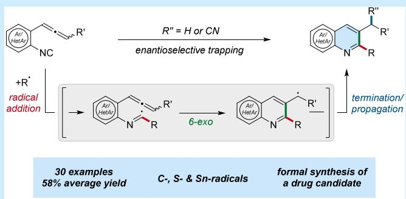
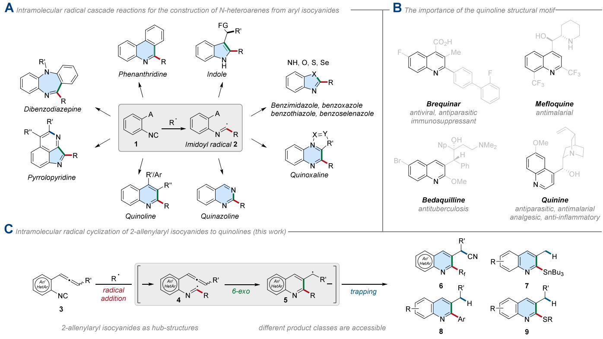
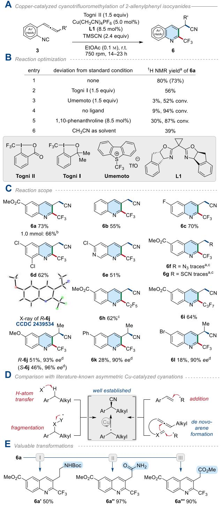
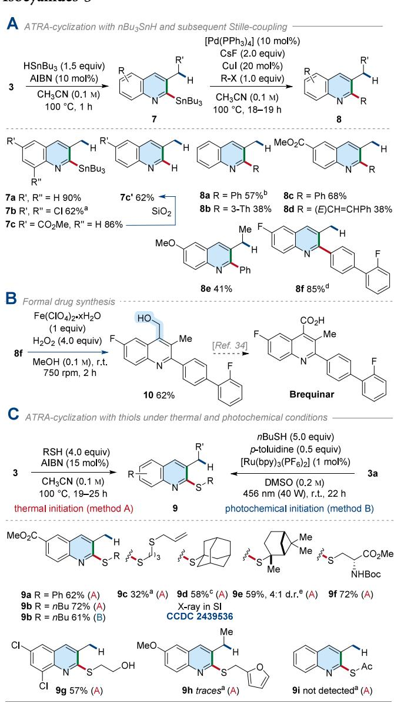

pubs.acs.org/OrgLett

Letter

# Radical Addition to 2‑Allenylaryl Isocyanides for the Preparation of 2,3-Difunctionalized Quinolines

Till Drennhaus, Jens Birschel, Constantin G. Daniliuc, Dirk Leifert,\* and Armido Studer\*

Cite This: Org. Lett. 2025, 27, 5675−5680

Read Online

## ACCESS

Metrics & More

ABSTRACT: 2-Allenylaryl isocyanides are presented as a novel platform to construct quinolines carrying various substituents in positions 2 and 3 via radical addition cyclization cascades. Carbon-, sulfur-, and tin-centered radicals add to the isonitrile functionality to generate the corresponding imidoyl radicals, which undergo 6- exo-cyclization onto the ortho-allenyl moiety. The newly generated benzylic radicals are either reduced or cyanated. In the latter case, enantioselective trapping is achieved.

Aryl isocyanides are highly potent radical acceptors leading1−4 to imidoyl radicals upon addition. This enables isocyanides to form�unlike other radical acceptors such as alkenes, alkynes, nitriles, etc.�1,1-adducts on the terminal carbon, thereby acting as C1-synthons.2 The eficiency of such processes renders the isonitrile functionality a highly versatile radical acceptor to realize radical addition cyclization cascades, as initial radical addition proceeds almost exclusively on the isocyanide functionality in the presence of various other typical radical acceptors.2 Despite being known for their great performance in radical reactions since the $1 9 6 0 s , ^ { 5 }$ it was not until the 1990s that Curran introduced this functional group in radical cascade reactions,6 laying the foundation for related strategies for the synthesis of various N-heterocyclic natural products.7 Over the last three decades, aryl isocyanides have been intensively used in radical chemistry, enabling access to valuable products.3,4,8,9

In particular, ortho-acceptor-substituted aryl isocyanides 1 stand out by their remarkable eficiency for the construction of diverse N-heteroarenes.9 The imidoyl radicals 2 formed after initial radical addition to the isocyanide 1 are prone to cyclize onto pending ortho-radical acceptors. Mainly, the nature of the ortho-acceptor moiety directs the reaction outcome, enabling access to a large series of important N-heterocyclic products (Scheme 1A). Those include phenanthridines (acceptor $\textrm { \textbf { A } } =$ arene),10 indoles $( \mathrm { A } = \mathrm { a l k e n e } , ^ { ^ { \mathbf { \hat { \mu } } _ { 1 1 , 1 2 } } } \mathrm { a l k y n e } ^ { ^ { 1 3 - 1 5 } } )$ , benzimidazoles $\left( \mathbf { A } = \mathbf { N } _ { 3 } ^ { ^ { 1 6 } } \right)$ , benzoxazoles $\mathbf { \Sigma } ( \mathbf { A } = \mathbf { \hat { e } } \mathbf { { t h e r } } ^ { 1 7 } )$ , benzothiazoles (A = thioether18,19), benzoselenazoles $\mathrm { ( A ~ = ~ \ s e l e n i d e ^ { 1 8 } ) }$ quinoxalines $( \mathrm { A } = \mathrm { i s o c y a n i d e } , ^ { 2 0 } \mathrm { a z o l e } ^ { 2 1 } )$ , quinazolines $\left( \mathbf { A } _ { \mathbf { \alpha } } = \mathbf { \alpha } \right.$ $\bar { \mathrm { C H } } _ { 2 } \mathrm { N } _ { 3 } ^ { 2 2 } )$ , pyrrolopyridines $\left( \mathbf { A } = { \mathrm { ~ n i t r i l e } } ^ { 2 3 } \right)$ , and dibenzodiazepines $( \mathrm { A } { \overset { - } { = } } \mathrm { a n i l i n e } ^ { 2 4 } )$ . However, to access quinolines via analogous strategies, specially designed alkenes25 or alkynes26

Article Recommendations

\*sı Supporting Information

are mandatory as acceptor functionalities to ensure eficient six-membered ring formation.14,15

Quinolines represent an important compound class, as various members are associated with useful biological activities, which renders the synthesis of these heterocycles a desired target (Scheme 1B). While most classical strategies exploit inter- or intramolecular cyclization of nitrogen-containing fragments with fitting carbon-based counterparts (e.g., classic Skraup or Doebner−Miller synthesis), extensive efort has been recently spent to expand the scope of accessible quinolines via mild catalytic methods.27 Along these lines, (catalytic) radical cascade cyclizations using aryl isocyanides are generally advantageous for installing valuable functional groups in sophisticated patterns within the synthesis.25,26

Allenes are also eficient acceptors, with radicals adding predominantly at the central sp-carbon.28 Thus, we envisioned that the formerly not examined ortho-allenylaryl isocyanides 3 might be eligible substrates for eficient quinoline synthesis, enabling simultaneous C2- and C3-benzylic functionalization (Scheme 1C). While this substrate class 3 was recently studied in Pd-catalyzed living cyclocopolymerizations,29 to the best of our knowledge no radical transformations have been reported with these interesting acceptors so far. Initial radical addition onto isocyanide 3 would lead to imidoyl radical 4 that should engage in a 6-exo-cyclization to generate benzylic radical 5, which can further react with various trapping reagents. In this

Scheme 1. Radical Cascade Reactions with Aryl Isocyanides as Acceptors and Quinolines as Core Structures in Biologically Active Compoundsa

  
a(A) General overview of radical N-heteroarene syntheses using 2-acceptor-substituted aryl isocyanides 1. (B) The importance of the quinoline structural motif. (C) Our approach of using 2-allenylaryl isocyanides 3 for the synthesis of quinolines 6−9.

Letter, we demonstrate the use of isonitriles 3 as valuable radical acceptors for the preparation of a variety of quinolines 6−9.

We initiated our studies by examining the 2-allenylaryl isocyanide 3a $\left( \mathbf { R } ^ { \prime } \ = \ \mathbf { H } \right)$ in a radical copper-catalyzed cyanotrifluoromethylation sequence (Scheme 2A).30 With the Togni II reagent as a CF -radical precursor, $\mathrm { C u } ( \mathrm { C H } _ { 3 } \mathrm { C N } ) _ { 4 } \mathrm { P F } _ { 6 }$ as a precatalyst (5.0 mol %), L1 as a ligand (8.5 mol %), and TMSCN (2.4 equiv) as a cyanide source in ethyl acetate, the targeted 3-quinolineacetonitrile 6a was obtained in 73% isolated yield (Scheme 2B, entry 1). Alternative $\cdot _ { \mathrm { C F } _ { 3 } }$ precursors like the Togni I or Umemoto reagents provided 6a in significantly lower yields (Scheme 2B, entries 2 and 3). Performing the Cu-catalyzed cascade reaction without a ligand or with achiral 1,10-phenanthroline led to poor product formation and incomplete conversion of 3a (Scheme 2B, entries 4 and 5). Acetonitrile, a commonly used solvent in related transformations,31 was found to have a deteriorating efect on the reaction outcome (Scheme 2B, entry 6).

Applying the best conditions, we next examined the scope of this transformation (Scheme 2C). The unsubstituted 6b as well as the halide derivatives 6c and 6d were formed in good yields (55−70%). Notably, using the pyridine-derived isocyanide 3e allowed expansion of the product scope from simple quinolines to naphthyridineacetonitrile 6e (51%). However, for azidation32,33 or thiocyanatio n,32,34 applying other nucleophile sources like $\mathrm { T M S N } _ { 3 }$ or TMSNCS provided only traces of the corresponding products 6f and 6g. Togni II derivatives carrying longer perfluoroalkyl chains were eligible radical precursors for the successful preparation of quinolines 6h (62%) and 6i (64%).

Allene acceptors with an additional substituent at the terminal position undergo the addition−cyclization sequence, leading to prochiral secondary benzylic radicals of type 5, eventually afording chiral 3-quinolineacetonitriles 6 through Cu-mediated cyanation. We were very pleased to find that with the methyl-substituted 2-allenylaryl isocyanides 3j−l under our standard conditions with chiral ligand L1 the desired nitriles 6j−l were formed with high enantioselectivity (90−96% ee), albeit in diminished yields (18−51%). This is likely due to competing side reactions as the more nucleophilic disubstituted allenes 3j−l rapidly decompose in solution. Since more electron-rich isocyanides decompose slower,35 the highest yield in this series was noted for the methoxy derivative 6j (51%). Unfortunately, no further improvement could be achieved in a screening of other chiral bisoxazoline ligands (see SI section 3, Scheme S1 for details). The absolute configuration of 6j was unambiguously assigned by X-ray crystal structure analysis (Xray structure of the R-enantiomer prepared with L1 is depicted in Scheme 2C). The absolute configurations of 6k and 6l were assigned in analogy. Of note, the asymmetric copper-catalyzed cyanation of secondary benzylic radicals has been heavily investigated in recent years.31,36,37

In this context, prochiral benzylic radicals for enantioselective cyanation were generated through benzylic hydrogen atom abstraction, fragmentation, or radical addition to styrene derivatives.37 Thus, our current study discloses a novel synthetic route for the generation of secondary benzylic radicals through concomitant arene construction (Scheme 2D) (for a proposed mechanism, see SI chapter 4, Scheme S2). The synthetic value of the 3-quinolineacetonitrile products was demonstrated by the successful transformation of 6a to the

## Scheme 2. Copper-Catalyzed Cyanotrifluoromethylation of 2-Allenylaryl Isocyanides $3 ^ { \ast }$

  
\*Reactions (0.1 mmol) were conducted under an argon atmosphere, and isolated yields are reported. aNMR yield with $\mathrm { C H } _ { 2 } \mathrm { B r } _ { 2 }$ as the internal standard. Isolated yield given in parentheses. Reaction was performed on a $^ { \mathrm { b } } 1 . 0$ or ${ } ^ { \mathrm { c } } 0 . \dot { 0 } 5$ mmol scale. dEnantiomeric excess was determined by HPLC on chiral stationary phases. I) 6a (0.1 mmol, 1.0 equiv), NiCl ·6H O (1.5 equiv), $( \mathrm { B o c } ) _ { 2 } \mathrm { O }$ (2.0 equiv), NaBH (7.0 equiv), MeOH (0.05 $\mathrm { M } ) , 0 ^ { \circ } \mathrm { C }  \mathrm { r . t . } , 2 . 5$ h; II) 6a (0.1 mmol, 1.0 equiv), (E/Z)-acetaldoxime (4.0 equiv), Pd(OAc) (20 mol %), PPh (40 mol %), EtOH/H O (0.07 M, 5:1), 85 °C, 6 h; III) 6a (0.1 mmol, 1.0 equiv), H SO (w = 98%, 0.2 M), MeOH (0.05 M), 100 ${ } ^ { \circ } \mathrm { C } ,$ 21 h. X-ray of R-6j: Thermal ellipsoids are shown at 30% probability.

Boc-protected amine ${ \bf 6 a ^ { \prime } }$ (50%), the amide ${ \bf 6 } { \bf a ^ { \prime \prime } }$ (97%), and the ester ${ \bf 6 } \mathbf { a } ^ { \prime \prime \prime }$ (90%, Scheme 2E).

To showcase that the 2-allenylaryl isocyanides 3 serve as platforms to diversely decorated quinolines, we further examined other typical radical processes. Conditions adapted from the original Fukuyama indole synthesis12 enabled the preparation of 2-stannylated quinolines $\mathbf { 7 a - c }$ through hydrostannylation in very good yields $( 6 2 - 9 0 \% )$ (Scheme 3A). The protodestannylated congener $\mathrm { 7 c ^ { \prime } }$ was obtained in 62% yield from 7c after flash column chromatography on $\mathrm { S i O } _ { 2 } .$ Moreover, the 2-arylated quinoline 8c could be prepared in 26% yield when 5.0 equiv of phenyl iodide was added, showing that iodine abstraction by the tin radical is faster than tin radical addition to the isocyanide (see SI for details). However,

$$
3 ^ { * }
$$

  
\*Reactions (0.1 mmol) were conducted under an argon atmosphere, and isolated yields are reported. $^ \mathrm { a 1 } \mathrm { H }$ NMR yield with CH Br as the internal standard. Reaction pursued on a ${ \dot { \mathsf { b } } } _ { 0 . 5 }$ mmol or c0.2 mmol scale. dDMF (0.01 M) was added as a cosolvent in the Stille coupling. eDiastereomeric ratio determined by 1H NMR from the crude mixture.

the same 2-functionalized quinolines can be accessed in higher yields through one-pot Stille cross-coupling from the intermediate stannanes with various aryl iodides or vinyl iodides as demonstrated by the synthesis of quinolines 8a−e (38−68%).12 The valuable Stille cross coupling was also used successfully for the preparation of quinoline 8f (85%) from isocyanide 3c using the corresponding aryl triflate. With the quinoline 8f in hand we realized the formal synthesis of brequinar by installing the C-skeleton of alcohol 10 via a Fenton reaction in methanol with 62% yield (Scheme 3B).38

Atom transfer radical addition (ATRA) cyclization with thiols14,15 was also examined using our 2-allenylaryl isocyanides 3 as radical acceptors (Scheme 3C). Cyclizing hydrothiolation applying a thermal initiation protocol (method A) with AIBN (α,α′-azoisobutyronitrile) showed a good functional group tolerance as demonstrated by the reaction of 3a with aromatic (9a) and aliphatic (9b−f) thiols. Ester and amide functionalities at the thiol component were tolerated (9f). However, allyl thiol provided 9c in a moderate yield as a result of a thiol−ene reaction on the initially targeted product (see SI for details). Sterically more demanding tertiary thiols aforded the corresponding products 9d and 9e in comparable yields. Noteworthy, natural product-derived scafolds like monoterpene 9e or protected cysteine 9f could be used as the thiol component in these transformations (59−72%). The terminal substituted allene 3j yielded 9h only in traces due to the lower stability of the starting material. Unfortunately, thioacetic acid was not an eligible thiyl radical precursor in this cascade reaction, and 9i was not detected. Along with the thermal protocol, a photochemical initiation process (method B) was successfully applied for the preparation of 9b from allene 3a and butyl thiol (see SI for details).39 The quinoline 9b was obtained in slightly diminished yields (61%) compared with the thermally initiated process.

In summary, we introduced 2-allenylaryl isocyanides 3 as versatile radical acceptors for the preparation of diversely substituted quinolines 6−9. 2-Trifluoromethylated 3-quinoli neacetonitriles 6 were obtained through copper-catalyzed perfluoroalkylcyanation of 3. With terminal substituted allenes, chiral 3-quinolinacetonitriles 6j−l were accessed with high enantioselectivity (90−96% ee) using a chiral Cu catalyst. Furthermore, ATRA cyclization applying nBu SnH, aromatic, and aliphatic thiols provided various S- and Sn-substituted quinolines. The latter engaged in Stille cross couplings, enabling the formal synthesis of the drug brequinar. While our study examined 2-allenylaryl isocyanides 3 across four diferent radical protocols, each yielding distinct product classes, we anticipate that additional reaction modes could be applicable when isonitriles of type 3 are used as the starting material. Therefore, we encourage others to consider this platform in their synthetic planning.

## ■ ASSOCIATED CONTENT

## Data Availability Statement

The data underlying this study are available in the published article and its Supporting Information.

## \*sı Supporting Information

The Supporting Information is available free of charge at https://pubs.acs.org/doi/10.1021/acs.orglett.5c01436.

Details, characterization data, nuclear magnetic resonance (NMR) spectra, HPLC traces, and X-ray data (PDF)

## Accession Codes

Deposition Numbers 2439534−2439536 contain the supplementary crystallographic data for this paper. These data can be obtained free of charge via the joint Cambridge Crystallographic Data Centre (CCDC) and Fachinformationszentrum Karlsruhe Access Structures service.

## ■ AUTHOR INFORMATION

## Corresponding Authors

Dirk Leifert − Organisch-Chemisches Institut, Universität Münster, 48149 Münster, Germany; orcid.org/0000- 0001-7117-2094; Email: dirkleifert@uni-muenster.de

Armido Studer − Organisch-Chemisches Institut, Universität Münster, 48149 Münster, Germany; orcid.org/0000- 0002-1706-513X; Email: studer@uni-muenster.de

## Authors

Till Drennhaus − Organisch-Chemisches Institut, Universität Münster, 48149 Münster, Germany; orcid.org/0000- 0003-0368-2898

Jens Birschel − Organisch-Chemisches Institut, Universität Münster, 48149 Münster, Germany

Constantin G. Daniliuc − Organisch-Chemisches Institut, Universität Münster, 48149 Münster, Germany; orcid.org/0000-0002-6709-3673

Complete contact information is available at: https://pubs.acs.org/10.1021/acs.orglett.5c01436

## Author Contributions

The manuscript was written through the contributions of all authors. All authors have given approval to the final version of the manuscript.

Notes

The authors declare no competing financial interest.

## ■ ACKNOWLEDGMENTS

We thank the University of Münster and the Deutsche Forschungsgemeinschaft (DFG, German Research Foundation)−GRK2678-437785492−for funding this work. Dr. C. Manske (née Gerleve), M. Huang, and M. Schwenzer are acknowledged for generously providing some reagents and J. Lammert for synthetic support (all University of Münster).

## ■ REFERENCES

(1) Ramozzi, R.; Chéron, N.; Braïda, B.; Hiberty, P. C.; Fleurat-Lessard, P. A valence bond view of isocyanides’ electronic structure. New J. Chem. 2012, 36, 1137−1140.

(2) Gomes, G. d. P.; Loginova, Y.; Vatsadze, S. Z.; Alabugin, I. V. Isonitriles as Stereoelectronic Chameleons: The Donor−Acceptor Dichotomy in Radical Additions. J. Am. Chem. Soc. 2018, 140, 14272−14288.

(3) Lei, J.; Huang, J.; Zhu, Q. Recent progress in imidoyl radicalinvolved reactions. Org. Biomol. Chem. 2016, 14, 2593−2602.

(4) Minozzi, M.; Nanni, D.; Spagnolo, P. Imidoyl radicals in organic synthesis. Curr. Org. Chem. 2007, 11, 1366−1384.

(5) Shaw, D. H.; Pritchard, H. O. Free-radical-catalyzed isomerization of isocyanides. Can. J. Chem. 1967, 45, 2749−2754.

(6) Curran, D. P.; Liu, H. 4+ 1 Radical annulations with isonitriles: a simple route to cyclopenta-fused quinolines. J. Am. Chem. Soc. 1991, 113, 2127−2132.

(7) (a) Curran, D. P.; Liu, H. New 4+ 1 radical annulations. A formal total synthesis of (±)-camptothecin. J. Am. Chem. Soc. 1992, 114 (14), 5863−5864. (b) Curran, D. P.; Liu, H.; Josien, H.; Ko, S.-B.

(d) Curran, D. P.; Ko, S.-B.; Josien, H. Cascade Radical Reactions of Isonitriles: A Second-Generation Synthesis of (20S)-Camptothecin, Topotecan, Irinotecan, and GI-147211C. Angew. Chem., Int. Ed. Engl. 1996, 34, 2683−2684. (e) Curran, D. P.; Sisko, J.; Yeske, P. E.; Liu, H. Recent applications of radical reactions in natural product synthesis. Pure Appl. Chem. 1993, 65, 1153−1159.

(8) (a) Lygin, A. V.; de Meijere, A. Isocyanides in the Synthesis of Nitrogen Heterocycles. Angew. Chem., Int. Ed. 2010, 49, 9094−9124. (b) Song, B.; Xu, B. Metal-catalyzed C−H functionalization involving isocyanides. Chem. Soc. Rev. 2017, 46, 1103−1123. (c) Sharma, S.; Pandey, A. P.; Sharma, A. Photocatalytical and Photochemical Generation of Imidoyl Radicals: Synthetic Applications. Adv. Synth. Catal. 2020, 362, 5196−5218. (d) Gu, Q.; Cheng, Z.; Qiu, X.; Zeng, X. Recent Advances in the Electrochemical Functionalization of Isocyanides. Chem. Rec. 2023, 23 (1), No. e202200177.

(9) Zhang, B.; Studer, A. Recent advances in the synthesis of nitrogen heterocycles via radical cascade reactions using isonitriles as radical acceptors. Chem. Soc. Rev. 2015, 44, 3505−3521.

(10) (a) Nanni, D.; Pareschi, P.; Rizzoli, C.; Sgarabotto, P.; Tundo, A. Radical annulations and cyclisations with isonitriles: the fate of the intermediate imidoyl and cyclohexadienyl radicals. Tetrahedron 1995, 51, 9045−9062. (b) Tobisu, M.; Koh, K.; Furukawa, T.; Chatani, N. Modular Synthesis of Phenanthridine Derivatives by Oxidative Cyclization of 2-Isocyanobiphenyls with Organoboron Reagents. Angew. Chem., Int. Ed. 2012, 51, 11363−11366. (c) Zhang, B.; Mück-Lichtenfeld, C.; Daniliuc, C. G.; Studer, A. 6-Trifluoromethylphenanthridines through radical trifluoromethylation of isonitriles. Angew. Chem., Int. Ed 2013, 52, 10792−10795.

(11) (a) Mitamura, T.; Tsuboi, Y.; Iwata, K.; Tsuchii, K.; Nomoto, A.; Sonoda, M.; Ogawa, A. Photoinduced thiotelluration of isocyanides by using a (PhS)2−(PhTe)2 mixed system, and its application to bisthiolation via radical cyclization. Tetrahedron Lett. 2007, 48, 5953−5957. (b) Kobayashi, S.; Peng, G.; Fukuyama, T. Efficient total syntheses of (±)-vincadifformine and (−)-tabersonine. Tetrahedron Lett. 1999, 40, 1519−1522. (c) Han-ya, Y.; Tokuyama, H.; Fukuyama, T. Total Synthesis of (−)-Conophylline and (−)-Conophyllidine. Angew. Chem., Int. Ed. 2011, 50, 4884−4887. (d) Zhang, B.; Studer, A. 2-Trifluoromethylated Indoles via Radical Trifluoromethylation of Isonitriles. Org. Lett. 2014, 16, 1216−1219. (e) Wang, C.-H.; Li, Y.-H.; Yang, S.-D. Autoxidation Photoredox Catalysis for the Synthesis of 2-Phosphinoylindoles. Org. Lett. 2018, 20, 2382−2385. (f) Zhang, T.; Yu, M.; Huang, H. Fe-catalyzed Fukuyama-type indole synthesis triggered by hydrogen atom transfer. Chem. Sci. 2021, 12, 10501−10505. (g) Kaburagi, Y.; Tokuyama, H.; Fukuyama, T. Total Synthesis of (−)-Strychnine. J. Am. Chem. Soc. 2004, 126, 10246−10247.

(12) Fukuyama, T.; Chen, X.; Peng, G. A Novel Tin-Mediated Indole Synthesis. J. Am. Chem. Soc. 1994, 116, 3127−3128.

(13) Leifert, D.; Weidlich, F.; Adler, F.; Daniliuc, C. G.; Alasmary, F. A.; Studer, A. 2,3-Difunctionalized Indoles via Radical Acylation or Trifluoromethylation of ortho-Alkynylphenyl Isonitriles. Org. Lett. 2022, 24, 284−288.

(14) Rainier, J. D.; Kennedy, A. R.; Chase, E. An isonitrile-alkyne cascade to di-substituted indoles. Tetrahedron Lett. 1999, 40, 6325− 6327.

(15) Rainier, J. D.; Kennedy, A. R. Cascades to Substituted Indoles. J. Org. Chem. 2000, 65, 6213−6216.

(16) Li, D.; Mao, T.; Huang, J.; Zhu, Q. Denitrogenative Imidoyl Radical Cyclization: Synthesis of 2-Substituted Benzoimidazoles from 1-Azido-2-isocyanoarenes. Org. Lett. 2017, 19, 3223−3226.

(17) Yuan, S.; Ye, X.; Cai, J.; Song, Z.; Tan, Y.; Peng, Y.; Ding, Q. DMF-Assisted Radical Cyclization of o-Isocyanodiaryl Ethers via 1,5-

Aryl Migration: Construction of 2-Arylbenzoxazoles. J. Org. Chem. 2022, 87, 1485−1492.

(18) Liu, Y.; Chen, X.-L.; Sun, K.; Li, X.-Y.; Zeng, F.-L.; Liu, X.-C.; Qu, L.-B.; Zhao, Y.-F.; Yu, B. Visible-Light Induced Radical Perfluoroalkylation/Cyclization Strategy To Access 2-Perfluoroalkylbenzothiazoles/Benzoselenazoles by EDA Complex. Org. Lett. 2019, 21, 4019−4024.

(19) Yang, W.-C.; Wei, K.; Sun, X.; Zhu, J.; Wu, L. Cascade C(sp3)−S Bond Cleavage and Imidoyl C−S Formation: Radical Cyclization of 2-Isocyanoaryl Thioethers toward 2-Substituted Benzothiazoles. Org. Lett. 2018, 20, 3144−3147.

(20) Leifert, D.; Studer, A. Iodinated (Perfluoro)alkyl Quinoxalines by Atom Transfer Radical Addition Using ortho-Diisocyanoarenes as Radical Acceptors. Angew. Chem., Int. Ed. 2016, 55, 11660−11663.

(21) He, Z.; Bae, M.; Wu, J.; Jamison, T. F. Synthesis of Highly Functionalized Polycyclic Quinoxaline Derivatives Using Visible-Light Photoredox Catalysis. Angew. Chem., Int. Ed. 2014, 53, 14451−14455.

(22) Yogesh Kumar, G. R.; Begum, N. S.; Mohammed Imran, K. Mn-mediated oxidative radical cyclization of 2-(azidomethyl)phenyl isocyanides with carbazate: access to quinazoline-2-carboxylates. New J. Chem. 2020, 44, 7001−7006.

(23) (a) Xu, P.; Zhu, Y.-M.; Liu, X.-Y.; Zhou, X.-Z.; Wang, S.-Y.; Ji, S.-J. Mn(III)-mediated radical reaction of 2-isocyano-6-alkenyl-(alkynyl)benzonitriles with arylboronic acids: Synthesis of pyrroloisoquinoline derivatives. Chin. Chem. Lett. 2021, 32, 413−416. (b) Xu, P.; Zhu, Y.-M.; Wang, F.; Wang, S.-Y.; Ji, S.-J. Mn(III)-Mediated Cascade Cyclization of 3-Isocyano-[1,1′-biphenyl]-2-carbonitrile with Arylboronic Acid: Construction of Pyrrolopyridine Derivatives. Org. Lett. 2019, 21, 683−686.

(24) (a) Liu, X.; Yuan, S.; Liu, Y.; Ni, M.; Xu, J.; Gui, S.; Peng, Y.-Y.; Ding, Q. Mn(III)-Mediated Radical Addition/Cyclization of Isocyanides with Aryl Boronic Acids/Diarylphosphine Oxides: Access to 11-Functionalized Dibenzodiazepines. J. Org. Chem. 2023, 88, 198− 210. (b) Yuan, S.; Liu, X.; Huang, Z.; Gui, S.; Diao, Y.; Peng, Y.-Y.; Ding, Q. Tetrabutylammonium Chloride-Induced Cascade Radical Addition/Cyclization of O-Isocyanodiaryl Amines: A Novel Protocol for the Synthesis of 11-Trifluoromethylated Dibenzodiazepines. J. Org. Chem. 2022, 87, 16542−16549.

(25) (a) Evoniuk, C. J.; Ly, M.; Alabugin, I. V. Coupling cyclizations with fragmentations for the preparation of heteroaromatics: quinolines from o-alkenyl arylisocyanides and boronic acids. Chem. Commun. 2015, 51, 12831−12834. (b) Mao, S.; Wang, H.; Liu, L.; Wang, X.; Zhou, M.-D.; Li, L. Trifluoromethylation/Difluoromethylation-Initiated Radical Cyclization of o-Alkenyl Aromatic Isocyanides for Direct Construction of 4-Cyano-2-Trifluoromethyl/Difluoromethyl-Containing Quinolines. Adv. Synth. Catal. 2020, 362, 2274−2279.

(26) Mitamura, T.; Iwata, K.; Ogawa, A. (PhTe)2-Mediated Intramolecular Radical Cyclization of o-Ethynylaryl Isocyanides Leading to Bistellurated Quinolines upon Visible-Light Irradiation. Org. Lett. 2009, 11, 3422−3424.

(27) (a) Mandal, A.; Khan, A. T. Recent advancement in the synthesis of quinoline derivatives via multicomponent reactions. Org. Biomol. Chem. 2024, 22, 2339−2358. (b) Prajapati, S. M.; Patel, K. D.; Vekariya, R. H.; Panchal, S. N.; Patel, H. D. Recent advances in the synthesis of quinolines: a review. RSC Adv. 2014, 4, 24463− 24476.

(28) Liu, L.; Ward, R. M.; Schomaker, J. M. Mechanistic Aspects and Synthetic Applications of Radical Additions to Allenes. Chem. Rev. 2019, 119, 12422−12490.

(29) (a) Kanbayashi, N.; Narukawa, M.; Onitsuka, K. Facile End-Functionalization of Poly(Quinolylene-2,3-Methylene) Using the Terminal Palladium Complex: Thiocarbonylation through Formation of an Acyl Palladium Complex at the Polymer Terminal. Macromol. Rapid Commun. 2023, 44, 2300251. (b) Kanbayashi, N.; Nishio, M.; Okamura, T.; Onitsuka, K. Synthesis of helically π-stacked poly-(quinolylene-2,3-methylene)s with anthracene derivatives at the chain end: intramolecular energy transfer based on the π-stacked architecture. Polym. Chem. 2023, 14, 412−420. (c) Kanbayashi, N.; Yamazaki, K.; Nishio, M.; Onitsuka, K. Synthesis Methodology of

End-Functionalized Poly(quinolylene-2,3-methylene)s: Living Cyclocopolymerization Using Aryl Palladium Initiators Conveniently Prepared from Versatile Aryl Halide. Macromolecules 2022, 55, 5027−5037. (d) Kanbayashi, N.; Kataoka, Y.; Okamura, T.; Onitsuka, K. Stability Enhancement of a π-Stacked Helical Structure Using Substituents of an Amino Acid Side Chain: Helix Formation via a Nucleation−Elongation Mechanism. J. Am. Chem. Soc. 2022, 144, 6080−6090. (e) Kataoka, Y.; Kanbayashi, N.; Fujii, N.; Okamura, T.; Haino, T.; Onitsuka, K. Construction of Helically Stacked π-Electron Systems in Poly(quinolylene-2,3-methylene) Stabilized by Intramolecular Hydrogen Bonds. Angew. Chem., Int. Ed. 2020, 59, 10286−10291. (f) Kanbayashi, N.; Odagaki, S.; Onitsuka, K. Sidechain modification of π-stacked helical poly(quinoline-2,3-diylmethylene) via thiol−ene reaction. Polym. Chem. 2024, 15, 3563− 3571. (g) Kanbayashi, N.; Odagaki, S.; Kobayakawa, N.; Kato, H. S.; Onitsuka, K. Direct Introduction of Cysteine Derivatives into the Chain End of Helical Poly(quinoline-2,3-diylmethylene)s: Densely Packed Monolayers on Au Substrates. Macromolecules 2024, 57, 7787−7797. (h) Kanbayashi, N.; Okamura, T.; Onitsuka, K. Living Cyclocopolymerization through Alternating Insertion of Isocyanide and Allene via Controlling the Reactivity of the Propagation Species: Detailed Mechanistic Investigation. J. Am. Chem. Soc. 2019, 141, 15307−15317.

(30) Drennhaus, T.; Leifert, D.; Lammert, J.; Drennhaus, J. P.; Bergander, K.; Daniliuc, C. G.; Studer, A. Enantioselective Copper-Catalyzed Fukuyama Indole Synthesis from 2-Vinylphenyl Isocyanides. J. Am. Chem. Soc. 2023, 145, 8665−8676.

(31) Wang, F.; Wang, D.; Wan, X.; Wu, L.; Chen, P.; Liu, G. Enantioselective Copper-Catalyzed Intermolecular Cyanotrifluoromethylation of Alkenes via Radical Process. J. Am. Chem. Soc. 2016, 138, 15547−15550.

(32) Zhu, N.; Wang, F.; Chen, P.; Ye, J.; Liu, G. Copper-Catalyzed Intermolecular Trifluoromethylazidation and Trifluoromethylthiocyanation of Allenes: Efficient Access to CF3-Containing Allyl Azides and Thiocyanates. Org. Lett. 2015, 17, 3580−3583.

(33) Wang, F.; Qi, X.; Liang, Z.; Chen, P.; Liu, G. Copper-Catalyzed Intermolecular Trifluoromethylazidation of Alkenes: Convenient Access to CF3-Containing Alkyl Azides. Angew. Chem., Int. Ed. 2014, 53, 1881−1886.

(34) Liang, Z.; Wang, F.; Chen, P.; Liu, G. Copper-Catalyzed Intermolecular Trifluoromethylthiocyanation of Alkenes: Convenient Access to CF3-Containing Alkyl Thiocyanates. Org. Lett. 2015, 17, 2438−2441.

(35) Grundmann, C. Ü ber die spontane Polymerisation des Phenylisocyanids; ein neuer Weg in die Indigo-Reihe. Chem. Ber. 1958, 91, 1380−1387.

(36) (a) Zhang, W.; Wang, F.; McCann, S. D.; Wang, D.; Chen, P.; Stahl, S. S.; Liu, G. Enantioselective cyanation of benzylic C−H bonds via copper-catalyzed radical relay. Science 2016, 353, 1014−1018.

(b) Wang, D.; Wang, F.; Chen, P.; Lin, Z.; Liu, G. Enantioselective Copper-Catalyzed Intermolecular Amino- and Azidocyanation of Alkenes in a Radical Process. Angew. Chem., Int. Ed. 2017, 56, 2054−

2058. (c) Wang, D.; Zhu, N.; Chen, P.; Lin, Z.; Liu, G. Enantioselective Decarboxylative Cyanation Employing Cooperative Photoredox Catalysis and Copper Catalysis. J. Am. Chem. Soc. 2017, 139, 15632−15635.

(37) Wang, F.; Chen, P.; Liu, G. Copper-catalysed asymmetric radical cyanation. Nat. Synth 2022, 1, 107−116.

(38) Zhou, X.; Li, X.; Le, C.; Li, J.-Q. Base-Catalyzed Domino Isomerization/Oxidant-Free Dehydrogenative Annulation of Allylic Alcohols: Scope, Mechanism, and Application. Adv. Synth. Catal. 2024, 366, 3316−3324.

(39) Santos, M. S.; Betim, H. L. I.; Kisukuri, C. M.; Campos Delgado, J. A.; Correa, ̂ A. G.; Paixao, ̃ M. W. Photoredox Catalysis toward 2-Sulfenylindole Synthesis through a Radical Cascade Process. Org. Lett. 2020, 22, 4266−4271.