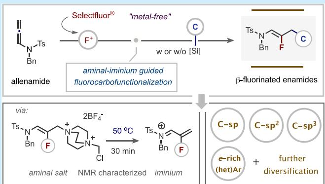
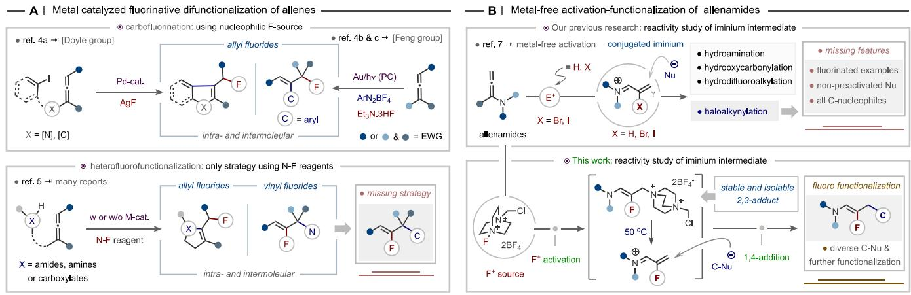
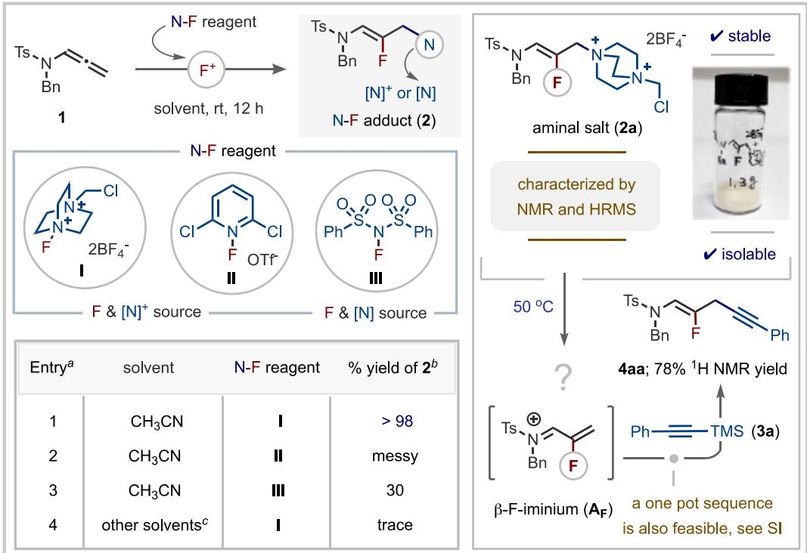
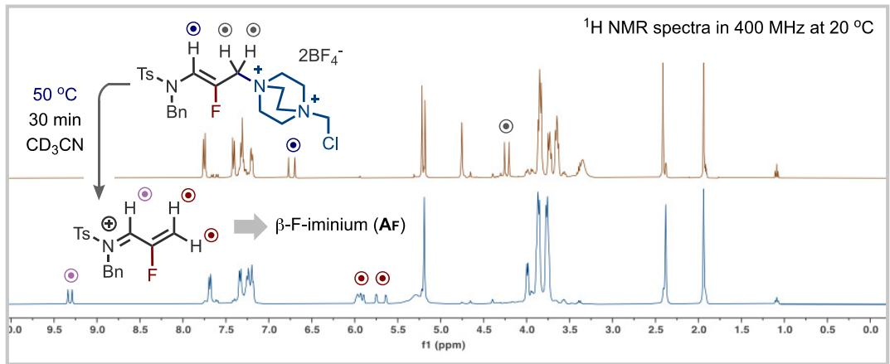
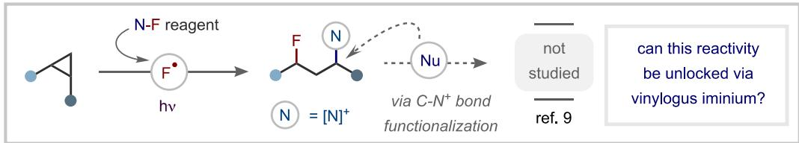
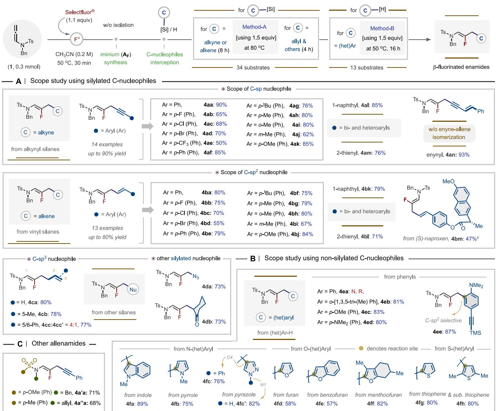
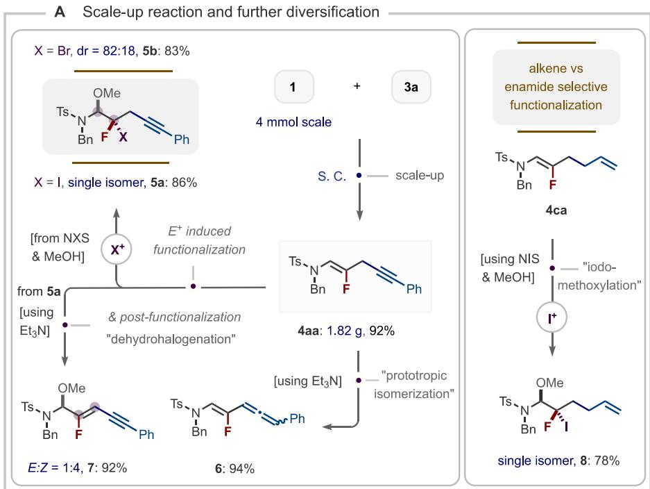
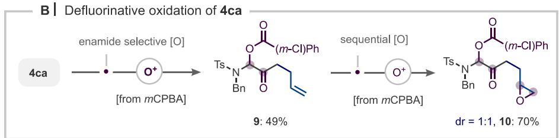

pubs.acs.org/OrgLett

Letter

# Stable Vinylogous Aminal Salt as a Reactive Synthon for the Synthesis of Homologated β‑Fluoroenamides

Hae Eun Lee,† Tapas R. Pradhan,† Youngsuk Kim, and Jin Kyoon Park\*

Cite This: Org. Lett. 2025, 27, 7342−7348

Read Online

## ACCESS

Metrics & More

ABSTRACT: Described herein is a versatile method in which allenamide and Selectfluor are eficiently combined to produce a stable and isolable vinylogous aminal salt. This innovative salt possesses the unique ability to irreversibly convert into a reactive iminium salt at 50 °C, as evidenced by NMR spectroscopy, serving as a synthon for the synthesis of homologated β-fluoroenamides. This metal-free approach accommodates a broad range of silylated C-nucleophiles across all hybridizations as well as electron-rich (hetero)aryls, with additional functionalization further showcasing its synthetic potential.

F luorine’s unique ability to influence the physical and biological characteristics of organic molecules has made its incorporation via C−F bond formation a fundamental approach in drug discovery.1 Among the various approaches, fluorinative functionalization of C−C π frameworks is a powerful strategy to enhance molecular complexity while simultaneously adding extra functionality.2 Specifically, carbofluorination reactions introduce both C−C and C−F bonds, orchestrating the simultaneous incorporation of molecular complexity alongside the fluorination step.3 While a plethora of methods emerged in recent years, only a handful of successful examples of such fluorinative difunctionalization of allenic frameworks have been reported.4,5 Reported examples showcase metal-bound aryl electrophiles as coupling carbon fragments, with fluorination terminated by F-nucleophiles in both intra- and intermolecular reactions to access allyl fluorides (top, Scheme 1A).

Alternative activation methods utilizing N−F reagents through radical and electrophilic mechanisms have also been reported that could engage allenes, specifically through heterofluorination reactions, notably, with no examples of Cnucleophile interception.5 These seminal contributions, however, in some cases, use a metal activator.5b,c Furthermore, the corresponding activation mode for selectively integrating both fluorine and carbon atoms into allenic bonds remains significantly underdeveloped, particularly in achieving compatibility across the diverse range of C-nucleophiles for vinyl fluoride synthesis (bottom, Scheme 1A).

Given the structural similarities between conjugated hydrogen and halo-iminium species, which serve as an ideal class of electrophiles for studying C-nucleophile addition, their fluorinated counterparts can be similarly anticipated through

Article Recommendations

\*sı Supporting Information

the use of a fluorinating reagent. To achieve selective carbofluorination, we aimed to extend our previous strategy, which involved trapping an iminium intermediate, activated by Brønsted acid and bromonium or iodonium reagents, intercepting various nucleophiles at distal C of allenamide (top, Scheme 1B).6 Notably, the halo-iminium-enabled alkynylation utilizes electronic cooperation with a neighboring halogen and N-electron-withdrawing groups (EWG) on the allene unit, exclusively engaging premetalated (zinc)-alkynyl species, for the synthesis of non-fluorinated ynenamides.6c However, previous carbofluorination attempts were unsuccessful, primarily due to the instability of the fluoro iminium intermediate. While optimizing conditions for intermediates, we successfully isolated a stable vinylogous aminal salt. This observation led us to envision that this stable iminium precursor could be as a versatile synthon for synthesizing homologated β-fluoroenamide, a largely underexplored class of compounds with significant synthetic potential.

Herein, we present a metal-free strategy for the carbofluorination of allenamides, enabling the eficient incorporation of diverse C-nucleophiles (bottom, Scheme 1B). Our study explores TMS-protected C(sp3, sp2, and sp) centers as well as electron-rich aryl and heteroaryl motifs as potential Cnucleophiles. This approach facilitates regio- and stereoselective formal fluoro-carbofunctionalization of allenamides under metal-free conditions.

Scheme 1. Inspiration for the Development of the Allenamide Carbofluorination  

We began our search for β-fluoroiminium species $\mathbf { A } _ { \mathrm { F } }$ by evaluating several N−F reagents with allenamide 1 (left, Scheme 2A). The fluorinating agents tested included 1- chloromethyl-4-fluoro-1,4-diazoniabicyclo[2.2.2]octane bis-(tetrafluoroborate) (Selectfluor, I), 2,6-dichloro-1-fluoropyridinium triflate (II), and N-fluorobenzenesulfonamide (NFSI, III). Interestingly, Selectfluor uniquely facilitated the exclusive formation of solid fluorinated DABCO (N−F) adduct 2a, which is characterized by its easy isolation and stability (right, Scheme 2A). However, attempts using reagents II and III were unsuccessful, likely due to the lower nucleophilicity of the pyridyl unit and imide anion compared to that of the DABCO unit in reagent I. This unique success can be attributed to Selectfluor’s specific compatibility with both the nucleophilicity of the cyclic amine and the electrophilicity of the iminium intermediate.8 It is worth mentioning to note here that a similar N−F (1,3)-adduct has been previously observed to form from strained cyclopropanes via the homolytic cleavage of N−F reagents (Scheme 2C).9 This strategy ofers notable advantages; however, investigating the reactivities of these closely related scafolds with other nucleophiles remains valuable, as only the SCN nucleophile was studied, and further nucleophilic substitution of the C−N+ bond was not explored.

In our standard procedure, Selectfluor (1.1 equiv) is added to a prestirred solution of compound 1a in acetonitrile (0.2 M) at room temperature for 12 h to furnish 2,3-fluoroamination adduct 2a in >98% 1H NMR yield (94% isolated by precipitation at $0 \ ^ { \circ } \mathrm { C } ,$ entry 1). The formation of adduct 2a is verified through 1H NMR spectroscopy, specifically by observing a doublet peak at δ = 4.24 ppm (resulting from H−F coupling) of the α-proton to the aminal unit (top 1H NMR, Scheme 2B). Notably, other solvents failed to produce any traces of the desired adducts (entry 4, Scheme 2A). For further functionalization studies, we determined the 2,3-adduct 2a with silylated alkyne 3a under various conditions (see the Supporting Information for details); the heating condition would enable us to observe the γ-alkynylation product in 78% 1H NMR yield. With this in mind, could the iminium species be the actual reactive species, isolable or detectable, as strongly suggested by the above results, with temperature modulation likely playing a key role? Indeed, adjusting the temperature to 50 °C could reflect such an idea: compound 2a undergoes full conversion to iminium salt $\mathbf { A } _ { \mathbf { F } }$ (Scheme 2B). This was subsequently subjected to careful characterization using NMR spectroscopy and ESI−HRMS; interestingly, this process is irreversible; once formed, iminium salt $\mathbf { A } _ { \mathrm { F } }$ remained as such and is stable at room temperature for a week (see details in the Supporting Information). We ascribed the observed behavior solely to the good leaving ability of the DABCO unit in compound 2a.

Following the detection of iminium ion formation, we initially explored its potential for regioselective C−C coupling reactions with a TMS−alkyne nucleophile, aiming to establish the feasibility of a metal-free protocol to complement a previously achieved method that requires a metallic Lewis acid activator.10 Indeed, simply incorporating trimethyl-(phenylethynyl)silanes (3a) enabled us to achieve the desired fluoroalkynylation product 4aa with a yield of 92% in MeCN. The notion of an electrophilic fluorination followed by Cnucleophile interception (via iminium $\mathbf { A } _ { \mathrm { F } } )$ of aminal salt 2a further prompted us to devise a streamlined one-pot sequential reaction that is amenable for easy diversification, as illustrated in Scheme 3. Precisely, the overall process initiates with the complete formation of the iminium adduct at 50 °C for 30 min, followed by nucleophile coupling at $8 0 ~ ^ { \circ } \mathrm { C }$ (method A) or at the same temperature (method B, vide infra). We propose that highly electrophilic iminium intermediate $\mathbf { A } _ { \mathrm { F } }$ is intercepted by a silyl carbon nucleophile through the formation of a β-silyl vinyl cation (in the case of alkynylation), which subsequently delivers the desired product via nucleophilic attack at the distal carbon of iminium intermediate $\mathbf { A } _ { \mathbf { F } } .$ 11 Furthermore, the Z selectivity of the product can be attributed to iminium intermediate $\mathbf { A } _ { \mathrm { F } }$ favoring the S-cis ground-state conformation over the trans isomer, as previously studied for Cl−iminium species.6c

With this optimized process, we first investigated the scope of the reaction with various TMS-protected C-nucleophiles (sp, sp2, and sp3), and the results are summarized in Scheme 3A. Our scope studies indicate that diferent substitution patterns on the aromatic unit of trimethyl(phenylethynyl)- silanes generally maintained reaction eficiency, regardless of their electronic, steric, or ring position (4aa−4ak) (top, Scheme 3A). Of note, EWGs at the para position of arylalkynylsilanes diminished the nucleophilicity of alkynyl carbon, afecting the reaction yield (4ab−4ae). In addition, TMSalkynes possesing multi-aromatics, naphthyl (4al) and thiophene-substituted heteroaryl alkyne (4am) both performed well with comparable yield and selectivity. Interest-

## Scheme 2. Optimization, Intermediate Detection, and Reaction Developmenta

A Optimization of detection of intermediates and reactivity study  

B | Temperature-dependent Identification of aminal and iminium salt  

C | Previous study related to the current research  
  
aUnless otherwise noted, optimization studies for the synthesis of compound 2a were carried out using 0.2 mmol of allenamide 1, N−F reagent (1.1 equiv), and solvent (0.2 M). bYields are determined by 1H NMR using CH Br as an internal standard. c1,2-Dichloroethane, dioxane, toluene, DMF, and EtOH were tested.

ingly, incorporation of additional conjugation through an olefinic bond was feasible (4an), remarkably, without any isomerization to allene.

We were pleased to find that the developed alkynylation conditions were also efective for incorporating the olefin unit, enabling the synthesis of a C-skeleton bearing a dienamide unit via metal-free fluoro-carbofunctionalization (middle, Scheme

3A). A study with various functional groups on (E)-aryl vinylsilanes showed compatibility for a range of functional groups at the para, meta, and ortho positions with diverse electronic properties (4ba−4bj). Both linear and fused biaryls (4be and 4bk) as well as the S-heterocycle, thiophene (4bl), were successfully accommodated, enabling the synthesis of conjugately distinct dienamides. Complex molecule modification was demonstrated by the coupling of a vinyl silane derivative of naproxen (4bm), a nonsteroidal anti-inflamma tory drug, further highlighting the synthetic versatility of this transformation.

Scheme 3. Scope of Fluoro-carbofunctionalization Reactionsa,b  
  
aUnless otherwise noted, all reactions were carried out in a one-pot sequential manner using 0.3 mmol of compound 1 and SelectFluor (0.33 mmol) in acetonitrile (0.2 M) at 50 °C for 30 min, and then TMS-protected carbon nucleophiles (0.45 mmol) were added to the reaction mixture under either condition A or B. bIsolated yields. cYield loss is due to the formation of the −NH(Ts)Bn byproduct, likely resulting from hydrolysis of intermediate A by residual water in the solvent, owing to the low reactivity of compound 3′m.

To further expand the scope of our fluoro-carbofunctionalization reaction through $\mathrm { C - \bar { C } ( \mathsf { s p } ^ { 3 } ) }$ bond formation, we next focused on using allyl trimethylsilanes (bottom left, Scheme 3A). Representative substrates include both unsubstituted and substituted internal and terminal olefins; while simple allyl and methallyl groups proved efective (4ca and 4cb), cinnamyltrimethylsilane produced two regioisomers in a 4:1 ratio, respectively, resulting from direct addition (4cc) and a Hosomi−Sakurai-type addition product (4cc′). Furthermore, we demonstrated that other silylated nucleophiles, such as silyl azides and silyl enol ethers, also coupled successfully with the same regioselectivity, furnishing the corresponding γ-azido and carbonylated fluoroenamides (4da and 4db) in a synthetically acceptable yield. Unfortunately, limitations arose with the cyano and thiocyano precursors, as they did not yield the desired products (see the Supporting Information for details on the limitations of other substrates).

Direct and site-selective C−H functionalization of native arenes is a practical approach for the development of new synthetic protocols. Thus, to demonstrate the synthetic applicability of the metal-free iminium-guided fluoro-carbofunctionalization using nonsilylated C-nucleophiles, electronrich aryl and heteroaryls were examined. Indeed, under slightly modified conditions, by lowering the temperature to $5 0 ~ ^ { \circ } \mathrm { C } ,$ which is the same with the iminium formation step, a variety of substrates successfully participated in this transformation (Scheme 3B). As expected, less nucleophilic arenes, such as benzene, failed to yield the desired product (4ea). However, we found that this lower reactivity could be counteracted by using the more nucleophilic arenes, such as mesitylene and Oand N-containing arenes, giving products 4eb−4ed in ≥80% yield. An interesting outcome was observed with the highly electron-rich arene, where ortho- and C-aryl-selective product 4ee was formed preferentially over the expected alkynylation product. In addition, site-selective installation of fluorinated enamides onto a variety of electron-rich N-, O-, and Sheteroarenes was remarkable given the easy and mild conditions under which the coupling occurred. For example, C3- and C2-monoselective functionalization of single-N-atombased heterocycles (indole and pyrrole) could be feasible (4fa and 4fb). A comparatively less nucleophilic heteroarene, such as pyrazole, could also be functionalized selectively, with the N−Ph-protected derivative (4fc) favoring C4 selectivity, while the unprotected form led to N-selective allylation (4fc′). Pleasingly, both parent and C3-protected furan derivatives proved to be excellent coupling partners, yielding only C2- functionalized products (4fd and 4fe). A fluorinated enamide unit was successfully installed into the pulegone metabolite menthofuran, a CYP2A6 inhibitor, furnishing product 4f in an excellent yield (82%). Finally, extension to use S-heterocycles with feasibility of selectively incorporating the enamide units at both C2 and C3 positions was likely with the strategic use of blocking units (for the latter), which made it accessible to products 4fg and 4fh in the same yield. Importantly, variations in N substituents of allenamide were also feasible, providing products 4a′a and 4a″a in comparable yields and with the same selectivity (Scheme 3C).

Scheme 4. Scale-Up and Synthetic Elaboration of Carbofluorination Productsa  

  
aExperimental details for the scale-up and subsequent transformations are available in the Supporting Information.

We subsequently explored the synthetic versatility of this method, as demonstrated in Scheme 4, showcasing diverse transformations to enhance the structural and functional complexity of β-fluorinated enamide derivatives. Initially, the process was scaled up to gram quantities for the synthesis of fluoroalkynylation product 4aa, achieving a satisfactory 92% isolated yield under the standard conditions. The series of transformations involving product 4aa includes the following: (1) halonium-induced difunctionalization of the enamide unit through halomethoxylation to obtain gem-dihalide N,O-acetals (5a and 5b), albeit with diastereoselectivity varying by halogen size (exclusive for I vs 82:18 for Br), (2) base-mediated prototopic isomerization to allene enamide 6, and (3) postfunctionalization of compound 5a to conjugated fluorinated enynes 7 through dehydrohalogenation (left, Scheme 4A).

Similarly, iodonium-induced highly chemoselective synthesis of gem-dihalogenated α-N,O-aminal 8 was achieved through enamide-selective iodomethoxylation of allylation product 4ca (right, Scheme 4A). Further transformations of the same product 4ca highlighted its synthetic potential, unveiling an unexpected defluorinative C−O bond formation that selectively synthesized product 9, the enamide-selective product, and a highly oxygenated C skeleton through excessive oxidation (10) (Scheme 4B). The first process is thought to proceed via the formation of an unstable hydroxy carboxylation adduct, which rapidly converts to defluorinated product 9.

In summary, we have established a novel fluoro-carbofunctionalization approach to synthesize γ-functionalized β- fluoroenamides from allenamides via a F+ activation pathway mediated by Selectfluor, leveraging a pivotal facile aminal salt− iminium conversion. The subsequent utilization of an iminium intermediate was demonstrated in coupling with a broad spectrum of C-nucleophiles across all hybridization classes, maintaining consistent regio- and stereoselectivities. Experimental evidence elucidated the precise reaction intermediates, while product elaboration highlighted the broad synthetic applicability of this method.

## ■ ASSOCIATED CONTENT

## Data Availability Statement

The data underlying this study are available in the published article and its Supporting Information.

## \*sı Supporting Information

The Supporting Information is available free of charge at https://pubs.acs.org/doi/10.1021/acs.orglett.5c02033.

Experimental procedures, compound characterization data, and NMR spectra (PDF)

## ■ AUTHOR INFORMATION

## Corresponding Author

Jin Kyoon Park − Department of Chemistry and Chemistry Institution for Functional Materials, Pusan National University, Busan 46241, Republic of Korea; orcid.org/ 0000-0001-6768-2788; Email: pjkyoon@pusan.ac.kr

## Authors

Hae Eun Lee − Department of Chemistry and Chemistry Institution for Functional Materials, Pusan National University, Busan 46241, Republic of Korea

Tapas R. Pradhan − Department of Chemistry and Chemistry Institution for Functional Materials, Pusan National University, Busan 46241, Republic of Korea; orcid.org/ 0000-0003-1480-7799

Youngsuk Kim − Department of Chemistry and Chemistry Institution for Functional Materials, Pusan National University, Busan 46241, Republic of Korea; orcid.org/ 0000-0002-7378-2301

Complete contact information is available at: https://pubs.acs.org/10.1021/acs.orglett.5c02033

## Author Contributions

†Hae Eun Lee and Tapas R. Pradhan contributed equally to this work.

## Notes

The authors declare no competing financial interest.

## ■ ACKNOWLEDGMENTS

This work was supported by a two-year research grant from Pusan National University.

## ■ REFERENCES

(1) For selected reviews, see (a) Wang, J.; Sánchez-Roselló, M.; Aceña, J. L.; del Pozo, C.; Sorochinsky, A. E.; Fustero, S.; Soloshonok, V. A.; Liu, H. Fluorine in Pharmaceutical Industry: Fluorine-Containing Drugs Introduced to the Market in the Last Decade (2001−2011). Chem. Rev. 2014, 114, 2432−2506. (b) Gillis, E. P.; Eastman, K. J.; Hill, M. D.; Donnelly, D. J.; Meanwell, N. A. Applications of Fluorine in Medicinal Chemistry. J. Med. Chem. 2015, 58, 8315−8359.

(2) For selected reviews, see (a) Liu, G. Transition Metal-Catalyzed Fluorination of Multi Carbon−Carbon Bonds: New Strategies for Fluorinated Heterocycles. Org. Biomol. Chem. 2012, 10, 6243. (b) Wolstenhulme, J. R.; Gouverneur, V. Asymmetric Fluorocyclizations of Alkenes. Acc. Chem. Res. 2014, 47, 3560−3570. (c) Wang, X.; Lei, J.; Liu, Y.; Ye, Y.; Li, J.; Sun, K. Fluorination and Fluoroalkylation of Alkenes/Alkynes to Construct Fluoro-Containing Heterocycles. Org. Chem. Front. 2021, 8, 2079−2109. (d) Zeng, Y.; Ni, C.; Hu, J. Recent Advances in the One-Step Synthesis of Distally Fluorinated Ketones. Chem. - Eur. J. 2016, 22, 3210−3223.

(3) For a recent review, see McKnight, E. A.; Cadwallader, D.; Le, C. M. Carbofluorination of π-Bonds and Related Reactions Involving Tandem C−C/C−F Bond Formation. Eur. J. Org. Chem. 2024, 27, No. e202300017. and see the references cited therein.

(4) For fluorinative difunctionalization of allenes using a nucleophilic F source, see (a) Braun, M.-G.; Katcher, M. H.; Doyle, A. G. Carbofluorination via a Palladium-Catalyzed Cascade Reaction. Chem. Sci. 2013, 4, 1216−1220. (b) Tang, H. J.; Zhang, X.; Zhang, Y. F.; Feng, C. Visible Light Assisted Gold Catalyzed Fluoroarylation of Allenoates. Angew. Chem., Int. Ed. 2020, 59, 5242−5247. (c) Zhang, F.; Ma, J. Regio- and Stereo-selective Vicinal Fluoroarylation of Allenoates. Chin. J. Org. Chem. 2020, 40, 1082−1083. (d) Li, Z. Q.; Tang, H. J.; Wang, Z.; Wang, C. Q.; Feng, C. Multi-substituted Trifluoromethyl Alkene Construction via Gold-Catalyzed Fluoroarylation of gem-Difluoroallenes. Chem. Sci. 2024, 15, 3524−3529.

(5) For fluorinative difunctionalization of allenes using N−F reagents, see (a) Cui, H.; Chai, Z.; Zhao, G.; Zhu, S. Facile Synthesis of Monofluoro γ-Lactones and Pyrrolidine Derivatives via Electrophilic Fluorination of Allenoic Acids and Amides. Chin. J. Chem. 2009, 27, 189−194. (b) Xu, T.; Mu, X.; Peng, H.; Liu, G. Silver-Catalyzed Intramolecular Aminofluorination of Activated Allenes. Angew. Chem., Int. Ed. 2011, 50, 8176−8179. (c) Zhang, G.; Xiong, T.; Wang, Z.; Xu, G.; Wang, X.; Zhang, Q. Highly Regioselective Radical Amination of Allenes: Direct Synthesis of Allenamides and Tetrasubstituted Alkenes. Angew. Chem., Int. Ed. 2015, 54, 12649. (d) Tiwari, V.; Bingham, J. T.; Vyas, S.; Singh, A. Intermolecular fluoroamination of allenes towards substituted vinyl fluorides. Org. Biomol. Chem. 2020, 18, 9044.

(6) (a) Pradhan, T. R.; Park, J. K. Intermediate Control: Unlocking Hitherto Unknown Reactivity and Selectivity in N-Conjugated Allenes and Alkynes. Acc. Chem. Res. 2025, 58, 281−298. (b) Pradhan, T. R.; Lee, H. E.; Gonzalez-Montiel, G. A.; Cheong, P. H.-Y.; Park, J. K. Highly Chemoselective Esterification from O-Aminoallylation of Carboxylic Acids: Metal- and Reagent-Free Hydrocarboxylation of Allenamides. Chem. - Eur. J. 2020, 26, 13826−13831. (c) Pradhan, T. R.; Paudel, M.; Harper, J. L.; Cheong, P. H.-Y.; Park, J. K. Characterization and Utilization of the Elusive α,β-Unsaturated N-Tosyliminium: The Synthesis of Highly Functionalizable Skipped Halo Enynes. Org. Lett. 2021, 23, 1427−1433. (d) Sagar, K.; Pradhan, T. R.; Farah, A. O.; Wise, H. R.; Merja, B. C.; Srimannarayana, M.; Cheong, P. H.-Y.; Park, J. K. General Hydroamination of Allenamides: Mechanistic Insights with an Acetate Adduct and 1,1,1,3,3,3- Hexafluoro-2-propanol. Org. Lett. 2023, 25, 5574−5578. (e) Pradhan, T. R.; Farah, A. O.; Sagar, K.; Wise, H. R.; Srimannarayana, M.; Cheong, P. H.-Y.; Park, J. K. Acetate Assistance in Regioselective Hydroamination of Allenamides: A Combined Experimental and Density Functional Theory Study. J. Org. Chem. 2024, 89, 5927− 5940. (f) Sagar, K.; Srimannarayana, M.; Teegala, R.; Merja, B. C.; Pradhan, T. R.; Park, J. K. Difluoroenoxysilane: Expanding Allenamide Hydrodifluoroalkylation for Diverse Carbon Frameworks. Org. Lett. 2024, 26, 5676−5681.

(7) (a) Taguchi, T.; Yanai, H. Fluorinated Moieties for Replacement of Amide and Peptide Bonds. In Fluorine in Medicinal Chemistry and Chemical Biology; Ojima, I., Ed.; Blackwell Publishing, Inc.: Hoboken, NJ, 2009; Chapter 10, pp 257−290, DOI: 10.1002/ 9781444312096.ch10. (b) Drouin, M.; Paquin, J.-F. Recent progress in the racemic and enantioselective synthesis of monofluoroalkenebased dipeptide isosteres. Beilstein J. Org. Chem. 2017, 13, 2637− 2658. (c) Drouin, M.; Wadhwani, P.; Grage, S. L.; Bürck, J.; Reichert,

J.; Tremblay, S.; Mayer, M. S.; Diel, C.; Staub, A.; Paquin, J.-F.; Ulrich, A. S. Monofluoroalkene-Isostere as a 19F NMR Label for the Peptide Backbone: Synthesis and Evaluation in Membrane-Bound PGLa and (KIGAKI) . Chem. - Eur. J. 2020, 26, 1511−1517.

(d) Drouin, M.; Arenas, J. L.; Paquin, J.-F. Incorporating a Monofluoroalkene into the Backbones of Short Peptides: Evaluating the Impact on Local Hydrophobicity. ChemBioChem 2019, 20, 1817− 1826. (e) Champagne, P. A.; Desroches, J.; Hamel, J.-D.; Vandamme, M.; Paquin, J.-F. Monofluorination of Organic Compounds: 10 Years of Innovation. Chem. Rev. 2015, 115, 9073−9174.

(8) (a) Singh, R. P.; Shreeve, J. M. Recent Highlights in Electrophilic F l u o r i n a t i o n w i t h 1 - C h l o r o m e t h y l - 4 - fl u o r o - 1 , 4 - diazoniabicyclo[2.2.2]octane Bis(tetrafluoroborate). Acc. Chem. Res. 2004, 37, 31−44. (b) Nyffeler, P. T.; Durón, S. G.; Burkart, M. D.; Vincent, S. P.; Wong, C.-H. Selectfluor: Mechanistic Insight and Applications. Angew. Chem., Int. Ed. 2005, 44, 192−212.

(9) Pitts, C. R.; Ling, B.; Snyder, J. A.; Bragg, A. E.; Lectka, T. Aminofluorination of Cyclopropanes: A Multifold Approach through a Common, Catalytically Generated Intermediate. J. Am. Chem. Soc. 2016, 138, 6598−6609.

(10) (a) Xu, Y.; Pan, Y.; Liu, P.; Wang, H.; Tian, X.; Su, G. Indium(III) Chloride Catalyzed Conjugate Addition Reaction of Alkynylsilanes to Acrylate Esters. J. Org. Chem. 2012, 77, 3557−3562.

(b) Jaiswal, A. K.; Goh, K. K. K.; Sung, S.; Young, R. D. Aluminum-Catalyzed Cross-Coupling of Silylalkynes with Aliphatic C−F Bonds. Org. Lett. 2017, 19, 1934−1937.

(11) Rubial, B.; Ballesteros, A.; González, J. M. Silylium-Catalysed Alkynylation and Etherification Reactions of Benzylic Acetates. Eur. J. Org. Chem. 2022, 2022, No. e202200051.