pubs.acs.org/OrgLett

Letter

# Exploring Pd-Catalyzed Hydrocarbation of Allenes: Focusing on Propa-1,2-diene for the Isopropenylation of $\mathsf { C } ( \mathsf { s p } ^ { 2 } )$ Halides

Louis Perrault, Romain Magny, Lucas Pages,̀ Rayane Mekerri, Clément Burgevin, Damien Cordeau, and Emmanuel Roulland\*

Cite This: Org. Lett. 2025, 27, 11332−11337

Read Online

## ACCESS

Metrics & More

ABSTRACT: The operatively simple Pd-catalyzed allene hydrocarbation described here uses $\mathrm { H } \mathrm { \bar { C } O } _ { 2 } \mathrm { N a }$ and produces innocuous $\mathrm { C O } _ { 2 }$ and sodium halide, and pure coupling products are isolated via water/ether extraction in most cases. This new transformation displays a broad $\mathrm { C } \left( \mathrm { s p } ^ { 2 } \right)$ halide scope, functional group tolerance, and good to excellent yields and allows inexpensive selective deuteration. Pd loadings of 0.10 mol % remain efective, and gram-scale reactions were conducted. The protocol extends to O-, N-, Si-, and C-substituted allenes, demonstrating its versatility.

Article Recommendations

\*sı Supporting Information

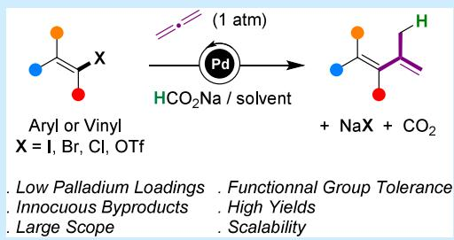

T he Heck coupling is a widely used method enablingC(sp2) halides to react with diverse alkenes under Pd catalysis mostly.1 The catalytic cycle involves a β-hydride elimination, restoring an unsaturation, but if a hydride donor is added, concurrent hydride transfer occurs, leading to saturated products. This hydrocarbation or reductive Heck allows enantioselective cyclization (Scheme 1a);2 in total syntheses,3

Scheme 1. Reductive Heck, Applications, and Our Work  
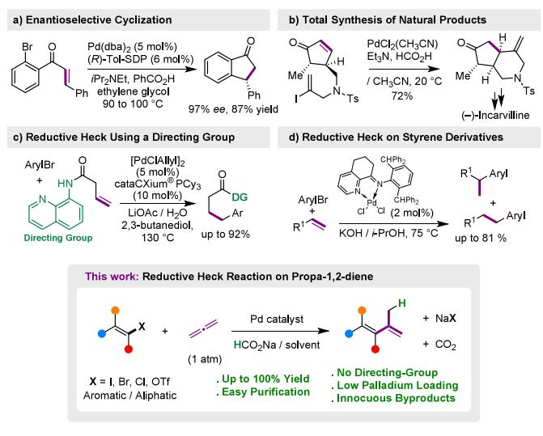

it permitted ring closures of (−)-incarvilline (Scheme 1b),4 sesterstatins,5 menogaril, and nogalamycin.6 Sometimes, competing dehalogenation prevails over carbopalladation as in the case of the synthesis of (±)-aspidophylline A.7 However, competing β-hydride elimination, dehalogenation, and regioselectivity issues make the intermolecular reductive Heck approach challenging. Eficient and regioselective transformations were achieved however with alkenes bearing Pd-chelating groups (Scheme 1c),8 styrenes9 (Scheme 1d), norbornenes,10 allyl alcohols,11 and alkynes,12 but unbiased alkenes generally exhibit incomplete regioselectivity.9,11 Our previous study on allene−alkyne cross-coupling13 led us to appreciate the rich reactivity of allenes and their utility in total synthesis.14,15 Allenes are competent in Heck reactions;16−18 however, reductive Heck of allenes is notably absent from the literature. Here, we explore this uncharted territory and show that prop-1,2-diene enables a practical method of isopropenylation of C(sp2) halides. Since more than 16 000 prop-1-en-2-ylcontaining molecules are described, notably natural product s19−22 (Scheme 2) and pharmaceutical drugs, new methods for introducing the prop-1-en-2-yl group from C(sp2) halides are highly desirable, especially if they are more atomeconomical or environmentally friendly than traditional cross-couplings (Suzuki−Miyaura, Stille, or Negishi). First,

Scheme 2. Some Prop-1-en-2-yl-Bearing Natural Products  
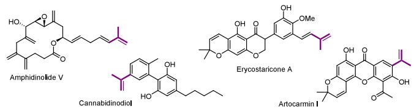

Received: September 1, 2025   
Revised: September 22, 2025   
Accepted: September 24, 2025   
Published: September 30, 2025

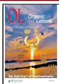

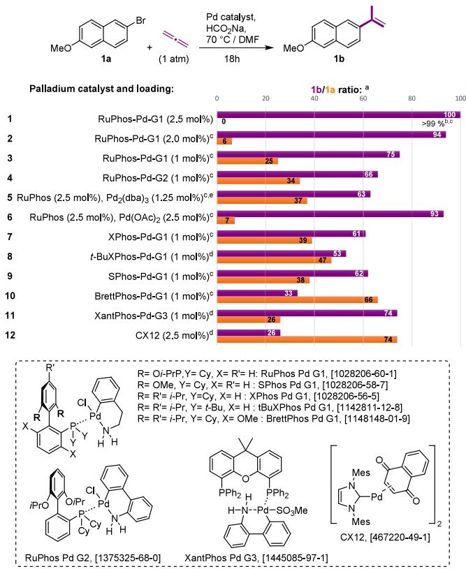

we imagined that Heck−Jefery-like conditions could be implemented23 by simply adding HCO2Na as a hydride donor. The reaction was carried out at $6 0 ~ ^ { \circ } \mathrm { C }$ under 1.0 bar of propa-1,2-diene, with HCO Na (1.2 equiv), $\mathrm { P d } _ { 2 } ( \mathrm { d b } \mathsf { a } ) _ { 3 }$ (3 mol %), and $\mathrm { B u _ { 4 } N B r }$ (1.0 equiv), in degassed dry DMF, and 2- bromo-6-methoxynaphthalene 1a was used as the model substrate (Table 1, entry 1). After 18 h, the 1H NMR

Table 1. First Trials of Reductive Heck on Propa-1,2-dienea  
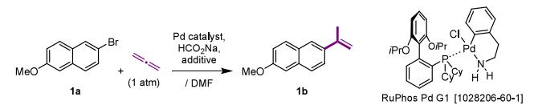

<table><tr><td></td><td>catalyst</td><td>HCO2Na (equiv)</td><td>additive</td><td>conditions: time, temperature, and 1b/1a ratiob</td></tr><tr><td>1</td><td> $\mathrm { P d } _ { 2 } ( \mathrm { d b } \mathsf { a } ) _ { 3 }$   $3 \mathrm { ~ m o l ~ } \%$ </td><td>1.2</td><td>Bu4NBr, 1.0 equiv</td><td> $1 8 \mathrm { ~ h ~ } , 6 0 \mathrm { ~ } ^ { \circ } \mathrm { C }$   $2 0 { : } 8 0 ^ { d }$ </td></tr><tr><td>2</td><td> $\mathrm { P d } _ { 2 } ( \mathrm { d b } \mathsf { a } ) _ { 3 }$  3 mol %</td><td>3.0</td><td>Bu4NBr, 3.0 equiv</td><td> $1 8 \mathrm { ~ h ~ } , 6 0 \mathrm { ~ } ^ { \circ } \mathrm { C }$   $4 3 { : } 5 7 ^ { d }$ </td></tr><tr><td>3</td><td> $\mathrm { P d C l } _ { 2 } ( \mathrm { d p p f } )$   $5 \mathrm { \ m o l \ \% }$ </td><td>3.0</td><td>no</td><td> $1 8 \mathrm { ~ h ~ } , 7 0 \mathrm { ~ } ^ { \circ } \mathrm { C }$   $7 4 { : } 2 6 ^ { d }$ </td></tr><tr><td>4</td><td>RuPhos-Pd-G1 2.5 mol %</td><td>3.0</td><td>no</td><td> $1 8 \mathrm { ~ h ~ } , 7 0 \mathrm { ~ } ^ { \circ } \mathrm { C }$   $1 0 0 { : } 0 , > 9 9 \% ^ { c , d }$ </td></tr></table>

aWith 0.5 mmol of 1a in degassed DMF. bFrom the 1H NMR experiment on the crude reaction mixture. cIsolated yield. $^ { d } \mathrm { N o }$ byproduct detected.

spectrum shown a clean crude reaction mixture made of 1a and expected 2-methoxy-6-(prop-1-en-2-yl)-naphthalene 1b in an unfavorable 80:20 ratio. This initial encouraging result demonstrated the feasibility of reductive Heck on an allene, moreover, in an intermolecular fashion. The absence of detectable byproducts hinted at the possibility of efective improvements. Increasing the amounts of $_ \mathrm { H C O } _ { 2 } \mathrm { N a }$ and Bu NBr resulted in a 43:57 1b/1a ratio (entry 2). However, catalyst degradation into Pd black limited conversion; therefore, stabilizing phosphine ligands were used. PdCl (dppf) (entry 3) gave a favorable 74:26 1b/1a ratio, even if Pd black formation hindered reaching completion. Highly active RuPhos-Pd-G124 was then employed (entry 4), resulting in a spectacular improvement; only 1b was detected in a very clean crude reaction mixture, achieving a quantitative yield. Lower RuPhos-Pd-G1 catalyst loadings were tested (Table 2, entries 2 and 3), with 2 mol % completion being no longer reached over 18 h at $7 0 \ ^ { \circ } \mathrm { C } ,$ and 1 mol % gave a 75:25 1b/1a ratio. With incomplete conversion of 1a being shown, these “at the limit conditions” were harnessed to detect an eventual more eficient catalyst. Other RuPhos-based systems, such as RuPhos-Pd-G2 or RuPhos $/ \mathrm { P d } _ { 2 } ( \mathrm { d b } \mathsf { a } ) _ { 3 }$ (Table 2, entries 4 and 5), gave similar ≈65:35 1b/1a ratios. The $\mathrm { P d } ( \mathrm { O A c } ) _ { 2 } /$ RuPhos combination gave results similar to those of reference conditions, featuring a cheaper alternative (entry 6). XPhos-Pd-G1, t-BuXPhos-Pd-G1, and SPhos-Pd-G1 (entries 7−9) yielded similar 1b/1a ratios from 60:40 to 50:50. With BrettPhos-Pd-G1, the 1b/1a ratio dropped to 33:66 (entry 10), while XantPhos-Pd-G3 gave results similar to reference conditions (entry 11). Carbene-liganded Pd catalyst CX12 allowed only partial conversion with a 26:74 1b/1a ratio, even at 5 mol % (entry 12), with unidentified byproducts also forming. This series of experiments led us to retain RuPhos-Pd-G1 to further explore this transformation.

Table 2. Palladium Ligand Optimization  
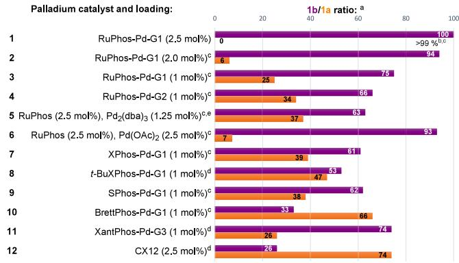  
aDetermined by 1H NMR on the crude reaction mixture. bIsolated yield. cNo byproduct detected. dNon-defined byproducts formed. ePd black formation.

Variation around the hydride source was explored: Using 1.3 equiv of $_ \mathrm { H C O } _ { 2 } \mathrm { N a }$ instead of 3.0 still allowed completion to be reached (Table 3, entry 2). Replacing HCO Na by $\mathrm { H C O } _ { 2 } \mathrm { N H } _ { 4 }$ or the water−B (OH) couple25 proved unsatisfactory (Table 3, entries 3 and 4). Replacing DMF by THF or MeCN or adding heptane or water to DMF to tune propa-1,2-diene solubility (entries 5−8) gave lower conversions. At 100 ${ } ^ { \circ } \mathrm { C } ,$ the reaction reaches completion in less than 3 h (entry 9) even on a 2.00 g scale at 1.0 mol % RuPhos-Pd-G1 (entry 10). Full conversion was maintained at 0.5 mol % (240 mg scale, 18 h, entry 11), and 95% conversion was reached at 0.1 mol % on a 473 mg scale over 22 h (entry 12), underscoring the eficiency of the reaction. With DCO Na (entry 13), regioselective deuteration at the allylic methyl group confirmed that the formate anion is indeed the source of hydride and that no hydrogen atom scrambling occurred. This provides an easy and cost-efective approach to accessing deuterated molecules, which hold significant practical value, for instance, in medicinal applications.26 Note that compound 1b is a potential synthetic intermediate toward naproxene.27

Table 3. Variation around Established Eficient Conditions  
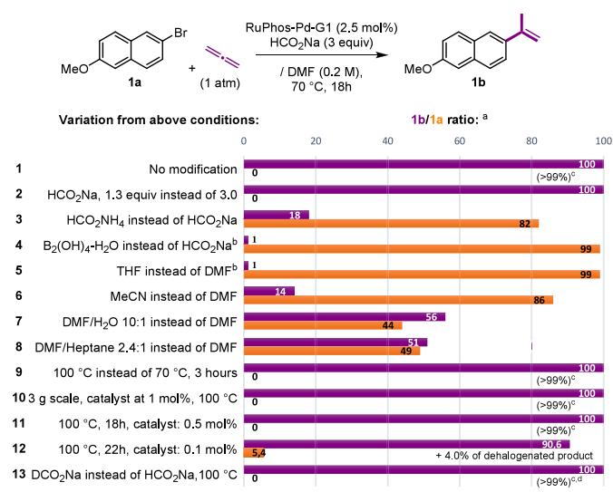  
aDetermined by 1H NMR on the crude reaction mixture. bCarried out on 3,4-methylidenedioxy-bromobenzene. cIsolated yield. $^ d \mathrm { A }$ >99% D incorporation at the allylic position of 1bD.

We explored variations around the nature of aryl halide and extended the study to vinyl halides using the following conditions: propa-1,2-diene (1 bar), RuPhos-Pd-G1 (2.5 mol %), and HCO Na (3.0 equiv) in DMF at $1 0 0 ~ ^ { \circ } \mathrm { C }$ . Electron-rich methoxy-substituent aryl bromides gave desired products 1b, 2b, 3b, and 4b (Scheme 3) eficiently. Non-protected phenol 7a gave 7b quantitatively. While 2-bromonaphthalene 11a gave 11b quantitatively, 1-bromonaphthalene 12a led to a 76:24 12b/naphthalene mixture. However, replacing RuPhos by XantPhos decreased dehalogenation to 5%, but 1-allylnaph thalene formed (6%), issuing from an alternative carbopalladation regioselectivity. With 2-bromobenzonitrile 6a, expected 6b was obtained along with 20% of benzonitrile, XantPhos suppressed dehalogenation, but 2-allylbenzonitrile formed (15%). Hindered 15a achieved partial conversion into 15b accompanied with the corresponding dehalogenated product, and 15c featuring an unexpected double propenylation. Non protected alcohol has no impact as 9b formed in a good yield without the corresponding cyclization product, while compet ing cyclization took place with 13a, featuring a carboxylic acid adjacent to the leaving halogen, proving the existence of a π- allyl palladium intermediate. Free amide in 2-bromobenzamide 5a led to no lactam, and only amide 5b was isolated. These reductive conditions are mild and selective enough to leave benzyl or 2-naphthyl protecting groups or even nitro groups intact, with 16b, 2b, and 22b forming in good yields. With 5- bromoindol 10a, the reaction gave mediocre yields of 10b. Aurone 14b could be obtained from $\mathbf { 1 4 a } ^ { 2 8 }$ in 60% yield, proving that the sulfur atom is tolerated. Aryl iodides proved competent as well. Electron-rich 18b was isolated in a high yield, and phenol 19b was obtained in a yield of 74% but remained contaminated by 5% of the dehalogenation by product. With boronic acids remaining inert toward crosscoupling under pH-neutral conditions, (4-iodophenyl)boronic acid 23a could be selectively transformed into 23b. Ketones proved compatible, with 20b forming quantitatively. With iodinated substrates, Pd black formation was never observed, with iodide anions apparently acting as catalyst protection. We exploited this protective efect with bromophenanthrene 8a, which without NaI addition, use to give a 64:36 mixture of 8b and phenanthrene 8c with rapid Pd black formation. Adding 1 equiv of NaI delayed catalyst degradation but only slightly improved the 8b/8c ratio to 76:24. Replacing RuPhos with XantPhos completely suppressed dehalogenation, yielding 8b quantitatively. Electro-poor derivative 24a gave a 66:33 ratio of 24b/deiodinated 24c, and XantPhos allowed no improvement; however, using less HCO Na (2 equiv) under higher propa-1,2-diene pressure (2−3 bar) allowed the ratio to increase to 80:20. Aryl chlorides reacted quickly but with competing

Scheme 3. Substrate Scope Exploration

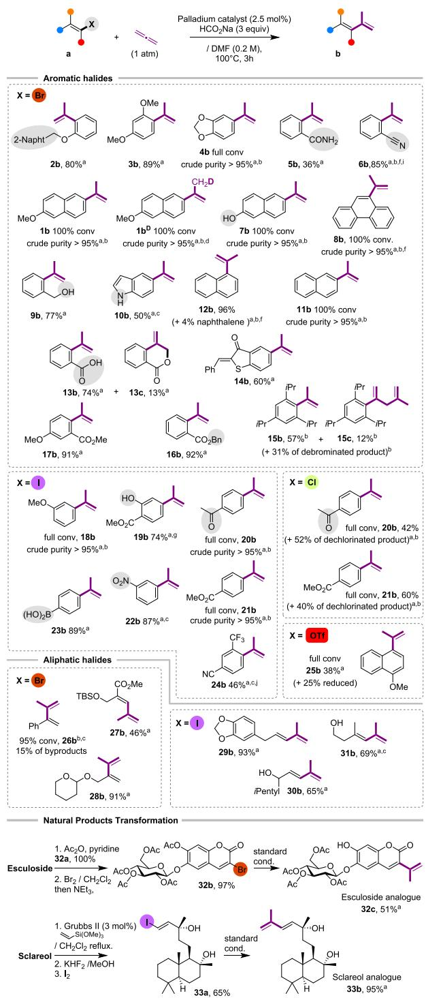  
aIsolated yield. bDetermined by 1H NMR. cVolatile. dDCO Na instead of HCO Na. eA total of 1 equiv of NaI was added. fXantPhos-Pd-G3 instead of RuPhos-Pd-G1. gContaminated with 5% methyl salicylate. hContaminated with 5% methyl 3-methoxybenzoate. iContaminated with 15% 2-allylbenzonitrile. jHCO Na (2 equiv) and propa-1,2-diene (2−3 bar).

dehalogenation, with ketone 20b and ester 21b being contaminated with ≈50% of dehalogenated products. With Chloro-20a using RuPhos with NaI, no conversion occurred, while Iodo-20a reacted cleanly and quantitatively. Chloro-20a proved poorly reactive by using XantPhos (≈1% of 20b formed). Similar observations were made with Chloro-21a.

Aryl triflates proved reactive under our conditions but also with important dehalogenation levels, even with XantPhos and NaI, with 25b coming along with 45% of the dehalogenated product.

Vinyl halides proved to be competent substrates, giving dienes with configuration retention. Compounds 29a, 30a, and 31a were prepared according to a one-pot three-step procedure developed in the lab.15 Functionalization of the complex structures of natural products proved to be eficient. Brominated esculoside 32b, a glycosylated coumarin, was converted into its analogue 32d, and iodinated sclareol 33a, a diterpene, was transformed into diene 33b in 95% yield.

Substituted allenes also proved competent, highlighting the versatility of our method, albeit regioselectivity issues appeared. C-substituted allene hexa-4,5-dien-1-ol (Scheme 4)

Scheme 4. Examples Involving Substituted Allenes  
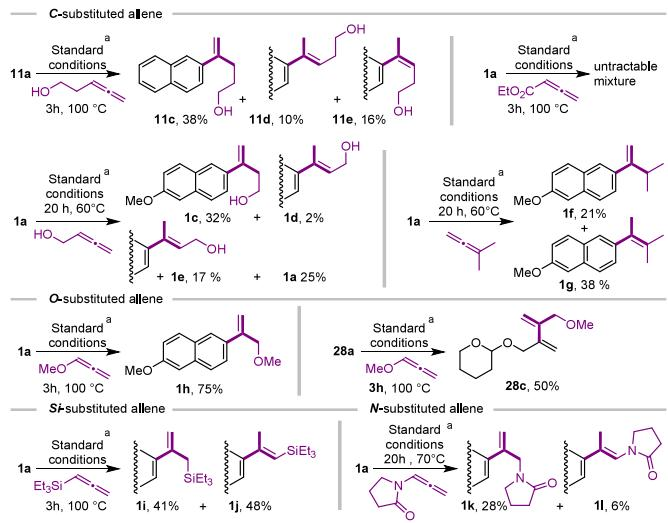  
aRuPhos-Pd-G1 (2.5 mol %) and HCO Na/DMF.

reacted with 11a, afording a mixture of exo-methylene 11c along with E and Z endo derivatives 11d and 11e (≈50:50, 63%). Bromide 1a reacted with buta-2,3-dien-1-ol, giving isomers ${ \bf 1 c , }$ 1d, and 1e. Congested 3-methylbuta-1,2-diene reacted with 1a, giving isomers 1f and $\mathbf { 1 } \mathbf { g }$ and the dehalogenation product. Methoxyallene, reacted with ${ \bf 1 } \mathbf { a } ,$ giving exo-methylene isomer 1h selectively (75% yield). With the opposite electronic efect displayed, ethyl buta- $^ { \cdot 2 , 3 }$ -dienoate gave an intractable reaction mixture. Si-substituted allenes proved eficient coupling partners, as with 1a, triethyl(propa-1,2-dien-1-yl)silane gave inseparable 1i and 1j (≈45:55, 89%). N-substituted allenes, such as 1-(propa-1,2-dien-1-yl)- pyrrolidin-2-one, are possible substrates, with 1k being isolated in 28% yield along with its enamide isomer 1l (6%) and the dehalogenation product. The regioselectivity observed with the substituted allenes studied here appears to be mainly governed by steric factors, as in the case of products 11c−11e, 1c−1e, 1f, 1g, 1i, and 1j. In contrast, O- and N-substituted allenes, such as 1-methoxypropa-1,2-diene and 1-(propa-1,2- dien-1-yl)pyrrolidin-2-one, display complete or nearly complete regioselectivity, which can be attributed to electronic efects. These encouraging results open new possibilities for the transformation of substituted allenes. Further investigations will focus on improving regioselectivity and minimizing the competing dehalogenation pathway.

In a plausible mechanism (Scheme $5 ) ,$ , the oxidative addition of $\mathrm { P d } ^ { 0 } \hat { \mathrm { L } } _ { \mathrm { n } }$ I leads to $\mathrm { P d } ^ { \mathrm { I I } } \mathbf { I I } ,$ and then allene interacts with this π-

## Scheme 5. Proposed Reaction Mechanism

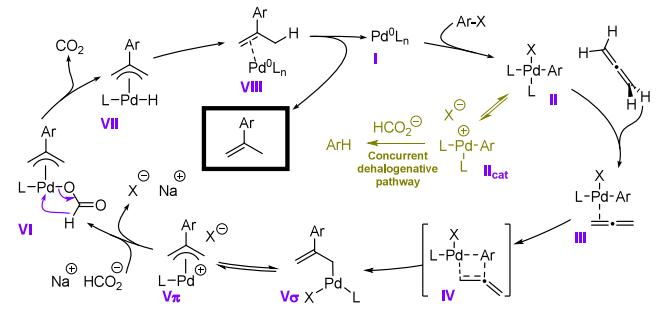

philic complex, which through IV leads to σ-allyl−Pd complex $\mathbf { V } _ { \sigma }$ (in equilibrium with cationic $\pi { \mathrm { - a l l y l { - P d } ~ } } \mathbf { V } _ { \pi } )$ . The formate anion then bonds $\mathrm { P d } ^ { \mathrm { I I } }$ of $\mathbf { V } _ { \pi } ,$ giving VI, within which hydride transfer occurs releasing $\mathrm { C O } _ { 2 } ^ { 3 0 }$ and hydrido π-allyl−Pd VII. Final reductive elimination regenerated $\mathrm { \ P d ^ { 0 } L _ { n } }$ and released the product. Selective deuteriation experiments leading to $\mathbf { 1 6 ^ { D } }$ (Scheme 3) and the formation of lactone 13c from carboxylate 13a both support this mechanism.

To conclude, we reported the first example of a reductive Heck reaction involving allenes. The eficiency of this transformation stems from the strong afinity of allenes for π-philic $\mathrm { P d } ^ { \mathrm { I I } }$ complexes, which in conjunction with the Ruphos ligand suppresses the competing dehalogenation pathway in most cases. Moreover, the use of wide-bite-angle bisphosphine XantPhos efectively prevents recalcitrant dehalogenation with certain substrates, providing valuable insight into strategies for suppressing this side reaction. Using propa-1,2-diene, we developed a mild, high-yielding method to install a prop-1-en-2-yl group across 35 examples, including multigram-scale reactions and natural product functionalization. Both aryl and vinyl bromides and iodides are competent, but with aryl triflates and chlorides, dehalogenation could not be suppressed. Deuterated analogues are easily accessible, and $\mathrm { C } \mathrm { \cdot , O } \mathrm { \cdot , N } .$ , and Si-substituted allenes also proved competent coupling partners. By exploring uncharted territory, this study further enriches the synthetic role of allenes, expands the Pd catalysis scope, and provides a new strategy for the construction of complex molecules.

## ■ ASSOCIATED CONTENT

## Data Availability Statement

The data underlying this study are available in the published article and its online Supporting Information.

## \*sı Supporting Information

The Supporting Information is available free of charge at https://pubs.acs.org/doi/10.1021/acs.orglett.5c03623.

Experimental procedures, spectroscopic data, and copies of 1H and $^ { 1 3 } \dot { \mathrm { C } }$ NMR spectra (PDF)

## ■ AUTHOR INFORMATION

## Corresponding Author

Emmanuel Roulland − CITCOM-UMR-8038 CNRS/ Université Paris Cité, Faculté de Pharmacie, 75006 Paris, France; orcid.org/0000-0002-8012-7946; Email: emmanuel.roulland@parisdescartes.fr

## Authors

Louis Perrault − CITCOM-UMR-8038 CNRS/Université Paris Cité, Faculté de Pharmacie, 75006 Paris, France

Romain Magny − Laboratoire de Toxicologie, AP-HP, Hôpital Lariboisiere, ̀ 75010 Paris, France; Université Paris-Cité, INSERM, Optimisation Thérapeutique en Neuropharmacologie OTEN-U1144, 75006 Paris, France

Lucas Pages̀ − CITCOM-UMR-8038 CNRS/Université Paris Cité, Faculté de Pharmacie, 75006 Paris, France

Rayane Mekerri − CITCOM-UMR-8038 CNRS/Université Paris Cité, Faculté de Pharmacie, 75006 Paris, France

Clément Burgevin − CITCOM-UMR-8038 CNRS/ Université Paris Cité, Faculté de Pharmacie, 75006 Paris, France

Damien Cordeau − CITCOM-UMR-8038 CNRS/Université Paris Cité, Faculté de Pharmacie, 75006 Paris, France

Complete contact information is available at: https://pubs.acs.org/10.1021/acs.orglett.5c03623

## Author Contributions

All authors have given approval to the final version of the manuscript.

## Notes

The authors declare no competing financial interest.

## ■ ACKNOWLEDGMENTS

The authors acknowledge the CNRS and the Université Paris-Cité for financial and technical support. The authors are grateful to Prof. Ludovic Jean and Alexandre Potfer for insightful discussions (UMR 8038 CNRS). The authors warmly thank Dr. Raphael Grougnet (UMR 8038 CNRS) for providing naturally occurring coumarins.

## ■ REFERENCES

(1) (a) Beletskaya, I. P.; Cheprakov, A. V. The Heck Reaction as a Sharpening Stone of Palladium Catalysis. Chem. Rev. 2000, 100, 3009−3066. (b) Nicolaou, K. C.; Bulger, P. G.; Sarlah, D. Palladium-Catalyzed Cross-Coupling Reactions in Total Synthesis. Angew. Chem., Int. Ed. 2005, 44, 4442−4489.

(2) Yue, G.; Lei, K.; Hirao, H.; Zhou, J. S. Palladium-Catalyzed Asymmetric Reductive Heck Reaction of Aryl Halides. Angew. Chem., Int. Ed. 2015, 54, 6531−6535.

(3) For a review, see Ghosh, T. Reductive Heck Reaction: An Emerging Alternative in Natural Product Synthesis. Chem. Select 2019, 4, 4747−4755.

(4) Ichikawa, M.; Takahashi, M.; Aoyagi, S.; Kibayashi, C. Stereoselective Total Synthesis of Natural (+)-Streptazolin via a Palladium-Catalyzed Enyne Bicyclization Approach. J. Am. Chem. Soc. 2004, 126, 16553−16558.

(5) Fan, W.-Y.; Wang, Z.-L.; Li, H.-C.; Fossey, J. S.; Deng, W.-P. A straightforward and efficient synthetic access to biologically active marine sesterterpenoids, sesterstatins 4 and 5. Chem. Commun. 2011, 47, 2961−2963.

(6) Peng, R.; VanNieuwenhze, M. S. A Model Study for Constructing the DEF-Benzoxocin Ring System of Menogaril and Nogalamycin Via a Reductive Heck Cyclization. Org. Lett. 2012, 14, 1962−1965.

(7) Ren, W.; Wang, Q.; Zhu, J. Total Synthesis of (±)-Aspidophylline A. Angew. Chem., Int. Ed. 2014, 53, 1818−1821.

(8) Zheng, K.; Xiao, G.; Guo, T.; Ding, Y.; Wang, C.; Loh, T.-P.; Wu, X. Intermolecular Reductive Heck Reaction of Unactivated Aliphatic Alkenes with Organohalides. Org. Lett. 2020, 22, 694−699.

(9) Jin, L.; Qian, J.; Sun, N.; Hu, B.; Shen, Z.; Hu, X. Pd-Catalyzed Reductive Heck Reaction of Olefins with Aryl Bromides for C(sp2)− C(sp3) Bond Formation. Chem. Commun. 2018, 54, 5752−5755.

(10) (a) Wei, Z.-L.; George, C.; Kozikowski, A. P. Synthesis of 5- Endo-, 5-Exo-, 6-Endo- and 6-Exo-Hydroxylated Analogues of Epibatidine. Tetrahedron Lett. 2003, 44, 3847−3850. (b) Wu, X.-Y.; Xu, H.-D.; Zhou, Q.-L.; Chan, A. S. C. Enantioselective Heck-Type Hydroarylation of Norbornene with Phenyl Iodide Catalyzed by Palladium/Quinolinyl-Oxazolines. Tetrahedron: Asymmetry 2000, 11, 1255−1257.

(11) Gurak, J. A., Jr.; Engle, K. M. Practical Intermolecular Hydroarylation of Diverse Alkenes Via Reductive Heck Coupling. ACS Catal. 2018, 8, 8987−8992.

(12) Cacchi, S.; Felici, M.; Pietroni, B. The Palladium-Catalyzed Reaction of Aryl Iodides with Mono and Disubstituted Acetylenes: A New Synthesis of Trisubstituted Alkenes. Tetrahedron Lett. 1984, 25, 3137−3140.

(13) Jeanne-Julien, L.; Masson, G.; Kouoi, R.; Regazzetti, A.; Genta-Jouve, G.; Gandon, V.; Roulland, E. Stereoselective Access to (E)-1,3- Enynes through Pd/Cu-Catalyzed Alkyne Hydrocarbation of Allenes. Org. Lett. 2019, 21, 3136−3141.

(14) Jeanne-Julien, L.; Masson, G.; Astier, E.; Genta-Jouve, G.; Servajean, V.; Beau, J.-M.; Norsikian, S.; Roulland, E. Synthesis of a Tiacumicin B Protected Aglycone. Org. Lett. 2017, 19, 4006−4009.

(15) Christin, O.; Roulland, E. Advancements in Enacyloxins Total Synthesis: Access to the Chlorinated Polyunsaturated Chain Peculiar to this Promising Family of Antibiotics. Org. Lett. 2023, 25, 6869− 6874.

(16) Vine, L. E.; Schomaker, J. M. Pd-Catalyzed Heck-Type Reactions of Allenes for Stereoselective Syntheses of Substituted 1,3- Dienes. Chem. - Eur. J. 2022, 28, No. e202103507.

(17) Dondas, H. A.; Hempshall, A.; Narramore, S.; Kilner, C.; Fishwick, C. W. G.; Grigg, R. γ-Carboline AC190 Analogues Via Palladium-Catalysed Allene Insertion Stereo- and Regioselective 3- and 5-Component Cascades. Tetrahedron 2016, 72, 1316−1329.

(18) Larock, R. C.; Varaprath, S.; Lau, H. H.; Fellows, C. A. Synthesis of Isocoumarins Via Thallation-Olefination of Benzoic Acids. J. Am. Chem. Soc. 1984, 106, 5274−5284.

(19) Kubota, T.; Tsuda, M.; Kobayashi, J. Amphidinolide V, Novel 14-Membered Macrolide from Marine Dinoflagellate Amphidinium sp. Tetrahedron Lett. 2000, 41, 713−716.

(20) Tanaka, H.; Hattori, H.; Oh-Uchi, T.; Sato, M.; Yamaguchi, R.; Sako, M.; Tateishi, Y. Two New Isoflavanones from Erythrina costaricensis. J. Asian Nat. Prod. Research 2008, 10, 983−987.

(21) Vree, T. B.; Breimer, D. D.; Van Ginneken, C. A. M.; Van Rossum, J. M. Gas Chromatography of Cannabis Constituents and their Synthetic Derivatives. J. Chromatography A 1972, 74, 209−224.

(22) Nguyen, M. T. T.; Le, T. H.; Nguyen, H. X.; Dang, P. H.; Do, T. N. V.; Abe, M.; Takagi, R.; Nguyen, N. T. Artocarmins G−M, Prenylated 4-Chromenones from the Stems of Artocarpus rigida and their Tyrosinase Inhibitory Activities. J. Nat. Prod. 2017, 80, 3172− 3178.

(23) (a) Jeffery, T. Palladium-Catalysed Vinylation of Organic Halides Under Solid−Liquid Phase Transfer Conditions. J. Chem. Soc., Chem. Commun. 1984, 1287−1289. (b) Jeffery, T. Highly Stereospecific Palladium-Catalysed Vinylation of Vinylic Halides under Solid-Liquid Phase Transfer Conditions. Tetrahedron Lett. 1985, 26, 2667−2670.

(24) Biscoe, M. R.; Fors, B. P.; Buchwald, S. L. A New Class of Easily Activated Palladium Precatalysts for Facile C−N Cross-Coupling Reactions and the Low Temperature Oxidative Addition of Aryl Chlorides. J. Am. Chem. Soc. 2008, 130, 6686−6687.

(25) Kong, W.; Wang, Q.; Zhu, J. Water as a Hydride Source in Palladium-Catalyzed Enantioselective Reductive Heck Reactions. Angew. Chem., Int. Ed. 2017, 56, 3987−3991.

(26) (a) Atzrodt, J.; Derdau, V.; Fey, T.; Zimmermann, J. The Renaissance of H/D Exchange. Angew. Chem., Int. Ed. 2007, 46, 7744−7765. (b) Gant, T. G. Using Deuterium in Drug Discovery: Leaving The Label in The Drug. J. Med. Chem. 2014, 57, 3595−3611.

(c) Yu, R. P.; Hesk, D.; Rivera, N.; Pelczer, I.; Chirik, P. J. Iron-Catalysed Tritiation of Pharmaceuticals. Nature 2016, 529, 195−199.

(27) Zhang, L.; Zuo, Z.; Wan, X.; Huang, Z. Cobalt-Catalyzed Enantioselective Hydroboration of 1,1-Disubstituted Aryl Alkenes. J. Am. Chem. Soc. 2014, 136, 15501−15504.

(28) Zhang, Y.; Yu, A.; Jia, J.; Ma, S.; Li, K.; Wei, Y.; Meng, X. NaH-Promoted [4 + 3] Annulation of Crotonate-Derived Sulfur Ylides with Thioaurones: Synthesis of 2,5-Dihydrobenzo[4,5]Thieno[3,2-b]- Oxepines. Chem. Commun. 2017, 53, 10672−10675.

(29) Mohite, S. B.; Bera, P. S.; Mirza, Y. K.; Ntuli, V.; Soorni, Y.; Karpoormath, R.; Bera, M. Hydrogen-Bonding Network-Enabled Terminal Selective Heteroarylation of Allenamides in Hexafluoroisopropanol. Org. Lett. 2025, 27, 2053−2059.

(30) Tsuji, J.; Shimizu, I.; Minami, I. Regioselective Synthesis of 1- Olefins by Palladium-Catalyzed Hydrogenolysis of Terminal Allylic Compounds with Ammonium Formate. Chem. Lett. 1984, 13, 1017− 1020.