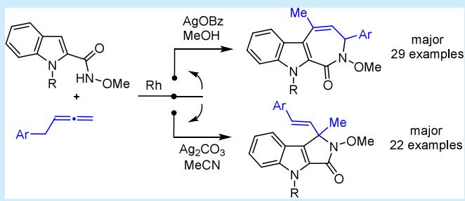
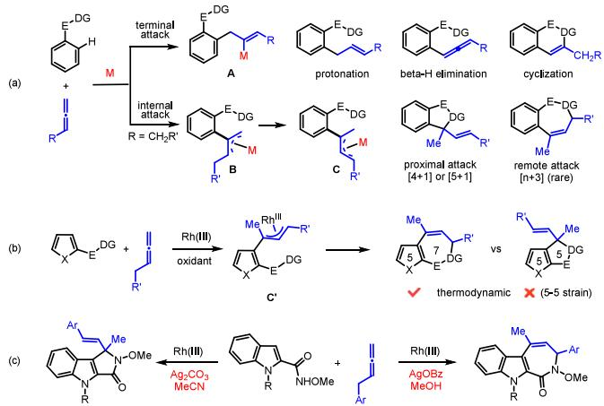
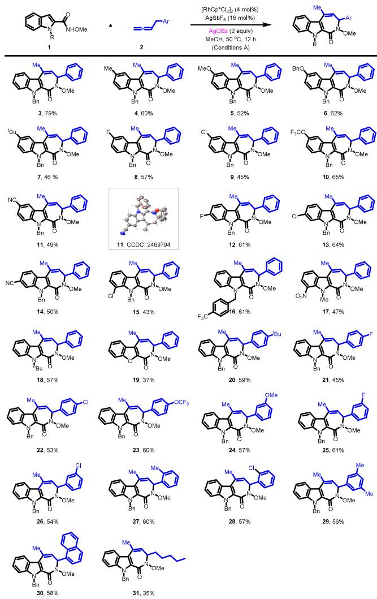
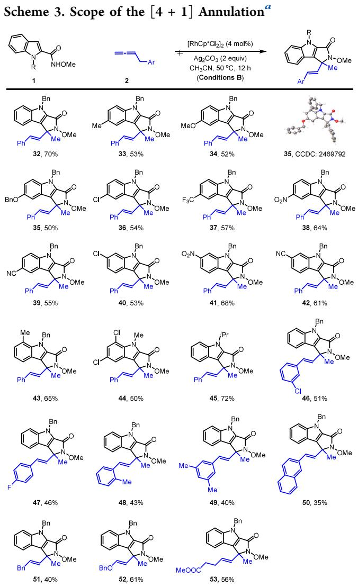
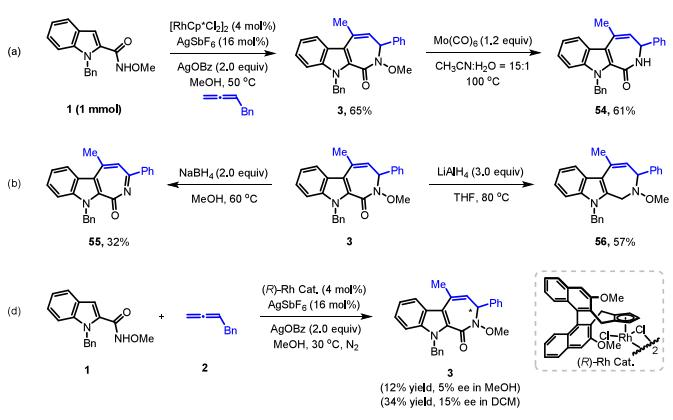
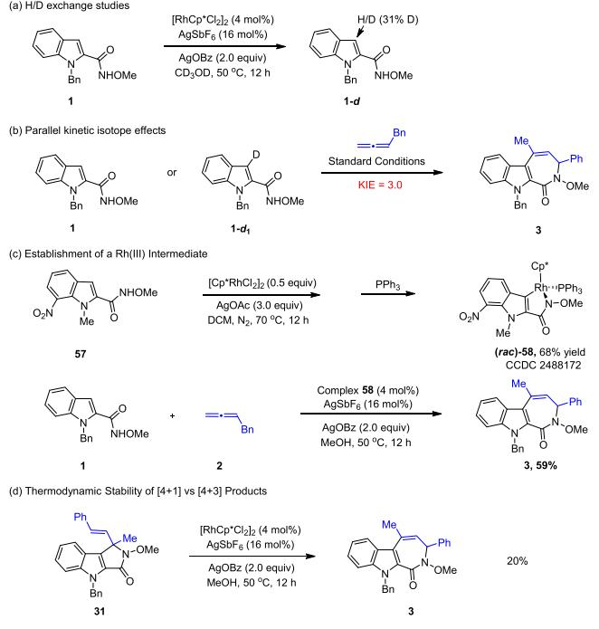
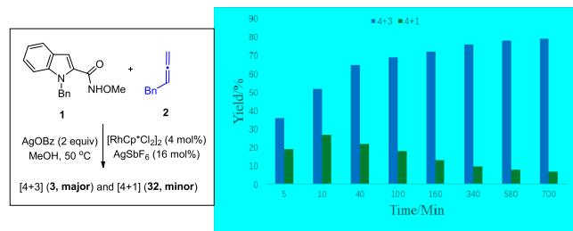
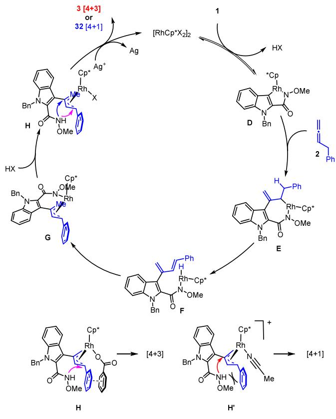

pubs.acs.org/OrgLett

Letter

# Rhodium-Catalyzed Regiodivergent Oxidative Annulation of Indole-2-carboxamides with Allenes via C−H Bond Activation

Wei Zhou, Xiaohan Zhu, Fen Wang,\* and Xingwei Li\*

Cite This: Org. Lett. 2025, 27, 12530−12535

Read Online

ACCESS

Metrics & More

Article Recommendations

\*sı Supporting Information

ABSTRACT: Reported herein is regiodivergent oxidative annulation of 2-indolylcarboxamides with benzyl allenes via C−H bond activation of the indole ring via the formation of a π-allyl intermediate. The regioselectivity is reaction-condition-dependent, selectively afording the [4 + 1]- or [4 + 3]-annulated product as a result of functionalization of the proximal or distal allylic site, respectively.

Allenes are fundamentally important unsaturated reagentsin contemporary organic synthesis, and they have found extensive applications in the fabrication of valuable synthetic scafolds and bioactive compounds.1 Allenes have particularly emerged as versatile coupling partners in metal-catalyzed C−H bond activation and functionalization reactions of arenes. Their synthetic value is ascribed to the high reactivity and versatile reaction patterns during their interactions with diverse transition metals. Nevertheless, control of the regio- and chemoselectivities remains a significant challenge that may deter the use of allenes in metal-catalyzed C−H functionalization in comparison to other π systems, such as alkenes and alkynes.2 Nevertheless, notable progress has been made toward addressing the selectivity of allenes by unraveling their unique reactivities in C−H activation reactions (Scheme 1). Krische and co-workers disclosed the first iridium-catalyzed C−H functionalization with allenes in 2009.3 This chemistry was later explored by several research groups, including those of Ma,4 Ackermann,5 Glorius,6 Mascareñas,7 Cheng,8 Cramer,9 and others.10

Scheme 1. Diverse Reactivity of Allenes in C−H Activation  

The selectivity of the reaction of allenes is largely attributed to the initial interactions between an organometallic species (R−M) and an allene, which represents a fundamental topic in allene chemistry (Scheme 1a). The migratory insertion of R− M into the terminal position of an allene gives a metal alkenyl intermediate (A), which may undergo protonolysis, β-H elimination, and cyclization to yield the allylation,6a,11 allenylation,4a and cyclized products,12 respectively, with possible double bond isomerization.12 Alternatively, the organometallic intermediate may undergo migratory insertion into the 2 positon of the allene, afording a reactive metal allyl species (B). This allyl species is directly trappable by an internal or external functional group, or it may also undergo β- H elimination−reinsertion to give a distal allyl (C), which is typically engaged in cyclization with an internal nucleophile, eventually afording $[ \dot { 4 } + 1 ] - , ^ { 9 \mathrm { c } , 1 3 } \ [ 5 + 1 ] - , ^ { 1 4 }$ and [3 + 3]-15 cyclized products under oxidative conditions.

Despite the progress, the reactivity and selectivity of the allyl species C need further exploration given the fact that the annulated products are predominantly limited to stable fiveand six-membered rings. We reasoned that, in the case of the reaction of a five-membered heterocycle (such as indole), the C−H activation and allene insertion produces an analogous allyl intermediate C′ (Scheme 1b). The subsequent cyclization by engaging proximal allyl carbon afords a commonly encountered $[ \bar { 4 } ~ + ~ 1 ]$ product. However, this product is thermodynamically unstable due to the inherent ring strain in a five−five ring fusion.16 The alternative $[ 4 ~ + ~ 3 ]$ annulation product has been rarely explored,17 but the formation of a less strained seven-membered ring is thermodynamically favorable. By leveraging the reaction conditions, we aimed to address the regioselectivity of such annulation reactions via allyl intermediates under simple condition control. We now report oxidant-dependent, chemoselective, and regiodivergent [4 + 1] and [4 + 3] annulations between 2-indolylcarboxymides and benzyl allenes under rhodium catalysis (Scheme 1c).

We initiated our studies using N-protected indole-2- carboxamides 1 and benzyl allene 2 as substrates to identify the optimal reaction conditions and to prove our concept (Table 1). A polar solvent seems to favor the desired

Table 1. Optimization Studies
<table><tr><td rowspan="2">0 NHOMe 1</td><td rowspan="2">Ph + =_ 2</td><td>[RhCp*Cl2]2 (4 mol%) silver additive (16 mol%) silver oxidant (2 equiv)</td><td>Me -Ph N-OMe Bn N</td><td>Ph Me N-OMe Bn</td></tr><tr><td>solvent, 50-60 C, 12 h temperature</td><td>3</td><td>32 yield (%)</td></tr><tr><td>entry</td><td>oxidant</td><td>(°℃)</td><td>solvent additive</td><td>(3/32) 6</td></tr><tr><td>1</td><td> $\mathrm { A g O P i v }$ </td><td>60 MeOH</td><td> $\mathsf { A g S b F } _ { 6 }$   $\mathsf { A g S b F } _ { 6 }$ </td><td>49:18 32:15</td></tr><tr><td>2</td><td> $\mathbf { M e s C O _ { 2 } A g }$ </td><td>60 MeOH 60 MeOH</td><td> $\mathsf { A g S b F } _ { 6 }$ </td><td>76:11</td></tr><tr><td>3</td><td> $\mathbf { A g O B z }$ </td><td>50 MeOH</td><td> $\mathbf { A g S b F } _ { 6 }$ </td><td>79:8</td></tr><tr><td>4 5</td><td> $\mathbf { A g O B z }$ </td><td>50 MeOH</td><td> $\mathrm { A g N T f } _ { 2 }$ </td><td>71:15</td></tr><tr><td>6</td><td> $\mathbf { A g O B z }$ </td><td>50 MeOH</td><td> $\mathrm { A g O T f } _ { 2 }$ </td><td>73:13</td></tr><tr><td>7</td><td> $\mathbf { A g O B z }$ </td><td>50 MeCN</td><td> $\mathsf { A g S b F } _ { 6 }$ </td><td>30:39</td></tr><tr><td>8</td><td> $\mathbf { A g O B z }$ </td><td>50 MeCN</td><td></td><td>11:42</td></tr><tr><td></td><td> $\mathbf { A g O B z }$ </td><td>50 MeOH</td><td> $\mathsf { A g S b F } _ { 6 }$ </td><td>48:29</td></tr><tr><td>9</td><td> ${ \mathrm { A g } } _ { 2 } { \mathrm { C O } } _ { 3 }$ </td><td>50 MeOH</td><td></td><td>12:55</td></tr><tr><td>10 11</td><td> ${ \mathrm { A g } } _ { 2 } { \mathrm { C O } } _ { 3 }$ </td><td>50 MeCN</td><td> $\mathsf { A g S b F } _ { 6 }$ </td><td>17:58</td></tr><tr><td></td><td> ${ \mathrm { A g } } _ { 2 } { \mathrm { C O } } _ { 3 }$ </td><td>MeCN</td><td></td><td>6:70</td></tr><tr><td>12</td><td> $\mathbf { A g _ { 2 } C O _ { 3 } }$ </td><td>50</td><td></td><td>14:51</td></tr><tr><td>13</td><td> $\mathbf { A g } _ { 2 } \mathbf { O }$ </td><td>50</td><td>MeCN  $\mathsf { A g S b F } _ { 6 }$ </td><td></td></tr><tr><td>14</td><td> $\mathrm { A g F }$ </td><td>50</td><td>MeCN  $\mathsf { A g S b F } _ { 6 }$ </td><td>27:32</td></tr></table>

aReaction conditions: indole-2-carboxamide 1 (0.1 mmol), benzyl allene 2 (0.2 mmol), $[ \mathrm { R h C p } ^ { * } \mathrm { C l } _ { 2 } ] _ { 2 }$ (4 mol %), additive (16 mol %), and oxidant (2.0 equiv) in a solvent (2 mL) for 12 h at a specified temperature. bIsolated yield.

annulation, possibly via cleavage of the Rh−N bond prior to C−N formation.9c,d An annulation reaction occurred when $[ \mathrm { R h } { \mathrm { C p } } ^ { \ast } \mathrm { C l } _ { 2 } ] _ { 2 } / \mathrm { A g } \mathrm { S b F } _ { \epsilon }$ was used as a catalyst in the presence of a silver carbonate oxidant in MeOH at ${ \bf \dot { 6 } 0 } ~ ^ { \circ } { \bf C } .$ This reaction proceeded with low selectivity to give both products 3 and $^ { 3 2 , }$ albeit with good overall eficiency when AgOPiv was used as an oxidant (entry 1). The selectivity (7:1) of $[ 4 + 3 ]$ product 3 (79% yield) was drastically improved when AgOBz was selected as the oxidant (entry 3). Lowering the reaction temperature to $5 0 ~ ^ { \circ } \mathrm { C }$ gave rise to a higher yield and selectivity (entry $^ { 4 , }$ condition A), and ${ \mathrm { A g S b F } } _ { 6 }$ turned out to be the optimal silver additive (entries 5 and 6). Switching to MeCN as a solvent, however, slightly favored the formation of $[ 4 + 1 ]$ product 32 (entry 7). Optimization using a combination of silver carbonate and MeCN further favored product 32 (entries 7−11), and it was isolated in 70% yield even in the absence of any ${ \tt A g S b F } _ { 6 }$ additive (entry 12, condition B). Other silver oxidants gave lower selectivity (entries 13 and 14).

With the optimal conditions in hand, we next explored the scope and limitation of the $[ 4 + 3 ]$ -coupling system under condition A (Scheme 2). The scope of N-protected indole-2-

Scheme 2. Scope of the [4 + 3] Annulation under Oxidative Conditions a

  
aReaction condition A: 1 (0.1 mmol), 2 (0.2 mmol), $[ \mathrm { R h C p } ^ { * } \mathrm { C l } _ { 2 } ] _ { 2 }$ (4 mol %), ${ \tt A g S b F } _ { 6 }$ (16 mol %), and $\mathbf { A g O B z }$ (2 equiv) in MeOH (2 mL) for 12 h, with the isolated yield.

carboxamides has been investigated. Initially, we evaluated the generality of diferent N-substituted indole-2-carboxamides in coupling with allene 2. Amides bearing an electron-donating group at the para position of the benzene ring tend to react in moderate to good yields (4−7). Similarly, amides with a halogen, trifluoromethoxy, or cyano group at the C5 position all reacted in good yields (8−11). The structure of product 11 was determined by X-ray crystallography (CCDC 2469794). The presence of fluoro, chloro, and cyano groups at the C6 position was also well-tolerated, and the corresponding product was obtained in a good yield (12−14). C7-Chlorofunctionalized N-benzyl indole-2-carboxamide also reacted with comparable reactivity (15). Moreover, diferent Nprotected indole-2-carboxamides, such as N-methyl and N-nbutyl, also proved efective in this coupling system with acceptable yields (17 and 18).

In addition, benzofuran-2-carboxamide underwent $[ 4 + 3 ]$ annulations to furnish the corresponding products in moderate yields. Next, the scope of the reaction, with regard to various allenes, was investigated. The para-substituted allenes with electron-donating tert-butyl and electron-withdrawing fluoro, chloro, and trifluoromethoxy substituents reacted to furnish the products in decent yields (45−60%, 20−23). Allenes with meta OMe and Ph groups in phenyl coupled smoothly to provide moderate yields (54−61%, 24−26). ortho-Methyl and -chloro groups in benzyl allene were also tolerated, afording [4 + 3]-annulated azepines (27 and 28) in good yields (43− 45%). A 3,5-dimethyl substituent in benzyl allene is suitable for the present reaction. Similarly, 1-naphthylmethyl allene also reacted smoothly to yield desired product 30 in 58% yield. Alkyl allene also proved to be compatible and aforded product 31 in a 35% yield.

Subsequently, the scope of the [4 + 1] annulation reaction was investigated under condition B (Scheme 3). The presence of an electron-withdrawing or -donating functional group at the C5 position of indole was tolerated, afording corresponding desired products 32−39 in moderate to good yields (50− 70%). Among them, the structure of benzyloxy-substituted product 35 was unambiguously confirmed by X-ray crystallo graphic analysis (CCDC 2469792). Indolyl amides bearing a chloro, nitro, or cyano substituent at the C6 position also reacted smoothly to give corresponding products 40−42 in good yields. C7-Methyl-substituted N-benzyl indole-2-carboxamides was also tolerated in this reaction system (43, 65%). N-Methyl and -isopropyl indole-2-carboxamides were compatible, giving corresponding products 44 and 45, respectively, in good yields. Meanwhile, 2-methyl-, 3-chloro-, and 4-fluoro-substituted benzyl allenes reacted with 1 to give desired annulation products 46−48 in 43−51% yields. In line with the scope of the [4 + 3] annulation system, 3,5-dimethyl- and 1-naphthyl-substituted allenes aforded target products 49 and 50 in acceptable yields. In addition, several alkyl allenes also reacted to give the products in decent yields (40−60%, 51− 53)

  
aReaction condition B: 1 (0.1 mmol), 2 (0.2 mmol), $\left[ \mathrm { R h C p } ^ { * } \mathrm { C l } _ { 2 } \right] _ { 2 } ($ (4 mol %), and Ag CO (2 equiv) in MeCN (2 mL) at 50 ${ } ^ { \circ } \bar { C }$ for 12 h.

The synthetic utility of the [4 + 3] annulation system was next demonstrated in a scale-up reaction (Scheme 4). A

Scheme 4. Synthetic Applications and Asymmetric Attempts  

millimolar-scale reaction of 1 and 2 aforded the annulated product 3 in 65% yield. To expand the synthetic utilities, we performed reductive cleavage of the N−OMe bond with $\mathrm { \bar { M } o ( C O ) } _ { 6 } ,$ afording NH azepine 54. The aromaticity-driven reaction of 3 with NaBH proceeded to give 55 in 32% yield via base-assisted elimination of MeOH. The amide carbonyl group in compound 3 was readily reduced by $\mathrm { L i A l H } _ { 4 }$ to give amine 56. We also attempted to explore the asymmetric version of the [4 + 3] system. However, poor reactivity and enantioselectivity were obtained after initial studies, where the poor enantioselectivity is likely attributed to the configurational instability of 3, which may undergo reversible heterolytic cleavage of the C(benzylic)−N bond in a polar solvent, such as MeOH, or assisted by a Lewis acid.17

Next, a series of preliminary experiments were conducted to gain mechanistic insight into the [4 + 3] annulation (Scheme 5). The deuterium-labeling reaction between 2 and $\mathrm { C D } _ { 3 } \mathrm { O D }$ was conducted to probe the reversibility of the C−H activation event (Scheme 5a). 1H NMR analysis of the recovered reagent showed 31% incorporation of deuterium at the 3 position (Scheme 5a). This result indicates that the C−H bond activation is largely reversible. A significant kinetic isotope efect of the indole substrate was measured from two parallel reactions $( k _ { \mathrm { H } } / k _ { \mathrm { D } } = 3 . 0 ;$ Scheme 5b). To further explore the C−H activation event, a stoichiometric reaction was conducted (Scheme 5c). Rhodacycle 58 was isolated and characterized by X-ray crystallography. It showed decent activity in catalyzing the reaction between indole 1 and allene $^ { 2 , }$ further underscoring a C−H activation pathway. To compare the

## Scheme 5. Mechanistic Studies

thermodynamic stability of the two classes of products, the [4 + 1] product was subjected to condition A and the latter was produced in 20% yield (Scheme 5d), indicating relief of strain in the $[ 4 + 3 ]$ product. Here, the isomerization likely occurred via a carbocation mechanism via C−N cleavage and recyclization. To further explore the reaction profile, the coupling of indole and allene was monitored, and the time dependent product distribution revealed a lower rate $\left( [ 4 + 1 ] / \right)$ $[ 4 ^ { - } + 3 ] = 2 )$ at the very early stage; however, the ratio increased as the reaction proceeded (to 14:1 at the end). These observations verified that this coupling system is primarily under kinetic control, but the isomerization to the $\left[ 4 + 3 \right]$ product also contributes to the high regioselectivity.

Based on our preliminary mechanistic studies and literature reports, a plausible mechanism for the Rh-catalyzed [4 + 1] and $[ 4 + 3 ]$ annulations of indole-2-carboxamides and allenes is depicted in Scheme 6. A five-membered rhodacyclic intermediate D is generated from the cyclometalation of carboxamide 1 via assistance of a ligated acetate or carbonate (CMD). Allene insertion via $\mathrm { C - } C$ formation at the internal position gives initial allyl species E. The subsequent β-H elimination of E and reinsertion of resulting rhodium hydride is proposed, afording another allyl intermediate G via a $^ { 1 , 3 - }$ diene intermediate ${ \check { \mathbf { F } } } .$ The $\mathrm { R h { - } N }$ bond in allyl species G readily undergoes facile protonolysis by a copious amount of MeOH to give intermediate H. The subsequent C−N coupling event is regio-determining. It is proposed that, in the case of the AgOBz oxidant (Scheme 6, bottom), the benzoate is

Scheme 6. Proposed Catalytic Cycle

ligated and the $\pi - \pi$ stacking attracts the allylic phenyl group, which opens up the allyl group and favors the NH attack at the distal allylic site. In contrast, in the case of $\mathrm { A g _ { 2 } C O _ { 3 } / M e C N , }$ the carbonate anion is less coordinating, and consequently, MeCN coordination gives cationic intermediate $\mathbf { H ^ { \prime } } ,$ where the allyl unit is pushed toward less hindered MeCN, which opens up the whole allyl moiety and favors the proximal allyl attack to aford $[ 4 ~ + ~ 1 ]$ major product 32. The catalytic cycle is completed upon reoxidation of the Rh(I) species.

In summary, we have developed a Rh(III)-catalyzed C−H activation system of N-protected indole-2-carboxamides with benzyl allenes as a coupling partner. A variety of N-protected indole-2-carboxamides and allenes are amenable to the coupling systems, afording the $\left[ 4 + 3 \right] - \mathrm { o r } \left[ 4 + 1 \right]$ -annulated products in good regioselectivity. The selectivity is collectively controlled by the silver salt and the solvent. The formation of the $[ 4 + { \dot { 3 } } ]$ product is controlled by both kinetic and thermodynamic efects. This protocol features compatibility with diverse functional groups, thus providing a straightforward strategy to access two classes of heterocycles under very similar reaction conditions. Development of the asymmetric version of these systems is ongoing in our laboratories.

## ■ ASSOCIATED CONTENT

## Data Availability Statement

The data underlying this study are available in the published article and its Supporting Information.

## \*sı Supporting Information

The Supporting Information is available free of charge at https://pubs.acs.org/doi/10.1021/acs.orglett.5c03943.

Experimental procedures, characterization data, and NMR spectra and X-ray crystallographic analysis for 11, 35, and 58 (PDF)

## Accession Codes

Deposition Numbers 2469792, 2469794, and 2488172 contain the supplementary crystallographic data for this paper. These data can be obtained free of charge via the joint Cambridge Crystallographic Data Centre (CCDC) and Fachinformationszentrum Karlsruhe Access Structures service.

## ■ AUTHOR INFORMATION

## Corresponding Authors

Xingwei Li − School of Chemistry and Chemical Engineering, Shaanxi Normal University, Xi’an 710062, China; Institute of Chemistry Frontier, School of Chemistry and Chemical Engineering, Shandong University, Qingdao 266237, China; orcid.org/0000-0002-1153-1558; Email: lixw@ snnu.edu.cn

Fen Wang − School of Chemistry and Chemical Engineering, Shaanxi Normal University, Xi’an 710062, China; Email: fenwang@snnu.edu.cn

## Authors

Wei Zhou − School of Chemistry and Chemical Engineering, Shaanxi Normal University, Xi’an 710062, China

Xiaohan Zhu − Institute of Chemistry Frontier, School of Chemistry and Chemical Engineering, Shandong University, Qingdao 266237, China

Complete contact information is available at: https://pubs.acs.org/10.1021/acs.orglett.5c03943

## Notes

The authors declare no competing financial interest.

## ■ ACKNOWLEDGMENTS

Financial support from the National Natural Science Foundation of China (NSFC, 22371175) and the Shaanxi Normal University (SNNU) is acknowledged.

## ■ REFERENCES

(1) (a) Hoffmann-Röder, A.; Krause, N. Synthesis and Properties of Allenic Natural Products and Pharmaceuticals. Angew. Chem., Int. Ed. 2004, 43, 1196−1216. (b) Rivera-Fuentes, P.; Diederich, F. Allenes in Molecular Materials. Angew. Chem., Int. Ed. 2012, 51, 2818−2828. (c) Yu, S.; Ma, S. Allenes in Catalytic Asymmetric Synthesis and Natural Product Syntheses. Angew. Chem., Int. Ed. 2012, 51, 3074− 3112.

(2) (a) Satoh, T.; Miura, M. Oxidative Coupling of Aromatic Substrates with Alkynes and Alkenes under Rhodium Catalysis. Chem. - Eur. J. 2010, 16, 11212−11222. (b) Song, G.; Wang, F.; Li, X. C−C, C−O and C−N bond formation via rhodium(III)-catalyzed oxidative C−H activation. Chem. Soc. Rev. 2012, 41, 3651−3678. (c) Mesganaw, T.; Ellman, J. A. Convergent Synthesis of Diverse Tetrahydropyridines via Rh(I)-Catalyzed C−H Functionalization Sequences. Org. Process Res. Dev. 2014, 18, 1097−1104. (d) Zhou, L.; Lu, W. Towards Ideal Synthesis:Alkenylation of Aryl C−H Bonds by a Fujiwara-Moritani Reaction. Chem. - Eur. J. 2014, 20, 634. (e) Gandeepan, P.; Cheng, C.-H. Transition-Metal-Catalyzed π-Bond-Assisted C−H Bond Functionalization: An Emerging Trend in Organic Synthesis. Chem. - Asian J. 2015, 10, 824−838.

(3) Zhang, J.; Skucas, E.; Krische, M. J. Direct Prenylation of Aromatic and α,β-Unsaturated Carboxamides via Iridium-Catalyzed

C−H Oxidative Addition−Allene Insertion. Org. Lett. 2009, 11, 4248−4250.

(4) (a) Zeng, R.; Fu, C.; Ma, S. Highly Selective Mild Stepwise Allylation of N-Methoxybenzamides with Allenes. J. Am. Chem. Soc. 2012, 134, 9597−9600. (b) Zeng, R.; Wu, S.; Fu, C.; Ma, S. Room-Temperature Synthesis of Trisubstituted Allenylsilanes via Regioselective C−H Functionalization. J. Am. Chem. Soc. 2013, 135, 18284− 18287. (c) Zeng, R.; Ye, J.; Fu, C.; Ma, S. Arene C−H Bond Functionalization Coupling with Cyclization of Allenes. Adv. Synth. Catal. 2013, 355, 1963−1970.

(5) Wang, H.; Glorius, F. Mild Rhodium(III)-Catalyzed C−H Activation and Intermolecular Annulation with Allenes. Angew. Chem., Int. Ed. 2012, 51, 7318−7322.

(6) (a) Nakanowatari, S.; Ackermann, L. Ruthenium(II)-Catalyzed C−H Functionalizations with Allenes: Versatile Allenylations and Allylations. Chem. - Eur. J. 2015, 21, 16246−16251. (b) Nakanowatari, S.; Mei, R.; Feldt, M.; Ackermann, L. Cobalt (III)-Catalyzed Hydroarylation of Allenes via C−H Activation. ACS Catal. 2017, 7, 2511−2515. (c) Nakanowatari, S.; Müller, T.; Oliveira, J. C. A.; Ackermann, L. Bifurcated Nickel-Catalyzed Functionalizations: Heteroarene C−H Activation with Allenes. Angew. Chem., Int. Ed. 2017, 56, 15891−15895.

(7) (a) Casanova, N.; Seoane, A.; Mascareñas, J. L.; Gulías, M. Rhodium-Catalyzed (5 + 1) Annulations Between 2-Alkenylphenols and Allenes: A Practical Entry to 2,2-Disubstituted 2H-Chromenes. Angew. Chem., Int. Ed. 2015, 54, 2374−2377. (b) Casanova, N.; Del Rio, K. P.; García-Fandiño, R.; Mascareñas, J. L.; Gulías, M. Palladium(II)-Catalyzed Annulation between ortho-Alkenylphenols and Allenes. Key Role of the Metal Geometry in Determining the Reaction Outcome. ACS Catal. 2016, 6, 3349−3353. (c) Cendón, B.; Casanova, N.; Comanescu, C.; GarcíaFandiño, R.; Seoane, A.; Gulías, M.; Mascareñas, J. L. Palladium-Catalyzed Formal (5 + 2) Annulation between ortho-Alkenylanilides and Allenes. Org. Lett. 2017, 19, 1674− 1677.

(8) (a) Kuppusamy, R.; Gandeepan, P.; Cheng, C.-H. RhIII- Catalyzed [4 + 1] Annulations of 2-Hydroxy- and 2-Aminobenzaldehydes with Allenes: A Simple Method toward 3-Coumaranones and 3-Indolinones. Org. Lett. 2015, 17, 3846−3849. (b) Boobalan, R.; Kuppusamy, R.; Santhoshkumar, R.; Gandeepan, P.; Cheng, C.-H. Access to Isoquinolin-1(2H)-ones and Pyridones by Cobalt-Catalyzed Oxidative Annulation of Amides with Allenes. ChemCatChem. 2017, 9, 273−277.

(9) (a) Tran, D. N.; Cramer, N. syn-Selective Rhodium(I)-Catalyzed Allylations of Ketimines Proceeding through a Directed C−H Activation/Allene Addition Sequence. Angew. Chem., Int. Ed. 2010, 49, 8181−8184. (b) Tran, D. N.; Cramer, N. Highly Selective Rhodium Catalyzed Domino C−H Activation/Cyclizations. Chimia 2011, 65, 271−273. (c) Wang, S.-G.; Liu, Y.; Cramer, N. Asymmetric Alkenyl C−H Functionalization by CpxRhIII forms 2H-Pyrrol-2-ones through [4 + 1]-Annulation of Acryl Amides and Allenes. Angew. Chem., Int. Ed. 2019, 58, 18136−18140. (d) Wang, S.-G.; Cramer, N. Asymmetric CpxRh(III)-Catalyzed Acrylic Acid C−H Functionalization with Allenes Provides Chiral γ-Lactones. ACS Catal. 2020, 10, 8231−8236.

(10) (a) Thrimurtulu, N.; Dey, A.; Maiti, D.; Volla, C. M. R. Cobalt-Catalyzed sp2-C−H Activation: Intermolecular Heterocyclization with Allenes at Room Temperature. Angew. Chem., Int. Ed. 2016, 55, 12361−12365. (b) Wang, C.; Wang, A.; Rueping, M. Manganese-Catalyzed C−H Functionalizations: Hydroarylations and Alkenylations Involving an Unexpected Heteroaryl Shift. Angew. Chem., Int. Ed. 2017, 56, 9935. (c) Wu, L.; Meng, Y.; Ferguson, J.; Wang, L.; Zeng, F. Palladium-Catalyzed Oxidative Annulation of ortho-Alkenylanilines and Allenes: An Access to Benzo[b]azepines. J. Org. Chem. 2017, 82, 4121−4128. (d) Kuninobu, Y.; Yu, P.; Takai, K. Rhenium-Catalyzed Diastereoselective Synthesis of Aminoindanes via the Insertion of Allenes into a C−H Bond. Org. Lett. 2010, 12, 4274−4276. (e) Gong, T.-J.; Su, W.; Liu, Z.-J.; Cheng, W.-M.; Xiao, B.; Fu, Y. Rh(III)- Catalyzed C−H Activation with Allenes to Synthesize Conjugated Olefins. Org. Lett. 2014, 16, 330−333. (f) Parganiha, D.; Thorat, R.

A.; Dhumale, A. D.; Upadhyay, Y. D.; Jha, R. K.; Raju, S.; Kumar, S. Substrate NOBINAc ligand affinity for PdII-catalyzed enantioselective C−H activation over reactive β-C−H bonds in ferrocenyl amines. Chem. Sci. 2025, 16, 700−708.

(11) (a) Chen, S.-Y.; Li, Q.; Wang, H. Manganese(I)-Catalyzed Direct C−H Allylation of Arenes with Allenes. J. Org. Chem. 2017, 82, 11173−11181. (b) Koschker, P.; Breit, B. Branching Out: Rhodium-Catalyzed Allylation with Alkynes and Allenes. Acc. Chem. Res. 2016, 49, 1524−1536. (c) Mishra, N. K.; Sharma, S.; Park, J.; Han, S.; Kim, I. S. Recent Advances in Catalytic C(sp2)−H Allylation Reactions. ACS Catal. 2017, 7, 2821−2847.

(12) (a) Mo, Ji.; Müller, T.; Oliveira, J. C. A.; Ackermann, L. 1,4- Iron Migration for Expedient Allene Annulations through Iron-Catalyzed C−H/N−H/C−O/C−H Functionalizations. Angew. Chem., Int. Ed. 2018, 57, 7719−7723. (b) Thrimurtulu, N.; Nallagonda, R.; Volla, C. M. R. Cobalt-catalyzed aryl C−H activation and highly regioselective intermolecular annulation of sulfonamides with allenes. Chem. Commun. 2017, 53, 1872−1875. (c) González, J. M.; Cendón, B.; Mascareñas, J. L.; Gulías, M. Kinetic Resolution of Allyltriflamides through a Pd-Catalyzed C−H Functionalization with Allenes: Asymmetric Assembly of Tetrahydropyridines. J. Am. Chem. Soc. 2021, 143, 3747−3752. (d) Chowdhury, D.; Koner, M.; Ghosh, S.; Baidya, M. Regioselective Annulation of Allenylphosphine Oxides with Aromatic Amides under Ruthenium(II) Catalysis. Org. Lett. 2022, 24, 3604−3608.

(13) (a) Boobalan, R.; Santhoshkumar, R.; Cheng, C.-H. Co(III)- Catalyzed [4 + 1] Annulation of Amides with Allenes via C−H Activation. Adv. Synth. Catal. 2019, 361, 1140−1145. (b) Sontakke, G. S.; Chaturvedi, A. K.; Jana, D.; Volla, C. M. R. Pyrazolidinone Aided Ru(II)-Catalyzed Regioselective C−H Annulation with Allenes. Org. Lett. 2024, 26, 4480−4485. (c) Zhou, Z.; Liu, G.; Lu, X. Regiocontrolled Coupling of Aromatic and Vinylic Amides with α- Allenols To Form γ-Lactams via Rhodium(III)-Catalyzed C−H Activation. Org. Lett. 2016, 18, 5668−5671. (d) Yin, C.; Zhong, T.; Zheng, X.; Li, L.; Zhou, J.; Yu, C. Direct synthesis of Indazole Derivatives via Rh(III)-Catalyzed C−H Activation of Phthalazinones and Allenes. Org. Biomol. Chem. 2021, 19, 7701−7705.

(14) (a) Kuppusamy, R.; Muralirajan, K.; Cheng, C.-H. Cobalt(III)- Catalyzed [5 + 1] Annulation for 2H-Chromenes Synthesis via Vinylic C−H Activation and Intramolecular Nucleophilic Addition. ACS Catal. 2016, 6, 3909−3913. (b) Singh, A.; Shukla, R. K.; Volla, C. M. R. Rh(III)-Catalyzed [5 + 1] Annulation of 2-Alkenylanilides and 2- Alkenylphenols with Allenyl Acetates. Chem. Sci. 2022, 13, 2043− 2049. (c) Lin, Z.; Cai, Y.; Ye, J.; Chen, K.; Zheng, J.; Zhou, L.; Zhou, Z.; Yi, W. Chemo-/Regioselective [5 + 1] Annulation with gem-Difluoromethylene Allenes for the Assembly of Fluorinated 2H-Chromenes and Dihydroquinolines. Adv. Synth. Catal. 2025, 367, No. e202401110.

(15) Kuppusamy, R.; Santhoshkumar, R.; Boobalan, O.; Wu, H.-R.; Cheng, C.-H. Synthesis of 1,2-Dihydroquinolines by Co(III)- Catalyzed [3 + 3] Annulation of Anilides with Benzylallenes. ACS Catal. 2018, 8, 1880−1883.

(16) Xia, G.; Weng, J.; Liu, L.; Verma, P.; Li, Z.; Yu, J.-Q. Reversing conventional site-selectivity in C(sp3)−H bond activation. Nat. Chem. 2019, 11, 571−577.

(17) Thorat, R. A.; Parganiha, D.; Jain, S.; Choudhary, V.; Shakir, B.; Rohilla, K.; Jha, R. K.; Kumar, S. Temperature-Dependent Diastereodivergent [4 + 3] Annulation: Synthesis of Ferrocene-Fused Azepines via Rh(III) Catalysis. Org. Lett. 2025, 27, 552−558.