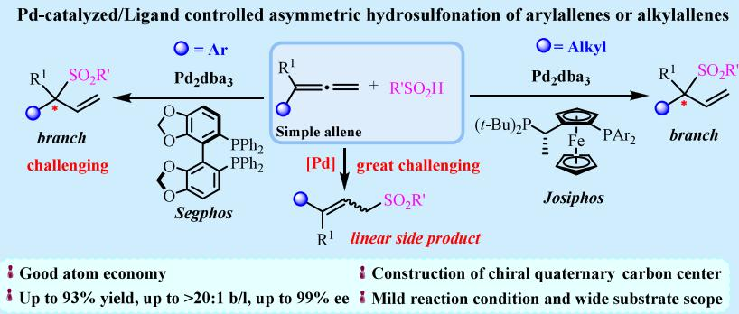
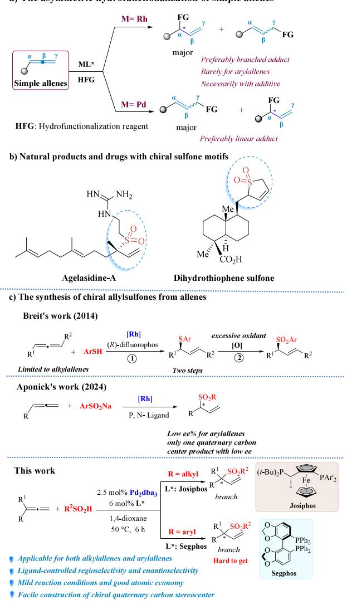
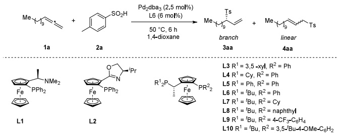
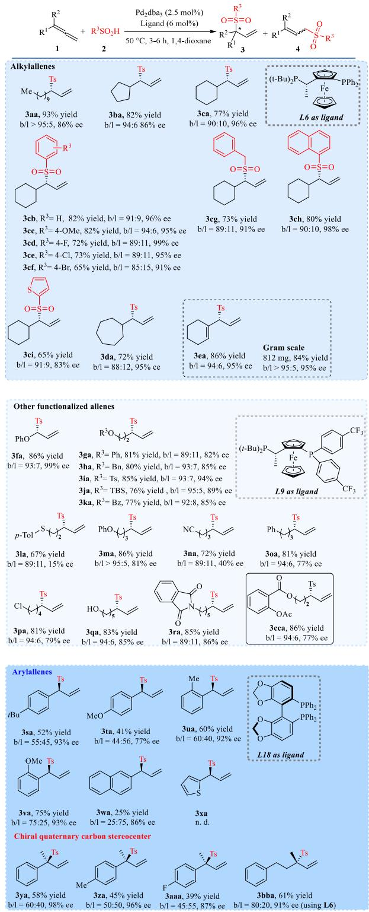
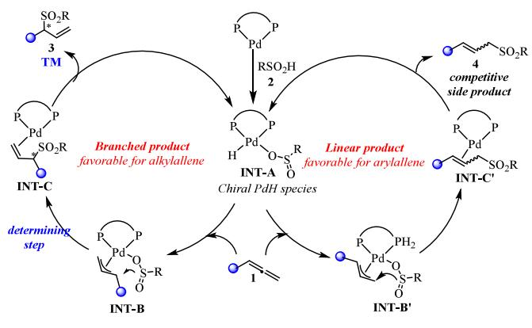

pubs.acs.org/OrgLett

Letter

# Pd-Catalyzed/Ligand-Controlled Regioselective Asymmetric Hydrosulfonylation of Alkylallenes or Arylallenes

Jing Wu, Boyi Wang, Jinghan Zou, Xinman Guo, Weixing Chang, Lingyan Liu,\* Xiaohui $\mathbf { C a o } , ^ { * }$ and Jing Li\*

Cite This: Org. Lett. 2025, 27, 1350−1355

ACCESS

Metrics & More

Article Recommendations

\*sı Supporting Information

  
ABSTRACT: The metal-catalyzed hydrofunctionalization reaction of allenes is an eficient approach for the construction of new allyl compounds. This work described a palladium-catalyzed/ligand-controlled asymmetric hydrosulfonylation of simple alkylallenes and arylallenes in the presence of $\mathrm { P d } _ { 2 } \mathrm { d } \bar { \bf b } { \sf a } _ { 3 }$ Using a Josiphos or Segphos ligand, the alkylallenes or arylallenes could render the corresponding branched chiral allylsulfones with high yields and high enantioselectivities up to 90% and 99% ee, respectively.

chemistry because of its unique linear three-carbon skeleton constructed by two cumulative π bonds, thus endowing its interesting reactivities and diverse site selectivities $( \alpha \cdot , \ \beta \circ , \ \mathrm { ~ o r ~ } \ \gamma - ) .$ Many reviews have emerged on their preparation and transformation.2 Among them, the transition-metal-catalyzed asymmetric hydrofunctionalization of allenes represents an important domain in allene chemistry. It is a powerful means to construct allyl C−C and C−X bonds with chiral carbon centers from allenes, and it can also directly give rise to many natural and non-natural products as well as some important pharmaceutical molecules.3 In these reactions, Rh and Ir catalysts are commonly used to achieve the formation of chiral branched products, but most need a higher temperature or longer reaction time.4 As a comparison, Pdcatalyzed asymmetric functionalization reactions of allenes have been extremely scarce until now.5 In addition, Pdcatalyzed hydrofunctionalization of allenes usually results in a dominated linear allyl product (Scheme 1a).6 And compared with the alkylallenes, the arylallenes are relatively dificult substrates and more inclined to render the linear products without branched products, as may be due to electronic efects and conjugated efects as well as possible steric efects of the aromatic ring on the arylallenes.7 Therefore, it is highly desirable to regulate the branched regioselectivity of the asymmetric hydrofunctionalization of allenes precisely and remains greatly challenging, especially for the arylallenes.

Considering that, we herein focus on the asymmetric hydrosulfonylation of simple terminal allenes including alkyland arylallenes, with the aim of the synthesis of diverse chiral allylsulfones, which are the ubiquitous building blocks of the drugs and natural products (Scheme 1b).8 Breit and his coworkers developed a Rh-catalyzed asymmetric hydrothioetheration oxidation of allenes in a two-step process to aford the chiral allylsulfones. In their reaction, excessive oxidants and smelly sulfur-containing toxic reagents were used and only limited to alkylallenes (Scheme 1c, Breit’s work).9 Recently, Aponick and co-workers reported an asymmetric hydrosulfonylation reaction of allenes through using a Rh catalyst (Scheme 1c, Aponick’s work).10 In their work, the arylallenes delivered the corresponding allyl sulfones with relatively low enantioselectivities. In spite of this, we herein developed a Pdcatalyzed/ligand-controlled asymmetric hydrosulfonylation of alkylallenes or arylallenes, and a series of chiral allylsulfones a) The asymmetric hydrofunctionalization of simple allenes

Scheme 1. Synthesis and Application of Chiral Allylsulfones from Allenes  

were obtained in good yields with excellent enantioselectivities. Namely, using a Pd dba /Josiphos or Pd dba /Segphos chiral metal complex, the alkylallenes or arylallenes could smoothly proceed to give the corresponding branched chiral allylsulfones, respectively (Scheme 1c, this work). This reaction breaks through the inherent reaction mode of palladium catalysis with dominant linear products, especially for the challenging arylallenes. Moreover, this methodology is also applicable for the construction of allylsulfones containing chiral quaternary carbon stereocenters. And the DFT calculations also consolidated the ligand-controlled regioselectivity and enantioselectivity of the asymmetric hydrosulfonylation reaction.

Our initial studies commenced with the hydrosulfonylation of the trideca-1,2-diene 1a and p-toluenesulfinic acid 2a in the presence of Pd dba catalyst for screening of various chiral phosphine ligands (L1−L10) with the aim of identifying conditions for a direct catalytic enantioselective reaction (Table 1). After an extensive examination, it was found that the substituents on Josiphos had a significant efect on the reaction enantioselectivities (Table 1, entries 1−12), and the ligand L6 (R1 = tert-butyl, $\mathrm { R } ^ { 2 } \ = \ \mathrm { P h } )$ performed the best, rendering the corresponding allylsulfone branched product 3aa in high up to 93% yield and 86% ee as well as a b/l ratio > 95:5 (Table $^ { 1 , }$ entry 6). Replacing the 1,4-dioxane with THF, we found that the yield and ee value of the corresponding product 3aa decreased rapidly (entry 13). Other Pd catalysts, such as Pd(dba) and $\mathrm { P d } ( \mathrm { P P h } _ { 3 } ) _ { 4 } ,$ both showed poor performance (entries 14 and 15). And the ratio of Pd/L6 was also examined (entry 16). Other details of experimental parameters on the reaction of 1a and 2a, such as the Pd catalyst, solvent, the ratio of Pd catalyst, ligand and additive, all were investigated and shown in Supporting Information (see Tables S1−S3). As a result, the optimized reaction conditions were determined to be that the alkylallenes 1 (0.1 mmol, 1.0 equiv) and sulfones 2 (1.2 equiv) were reacted in $^ { 1 , 4 }$ -dioxane (1.6 mL) at 50 °C for 6 h under an argon atmosphere with using $\mathrm { P d } _ { 2 } \mathrm { d } { \bf b } { \bf a } _ { 3 }$ (2.5 mol %) and Josiphos ligand L6 (6 mol %).

Table 1. Optimization of the Chiral Ligands for the Reaction between Alkylallene 1a and p-Tolsulfinic Acid $2 \mathsf { a } ^ { a }$
<table><tr><td></td><td></td><td colspan="3"></td></tr><tr><td></td><td></td><td></td><td></td><td></td></tr><tr><td></td><td></td><td></td><td></td><td></td></tr><tr><td>Entry</td><td>Variants from the standard condition</td><td>Yield of 3aa (%)b</td><td> $b / l ^ { b }$ </td><td>ee (%)c</td></tr><tr><td>1</td><td>none</td><td>93</td><td>&gt;95:5</td><td>86</td></tr><tr><td>2 3</td><td>L1</td><td>n. r.</td><td></td><td></td></tr><tr><td>4</td><td>L2</td><td>n. r.</td><td>- 93:7</td><td>- 12</td></tr><tr><td>5</td><td>L3</td><td>45</td><td>93:7</td><td>47</td></tr><tr><td>6</td><td>L4 L5</td><td>18</td><td>92:8</td><td>54</td></tr><tr><td></td><td>L6</td><td>81</td><td>&gt;95:5</td><td>86</td></tr><tr><td>7</td><td></td><td>93</td><td>&gt;95:5</td><td>81</td></tr><tr><td>8</td><td>Enti-L6</td><td>81</td><td>88:12</td><td>58</td></tr><tr><td>9</td><td>L7 L8</td><td>40</td><td>95:5</td><td>41</td></tr><tr><td>10</td><td></td><td>70</td><td>94:6</td><td>85</td></tr><tr><td>11</td><td>L9</td><td>88</td><td>88:12</td><td>58</td></tr><tr><td>12</td><td>L10</td><td>64</td><td></td><td></td></tr><tr><td>13</td><td>THF</td><td>27</td><td>50:50</td><td>31</td></tr><tr><td>14</td><td> $\mathrm { P d } ( \mathrm { d b } \mathrm { a } ) _ { 2 }$ </td><td>43</td><td>91:9</td><td>80</td></tr><tr><td>15</td><td> $\mathrm { P d } ( \mathrm { P P h } _ { 3 } ) _ { 4 }$ </td><td>26</td><td>-</td><td>17</td></tr><tr><td>16</td><td> $\scriptstyle \left[ \mathrm { P d } \right] : \mathbf { L } 6 = 1 : 1$ </td><td>38</td><td>50:50</td><td>26</td></tr></table>

aReaction procedure: The trideca-1,2-diene 1a (18 mg, 0.1 mmol), ptolsulfinic acid 2a (18.7 mg, 0.12 mmol, 1.2 equiv), $\dot { \mathrm { P d } } _ { 2 } \mathrm { d } { \bf b } { \bf a } _ { 3 }$ (0.0025 mmol, 0.025 equiv), ligand (0.006 mmol, 0.06 equiv), and $^ { 1 , 4 \cdot }$ dioxane were sequentially added into a Schlenk tube, and the mixture was stirred at 50 $^ { \circ } \mathrm { C } ^ { \prime }$ (an oil bath) for 6 h under an argon atmosphere. bYields and $b / l$ ratio were determined by 1H NMR spectroscopy of crude product using 4-bromobenzaldehyde as an internal standard sample. cDetermined by chiral HPLC. n. r. = no reaction.

In the case of arylallene 1s, only a trace of branched 3sa was obtained with low enantioselectivity under the above optimal reaction conditions (Table ${ \mathrm { S 4 } } ,$ entry 1), and the linear product 4sa was dominant. This result might be ascribed to the smaller steric hindrance and greater stability of the large conjugated aromatic system for the linear product generated. Thus, other chiral ligands were further examined (entries 2−11). As a result, the high enantioselectivity of 3sa was obtained in moderate yield (52% yield, 94% ee) with a 1.1/1 ratio of branched and linear products when using the phenylsubstituted Segphos ligand L18 (Table S4, entry 9). In view of the poor b/l ratio, we herein also tried to use the Rh catalyst with some chiral ligands. The results are shown in Table S5. But consequently, no satisfying yield and ee value of 3sa were observed, although the $b / l$ ratio was good. Other experimental parameters were further screened using the Pd catalyst, and no obvious improved results were obtained (Table S6). Therefore, the optimal reaction conditions for the asymmetric hydrosulfonylation of arylallenes were determined to be similar to those of the alkylallenes except for using ligand L18 at a short time for 3 h.

Under the above optimal reaction conditions, we evaluated substrate scope with diferent alkylallene or arylallene substrates 1 and sulfones 2. As shown in Table $^ { 2 , }$ the alkylallenes, whether cyclohexyl or cyclopentyl as well as cycloheptyl, all aliphatic allenes could smoothly proceed and deliver the corresponding chiral allylsulfones in good yields and regioselectivities as well as high enantioselectivities (3aa− 3da). In the case of cyclohexylallene 1c, a series of sulfones 2 was also investigated, and it was found that various substituted arylsulfinic acids were good candidates for the asymmetric hydrosulfonylation (3cb−3cf). In detail, it was observed that the substituents of the arylsulfinic acid had little efect on this reaction. And the 4-OMe-substituted sulfinic acid gave the corresponding product with a high $b / l$ ratio up to 18:1 of branched/linear regioselectivity (3cc), which might be because the electron-donating substituted sulfinic acid could stabilize the allyl palladium intermediate well. Moreover, the benzyl-, sterically hindered naphthyl-, and thiophenylsulfinic acid were also tolerant and gave the target molecules 3cg−3ci in good yields and high enantioselectivities.

In addition, using chiral ligand L9, other substituted allenes, cyclohexenyl- and phenoxylallene, could also give satisfactory results with high yields, regioselectivities, and enantioselectivities (3ea and 3fa). And the scale-up reaction of cyclohexyenylallene could also smoothly proceed and aford 3ea in 812 mg. In addition, a variety of substituted ethylallenes with PhO−, benzyloxy (BnO−), benzenesulfonyl (Ts−), tributylsilyl (TBS−), and benzoxyl (Bz−) groups on the terminal end of the ethyl chain produced the corresponding chiral allylsulfones 3ga−3ka. Nevertheless, when O was replaced with a S atom, the enantioselectivity of the reaction product sharply decreased to 15% ee (3la). The reason might be attributed to the poisoning of the active chiral palladium species by sulfur atoms. The alkylallenes with a prolonged carbon chain, no matter what substituents are on the end of the chain (such as PhO−, −CN, Ph−, Cl−, or even −OH), all were still tolerant and rendered the corresponding chiral allylsulfones 3ma−3qa. The phthalimide-substituted alkylallene 1r was also tolerant and gave the corresponding product 3ra in good yield and enantioselectivity. Moreover, the derivative of aspirin 1cc could also be modified to produce the chiral allylsulfone 3cca in 86% yield with 80% ee.

The reaction of the arylallenes and sulfinic acid was achieved through using sterically hindered ligand segphos (L18) with strong electron-donating ability and led to the branched product with high enantioselectivity up to 93% ee. And several substituted arylallenes could deliver the corresponding branched products 3sa−3va with high enantioselectivities. But unfortunately, the regioselectivity of the branched and linear product was unsatisfying in the presence of the Pd catalyst. In spite of this, it was found that orthomethoxyphenylallene could give the product with good b/l regioselectivity (3va). From the results of 3ua and 3va, we could surmise that the oxygen atom of the ortho-methoxy group might participate in the coordination with the Pd complex, as it obviously improved the regioselectivity. In addition, the steric hindrance naphthylallene could also react with the phenylsulfinic acid to aford 3wa, but thiophenylallene was not suitable for this asymmetric hydrosulfonylation reaction (3xa). Interestingly, 1,1-substituted arylallenes or alkylallene were also good candidates and rendered the corresponding allysulfone products containing chiral quaternary carbon stereocenters with high enantioselectivity (3ya, 3za, 3aaa, and 3bba).

Table 2. Evaluation of the Substrate Scope of Various Allenes 1 and Sulfinic Acids $2 ^ { a }$  
  
aReaction procedure: The allene substrates 1 (0.1 mmol) and 2 (0.12 mmol), Pd dba (0.0025 mmol), chiral ligand (0.006 mmol), and 1,4- dioxane were sequentially added into a Schlenk tube, and the mixture was stirred at $5 0 ^ { \circ } \mathrm { C }$ (an oil bath) under an argon atmosphere for 3 h (arylallenes) or 6 h (alkylallenes). bYields and b/l value were determined by 1H NMR spectroscopy of crude product using 4- bromobenzaldehyde as an internal standard sample. cDetermined by chiral HPLC. Isolated yield. n. r. = no reaction. n. d. = no observed.

To explore the reaction mechanism, we performed the kinetic isotope efect (KIE) control experiments through using cyclohexylallene 1c and 100% deuterated substrate 2a−d (Scheme S1a). The $K _ { \mathrm { H } } / K _ { \mathrm { D } }$ ratio of 1.8 demonstrated that this reaction was not first-order KIE and that the cleavage of the O−H bond was not the rate-determining step. And the 61% deuterated product 3aa-d indicated that the hydrogen at the allyl site majorly came from sulfinic acid and minorly from a trace of water in the reaction system, solvent, or reactants (Scheme S1b). Combining these results with the absolute configuration of 3oa and 3sa determined by the single X-ray difraction (see Figures S1 and S2), we proposed a possible transition-state model (Figure S3). In the system of (S, Rp)- Josiphos with allyl palladium, the sulfinic acid prefers the Si face instead of the Re face to attack and gives the 3oa. In the chiral transition state formed by phenyl-substituted allenes with (R)-Segphos/palladium, sulfinic acid is also attacked from the less sterically hindered Si surface to obtain 3sa.

Also, combining the reported results from relevant literature11 with our dynamic isotope efect (KIE) experimental results (more details shown in the SI), we proposed a possible catalytic reaction mechanism as illustrated in Scheme 2. In the case of arylallene, the palladium catalyst initially

Scheme 2. Plausible catalytic cycle for the arylallenes  

inserts into the O−H bond of RSO H to generate an M−H intermediate (INT-A). Subsequently, the allene compound undergoes a hydrogenation reaction, resulting in the formation of a π-allyl palladium complex (INT-B). Following this step, the lone pair of electrons on the sulfur atom attacks the π-allyl group while simultaneously cleaving the Pd−O bond to form a π-Pd complex (INT-C). Ultimately, INT-C dissociates from palladium, resulting in the formation of the final product and facilitating catalyst regeneration. And it was surmised that the regioselectivity- and enantioselectivity-determining step in this reaction may involve the transformation from INT-B to INT-C.

To further understand how the catalyst controls regioselectivity and stereoselectivity, we selected the Pd/L18- catalyzed reaction of arylallenes as a model for density functional theory (DFT) calculations, focusing on locating the transition state structure of this conversion process. We located the transition states corresponding to the generation of linear and branched products (R, S), and we calculated their relative energies. As shown in Figure S4 (for more lessfavorable transition states, see the Supporting Information file), the transition state (TS-branched-S) for generating the Sbranched product possesses the lowest energy, while the energy of its enantiomer product (TS-branched-R) is 2.6 kcal/ mol higher. The computational results predict that the ee value of the branched product is approximately 95% at 323 K, which aligns closely with experimental observations. Concurrently, our calculations show that the relative energy of the transition state leading to linear product formation (TS-Linear) is comparable to that of TS-branched-S (ΔΔG = 1.0 kcal/mol), which is consistent with experimental findings and further consolidates that b/l regioselective control is very dificult. Further analysis of relevant transition state structures reveals that in TS-Linear, during S−C bond formation, there has been a significant transformation from an $\eta ^ { 3 } \mathrm { - P d }$ structure to an π-Pd structure. The conjugation between the carbon−carbon double bond in the linear product and its aromatic group contributes to enhance electronic stability, explaining why arylallene typically favors linear product generation as noted in previous studies. Although steric hindrance exists between phosphorus ligands on the catalyst and two aromatic groups along with their functional groups within TS-Linear, rendering it less favorable compared to TS-branched-S, a comprehensive consideration of both electronic efects and steric hindrance indicates that their final energy diference remains relatively small. In addition, we are pleased to report that 1,1-substituted allene substrates can also produce highly enantioenriched branched products with the Pd-L18 chiral metal complex, thereby providing an efective approach for constructing chiral quaternary carbon centers. The corresponding transition state structures are also calculated, and the computational results show that the relative energy diference between TS-branched S-Me and TS-branched-R-Me has not decreased (more details shown in SI), thus maintaining a high stereochemical selectivity.

In summary, we have developed a palladium-catalyzed/ ligand-controlled highly regioselective asymmetric hydrosulfonylation of simple allenes. Using diferent diphosphine ligands, Josiphos or Segphos, the reaction of alkylallenes or arylallenes with sulfinic acids aforded the corresponding chiral branched allylsulfones in high yields and high enantioselectivities, respectively. The known Pd-catalyzed hydrofuncationalization of allenes generally gives the linear allyl compounds; this reaction herein breaks through this intrinsic mode, and the described protocol has the advantages of good atomic economy and operational simplicity as well as good functional tolerance. And it was noteworthy that the chiral allylsulfones with a chiral quaternary carbon stereocenter could be also generated with high enantioselectivities, as was comparable to that in Aponick’s work on the asymmetric hydrosulfonylation reaction of allenes; only one chiral allylsulfone with a quaternary carbon stereocenter was obtained in low enantioselectivity. In addition to the experimental results on the ligand-controlled regioselectivity and enantioselectivity, the DFT calculations also consolidated the great challenge of the regioselectivity and enantioselectivity control for the arylallenes in detail. This is the first application of Pd-catalyzed/ ligand-controlled asymmetric hydrosulfonylation of simple allenes, and further studies on the other asymmetric functionalization of allenes are underway in our laboratory to expand this protocol of Pd-catalyzed processes.

## ■ ASSOCIATED CONTENT

## Data Availability Statement

The data underlying this study are available in the published article and its Supporting Information.

## \*sı Supporting Information

The Supporting Information is available free of charge at https://pubs.acs.org/doi/10.1021/acs.orglett.4c04259.

The characterization data, X-ray single crystal difraction data of 3oa (2327860) and 3sa (2327861), spectra of all products (1H NMR, 13C NMR, 19F NMR and HPLC) and the DFT calculations detail (PDF)

FAIR data, including the primary NMR FID files, for compounds 3aa−3bba (ZIP)

## Accession Codes

Deposition Numbers 2327860−2327861 contain the supplementary crystallographic data for this paper. These data can be obtained free of charge via the joint Cambridge Crystallographic Data Centre (CCDC) and Fachinformationszentrum Karlsruhe Access Structures service.

## ■ AUTHOR INFORMATION

## Corresponding Authors

Lingyan Liu − State Key Laboratory and Institute of Elemento-Organic Chemistry, National Engineering Research Center of Pesticide, Nankai University; College of Chemistry, Nankai University, Tianjin 300071, China; orcid.org/ 0000-0001-5268-5986; Email: liulingyan@nankai.edu.cn

Jing Li − State Key Laboratory and Institute of Elemento-Organic Chemistry, National Engineering Research Center of Pesticide, Nankai University; College of Chemistry, Nankai University, Tianjin 300071, China; Collaborative Innovation Center of Chemical Science and Engineering (Tianjin), Tianjin 300071, China; Email: lijing@nankai.edu.cn

Xiaohui Cao − School of Pharmacy, Guangdong Pharmaceutical University, Guangzhou 510006, China; Email: caoxiaohui@gdpu.edu.cn

## Authors

Jing Wu − State Key Laboratory and Institute of Elemento-Organic Chemistry, National Engineering Research Center of Pesticide, Nankai University; College of Chemistry, Nankai University, Tianjin 300071, China

Boyi Wang − State Key Laboratory and Institute of Elemento-Organic Chemistry, National Engineering Research Center of Pesticide, Nankai University; College of Chemistry, Nankai University, Tianjin 300071, China

Jinghan Zou − State Key Laboratory and Institute of Elemento-Organic Chemistry, National Engineering Research Center of Pesticide, Nankai University; College of Chemistry, Nankai University, Tianjin 300071, China

Xinman Guo − State Key Laboratory and Institute of Elemento-Organic Chemistry, National Engineering Research

Center of Pesticide, Nankai University; College of Chemistry, Nankai University, Tianjin 300071, China

Weixing Chang − State Key Laboratory and Institute of Elemento-Organic Chemistry, National Engineering Research Center of Pesticide, Nankai University; College of Chemistry, Nankai University, Tianjin 300071, China

Complete contact information is available at: https://pubs.acs.org/10.1021/acs.orglett.4c04259

## Author Contributions

All authors have given approval to the final version of the manuscript.

## Notes

The authors declare no competing financial interest.

## ■ ACKNOWLEDGMENTS

We are grateful for financial support from the National Natural Science Foundation of China (grants 22271167). And we also thank the support from the Collaborative Innovation Center of Chemical Science and Engineering (Tianjin).

## ■ REFERENCES

(1) (a) Alcaide, B.; Almendros, P. Progress in Allene Chemistry. Chem. Soc. Rev. 2014, 43, 2886−2887. (b) Hashmi, A. S. K.; Krause, N. Synthesis of Allenes by Isomerization Reactions. Modern Allene Chemistry 2004, 2−50. (c) Zimmer, R.; Dinesh, C. U.; Nandanan, E.; Khan, F. A. Palladium Catalyzed Reactions of Allenes. Chem. Rev. 2000, 100, 3067−3125.

(2) (a) Ma, S. Electrophilic addition and cyclization reactions of allene. Acc. Chem. Res. 2009, 42, 1679−1688. (b) Ye, J.; Ma, S. Palladium-Catalyzed Cyclization Reactions of Allenes in the Presence of Unsaturated Carbon-Carbon Bonds. Acc. Chem. Res. 2014, 47, 989−1000. (c) Thieme, N.; Breit, B. Enantioselective and Regiodivergent Addition of Purines to Terminal Allenes: Synthesis of Abacavir. Angew. Chem., Int. Ed. 2017, 56, 1520−1524. (d) Ma, S.; Gu, Z. Sequential Rearrangement of 1,2,4Z,7-Tetraenes Involving [1,5]-Hydrogen Migration and Electrocyclization: An Efficient Synthesis of Eight-Membered Cyclic Compounds. J. Am. Chem. Soc. 2006, 128, 4942−4943.

(3) (a) Blieck, R.; Taillefer, M.; Monnier, F. Metal-Catalyzed Intermolecular Hydrofunctionalization of Allenes: Easy Access to Allylic Structures via the Selective Formation of C-N, C-C, and C-O Bonds. Chem. Rev. 2020, 120, 13545−13598. (b) Koschker, P.; Breit, B. Branching Out: Rhodium-Catalyzed Allylation with Alkynes and Allenes. Acc. Chem. Res. 2016, 49, 1524−1536. (c) Xie, H.; Breit, B. Organophotoredox/Ni-Cocatalyzed Allylation of Allenes: Regio- and Diastereoselective Access to Homoallylic Alcohols. ACS Catal. 2022, 12, 3249−3255. (d) Xu, J.; Xu, Z.; Wang, Z.; Ma, W.; Sun, X.; Fu, Y.; Xu, Y. Copper-Catalyzed Regiodivergent and Enantioselective Hydrosilylation of Allenes. J. Am. Chem. Soc. 2022, 144, 5535−5542. (e) Karmakar, U.; Bae, J.; Kim, J. A.; Kim, S.; Yang, W.-G.; Cho, E. J. Nickel-Catalyzed Regio- and Stereoselective Hydroalkylation of Allenes: Exploiting the Unique Reactivity of Diazo Compounds as an Alkylating Source. ACS Catal. 2024, 14, 16570−16576. (f) Kennemur, J.; Maji, R.; Scharf, M.; List, B. Catalytic Asymmetric Hydroalkoxylation of C−C Multiple Bonds. Chem. Rev. 2021, 121, 14649−14681.

(4) (a) Xu, K.; Gilles, T.; Breit, B. Asymmetric Synthesis of N-Allylic Indoles via Regio- and Enantioselective Allylation of Aryl Hydrazines. Nat. Commun. 2015, 6, 7616. (b) Kim, S. W.; Meyer, C. C.; Mai, B. K.; Liu, P.; Krische, M. J. Inversion of Enantioselectivity in Allene Gas versus Allyl Acetate Reductive Aldehyde Allylation Guided by Metal-Centered Stereogenicity: An Experimental and Computational Study. ACS Catal. 2019, 9, 9158−9163. (c) Schwartz, L.; Holmes, M.; Brito, G.; Goncalves, T.; Richardson, J.; Ruble, J.; Huang, K.; Krische, M.

Cyclometalated Iridium-PhanePhos Complexes Are Active Catalysts in Enantioselective Allene-Fluoral Reductive Coupling and Related Alcohol-Mediated Carbonyl Additions That Form Acyclic Quaternary Carbon Stereocenters. J. Am. Chem. Soc. 2019, 141, 2087−2096.

(5) (a) Trost, B.; Jakel, C.; Plietker, B. Palladium-Catalyzed Asymmetric Addition of Pronucleophiles to Allenes. J. Am. Chem. Soc. 2003, 125, 4438−4439. (b) Zhou, H.; Wang, Y.; Zhang, L.; Cai, M.; Luo, S. Enantioselective Terminal Addition to Allenes by Dual Chiral Primary Amine/ Palladium Catalysis. J. Am. Chem. Soc. 2017, 139, 3631−3634. (c) Jiang, L.; Jia, T.; Wang, M.; Liao, J.; Cao, P. Pd Catalyzed Enantioselective Hydroalkoxylation of Alkoxy allenes with Phenol for Construction of Acyclic O, O-Acetals. Org. Lett. 2015, 17, 1070−1073. (d) Hilpert, L.; Sieger, S.; Haydl, A.; Breit, B. Palladium and Rhodium-Catalyzed Dynamic Kinetic Resolution of Racemic Internal Allenes Towards Chiral Pyrazoles. Angew. Chem., Int. Ed. 2019, 58, 3378−3381.

(6) (a) Liang, L.; Niu, H.; Xie, M.; Qu, G.; Guo, H. Enantioselective and Regiodivergent Allylation of Pyrimidines with Terminal Allenes: An Approach to Pyrimidine Acyclic Nucleosides. Org. Chem. Front. 2018, 5, 3148−3152. (b) Xu, K.; Wang, Y.; Khakyzadeh, V.; Breit, B. Asymmetric Synthesis of Allylic Amines via Hydroamination of Allenes with Benzophenone Imine. Chem. Sci. 2016, 7, 3313−3316. (c) Beck, T.; Breit, B. Regio- and Enantioselective Rhodium Catalyzed Addition of 1,3-Diketones to Allenes: Construction of Asymmetric Tertiary and Quaternary All Carbon Centers. Angew. Chem., Int. Ed. 2017, 56, 1903−1907. (d) Yamamoto, Y.; Al-Masum, M.; Asao, N. Palladium-Catalyzed Addition of Activated Methylene and Methyne Compounds to Allenes. J. Am. Chem. Soc. 1994, 116, 6019−6020. (e) Parisotto, S.; Palagi, L.; Prandi, C.; Deagostino, A. Cooperative Iodide Pd(0)-Catalysed Coupling of Alkoxyallenes and N-Tosylhydrazones: A Selective Synthesis of Conjugated and Skipped Dienes. Chem. Eur. J. 2018, 24, 5484−5488.

(7) Xu, K.; Thieme, N.; Breit, B. Atom-Economic, Regiodivergent, and Stereoselective Coupling of Imidazole Derivatives with Terminal Allenes. Angew. Chem., Int. Ed. 2014, 53, 2162−2165.

(8) (a) Scott, K.; Njardarson, J. Analysis of US FDA-Approved Drugs Containing Sulfur Atoms. Top. Curr. Chem. 2018, 376, 5. (b) Reck, F.; Zhou, F.; Girardot, M.; Kern, G.; Eyermann, C. J.; Hales, N. J.; Ramsay, R. R.; Gravestock, M. Identification of 4-Substituted 1,2,3-Triazoles as Novel Oxazolidinone AntibacterialAgents with Reduced Activity against Monoamine Oxidase A. J. Med. Chem. 2005, 48, 499−506.

(9) (a) Pritzius, A.; Breit, B. Asymmetric Rhodium-Catalyzed Addition of Thiols to Allenes: Synthesis of Branched Allylic Thioethers and Sulfones. Angew. Chem., Int. Ed. 2015, 54, 3121− 3125. (b) Pritzius, A.; Breit, B. Z-Selective Hydrothiolation of Racemic 1,3-Disubstituted Allenes: An Atom-Economic Rhodium-Catalyzed Dynamic Kinetic Resolution. Angew. Chem., Int. Ed. 2015, 54, 15818−15822.

(10) Chang, C.; Aponick, A. Enantioselective Synthesis of Allylic Sulfones via Rhodium-Catalyzed Direct Hydrosulfonylation of Allenes and Alkynes. J. Am. Chem. Soc. 2024, 146, 16996−17002.

(11) (a) Kim, S. W.; Meyer, C. C.; Mai, B. K.; Liu, P.; Krische, M. J. Inversion of Enantioselectivity in Allene Gas versus Allyl Acetate Reductive Aldehyde Allylation Guided by Metal-Centered Stereogenicity: An Experimental and Computational Study. ACS Catal. 2019, 9, 9158−9163. (b) Ye, Y.; Kevlishvili, I.; Feng, S.; Liu, P.; Buchwald, S. L. Highly Enantioselective Synthesis of Indazoles with a C3-Quaternary Chiral Center Using CuH Catalysis. J. Am. Chem. Soc. 2020, 142, 10550−10556. (c) Zhou, H.; Wang, Y.; Zhang, L.; Cai, M.; Luo, S. Enantioselective Terminal Addition to Allenes by Dual Chiral Primary Amine/Palladium Catalysis. J. Am. Chem. Soc. 2017, 139, 3631−3634.