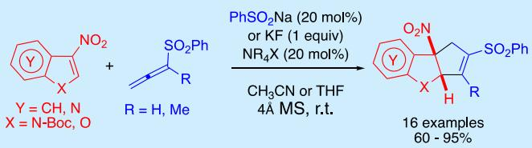
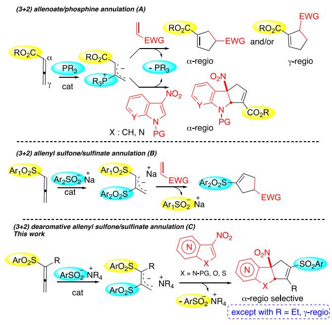
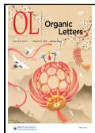
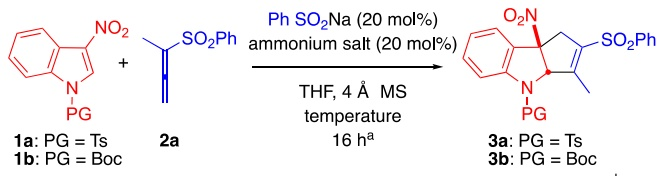
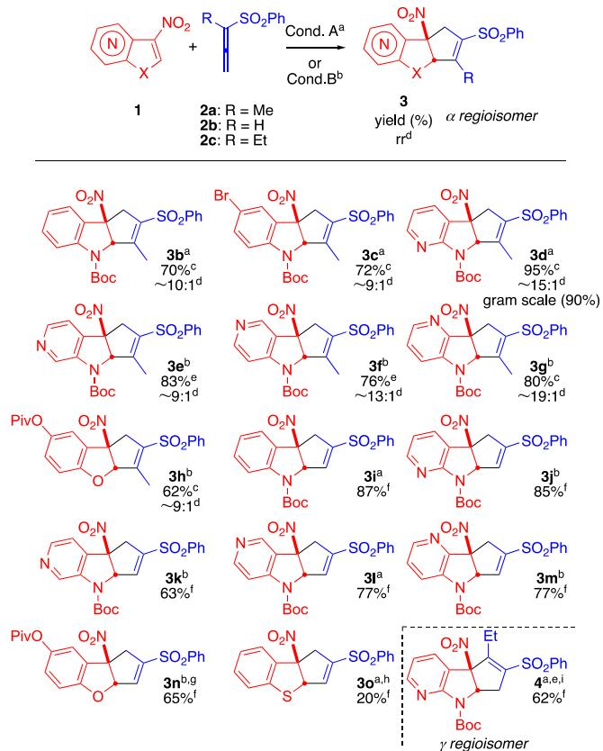
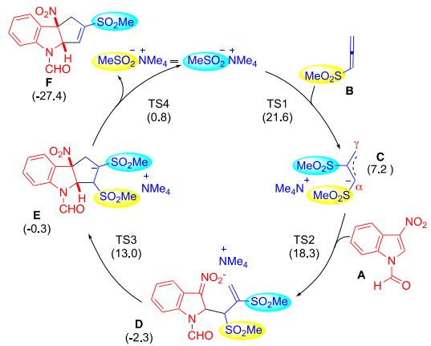
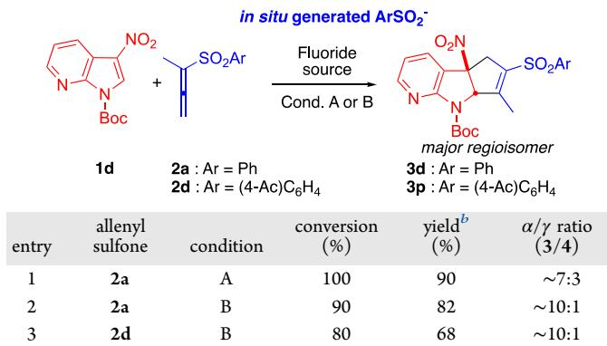
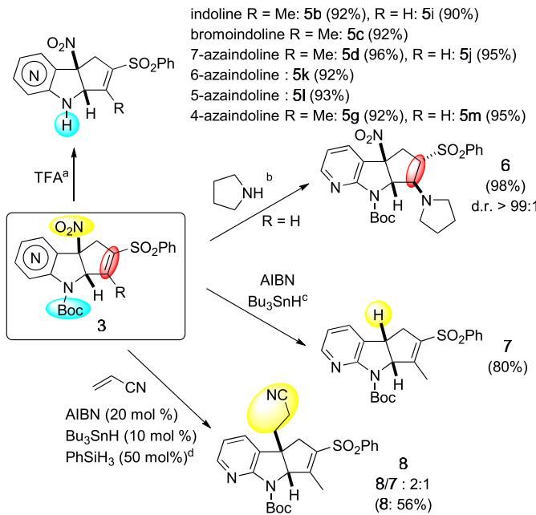

pubs.acs.org/OrgLett

Letter

# Dearomative (3 + 2) Cycloadditions of 3‑Nitroheteroarenes with Allenyl Sulfones Mediated by Ion Pair Organocatalysis

Léo Birbaum, Moussa Ndiaye, Mahmoud Hachem, Stéphane Perrio, Michael De Paolis,\* and Isabelle Chataigner\*

Cite This: Org. Lett. 2025, 27, 1729−1734

ACCESS

Metrics & More

Read Online

ABSTRACT: We report the first example of dearomative (3 + 2) cycloadditions of 3-nitro(aza)-indole, -benzofuran, and -benzothiophene derivatives in the presence of allenyl sulfones, using sulfinate ammonium ion pairs as organocatalytic promoters. The methodology provides a new, facile, and eficient protocol for the synthesis of functionalized 2,3-fused cyclopentannulated indolines and dihydrobenzofurans.

D earomatization reactions are valuable tools in organic synthesis, generating three-dimensional (3D) molecules from easily accessible raw substrates.1 However, the disruption of the stable aromatic π system makes their development challenging from both kinetic and thermodynamic viewpoints. In this context, electron-rich indoles have been used in many alkaloid syntheses, taking advantage of their C3 nucleophilicity.2 In a complementary way, N-protected 3-nitroindoles have recently become privileged scafolds, with their C2�C3 double bond displaying an electrophilic behavior akin to nitrostyrenes.3 In the presence of electron-rich 1,3-dipoles, several dearomatizing (3 + 2) cycloadditions have been reported with 3-nitroindoles, allowing elegant generation of tricyclic indolines. 3a,4

The addition of catalytic phosphines to allenoates generates 1,3-dipoles, which can react with Michael acceptors to form α- and/or γ-regioisomeric cyclopentenes (Scheme 1A, top).5 Recently, it has been shown that nitroheteroaromatics also react with these dipoles to generate cyclopentaindolines, with an exclusive α-regioselectivity (Scheme 1A, bottom).6

As alternative electron-deficient allenes, allenyl sulfones exhibit distinct reactivity in (3 + 2) annulations in the presence of a sulfinate promoter (Scheme 1B).7,8 This sulfinate is incorporated into the cycloadduct, while a sulfinate anion derived from the starting allenyl sulfone is released. As a result, sulfinate can be used in catalytic amounts if it is similar to the sulfonyl group on allene. These (3 + 2) annulations have been extended to a few classical (hetero)dipolarophiles, including acrylonitrile, methyl ketones, cyclic carbonyl compounds, or imines.9 Noteworthy, employing a sulfinate−ammonium (ArSO − R N+) cooperative ion pair as a promoter has proven beneficial, expanding the scope of this chemistry to a broader range of substrates.9e−h

Building upon our previous studies of cycloadditions with electrophilic arenes,10 we now report the first dearomatization of 3-nitroheteroaromatics using allenyl sulfones, catalyzed by

Article Recommendations

\*sı Supporting Information

## Scheme 1. (3 + 2) Annulations Involving Electron-Deficient Allenes

  
sulfinate ammonium ion pairs, leading to novel dearomatized sulfonyl-substituted cyclopentannulated heterocycles (Scheme 1C).

Received: January 17, 2025   
Revised: January 31, 2025   
Accepted: February 4, 2025   
Published: February 8, 2025

<table><tr><td colspan="2"></td><td rowspan="2"></td><td rowspan="2"></td><td rowspan="2"></td><td rowspan="2">major regioisomerb</td></tr><tr><td></td><td></td></tr><tr><td>entry</td><td>indole</td><td>ammonium salt</td><td>temperature (°C)</td><td>conversion (%)</td><td>yield (%)</td></tr><tr><td>1</td><td>1a</td><td>nBu4NCl</td><td>45</td><td>35</td><td></td></tr><tr><td>2</td><td>1b</td><td>nBu4NCl</td><td>45</td><td>100</td><td>63</td></tr><tr><td>3</td><td>1b</td><td>nBu4NCl</td><td>25</td><td>100</td><td>70</td></tr><tr><td>4</td><td>1b</td><td>nBu4NCl</td><td>0</td><td>45</td><td></td></tr><tr><td>5</td><td>1b</td><td> $n { \mathrm { B u } } _ { 4 } { \mathrm { N B r } }$ </td><td>25</td><td>60</td><td>50</td></tr><tr><td>6</td><td>1bc</td><td> $n { \bf B u _ { 4 } N C l }$ </td><td>45</td><td>46</td><td></td></tr><tr><td>7</td><td> $\mathbf { 1 6 } ^ { d }$ </td><td> $\mathrm { B n M e } _ { 3 } \mathrm { N C l }$ </td><td>25</td><td>90e</td><td>70</td></tr><tr><td>8</td><td>1b</td><td></td><td>45</td><td>0</td><td></td></tr><tr><td>9</td><td> $\mathbf { 1 6 } ^ { f }$ </td><td> $n { \bf B u } _ { 4 } { \bf N C l }$ </td><td>45</td><td>0</td><td></td></tr></table>

Table 1. Optimization of the Reaction Conditions  
aReaction conditions: compound 1 (1 equiv), compound 2a (1.2 equiv), $\mathrm { P h S O } _ { 2 } \mathrm { N a }$ (20 mol %), ammonium salt (20 mol %), and 4 Å molecular sieves $\left( \mathbf { M } \mathbf { S } \right)$ in THF for 16 h. bAt 9:1 rr. cWith 10 mol % $\mathrm { P h S O } _ { 2 } \mathrm { N a }$ and $n { \mathrm { B u } } _ { 4 } { \mathrm { N C l . } } ~ ^ { d } { \mathrm { I n } } ~ { \mathrm { C H } } _ { 3 } { \mathrm { C N } }$ for 12 h instead of THF for 16 h. eAt 10:1 $\operatorname { r r } . { } ^ { f _ { \mathrm { { I n } } } }$ the absence of $\mathrm { P h } S \mathrm { O } _ { 2 } \mathrm { N a }$

We began our study with 3-nitro-N-tosylindole 1a, as a model of electrophilic arene, $\overset { 3 \mathrm { a } } { \underset {  } { \mathrm { \ell } } }$ in the presence of α- methylallenyl sulfone 2a, 20 mol % sodium benzenesulfinate $\left( \mathrm { P h S O } _ { 2 } \mathrm { N a } \right)$ , and $n { \bf B u _ { 4 } N C l }$ (entry 1 in Table 1). We were

pleased to observe the formation of compound 3a at $45 \ ^ { \circ } \mathrm { C } ,$ resulting from the cycloaddition of the transient allyl sulfone anion at the ${ \mathrm { C } } 2 { = } { \dot { \mathrm { C } } } 3$ double bond of indole. Noteworthy, compound 3a was stable under the reaction conditions, and no bis-adduct resulting from a subsequent addition to the newly formed electron-poor olefin could be detected. Optimization of the reaction conditions showed that N-Boc protection of indole was preferable (entry 2). Complete conversion of the starting material was observed, resulting in $\alpha \cdot$ and $\gamma \mathrm { - }$ regioisomers $[ \sim 9 { : } 1$ regioisomeric ratio (rr)], with compound 3b isolated in a 63% yield. Decreasing the temperature to room temperature led to a similar conversion but slightly higher yield without impact on the rr (entry 3). At a lower temperature, the reaction was less eficient (entry 4). Replacing the chloride counterion with bromine resulted in a lower conversion and yield (entry 5), while diminishing the catalyst loading was detrimental (entry 6). Notably, the nature of the quaternary ammonium salt can be easily changed, as the use of BnMe NCl in $\mathrm { C H } _ { 3 } \mathrm { C N }$ for 12 h and nBu NCl in tetrahydrofuran (THF) for 16 h performed equally well (entry 7). Finally, the reaction required both the presence of sulfinate and ammonium catalysts (entries 8 and 9) (see the Supporting Information for additional details).

With the optimized conditions in hand, we then evaluated the scope of this new process with the variation of nitroarenes and allenyl sulfones (Scheme 2).

Reacting with compound 2a, N-Boc indole 1b, or the corresponding 5-bromoindole furnished the expected cycloadducts 3b and 3c in similar yields and $\alpha / \gamma .$ regioselectivities. 7-Aza-3-nitroindole 1c led to compound 3d in an enhanced 95% yield. A gram-scale experiment was performed with these reagents, yielding compound 3d with a minimal loss of eficiency (90% yield). The isomers of the aza-nitro-indole

Scheme $2 . \left( 3 + 2 \right)$ Annulations Involving 3-Nitro(aza)- indole, -benzofuran, and -benzothiophene Derivatives

  
aReaction condition A: compound 1 (1 equiv), compound 2 (1.2 equiv), $\mathrm { P h S O } _ { 2 } \mathrm { N a }$ (20 mol %), BnMe NCl (20 mol %), and 4 Å MS in $\mathrm { C } \mathrm { \bar { H } } _ { 3 } \mathrm { C N }$ at room temperature or $0 ~ ^ { \circ } \mathrm { C }$ for 16 h. bReaction condition B: compound 1 (1 equiv), compound 2 (1.2 equiv), PhSO Na (20 mol %), nBu $\mathrm { _ { 4 } N C l }$ (20 mol %), and 4 Å MS in THF at room temperature for 16 h. cIsolated yield of the α-regioisomer. $^ { d } \mathrm { { r r } }$ was evaluated by 1H nuclear magnetic resonance (NMR) on crude mixtures; see the Supporting Information for details. eOverall yield for the two regioisomers. fOnly one regioisomer detected by 1H NMR. $^ { g } \mathrm { A t }$ 85% conversion. $^ h \mathrm { A t }$ 50% conversion. iFormation of the $\gamma -$ regioisomer.

scafold were tolerated, and $6 , ~ 5 \AA ,$ and 4-azaindoles were converted into the respective cycloadducts 3e, 3f, and 3g, in 83, 76, and 80% yields, respectively. 3-Nitrobenzofuran was also converted into compound 3h in 62% yield, exhibiting a 9:1 regioselectivity, similar to the results previously observed with (aza)nitroindoles.

Allenyl sulfone 2b (R = H) was then tested in the cycloaddition process. A higher tendency to self-condensation was previously observed with this compound.9b Gratifyingly, under the optimized conditions, the reactivity of compound 2b was selectively directed toward nitroheteroarenes, which were converted into cycloadducts 3i−3n in good yields (63−87%) and exquisite α-regioselectivity in all cases. While inert toward α-methyl allenyl sulfone 2a, 3-nitrobenzothiophene reacted with compound 2b to give compound 3o in 20% yield (50% conversion).

α-Ethylallenyl sulfone 2c proved to be significantly less reactive than compounds 2a and $^ { 2 \mathbf { b } , }$ showing no reaction with 3-nitroindole 1b. In contrast, more electrophilic 7-aza-3- nitroindole 1c was dearomatized at $0 ~ ^ { \circ } \mathrm { C }$ in the presence of this more sterically hindered sulfone.11 Strikingly, in this case, azaindoline 4, isolated in 62% yield, displayed complete $\gamma \mathrm { - }$ regioselectivity, probably for steric reasons.

To have insight into the reaction mechanism, density functional theory (DFT) calculations were undertaken (see the Supporting Information for details). A model 3-nitroindole derivative, A, bearing a formyl group on the nitrogen center of the heterocycle, methanesulfonyl sulfone B, and a methane sulfinate anion associated with a tetramethylammonium cation were considered (Scheme 3).

Scheme 3. Proposed Mechanism and DFT Calculations  
  
aCalculated at the (SMD: $\mathrm { C H } _ { 3 } \mathrm { C N } )$ $\mathrm { M 0 6 2 X } / 6 { \cdot } 3 1 { + } \mathrm { G } ( \mathrm { d } , \mathrm { p } )$ level considering a polarized medium. ΔG values $( \Delta G ^ { \ddagger }$ and $\Delta G _ { \mathrm { r } } )$ in kcal $\mathrm { m o l ^ { - 1 } }$ were computed as the diference between the separated reactants and the transition state (TS)/products.

The addition of methanesulfinate to allenyl sulfone B was found to be a highly activated associative step $( \Delta G ^ { \ddagger } = 2 1 . 6$ kcal $\mathrm { m o l ^ { - 1 } } )$ , leading to allyl sulfone anion C $\bar { ( } \Delta G _ { \mathrm { r } } = 7 . 2$ kcal mol−1) in an endergonic process. The cycloaddition expectedly occurred in two steps, involving first the addition of carbanion at the C2 atom of indole A to generate nitronate D $\left( \Delta G ^ { \ddagger } = \right.$ 18.3 kcal $\mathrm { m o l ^ { - 1 } }$ and $\Delta G _ { \mathrm { r } } ~ { = } ~ - \bar { 2 } . 3$ kcal $\mathrm { m o l } ^ { - 1 } )$ and then its cyclization to give E $\left( \Delta G ^ { \ddagger } = 1 3 . 0 \right.$ kcal $\mathrm { m o l ^ { - 1 } }$ and $\Delta G _ { \mathrm { r } } = - 0 . 3$ kcal $\mathbf { m o l } ^ { - 1 } )$ . Then, the final step consisting of the sulfinate release was almost barrierless $( \hat { \Delta } G ^ { \ddagger } = 0 . 8 $ kcal $\mathrm { m o l ^ { - 1 } } )$ and highly exergonic $\left( \Delta G _ { \mathrm { r } } \ = \ - 2 7 . 4 \right.$ kcal $\mathbf { m o l } ^ { - 1 } )$ . While the formation of allyl sulfone anion C was more energetic than anticipated, the addition to indole appeared to be less energydemanding than expected for a dearomatizing process, suggesting that it is a relatively facile step. Within the cycloaddition process, the first addition step $\bar { ( } \mathbf { A } + \mathbf { C }  \mathbf { D } )$ was the determining step, even if the cyclization step (D to E) exhibited a relatively high barrier $( \Delta G ^ { \ddagger } = 1 3 . 0 \mathrm { k c a l \ m o l ^ { - 1 } }$ , with respect to separated substrates, and 15.3 kcal mol−1, with respect to the adduct D), which was unexpected for an intramolecular cyclization. This is, however, in line with previous data computed with the related dearomatizing allenoate/phosphine $\left( 3 + 2 \right)$ annulation process.6f The final step of the sequence appeared to be favorable from both kinetic and thermodynamic points of view. The stability of cycloadduct F probably drives the reaction to completion by shifting all possible equilibria and explains the whole transformation.

Considering the high energy barrier of the first step of the sequence, we then examined diferent nucleophilic promoters for the reaction. In this regard, sodium nitrites, cyanides, phosphines, or N-heterocyclic carbenes (NHCs) have already been employed to activate allenyl sulfones.9 However, regardless of the promoter, only the formation of sulfonyl cycloadducts was observed, indicating that the acting catalyst in the process is the sulfinate anion itself, generated in situ.

To explore the reaction outcome with a diferent type of promoter, we considered fluorides to promote the addition of compound 1d to compound 2a. As a preliminary result, with $n \mathrm { B u } _ { 4 } \mathrm { N F } ,$ no fluoro-containing product was formed beside the cycloadduct 3c, isolated in 90% yield (entry 1 in Table 2) with

Table 2. (3 + 2) Annulations with an In Situ Generated Sulfinate Anion  

<table><tr><td>entry</td><td>allenyl sulfone</td><td>condition</td><td>conversion (%)</td><td>yieldb (%)</td><td>α/γ ratio (3/4)</td></tr><tr><td>1</td><td>2a</td><td>A</td><td>100</td><td>90</td><td>~7:3</td></tr><tr><td>2</td><td>2a</td><td>B</td><td>90</td><td>82</td><td>~10:1</td></tr><tr><td>3</td><td>2d</td><td>B</td><td>80</td><td>68</td><td>~10:1</td></tr></table>

aReaction condition A: compound 1 (1 equiv), compound 2 (1.5 equiv), TBAF (1 equiv), and 4 Å MS in THF at $0 \mathrm { \Omega } ^ { \bullet } \mathrm { C }$ for 12 h. Reaction condition B: compound 1 (1 equiv), compound 2 (1.5 equiv), KF (1 equiv), $\mathrm { B n M e } _ { 3 } \mathrm { \tilde { N } C l } ,$ and 4 Å MS in $\mathrm { C H } _ { 3 } \mathrm { \dot { C } N }$ at $0 ~ ^ { \circ } \mathrm { C }$ for 16 h. bOverall yield.

the α-regioisomer remaining predominant $\left( 7 { : } 3 ~ \mathrm { r r } \right)$ . This result suggests a mechanism involving the formation of a sulfinate anion triggered by the addition of fluoride ions to allenyl sulfone (see the Supporting Information for a proposed mechanism). To examine the impact of the quaternary ammonium salt, we repeated the reaction between compound 1d and compound 2a using KF and $\mathrm { B n M e } _ { 3 } \mathrm { N C l }$ with success, as a similar yield in compound 3c was obtained (entry 2). Equally striking was the higher rr measured, a value of 10:1 (α/ γ) previously observed with this ammonium salt combined with $\mathrm { P h } S \mathrm { O } _ { 2 } \mathrm { \dot { N } a }$ . From a synthetic viewpoint, this fluoride promoted method allows the formation of diverse arylsulfonylated cycloadducts without requiring the corresponding arenesulfinate anion, thus avoiding scrambling issues when using diferent aryl groups on allenyl sulfone and the sulfinate ion. In addition, it leads to volatile sub-products, which are easy to remove. To illustrate this point, allenyl sulfone $^ { 2 \mathrm { d } , }$ bearing a 4-acetylphenylsulfonyl group, was exposed to compound 1d and the $\mathrm { K F / B n M e } _ { 3 } \mathrm { N C l }$ combination. The corresponding cycloadduct 3p was successfully isolated in 68% yield (entry 3).

Synthetic transformations were then performed along three distinct derivatizations (Scheme 4). First, the nitrogen atom protecting group was removed under acidic conditions, nicely afording (aza)indolines 5b−5m in 90−96% yields. Second, we performed the aza-Michael addition of pyrrolidine, thereby demonstrating the electrophilic character of the vinylsulfone motif of compound 3i and furnishing amino sulfone 6 in a quantitative yield and complete diastereoselectivity. As a last development, we sought to illustrate the versatility of the nitro group, which was pivotal for dearomatization. Hence, radical denitration (AIBN and nBu SnH) of compound 3d led to

## Scheme 4. Post-functionalizations of (Aza)indolinic Cycloadducts 3

  
aTrifluoroacetic acid (TFA) and $\mathrm { C H } _ { 2 } \mathrm { C l } _ { 2 }$ at room temperature for 4 h. bPyrrolidine (5 equiv) and $\mathrm { C H } _ { 2 } \mathrm { C l } _ { 2 }$ at room temperature for 12 h. cAIBN (0.8 equiv), nBu SnH (5 equiv), and toluene at 100 °C for 30 min. dAIBN (0.2 equiv), nBu SnH (0.1 equiv), PhSiH (0.5 equiv), and 4 Å MS in benzene at $8 0 ~ ^ { \circ } \mathrm { C }$ for 5 h, with 86% conversion.

azaindoline 7 in 80% yield. No rearomatization of the central five-membered ring was observed under these conditions. To further increase the molecular diversity, we devised to trap the hindered benzylic intermediate radical species with a Michael acceptor. The challenge of this transformation lies in the existing competition between alkylation and reduction with nBu SnH. After optimization, the best result was obtained when operating with a catalytic amount of nBu SnH (10 mol %) and PhSiH (50 mol %). This method, described by Fu and co-workers,12 was far only applied to the reductive denitration of nitroalkanes. Thus, in a rare example of intermolecular alkylative denitration,13 compound 3d reacted with acrylonitrile to give azaindoline 8 alongside denitrated compound 7 $\left( 8 / 7 = { \bar { 2 } } { : } 1 \right)$ in 56% yield (86% conversion).

In conclusion, we have developed the first dearomatization of 3-nitroheteroarenes with allenyl sulfones to generate $^ { 2 , 3 \cdot }$ fused cyclopentannulated heterocycles bearing a versatile vinylsulfone motif. The process is catalyzed by sulfinate anions, whether added or in situ generated, associated with a quaternary ammonium salt. Unsubstituted or α-methyl allenyl sulfones led to the exclusive or favored formation of the α- regioisomeric cycloadducts, while the less reactive more hindered α-ethyl allenyl sulfone furnished exclusively the γ- regioisomer in reaction with 7-aza-3-nitroindole. The mechanism, supported by a DFT study, suggests a highly energetic sulfonyl anion formation, followed by a two-step cycloaddition and a barrierless sulfinate release. The reactivity of azanitroindoles is especially interesting to exploit, revealing 3D molecules that are pharmaceutically relevant. The diferent derivatizations conducted further demonstrate the versatility of these cycloadducts. We are currently looking to extend the methodology to enantioselective processes through use of chiral ammonium salts.

## ■ ASSOCIATED CONTENT

## Data Availability Statement

The data underlying this study are available in the published article and its Supporting Information.

## \*sı Supporting Information

The Supporting Information is available free of charge at https://pubs.acs.org/doi/10.1021/acs.orglett.5c00215.

Experimental procedures, compound characterization data, spectra, computational details, and Cartesian coordinates (PDF)

## ■ AUTHOR INFORMATION

## Corresponding Authors

Michael De Paolis − Université de Rouen Normandie, CNRS, Normandie Université, INSA Rouen Normandie, COBRA UMR 6014, INC3M FR 3038, F-76000 Rouen, France; orcid.org/0000-0001-8139-3544; Email: michael.depaolis@univ-rouen.fr

Isabelle Chataigner − Université de Rouen Normandie, CNRS, Normandie Université, INSA Rouen Normandie, COBRA UMR 6014, INC3M FR 3038, F-76000 Rouen, France; Sorbonne Université, CNRS, Laboratoire de Chimie Théorique, LCT UMR7616, 75005 Paris, France; orcid.org/0000-0001-6302-7831; Email: isabelle.chataigner@univ-rouen.fr

## Authors

Léo Birbaum − Université de Rouen Normandie, CNRS, Normandie Université, INSA Rouen Normandie, COBRA UMR 6014, INC3M FR 3038, F-76000 Rouen, France

Moussa Ndiaye − Université de Rouen Normandie, CNRS, Normandie Université, INSA Rouen Normandie, COBRA UMR 6014, INC3M FR 3038, F-76000 Rouen, France

Mahmoud Hachem − Université de Rouen Normandie, CNRS, Normandie Université, INSA Rouen Normandie, COBRA UMR 6014, INC3M FR 3038, F-76000 Rouen, France

Stéphane Perrio − Université de Caen Normandie, ENSICAEN, CNRS, LCMT, Normandie Université, 14000 Caen, France; orcid.org/0000-0002-3371-2405

Complete contact information is available at: https://pubs.acs.org/10.1021/acs.orglett.5c00215

## Notes

The authors declare no competing financial interest.

## ■ ACKNOWLEDGMENTS

Labex SynOrg (ANR-11-LABX-0029), Carnot Institute I2C, Graduate School for Research XL-Chem (ANR-18-EURE-0020 XL CHEM), Région Normandie Rouen University, CNRS, and INSA Rouen are thanked for financial support as well as CRIANN (Saint Etienne du Rouvray, France) for the generous allocation of computer time.

## ■ REFERENCES

(1) See for instance (a) Wertjes, W. C.; Southgate, E. H.; Sarlah, D. Recent Advances in Chemical Dearomatization of Nonactivated Arenes. Chem. Soc. Rev. 2018, 47 (21), 7996−8017. (b) Zheng, C.; You, S.-L. Advances in Catalytic Asymmetric Dearomatization. ACS Cent. Sci. 2021, 7 (3), 432−444. (c) Wang, J.; Luo, H.; Wang, X.; Wei, D.; Tian, R.; Duan, Z. Dearomatization [4 + 2] Cycloaddition of

Nonactivated Benzene Derivatives. Org. Lett. 2022, 24 (24), 4404− 4408. (d) Escolano, M.; Gaviña, D.; Alzuet-Piña, G.; Díaz-Oltra, S.; Sánchez-Roselló, M.; Pozo, C. D. Recent Strategies in the Nucleophilic Dearomatization of Pyridines, Quinolines, and Isoquinolines. Chem. Rev. 2024, 124 (3), 1122−1246.

(2) See for instance (a) Roche, S. P.; Youte Tendoung, J.-J.; Tréguier, B. Advances in Dearomatization Strategies of Indoles. Tetrahedron 2015, 71 (22), 3549−3591. (b) Sheng, F.-T.; Wang, J.- Y.; Tan, W.; Zhang, Y.-C.; Shi, F. Progresses in Organocatalytic Asymmetric Dearomatization Reactions of Indole Derivatives. Org. Chem. Front. 2020, 7 (23), 3967−3998. (c) Mei, G.-J.; Koay, W. L.; Tan, C. X. A.; Lu, Y. Catalytic Asymmetric Preparation of Pyrroloindolines: Strategies and Applications to Total Synthesis. Chem. Soc. Rev. 2021, 50 (10), 5985−6012. (d) Wu, W.-T.; Ding, L.; Zhang, L.; You, S.-L. Gold-Catalyzed Intramolecular Dearomatization Reactions of Indoles for the Synthesis of Spiroindolenines and Spiroindolines. Org. Lett. 2020, 22 (4), 1233−1238.

(3) For a review on 3-nitroindole, see for instance (a) Rkein, B.; Bigot, $\mathbf { A } . ;$ Birbaum, L.; Manneveau, M.; De Paolis, M.; Legros, J.; Chataigner, I. Reactivity of 3-Nitroindoles with Electron-Rich Species. Chem. Commun. 2021, 57 (1), 27−44. For the characterization of their electrophilic character, see (b) Rkein, B.; Manneveau, M.; Noël-Duchesneau, L.; Pasturaud, K.; Durandetti, M.; Legros, J.; Lakhdar, S.; Chataigner, I. How Electrophilic Are 3-Nitroindoles? Mechanistic Investigations and Application to a Reagentless (4 + 2) Cycloaddition. Chem. Commun. 2021, 57 (78), 10071−10074. For recent examples of their reactivity in (4 + 2) dearomatization annulations, see for instance (c) Dou, P.-H.; Yuan, S.-P.; Chen, Y.; Zhao, J.-Q.; Wang, Z.-H.; You, Y.; Zhang, Y.-P.; Zhou, M.-Q.; Yuan, W.-C. Dearomatization of 3-Nitroindoles Enabled Using Palladium-Catalyzed Decarboxylative [4 + 2] Cycloaddition of 2-Alkylidenetrimethylene Carbonates. J. Org. Chem. 2022, 87, 6025−6037. (d) Zou, W.-L.; Liu, Y.-Q.; Li, Q.-Z.; Kou, X.-X.; Huang, H.; Tong, R.-S.; Li, J.- L.; Han, B. Dearomative Tandem Annulation to Access Chiral Indoline-Fused Bicyclo[2.2.2]Octanes Using Modularly Designed Organocatalysts. Org. Chem. Front. 2023, 10, 1237−1244. (e) Zhou, S.; Qian, H.-L.; Zhao, J.-Q.; You, Y.; Wang, Z.-H.; Yin, J.-Q.; Zhang, Y.-P.; Chen, M.-F.; Yuan, W.-C. Diastereoselective Synthesis of Polycyclic Indolines via Dearomative [4 + 2] Cycloaddition of 3- Nitroindoles with Ortho -Aminophenyl p -Quinone Methides. Org. Biomol. Chem. 2023, 21, 1373−1378. (f) Pandit, S.; Pandey, V. K.; Adhikari, A. S.; Kumar, S.; Maurya, A. K.; Kant, R.; Majumdar, N. Palladium-Catalyzed Dearomative [4 + 2]-Cycloaddition toward Hydrocarbazoles. J. Org. Chem. 2023, 88 (1), 97−105. (g) Wang, K.; Li, Y.; Li, L.; Yao, W.; Li, Y.; Wang, W.; Chen, R.; Hu, Y.; Sun, A. Dearomative [4 + 2] Cycloaddition of 3-nitroindoles with Ortho -amino Morita−Baylis−Hillman Carbonates to Forge Indole-fused Quinolines. J. Heterocyclic Chem. 2024, 61 (3), 528−537.

(4) See for instance (a) Wang, N.; Ren, J.; Li, K. Dearomatization of Nitro(hetero)arenes through Annulation. Eur. J. Org. Chem. 2022, 2022 (18), No. e202200039. (b) Yuan, W.-C.; Chen, X.-M.; Zhao, J.- Q.; Zhang, Y.-P.; Wang, Z.-H.; You, Y. Ag-Catalyzed Asymmetric Interrupted Barton−Zard Reaction Enabling the Enantioselective Dearomatization of 2- and 3-Nitroindoles. Org. Lett. 2022, 24 (3), 826−831. (c) Chen, Y.; Zhao, J.-Q.; Zhang, Y.-P.; Zhou, M.-Q.; Zhang, X.-M.; Yuan, W.-C. Copper-Catalyzed Asymmetric Dearomative [3 + 2] Cycloaddition of Nitroheteroarenes with Azomethines. Molecules 2023, 28 (6), 2765. (d) Dou, P.-H.; Fu, X.- H.; Chen, Y.; Ge, Z.-Z.; Zhou, M.-Q.; Wang, Z.-H.; You, Y.; Yang, L.; Zhang, Y.-P.; Zhao, J.-Q.; Yuan, W.-C. Palladium-Catalyzed Asymmetric Decarboxylation of 5-Vinyloxazolidine-2,4-Diones Triggering the Dearomatization of Electron-Deficient Indoles for the Synthesis of Chiral Highly Functionalized Pyrroloindolines. Org. Lett. 2024, 26 (15), 3310−3315.

(5) For seminal work, see (a) Zhang, C.; Lu, X. Phosphine-Catalyzed Cycloaddition of 2,3-Butadienoates or 2-Butynoates with Electron-Deficient Olefins. A Novel [3 + 2] Annulation Approach to Cyclopentenes. J. Org. Chem. 1995, 60, 2906−2908. For a review, see for instance (b) Wei, Y.; Shi, M. Lu’s [3 + 2] Cycloaddition of Allenes

with Electrophiles: Discovery, Development and Synthetic Application. Org. Chem. Front. 2017, 4 (9), 1876−1890.

(6) (a) Wang, H.; Zhang, J.; Tu, Y.; Zhang, J. Phosphine-Catalyzed Enantioselective Dearomative [3 + 2]-Cycloaddition of 3-Nitroindoles and 2-Nitrobenzofurans. Angew. Chem., Int. Ed. 2019, 58, 5422−5426. (b) Li, $\mathrm { K . } ;$ Gonçalves, T. $\mathrm { P . ; }$ Huang, K.-W.; Lu, Y. Dearomatization of 3-Nitroindoles by a Phosphine-Catalyzed Enantioselective [3 + 2] Annulation Reaction. Angew. Chem., Int. Ed. 2019, 58, 5427−5431. (c) Jin, L.-W.; Jiang, F.; Chen, K.-W.; Du, B.-X.; Mei, G.-J.; Shi, F. Phosphine-Catalyzed Regiospecific (3 + 2) Cyclization of 3-Nitroindoles with Allene Esters. Org. Biomol. Chem. 2019, 17, 3894−3901. (d) Liu, K.; Wang, G.; Cheng, S.-J.; Jiang, W.- F.; He, C.; Ye, Z.-S. Phosphine-Catalyzed Dearomative $\left[ 3 ~ + ~ 2 \right]$ Annulation of 3-Nitroindoles and Allenoates. Tetrahedron Lett. 2019, 60, 1885−1890. (e) Cerveri, A.; Faza, O. N.; López, C. S.; Grilli, S.; Monari, M.; Bandini, M. Phosphine-Catalyzed Stereoselective Dearomatization of 3-NO -Indoles with Allenoates. J. Org. Chem. 2019, 84, 6347−6355. (f) Birbaum, L.; Gillard, L.; Gérard, H.; Oulyadi, H.; Vincent, G.; Moreau, X.; De Paolis, M.; Chataigner, I. Dearomatization of 3-Nitroindoles with Highly γ-Functionalized Allenoates in Formal (3 + 2) Cycloadditions. Chem. - Eur. J. 2019, 25 (60), 13688−13693.

(b) Yadav, D.; Menon, R. S. Recent Developments in the Chemistry of Allenyl Sulfones. Org. Biomol. Chem. 2020, 18, 365−378.

(8) For seminal work on these annulations, see (a) Padwa, A.; Yeske, P. E. Synthesis of Cyclopentenyl Sulfones via the [3 + 2] Cyclization-Elimination Reaction of (Phenylsulfonyl)allene. J. Am. Chem. Soc. 1988, 110 (5), 1617−1618. (b) Padwa, $\mathbf { A . } ;$ Yeske, P. E. [3 + 2] Cyclization-Elimination Route to Cyclopentenyl Sulfones Using (Phenylsulfonyl)-1,2-Propadiene. J. Org. Chem. 1991, 56 (22), 6386−6390.

(9) See for instance (a) Moreno-Clavijo, E.; Carmona, A. T.; Reissig, H.-U.; Moreno-Vargas, A. J.; Alvarez, E.; Robina, I. Allenyl Sulfones and Allenyl Sulfides in the Synthesis of 3-Pyrrolines. A Novel Nucleophilic [3 + 2] Cycloaddition on Allenyl Sulfones Giving Rearranged Cycloadducts. Org. Lett. 2009, 11 (21), 4778−4781. (b) Nuń̃ez, A.; Martín, M. R.; Fraile, A.; García Ruano, J. L. Abnormal Behaviour of Allenylsulfones under Lu’s Reaction Conditions: Synthesis of Enantiopure Polyfunctionalised Cyclopentenes. Chem. - Eur. J. 2010, 16 (18), 5443−5453. (c) Flasz, J. T.; Hale, K. J. A New Stereocontrolled Synthetic Route to (−)-Echinosporin from d -Glucose via Padwa Allenylsulfone [3 + 2]-Anionic Cycloadditive Elimination. Org. Lett. 2012, 14 (12), 3024−3027. (d) Xiong, Z.; Hale, K. J. Total Synthesis of the Antitumor Macrolides, (+)-Brefeldin A and 4-Epi-Brefeldin A from d -Glucose: Use of the Padwa Anionic Allenylsulfone [3 + 2]-Cycloadditive Elimination to Construct Trans-Configured Chiral Cyclopentane Systems. Org. Lett. 2016, 18 (17), 4254−4257. (e) Martzel, T.; Lohier, J.-F.; Gaumont, A.-C.; Briere,̀ J.- F.: Perrio, S. Unique Reactivity of α-Substituted Electron-Deficient Allenes Using Sulfinate Salts as Lewis Base Organocatalysts. Adv. Synth. Catal. 2017, 359 (1), 96−106. (f) Kuwano, S.; Masuda, T.; Yamaguchi, $\mathrm { K . } ;$ Arai, T. N-Heterocyclic Carbene-Promoted [3 + 2] Cycloaddition of Allenyl Sulfone and Arylidenemalononitriles. Heterocycles 2017, 95 (1), 232. (g) Martzel, T.; Lohier, J.; Gaumont, A.; Briere, ̀ $\mathrm { J . ; }$ Perrio, S. Sulfinate-Organocatalyzed (3 + 2) Annulation Reaction of Propargyl or Allenyl Sulfones with Activated Imines. Eur. J. Org. Chem. 2018, 2018, 5069−5073. (h) Martzel, $\mathrm { T } . \mathrm { } _ { \mathrm { \cdot } } ^ { }$ Lohier, J.; Gaumont, $\mathbf { A . } ;$ Briere,̀ J.; Perrio, S. Sulfinate-Organocatalyzed (3 + 2) Annulation of Allenyl Sulfones with 1,1-Dicyano Olefins in the Presence of a Quaternary Ammonium Phase Transfer Agent. Adv. Synth Catal 2018, 360 (14), 2696−2706.

(10) See for instance (a) Chataigner, I.; Hess, E.; Toupet, L.; Piettre, S. R. Activation of the Dienophilicity of Indoles in Normal Electron Demand [4 + 2] Cycloadditions under High Pressure. Org. Lett. 2001, 3 (4), 515−518. (b) Chataigner, $\mathrm { I . } \mathrm { \Omega }$ Piettre, S. R. Multicomponent Domino $[ 4 + 2 ] / [ 3 + 2 ]$ Cycloadditions of Nitroheteroaromatics: An Efficient Synthesis of Fused Nitrogenated Polycycles. Org. Lett. 2007,

(h) Faye, Y.; Rkein, B.; Bigot, A.; Lequeux, T.; Legros, J.; Chataigner, I. Photocatalyzed (3 + 2) Cycloaddition for the Dearomatization of Electron-Poor Arenes under Flow Conditions. Chem. - Eur. J. 2023, 29 (49), No. e202301567. (i) Powderly, M.; Roseau, M.; Frison, G.; Harrowven, D.; Legros, J.; Chataigner, I.; Hammami, R.; Chausset-Boissarie, L. Controlling Diastereoselectivity in Dearomatizing Diels-Alder Reactions of Nitroarenes with 2-Trimethylsilyloxycyclohexadiene. Chem. - Eur. J. 2024, 30 (34), No. e202303697.

(11) At a higher temperature, the competing formation of 1,2- diphenylsulfonylpent-2-ene was predominant.

(12) Tormo, J.; Hays, D. S.; Fu, G. C. Bu SnH-Catalyzed Reduction of Nitroalkanes to Alkanes. J. Org. Chem. 1998, 63 (16), 5296−5297.

(13) A recent contribution showed a photocatalytic denitrative alkenylation of nitroalkanes. See Osawa, A.; Uemura, K.; Murakami, S.; Nakao, Y. Photocatalytic Denitrative Alkenylation of Nitroalkanes. Org. Lett. 2024, 26 (48), 10218−10223.