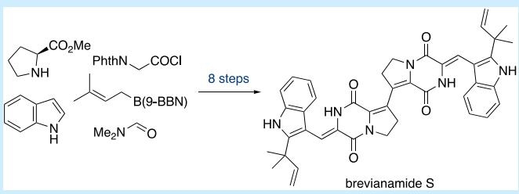
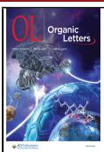
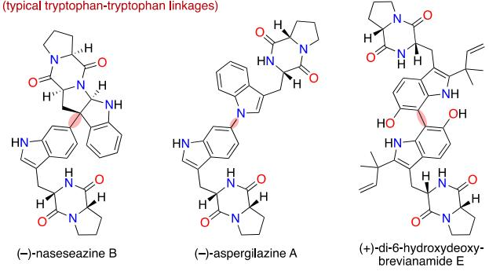
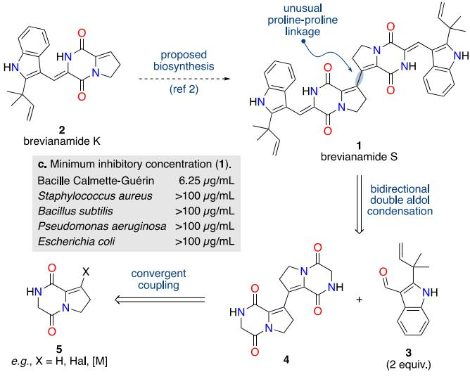
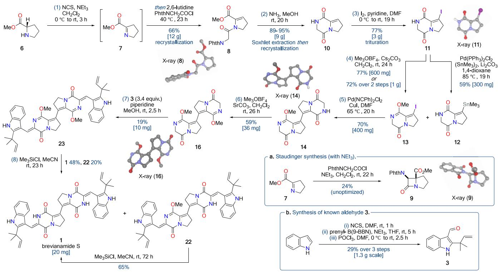
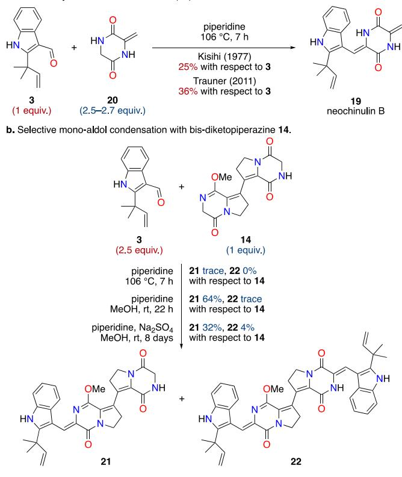
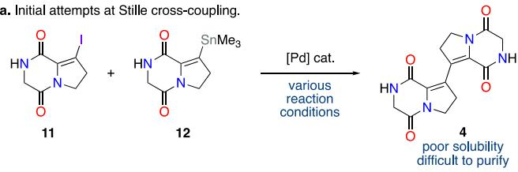
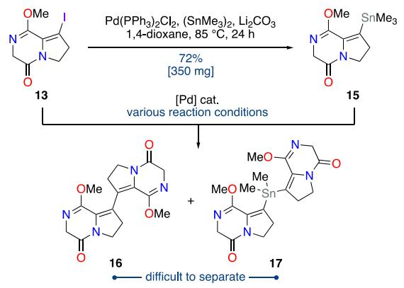
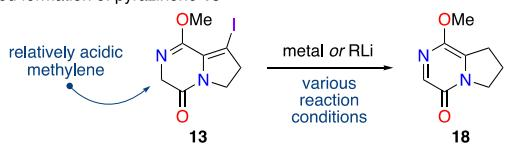

pubs.acs.org/OrgLett

Letter

# Total Synthesis of Brevianamide S

Adam R. Lockyer, Helen E. Jones, Nicholas J. Green, Robert C. Godfrey, Vera P. Demertzidou, Gary S. Nichol, and Andrew L. Lawrence\*

Cite This: Org. Lett. 2025, 27, 3715−3719

Read Online

ACCESS

Metrics & More

ABSTRACT: The first total synthesis of the alkaloid brevianamide S has been achieved in eight steps. This natural product, isolated from Aspergillus versicolor, exhibits selective antibacterial activity against Bacille Calmette-Gueriń (BCG), a commonly used surrogate for Mycobacterium tuberculosis. Brevianamide S is proposed to act through a novel, yet-to-be-elucidated mechanism, making it a promising lead in the development of next-generation antitubercular agents. Our approach employs a bidirectional synthetic strategy, involving a bespoke alkenyl−alkenyl Stille

Article Recommendations

\*sı Supporting Information

cross-coupling reaction and a double aldol condensation. This represents a flexible and eficient platform for the future synthesis of structurally diverse analogues.

stitute a vast and diverse family of bioactive natural products.1 The biogenesis of these dimers is typically a result of the rich redox chemistry of the constituent tryptophan units, as reflected in their tryptophan-tryptophan linkages (Scheme 1a). Brevianamide S (1) is a dimeric diketopiperazine alkaloid produced by the fungus Aspergillus versicolor (MF030),2 which stands out due to its distinctive proline−proline linkage (Scheme 1b).3 It was discovered during a screen of marinederived microbes against Bacille Calmette-Gueriń (BCG), a weakened strain of the bovine tuberculosis bacillus Mycobacterium bovis.2 Brevianamide S (1) was found to selectively inhibit the growth of BCG (MIC 6.25 μg/mL), which is a valuable screening surrogate for Mycobacterium tuberculosis,4 without significant activity against other Gram-positive or Gramnegative bacteria tested (Scheme 1c).2 This specificity suggests that brevianamide S (1) may act through a novel mechanism of action, potentially making it a promising lead compound for the development of antitubercular drugs.5

Brevianamide S (1) is proposed to form via oxidative homodimerization of brevianamide K (2),2 a coisolated natural product which has been isolated from various Aspergillus fungi (Scheme 1b).3 While a late-stage oxidative coupling strategy might represent an eficient route to brevianamide S (1), we opted to explore an ambitious three-component coupling strategy (Scheme 1b),6 which would lay the groundwork for a general synthetic strategy for accessing diverse structural analogues. Retrosynthetic analysis revealed that a double aldol transform of brevianamide S (1) generates known aldehyde 3 and a bis-diketopiperazine 4 (Scheme 1b).7 Although aware of the challenges associated with performing aldol condensations on similar diketopiperazines,7,8 we deemed the potential gain in step economy, and the future potential for exploring structural diversity, worth the challenge. A central disconnection of bis-diketopiperazine 4 gives a monomeric unsaturated diketopiperazine 5. Although no direct literature precedent exists for this specific alkenyl−alkenyl coupling, many synthetic variants of the generalized building block 5 are conceivable. We ventured that successful implementation of this unique C−C coupling and the daunting double aldol condensation would enable a highly concise synthesis of brevianamide S (1) (Scheme 1b).

The synthesis began with a one-pot oxidation/N-acylation of proline methyl ester 6 (Scheme 2).9 The initial dehydrogenation to access dehydroproline 7 was achieved using Nchlorosuccinimide and triethylamine, which was followed by addition of phthalylglycyl chloride and 2,6-lutidine to give enamide 8 in 66% yield on multigram scale, following recrystallization. It should be noted that the choice of base for the imine acylation process is important, with stronger bases, such as triethylamine, resulting in an unwanted (2 + 2)- Staudinger synthesis of β-lactam 9 (Scheme 2a).10 Ammonia in methanol results in clean deprotection of the phthaloylprotected amine 8, with spontaneous cyclization giving diketopiperazine 10 in near quantitative yields, following Soxhlet extraction of phthalamide and subsequent recrystallization.11 Preliminary attempts at direct oxidative homocoupling of diketopiperazine 10 failed to give any promising results. However, when diketopiperazine 10 was exposed to iodine and

## Scheme 1. Brevianamide S (1) and Related Alkaloids

a. Representative tryptophan-proline diketopiperazine alkaloid dimers. (typical tryptophan-tryptophan linkages) pyridine, alkenyl iodide 11 could be obtained in 77% yield on multigram scale, with purification achieved by simple trituration (Scheme 2). Thus, we have developed an eficient, scalable, and chromatography-free three-step synthesis of alkenyl iodide 11, a key intermediate in this synthesis that is also likely to serve as a broadly useful synthetic building block.

  
b. Structure, proposed biosynthesis and retrosynthetic analysis of brevianamide S (1).

Attempts at Ullmann homocoupling of iodide 11 and Hecktype cross-coupling with the parent diketopiperazine 10 were unsuccessful. Many other tactics were also investigated, including numerous cross-coupling and homocoupling reactions of various intermediates, with frustratingly little success (see Tables S1−4 in the Supporting Information (SI) for full details). Organotin 12 could be accessed in 59% yield on 300 mg scale by coupling iodide 11 with hexamethylditin under standard Pd-catalyzed conditions (Scheme 2). Attempts at the cross-coupling of iodide 11 and organotin 12 gave tantalizing evidence that the key C−C bond formation was occurring (Scheme 3a). However, this Stille reaction was frustrated by the bis-diketopiperazine 4 being highly insoluble and dificult to purify. Therefore, the secondary lactam in iododiketopiperazine 11 was first converted into a methyl lactim ether 13 (Scheme 2).12 The hope was this would not only give more soluble, easy-to-handle compounds but also activate the neighboring methylene position for the challenging aldol chemistry later in the synthesis,13 vide infra. A Stille crosscoupling of iodide 13 and organotin 12 was achieved using bis(benzonitrile)palladium dichloride as the precatalyst and copper(I) iodide as an additive to give over 400 mg of bisdiketopiperazine 14 in a single batch, in 70% yield (Scheme 2).14 The organotin methyl lactim ether 15 is also a competent coupling partner for a Stille cross-coupling reaction with iodide 13, but the desired product 16 is not easily separated from a minor dimeric organotin product 17 (Scheme 3b). It is worth

Scheme 2. Total Synthesis of Brevianamide S (1)a  
  
aReaction scales: The quantity of product made in the largest scale reactions conducted is shown in square brackets.

## Scheme 3. Attempted Functionalization and Coupling Reactions of Alkenyl Iodides 11 and 13

b. Synthesis of organotin 15 and subsequent Stille cross-coupling.

c. Unwanted formation of pyrazinone 18.

noting that many other attempts to access organometallic intermediates of methyl lactim ether 13, via metalation or lithium-halogen exchange, were unproductive due to facile formation of pyrazinone 18, which we attribute to the relatively acidic methylene position in iodide 13 (Scheme 3c) (see Table S7 in the SI for full details).

With practical quantities of monomethylated bis-diketopiperazine 14 in-hand, the three-component double aldol condensation could be investigated (Scheme 4). The known aldehyde 3 was prepared on gram scale following literature procedures (Scheme 2b).7 Aldol condensations between diketopiperazines and aldehydes have been successfully exploited in several natural product syntheses,15 but they are often hampered by low yields. A particularly pertinent example can be found in the total synthesis of neochinulin B (19) by Kishi and co-workers,8 where a final aldol condensation between aldehyde 3 and unsaturated diketopiperazine 20 was used (Scheme 4a). This aldol condensation was also employed by Trauner and co-workers to prepare 19 as an intermediate in their synthesis of variecolortide B.7 The low yields of neochinulin B (19) achieved by both the Kishi and Trauner groups (25% and 36% yield, respectively) are typical of such aldol condensations,15 even when the diketopiperazine 20 is used in excess (Scheme 4a). Moreover, the tactic of using excess diketopiperazine to maximize yield is not amenable to a double aldol condensation, as it would likely result in single aldol condensation. Preliminary attempts at the double aldol condensation between bis-diketopiperazine 14 and excess aldehyde 3 in piperidine under reflux (i.e., the conditions used by Kishi and Trauner) led to very limited product formation, with extensive decomposition observed (Scheme

## Scheme 4. Attempted Aldol Condensations of Diketopiperazine 14

a. Previous syntheses of neochinulin B (19)

4b). Following a screen of reaction conditions, it was found that conducting the reaction at ambient temperature in methanol resulted in a selective single aldol condensation occurring exclusively adjacent to the lactim-ether, giving monoadduct 21 in 64% isolated yield (Scheme 4b). Even when the aldol condensation was left for several days and sodium sulfate was added as a dehydrating agent the doublealdol adduct 22 was only isolated in 4% yield, with the monoadduct 21 still representing the major product (Scheme 4b). Therefore, to enable a double aldol condensation, the remaining secondary lactam of bis-diketopiperazine 14 was first methylated to give double methyl lactim ether 16 in 59% yield (Scheme 2) (see Table S5 in the SI for full details). A double aldol condensation between bis-diketopiperazine 16 and aldehyde 3 was then achieved using piperidine in methanol at ambient temperature to give dimethyl-brevianamide S (23) in 19% yield. Although a seemingly modest yield, this equates to a 44% yield per-aldol condensation.7,8 Final deprotection of the secondary lactams using trimethylsilyl chloride in acetonitrile proceeded in 48% yield,16 thus completing the first total synthesis of brevianamide S (1) in 8 steps (longest linear sequence).11 The deprotection did not go to full conversion, with the monodeprotected material 22 isolated in 20% yield. Resubjecting this material to the deprotection conditions allowed for more brevianamide S (1) to be accessed, in 65% yield (Scheme 2). The spectroscopic data for our synthetic brevianamide S (1) matched perfectly with that reported by Capon and co-workers,2 thus confirming that the total synthesis had been achieved (see Table S6 in the SI for full details).

In summary, the first total synthesis of a proline−proline linked diketopiperazine-alkaloid dimer has been achieved following a bidirectional three-component coupling strategy.

To achieve this synthesis, a bespoke alkenyl−alkenyl Stille cross-coupling reaction and a double aldol condensation were developed. This represents a flexible synthetic strategy, which can now be leveraged to access diverse structural analogues. For example, the selective single aldol condensation of bisdiketopiperazine 14 (Scheme 4b), although not important for this target-orientated synthesis, will be of great utility for the future synthesis of nonsymmetrical analogues of brevianamide S (1).

## ■ ASSOCIATED CONTENT

## Data Availability Statement

The data underlying this study are available in the published article, in its Supporting Information, and are openly available in ACS Chemistry Databank at DOI:10.5061/dryad.0rxwdbsbz.

## \*sı Supporting Information

The Supporting Information is available free of charge at https://pubs.acs.org/doi/10.1021/acs.orglett.5c00860.

Experimental procedures, optimization of reaction conditions, details of failed experiments, and NMR spectra for all new compounds. (PDF)

## Accession Codes

Deposition Numbers 2426508−2426516 contain the supplementary crystallographic data for this paper. These data can be obtained free of charge via the joint Cambridge Crystallographic Data Centre (CCDC) and Fachinformationszentrum Karlsruhe Access Structures service.

## ■ AUTHOR INFORMATION

## Corresponding Author

Andrew L. Lawrence − EaStCHEM School of Chemistry, University of Edinburgh, Edinburgh EH9 3FJ, U.K.; orcid.org/0000-0002-9573-5637; Email: a.lawrence@ ed.ac.uk

## Authors

Adam R. Lockyer − EaStCHEM School of Chemistry, University of Edinburgh, Edinburgh EH9 3FJ, U.K.

Helen E. Jones − EaStCHEM School of Chemistry, University of Edinburgh, Edinburgh EH9 3FJ, U.K.; Present Address: AstraZeneca, The Discovery Centre, Cambridge Biomedical Campus, 1 Francis Crick Avenue, Cambridge CB2 0AA, U.K

Nicholas J. Green − EaStCHEM School of Chemistry, University of Edinburgh, Edinburgh EH9 3FJ, U.K.; Present Address: Department of Chemistry, University of Otago, Dunedin 9054, New Zealand.; orcid.org/0000-0002- 3874-7359

Robert C. Godfrey − EaStCHEM School of Chemistry, University of Edinburgh, Edinburgh EH9 3FJ, U.K.

Vera P. Demertzidou − EaStCHEM School of Chemistry, University of Edinburgh, Edinburgh EH9 3FJ, U.K.; Present Address: Laboratory of Organic Chemistry, Department of Chemistry, National and Kapodistrian University of Athens, Panepistimiopolis 15771, Athens, Greece.; orcid.org/0000-0002-9339-8964

Gary S. Nichol − EaStCHEM School of Chemistry, University of Edinburgh, Edinburgh EH9 3FJ, U.K.; orcid.org/ 0000-0002-1597-3679

Complete contact information is available at: https://pubs.acs.org/10.1021/acs.orglett.5c00860

## Author Contributions

A.R.L. designed and performed the experiments and analyzed experimental data. H.E.J., N.G.J., R.C.G. and V.P.D. conducted preliminary/ancillary experiments and contributed to the design of experiments. G.S.N. performed the crystallographic studies. A.L.L. directed the investigations and prepared the manuscript with contributions from all authors; all authors contributed to discussions.

## Notes

The authors declare no competing financial interest.

## ■ ACKNOWLEDGMENTS

This work was supported by funding from the European Research Council (ERC) under the European Union’s Horizon 2020 research and innovation programme (Grant Agreement No. 759552), a Marie Curie Career Integration Grant (631132, POSIN), and by the EPSRC (EP/N029542/ 1). Data for compounds 8 and 14 were collected remotely at beamline I-19 of Diamond Light Source (award CY35994). A.R.L. and H.E.J. thank the University of Edinburgh for the provision of studentships. Andrew Hall (University of Edinburgh) is thanked for assistance with NMR experiments. Access to equipment in the Scottish High-Field NMR Centre (EP/R030065/1) and the Scottish Instrumentation and Research Centre for Advanced Mass Spectrometry (SIR-CAMS) at the University of Edinburgh is acknowledged. David Jones (University College Cork) is thanked for helpful advice regarding the deprotection of methyl lactim ethers.

## ■ REFERENCES

(1) (a) Gomes, N. G. M.; Pereira, R. B.; Andrade, P. B.; Valentao,̃ P. Double the Chemistry, Double the Fun: Structural Diversity and Biological Activity of Marine-Derived Diketopiperazine Dimers. Mar. Drugs 2019, 17, 551−578. For a useful review, see: (b) Raju, R.; Piggott, A. M.; Conte, M.; Aalbersberg, W. G. L.; Feussner, K.; Capon, R. J. Naseseazines A and B: A New Dimeric Diketopiperazine Framework from a Marine-Derived Actinomycete. Streptomyces sp. Org. Lett. 2009, 11, 3862−3865. For naseseazine B, see: (c) Cai, S.; Kong, X.; Wang, W.; Zhou, H.; Zhu, T.; Li, D.; Gu, O. Aspergilazine A, a diketopiperazine dimer with a rare N-1 to C-6 linkage, from a marine-derived fungus Aspergillus taichungensis. Tetrahedron Lett. 2012, 53, 2615−2617. For aspergilazine A, see: (d) Li, P.; Zhang, M.; Li, H.; Wang, R.; Hou, H.; Li, X.; Liu, K.; Chen, H. New Prenylated Indole Homodimeric and Pteridine Alkaloids from the Marine-Derived Fungus Aspergillus austroafricanus Y32−2. Mar. Drugs. 2021, 19, 98−109. For (+)-di-6-hydroxydeoxy-brevianamide E, see:

(2) Song, F.; Liu, X.; Guo, H.; Ren, B.; Chen, C.; Piggott, A. M.; Yu, K.; Gao, H.; Wang, Q.; Liu, M.; Liu, X.; Dai, H.; Zhang, L.; Capon, R. J. Brevianamides with antitubercular potential from a marine-derived isolate of Aspergillus versicolor. Org. Lett. 2012, 14, 4770−4773.

(3) (a) Li, G.-Y.; Yang, T.; Luo, Y.-G.; Chen, X.-Z.; Fang, D.-M.; Zhang, G.-L. Brevianamide J, a new indole alkaloid dimer from fungus Aspergillus versicolor. Org. Lett. 2009, 11, 3714−3717. (b) Cai, R.; Jiang, H.; Xiao, Z.; Cao, W.; Yan, T.; Liu, Z.; Lin, S.; Long, Y.; She, Z. (−)-and (+)-Asperginulin A, a pair of indole diketopiperazine alkaloid dimers with a 6/5/4/5/6 pentacyclic skeleton from the mangrove endophytic fungus Aspergillus sp. SK-28. Org. Lett. 2019, 21, 9633− 9636. (c) Zhao, Y.-J.; Li, L.; Zhang, Y.-H.; Yang, Y.-Y.; Li, L.-F.; Yang, K.; Liu, Y.-F.; Cao, F. (±)-dibrevianamide Q1 and Q2, the key precursors of asperginulin A from a marine-derived fungus. Appl. Microbiol. Biotechnol. 2023, 107, 6459−6467.

(4) Ahmed, A.; Rakshit, S.; Adiga, V.; Dias, M.; Dwarkanath, P.; D’Souza, G.; Vyakarnam, A. A Century of BCG: Impact on Tuberculosis Control and Beyond. Immunol. Rev. 2021, 301, 98−121.

(5) Dartois, V. A.; Rubin, E. J. Anti-tuberculosis treatment strategies and drug development: challenges and priorities. Nat. Rev. Microbiol. 2022, 20, 685−701.

(6) Vrettou, M.; Gray, A. A.; Brewer, A. R. E.; Barrett, A. G. M. Strategies for the synthesis of C symmetric natural products�a review. Tetrahedron 2007, 63, 1487−1536.

(7) (a) Kuttruff, C. A.; Zipse, H.; Trauner, D. Concise Total Syntheses of Variecolortides A and B through an Unusual Hetero-Diels-Alder Reaction. Angew. Chem., Int. Ed. 2011, 50, 1402−1405.

(b) Kuttruff, C. A.; Mayer, P.; Trauner, D. Evolution of a Synthetic Strategy for the Variecolortides. Eur. J. Org. Chem. 2012, 2012, 5151− 5161.

(8) Inoue, S.; Murata, J.; Takamatsu, N.; Nagano, H.; Kishi, Y. Synthetic Studies on Echinulin and Related Natural Products. V. Isolation, Structure and Synthesis of Echinulin-neoechinulin Type Alkaloids Isolated from Aspergillus amstelodami. Yakugaku Zasshi 1977, 97, 576−581.

(9) Huy, P.; Neudörfl, J.-M.; Schmalz, H.-G. A Practical Synthesis of Trans-3-Substituted Proline Derivatives through 1,4-Addition. Org. Lett. 2011, 13, 216−219.

(10) Kurti, L.; Czako, B. Staudinger Ketene Cycloaddition. In Strategic Applications of Named Reactions in Organic Synthesis; Kurti, L., Czako, B., Eds.; Elsevier Academic Press: 2005; pp 426−427.

(11) (a) Godfrey, R. C.; Green, N. J.; Nichol, G. S.; Lawrence, A. L. Total synthesis of brevianamide A. Nat. Chem. 2020, 12, 615−619.

(b) Godfrey, R. C.; Jones, H. E.; Green, N. J.; Lawrence, A. L. Unified total synthesis of the brevianamide alkaloids enabled by chemical investigations into their biosynthesis. Chem. Sci. 2022, 13, 1313− 1322.

(12) Greshock, T. J.; Grubbs, A. W.; Jiao, P.; Wicklow, D. T.; Gloer, J. B.; Williams, R. M. Isolation, Structure Elucidation, and Biomimetic Total Synthesis of Versicolamide B, and the Isolation of Antipodal (−)-Stephacidin A and (+)-Notoamide B from Aspergillus versicolor NRRL 35600. Angew. Chem., Int. Ed. 2008, 47, 3573−3577.

(13) Schöllkopf, U. Enantioselective Synthesis of Non-Proteinogenic Amino Acids via Metallated Bis-Lactim Ethers of 2,5-diketopiperazines. Tetrahedron 1983, 39, 2085−2091.

(14) Farina, V.; Kapadia, S.; Krishnan, B.; Wang, C.; Liebeskind, L. S. On the Nature of the “Copper Effect” in the Stille Cross-Coupling. J. Org. Chem. 1994, 59, 5905−5911.

(15) González, J. F.; de la Cuesta, E.; Avendaño, C. Improvements in Aldol Reactions with Diketopiperazines. Synth. Commun. 2004, 34, 1589−1597.

(16) (a) Jung, M. E.; Lyster, M. A. Quantitative Dealkylation of Alkyl Ethers via Treatment with Trimethylsilyl Iodide. A New Method for Ether Hydrolysis. J. Org. Chem. 1977, 42, 3761−3764. (b) Prendergast, A. M.; McGlacken, G. P. Regioselective Chlorination and Suzuki−Miyaura Cross-Coupling of 4-Alkoxycoumarins, 4- Alkoxy-2-pyrones, and Related Heterocycles. Eur. J. Org. Chem. 2017, 2017, 4827−4835.