pubs.acs.org/acscatalysis

Letter

# Enantioselective Synthesis of Axially Chiral Alkylidenecycloalkanes via Copper-Catalyzed Functionalization of Acyl Allenols

Baihui Gong,† Qingbin Lu,† Ruikang Sun, Zelin Li, Yihan Chen, Aijun Lin, Hequan Yao,\* and Shang Gao\*

Cite This: ACS Catal. 2025, 15, 2351−2358

Read Online

## ACCESS

Metrics & More

ABSTRACT: Axially chiral alkylidenecycloalkanes are an important type of stereoisomer, resulting from the perpendicular arrangement of two pairs of substituents. Despite the considerable progress made in the catalytically enantioselective synthesis of atropisomers, the available methods for accessing axially chiral alkylidenecycloalkanes have been underutilized. In this study, we

Article Recommendations

\*sı Supporting Information

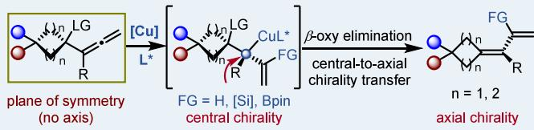

describe a copper-catalyzed enantioselective synthesis of axially chiral alkylidenecycloalkanes using acyl allenols. The axial chirality is established through a central to axial transfer via an enantioenriched allylcopper species. This reaction features mild conditions, >30:1 regioselectivities, and up to 98% ee. Control experiments reveal that the bulky size of the leaving group has a significant influence on the enantioselectivity of the reaction. The alkene and vinylboronate groups of the products provide versatile platforms for further transformations to enrich the structural diversity of products.

KEYWORDS: copper catalysis, enantioselective desymmetrization, axially chiral alkylidenecycloalkanes, acyl allenols, allenylic substitution

Axially chiral compounds have received significant attention from both synthetic and medicinal communities due to their widespread presence in natural products, chiral ligands, and catalysts.1 Among these, the catalytical enantioselective synthesis of (hetero)aryl-based C−X (X = C, O, N, B, etc.) atropisomers2 and allene-based atropisomers3 has been a hot topic in the synthetic community over the past few decades (Scheme 1a). In comparison, the enantioselective synthesis of axially chiral alkylidenecycloalkanes remains in its infancy due to the challenge arising from the longer distance between the four groups about the chirality axis. At present, the majority of methodologies to access enantioenriched axially chiral alkylidenecycloalkanes focuses on the noncatalytic strategy, i.e., with the aid of stoichiometric chiral reagents.4 The catalytic methods in this area have been somewhat limited,5 including enantioselective olefination of 4-substituted cyclo hexanones and their analogs,6 desymmetrization of 4- substituted cyclohexanes and derivatives,7 [2 + 2] cycloaddition between terminal alkenes and allenes,8 and deracemization of racemic alkylidenecycloalkanes9 (Scheme 1b). In view of the remarkable roles of axially chiral alkylidenecycloalkanes in bioactive molecules and chiroptical molecular switches as well as chiral ligands (Scheme 1c),10 further development of novel methods for synthesizing these architectures is still highly desirable.

α-Allenols make up a crucial class of allenes that possess a 1,2-propadiene moiety and a hydroxyl group. Due to their π- activated reactivity, α-allenols and their derivatives have found extensive applications in organic synthesis,11 and various fascinating transformations have been well-established, whereinto, transition-metal catalyzed C1-allylic substitution has emerged as a general strategy to construct allenes bearing a central chirality,12 or chiral allenes13 (Scheme 2a, upper panel). When the external nucleophiles attack the C3-position of 2,3- allenol and analogues via transition-metal catalysis, achiral multiply substituted 1,3-dienes would be generated (Scheme 2a, bottom panel).14 However, to the best of our knowledge, the enantioselective construction of axially chiral alkylidenecycloalkanes using α-allenols and their derivatives remains unknown. We hypothesized that by rational design of allenol derivatives and precise control of the regioselectivity, it would be possible to generate axially chiral alkylidenecycloalkanes by enantioselective C3-substitution.15 Building upon our research interests in transition-metal-catalyzed enantioselective desymmetrization and atroposelective construction of axially chiral compounds,16 we present herein a copper-catalyzed enantioselective allenylic substitution of acyl 2,3-allenols (Scheme 2b). With phenylsilane used as the hydride donor, the axially chiral alkylidenecycloalkanes containing a 1,3-dienyl motif are constructed in good yields with excellent enantioselectivities. In addition, copper-catalyzed enantioselective silylation and borylation could also proceed, giving products containing functionalized dienyl motifs.

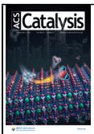

## Scheme 1. Enantioselective Synthesis of Axially Chiral Alkylidenecycloalkanes

a) Research progress for the selected types of axial chiralities

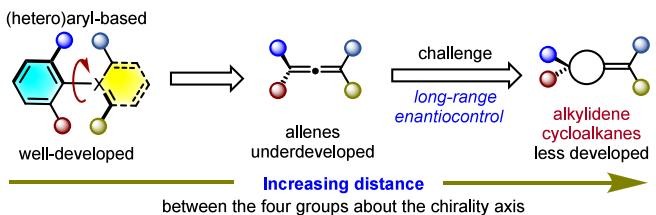

b) Strategies of enantioselective synthesis of axially chiral alkylidenecycloalkanes  
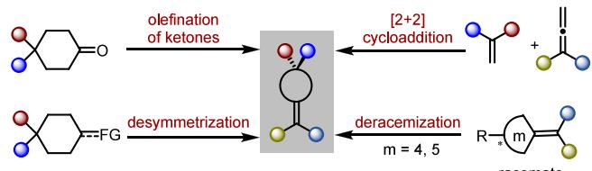

## Scheme 2. Transition-Metal Catalyzed Enantioselective Substitution of α-Allenol and Derivatives

a) TM-catalyzed intermolecular functionalization with α-allenols and derivatives

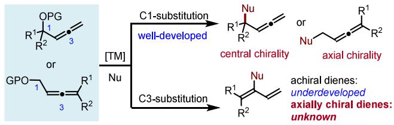

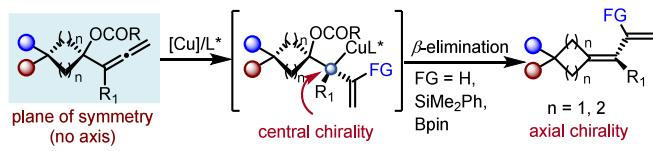

We initiated our studies with allenyl acetate 1a as a starting material. The representative results are summarized in Table 1. In the presence of 2.5 mol % CuOAc and 2.0 equiv of phenylsilane, the reaction proceeded smoothly $\mathrm { a t } - 2 0 { } ^ { \circ } \dot { \mathrm { C } }$ using various chiral bisphosphine ligands L1−L7, giving 6a in $5 7 -$ 86% yields with 11−80% ee (Table 1, entries $_ { 1 - 7 ) }$ . Among these ligands, DTBM-Segphos L3 exhibited the highest enantioselectivity, with an ee value of 80% (entry 3). To probe the efect of the leaving group on the reaction, we further tested allenol 2a and its various O-acyl derivatives.

Table 1. Optimization of Reaction Conditionsa-c  
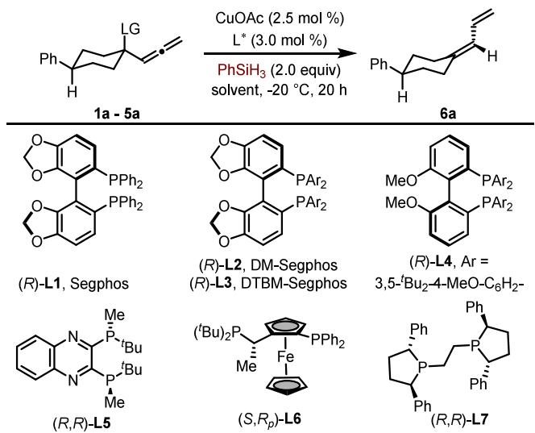

<table><tr><td>Entry</td><td>Ligand</td><td>Solvent</td><td>LG</td><td>Yield (%)</td><td>ee (%)</td></tr><tr><td>1</td><td>L1</td><td>DME</td><td>OAc (1a)</td><td>61</td><td>28</td></tr><tr><td>2</td><td>L2</td><td>DME</td><td>OAc (1a)</td><td>71</td><td>32</td></tr><tr><td>3</td><td>L3</td><td>DME</td><td>OAc (1a)</td><td>69</td><td>80</td></tr><tr><td>4</td><td>L4</td><td>DME</td><td>OAc (1a)</td><td>76</td><td>75</td></tr><tr><td>5</td><td>L5</td><td>DME</td><td>OAc (1a)</td><td>57</td><td>70</td></tr><tr><td>6</td><td>L6</td><td>DME</td><td>OAc (1a)</td><td>86</td><td>-11</td></tr><tr><td>7</td><td>L7</td><td>DME</td><td>OAc (1a)</td><td>73</td><td>51</td></tr><tr><td>8</td><td>L3</td><td>DME</td><td>OH (2a)</td><td>29</td><td>34</td></tr><tr><td>9</td><td>L3</td><td>DME</td><td>OCOPh (3a)</td><td>39</td><td>73</td></tr><tr><td>10</td><td>L3</td><td>DME</td><td>OCOPr (4a)</td><td>80</td><td>93</td></tr><tr><td>11</td><td>L3</td><td>DME</td><td>OCOBu (5a)</td><td>73</td><td>96</td></tr><tr><td>12</td><td>L3</td><td>DCM</td><td>OCOtBu (5a)</td><td>29</td><td>85</td></tr><tr><td>13</td><td>L3</td><td>THF</td><td>OCOBu (5a)</td><td>59</td><td>96</td></tr><tr><td>14</td><td>L3</td><td>Toluene</td><td>OCOBu (5a)</td><td>81</td><td>97</td></tr><tr><td> $1 5 ^ { d }$ </td><td>L3</td><td>Toluene</td><td>OCOBu (5a)</td><td>90</td><td>98</td></tr></table>

aReaction conditions: 1a−5a (0.2 mmol, 1.0 equiv), CuOAc (2.5 mol %), L (3.0 mol %) and PhSiH (0.4 mmol, 2.0 equiv) in solvent (0.4 mL) $\mathrm { a t } - 2 0 \ ^ { \circ } \mathrm { C }$ under argon atmosphere for 20 h. bIsolated yields were listed. cee values were determined by chiral HPLC analysis on a chiral stationary phase. $^ { d } \mathrm { O n }$ 0.5 mmol scale. $\mathrm { D M E } = 1 { , } 2$ -dimethoxyethane; DCM = dichloromethane; THF = tetrahydrofuran.

When allenol 2a was used, desired product 6a could only be obtained in 29% yield with 34% ee (entry 8). Switching acetyl allenol 1a to benzoyl allenol 3a resulted in a significantly reduced yield, albeit comparable enantioselectivity (entry 9, 39% yield with 73% ee). Introducing a bulkier acyl group led to a marked improvement in the enantioselectivity of 6a, with ee values of 93−96% and yields of 73−80% (entries 10 and 11). We also observed that the choice of solvent greatly influenced the yield of the reaction (entries 12−14). Among the solvents tested, toluene exhibited the best performance, generating compound 6a in 81% yield with 97% ee. Furthermore, upon scaling up the reaction to a 0.5 mmol level, there has been a slight enhancement in both the yield and the enantioselectivity of product 6a (entry 15).

With the optimized conditions established, we next explored the substrate scope of acyl allenols, as presented in Table 2. The pivaloyl allenols derived from 4-arylcyclohexanones, which bear electron-donating or electron-withdrawing groups at the para-, meta-, or ortho-positions of the phenyl ring, all proved suitable for this transformation, delivering 6b−i in 74−93% yields with 96−97% ee. Substrates carrying a piperonyl, 2- naphthyl, or heteroaryl group at the C4-position produced products 6j−q in 68−96% yields with 92−98% ee. Introduction of various alkyl groups led to products 6r−t in 70−82% yields with 97−98% ee. Products 6u−y, containing a series of heteroatom-based group such as BnO-, PhMe Si-, $\mathrm { A r } _ { 2 } ( \mathrm { O } ) \mathrm { P } \mathrm { - }$ , or PhSe- group, were successfully synthesized in 61−85% yields with 92−97% ee. Notably, the relative configuration of substrates has a great efect on the enantioselectivity, as well as the absolute configuration of the products. With trans-5u used as the substrate, ent-6u was isolated in 91% yield with 79% ee. Furthermore, 4,4- disubstituted cyclohexyl pivalates were also compatible with this transformation, resulting in the formation of product 6z in 76% yield with 88% ee and 6aa in 75% yield with 91% ee. Product 6ab containing an internal tetra-substituted olefin motif could also be obtained in 78% yield, albeit with lower enantioselectivity. Substrates meso-5ac and meso-5ad were able to render products 6ac and 6ad in 67−79% yields with 84− 90% ee. Notably, this transformation allowed for the simultaneous construction of three chiral elements, namely, two C-stereogenic centers and one axial chirality, in a single step.2a To enrich the product diversity, a series of cyclobutanone-derived pivaloyl allenols were also examined. Substrates containing phenyl rings with electron-donating or electron-withdrawing groups attached to the cyclobutanol backbones were found to be compatible with the reaction conditions, afording 6ae−aj in 70−90% yields with 90−94% ee. It is worthy of noting that all reactions proceeded with excellent regioselectivities (rr > 30:1) and no allene byproduct was detected.

Table 2. Substrate Scopea,b,c  
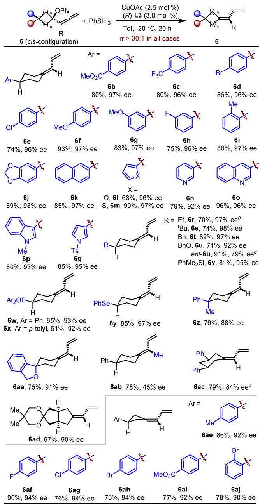  
aReaction conditions: 5 (0.5 mmol, 1.0 equiv), CuOAc (2.5 mol %), (R)-L3 (3.0 mol %) and PhSiH (1.0 mmol, 2.0 equiv) in toluene (1.0 mL) $\mathrm { a t } - 2 0 \ ^ { \circ } \mathrm { C }$ under argon atmosphere for 20 h. Isolated yields were listed. ee values were determined by chiral HPLC analysis on a chiralstationary-phase. bUsing Et O as the solvent. cWith trans-5u used. dUsing (S,S)-BenzP\* as the ligand.

To gain some insights into the reaction mechanism, several control experiments were conducted. As shown in Scheme 3a, with silyl allenol ether 7a used, the corresponding product 6a was isolated in 22% yield with 98% ee, accompanied by the formation of partially hydrogenated byproduct 8a in 32% yield. The excellent enantiopurity of 6a indicates that the bulky Osubstituent is essential to the enantioselectivity, while the acyl group governs the reactivity of substrates to form the chiral axis. At this stage, two possible mechanisms to generate the 1,3-dienyl motif could be proposed including β-oxy elimination from allyl copper INT-I (path a)17 and Peterson olefination18 from INT-II (path b) (Scheme 3b, upper panel). Replacing PhSiH with HBpin, product 6a could still be obtained in 71% yield with 98% ee (Scheme 3b, bottom panel), indicating that Peterson olefination (path b) was not involved. In addition, deuterated product 8a−D was isolated in 71% and 69% yields with >95% D in the presence of 2.0 equiv $\mathrm { D } _ { 2 } \mathrm { O }$ or 4.0 equiv MeOH-d , hinting that allylcopper species INT-III was involved (Scheme 3c).19 Moreover, with pivaloyl allenol 9a containing two methyl groups used, only trace product 10 was detected (Scheme 3d), which again hints that hydrocupration prefers to occur at the terminal position of allene motif.

Combined with previously reported literature,20 a possible mechanism is proposed in Scheme 3e. First, CuH species is generated from CuOAc in the presence of L3 and PhSiH . Hydrocupration of 5a provides allylcopper INT-IV or INT-V. These two allylcopper species could undergo interconversion through a fast 1,3-copper shift.20,21 β-Oxy elimination of INT-V will provide 6a and precatalyst LCu(OPiv). In this step, the axial chirality would be constructed via the central-to-axial chirality transfer. The high enantioselectivity of the substitution of 5a with PhSiH in the presence of (R)-DTBM-Segphos (L3) was rationalized with two possible transitionstate isomers, namely, models A and B (Scheme 3f). For both models A and B, a repulsion between the pivaloyl group of 5a and t-Bu group on the aryl unit of (R)-DTBM-Segphos (L3) is involved. In model A, there is a severe repulsion between the vinyl group of the substrate and the sterically bulky t-Bu group on the aryl unit of (R)-DTBM-Segphos (L3). In comparison, the repulsion between the hydrogen atom of substrate 5a and ligand L3 is much weaker in model B. Finally, σ-bond metathesis between LCu(OPiv) and PhSiH generates the LCuH species to enter the next catalytic cycle.

At this stage, we were intrigued whether this catalytic system could be further extended to other functionalizations, for

## Scheme 3. Mechanistic Studies

a) The effect of O-substituent on the enantioselectivity and reactivity  
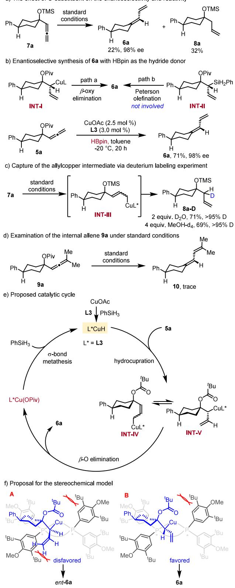  
example silylation22 and borylation $\cdot ^ { 2 3 }$ Preliminary investigation showed that $( S , S )$ -QuinoxP\* L5 is an optimal ligand for this copper-catalyzed silylation of 5a in the presence of CsF at −20 ${ } ^ { \circ } \bar { \mathrm { C } } ,$ giving product $\mathbf { 1 7 a }$ in 8% yield with 63% ee (Table $^ { 3 , }$ entry 1). Since previous results show that the leaving group has a great efect on the enantioselectivity, we further evaluated the leaving groups. Generally, switching the R group from a tertbutyl to an aryl group could improve the enantioselectivity

Table 3. Evaluation of Leaving Groupsa,b,c  
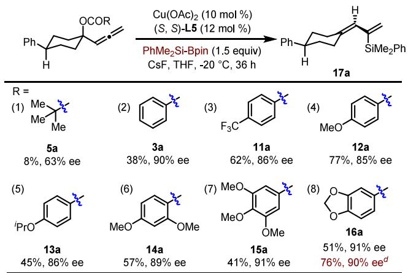  
aReaction conditions: acyl allenol (0.2 mmol, 1.0 equiv), PhMe SiBpin (0.3 mmol, 1.5 equiv), Cu(OAc) (10 mol %), (S,S)- QuinoxP\* (L5, 12 mol %), and CsF (0.24 mmol, 1.2 equiv) in THF (1.0 mL) $\mathrm { a t } - 2 0 { } ^ { \circ } \mathrm { C }$ under argon atmosphere for 36 h. bIsolated yields were listed. $c _ { \mathrm { e e } }$ values were determined by chiral HPLC analysis on a chiral stationary phase. dPhMe SiBpin (3.0 equiv), 60 h, on 0.5 mmol scale.

(85−91% ee), while the yields range from 38 to 77% (Table $^ { 3 , }$ entries 2−8). In particular, with substrate 16a used, product 17a was isolated in 51% yield with 91% ee (Table 3, entry 8). By prolonging the reaction time to 60 h, the yield of 17a could be further improved to 76% yield with a comparable enantiopurity.

With the optimal conditions established, the substrate scope was next examined. As shown in Table $^ { 4 , }$ a diverse array of acyl allenols containing an aryl group or an alkyl group are suitable substrates for this transformation containing at the C4- positions, giving 17b−i in 49−80% yields with 88−93% ee. The lower yield for 17e mainly results from the poor conversion of the substrate. With cyclobutanone-derived substrates used, the corresponding products 17j and 17k could only be obtained in 21% ee with 61% and 86% yields, respectively. Furthermore, the copper-catalyzed borylation of acyl allenol 1a was also tested. With chiral ligand L3 (DTBM Segphos) used, the borylated product 18 was isolated in 72% yield with 88% ee (eq 1), which further extended the application scope of this transformation (see Supporting Information for the details of the condition screening). The substrate scope of this borylation was next investigated. For ease of determination of the enantiopurity of the products, the borylated products were further oxidized to the ketones. As shown in Table $5 ,$ cyclohexanone-derived allenol esters 1 containing an aryl group or a tert-butyl group could participate to this reaction, giving 19b−e in 62−78% yields with 78−83% ee. Cyclobutanone-derived substrates generated 19f and 19g with diminished yields and enantioselectivities.

The practical applicability of this method was demonstrated through a gram-scale reaction and synthetic applications. As shown in Scheme 4a, when the reaction was carried out at 8 mmol, the product 6a was obtained in 81% yield (1.28 g) with 96% ee. The presence of the 1,3-dienyl motif in the products provided a platform for further transformations24 (Scheme 4b). Sequential platinum-catalyzed enantioselective diboration $\mathrm { \cdot } / \mathrm { H } _ { 2 } \mathrm { O } _ { 2 }$ -mediated oxidation of 6a resulted in the conversion to $^ { 1 , 2 }$ -diol 20 in 73% yield with >20:1 dr. Cross-metathesis of 6a with methyl acrylate using Grubbs second generation catalyst yielded 21 in 49% yield with 95% ee and >20:1 Eselectivity. With (Z)-2-butene-1,4-diol used as the coupling partner, the corresponding product 22 was isolated in 64% yield with 13:1 E-selectivity. Rhodium-catalyzed dehydrogenative coupling reaction between 6a and HBpin proceeded smoothly to generate vinyl boronate 23 in 72% yield with 94%

Table 4. Substrate Scope for Silylationa,b,c  
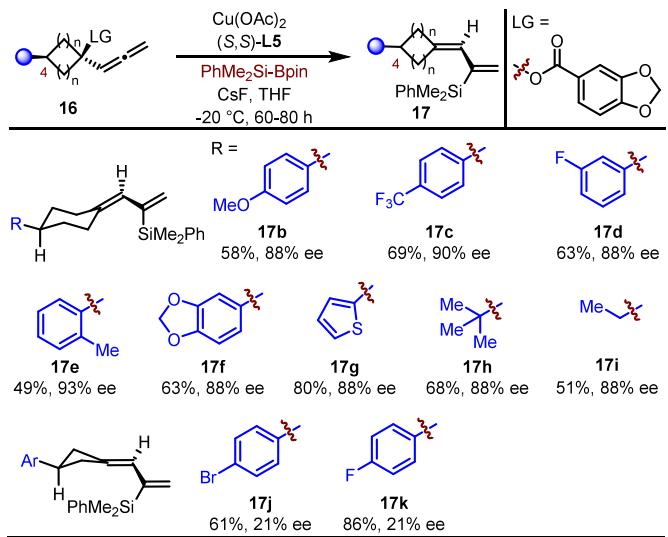

aReaction conditions: 16 (0.2 mmol, 1.0 equiv), PhMe SiBpin (0.6 mmol, 3.0 equiv), Cu(OAc) (10 mol %), (S,S)-QuinoxP\* (L5, 12 mol %), and CsF (0.24 mmol, 1.2 equiv) in THF (1.0 mL) at −20 °C under argon atmosphere for 60−80 h. bIsolated yields were listed. cee values were determined by chiral HPLC analysis on a chiral stationary phase.  
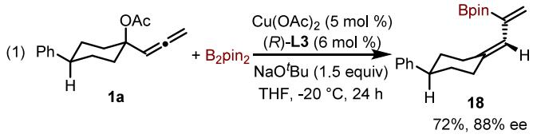

Table 5. Substrate Scope for Borylationa,b,c  
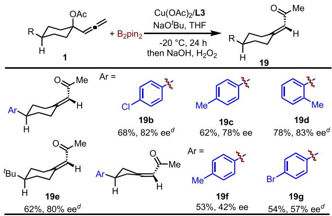  
aReaction conditions: 1 (0.2 mmol, 1.0 equiv), B pin (0.4 mmol, 2.0 equiv), Cu(OAc) (5 mol %), (R)-L3 (6 mol %), and NaOtBu (0.3 mmol, 1.5 equiv) in THF (1.0 mL) $\mathrm { a t } - 2 0 \ ^ { \circ } \mathrm { C }$ under argon atmosphere for 24 h; then the reaction mixture was treated with 3 N NaOH and $\mathrm { H } _ { 2 } \mathrm { O } _ { 2 } .$ bIsolated yields were listed. cee values were determined by chiral HPLC analysis on a chiral stationary phase. dWith $\mathrm { C u } ( \mathrm { M e C N } ) _ { 4 } \mathrm { P F } _ { 6 }$ (5 mol %) as the catalyst in toluene (0.1 M) for 36 h.

Scheme 4. Gram-Scale Experiment and Further Application of Products

a) Gram-scale synthesis of 6a

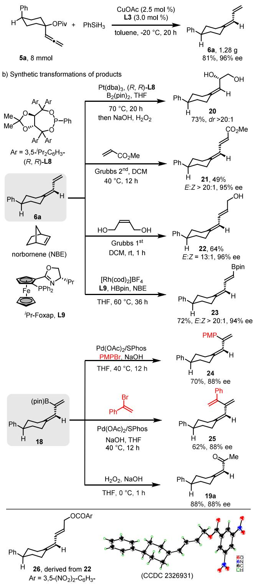

ee and >20:1 E-selectivity. In addition, the vinyl boronate motif of 18 could engage in palladium-catalyzed Suzuki coupling with aryl bromide or alkenyl bromide, delivering 24 in 70% yield and 25 in 62% yield with 88% ee. Oxidation of 18 in the presence of $\mathrm { H } _ { 2 } \mathrm { O } _ { 2 }$ and NaOH produced 19a in 88% yield with 88% ee. The absolute configuration of 22 was confirmed through X-ray crystallography analysis using its derivative 26, and the others were assigned accordingly.

In summary, we have developed a copper-catalyzed enantioselective synthesis of axially chiral alkylidenecycloalkanes with acyl 2,3-allenols. This reaction features broad substrate scope, mild conditions, and excellent regio- and enantioselectivities. Control experiments show that the choice of acyl group is important to both the yield and enantioselectivity. The terminal alkene and vinyl boronate motifs of the products could participate in a series of downstream transformations. Further application of this catalytic strategy to the enantioselective synthesis of functionalized axially chiral alkylidenecycloalkanes is ongoing in our laboratory.

## ■ ASSOCIATED CONTENT

## Data Availability Statement

The data underlying this study are available in the published article and its Supporting Information.

## \*sı Supporting Information

The Supporting Information is available free of charge at https://pubs.acs.org/doi/10.1021/acscatal.4c06387.

Experimental procedures, characterization, and 1H NMR, 13C NMR, 19F NMR, 31P NMR, and HPLC spectra for all new compounds (PDF) Data and structure for 26 (CIF)

## ■ AUTHOR INFORMATION

## Corresponding Authors

Shang Gao − State Key Laboratory of Natural Medicines (SKLNM) and Department of Medicinal Chemistry, School of Pharmacy, China Pharmaceutical University, Nanjing 210009, People’s Republic of China; orcid.org/0000- 0001-8166-5503; Email: gaoshang1990@cpu.edu.cn

Hequan Yao − State Key Laboratory of Natural Medicines (SKLNM) and Department of Medicinal Chemistry, School of Pharmacy, China Pharmaceutical University, Nanjing 210009, People’s Republic of China; Email: hyao@ cpu.edu.cn, cpuhyao@126.com

## Authors

Baihui Gong − State Key Laboratory of Natural Medicines (SKLNM) and Department of Medicinal Chemistry, School of Pharmacy, China Pharmaceutical University, Nanjing 210009, People’s Republic of China

Qingbin Lu − State Key Laboratory of Natural Medicines (SKLNM) and Department of Medicinal Chemistry, School of Pharmacy, China Pharmaceutical University, Nanjing 210009, People’s Republic of China

Ruikang Sun − State Key Laboratory of Natural Medicines (SKLNM) and Department of Medicinal Chemistry, School of Pharmacy, China Pharmaceutical University, Nanjing 210009, People’s Republic of China

Zelin Li − State Key Laboratory of Natural Medicines (SKLNM) and Department of Medicinal Chemistry, School of Pharmacy, China Pharmaceutical University, Nanjing 210009, People’s Republic of China

Yihan Chen − State Key Laboratory of Natural Medicines (SKLNM) and Department of Medicinal Chemistry, School of Pharmacy, China Pharmaceutical University, Nanjing 210009, People’s Republic of China

Aijun Lin − State Key Laboratory of Natural Medicines (SKLNM) and Department of Medicinal Chemistry, School of Pharmacy, China Pharmaceutical University, Nanjing

210009, People’s Republic of China; orcid.org/0000-   
0001-5786-4537

Complete contact information is available at: https://pubs.acs.org/10.1021/acscatal.4c06387

## Author Contributions

†B.G. and Q.L. contributed equally to this work.

## Notes

The authors declare no competing financial interest.

## ■ ACKNOWLEDGMENTS

The authors acknowledge generous financial support from the Natural Science Foundation of Jiangsu Province (BK20210414), the National Natural Science Foundation of China (NSFC22071267 and 22371299), the Project Program of State Key Laboratory of Natural Medicines (SKLNMZZ202211), and the Fundamental Research Funds for the Central Universities (2632024ZD09).

## ■ REFERENCES

(1) For selected reviews and book, see: (a) Basilaia, M.; Chen, M. H.; Secka, J.; Gustafson, J. L. Atropisomerism in the pharmaceutically relevant realm. Acc. Chem. Res. 2022, 55, 2904. (b) Atropisomerism and Axial Chirality; Lassaletta, J. M., Ed.; World Scientific: Singapore, 2019. (c) Smyth, J. E.; Butler, N. M.; Keller, P. A. A twist of nature − the significance of atropisomers in biological systems. Nat. Prod. Rep. 2015, 32, 1562. (d) LaPlante, S. R.; Fader, L. D.; Fandrick, K. R.; Fandrick, D. R.; Hucke, O.; Kemper, R.; Miller, S. P. F.; Edwards, P. J. Assessing atropisomer axial chirality in drug discovery and development. J. Med. Chem. 2011, 54, 7005. (e) Bringmann, G.; Gulder, T.; Gulder, T. A. M.; Breuning, M. Atroposelective total synthesis of axially chiral biaryl natural products. Chem. Rev. 2011, 111, 563. (f) Chen, Y.; Yekta, S.; Yudin, A. K. Modified BINOL ligands in asymmetric catalysis. Chem. Rev. 2003, 103, 3155.

(2) For selected reviews, see: (a) Zhang, H.-H.; Li, T.-Z.; Liu, S.-J.; Shi, F. Catalytic asymmetric synthesis of atropisomers bearing multiple chiral elements: An emerging field. Angew. Chem., Int. Ed. 2024, 63, No. e202311053. (b) Campbell, A. D. G.; Armstrong, R. J. Synthetic strategies to control C−N atropisomerism in acyclic amines and amides. Synthesis 2023, 55, 2427. (c) Qian, P.-F.; Zhou, T.; Shi, B.-F. Transition-metal-catalyzed atroposelective synthesis of axially chiral styrenes. Chem. Commun. 2023, 59, 12669. (d) Qian, P.-F.; Li, J.-Y.; Zhou, Y.-B.; Zhou, T.; Shi, B.-F. Half-sandwich d6-metal (CoIII, RhIII, IrIII, RuII)-catalyzed enantioselective C−H activation. SynOpen 2023, 7, 466. (e) Mei, G.-J.; Koay, W. L.; Guan, C.-Y.; Lu, Y. Atropisomers beyond the C−C axial chirality: Advances in catalytic asymmetric synthesis. Chem. 2022, 8, 1855. (f) Zhang, X.; Zhao, K.; Gu, Z. Transition metal-catalyzed biaryl atropisomer synthesis via a torsional strain promoted ring-opening reaction. Acc. Chem. Res. 2022, 55, 1620. (g) Qin, W.; Liu, Y.; Yan, H. Enantioselective synthesis of atropisomers via vinylidene ortho-quinone methides (VQMs). Acc. Chem. Res. 2022, 55, 2780. (h) Watts, O. F. B.; Berreur, J.; Collins, B. S. L.; Clayden, J. Biocatalytic enantioselective synthesis of atropisomers. Acc. Chem. Res. 2022, 55, 3362. (i) Zhang, Z.-X.; Zhai, T.-Y.; Ye, L.-W. Synthesis of axially chiral compounds through catalytic asymmetric reactions of alkynes. Chem. Catal. 2021, 1, 1378. (j) Cheng, J. K.; Xiang, S.-H.; Li, S.; Ye, L.; Tan, B. Recent advances in catalytic asymmetric construction of atropisomers. Chem. Rev. 2021, 121, 4805. (k) Kumarasamy, E.; Raghunathan, R.; Sibi, M. P.; Sivaguru, J. Nonbiaryl and heterobiaryl atropisomers: Molecular templates with promise for atropselective chemical transformations. Chem. Rev. 2015, 115, 11239.

(3) For selected example and review, see: (a) Feringa, B. L.; van Delden, R. A.; Koumura, N.; Geertsema, E. M. Chiroptical molecular switches. Chem. Rev. 2000, 100, 1789. (b) Kuroda, T.; Hirota, H.; Fujio, H.; Sugiyama, S.; Masaki, M.; Hiramoto, Y.; Shioyama, W.;

Okamoto, K.; Hori, M.; Yamauchi-Takihara, K. Carbacyclin induces carnitine palmitoyltransferase-1 in cardiomyocytes via peroxisome proliferator-activated receptor (PPAR)δ independent of the IP receptor signaling pathway. J. Mol. Cell. Cardiol. 2007, 43, 54. (c) Olschewski, H.; Rohde, $\mathrm { B } . { \mathrm { ; } }$ Behr, J.; Ewert, R.; Gessler, T.; Ghofrani, H. $\mathbf { A . } _ { \mathrm { j } }$ Schmehl, T. Pharmacodynamics and pharmacokinetics of inhaled iloprost, aerosolized by three different devices, in severe pulmonary hypertension. Chest. 2003, 124, 1294.

(4) For selected examples, see: (a) Iguchi, M.; Tomioka, K. External chiral ligand-mediated enantioselective Peterson reaction of α- trimethylsilanylacetate with substituted cyclohexanones. Org. Lett. 2002, 4, 4329. (b) Mizuno, M.; Fujii, K.; Tomioka, K. The asymmetric Horner−Wadsworth−Emmons reaction mediated by an external chiral ligand. Angew. Chem., Int. Ed. 1998, 37, 515. (c) Furuta, $\mathrm { T } . \mathrm { } _ { \mathrm { \cdot } } ^ { }$ Iwamura, M. Stereodivergent synthesis of two diastereoisomeric enoates by asymmetric Horner−Wadsworth−Emmons reaction using a single chiral auxiliary. J. Chem. Soc. Chem. Commun. 1994, 18, 2167. (d) Dai, W.-M.; Wu, J.; Huang, X. Asymmetric Wittig reaction of chiral arsonium ylides�I. Asymmetric olefination of 4-substituted cyclohexanones. Tetrahedron: Asymmetry 1997, 8, 1979. (e) Denmark, S. E.; Chen, C.-T. Electrophilic activation of the Horner-Wadsworth-Emmons-Wittig reaction: highly selective synthesis of dissymmetric olefins. J. Am. Chem. Soc. 1992, 114, 10674. (f) Hanessian, S.; Delorme, D.; Beaudoin, $S . ;$ Leblanc, Y. Design and reactivity of topologically unique, chiral phosphonamides. Remarkable diastereofacial selectivity in asymmetric olefination and alkylation. J. Am. Chem. Soc. 1984, 106, 5754. (g) Bestmann, H. J.; Lienert, J. Partial asymmetric synthesis of substituted benzylidenecycloalkanes. Angew. Chem., Int. Ed. 1969, 8, 763.

(5) For selected review, see: Hu, $\mathrm { F } _ { \cdot \mathrm { j } }$ Xia, Y. Axial chirality in alkylidene-cyclic molecules. Eur. J. Org. Chem. 2023, 26, No. e202300151.

(6) For selected examples, see: (a) Essman, J. Z.; Jacobsen, E. N. Enantioselective potassium-catalyzed Wittig olefinations. J. Am. Chem. Soc. 2024, 146, 7165. (b) Ying, M.; Wang, K.; Yan, W.; Pu, M.; Lin, L. Stable axially chiral cyclohexylidenes from catalytic asymmetric Knoevenagel condensation. Chem.�Eur. J. 2024, 30, No. e202401243. (c) He, S.-J.; Zhu, S.; Qiu, S.-Q.; Ding, W.-Y.; Cheng, J. K.; Xiang, S.-H.; Tan, B. Phosphoric acid-catalyzed enantioselective synthesis of axially chiral anthrone-based compounds. Angew. Chem., Int. Ed. 2023, 62, No. e202213914. (d) Zhu, S.; Mao, J.-H.; Cheng, J. K.; Xiang, S.-H.; Tan, B. Discovery and organocatalytic enantioselective construction of axially chiral cyclohexadie nylidene skeletons. Chem. 2022, 8, 2529. (e) Crotti, $\mathrm { S . j }$ Di Iorio, N.; Artusi, $\mathrm { C . j }$ Mazzanti, $\mathbf { A . } ;$ Righi, $\mathrm { P . ; }$ Bencivenni, G. Direct access to alkylideneoxindoles via axially enantioselective Knoevenagel condensation. Org. Lett. 2019, 21, 3013. (f) Gramigna, L.; Duce, S.; Filippini, $\mathrm { G } . ;$ Fochi, M.; Franchini, M. C.; Bernardi, L. Organocatalytic asymmetric Wittig reactions: Generation of enantioenriched axially chiral olefins breaking a symmetry plane. Synlett. 2011, 18, 2745. $( \mathbf { g } )$ Lee, $\mathbf { A . } ;$ Michrowska, A.; Sulzer-Mosse, S.; List, B. The catalytic asymmetric Knoevenagel condensation. Angew. Chem., Int. Ed. 2011, 50, 1707. (h) Arai, S.; Hamaguchi, S.; Shioiri, T. Catalytic asymmetric Horner-Wadsworth-Emmons reaction under phase-transfer-catalyzed conditions. Tetrahedron Lett. 1998, 39, 2997.

(7) For selected examples, see: (a) He, S.-J.; Shen, B.; Zuo, L.-Z.; Xiang, S.-H.; Liu, H.-H.; Yu, P.; Tan, B. Enantioselective construction of anthracenylidene-based axial chirality by asymmetric Heck reaction. J. Am. Chem. Soc. 2024, 146, 19137. (b) Shao, B.-r.; Jiang, W.-f.; Zheng, $\mathrm { C . } \mathrm { \mathrm { ; } }$ Shi, L. Pd-catalyzed enantioselective synthesis of axially chiral alkylidene cycloalkanes. Chem. Catal. 2023, 3, 100697. (c) Ma, $\mathrm { C . j }$ Sun, $\mathrm { Y . } _ { \mathrm { \cdot } }$ Liu, S.; Li, Z.-M.; Yang, J.; Guo, H.; Zhang, J. Enantioselective construction of axially chiral cyclohexylidene scaffolds via Pd-catalyzed asymmetric coupling reaction. Chem. Catal. 2022, 2, 3196. (d) Li, S.; Xu, J.-L.; Xu, Y.-H. Copper-catalyzed enantioselective hydrosilylation of allenes to access axially chiral (cyclohexylidene)ethyl silanes. Org. Lett. 2022, 24, 6054. (e) Wang, $\mathrm { S } . \mathrm { ; }$ Liu, J.; Ma, W.; Song, $\mathrm { Q } .$ Cu-catalyzed enantioselectivee assembly of axially chiral allylic boronates. Sci. China Chem. 2024, asap.

(f) Hurtado, J.; Iragorri, N.; Reyes, E.; Vicario, J. L.; Fernández, E. Cu-Catalyzed enantioselective borylative desymmetrization of 1-vinyl cyclobutanols and axial-to-point chirality transfer in a diastereoconvergent/stereoretentive allylation scenery. Angew. Chem., Int. Ed. 2024, 63, No. e202411232.

(8) For selected examples, see: (a) Conner, M. L.; Xu, Y.; Brown, M. K. Catalytic Enantioselective Allenoate−Alkene $[ 2 ~ + ~ 2 ]$ Cycloadditions. J. Am. Chem. Soc. 2015, 137, 3482. (b) Wahl, J. M.; Conner, M. L.; Brown, M. K. Allenoates in enantioselective $[ 2 ~ + ~ 2 ]$ cycloadditions: From a mechanistic curiosity to a stereospecific transformation. J. Am. Chem. Soc. 2018, 140, 15943. (c) Xiao, W.; Ning, L.; Xin, S.; Dong, S.; Liu, X.; Feng, X. Enantioselective [2 + 2] cycloaddition of allenyl imide with mono- or disubstituted alkenes. Angew. Chem., Int. Ed. 2022, 61, No. e202211596.

(9) Kratz, T.; Steinbach, P.; Breitenlechner, S.; Storch, G.; Bannwarth, $\mathrm { C . } \mathrm { \mathrm { ; } }$ Bach, T. Photochemical deracemization of chiral alkenes via triplet energy transfer. J. Am. Chem. Soc. 2022, 144, 10133.

(10) For selected reviews, see: (a) Yu, S.; Ma, S. Allenes in catalytic asymmetric synthesis and natural product syntheses. Angew. Chem., Int. Ed. 2012, 51, 3074. (b) Neff, R. K.; Frantz, D. E. Recent advances in the catalytic syntheses of allenes: A critical assessment. ACS Catal. 2014, 4, 519. (c) Neff, R. K.; Frantz, D. E. Recent applications of chiral allenes in axial-to-central chirality transfer reactions. Tetrahedron 2015, 71, 7. (d) Xiao, W.; Wu, J. Recent advances in the metalcatalyzed asymmetric synthesis of chiral allenes. Org. Chem. Front. 2022, 9, 5053.

(11) For selected reviews, see: (a) Alonso, J. M.; Almendros, P. Deciphering the chameleonic chemistry of allenols: Breaking the taboo of a onetime esoteric functionality. Chem. Rev. 2021, 121, 4193. (b) Deng, Y.-Q.; Gu, Z.-H.; Ma, S.-M. Reactions of 2,3-allenols and their derivatives. Chin. J. Org. Chem. 2006, 26, 1468.

(12) For selected recent examples, see: (a) Lin, J.; Jia, M.; Song, X.; Yu, H.; Ma, S. Pd-Catalyzed enantioselective creation of all-carbon quaternary center with 2,3-allenylic carbonates. Org. Lett. 2024, 26, 2349. (b) Ghosh, S.; Changotra, $\mathbf { A } . ;$ Petrone, D. $\mathbf { A . } ;$ Isomura, M.; Carreira, E. M.; Sunoj, R. B. Role of noncovalent interactions in inducing high enantioselectivity in an alcohol reductive deoxygenation reaction involving a planar carbocationic intermediate. J. Am. Chem. Soc. 2023, 145, 2884. (c) Zhao, L.; Luo, Y.; Xiao, J.; Huo, X.; Ma, S.; Zhang, W. Stereodivergent synthesis of allenes with $\alpha { , } \beta { \cdot }$ adjacent central chiralities empowered by synergistic Pd/Cu catalysis. Angew. Chem., Int. Ed. 2023, 62, No. e202218146. (d) Chakrabarty, A.; Mukherjee, S. Iridium-catalyzed enantioselective and chemodivergent allenylic alkylation of vinyl azides for the synthesis of α-allenylic amides and ketones. Angew. Chem., Int. Ed. 2022, $^ { 6 1 , }$ No. e202115821. (e) Isomura, M.; Petrone, D. $\mathbf { A } . ;$ Carreira, E. M. Construction of vicinal quaternary centers via iridium-catalyzed asymmetric allenylic alkylation of racemic tertiary alcohols. J. Am. Chem. Soc. 2021, 143, 3323. (f) Zhang, Y.; Zhang, X.; Ma, S. Stretchable chiral pockets for palladium-catalyzed highly chemo- and enantioselective allenylation. Nat. Commun. 2021, 12, 2416. (g) Xiao, J.; Xu, H.; Huo, X.; Zhang, W.; Ma, S. One stone two birds� Enantioselective bimetallic catalysis for α-amino acid derivatives with an allene unit. Chin. J. Chem. 2021, 39, 1958. (h) Isomura, M.; Petrone, D. $\mathbf { A . } ;$ Carreira, E. M. Coordination-induced stereocontrol over carbocations: asymmetric reductive deoxygenation of racemic tertiary alcohols. J. Am. Chem. Soc. 2019, 141, 4738. (i) Glatz, F.; Petrone, D. A.; Carreira, E. M. Ir-catalyzed enantioconvergent synthesis of diversely protected allenylic amines employing ammonia surrogates. Angew. Chem., Int. Ed. 2020, 59, 16404. (j) Petrone, D. A.; Isomura, M.; Franzoni, I.; Rössler, S. L.; Carreira, E. M. Allenylic carbonates in enantioselective iridium-catalyzed alkylations. J. Am. Chem. Soc. 2018, 140, 4697.

(13) For selected recent examples, see: (a) Su, W.; Zhu, J.; Chen, Y.; Zhang, X.; Qiu, W.; Yang, K.; Yu, P.; Song, Q. Copper-catalysed asymmetric hydroboration of alkenes with 1,2-benzazaborines to access chiral naphthalene isosteres. Nat. Chem. 2024, 16, 1312. (b) Shen, $\mathrm { G } . { \mathrm { ; } }$ He, $\mathrm { F . ; }$ Yang, X. Divergent asymmetric reactions of α- alkenyl ketones with β,γ-alkynyl-α-imino esters enabled by chiral

phosphoric acids. Green Synth. Catal. 2024, DOI: 10.1016/ j.gresc.2024.10.003. (c) Zha, T.; Rui, J.; Zhang, Z.; Zhang, D.; Yang, Z.; Yu, P.; Wang, Y.; Peng, F.; Shao, Z. Direct catalytic asymmetric and regiodivergent N1- and C3-allenylic alkylation of indoles. Angew. Chem., Int. Ed. 2023, 62, No. e202300844. (d) Zhang, Y.; Wu, J.; Ning, L.; Chen, Q.; Feng, X.; Liu, X. Enantioselective synthesis of tetrasubstituted allenes via addition/arylation tandem reaction of 2-activated 1,3-enynes. Sci. China Chem. 2023, 66, 526. (e) Cui, Y.; Zhai, Y.; Xiao, J.; Li, C.; Zheng, W.-F.; Huang, C.; Wu, G.; Qin, A.; Lin, J.; Liu, Q.; Wang, H.; Wu, P.; Xu, H.; Zheng, Y.; Ma, S. Chirality memory of α-methylene-π-allyl iridium species. Chem. Sci. 2021, 12, 11831. (f) Song, S.; Ma, S. Highly selective nucleophilic 4- aryl-2,3-allenylation of malonates. Chin. J. Chem. 2020, 38, 1233. (g) Song, S.; Zhou, J.; Fu, C.; Ma, S. Catalytic enantioselective construction of axial chirality in 1,3-disubstituted allenes. Nat. Commun. 2019, 10, 507. (h) Dai, J.; Li, L.; Ye, R.; Wang, S.; Wang, Y.; Peng, F.; Shao, Z. Construction of acyclic all-carbon quaternary stereocenters and 1,3-nonadjacent stereoelements via organo/metal dual catalyzed asymmetric allenylic substitution of aldehydes. Angew. Chem., Int. Ed. 2023, 62, No. e202300756. (i) Zhang, J.; Huo, X.; Xiao, J.; Zhao, L.; Ma, S.; Zhang, W. Enantio- and diastereodivergent construction of 1,3-nonadjacent stereocenters bearing axial and central chirality through synergistic Pd/Cu catalysis. J. Am. Chem. Soc. 2021, 143, 12622.

(14) For selected examples, see: (a) Chen, S.; Su, X.; Dong, Y.; Liu, J.; Yang, F.; Guo, H.; Zhang, C. Cu-Catalyzed divergent transformations of allenylethylene carbonates with diboron reagents. Org. Lett. 2024, 26, 960. (b) Li, S.; Yang, W.; Shi, J.; Dan, T.; Han, Y.; Cao, Z.-C.; Yang, M. Synthesis of trifluoromethyl-substituted allenols via catalytic trifluoromethylbenzoxylation of 1,3-enynes. ACS Catal. 2023, 13, 2142. (c) Brown, R. W.; Zamani, F.; Gardiner, M. G.; Yu, H.; Pyne, S. G.; Hyland, C. J. T. Divergent Pd-catalyzed cross-coupling of allenyloxazolidinones to give chiral 1,3-dienes and vinyloxazolidinones. Chem. Sci. 2019, 10, 9051. (d) Shen, R.; Yang, J.; Zhang, M.; Han, L.-B. Silver-catalyzed atom-economic hydrophosphorylation of propargyl epoxides: An access to 4-phosphoryl 2,3-allenols and stereodefined 1-phosphoryl 1,3-dienes. Adv. Synth. Catal. 2017, 359, 3626. (e) Chen, D.; Chen, X.; Lu, Z.; Cai, H.; Shen, J.; Zhu, G. Palladium-catalyzed dienylation of haloalkynes using 2,3-butadienyl acetates: A facile access to (1Z)-1,2-dihalo-3-vinyl-1,3-dienes. Adv. Synth. Catal. 2011, 353, 1474.

(15) For selected reviews, see: (a) Min, X.-L.; Zhang, X.-L.; Shen, R.; Zhang, Q.; He, Y. Recent advances in the catalytic asymmetric construction of atropisomers by central-to-axial chirality transfer. Org. Chem. Front. 2022, 9, 2280. (b) Yang, H.; Chen, J.; Zhou, L. Construction of axially chiral compounds via central-to-axial chirality conversion. Chem.�Asian J. 2020, 15, 2939.

(16) (a) Li, X.; Kong, L.; Yin, S.; Zhou, H.; Lin, A.; Yao, H.; Gao, S. Palladium-catalyzed atroposelective Suzuki−Miyaura coupling to construct axially chiral tetra-substituted α-boryl styrenes. Adv. Sci. 2024, 11, 2309706. (b) Han, X.; Chen, L.; Yan, Y.; Zhao, Y.; Lin, A.; Gao, S.; Yao, H. Atroposelective synthesis of axially chiral diaryl ethers by copper-catalyzed enantioselective alkyne−azide cycloaddition. ACS Catal. 2024, 14, 3475. (c) Wu, Q.; Zhang, Q.; Yin, S.; Lin, A.; Gao, S.; Yao, H. Atroposelective synthesis of axially chiral styrenes by platinum-catalyzed stereoselective hydrosilylation of internal alkynes. Angew. Chem., Int. Ed. 2023, 62, No. e202305518. (d) Xu, M.; Lu, Q.; Gong, B.; Ti, W.; Lin, A.; Yao, H.; Gao, S. Copper-catalyzed enantioselective and regiodivergent allylation of ketones with allenylsilanes. Angew. Chem., Int. Ed. 2023, 62, No. e202311540. (e) Li, Q.; Li, J.; Zhang, J.; Wu, S.; Zhang, Y.; Lin, A.; Yao, H. Enantioselective synthesis of bicyclo[3.2.1]octadienes via palladium catalyzed intramolecular alkene-alkyne coupling reaction. Angew. Chem., Int. Ed. 2023, 62, No. e202313404. (f) Zhang, D.; Li, M.; Li, J.; Lin, A.; Yao, H. Rhodium-catalyzed intermolecular enantioselective Alder−ene type reaction of cyclopentenes with silylacetylenes. Nat. Commun. 2021, 12, 6627. (g) Yuan, Z.; Feng, Z.; Zeng, Y.; Zhao, X.; Lin, A.; Yao, H. Palladium-catalyzed asymmetric intramolecular reductive Heck desymmetrization of

cyclopentenes: Access to chiral bicyclo[3.2.1]octanes. Angew. Chem., Int. Ed. 2019, 58, 2884.

(17) For selected examples, see: (a) Ito, H.; Okura, T.; Matsuura, K.; Sawamura, M. Desymmetrization of meso-2-alkene-1,4-diol derivatives through copper(I)-catalyzed asymmetric boryl substitution and stereoselective allylation of aldehydes. Angew. Chem., Int. Ed. 2010, 49, 560. (b) Ohmiya, H.; Yokobori, U.; Makida, Y.; Sawamura, M. Copper-catalyzed γ-selective allyl−alkyl coupling between allylic phosphates and alkylboranes. J. Am. Chem. Soc. 2010, 132, 2895. (c) Nagao, K.; Yokobori, U.; Makida, Y.; Ohmiya, H.; Sawamura, M. Reversible 1,3-anti/syn-stereochemical courses in copper-catalyzed γ- selective allyl−alkyl coupling between chiral allylic phosphates and alkylboranes. J. Am. Chem. Soc. 2012, 134, 8982. (d) Han, J. T.; Lee, J. Y.; Yun, J. Asymmetric synthesis of γ-chiral borylalkanes via sequential reduction/hydroboration using a single copper catalyst. Chem. Sci. 2020, 11, 8961.

(18) (a) For selected reviews, see: Ager, D. J. The Peterson Olefination Reaction. Org. React., (Ed.). 2004;.1 (b) van Staden, L. F.; Gravestock, D.; Ager, D. J. New developments in the Peterson olefination reaction. Chem. Soc. Rev. 2002, 31, 195.

(19) Tsai, E. Y.; Liu, R. Y.; Yang, Y.; Buchwald, S. L. A regio- and enantioselective CuH-catalyzed ketone allylation with terminal allenes. J. Am. Chem. Soc. 2018, 140, 2007.

(20) For selected examples, see: (a) Xu, J.-L.; Xu, Z.-Y.; Wang, Z.-L.; Ma, W.-W.; Sun, X.-Y.; Fu, Y.; Xu, Y.-H. Copper-catalyzed regiodivergent and enantioselective hydrosilylation of allenes. J. Am. Chem. Soc. 2022, 144, 5535. (b) Chen, S.; He, X.; Jin, Y.; Lan, Y.; Shen, X. Copper-catalyzed regio- and stereo-selective hydrosilylation of terminal allenes to access (E)-allylsilanes. Nat. Commun. 2022, 13, 3691. (c) Liu, R. Y.; Yang, Y.; Buchwald, S. L. Regiodivergent and diastereoselective CuH-catalyzed allylation of imines with terminal allenes. Angew. Chem., Int. Ed. 2016, 55, 14077. (d) Li, C.; Liu, R. Y.; Jesikiewicz, L. T.; Yang, Y.; Liu, P.; Buchwald, S. L. CuH-Catalyzed enantioselective ketone allylation with 1,3-dienes: Scope, mechanism, and applications. J. Am. Chem. Soc. 2019, 141, 5062. (e) Ye, Y.; Kevlishvili, I.; Feng, S.; Liu, P.; Buchwald, S. L. Highly enantioselective synthesis of indazoles with a C3-quaternary chiral center using CuH catalysis. J. Am. Chem. Soc. 2020, 142, 10550.

(21) For selected reviews, see: (a) Perry, G. J. P.; Jia, T.; Procter, J. Copper-catalyzed functionalization of 1,3-dienes: Hydrofunctionalization, borofunctionalization, and difunctionalization. ACS Catal. 2020, 10, 1485. (b) Pulis, A. P.; Yeung, K.; Procter, D. J. Enantioselective copper catalysed, direct functionalisation of allenes via allyl copper intermediates. Chem. Sci. 2017, 8, 5240.

(22) For selected examples, see: (a) Lee, H.; Lee, Y.; Lee, Y.; Kamranifard, T.; Lee, Y.; Jung, B. Cu-Catalyzed synthesis of 2-silyl-1,3-butadienes from allenols and applications to one-pot synthesis of tetrasubstituted arylsilanes. Org. Lett. 2023, 25, 8932. (b) Xu, G.-L.; Duan, Y.-T.; Wang, Z.-X. Copper-catalyzed reaction of 2,3-allenols with silylzinc reagents: Access to 2-silyl-1,3-butadienes. Org. Lett. 2022, 24, 7934. (c) Xu, G.-L.; Wang, Z.-X. Palladium-catalyzed silylation of 2,3-allenols with unactivated disilanes: Access to 2-silyl-1,3-butadienes and α-silyl-β-hydroxy vinylsilanes. Org. Lett. 2022, 24, 692.

(23) For selected examples, see: (a) Semba, K.; Fujihara, T.; Terao, J.; Tsuji, Y. Copper-catalyzed borylation of α-alkoxy allenes with bis(pinacolato)diboron: Efficient synthesis of 2-boryl 1,3-butadienes. Angew. Chem., Int. Ed. 2013, 52, 12400. (b) Zhang, W.-D.; Zou, J.-Y.; Zhong, Q.; Li, S.-S.; Zhao, J. Synergistic Pd/Cu-catalysed regio- and stereoselective borylation of allenylic carbonates. Chem. Commun. 2022, 58, 1037. (c) Akiyama, S.; Nomura, S.; Kubota, K.; Ito, H. Copper(I)-catalyzed boryl substitution of 1-trifluoromethyl allenes for the synthesis of 3-boryl-substituted 1,1-gem-difluorodienes. J. Org. Chem. 2020, 85, 4172.

(24) For representative example on the application of axially chiral compounds containing 1,3-dienyl motif, see: Jin, L.; Zhang, P.; Li, Y.; Yu, X.; Shi, B.-F. Atroposelective synthesis of conjugated diene-based axially chiral styrenes via Pd(II)-catalyzed thioether-directed alkenyl C−H olefination. J. Am. Chem. Soc. 2021, 143, 12335.