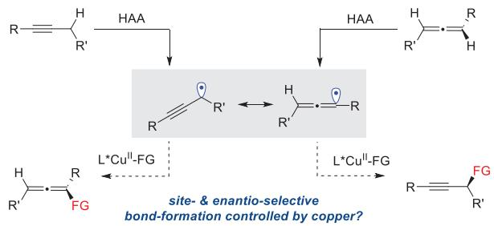
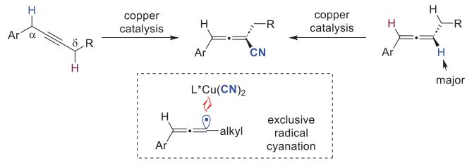
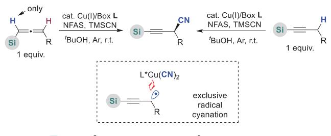
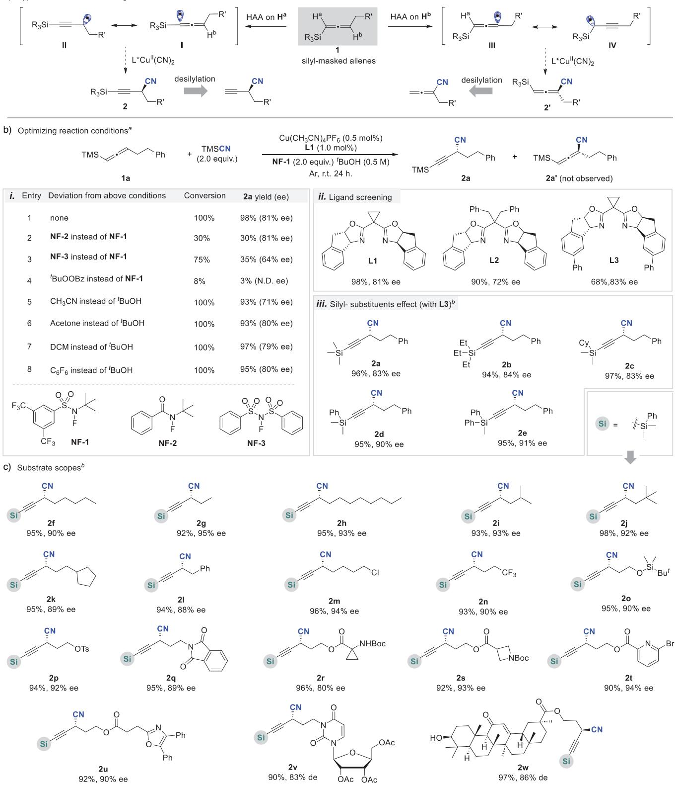
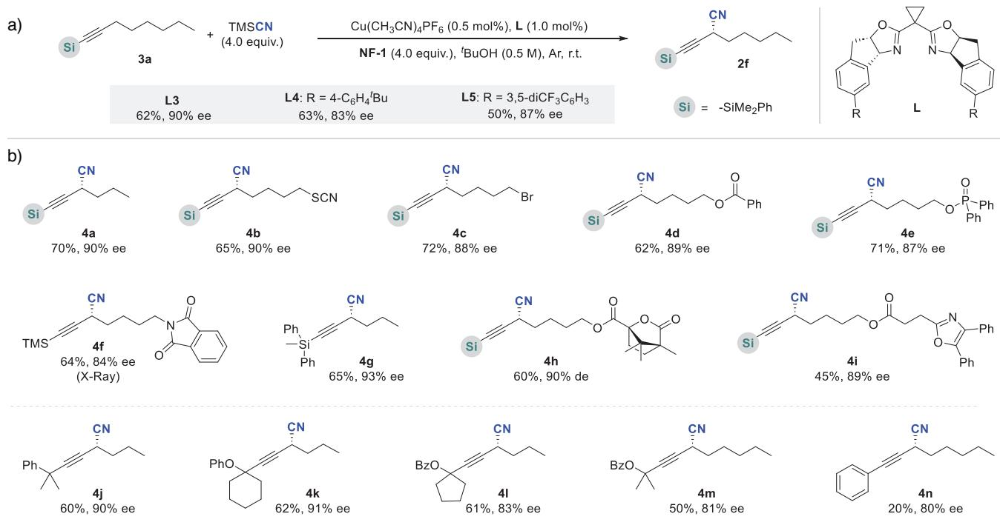
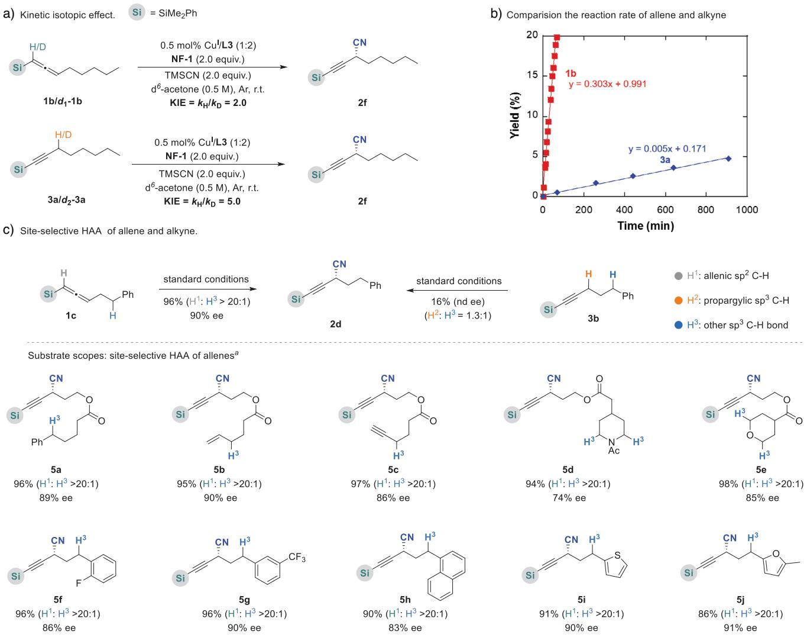
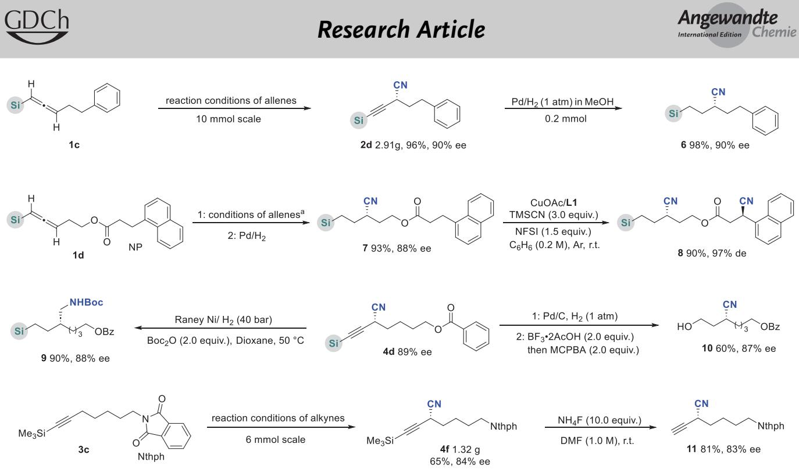

Asymmetric Synthesis Hot Paper

How to cite: Angew. Chem. Int. Ed. 2025, 64, e202505939

doi.org/10.1002/anie.202505939

# Copper-Catalyzed Asymmetric Cyanation of Propargylic Radicals Derived From Silyl-Substituted Allenes and Alkynes

Zhongming Cheng+, Guoyu Zhang+, Yunshun Deng, Yiping Zhang, Xiang Li, Pinhong Chen, and Guosheng Liu\*

Abstract: Here, we report an efficient method to synthesize enantiomerically enriched propargyl nitriles via copper-catalyzed asymmetric cyanation of propargylic radicals, which are generated from silyl-substituted allenes or alkynes. These reactions proceeded through a highly site-selective hydrogen atom abstraction (HAA) with Cu(II)-bound nitrogen-centered radicals (NCRs). Notably, silyl-substituted allenes demonstrate exceptional allenic sp2 C─H bond activation selectivity, outcompeting alternative reactive sp3 C─H bonds (benzylic, allylic, and heteroatom-adjacent) in HAA processes. This chemo-selectivity profile enables precise enantiocontrol and site-specific functionalization of complex molecular architectures.

## Introduction

Optically pure alkynyl moieties are extensively found in natural products, pharmaceuticals, and material science.[1–4] Moreover, enantioenriched alkynes also serve as valuable building blocks for the synthesis of chiral compounds and biologically active molecules.[5–7] Therefore, the synthesis of chiral alkynes has garnered significant attention over the past decades,[8–10] and the approaches to chiral propargylic compounds include nucleophilic addition of carbonyls,[11,12] hydroalkynylation,[13,14] and so on. In recent years, substantial advancements have been achieved via transition metal-catalyzed asymmetric radical coupling reactions.[15–21] For instance, the pioneering studies on Ni-catalyzed asymmetric cross-coupling of propargylic halides to organozinc reagents have been reported by Fu and coworkers.[22,23] Very recently, the groups of Liu[24–26] and Zhang[27,28] reported copper-catalyzed asymmetric Sonogashira-type cross-couplings, which are compatible with a broad range of terminal alkynes and prochiral alkyl halides, respectively. However, as an alternative approach, the asymmetric propargylic C─H functionalization reaction is extremely rare.[29,30]

Asymmetric catalytic C─H functionalization presents a more attractive and streamlined approach for the synthesis of functional molecules.[31–34] With a copper-catalyzed radical relay process,[35] enantioselective functionalization reactions of benzylic [36,37] and allylic C─H bonds [38] have been recently developed. Inspired by these studies, we reasoned that enantiomerically enriched propargylic compounds could be obtained through this radical relay process. Distinct from previous studies, however, propargylic radicals as key intermediates involved in the reaction can be tautomerized to allenic radicals, thus leading to the formation of the corresponding alkyne and/or allene products, respectively (Scheme 1a).[39–43] For instance, we recently reported the enantioselective cyanation of propargylic C─H bonds of arylsubstituted alkynes [44] and the enantioselective cyanation of allenic C─H bonds of allenes,[45,46] where both reactions involve the same tautomers of propargylic and allenic radicals, and the radical coupling of Cu(II) cyanide exclusively occurs at less steric allenic radicals, providing the cyano-allene products exclusively (Scheme 1b). Can we explore novel C─H functionalization strategies by modulating site- and chemo-selectivity to enable the efficient synthesis of chiral propargylic nitrile products? Herein, we communicate the first copper-catalyzed asymmetric cyanation of propargylic radicals generated from silyl-substituted allenes or alkynes, which serve as the limiting C─H reagents (Scheme 1c). The hydrogen atom abstraction (HAA) process demonstrated remarkable site-selectivity, occurring exclusively at sp2 allenic C─H bonds adjacent to silyl groups. Furthermore, distinct from previous studies, the radical coupling of Cu(II) cyanide exhibited chemoselective preference, proceeding through the less sterically hindered propargylic radical pathway.

## Results and Discussion

More recently, we [45,46] and others[47,48] disclosed coppercatalyzed cyanation, arylation, and alkynylation reactions of

HAA: sp² allenic C-H (allenes) >> sp³ propargylic C-H (alkynes)

Cu(II)-bound NCR: excellent site-selective HAA

a) Site- and enantioselective C-H functionalization: allenes vs alkynes  

b)Allene synthesis via C-H cyanation (previous studies)  
  
L\*Cu"(CN)2: excellent chemo-selective bond formation

c) Chiral alkyne synthesis: asymmetric cyanation of sp²& sp³ C-H bond (this work).  
  
Excellent site-selective HAA & radical cyanationExcellent enanatioselectivity  
Scheme 1. Asymmetric C─H cyanation for the synthesis of chiral allenes and alkynes.

allenic C─H bonds, where a highly site-selective HAA with Cu(II)-bound nitrogen-centered radicals (NCRs) is critical to the success of the C─H bond functionalizations of allenes; however, mono-alkyl-substituted allenes were proven to be ineffective candidates for these reactions. Considering the nature of easily deprotected silyl groups, silyl-substituted allene 1, acting as the “masked” terminal allenes, was chosen to carry out the asymmetric C─H cyanation. As mentioned in Scheme 2a, based on the previous studies, the HAA could occur at the C1 (Ha) and C3 (Hb) positions, which generate two kinds of allenic radicals. I and III, and their resonances II and IV. The final radical coupling process by sterically bulky chiral L\*Cu(II) cyanide is more favorable to trap the less sterically hindered carbon-centered radicals;[49] Therefore, the reaction is likely to yield the corresponding alkynyl nitriles 2 and/or allenyl nitriles 2-, which can be readily converted to the terminal alkynyl and allenyl nitriles. These compounds have been recognized as important synthons in organic synthesis.

Encouraged by the above hypothesis, we commenced our initial study on the reaction of allene 1a and TMSCN with NF-1 as an NCR precursor. We were delighted that the reaction afforded the desired alkynyl nitrile product 2a exclusively, while the previously reported allene nitrile product $\mathbf { 2 } \mathbf { a } ^ { \prime }$ was not observed (Scheme 2b). After careful screening, the propargyl cyanide product 2a was obtained in 98% yield with specific site-selectivity $( \mathbf { C } _ { s p 2 } { : } \mathbf { C } _ { s p 3 } > 2 0 { : } 1 )$ and good enantioselectivity (81% ee) in the presence of 0.5 mol% $\mathrm { C u ( C H _ { 3 } C N ) _ { 4 } P F _ { 6 } / \mathbf { L 1 } }$ (Scheme 2b-i, entry 1). Notably, some features were observed in this reaction. First, different NCR precursors exhibited significant influences on both yields and ee values. For instance, NF-2 exhibited relatively lower reactivity but similar enantioselectivity (entry 2), while NF-3 displayed moderate reactivity but with poor yields and diminished enantioselectivity (entry 3). In contrast, $^ { t } \mathbf { B u O } _ { 2 } \mathbf { B } \mathbf { z }$ was demonstrated as an ineffective radical precursor toward the C─H cyanation (entry 4). Second, various solvents could provide excellent yields but slightly affect the enantioselectivity (entries 5–8). For example, a 71% ee was obtained in acetonitrile, while similar results were given in acetone and perfluorobenzene. Third, ligand screening revealed that, as shown in Scheme 2b-ii, increasing the steric bulk of groups at the gem-carbon position was proven to be ineffective, which could decrease the enantioselectivity (e.g., 72% ee for L2). Considering the linear and rod-like structure of triple bonds in propargylic radicals, the designed L3, by extending the chiral pocket, could slightly improve the enantioselectivity to 83% ee, albeit with a reduced reactivity (68% yield). Further prolonging the reaction time could give the desired product an excellent yield (96%, Scheme 2b-iii). Finally, modifying the silyl groups could also affect the enantioselectivity. Although the trialkyl silyl-substituted substrates gave similar results (e.g., 2b, 2c), introducing the phenyl group into silyl groups could improve the enantioselectivity up to 90% ee (e.g., 2d, 2e).

With the optimized reaction conditions in hand, a variety of silyl-substituted allenes with dimethylphenylsilyl groups were investigated (Scheme 2c). For the substrates with simple alkyl chains, the reactions consistently furnished the desired propargyl nitriles (2f–2l) in nearly quantitative isolated yields (92%–98%) and excellent enantioselectivities (88%–95% ee). Moreover, substrates bearing various functional groups compatible with the reaction conditions, such as halide (2m), CF (2n), silyl ether (2o), OTs (2p), imide (2q), and esters (2r, 2s), yielded the corresponding products in excellent results. Substrates containing small rings (e.g., cyclopropyl ${ \bf 2 r , }$ azetidine 2s) were suitable for the reactions, and these high-strain rings were retained. Moreover, heterocycles (e.g., pyridine 2t, oxazole 2u), and complex moieties (e.g., uridine 2v, glycyrrhetinic ester 2w) were also compatible with the reaction conditions, and the corresponding products were obtained in excellent yields and ee (or de) values. All these outcomes (typically > 90% yields) demonstrated the extremely high catalytic reactivity toward allenic sp2 C─H cyanation.

Encouraged by the above results, we also investigated the asymmetric cyanation of propargylic C─H bonds, which presents an alternative pathway for the synthesis of these chiral propargylic nitriles. As shown in Scheme 3a, when the silyl-substituted alkyne 3a was treated under the standard conditions, the reaction indeed occurred and afforded the

a) Hypothesis and reaction design

Scheme 2. Site- and enantio-selective $\mathsf { s p } ^ { 2 } \mathsf { C - H }$ cyanation of silyl-substituted allenes. a) Hypothesis and reaction design. b) i. Optimization of the reaction conditions. ii. Further ligand screening. aReaction conditions: $\mathsf { C u } ( \mathsf { C H } _ { 3 } \mathsf { C N } ) _ { 4 } \mathsf { P F } _ { 6 }$ (0.5 mol%), L3 (1.0 mol%), 1a (0.2 mmol), NF-1 (0.4 mmol), TMSCN (0.4 mmol), tBuOH $( 0 . 5 { \mathsf { M } } )$ , at r.t. under Ar, 24 h. The yields were determined by the crude 1H NMR with ${ \mathsf { C H } } _ { 2 } { \mathsf { B r } } _ { 2 }$ as an internal standard; ee values were determined by HPLC on a chiral stationary phase. iii. Silyl-substituted efect with L3 as ligand. c) Substrate scopes. bReaction for 39 h, and the isolated yields were given.

  
Scheme 3. Asymmetric cyanation of propargylic C─H bonds. a) Ligand screening. b) Substrate scope and reaction on a 0.2 mmol scale. Reaction conditions: $\mathsf { C u } ( \mathsf { C H } _ { 3 } \mathsf { C N } ) _ { 4 } \mathsf { P F } _ { 6 }$ (0.5 mol%), L3 (1.0 mol%), 1a (0.2 mmol), NF-1 (0.8 mmol), and TMSCN (0.8 mmol) in tBuOH at r.t. under Ar for 72 h. The isolated yield was given, and ee values were determined by HPLC on a chiral stationary phase.

desired propargylic nitriles 2f with excellent enantioselectivity (90% ee), but with much poorer reactivity (38% yield).

Increasing the dosages of NF-1 and TMSCN (4.0 equivalents) and prolonging the reaction time (72 h) could increase a yield of 2f to 62% (90% ee). Notably, the identical product 2f was obtained with the same enantiomeric control as the reaction of allenes, indicating that the reaction involved the same tautomerization of two radical intermediates. Further optimizing Box ligands (e.g., L4 and L5) by enhancing the steric hindrance of the gem-groups failed to improve the enantioselectivity.

Subsequently, the scope of alkyne substrates was also examined (Scheme 3b). Similar to the allene substrates, a range of silyl-alkynes featuring simple alkyl or functionalized alkyl groups proved to be compatible with the reaction, delivering the corresponding products 4a–4e in moderate yields (62%–72%) while maintaining excellent enantioselectivity (87%–90% ee). Notably, verifying silyl substituents in alkynes could slightly affect the enantioselectivity, where a substrate with a small trimethylsilyl group provided a slightly lower enantiomeric ratio (84% ee, 4f),[50] while a substrate with a larger diphenylmethylsilyl group gave a higher ee value (93% ee, 4g), which offers guidance for substrate design to reach high ee value. More importantly, besides the silyl-substituted alkynes, various tertiary carbon-substituted alkynes were also suitable for the reaction to provide propargylic nitriles 4j, 4k in moderate yields (60%–62%) with excellent ee values (90%–91%). The similar alkynes 4l, 4m containing ester groups are also suitable for the reaction but with slightly reduced enantioselectivities (81%–83% ee).

As mentioned above, significantly different performance was observed between silyl-substituted allenes and alkynes, though both reactions provide an identical product. To gain more insights, a series of control experiments were conducted. First, the kinetic isotopic effect was probed through parallel experiments using 1b and d -1b (Scheme 4a). The KIE value $( k _ { \mathrm { H } } / k _ { \mathrm { D } } = 2 . 0 )$ revealed that the HAA of allenic sp2 C─H bonds contributes to the rate-determining step. In comparison, a higher KIE value $( k _ { \mathrm { H } } / k _ { \mathrm { D } } = 5 . 0 )$ was obtained in the case of alkyne (3a and d -3a). In addition, the time course of two reactions in Scheme 4b revealed that the HAA of allenic $\mathrm { s p } ^ { 2 } \ \mathrm { C - H }$ in 1b (one hydrogen) is 120 times faster than that of $\mathrm { s p } ^ { 3 } \ \mathrm { C - H }$ in 3a (two hydrogens), greatly affected by the bond dissociation energy (BDE) of the allenic sp2 C─H bond (82 kcal mol−1) which is lower than that of propargylic sp3 C─H bonds (86 kcal mol−1).[51] This observation is also reflected by the remarkably different KIE values. Second, this remarkable difference prompted us to survey the site-selective HAA between various active C─H bonds in allene and alkyne substrates. As shown in Scheme 4c the reaction of allene 1c occurred at the allenic sp2 C─H1 bond to deliver product 2d exclusively for 15 h, while another active benzylic $\mathbf { s p } ^ { 3 } \mathbf { \Lambda } \mathbf { C } \mathbf { - } \mathbf { H }$ bond was intact. However, the reaction of alkyne 3b exhibited extremely poor reactivity (16% yield) for 40 h, along with poor site-selectivity $( \mathrm { C } \mathrm { - } \mathrm { H } ^ { 2 } \ \mathrm { v s . } \ \mathrm { C } \mathrm { - } \mathrm { H } ^ { 3 } = 1 . 3 { : } 1 )$ . These outcomes revealed that the excellent site-selective HAA is much more likely to occur at the allenic sp2 C─H bond position of allenes rather than that in alkynes. Therefore, various silyl-allenes containing diverse active $\mathrm { s p } ^ { 3 } \mathrm { C - H }$ bonds were evaluated on the siteselectivity. Allene substrates containing extra active $\mathrm { s p } ^ { 3 } \mathrm { C - H }$ bonds at the benzylic (5a), allylic (5b), and propargylic (5c) positions or adjacent to heteroatoms (amide 5d, ether 5e) exhibited excellent reactivity, where specific site-selective sp2

  
Scheme 4. Mechanism and site-selective cyanation. a) Kinetic isotopic efect. b) Comparison of reaction rates of allene 1b and alkyne 3a. c) Site-selective HAA & cyanation of diverse sp3 C─H bonds in allenes and alkynes. aReaction conditions: $\mathsf { C u } ( \mathsf { C H } _ { 3 } \mathsf { C N } ) _ { 4 } \mathsf { P F } _ { 6 }$ (0.5 mol%), L3 (1.0 mol%), substrate (0.2 mmol), NF-1 (0.4 mmol), and TMSCN (0.4 mmol) in tBuOH at r.t. under Ar. $^ b { \sf C } _ { 6 } { \sf F } _ { 6 }$ as solvent. The isolated yields were given.

C─H cyanation occurred to give propargylic cyanides (H1 vs. H3 > 20:1) in excellent yields and ee values. In contrast, the site-selective cyanation of corresponding alkynes provided worse performance with poor reactivity and site-selectivity (see SI). To expand the functionality, more allenes with various other arenes (5f–5h) and heteroarenes thiophene 5i and furan 5j were also investigated, which were proven to be good candidates for achieving excellent site-selectivity, presenting broad substrate scope for asymmetric cyanation on the specific sp2 C─H bond of allenes.

Finally, the synthetic utility of methods was surveyed (Scheme 5). First, the preparative utility of our method in the laboratory was demonstrated by gram-scale reactions (2d) with excellent yields and ee values. Chiral alkyl nitrile compounds with silyl substituent 6 (98% yield, 90% ee) can be obtained by hydrogenation at atmospheric pressure catalyzed by Pd/C. Second, substrate 1d bearing both allenic sp2 C─H and benzylic sp3 C─H bonds was treated under the standard conditions; the reaction occurred at the allenic sp2 C─H bond position exclusively to afford chiral product 7 in 93% yield with 88% ee. After hydrogenation, the sequential asymmetric cyanation of the benzylic C─H bond proceeded smoothly to deliver a dinitrile product 8 in 90% yield with 97% de. Third, hydrogenation of product 4d was conducted by Raney Ni catalysts, which could provide the desired chiral alkyl amine 9 with almost identical ee values. After Pd/C hydrogenation, it can be further oxidized to deliver alcohol product 10 in 60% yield with 87% ee. In addition, the reaction of 3c could be scaled up to 6 mmol and yielded product 4f in 65% yield (1.32 g) in 84% ee, which could be readily converted to chiral terminal alkyne 11 in 81% yield without the erosion of enantioselectivity.

## Conclusion

In summary, we have developed a copper-catalyzed asymmetric C─H cyanation of silyl-substituted allenes and alkynes, providing easy access to chiral propargyl nitriles with excellent enantioselectivity. The C─H functionalization reaction occurred selectively at the allenic $\mathbf { s p } ^ { 2 } \mathbf { \Lambda } \mathbf { C } \mathbf { - } \mathbf { H }$ bond position of silyl-substituted allenes, or the propargylic $\mathsf { s p } ^ { 3 }$ C─H bond position of alkynes. Although both allenes and alkynes yielded the same chiral propargylic nitriles, the reaction of silyl-substituted allenes is significantly faster than that of the corresponding alkynes, suggesting that HAA at the allenic C─H bond position is more favorable than that at the propargylic C─H bond position of alkynes. Moreover, the reaction with allenes demonstrates exceptional selectivity for the allenic C─H bond over various reactive $\mathsf { s p } ^ { 3 }$ C─H bonds, providing a promising platform for achieving highly selective C─H bond functionalizations of complex molecules. Not only does our presented methodology broaden the reaction types of allenes and alkynes but also significantly enhances the structural diversity of accessible products.

  
Scheme 5. Synthetic applications. ${ } ^ { a } { \mathsf { C } } _ { 6 } { \mathsf { F } } _ { 6 }$ as solvent.

## Acknowledgements

The authors are grateful for the financial support provided by the National Key R&D Program of China (2021YFA1500100), the National Nature Science Foundation of China (Nos. 22331012, 92256301, and 22171279), the Strategic Priority Research Program of the Chinese Academy of Sciences (no. XDB0610000), and the Youth Innovation Promotion Association of the Chinese Academy of Sciences (No. Y2022074). G.Z. and G.L. thank the postdoctoral financial support from Syngenta. G.L. acknowledges support from the Tencent Foundation through the New Cornerstone Science Foundation.

## Conflict of Interests

The authors declare no conflict of interest.

## Data Availability Statement

The data that support the findings of this study are available in the supplementary material of this article.

Keywords: Asymmetric cyanation • C─H activation • Copper catalysis • Hydrogen atom abstraction • Propargylic radicals

[1] X. Li, J.-M. Lv, D. Hu, I. Abe, RSC Chem. Biol. 2021, 2, 166–180.

[2] T. T. Talele, J. Med. Chem. 2020, 63, 5625–5663.

[3] C. Ngo, W. Fried, S. Aliyari, J. Feng, C. Qin, S. Zhang, H. Yang, J. Shanaa, P. Feng, G. Cheng, X. S. Cheng, C. Zhang, J. Med. Chem. 2023, 66, 12237–12248.

[4] F. Diederich, P. J. Stang, R. R. Tykwinski, Acetylene Chemistry: Chemistry, Biology, and Material Science, Wiley-VCH, Weinheim 2005.

[5] T. E. Müller, K. C. Hultzsch, M. Yus, F. Foubelo, M. Tada, Chem. Rev. 2008, 108, 3795–3892.

[6] U. Wille, Chem. Rev. 2013, 113, 813–853.

[7] H. Ohno, S. Inuki, Org. Biomol. Chem. 2021, 19, 3551–3568.

[8] C.-H. Ding, X.-L. Hou, Chem. Rev. 2011, 111, 1914–1937.

[9] I.-T. Trotuş, T. Zimmermann, F. Schüth, Chem. Rev. 2014, 114, 1761–1782.

[10] B. M. Trost, C.-J. Li, Modern Alkyne Chemistry: Catalytic and Atom-Economic Transformations, Wiley-VCH, New York 2014.

[11] L. Pu, Tetrahedron 2003, 59, 9873–9886.

[12] L. Lin, R. Wang, Curr. Org. Chem. 2009, 13, 1565–1576.

[13] Z.-X. Wang, X.-Y. Bai, B.-J. Li, Synlett 2017, 28, 509–514.

[14] T. Nishimura, X.-X. Guo, N. Uchiyama, T. Kato, T. Hayashi, J. Am. Chem. Soc. 2008, 130, 1576–1577.

[15] G. C. Fu, ACS Cent. Sci. 2017, 3, 692–700.

[16] J. Choi, G. C. Fu, Science 2017, 356, eaaf7230.

[17] S. Mondal, F. Dumur, D. Gigmes, M. P. Sibi, B. M. P. ertrand, M. Nechab, Chem. Rev. 2022, 122, 5842–5976.

[18] F. Wang, P. Chen, G. Liu, Nat. Synth. 2022, 1, 107–116.

Manuscript received: March 14, 2025

[19] D. A. Nagib, Chem. Rev. 2022, 122, 15989–15992.

[20] Q.-S. Gu, Z.-L. Li, X.-Y. Liu, Acc. Chem. Res. 2020, 53, 170–181.

[21] F. D. Lu, D. Liu, L. Zhu, L.-Q. Lu, Q. Yang, Q.-Q. Zhou, Y. Wei, Y. Lan, W.-J. Xiao, J. Am. Chem. Soc. 2019, 141, 6167–6172.

[22] S. W. Smith, G. C. Fu, J. Am. Chem. Soc. 2008, 130, 12645–12647.

[23] H. Huo, B. J. Gorsline, G. C. Fu, Science 2020, 367, 559–564.

[24] X.-Y. Dong, Y.-F. Zhang, C.-L. Ma, Q.-S. Gu, F.-L. Wang, Z.-L. Li, S.-P. Jiang, X.-Y. Liu, Nat. Chem. 2019, 11, 1158–1166.

[25] F.-L. Wang, C.-J. Yang, J.-R. Liu, N.-Y. Yang, X.-Y. Dong, R.- Q. Jiang, X.-Y. Chang, Z.-L. Li, G.-X. Xu, D.-L. Yuan, Y.-S. Zhang, Q.-S. Gu, X. Hong, X.-Y. Liu, Nat. Chem. 2022, 14, 949– 957.

[26] Z. Gao, L. Liu, J.-R. Liu, W. Wang, N.-Y. Yang, L. Tao, Z.-L. Li, Q.-S. Gu, X.-Y. Liu, Nat. Synth. 2025, 4, 84–96.

[27] X. Mo, B. Chen, G. Zhang, Angew. Chem. Int. Ed. 2020, 59, 13998–14002.

[28] M. Liao, C. Geng, Z. Wu, C. Pan, C. Wang, G. Meng, X. Zuo, Y. Zhu, X. Qi, G. Zhang, R. Guo, ACS Catal. 2025, 15, 1693–1703.

[29] H. Zhang, Y. Zhou, T. Yang, J. Wu, P. Chen, Z. Lin, G. Liu, Nat. Catal. 2025, 8, 58–66.

[30] S. Tang, H. Song, S. Yu, Org. Lett. 2024, 26, 10036–10040.

[31] C.-M. Che, V. K.-Y. Lo, C.-Y. Zhou, J.-S. Huang, Chem. Soc. Rev. 2011, 40, 1950–1975.

[32] X. Wang, J. He, Y.-N. Wang, Z. Zhao, K. Jiang, W. Yang, T. Zhang, S. Jia, K. Zhong, L. Niu, Y. Lan, Chem. Rev. 2024, 124, 10192–10280.

[33] D. L. Golden, S.-E. Suh, S. S. Stahl, Nat. Rev. Chem. 2022, 6, 405–427.

[34] Z. Zhang, P. Chen, G. Liu, Chem. Soc. Rev. 2022, 51, 1640–1658.

[35] F. Wang, P. Chen, G. Liu, Acc. Chem. Res. 2018, 51, 2036–2046.

[36] W. Zhang, F. Wang, S. D. McCann, D. Wang, P. Chen, S. S. Stahl, G. Liu, Science 2016, 353, 1014–1018.

[37] L. Fu, Z. Zhang, P. Chen, Z. Lin, G. Liu, J. Am. Chem. Soc. 2020, 142, 12493–12500.

[38] J. Li, Z. Zhang, L. Wu, W. Zhang, P. Chen, Z. Lin, G. Liu, Nature 2019, 574, 516–521.

[39] M. M. Hansmann, M. Melaimi, G. Bertrand, J. Am. Chem. Soc. 2017, 139, 15620–15623.

[40] J. Jammi, S. Maury, F. Vibert, S. R. A. Marque, D. Siri, L. Feray, M. Bertrand, J. Org. Chem. 2012, 77, 9081–9086.

[41] V. R. Sabbasani, H. Lee, Y. Xia, D. Lee, Angew. Chem. Int. Ed. 2016, 55, 1151–1155.

[42] F. Wang, D. Wang, Y. Zhou, L. Liang, R. Lu, P. Chen, Z. Lin, G. Liu, Angew. Chem. Int. Ed. 2018, 57, 7140–7145.

[43] X. Zhu, W. Deng, M.-F. Chiou, C. Ye, W. Jian, Y. Zeng, Y. Jiao, L. Ge, Y. Li, X. Zhang, H. Bao, J. Am. Chem. Soc. 2019, 141, 548–559.

[44] R. Lu, T. Yang, X. Chen, W. Fan, P. Chen, Z. Lin, G. Liu, J. Am. Chem. Soc. 2021, 143, 14451–14457.

[45] Z. Cheng, T. Yang, C. Li, Y. Deng, F. Zhang, P. Chen, Z. Lin, S. Ma, G. Liu, J. Am. Chem. Soc. 2023, 145, 25995–26002.

[46] Z. Cheng, J. Zhang, C. Li, X. Li, P. Chen, G. Liu, J. Am. Chem. Soc. 2024, 146, 24689–24698.

[47] Y. Wei, Z. Wang, K. Wang, J.-K. Qiu, Z. Wang, H. Li, X. Duan, K. Guo, X. Bao, X. Wu, Angew. Chem. Int. Ed. 2024, 63, e2023171.

[48] X. Duan, Q. Jin, K. Wang, Y. Sun, Y. Wei, Z. Wang, J.-K. Qiu, K. Guo, X. Bao, X. Wu, ACS Catal. 2024, 14, 13219–13226.

[49] For the final coupling of chiral BoxCu(II) cyanide and carbon radicals, the steric effect is remarkably observed. Owing to the larger steric hinderance of silyl group, the coupling reaction is difficult to occur at the intermediates I and IV.

[50] CCDC 2329075 (4f) contain the supplementary crystallographic data. These data can be obtained free of charge from The Cambridge Crystallographic Data Centre.

[51] These BDE values were obtained by DFT calculation.

Revised manuscript received: April 21, 2025

Accepted manuscript online: April 21, 2025

Version of record online: May 02, 2025