Homogeneous Catalysis Hot Paper

How to cite: Angew. Chem. Int. Ed. 2025, 64, e202508252

doi.org/10.1002/anie.202508252

# Iridium-Catalyzed Enantioselective Intramolecular Hydroarylation of Allenes: Formal Synthesis of ( )-Rhazinilam

Andrés Arribas+, Alejandro Rey+, Martín Calvelo, José L. Mascareñas, and Fernando López\*

Abstract: We report a versatile, highly enantioselective intramolecular hydroarylation of allenyl-tethered pyrroles and indoles. The reaction, promoted by an iridium(I)/bisphosphine chiral catalyst, provides a direct access heteropolycyclic systems bearing either tertiary or quaternary carbon stereocenters and a synthetically appealing alkenyl pendant. The method allows a highly efficient assembly of five-, six- and even sevenmembered fused indole and pyrrole products, providing enantiomeric excesses of up to 99%. DFT computational studies align nicely with the experimental results and allow to rationalize the key factors that control both regio- and stereoselectivity of the process. Finally, the synthetic potential of the method was exemplified with a very short, highly enantioselective formal synthesis of ( )-Rhazinilam.

## Introduction

Allenes are fascinating C─C unsaturated compounds that serve as highly versatile synthetic building blocks.[1–4] Although allenes might initially be perceived as mere alkene analogues, the presence of two orthogonal cumulated π-bonds offers opportunities for exploring new reaction pathways not available for alkenes.[5–9] However, these distinctive structural features also pose substantial challenges, particularly in terms of controlling chemo-, regio-, and stereoselectivity. As a result, and despite remarkable advancements in recent decades,[1–9] the potential of allenes remains underexploited compared to that of other more common unsaturated functional groups.

This underutilization is particularly evident in metalcatalyzed C─H hydrocarbonation reactions, which have been extensively developed using alkynes and alkenes as reaction partners.[10–14] In this context, we have recently demonstrated the versatility of allenes in iridium-catalyzed cycloisomerization processes initiated by a C–H activation step.[15] By judicious selection of the ancillary ligand, the reactions of pyrrole–allenyl derivatives 1 (Scheme 1a) can shift from simple intramolecular hydrocarbonations to give achiral adducts 2 (Scheme 1a, right) to mechanistically more intricate cascade processes, leading to cyclopropyl-fused azacycles like 3 (Scheme 1a, left).

a) Previously reported hydroarylations of 1 (n = 0 or 1)[15]

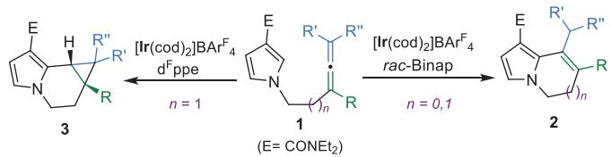

b) New divergence (n = 2): hydroarylations of 1a vs 1b: New product 4b  
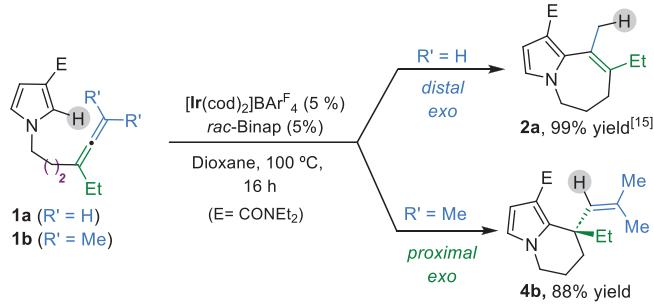

c) This work: Enantioselective exo-selective proximal hydroarylation of allenylpyrroles and indoles

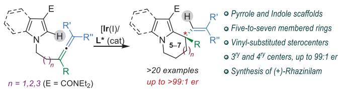

Scheme 1. a) Previously reported cycloisomerizations. b) New divergent reactivity observed for allene-pyrroles 1a and 1b. c) This work: enantioselective exo-selective proximal hydroarylations.

Curiously, while exploring the synthetic versatility of precursors bearing a three-methylene linker between the allene and the pyrrole (Scheme 1b), we observed an unexpected divergence: under standard conditions with the Ir(I)/rac-Binap catalyst, the pyrrole derivative 1a undergoes hydrocarbonation of its allene’s distal double bond to afford the canonical achiral product 2a (Scheme 1b, top). However, a related precursor bearing two methyl substituents at the allene terminal carbon (1b) evolved to the tetrahydroindolizine 4b, which features a synthetically appealing quaternary stereocenter bearing an alkenyl substituent (Scheme 1b, bottom).

This result caught our attention due to the unexpected chemoselectivity of the hydroarylation, the synthetic potential of the products of type 4, and the overall lack of highly enantioselective allene hydroarylations that deliver cyclic products bearing all-carbon quaternary centers.[10,16,17] Worth to note, the few reported asymmetric alkene hydrocarbonation methods that yield cyclic products bearing quaternary carbon stereocenters typically exhibit narrow scopes and are mostly limited to the formation of methyl-substituted stereocenters.[18–25]

Accordingly, the development of an asymmetric allene hydroarylation protocol capable of providing heterocyclic products like 4 in a highly enantioselective manner emerged as a very attractive and relevant goal.

Herein, we report the successful implementation of this asymmetric methodology, which enables the access to a variety of enantioenriched tetrahydroindolizines, tetrahydropyridoindoles, dihydropyrrolizine, and tetrahydropyrroloazepines, bearing either tertiary or quaternary alkenylsubstituted stereocenters (Scheme 1c). We also include a computational analysis that provides relevant mechanistic insights that explain the chemoselectivity of the reactions. Finally, we demonstrate the synthetic potential of the methodology by reporting a range of synthetic manipulations and a highly enantioselective formal synthesis of the alkaloid ( )-Rhazinilam.

## Results and Discussion

To evaluate the viability of an enantioselective reaction toward products of type 4, we initially carried out the reaction of allenepyrrole 1b, using (R)-Binap as ligand, in dioxane at $1 0 0 ~ ^ { \circ } \dot { \mathrm { C } } . \dot { [ 2 6 ] }$ Gratifyingly, the tetrahydroindolizine product 4b, was obtained with a high enantiomeric ratio (er) of 94:6. Further optimization with different Binap derivatives revealed that Tol-Binap (Entry 2) and, particularly, DM-Binap (Entry 3) were more efficient, enhancing both the yield and enantioselectivity, up to a 99.5:0.5 er (93% yield). Decreasing the reaction temperature to 80 °C significantly affected the yield due to an incomplete conversion of 1b, even after 46 h (Entry 4). Other C2-symmetric bisphosphines such as DM-Garphos or BTFM-Garphos resulted in lower er values (Entries 5 and 6). Curiously, the use of Binapine, which had provided excellent results in the hydroarylation of pyrrole-tethered alkenes,[21] led to complete recovery of the starting material (Entry 7). The absolute configuration of the product 4b, obtained with (R)-DM-Binap, was determined by X-ray diffractometry.[27]

Table 1: Preliminary analysis of the reaction with 1b.a)  
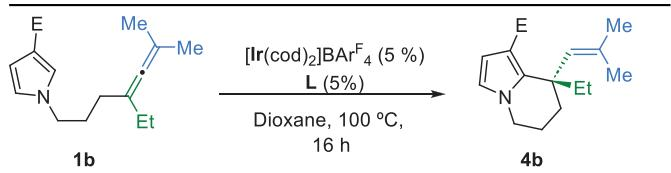

<table><tr><td>Entry</td><td> $\textsf { E } ( 7 b - 7 b ^ { \vert 1 \vert } )$ </td><td>Ligand (L)</td><td>4b, Yield (%) er</td><td></td></tr><tr><td>1</td><td>CONEt2 (1b)</td><td>(R)-Binap</td><td>88</td><td>94:6</td></tr><tr><td>2</td><td>CONEt2 (1b)</td><td>(R)-Tol-Binap</td><td>85</td><td>95:5</td></tr><tr><td>3</td><td>CONEt2 (1b)</td><td>(R)-DM-Binap</td><td>93</td><td>99.5:0.5</td></tr><tr><td>4b)</td><td>CONEt2 (1b)</td><td>(R)-DM-Binap</td><td>52</td><td>99:1</td></tr><tr><td>5</td><td>CONEt{2 (1b)</td><td>(R)-DM-Garphos</td><td>83</td><td>96:4</td></tr><tr><td>6</td><td>CONEt2 (1b)</td><td>(R)-BTFM-Garphos</td><td>s 98</td><td>75:25</td></tr><tr><td>7</td><td>CONEt2 (1b)</td><td>(S)-Binapine</td><td>0</td><td>n.d.</td></tr><tr><td>8</td><td> ${ \mathsf { C O N M e } } _ { 2 } \ ( { \mathsf { 7 b } } ^ { \mathsf { 1 } } )$ </td><td>(R)-DM-Binap</td><td>64</td><td>98:2</td></tr><tr><td>gc)</td><td> $\mathsf { C O N M e } ( \dot { \mathsf { O M e } } ) \ ( \bar { \mathbf { \mu } } ) ^ { \mathsf { I I } } )$ </td><td>(R)-DM-Binap</td><td>57</td><td>90:10</td></tr><tr><td>10</td><td> $\mathsf { C O P h } \ ( \mathsf { 7 b } ^ { \mathsf { I I I } } )$ </td><td>(R)-DM-Binap</td><td>52</td><td>68:32</td></tr></table>

a) Conditions: 1b was added to a solution of $[ \mathsf { I r } ( \mathsf { c o d } ) _ { 2 } ] \mathsf { B A r } ^ { \mathsf { F } } _ { 4 }$ (5 mol%) and ligand (L, 5 mol%) in dioxane and heated at 100 °C for 16 h, unless otherwise noted. b) Reaction carried out at 80 °C for 46 h. c) Reaction time 48 h.

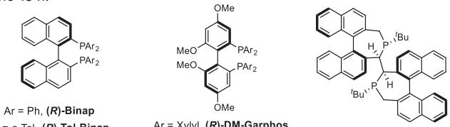

Notably, other directing groups than diethyl amide can be used. As can be deduced from Table 1 (Entries 8–10), a dimethyl amide provided equally good results and the reaction is also effective with a precursor bearing a Weinreb amide (1bII) that gives the product with a remarkable 90:10 er (Entry 9). It is also possible to use a phenyl ketone as directing group, although in this case the enantioselectivity is lower.[26]

With these optimized conditions in hand (Table 1, Entry 3), we explored the scope of the process. As shown in Table 2, other precursors structurally related to 1b also underwent a successful exo-selective proximal allene hydroarylation. Thus, the tetrahydroindolizine 4c could be efficiently obtained in 99% yield and with an enantiomeric ratio of 91:9 from the corresponding precursor (1c), using the Ir(I)/Binap catalyst. In this case, the use of DM-Binap also enhanced the enantioselectivity up to 94:6 er while maintaining a good yield. When employing an allene substituted with a phenyl group at its proximal position (1d), the enantioselectivity of the product 4d was slightly lower (88:12 er), although the yield remained high. Conversely, the reaction of precursor 1e, bearing a methyl group at the internal position of the allene moiety, was very selective, providing 4e in 83% yield, with 96:4 er. To our surprise, using Binapine as ligand, which was ineffective for 1b, was well tolerated in this case, leading to an even more selective transformation (4e, 90% yield) with >99:1 er. This result together with the failure of Binapine to promote the reaction of 1b (R Et versus Me)

Table 2: Scope of the enantioselective hydroarylation processa)

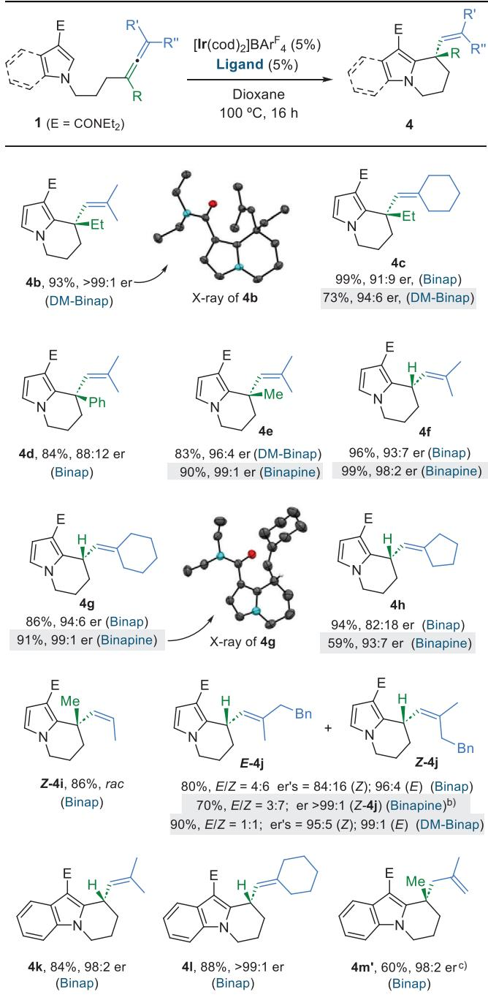

a) Conditions: 1 was added to a solution of $[ \mathsf { I r } ( \mathsf { c o d } ) _ { 2 } ] \mathsf { B A r } ^ { \mathsf { F } } _ { 4 } \ ( 5$ mol %) and ligand (5 mol%) in dioxane and heated at 100 °C for 16 h, unless otherwise noted. b) Carried out at ${ 8 0 ~ ^ { \circ } C } ;$ er of E-4j not determined. c) A 38% yield of the initially expected isomer 4m (depicted below) was also obtained.

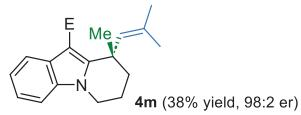

underscores the high steric demands imposed by this bulky ligand, particularly at the proximal position of the allene.

In consonance with this result, the Ir(I)/Binapine catalyst was also very efficient in promoting the hydroarylation of allene–pyrrole systems lacking substituents at their allene proximal position (R H). This is the case of the pyrrole–dimethyl allene 1f, which provided the chiral tetrahydroindolizine 4f, exhibiting a vinyl-substituted tertiary stereocenter, in 99% yield and a 98:2 er. Likewise, the hydroarylation of vinylidenecyclohexane 1g, employing Binapine as ligand, gave the expected tetrahydroindolizine product, 4g, with an exceptional 99:1 er (91% yield). The structure of 4g was further confirmed by X-ray diffraction analysis.[27] A related substrate that holds a vinylidenecyclopentane unit yielded the expected product 4h in good yield and a high 93:7 er. As shown in Table 2, employing Binap, instead of Binapine, resulted in good yields but somewhat lower enantiomeric ratios.

We also explored the outcome with substrates exhibiting chiral allene partners, like one that bears two methyl groups located at the proximal and terminal position, respectively (R and R- Me, R-- ═ H, rac-1i). Curiously, we observed a fully diastereoselective formation of the tetrahydroindolizine derivative 4i as a racemic cis isomer (86% yield, E/Z 0:1).

In contrast, the cyclization of rac-1j, which holds two different alkyl groups at the terminal position of the allene [R-Me, $\mathrm { R ^ { \prime \prime } } = \mathrm { C H _ { 2 } B n } , \mathrm { R } = \mathrm { H } ] .$ , afforded the tetrahydroindolizine 4j in 80% yield, as a 4:6 E/Z mixture. Notably, in this case both E and Z isomers were obtained with high er’s (E-4j: 96:4; Z-4j: 84:16 er), which is indicative of an effective overall stereocontrol by the chiral catalyst ( 89:11 er). Gratifyingly, the enantioselectivity could be further improved by using Binapine (70% yield, E/Z 3:7, Z-4j er > 99.5:0.5) or DM-Binap, this latter affording 4j as a 1:1 E/Z mixture, with both isomers showing excellent er’s (Z-4j: 99:1 er; E-4j: 95:5 er). Overall, these results highlight the potential of these ligands to induce asymmetry in the cyclization of substrates holding chiral allenes, provided that the terminal allene position is disubstituted.

Importantly, the reaction also proceeded successfully with indole precursors. Although the use of Binapine resulted in low conversions, the Ir(I)/Binap catalyst provided very good yields and high enantiomeric ratios. Thus, tetrahydropyrido[1,2-a]indole 4k was formed in 84% yield and an excellent 98:2 er, whereas the related tricycle 4l was obtained in 88% yield and an enantiomeric ratio exceeding 99:1. Moreover, allenyl–indoles bearing additional substituents at the allene proximal position were also suitable substrates, so tetrahydropyridoindole products like 4m/4m-, which contain an all-carbon quaternary stereocenter, were obtained in good yield and excellent er (98:2). Control experiments confirmed that, in this case, the partial isomerization of the vinylic system (toward 4m-), occurs after the hydroarylation process that gives 4m as initial product.[26]

We next analyzed precursors bearing connecting tethers of different lengths. Thus, we first checked precursors bearing two- instead of three-methylene connectors (Table 3). Although the reaction of 1n with an Ir(I)/Binap catalyst provided the achiral product 2n,[15,28] the analogous precursor bearing a vinylidenecyclohexane moiety gave the dihydro-1H-pyrrolizine product 4o, which bears a carbon quaternary stereocenter, in 50% yield, with 85:15 er (Table 3). Moreover, when a bulkier precursor with an adamantyl group was tested (1p), the analogue dihydropyrrolizine 4p was exclusively obtained in 95% yield and with an excellent enantiomeric ratio of 98:2. These results suggest that the steric hindrance imposed by the allene terminal substituents hampers the coordination of this C═C bond to the Ir center, thereby driving the chemoselectivity toward the proximal double bond.

Table 3: Enantioselective hydroarylation of precursors bearing diverse length tethers.a)  
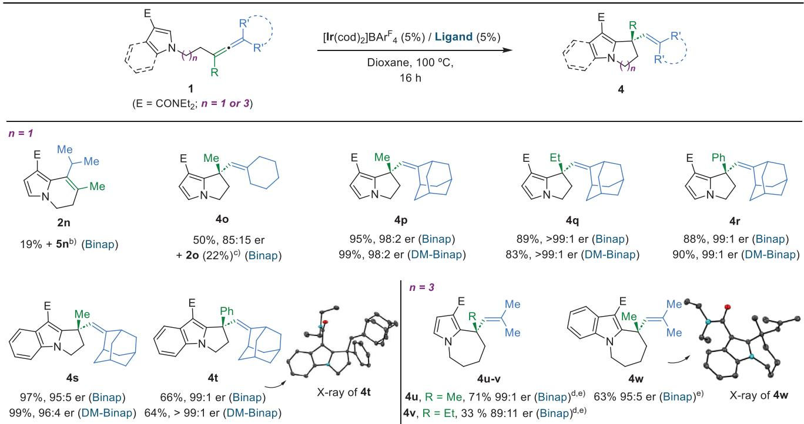

a) Conditions: 1 was added to a solution of [Ir(cod) ]BArF (5 mol %) and ligand (5 mol%) in dioxane and heated at 100 °C for 16 h, unless otherwise noted. b) Product 5n, depicted below, was also obtained; see Ref. [15] for further details. c) Product 2o, depicted below, was also obtained in 25% yield. d) Reaction time 48 h. e) Carried out at 130 °C, with 10 mol% of catalyst.  
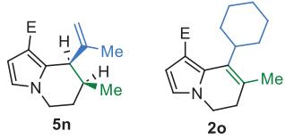

The reaction can be applied to give other related adducts, such as the chiral dihydropyrrolizines 4q and 4r, with ethyl or phenyl groups at the quaternary stereocenter, which are obtained in high yields and with excellent enantiomeric ratios (i.e., 99:1). Moreover, analogue precursors bearing an indole instead of a pyrrole moiety also participated in the process, delivering the corresponding dihydro-1Hpyrrolo[1,2-a]indole products (4s and 4t), in good yields and excellent er’s (95:5 and 99:1, respectively). The structure of product 4t was confirmed by X-ray diffractometry.[27] Notably, all these reactions also proceeded efficiently with DM-Binap, yielding comparable or slightly better yields and/or enantioselectivities (Table 3).

Finally, we evaluated precursors with longer, fourmethylene connecting tethers. As shown in Table 3, the reaction of a substrate featuring two methyl groups at the allene distal position (1u) selectively provided the chiral tetrahydro-pyrrolo[1,2-a]azepine derivative 4u, in 71% yield and with an excellent 99:1 er, using Binap as ligand. Although this system proved to be more sensitive to the allene proximal substituent (see for instance 4v, R Et), it is worth to note that a related indole precursor was fully selective toward 4w, which was obtained in 63% yield and 95:5 er. X-ray diffraction analysis confirmed the absolute stereochemistry of its chiral quaternary stereocenter.[27] These exceptional selectivities, even with simple methyl substituents at the allene terminal carbon, are likely due to the higher entropic cost of the potentially competitive hydroarylation of the allene distal bond, which would afford an eight-membered fused achiral product.

To gain insights into the chemoselectivity of the above cyclizations to give products of type 4, we performed a DFT theoretical analysis using Ir(I)/(R)-Binap as catalyst and 1a and 1b- as model allenyl-precursors (Figures 1 and 2, E CONMe ).[26] As indicated in Scheme 1b, the reaction of 1a, which has two hydrogens at the allene distal position, gave exclusively the achiral product 2a, resulting from an exo-addition across the allene distal bond. On the contrary, the terminally dimethylated derivatives 1b gave the chiral tetrahydroindolizine 4b, resulting from the exo addition to the proximal counterpart (Table 1, Entry 1; see also 4e in Table 2).

We first analyzed the energy profiles with precursor 1a’. According to previous computational studies,[15] the initial oxidative addition of the pyrrole C(2)─H bond to the Ir(I)

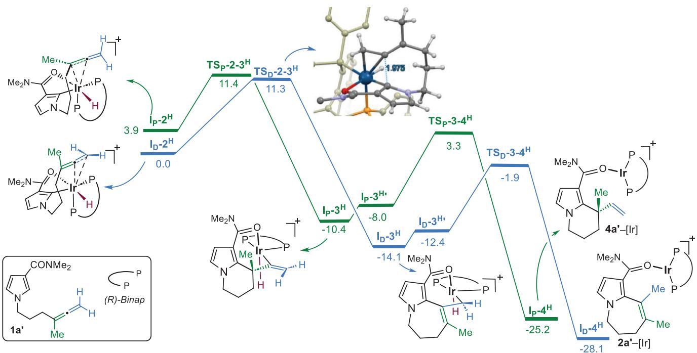  
Figure 1. Energy profile $\Delta G _ { \mathsf { s o l v } }$ (kcal mol−1) for the hydrocarbonation of 1a- B3LYP/6-31g(d) (LANL2DZ fo $\lvert \boldsymbol { \mathsf { r } } \rvert / / \mathsf { M O 6 } / 6 { - } 3 7 7 { + } + \mathsf { g } ( \mathsf { d } , \mathsf { p } )$ (SDD for Ir). Key bond distances in Å.

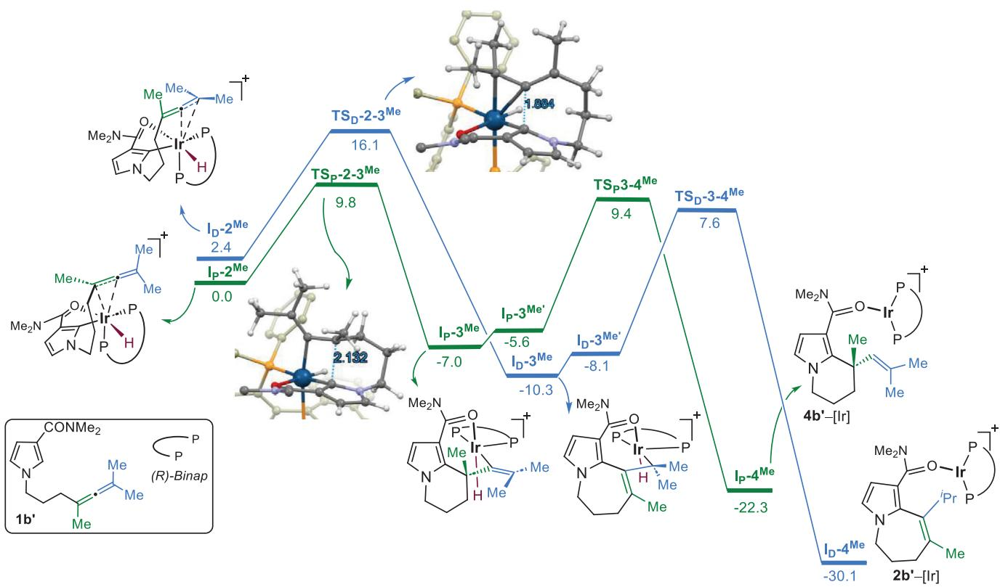  
Figure 2. Energy profile $\Delta G _ { \mathsf { s o l v } }$ (kcal mol−1) for the hydrocarbonation of 1b-. B3LYP/6-31g(d) (LANL2DZ for $\lvert \boldsymbol { \mathsf { r } } \rvert / / \mathsf { M } 0 6 / 6 { - } 3 7 7 { + } + \mathsf { g } ( \mathsf { d } , \mathsf { p } )$ (SDD for Ir). Key bond distances in Å.

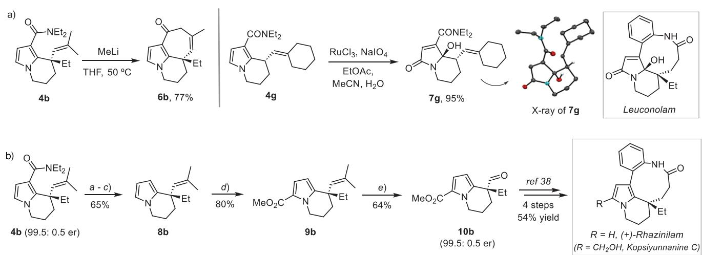  
Scheme 2. Synthetic manipulations of the products. Formal synthesis of Rhazinilam. a) $\mathsf { E t } _ { 3 } \mathsf { O B F } _ { 4 } , \mathsf { N a } _ { 2 } \mathsf { H P O } _ { 4 } , \mathsf { M e C N } , 9 \mathsf { 1 } \% ; \mathsf { b } ) \mathsf { L i O H } , \mathsf { D M S O } / \mathsf { H } _ { 2 } \mathsf { O } ,$ 150 °C, 92%; c) 2-aminoethanol, $1 7 5 ^ { \circ } \mathsf C ,$ , 78%; d) Cl CCOCl, CHCl , then MeONa, MeOH, 80%; e) $\mathsf { p } { \mathsf { - N O } } _ { 2 }$ -benzonitrile, $C H _ { 2 } C l _ { 2 }$ , 390 nm light; then $H _ { 2 } C O ,$ N-Ph-maleimide, MeCN/water (1:1), $8 0 ~ ^ { \circ } \mathsf { C } ,$ , 3 h, 64%.

catalyst delivers an Ir(III) intermediate,(I-1, G 18 kcal mol ${ \dot { - 1 } } ) , \ L ^ { [ 2 6 ] }$ which can coordinate the allene through either its proximal or distal double bond. Accordingly, two different intermediates, $\bf { I } _ { D } { - } 2 ^ { H }$ and $\bf { I } _ { P } { - } 2 ^ { H }$ , are obtained (Figure 1). The former, $\mathbf { I _ { D } } \mathbf { - } 2 ^ { \mathbf { H } }$ , resulting from the coordination of the distal $\mathrm { C } { = } \mathrm { C }$ bond of the allene, is 3.9 kcal $\mathrm { m o l ^ { - 1 } }$ more stable than $\bf { I } _ { P } { - } 2 ^ { H }$ . Although the energy barrier for the subsequent carbometallation via $\bf { T S _ { D } } \it { - } 2 \it { - } 3 ^ { \mathrm { { H } } }$ is higher than that from the less stable intermediate $\bf { I } _ { P } { - } 2 ^ { H }$ (via $\bf { T S _ { P } } \it { - } 2 \it { - } 3 ^ { \mathrm { { H } } } )$ , overall, the former transition state still lies below that of the proximal carbometallation. The energy difference between these transition states is minimal; however, the subsequent reductive eliminations are much easier for the distal pathway (the TS lies 5.2 kcal $\mathrm { m o l ^ { - 1 } }$ below to that associated to the proximal counterpart). Therefore, calculations qualitatively agree with the experimentally observed selectivity toward the achiral product of type 2a-.

We next analyzed how the addition of two methyl groups at the allene terminus (i.e., 1b-) influences the energy profile. As can be seen in Figure 2, the presence of these methyl’s drastically alters the relative stability of intermediates of type I-2 as now the proximal coordination $\left( \mathrm { i . e . , ~ } \ \mathbf { I _ { P } { - 2 } } ^ { \mathbf { M e } } \right)$ becomes 2.4 kcal mol−1 more stable than the distal $\left( \mathbf { I _ { D } } \mathbf { - } 2 ^ { \mathbf { M e } } \right)$ Intermediate $\mathbf { I } _ { \mathbf { P } ^ { - } } 2 ^ { \mathbf { M } \mathbf { e } }$ , which is suitably oriented for an exocarbometallation, evolves to the chiral tetrahydroindolizine iridium(III) species $\mathbf { I _ { P } { - } } 3 ^ { \mathbf { M e } }$ through an energy barrier of 9.8 kcal mol− $^ { \cdot 1 } \ ( \bf T S _ { P } . 2  . 3 ^ { M e } )$ . From intermediate $\mathbf { I } _ { \mathbf { P } } { \boldsymbol { \mathbf { \cdot } } } 3 ^ { \mathbf { M } \mathbf { e } }$ , a reductive elimination via $\mathrm { T S } _ { \mathrm { P } } { - } 3 { - } 4 ^ { \mathrm { M e } } \ ( \Delta G = 1 6 . 4 $ kcal mol−1) leads to the experimentally observed product (S-4b-), matching also the absolute configuration of the carbon quaternary stereocenter. In this regard, analysis of the profile leading to its enantiomer $( R ) \mathbf { - } \mathbf { 4 } \mathbf { b } ^ { \prime }$ confirmed that its enantiodetermining migratory insertion step lies 1.9 kcal $\mathrm { m o l ^ { - 1 } }$ above than that leading to (S)-4b (Figure S1),[26,29] in full agreement with the experimentally observed enantioselectivity (94: 6 er, Table 1, Entry 1).[26]

The carbometallation of the less stable intermediate, ${ \bf { I } } _ { \bf { D } } \cdot { \bf { \sigma } }$ 2Me, with the iridium coordinated to the allene distal bond, leads to $\mathbf { I _ { D } { - } } 3 ^ { \mathbf { M e } }$ through an energy barrier of 13.7 kcal $\mathrm { m o l ^ { - 1 } }$ Therefore, the observed selectivity is due to a significantly more favorable proximal carbometallation of $\mathbf { I } _ { \mathbf { P } } { \boldsymbol { - } } 2 ^ { \mathbf { M } \mathbf { e } }$ , with its transition state $\left( \mathbf { T S _ { p } }  – 2 – 3 ^ { \mathbf { M e } } \right)$ lying 6.3 kcal $\mathrm { m o l ^ { - 1 } }$ below that of the distal C═C bond $( \mathbf { T S _ { D } } – 2 – 3 ^ { \mathbf { M e } } )$ . This is fully consistent with the exclusive formation of products of type 4, as experimentally observed.

Worth to note, a comparison of the energy profiles of model substrates 1a- and 1b- reveals that both distal and proximal migratory insertion barriers are increased by ${ \sim } 2 . 3$ kcal $\mathrm { m o l ^ { - 1 } }$ when adding the methyl groups at the allene terminus. Thus, it is the relative stability of the immediate precursors of type I-2, which changes in more than 6 kcal mol−1, what eventually determines the selectivity switch. The origin of such difference in energy might be related to steric restrictions imposed by the allene terminal substituents, which disfavor the coordination of the iridium center to this distal double bond.

A related trend was also computationally observed for precursors of type 1, bearing a shorter two-methylene tether between the heteroaromatic ring and the allene (e.g., 1n, 1p, Table 3). In this case, the replacement of two methyl groups of the allene terminus by the bulkier adamantane led to a drastic change in the relative selectivity of the migratory insertion transition states, reversing the initial 6 kcal $\mathrm { m o l } ^ { - 1 }$ preference for the distal carbometallation that affords product of type 2 (i.e., 2n, Table 3) to a >11 kcal mol−1 in favor of the proximal counterpart, leading to ${ \mathfrak { A } } ( { \mathrm { i . e . , 4 p } } .$ , Table 3) (Figure S2).[26]

Given that tetrahydroindolizine, tetrahydropyridoindole, and dihydropyrroloindole skeletons, both bearing tertiary and quaternary carbon stereocenters, constitute the central core of numerous natural products,[30–34] we preliminarily explored the synthetic potential of adducts (Scheme 2). Surprisingly, when we treated compound 4b with MeLi, instead of obtaining the expected C3-methyl ketone, we observed the formation of an interesting, triple-fused heterocyclic product, 6b, in a good 77% yield (Scheme 2a, left). The reaction is assumed to proceed through an allylic deprotonation and subsequent intramolecular addition of the resulting carbanion to the carboxamide. On the other hand, the adduct 4g could be selectively oxidized at the pyrrole moiety to yield 7g (95% yield), which holds the 5-hydroxo-dihydropyrrol-2- one central core of several alkaloids, such as Leuconolam (Scheme 2a, right).[35,36] The structure of 7g was further confirmed by X-ray diffractometry.[27]

Another useful transformation involves the removal of the diethyl amide unit, which can be carried out by transforming the amide into the corresponding carboxylic acid, followed by thermal decarboxylation in aminoethanol (Scheme 2b). Performing this sequence on 4b (obtained in gram-scale with 93% yield, 99.5:0.5 er with Ir/DM-Binap) allowed us to obtain the tetrahydroindolizine 8b in 65% yield. Subsequent introduction of an ethyl carboxylate at its C-2- position (9b, 80% yield) and oxidative cleavage of the vinyl moiety, under the elegant photochemical conditions developed by Leonori and coworkers,[37] led to the chiral aldehyde 10b in 64% yield. Analysis of its enantiomeric ratio confirmed a value of 99.5:0.5, equal to that of 4b. The formation of this product constitutes a formal enantioselective synthesis of ( )-Rhazinilam.[38] and could also facilitate the access to analogues such as Kosiyunnanine C. Although several approaches toward these alkaloids have been detailed through the last years, few of them are asymmetric and, among them, only a handful are based on highly enantioselective catalytic processes.[39] Our route enable access to Rhazinilam with the highest enantiomeric ratio among those reported (99.5: 0.5 er),[40–45] reaching the key compound 10b in just 9 steps and 22% global yield (99% ee).

## Conclusion

In summary, we have discovered an iridium catalyzed hydroarylation of allene-tethered pyrroles and indoles that provides a straightforward enantioselective access to tetrahydroindolizines, tetrahydropyridoindoles, dihydropyrrolizine, and tetrahydropyrroloazepine systems, all bearing vinylsubstituted tertiary or all-carbon quaternary stereocenters. The chemoselectivity of the hydroarylation can be controlled by appropriate selection of the iridium ancillary ligand and the substitution pattern of the allene terminal carbon. Regardless of the mechanism, our method constitutes the first intramolecular allene hydroarylation protocol that provides a general and highly enantioselective access to products bearing all-carbon quaternary stereocenters. DFT calculations allowed to better rationalize the key role that allene distal substituents hold in defining such chemoselectivity. Finally, the synthetic potential of the products was preliminary explored, effectively demonstrating their utility through a formal asymmetric synthesis of the monoterpene alkaloid Rhazinilam (>99% ee).

## Supporting Information

The authors have cited additional references within Supporting Information.[46–53]

## Acknowledgements

This work received financial support from the Spanish Government (Grants PID2020-118579GB-I00, PID2022- 139318NB-I00, and PID2023-152054NB-I00, funded by MCIN/AEI/10.13039/501100011033; FPU fellowship to A.A., ORFEO-CINQA network RED2022-134287-T; and Grant IHRC22-00009, funded by MCIN/ISCIII and the “European Union Next Generation EU/PRTR”). The authors also thank the Xunta de Galicia (Grant ED431C 2021/25 and Grant ED431G 2023/03: Centro de Investigación do Sistema Universitario de Galicia accreditation 2023–2027) and the European Union (European Regional Development Fund-ERDF, corresponding to the multiannual financial framework 2014–2020). All calculations were carried out at the Centro de Supercomputación de Galicia (CESGA). The authors also thank the Xunta de Galicia for a predoctoral scholarship to A.R. and a postdoctoral fellowship to M.C.

## Conflict of Interests

The authors declare no conflict of interest.

## Data Availability Statement

The data that support the findings of this study are available in Supporting Information of this article.

Keywords: Allenes • C–H activation • Enantioselective • Hydroarylation • Iridium

[1] R. Loska, A. Wasilewska-Rosa, in Chiral Building Blocks in Asymmetric Synthesis, Wiley-VCH GmbH (Eds: E. Wojaczynska, J. Wojaczy´ nski), Wiley-VCH, Weinheim´ 2022; pp. 489–521.

[2] S. Yu, S. Ma, Angew. Chem. Int. Ed. 2012, 51, 3074–3112.

[3] C.-C. Gu, X.-E. Long, X. Chen, J. Liu, C.-C. Li, Chin. J. Chem. 2025, 43, 1059–1077.

[4] S. Ma, Chem. Rev. 2005, 105, 2829–2872.

[5] B. Alcaide, P. Almendros, Chem. Soc. Rev. 2014, 43, 2886.

[6] Modern Allene Chemistry (Eds: N. Krause, A.S.K. Hashmi), Wiley-VCH, Weinheim 2004.

[7] R. Blieck, M. Taillefer, F. Monnier, Chem. Rev. 2020, 120, 13545– 13598.

[8] J. L. Mascareñas, I. Varela, F. López, Acc. Chem. Res. 2019, 52, 465–479.

[9] S. Ma, Acc. Chem. Res. 2009, 42, 1679–1688.

[10] A. Arribas, C. Lázaro-Milla, J. L. Mascareñas, F. López, in Reference Module in Chemistry, Molecular Sciences and Chemical Engineering, Elsevier, Amsterdam, Netherlands 2023.

[11] D. F. Fernández, J. L. Mascareñas, F. López, Chem. Soc. Rev. 2020, 49, 7378–7405.

[12] Z. Dong, Z. Ren, S. J. Thompson, Y. Xu, G. Dong, Chem. Rev. 2017, 117, 9333–9403.

[13] R. Santhoshkumar, C.-H. Cheng, Asian J. Org. Chem. 2018, 7, 1151–1163.

[14] X.-L. Han, P.-P. Lin, Q. Li, Chin. Chem. Lett. 2019, 30, 1495– 1502.

[15] A. Arribas, M. Calvelo, A. Rey, J. L. Mascareñas, F. López, Angew. Chem. Int. Ed. 2024, 63, e202408258.

[16] R. A. Widenhoefer, in Catalytic Hydroarylation of Carbon-Carbon Multiple Bonds (Ed: L. Ackermann), Wiley-VCH, Weinheim 2017, pp. 361–388.

[17] D. Berthold, J. Klett, B. Breit, Chem. Sci. 2019, 10, 10048–10052.

[18] V. S. Shinde, M. V. Mane, L. Cavallo, M. Rueping, Chem. Eur. J. 2020, 26, 8308–8313.

[19] T. Shibata, H. Kurita, S. Onoda, K. S. Kanyiva, Asian J. Org. Chem. 2018, 7, 1411–1418.

[20] D. F. Fernández, M. Gulías, J. L. Mascareñas, F. López, Angew. Chem. Int. Ed. 2017, 56, 9541–9545.

[21] A. Arribas, M. Calvelo, D. F. Fernández, C. A. B. Rodrigues, J. L. Mascareñas, F. López, Angew. Chem. Int. Ed. 2021, 60, 19297– 19305.

[22] Examples based on high-valent transition metals, via CMD mechanisms, leading to quaternary carbon stereocenters are limited to alkyl-substituted dihydrobenzofuranes and (benz)imidazoles, see references 23 –25. For an organocatalytic example, see: P. Zhang, N. Tsuji, J. Ouyang, B. List, J. Am. Chem. Soc. 2021, 143, 675–680.

[23] S. J. Lou, Z. Mo, M. Nishiura, Z. Hou, J. Am. Chem. Soc. 2020, 142, 1200–1205.

[24] B. Ye, P. A. Donets, N. Cramer, Angew. Chem. Int. Ed. 2014, 53, 507–511.

[25] G. Li, Q. Liu, L. Vasamsetty, W. Guo, J. Wang, Angew. Chem. Int. Ed. 2020, 59, 3475–3479.

[26] See the Supporting Information for further details.

[27] Deposition numbers 2440975 (for 4b), 2440979 (for 4g), 2440980 (for 4t) 2440982 (for 4w) and 2440981 (for 7g) contain the supplementary crystallographic data for this paper. These data are provided free of charge by the joint Cambridge Crystallographic Data Centre and Fachinformationszentrum Karlsruhe Access Structures service.

[28] Together with 2n, a chiral dehydrogenated product, 5n (see Table 3, footnote) was also obtained. The use of Segphos, instead of Binap, allowed to obtain 2n as the almost exclusive product. See reference 15. Product 4n was never detected in the crude reaction mixtures.

[29] Figure S1 shows the enantiomeric energy profile which confirms the preference for the formation of (S)-4b-.

[30] D. Mal, B. Shome, B. Dinda, In Heterocycles in Natural Product Synthesis (Eds: K. C. Majumdar, S. K. Chattopadhyay), Wiley-VCH, Weinheim, 2011, pp. 187–220.

[31] J. Barluenga, C. Valdés, in Modern Heterocyclic Chemistry (Eds: J. Alvarez-Builla, J. J. Vaquero, J. Barluenga), Wiley-VCH, Weinheim 2011, pp. 377–531.

[32] J. Bergman, T. Janosik, in Modern Heterocyclic Chemistry (Eds: J. Alvarez-Builla, J. J. Vaquero, J. Barluenga), Wiley-VCH, Weinheim 2011, pp. 269–375.

[33] J. E. Saxton, Prod. Rep. 1997, 14, 559.

[34] N. K. Ratmanova, I. A. Andreev, A. V. Leontiev, D. Momotova, A. M. Novoselov, O. A. Ivanova, I. V. Trushkov, Tetrahedron 2020, 76, 131031.

[35] C.-Y. Gan, Y.-Y. Low, N. F. Thomas, T.-S. Kam, J. Nat. Prod. 2013, 76, 957–964.

[36] Z. Xu, Q. Wang, J. Zhu, J. Am. Chem. Soc. 2013, 135, 19127– 19130.

[37] A. Ruffoni, C. Hampton, M. Simonetti, D. Leonori, Nature 2022, 610, 81–86.

[38] This is accomplished following a sequence of 4 steps (54% global yield) reported by Nelson and coworkers in their synthesis of (–)-Rhazinilam (94% ee); see: Z. Liu, A. S. Wasmuth, S. G. Nelson, J. Am. Chem. Soc. 2006, 128, 10352–10353.

[39] For a review, see: M. Pfaffenbach, T. Gaich, in The Alkaloids: Chemistry and Biology, Vol. 77 (Ed: H.-J. Knölker), Academic Press, Cambridge, Massachusetts 2017, pp. 1–84.

[40] Some asymmetric synthesis based on key enantiocatalytic steps, have been reported with ee’s < 95%, see references 38 and 41– 45.

[41] D. Dagoneau, Z. Xu, Q. Wang, J. Zhu, Angew. Chem. Int. Ed. 2016, 55, 760–763.

[42] A. Shemet, E. M. Carreira, Org. Lett. 2017, 19, 5529–5532.

[43] V. Magné, C. Lorton, A. Marinetti, X. Guinchard, A. Voituriez, Org. Lett. 2017, 19, 4794–4797.

[44] J.-B. Gualtierotti, D. Pasche, Q. Wang, J. Zhu, Angew. Chem. Int. Ed. 2014, 53, 9926–9930.

[45] K. Zhao, S. Xu, C. Pan, X. Sui, Z. Gu, Org. Lett. 2016, 18, 3782– 3785.

[46] C.-H. Ting, Y.-L. Hsu, R.-S. Liu, Chem. Commun. 2012, 48, 6577.

[47] X. Tang, C. Zhu, T. Cao, J. Kuang, W. Lin, S. Ni, J. Zhang, S. Ma, Nat. Commun. 2013, 4, 2450.

[48] M. J. Frisch, G. W. Trucks, H. B. Schlegel, G. E. Scuseria, M. A. Robb, J. R. Cheeseman, G. Scalmani, V. Barone, B. Mennucci, G. A. Petersson, H. Nakatsuji, M. Caricato, X. Li, H. P. Hratchian, A. F. Izmaylov, J. Bloino, G. Zheng, J. L. Sonnenberg, M. Hada, M. Ehara, K. Toyota, R. Fukuda, J. Hasegawa, M. Ishida, T. Nakajima, Y. Honda, O. Kitao, H. Nakai, T. Vreven, J. A. Montgomery, Jr., et al., GAUSSIAN 09 (Revision C.01), Gaussian, Inc., Wallingford CT, 2010.

[49] W. Kohn, A. D. Becke, R. G. Parr, J. Phys. Chem. 1996, 100, 12974–12980.

[50] P. J. Hay, W. R. Wadt, J. Chem. Phys. 1985, 82, 299–310.

[51] Y. Zhao, D. G. Truhlar, Theor. Chem. Acc. 2008, 120, 215–241.

[52] M. Dolg, U. Wedig, H. Stoll, H. Preuss, J. Chem. Phys. 1987, 86, 866–872.

[53] A. V. Marenich, C. J. Cramer, D. G. Truhlar, J. Phys. Chem. B 2009, 113, 6378–6396.