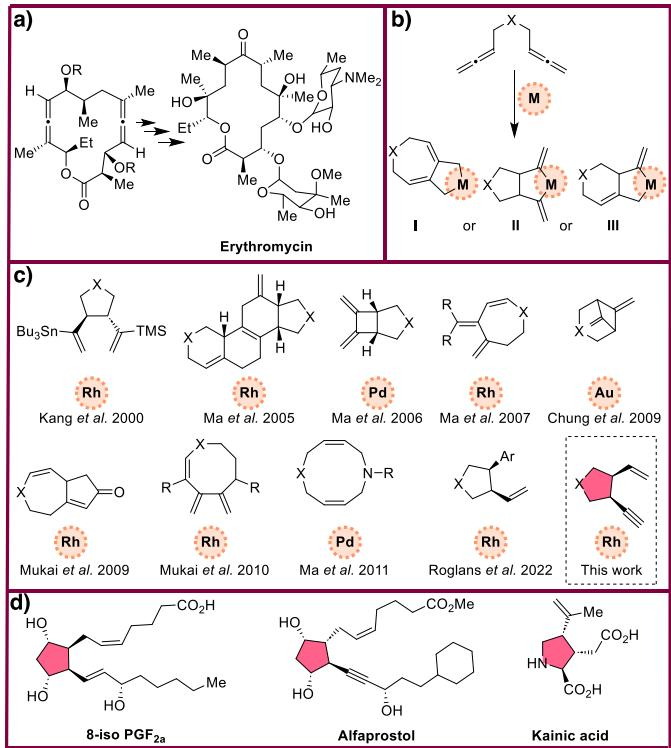
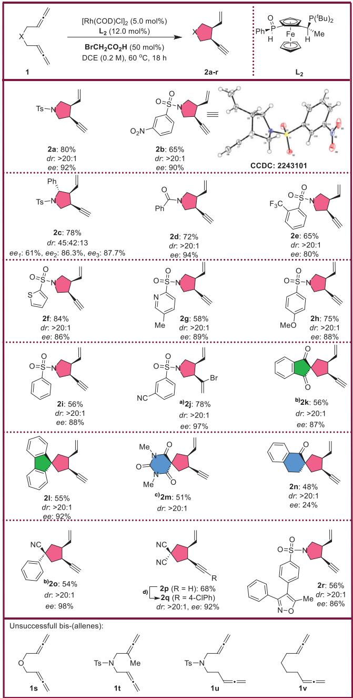
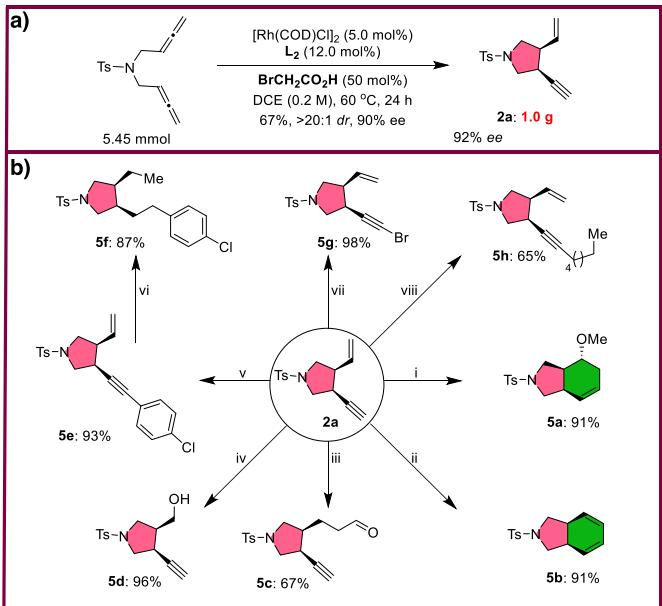
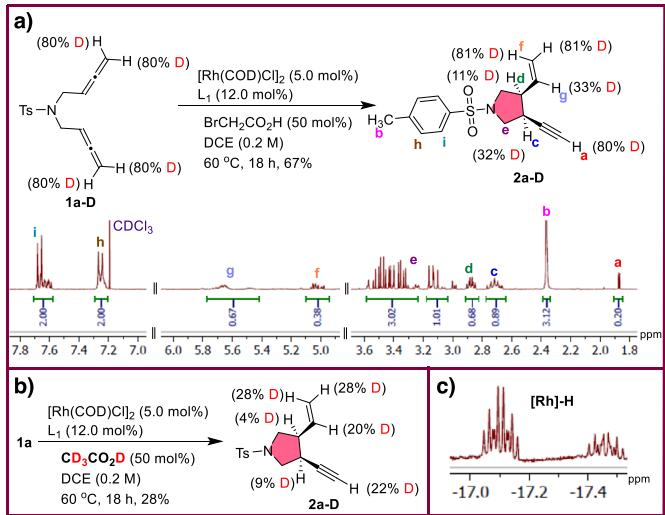
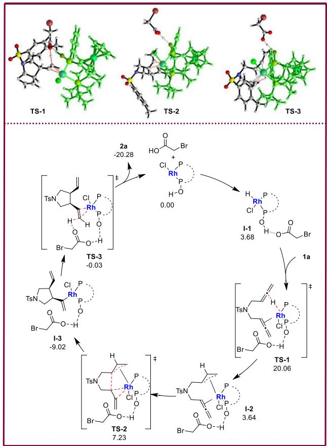

Asymmetric Catalysis

How to cite: Angew. Chem. Int. Ed. 2025, 64, e202507993   
doi.org/10.1002/anie.202507993

# Enantioselective Rhodium-Catalyzed Cycloisomerization of 1,5-Bis(allenes) to Access 1,2-cis-Ethynyl- and Vinyl-Substituted Five-Membered (Hetero)Cycles

Farhad Panahi+, Marzieh Samadani+, Felix Bauer, and Bernhard Breit\*

Abstract: In this study, an enantioselective Rh-catalyzed cycloisomerization of 1,5-bis(allenes) to furnish 1,2- cis-ethynyl- and vinyl-substituted five-membered (hetero)cycles in high yields and with excellent diastereoand enantioselectivity is presented. The possibility of further functionalization to access different chiral cyclic and bicyclic skeletons is provided by the two orthogonal functional groups (alkyne and alkene). We also demonstrate the scalability of the reaction through a gram-scale synthesis and illustrate the synthetic utility of the resulting 1,2-cis-ethynyl- and vinyl-substituted cyclic product via several transformations. The proposed reaction mechanism is supported by both density functional theory (DFT) calculations and control experiments.

Transition metal-catalyzed cyclization and cycloisomerization of unsaturated compounds provide a powerful synthetic approach to structurally complex (hetero)cyclic molecules in an atom- and step-economic manner from simple substrates.[1–7] Allenes are not only found in natural products, they are also valuable substrates in organic synthesis.[8–17] The involvement of two allene moieties results in an increased chemical space, providing bis(allenes) which are a unique platform for the creation of various (hetero)cyclic scaffolds via cyclization and cycloisomerization reactions. Hence, bis(allenes) are substrates to generate molecular complexity in a small number of steps (high step economy).[18–36] Bis(allenes) are also relevant in the total synthesis of complex molecules, for example in the synthesis of the antibiotic Erythromycin a bis(allene) is the key intermediate (Figure 1a).[37] In transition metal catalyzed cyclization of bis(allenes), three different types of cyclometalated intermediates have been reported as most probable intermediates (Figure 1b).[18] The metal coordinative cyclization between both terminal double bonds, both internal double bonds, and an internal double bond and a terminal double bond form the intermediates I, II, and III, respectively. However, there are reactions which might involve other intermediates.[18,31] The metal catalyst, the reaction conditions and the structure of starting material can control the formation of each intermediate. Therefore, by controlling the reaction conditions and the catalyst system, it is possible to obtain different types of products using the same bis(allene) substrate (Figure 1c).[18–36] Accordingly, the huge potential of cycloisomerization reactions with bis(allenes) could be further explored for the synthesis of new scaffolds with applications in total synthesis. As part of our ongoing investigation into the field of asymmetric rhodium catalysis with allenes,[17,38,39] we present herein a novel enantioselective Rh-catalyzed cycloisomerization of 1,5-bis(allenes) that offers a new route for the synthesis of chiral five-membered (hetero)cycles. Interestingly, the newly formed product contains two very compelling functionalities, a branched alkene and a terminal alkyne moiety, which allows for further orthogonal manipulation. Upon closer inspection, this new scaffold has great potential for use in the synthesis of biologically important compounds like prostaglandins[40,41] and kainic acids[42–44] (Figure 1d).

  
Figure 1. a) The synthetic value of bis(allenes) in total synthesis of Erythromycin. b) Cyclometalated intermediates in the cycloisomerization of 1,5-bis(allenes). c) Selected examples of 1,5-bis(allenes) cyclization products in the presence of diferent metals. d) Examples of natural product containing five-membered cyclic skeletons accessible by this Rh-catalyzed cycloisomerization of 1,5-bis(allenes).

Table 1: Optimization study.a)
<table><tr><td>PPh2 PPh2 0.</td><td></td><td> $\mathsf { A r } _ { \mathsf { H } } ^ { \mathsf { o } } \varprojlim _ { \mathsf { F e } } \mathsf { P } _ { \mathsf { H } } ^ { ( ^ { \prime } \mathsf { B u } ) _ { 2 } }$ </td><td> $\begin{array} { r l } & { \mathsf { L } _ { 2 } : \mathsf { A r } = \mathsf { P h } \left( \mathsf { S L } \mathrm { - } \mathsf { J 6 8 } 8 - 1 \right) } \\ & { \mathsf { L } _ { 3 } : \mathsf { A r } = 4 \mathrm { - } \mathsf { O M e } \mathrm { - } \mathsf { P h } } \\ & { \mathsf { L } _ { 4 } : \mathsf { A r } = 3 , 5 \mathrm { - } \mathsf { M e - } \mathsf { P h } } \end{array}$ </td></tr><tr><td>Entry Ligand</td><td>Additive</td><td> $\Upsilon \mathsf { i e l d } ^ { \mathsf { b } ) } 2 a : 3 a : 4 a$ </td><td> $2 \mathsf { a } ( d r ) ^ { \mathsf { c } ) }$   $2 a ( \% e e ) ^ { \mathrm { d } ) }$ </td></tr><tr><td>1</td><td> $\mathsf { L } _ { \mathsf { T } }$   ${ \mathsf { C l C H } } _ { 2 } { \mathsf { C O } } _ { 2 } { \mathsf { H } }$ </td><td>64:15:8</td><td>&gt;20:1</td></tr><tr><td> $2 ^ { \mathsf { e } ) }$  3</td><td></td><td></td><td></td></tr><tr><td> $\mathsf { L } _ { \mathsf { T } }$  4  $\mathsf { L } _ { \mathsf { T } }$ </td><td> ${ \mathsf { O } } ( { \mathsf { C H } } _ { 2 } { \mathsf { C O } } _ { 2 } { \mathsf { H } } ) _ { 2 }$ </td><td>70:12:10 40:9:30</td><td>&gt;20:1</td></tr><tr><td>5</td><td> $\mathsf { B r C H } _ { 2 } \mathsf { C O } _ { 2 } \mathsf { H }$ </td><td>23:15:25</td><td>6:1 一 &gt;20:1</td></tr><tr><td> $\mathsf { L } _ { 2 }$   $\mathsf { L } _ { 2 }$ </td><td> ${ \mathsf { C l C H } } _ { 2 } { \mathsf { C O } } _ { 2 } { \mathsf { H } }$ </td><td>42:15:20</td><td>76 &gt;20:1</td></tr><tr><td>6 7</td><td> ${ \mathsf { O } } ( { \mathsf { C H } } _ { 2 } { \mathsf { C O } } _ { 2 } { \mathsf { H } } ) _ { 2 }$ </td><td></td><td>50 &gt;20:1</td></tr><tr><td> $\mathsf { L } _ { 2 }$  8f)</td><td> $\mathsf { B r C H } _ { 2 } \mathsf { C O } _ { 2 } \mathsf { H }$ </td><td>50:10:trace</td><td>88</td></tr><tr><td> $\mathsf { L } _ { 2 }$  9</td><td> $\mathsf { B r C H } _ { 2 } \mathsf { C O } _ { 2 } \mathsf { H }$ </td><td>80:7:trace</td><td>&gt;20:1 92 &gt;20:1</td></tr><tr><td> $\mathsf { L } _ { 3 }$ </td><td> $\mathsf { B r C H } _ { 2 } \mathsf { C O } _ { 2 } \mathsf { H }$ </td><td>37:12:trace</td><td>88</td></tr><tr><td>10  $\mathsf { L } _ { 4 }$ </td><td> $\mathsf { B r C H } _ { 2 } \mathsf { C O } _ { 2 } \mathsf { H }$ </td><td>41:18:22</td><td>&gt;20:1 74</td></tr></table>

a) Reaction conditions: 1a (0.2 mmol), [Rh(COD)Cl]2 (5.0 mol%), Ligand (12.0 mol%), additive (50 mol%), DCE (2.0 mL, 0.1 M), at $6 0 ^ { \circ } C$ for 18 h. b) Isolated yield. c) Determined using 1H-NMR. d) Determined using chiral HPLC. e) The starting material was recovered. f) 0.2 M concentration.

In a preliminary experiment, a 64% yield of cycloisomerized product 2a was obtained with high diastereoselectivity (>20:1) by subjecting bis(allene) 1a to a catalyst system consisting of 5.0 mol% of [Rh(COD)Cl]2 (COD  1,5- cyclooctadiene), DPEPhos ligand (L , 12.0 mol%) and 2- chloroacetic acid (50 mol%) in 1,2-dichloroethane (DCE) solvent, with the reaction being conducted at a temperature of 60 °C (Table 1, entry 1). In addition to the target compound, two distinct byproducts (3a&4a) were detected. Although product 3a is observed here, product 4a has been the subject of previous reports.[25,29] In order to improve the yield of the desired product, various parameters and reaction conditions were investigated (ESI, Tables S1–S4). In the absence of an acid additive, no product formation was observed and the starting material was reisolated (Table 1, entry 2).

To improve the yield of the desired cycloisomerized product 2a, the choice of additive was found to be a crucial determinant (ESI, Table S3). Besides 2-chloroacetic, diglycolic and 2-bromoacetic acid exhibited particularly high yields (Table 1, entries 3 and 4). In order to induce enantioselectivity, various chiral ligands were screened (ESI, Table S1). The JoSPOphos SL-J688-1 (L ) ligand was found to be the most efficient ligand (Table 1, entry 5). However, a low yield of product was obtained with the use of 2-chloroacetic acid, and the by-products were prominent. Thus, the efficacy of this ligand was evaluated in conjunction with other additives (Table 1, entries 5–7). Using diglycolic acid, the isolated yield of 2a was improved (42%), however enantiomeric excess (ee) dropped to 50%. In addition, a significant amount (35%) of byproducts (3a&4a) was formed (Table 1, entry 6). Interestingly, the use of 2-bromoacetic acid resulted in the increased formation of 2a (50%) and a high ee of 89%, with the almost elimination of the byproduct 4a (Table 1, entry 7). Encouragingly, as the concentration was increased, 2a was obtained in 80% yield in 92% ee (Table 1, entry 8). No advantage was observed when other JoSPOphos type ligands $\mathbf { ( L _ { 3 } } \& \mathbf { L _ { 4 } ) }$ were used (Table 1, entries 9&10). Having identified the optimum reaction conditions, we began to evaluate the scope of this diastereo- and enantioselective Rh-catalyzed cycloisomerization of bis(allenes) (Figure 2). The assignment of the absolute configuration of the syn diastereomer was confirmed by X-ray analysis of compound 2b and showed the S,S configuration of the stereogenic centers (see ESI). The reaction conditions were found to be well-tolerated by a variety of functional groups, including nitro (2b), trifluoromethyl (2e), amide (2d,m), keto (2k,n) and nitrile (2o-q). The polysubstituted pyrrolidine 2c was synthesized with a yield of 52% and good enantioselectivity, albeit a dr of 45:42:13 for three diastereomers. One of the diastereomers was separable using column chromatography. This methodology was found to be effective for substrates bearing heterocyclic moieties such as thiophene (2f) and pyridine (2g). The N-amide protected bis(allene) also yielded the cyclic product 2d in a good yield and high enantioselectivity. Thus, we could synthesize a range of chiral 3-ethynyl-4-vinylpyrrolidine derivatives (2a-i). Two chiral spirocarbocycles (spiro[4.4]nonane) were synthesized from indandione (2k) and fluorene (2l) with moderate yields and high ee.[45,46] The application of a bis(allene) derived from a medicinally relevant template like barbituric acid, required the use of the DPEPhos ligand and has led to the successful synthesis of the corresponding spiro compound (2m). A spiro[4.5]decane diastereomer was isolated in a moderate yield of 48% but with a low enantiomeric excess of 24% by cycloisomerisation of a dihydronaphthalene-based bis(allene) (2n). Some chiral polyfunctionalized cyclopentane derivatives were successfully synthesized using 2-phenylacetonitrile (2o), and malononitrile (2p,q) demonstrating the high potential of this method for the synthesis of significant chiral fivemembered-ring carbocycles. A new chiral derivative of Valdecoxib was synthesized in satisfactory yield and high ee under optimized conditions (2r). This finding is significant because it demonstrates the potential of biomimicry in the design and manufacture of novel compounds with unique properties.[47] We did not obtain the desired product under optimized conditions using a bis(allene) derived from 3- cyanobenzenesulfonamide, but by increasing the amount of additive and concentration we obtained product 2j in 78% yield, >20:1 dr and 97% ee. It seems that the product 2j is the Markovnikov addition product of hydrogen bromide to the corresponding product.[48] The Markovnikov addition products for compounds 2k and 2o were also isolated.[49]

Figure 2. Generality and scope of the reaction. Reaction conditions: 1a (0.2 mmol), [Rh(COD)Cl] (5.0 mol%), L2 (12.0 mol%), BrCH CO H (50 mol%), DCE (1.0 mL, 0.2 M), at 60 °C for 18 h. Yields correspond to the isolated products, dr determined by 1H-NMR of the vinylic signals or HPLC and ee determined using chiral HPLC. a) Reaction conditions: $\mathsf { B r C H } _ { 2 } \mathsf { C O } _ { 2 } \mathsf { H }$ (100 mol%), DCE (1.0 M) and only Markovnikov addition product was isolated. b) In addition to the main product, Markovnikov product was also isolated. c) DPEPhos was used as ligand. d) The enantiomers could not be separated by HPLC and they were converted to the Sonogashira coupling product to separate the isomers. Reaction conditions for Sonogashira coupling reaction: PdCl2(PPh3)2 (2.0 mol%), CuI (4.0 mol%), Et3N (0.3 M), 1-chloro-4-iodobenzene, $5 0 ~ ^ { \circ } \mathsf { C }$ and 24 h.

  
Figure 3. a) Gram-scale synthesis. b) Follow-up chemistry. Reaction conditions: i) IPrAuCl (1.0 mol%), MeOH/H2O (2/1), 110 °C, 6 h. ii) IPrAuCl (5 mol%), AgSbF (5 mol%), CH Cl (0.05 M), 23 °C, 20 h, 91%. iii) $_ { \sf H _ { 2 } / \sf C O }$ (1 bar), [Rh(CO)2(acac)] (1.0 mol%), 6-DPPon (10 mol%), CHCl , 60 °C, 48 h. iv) O , NaBH , MeOH/DCM (1:1, 0.1 M), -78 °C to rt, 24 h. v) PdCl $( \mathsf { P P h } _ { 3 } ) _ { 2 }$ (2.0 mol%), CuI (4.0 mol%), $\mathsf { E t } _ { 3 } \mathsf { N }$ (0.3 M), 50 °C, 5 h, 1-chloro-4-iodobenzene. vi) Pd/C (5 mol%), ${ \sf H } _ { 2 } \ ( { \sf 7 }$ atm), MeOH (0.05 M), rt, 48 h. vii) AgNO3 (0.1 mol%), NBS, acetone (0.1 M), rt, 3 h. viii) n-BuLi (1.6 M,1.0 eq.), 1-iodohexane (1.5 eq.), THF (0.3 M), 18 h, reflux.

Since product 2p enantiomer separation through chiral HPLC was not possible, it was transferred to corresponding Sonogashira coupling products (2q) in order to estimate the ee of the product. Attempted oxygen-tethered bis(allene) 1s failed to produce the corresponding cycloisomerized product. Unsymmetric bis(allene) 1t, which carries an additional methyl group, resulted in no product formation. Bis(allene) 1u and 1v were also tested in an attempt to obtain sixmembered ring products; however, no such products were obtained.

To demonstrate the synthetic utility of our method, compound 2a was prepared on a gram scale in excellent yield, dr, and ee (Figure 3a). The simultaneous presence of both alkene and alkyne functional groups open many opportunities for further structural diversifications (Figure 3b). For example, using enyne chemistry and gold(I) catalysis, two successful cyclization reactions were performed and two products 5a and 5b were obtained under different reaction conditions.[50,51] In product 5a, the solvent methanol participated in the reaction and a unique methoxy-substituted isoindole derivative was obtained.[52] Previously, gold(I)-catalyzed dehydrogenative cycloisomerization of 1,5-enynes to benzene derivatives have been reported.[53] Unexpectedly, we obtained a diene product 5b, giving more opportunity for further followup chemistry such as Diels-Alder reactions.[54,55] Notably, hydroformylation[56] and ozonolysis[57] were carried out selectively on the alkene group without touching the terminal alkyne, and compounds 5c and 5d were successfully obtained. It is also possible to functionalize the alkyne group selectively, for example by Sonogashira coupling (5e), bromination (5g) and alkylation (5h). The saturated product 5f was obtained in high yield by hydrogenation of compound 5e. These examples highlight the potential of the cycloisomerization products 2 in synthetic organic chemistry.

  
Figure 4. a) Deuterium-labeling experiment using deuterated substrate 1a-D. b) Deuterium-labeling experiment using deuterated acetic-acid- ${ \cdot } { \mathsf { D } } _ { 4 }$ as additive. c) 1H-NMR spectrum of the hydride species obtained mixing [Rh(COD)Cl]2 (1 eq.), L2 (2.5 eq.) and BrCH2CO2H (10 eq.) in $C D _ { 2 } C l _ { 2 }$ at rt.

Deuterium labeling and some control experiments were performed to elucidate the reaction mechanism (Figure 4). The reaction of 1a-D proceeded smoothly to give the desired product 2a-D in 67% yield. The deuterium atoms are distributed between the vinylic hydrogen and the hydrogens of the pyrrolidine ring (Hc and Hd) (Figure 4a). This deuterium distribution suggests that the H/D exchange is facilitated by [Rh]-H catalysis. By using deuterated acetic acid instead of 2-bromoacetic acid, 2a-D was obtained with almost the same isotopic scrambling, also confirming the formation of an intermediate [Rh]-H species (Figure 4b). In the absence of substrate, the reaction of [Rh(COD)Cl]2, $\mathbf { L } _ { 2 }$ ligand and bromoacetic acid in CD Cl allowed the detection by proton NMR of two peaks at -17.1 and - 17.5 ppm in the catalyst solution, representing the formation of [Rh]-H species (Figure 4c). After addition of 1a to this solution the [Rh]-H peaks disappeared and the beginning of product formation was observed. A kinetic study using 1H NMR experiments suggests that the reaction is first order in substrate under the steady state approximation (see supporting information for further information). We therefore propose that the combination of Rh-ligand complex and additive as the active catalyst molecule remains in the catalytic cycle and coordinates with the bis(allene) substrate to initiate the catalysis and subsequently to produce the final product.

To gain further insight into the reaction mechanism, DFT calculations were performed. In our computational studies, we examined eight different catalytic cycles.[58] The mechanism lowest in energy is shown in Figure 5 (more details are available in the ESI). Starting from a [(Cl)Rh(L )] complex, a rhodium hydride species is formed by reaction with 2-bromoacetic acid to form intermediate I-1.[58,59] In I-1, the 2-bromoacetate is coordinated via hydrogen bonding. I-1 can form a π-allyl complex I-2 with one of the two allene moieties of substrate 1a via oxidative addition (TS-1). TS-1 has the highest activation barrier $( \Delta \mathrm { G } ^ { \ddagger } = 2 0 . 0 6$ kcal mol−1, Figure S1) and is therefore rate-determining for this mechanism. After cyclizative carborhodation (TS-2), the vinyl-rhodium complex I-3 is formed. Instead of a classical β-hydrogen elimination step, our calculations suggest a final proton abstraction step via the hydrogen-bonded preoriented 2-bromoacetate, forming the alkyne functionality (TS-3) from I-3 and releasing the product 2a. The ability of JoSPOphos ligands such as $\mathbf { L } _ { 2 }$ to form hydrogen bonds with the acid additive is critical for the selective formation of product 2a.

  
Figure 5. Proposed reaction mechanism. Calculated -G values [B3LYP/SDD-6–311  G(d,p)/D3BJ/PCRM(DCE)//B3LYP/SDD-6– 31G(d)/D3BJ/PCRM(DCE)]are given in kcal mol−1.

Alternative mechanisms toward 2a, considering both acidic and acid-free conditions, have higher activation barriers (TS-4, $\begin{array} { r c l } { \Delta \mathbf { G } ^ { \ddagger } } & { = } & { 2 8 . 6 1 } \end{array}$ kcal mol−1, Figures S2 and S3).[58] Moreover, for the formation of the side product 3a, a rhodium hydrido vinyl complex in which the ring carries an allene group is proposed. The formation of this intermediate and related equilibria could explain the observed distribution of deuterium in the labeling experiments. However, the final step toward 3a had a very high energy barrier (TS-9, $\Delta \mathrm { G } ^ { \ddagger } \ = \ 6 3 . 4 2$ kcal mol−1, Figure S4),[58] thus an alternative pathway involving the acid additive seems more likely. The formation of side product 4a also involves the oxidative cyclization (TS-4) as highest transition state (Figure S5).[58] The formation of the enantiomeric product, ent-2a, was also investigated, revealing a higher energy barrier, which aligns well with the observed high enantioselectivity (TS-11, -G‡ 29.54 kcal mol−1, Figure S6). The high diastereoselectivity can be explained by the significantly higher calculated energy barriers for the formation of the anti-2a (TS-13, -G‡ 37.13 kcal mol−1, Figure S7 and TS-16, -G‡ 32.00 kcal mol−1, Figure S8).

In conclusion, we have developed a method that allows cycloisomerization of 1,5-bis(allenes), producing a novel resulting 1,2-cis-ethynyl- and vinyl-substituted (hetero)cyclic products with high efficiency and excellent diastereoselectivity and enantioselectivity. The reaction shows a good substrate range and compatibility with functional groups. In addition, the synthetic potential of the products for the asymmetric synthesis of other useful building blocks was demonstrated. The key role of ligand and additive interactions in the high selectivity of the method was revealed by DFT calculations and control experiments. Further studies, including the application of this method in total synthesis of natural products, are ongoing in our laboratory.

## Supporting Information

The data supporting the results of this study, including experimental procedures, spectral data and copy of NMR spectra, are available in the Supporting Information. The authors have cited additional references within the Supporting Information.[60–91]

## Acknowledgements

The authors thank the Alexander von Humboldt Foundation (F.P.) for a postdoctoral fellow-ship. They appreciate Dr. M. Keller and Dr. S. Braukmüller for extensive NMR experimentations and J. Emmerich for challenging HPLC separations. Dr. B. Butschke is acknowledged for X-ray crystal structure analysis, and C. Warth for MS measurements. They are also grateful to Martin Rölz for the discussion of gold catalysis. Moreover, the authors acknowledge support by the state of Baden-Württemberg through bwHPC and the German Research Foundation (DFG) through grant noINST40/575–1 FUGG (JUSTUS 2 cluster).

Open access funding enabled and organized by Projekt DEAL.

## Conflict of Interests

The authors declare no conflict of interest.

## Data Availability Statement

The data that support the findings of this study are available in the Supporting Information of this article.

Keywords: Asymmetric catalysis • Bis(allenes) • Cycloisomerization • Enyne • Rhodium

[1] For selected reviews onmetal-catalyzed cyclization and cycloisomerization of unsaturated compounds see: Y. Yamamoto, Chem. Rev. 2012, 112, 4736–4769.

[2] A. Marinetti, H. Julliena, A. Voituriez, Chem. Soc. Rev. 2012, 41, 4884–4908.

[3] C. Aubert, L. Fensterbank, P. Garcia, M. Malacria, A. Simonneau, Chem. Rev. 2011, 111, 1954–1993.

[4] D.-H. Zhang, Z. Zhang, M. Shi, Chem. Commun. 2012, 48, 10271–10279.

[5] S. Sikandar, A. F. Zahoor, A. Ghaffar, M. N. Anjum, R. Noreen, A. Irfan, B. Munir, K. Kotwica-Mojzych, M. Mojzych, Molecules 2023, 28, 704.

[6] S. Song, C. Fu, X. Huang, S. Ma, Adv. Synth. Catal. 2018, 360, 1019–1025.

[7] Y. Han, A. Qin, Q. Zhang, X. Zhang, H. Qian, S. Ma, Angew. Chem. Int. Ed. 2022, 61, e202211635.

[8] For selected reviews on important use of allenes in organic synthesis see: Y. Li, H. Bao, Chem. Sci. 2022, 13, 8491–8506.

[9] S. Yu, S. Ma, Angew. Chem. Int. Ed. 2012, 51, 3074–3112.

[10] J. Ye, S. Ma, Acc. Chem. Res. 2014, 47, 989–1000.

[11] S. Kitagaki, F. Inagaki, C. Mukai, Chem. Soc. Rev. 2014, 43, 2956– 2978.

[12] M. Yang, A. S. K. Hashmi, Chem. Soc. Rev. 2014, 43, 2941–2955.

[13] M. T. Muhammad, Y. Jiao, C. Ye, M.-F. Chiou, M. Israr, X. Zhu, Y. Li, Z. Wen, A. Studer, H. Bao, Nat. Commun. 2020, 11, 416.

[14] G. Zhang, Y.-K. Song, F. Zhang, Z.-J. Xue, M.-Y. Li, G.-S. Zhang, B.-B. Zhu, J. Wie, C. Li, C.-G. Feng, G.-Q. Lin, Nat. Commun. 2021, 12, 728.

[15] J. Mateos-Gil, A. Mondal, M. C. Reis, B. L. Feringa, Angew. Chem. Int. Ed. 2020, 59, 7823–7829.

[16] J. Singh, A. Sharma, A. Sharma, Org. Chem. Front. 2021, 8, 5651–5667.

[17] F. Panahi, F. Bauer, B. Breit, Acc. Chem. Res. 2023, 56, 3676– 3693.

[18] B. Alcaide, P. Almendros, C. Aragoncillo, Chem. Soc. Rev. 2014, 43, 3106–3135.

[19] J. Vila, R. Vinardell, M. Solà, A. Pla-Quintana, A. Roglans, Adv. Synth. Catal. 2022, 364, 206–217.

[20] J. Vila, M. Solà, T. Achard, S. Bellemin-Laponnaz, A. Pla-Quintana, A. Roglans, ACS Catal. 2023, 13, 3201–3210.

[21] V. R. Naidu, D. Posevins, C. M. R. Volla, J.-E. Bäckvall, Angew Chem Int. Ed. 2017, 56, 1590–1594.

[22] I. Essid, C. Laborde, F. Legros, N. Sevrain, S. Touil, M. Rolland, T. Ayad, J.-N. Volle, J.-L. Pirat, D. Virieux, Org. Lett. 2017, 19, 1882–1885.

[23] A. Artigas, J. Vila, A. Lledó, M. Solà, A. Pla-Quintana, A. Roglans, Org. Lett. 2019, 21, 6608–6613.

[24] J. Vila, M. Solà, A. Pla-Quintana, A. Roglans, J. Org. Chem. 2022, 87, 5279–5286.

[25] S. Arai, Y. Kawata, Y. Amako, A. Nishida, Tetrahedron Lett. 2019, 60, 151168.

[26] X. Tao, K. Škoch, C. G. Daniliuc, G. Kehr, G. Erker, Chem. Sci. 2020, 11, 1542–1548.

[27] H. Hopf, G. Markopoulos, Beilstein J. Org. Chem. 2012, 8, 1936– 1998.

[28] G. Chen, X. Jiang, C. Fu, S. Ma, Chem. Lett. 2010, 39, 78–81.

[29] X. Jiang, X. Cheng, S. Ma, Angew. Chem. Int. Ed. 2006, 45, 8009– 8013.

[30] S. M. Kim, J. H. Park, Y. K. Kang, Y. K. Chung, Angew. Chem. Int. Ed. 2009, 48, 4532–4535.

[31] J. Cheng, X. Jiang, S. Ma, Org. Lett. 2011, 13, 5200–5203.

[32] P. Lu, S. Ma, Org. Lett. 2007, 9, 2095–2097.

[33] S. Ma, P. Lu, L. Lu, H. Hou, J. Wei, Q. He, Z. Gu, X. Jiang, X. Jin, Angew. Chem. Int. Ed. 2005, 44, 5275–5278.

[34] S.-K. Kang, T.-G. Baik, A. N. Kulak, Y.-H. Ha, Y. Lim, J. Park, J. Am. Chem. Soc. 2000, 122, 11529–11530.

[35] T. Kawamura, F. Inagaki, S. Narita, Y. Takahashi, S. Hirata, S. Kitagaki, C. Mukai, Chem.–Eur. J. 2010, 16, 5173–5183.

[36] F. Inagaki, S. Narita, T. Hasegawa, S. Kitagaki, C. Mukai, Angew. Chem. Int. Ed. 2009, 48, 2007–2011.

[37] K. Liu, H. Kim, P. Ghosh, N. G. Akhmedov, L. J. Williams, J. Am. Chem. Soc. 2011, 133, 14968–14971.

[38] P. Koschker, B. Breit, Acc. Chem. Res. 2016, 49, 1524–1536.

[39] F. Panahi, B. Breit, Angew. Chem. 2024, 136, e202317981 Angew. Chem. Int. Ed. 2024, 63, e202317981.

[40] G. Coulthard, W. Erb, V. K. Aggarwal, Nature 2012, 489, 278– 281.

[41] F. Zhang, J. Zeng, M. Gao, L. Wang, G.-Q. Chen, Y. Lu, X. Zhang, Nat. Chem. 2021, 13, 692–697.

[42] A. Evans, P. A. Inglesby, J. Am. Chem. Soc. 2012, 134, 3635– 3638.

[43] C. I. Stathakis, E. G. Yioti, J. K. Gallos, Eur. J. Org. Chem. 2012, 2012, 4661–4673.

[44] Y. Ni, R. M. Kassab, M. V. Chevliakov, J. Montgomery, J. Am. Chem. Soc. 2009, 131, 17714–17718.

[45] V. A. D’yakonov, O. A. Trapeznikova, A. Meijere, U. M. Dzhemilev, Chem. Rev. 2014, 114, 5775–5814.

[46] P.-W. Xu, J.-S. Yu, C. Chen, Z.-Y. Cao, F. Zhou, J. Zhou, ACS Catal. 2019, 9, 1820–1882.

[47] P. Vitale, S. Tacconelli, M. G. Perrone, P. Malerba, L. Simone, A. Scilimati, A. Lavecchia, M. Dovizio, E. Marcantoni, A. Bruno, P. Patrignani, J. Med. Chem. 2013, 56, 4277–4299.

[48] This difference in reactivity may be related to the directing ability of the nitrile group in Rh catalysis. See for example: S. Sasmal, G. Prakash, U. Dutta, R. Laskar, G. K. Lahiri, D. Maiti, Chem. Sci. 2022, 13, 5616–5621.

[49] We cannot fully explain the formation of Markovnikov side products during the formation of 2k and 2o. Structural effects, such as the presence of directing groups like nitrile or carbonyl, seem to be required for this side reaction. However, we did not observe any Markovnikov product formation during the formation of product 2p, even though 2p has two nitrile groups in close proximity..

[50] M. J. Ardolino, J. P. Morken, J. Am. Chem. Soc. 2012, 134, 8770– 8773.

[51] S. Wang, L. Zhang, J. Am. Chem. Soc. 2006, 128, 14274–14275.

[52] C. Virumbrales, M. Solas, S. Suárez-Pantiga, M. A. Fernández-Rodríguez, M. Marín-Luna, C. S. López, R. Sanz, Org. Biomol. Chem. 2019, 17, 9924–9932.

[53] G.-Q. Chen, W. Fang, Y. Wei, X.-Y. Tang, M. Shi, Chem. Commun. 2016, 52, 10799–10802.

[54] K. C. Nicolaou, S. A. Snyder, T. Montagnon, G. Vassilikogiannakis, Angew. Chem. Int. Ed. 2002, 41, 1668– 1698.

[55] Y.-H. Li, S.-L. Zhang, Y. Lu, B. Xiao, T.-Y. Sun, Q.-Q. Xu, J.-H. Chen, Z. Yang, Angew. Chem. Int. Ed. 2023, 62, e202303075.

[56] U. Gellrich, W. Seiche, M. Keller, B. Breit, Angew. Chem. Int. Ed. 2012, 51, 11033–11038.

[57] S. G. V. Ornum, R. M. Champeau, R. Pariza, Chem. Rev. 2006, 106, 2990–3001.

[58] See Supporting Information for more details.

[59] We were unable to locate the oxidative addition, but were able to locate a transition state with restricted coordinates that were lower compared to the other transition states in this mechanism. Due to the restricted coordinates and the lack of a successful IRC calculation, we did not include this transition state in the energetic profile.

[60] C. P. Grugel, B. Breit, Org. Lett. 2019, 21, 9672–9676.

[61] J. Vila, R. Vinardell, M. Solà, A. Pla-Quintana, A. Roglans, Adv. Synth. Catal. 2022, 364, 206–217.

[62] A. B. V. Silva, E. D. Silva, A. A. Dos Santos, J. L. Princival, Catal. Commun. 2020, 137, 105946.

[63] F. Bodinier, Y. Sanogo, J. Ardisson, M.-I. Lannou, G. Sorin, Chem. Commun. 2021, 57, 3603–3606.

[64] Z. Zhan, J. Yu, H. Liu, Y. Cui, R. Yang, W. Yang, J. Li, J. Org. Chem. 2006, 71, 8298–8301.

[65] H. Dai, G. Liu, X. Zhang, H. Yan, C. Lu, Organometallics 2016, 35, 1488–1496.

[66] T. Gläsel, H. Jiao, M. Hapke, ACS Catal. 2021, 11, 13434–13444.

[67] U. Sankar, C. Raju, R. Uma, Curr. Chem. Lett. 2012, 1, 123–132.

[68] F. Li, N. Wang, L. Lu, G. Zhu, J. Org. Chem. 2015, 80, 3538–3546.

[69] M. Rölz, B. Butschke, B. Breit, J. Am. Chem. Soc. 2024, 146, 13210–13225.

[70] B. Breit, W. Seiche, J. Am. Chem. Soc. 2003, 125, 6608–6609.

[71] D. Berthold, A. G. A. Geissler, S. Giofré, B. Breit, Angew. Chem. 2019, 131, 10099–10102.

[72] F. Panahi, H. Khosravi, F. Bauer, B. Breit, Chem. Sci. 2021, 12, 7388–7392.

[73] S. Golling, F. R. Leroux, M. Donnard, Org. Lett. 2021, 23, 8093– 8097.

[74] B. Lu, C. Li, L. Zhang, J. Am. Chem. Soc. 2010, 132, 14070–14072.

[75] Bruker, SAINT, V8.40B, Bruker AXS Inc., Madison, Wisconsin, USA.

[76] L. Krause, R. Herbst-Irmer, G. M. Sheldrick, D. Stalke, J. Appl. Cryst. 2015, 48, 3–10.

[77] G. M. Sheldrick, Acta Cryst 2015, A71, 3.

[78] G. M. Sheldrick, Acta Cryst 2015, C71, 3.

[79] C. R. Groom, I. J. Bruno, M. P. Lightfoot, S. C. Ward, Acta Cryst 2016, B72, 171–179.

[80] D. Kratzert, FinalCif, V117, https://dkratzert.de/finalcif.html

[81] Gaussian 16, Revision C.01: M. J. Frisch, G. W. Trucks, H. B. Schlegel, G. E. Scuseria, M. A. Robb, J. R. Cheeseman, G. Scalmani, V. Barone, G. A. Petersson, H. Nakatsuji, X. Li, M. Caricato, A. V. Marenich, J. Bloino, B. G. Janesko, R. Gomperts, B. Mennucci, H. P. Hratchian, J. V. Ortiz, A. F. Izmaylov, J. L. Sonnenberg, D. Williams-Young, F. Ding, F. Lipparini, F. Egidi, J. Goings, B. Peng, A. Petrone, T. Henderson, D. Ranasinghe, et al., Gaussian, Inc., Wallingford CT, 2019.

[82] Becke, A. D., J. Chem. Phys. 1993, 98, 5648–5652.

[83] C. Lee, W. Yang, R. G. Parr, Phys. Rev. B: Condens. Matter Mater. Phys. 1988, 37, 785–789.

[84] R. Ditchfield, W. J. Hehre, J. A. Pople, J. Chem. Phys. 1971, 54, 724–728.

[85] P. C. Hariharan, J. A. Pople, Theor. Chim. Acta. 1973, 28, 213– 222.

[86] W. J. Hehre, R. Ditchfield, J. A. Pople, J. Chem. Phys. 1972, 56, 2257.

[87] M. Dolg, U. Wedig, H. Stoll, H. Preuss, J. Chem. Phys. 1987, 86, 866–872.

[88] J. Tomasi, B. Mennucci, R. Cammi, Chem. Rev. 2005, 105, 2999– 3094.

[89] S. Grimme, J. Antony, S. Ehrlich, H. Krieg, J. Chem. Phys. 2010, 132, 154104.

[90] S. Grimme, S. Ehrlich, L. Goerigk, J. Comput. Chem. 2011, 32, 1456–1465.

[91] R. Krishnan, J. S. Binkley, R. Seeger, J. A. Pople, J. Chem. Phys. 1980, 72, 650–654.

Manuscript received: April 10, 2025   
Revised manuscript received: July 09, 2025   
Accepted manuscript online: July 11, 2025   
Version of record online: August 18, 2025