Homogeneous Catalysis

How to cite: Angew. Chem. Int. Ed. 2025, 64, e202512027   
doi.org/10.1002/anie.202512027

# Ligand-Enabled Chemo- and Regioselective Ir(I)-Catalyzed Intermolecular Hydrocarbonation of Allenes: Access to Branched Products with All-Carbon Quaternary Centers

Alejandro Rey, Andrés Arribas, José L. Mascareñas,\* and Fernando López\*

Abstract: An iridium complex featuring the perfluorinated bisphosphine ligand dFppe can catalyze intermolecular hydrocarbonation reactions of allenes with precise control over the selectivity to yield highly valuable branched products instead of the more common linear derivatives. Using N-substituted 3-carboxamide pyrroles as C─H donors, the reaction gives exclusively C-4 substituted products, while furan analogues yield C-2 substituted derivatives. β-Unsubstituted acrylamides can also be used as C─H sources to give chiral skipped dienes. The additions are equally efficient using monosubstituted and 1,1-disubstituted allenes, enabling the efficient formation of products bearing tertiary and all-carbon quaternary stereocenters. Moreover, a preliminary analysis with chiral bisphosphinite ligands confirms the feasibility of an enantioselective variant. Computational (DFT) studies provide relevant insights into this remarkable ligand-driven branched selectivity.

## Introduction

The metal-catalyzed addition of C─H bonds across C─C unsaturated systems is one of the most attractive bondforming strategies in organic synthesis, largely due to its complete atom economy.[1–5] These reactions typically proceed via oxidative addition of the C─H bond to a low-valent metal catalyst, followed by migratory insertion of the resulting metal hydride intermediate into an unsaturated partner, usually an alkyne or an alkene.[6–12] Surprisingly, despite their widespread use in C─H functionalization processes, allenes have been scarcely explored in this type of hydrocarbonation reactions.[13–16] This deficit may stem from the perception that their two cumulated C─C double bonds pose severe chemoselectivity and regioselectivity challenges. However, this unique structural feature should rather be viewed as an opportunity to make products that are inaccessible using alkene or alkyne partners.

In this context, in 2009, Krische reported a regioselective hydroarylation of benzamides with 1,1,-dimethyl allene to yield achiral ortho-prenylated benzamides with high selectivity (Scheme 1a).[17] More recently, Ackermann demonstrated that both iron and nickel catalysts can also promote related hydroarylations of 1,1-disubstituted allenes, respectively, using aryl ketones or benzimidazoles as C─H donors (Scheme 1a).[18–20] In all these cases, the reactions exclusively produced the more sterically accessible, linear, achiral product. Indeed, related hydroarylation methods that yield synthetically more appealing branched, chiral products have not been described.[21–26]

We recently found that an appropriate choice of the ancillary bisphosphine ligand allows to control the selectivity in Ir-catalyzed intramolecular cycloisomerizations of heteroarene-tethered allenes, leading to different types of heterocyclic structures.[27] Encouraged by these findings, we wondered whether a suitable ligand tuning of the catalyst could also allow us to overcome the intrinsic steric bias of intermolecular hydroarylations to give linear products and produce synthetically more relevant branched isomers.

Herein, we demonstrate that Ir(I) complexes featuring the electron-deficient bisphosphine ligand dFppe, which bears perfluorinated phenyl substituents, can catalyze the hydrocarbonation of allenes with branched selectivity. This reaction is highly effective with C(3)-dialkylcarboxamidepyrroles (1) as substrates, to give Cβ-substituted pyrroles (4), a type of product that is challenging to obtain through alternative methods (Scheme 1b),[28] The addition is also viable using other C─H donors, such as furans and α,β-unsaturated carboxamides, leading to chiral addition products of type 5, 9, or 13. Importantly, employing 1,1-disubstituted allenes as partners enabled the access to products featuring all-carbon quaternary centers. We also describe preliminary examples a) Previous intermolecular hydroarylations: linear selective

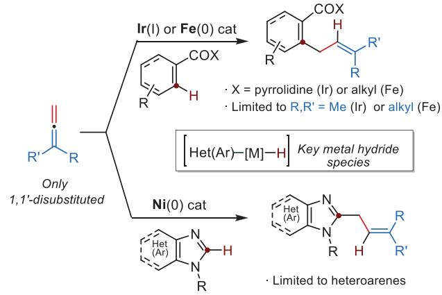

b) This work: Ir-catalyzed branched-selective intermolecular hydroarylation  
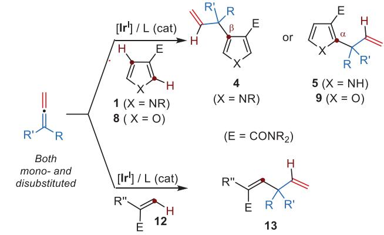  
Scheme 1. Previous metal-catalyzed intermolecular hydrocarbonations of allenes and current work.

of an asymmetric variant and provide a DFT computational analysis that offers relevant mechanistic insights, revealing that the unusual chemo- and regioselectivity may arise from subtle non-covalent interactions (NCI’s) involving the ancillary ligand.

## Results and Discussion

Based on our previous work in intramolecular processes,[27,29,30] and given the relevance of pyrrole structures in pharmaceutical and material sciences,[31–34,28] we initiated our studies using the N-methyl-pyrrole 1a as a model heteroarene and a simple monosubstituted allene like 2a (2 equiv.) as a coupling partner. Using as catalysts an Ir(I) complex prepared in situ from $[ \mathrm { I r } ( \mathrm { c o d } ) _ { 2 } ] { \bf B } { \bf A } \mathrm { r } ^ { \mathrm { F } } { } _ { 4 }$ and Binap,[11] we observed the formation of the achiral product 3aa, resulting from pyrrole C(2)─H bond activation and its exo addition across the less sterically hindered allene double bond (Table 1, entry 1). The regioselectivity with respect to the allene contrasts with that observed by Krische using 1,1-dimethyl allene and related C─H donors, which led to canonical linear regioisomers of type 6 (Table 1, footnote).[17]

Other bisphosphine ligands such as Biphep, dppf, Segphos, XantPhos, dppb, or dppe (entries 2–7),[35] led to the same selectivity toward 3aa, but in low to moderate yields, usually

Table 1: Initial evaluation of the intermolecular hydroarylation of 1a with 2a.a)

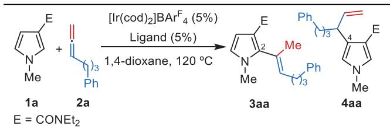

<table><tr><td>Entry</td><td>L</td><td>Conv (%)</td><td>Product, yield (%)</td></tr><tr><td>1</td><td>Binap</td><td>99</td><td>3aa, 45</td></tr><tr><td>2</td><td>Biphep</td><td>99</td><td>3aa, 46</td></tr><tr><td>3</td><td>Segphos</td><td>99</td><td>3aa, 36</td></tr><tr><td>4</td><td>XantPhos</td><td>10</td><td>3aa, &lt;5</td></tr><tr><td>5</td><td>dppf</td><td>53</td><td>3aa, 34</td></tr><tr><td>6</td><td>dppb</td><td>51</td><td>3aa, 23</td></tr><tr><td>7</td><td>dppe</td><td>0</td><td>0b),c)</td></tr><tr><td>8</td><td>dFppe</td><td>74</td><td>4aa, 74</td></tr><tr><td>9d)</td><td>dFppe</td><td>99</td><td>4aa, 99</td></tr></table>

a) Conditions: A solution of 1a, 2a, $[ \mathsf { I r } ( \mathsf { c o d } ) _ { 2 } ] \mathsf { B A r } ^ { \mathsf { F } } _ { 4 }$ (5 mol%), Ligand (5 mol%), in 1,4-dioxane, was heated at 120 °C for 46 h. Partial conversions of 1a were observed unless otherwise noted. b) Partial conversion and decomposition of 2a were observed. c) 1a was fully recovered. d) Carried out with 10 mol% of catalyst and 4 equiv. of 2a

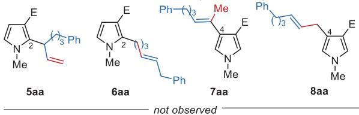

with incomplete conversion of the pyrrole precursor 1a. Curiously, while with dppe as ancillary ligand we observed a significant allene decomposition and full recovery of 1a, its perfluorinated derivative, dFppe,[36,37] enabled a clean and selective reaction to give the C(4)-substituted derivative 4aa (74% yield, entry 8) rather than 3aa. Increasing the catalyst loading to 10 mol% and using an excess of allene (4 equiv.) allowed us to obtain 4aa in an excellent 99% yield (entry 9). This regioselectivity at the pyrrole moiety is particularly surprising, as functionalization at the α-positions [C(2) and C(5)] tends to be favored over the β-counterparts [C(3) and C(4)].[28,38–41] It is important to note that neither α-substituted products such as the branched derivative 5aa, nor achiral counterparts like 6aa, 7aa, and 8aa were detected in the crude mixture.

The above results, enabling the formation of challenging branched products, prompted us to further explore the scope of the process using N-methyl pyrrole 1a, and 5 mol% of the catalyst generated in situ from $[ \mathrm { I r } ( \mathrm { c o d } ) _ { 2 } ] { \bf B } { \bf A } \mathrm { r } ^ { \mathrm { F } } { } _ { 4 }$ and dFppe (Scheme 2). Gratifyingly, the reaction worked well with other monosubstituted allenes, either bearing simple alkyl chains or with pendant functional groups such as a phthalimide, carboxylic ester, or ketone. In all these cases, the C(4)- branched isomers were selectively obtained in yields ranging from 54% to 99% (4aa–4ae).

Importantly, 1,1-disusbtituted allenes also proved to be excellent reaction partners, which allowed to obtain appealing products featuring quaternary carbon centers. Thus, pyrrole [a] Conditions: A solution of pyrrole 1a (0.10 mmol), allene (0.20 mmol), $[ \mathsf { I r } ( \mathsf { c o d } ) _ { 2 } ] \mathsf { B A r } ^ { \mathsf { F } } _ { 4 }$ (5 mol%), dFppe (5 mol%) in 1,4-dioxane (0.5 mL) was heated in a sealed tube at $1 2 0 ^ { \circ } \mathsf { C }$ for 18 h—46 unless otherwise noted. [b] Using 4 equiv. of the allene 2. [c] Using 10 mol% catalyst. [d] Carried out at ${ \mathsf { 7 0 5 } } ^ { \circ } { \mathsf { C } } .$ [e] Carried out with $[ \mathsf { I r } ( \mathsf { c o d } ) _ { 2 } ] \mathsf { B A r } ^ { \mathsf { F } } _ { 4 } \ ( 3$ mol%), dFppe (3 mol%). [f] Carried out at 130 °C with 3 equiv. of allene 2s for 72 h. E CONEt2.

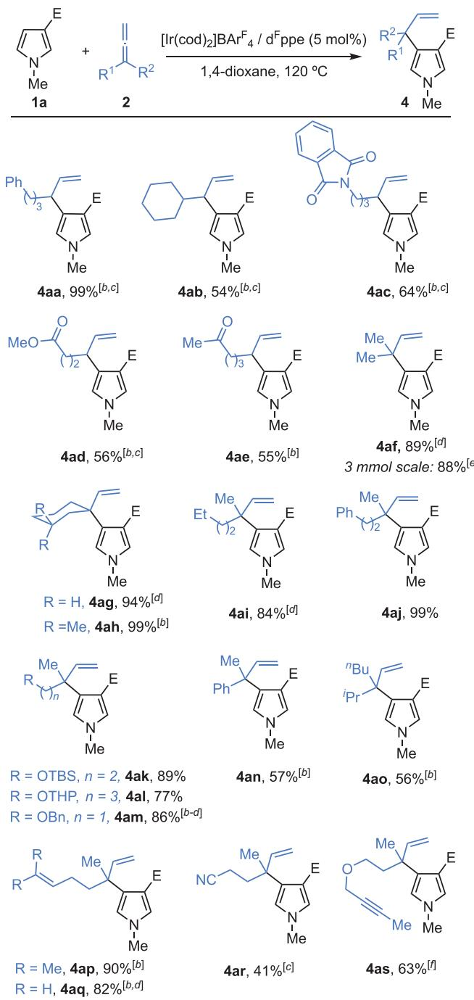  
Scheme 2. Branched-selective intermolecular hydroarylation of allenes with 1a.[a]

4af, bearing a fully substituted allylic center at C(4), was obtained in 89% yield. Notably, no C(2) isomers were detected in these cases; however, when Binap was used instead of ${ \mathrm { d } } ^ { \mathrm { F } }$ ppe, a complex mixture of branched and linear regioisomers at both C(2) and C(4) positions of the pyrrole ring was obtained.[42] This result underscores the unique capacity of $\mathsf { d } ^ { \mathrm { F } } \mathsf { p p e }$ to precisely control the chemoselectivity (i.e., which C─C double bond of the allene reacts) and the regioselectivity, both at the allene (favoring the branched allylic system) and at the pyrrole (β- versus α-position). Moreover, the method proved to be very robust, as the model reaction between 1a and 2f was successfully scaled up to 3 mmol (1a), while reducing the catalyst loading to 3 mol%, without any detrimental effect on yield or selectivity.

At this point, we tested other 1,1--disubstituted allenes. As shown in Scheme 2, the reaction proceeded efficiently with a cyclohexyl-substituted allene, yielding product 4ag in 94% yield. Importantly, using allenes bearing two different alkyl groups allows for building chiral products with all-carbon quaternary stereocenters, such as 4ah–4aj. The reaction tolerates various functional groups at the allene chains, including trialkylsilyl and benzyl ethers, as well as a tetrahydropyranyl ketal, affording the corresponding products 4ak–4am in yields from 77% to 89%. Moreover, sterically more demanding allenes, such as phenyl- and isopropyl-substituted allenes 2n and 2o, reacted efficiently, delivering the expected products 4an and 4ao in good yields. Remarkably, the hydroarylation of allenes bearing a pendant alkene unit (e.g., 2p and 2q) was completely chemoselective toward the desired C─C double bond of the allene, allowing the isolation of pyrroles 4ap and 4aq in very good yields. Likewise, the presence of a nitrile or a challenging alkyne moiety on the allene side chain was compatible with the process, and the desired products 4ar and 4as were obtained in good yields.[43]

The method is not limited to N-methyl pyrrole 1a. As can be deduced from Scheme 3, pyrroles with different substituents at the nitrogen, including benzyl, aryl, or aliphatic chains, are also viable substrates. Therefore, their reactions with the vinylidenecyclohexane 2g led to the expected products, 4bg, 4cg, and 4dg, in good to excellent yields (72%– 99%). The same result was obtained with a pyrrole bearing a bulky N-TBS group, which furnished 4eg in quantitative yield.

Curiously, with N─H pyrroles (i.e., 1f), we observed a complete change in the regioselectivity of the C─H functionalization to give α-substituted products 5. Therefore, C(2)- pyrrole derivatives 5fj and 5fg were obtained in good yields by reaction of 1f with allenes 2j and 2g. N-Unsubstituted C-4 derivates of type 4 can be indirectly accessed from the N-TBS protected pyrrole 1e by simple TBAF addition after the hydroarylation is completed, as exemplified by the synthesis of N─H pyrroles 4fg (99% yield) and 4fm (85% yield).

Therefore, the presence of an N-substituent is key to directing the selectivity of the Ir/dFppe catalyst toward the pyrrole C-4 position, very likely because of steric reasons. In line with these results, the furan-carboxamide 8a reacts with 1,1-disubstituted allenes like 2g or 2j, affording the corresponding C(2)-branched addition products, 9ag and 9aj, which feature all-carbon quaternary allylic centers, in good to excellent yields (92% and 64%, respectively). An analog reaction with an N-unsubstituted indole (10a) led to poor yields of the C(2)-branched product (11ag), even after prolonged reaction times. Noteworthy, moving the dialkyl amide directing group from the pyrrole to the phenyl moiety changes the regioselectivity, so the aryl-substituted products 11bg’ and 11bj’ could be obtained in moderate yields.[35]

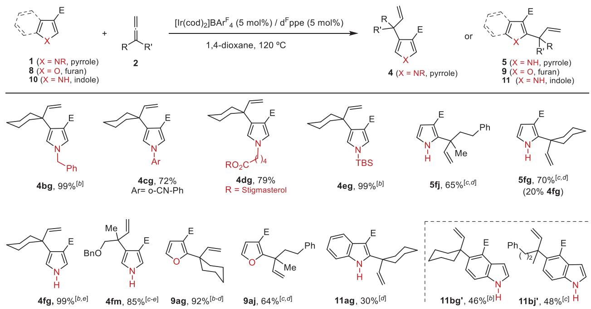  
Scheme 3. Branched-selective intermolecular hydroarylation of 1,1-disubstituted allenes with heteroaromatics.[a] [a] Conditions: A solution of pyrrole 1, furan 8, or indole 10 (0.10 mmol), allene (0.20 mmol), $[ \mathsf { I r } ( \mathsf { c o d } ) _ { 2 } ] \mathsf { B A r } ^ { \mathsf { F } } _ { 4 }$ (5 mol%) and ${ \mathsf { d } } ^ { \mathsf { F } } { \mathsf { p p e } }$ (5 mol%) in 1,4-dioxane (0.5 mL) were heated in a sealed tube at $1 2 0 ^ { \circ } \mathsf C \mathsf { f o r } 7 8 \mathsf { - } 4 6 \mathsf h ,$ unless otherwise noted. [b] Carried out at $1 0 5 ^ { \circ } \mathsf { C } .$ [c] Using 4 equiv. of the allene. [d] Using 10 mol% of catalyst. [e] Carried out using N-TBS pyrrole 1e. TBAF (2 equiv.) was added after full conversion of 1e was observed (TLC) and stirring continued at rt for 5 min before work-up. $\mathsf { E } = \mathsf { C O N E t } _ { 2 } .$ 1b: 1-benzyl-N,N-diethyl-1H-pyrrole-3-carboxamide; 1c: 1-(2-cyanophenyl)-N,N-diethyl-1H-pyrrole-3-carboxamide; 1d: Stigmasterol 5-(3-(diethylcarbamoyl)-1H-pyrrol-1-yl)pentanoate.

Importantly, the reaction is not limited to heteroaromatic C─H activations. As can be seen in Scheme 4, α,β-unsaturated alkenes such as acrylamide 12a also participate in the intermolecular hydrocarbonation of allenes like 2a to yield the skipped diene 13aa in very good yield and with complete branched selectivity. The use of $\mathsf { d } ^ { \mathrm { F } } \mathsf { p p e }$ was again essential for achieving such selectivity, as alternative ligands like Binap led only to achiral isomeric products in moderate yields.[35] Moreover, the reaction is not limited to the generation of tertiary allylic stereocenters; the use of 1,1-disubstituted allenes like 2g and 2j enabled the synthesis of the corresponding 1,4-dienes (13ag and 13aj) bearing all-carbon quaternary centers in very good yields. These results constitute the first examples of a branched-selective transition metal-catalyzed hydrocarbonation of allenes using alkenes as C─H sources. More importantly, the intrinsic higher reactivity of allenes compared to alkenes under these conditions enabled the formation of the 1,6-diene product 13bp in excellent yield. This reaction provides a straightforward approach to a very close analogue of Bakuchiol, a plant-derived monoterpene, i.e., currently used as a topical antiaging cosmetic due to its antioxidative and anti-inflammatory properties, as well as its epidermal regenerative capacity.[44]

Having developed this protocol, we conducted a preliminary evaluation of the viability of an asymmetric version, which we anticipated highly challenging due to the lack of chiral fluorinated bisphosphines that could mimic the structure of

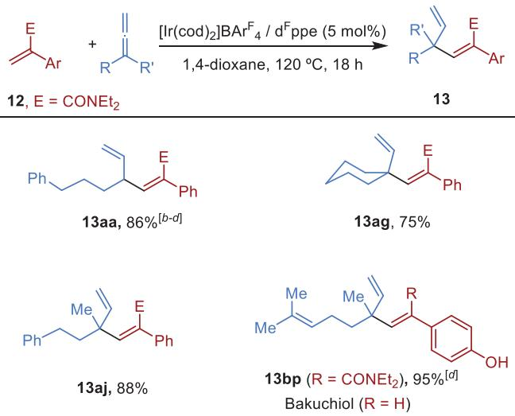

Scheme 4. Branched-selective intermolecular hydrocarbonations of allenes with α,β-unsaturated amides.[a]

[a] Conditions: A solution of acrylamide 12 (0.10 mmol), allene 2 (0.20 mmol), [Ir(cod)2]BArF4(5 mol%), and dFppe (5 mol%) in 1,4-dioxane (0.5 mL) was heated in a sealed tube at $\mathsf { I } 2 0 ^ { \circ } \mathsf C$ for 18–46 h. [b] Carried out at $1 0 5 ^ { \circ } \mathsf { C } .$ [c] Using 4 equiv. of the allene. [d] Using 10 mol% of catalyst.

dFppe. Thus, we initially tested related electron-deficient chiral bisphosphines like BTFM-Garphos, BTFM-Binap, or CF - Walphos, which hold 3,5-bistrifluoromethyl aryl phosphines (Tables S2–S4).[35] Unfortunately, in all cases, the reactions provided either achiral products or branched isomers in poor yields, with very poor enantioselectivities (Tables S2–S4). We then turned our attention toward (R,R)-Biphop-F, a chiral bidentate pentafluoroarylphosphinite, originally developed by Kündig and coworkers in the context of chiral Lewis acid metal catalysis (Scheme 5).[45] Notably, the reaction of 1a and 2j promoted by $[ \mathrm { I r } ( \mathrm { c o d } ) _ { 2 } ] \mathrm { B A r ^ { F } } _ { 4 } / ( R , R )$ -Biphop-F, mimics the reactivity behavior of the $\mathrm { I r ( I ) B A r ^ { F } } _ { 4 } / \bar { \mathsf { d } } ^ { \mathrm { F } }$ ppe catalyst, providing the desired product, 4aj, in an excellent 93% yield, although with a modest enantiomeric ratio of 60:40. However, the performance of this chiral catalyst was significantly enhanced when monosubstituted allenes (e.g., 2a, 2c, or 2e) were used, affording the corresponding branched products 4aa, 4ac, and 4ae in good yields and with enantiomeric ratios ranging from 79:21 to 83:17. These results pave the way for the future development of highly enantioselective variants of these hydroarylation processes by further ligand refinements.

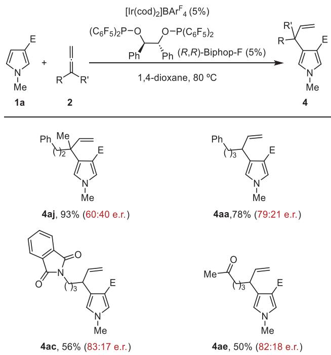  
Scheme 5. Preliminary development of an asymmetric variant.[a] [a] Conditions: A solution of pyrrole 1 (0.10 mmol), allene (0.20 mmol), $[ \mathsf { I r } ( \mathsf { c o d } ) _ { 2 } ] \mathsf { B A r } ^ { \mathsf { F } } _ { 4 } \ ( 5$ mol%), and (R,R)-Biphop-F (5 mol%) in 1,4-dioxane (0.5 mL) was heated in a sealed tube at $8 0 ^ { \circ } C$ for 18–46 h, unless otherwise noted. $\mathsf { E } = \mathsf { C O N E t } _ { 2 }$

To shed some light on the mechanistic reasons behind the intriguing chemo- and regioselectivities of the above reactions, we performed a computational DFT analysis using precursor 1a and allene 2a, and ${ \mathrm { d } } ^ { \mathrm { F } }$ ppe as an ancillary ligand for iridium (Figure 1). As expected, coordination of the iridium-bisphosphine complex $[ \mathrm { I r } ( \mathsf { d } ^ { \mathrm { F } } \mathsf { p p e } ) ] ^ { + }$ to the carbonyl amide group of 1a allows two possible interactions with adjacent C─H bonds, at C(2) (Int-1a) and C(4) (Int-1b). As shown, the coordination at C-4 provides a slightly more stable intermediate $\left( \Delta \Delta G = 0 . 8 \right.$ kcal mol−1) and, importantly, its corresponding oxidative addition, via TS-1b, involves a significantly lower energy barrier compared to its C(2)-H counterpart $\left( \Delta \Delta G = 2 . 7 \right.$ kcal mol−1). These values align well with the experimental results on the pyrrole regioselectivity, since C(4) derivatives 4 were the only ones detected when using this Ir-dFppe catalyst.[46]

We then analyzed the energy profiles for a subsequent carbometallation of the allene and a final C─H reductive elimination, as this type of route has been proven the most accessible path in previous Ir-catalyzed hydroarylations of alkenes.[29,11] Coordination of the allene partner to Int-2b can occur in either double bond of the allene and through three different orientations (Int-3b, Int-3b-, and $\mathbf { I n t } { \bf - } 3 { \bf b } ^ { \prime \prime } .$ , Figure $\mathrm { S } 2 ) . ^ { [ 4 7 ] }$ From this point, the evolution toward the branched isomer (4aa), via Int-3b, involves the most favored carbometallation $( \Delta G = 1 0 . 5 $ kcal mol−1), to give an Ir-alkenyl species, Int-4b, which holds the Ir center attached to the former central carbon atom of the allene partner (Figure 1, blue path). Then, an energetically accessible C(sp2)─H reductive elimination (via TS4b, $\Delta G = 1 8 . 3 $ kcal mol−1) yields the experimentally observed branched product 4aa (Figures 1 and S2).

The formation of the potentially competitive C(4)- regioisomers of type 7 and 8 (see Table 1, footnote) was also explored through this route (Figure S2). Overall, we found that the alternative carbometallation to eventually provide the isomer 7aa is less favored by more than 4 kcal $\mathrm { m o l ^ { - 1 } }$ whereas the regio-complementary carbometallation of this distal double bond of the allene, which would eventually lead to the linear isomer 8aa, involves a transition state >9 kcal $\mathrm { \ m o l ^ { - 1 } }$ less favored than that leading to 4aa (Figure S2). Therefore, these data are in full agreement with the experimentally observed C(4)-branched selectivity obtained with the $\mathrm { I r } ( \mathrm { I } ) / \dot { \mathrm { d } } ^ { \mathrm { F } }$ ppe catalyst.

The viability of an alternative pathway from Int-2, based on a hydrometallation/C─C reductive elimination, was also considered (Figure 1, magenta path). The migratory insertion from Int-3b\* involves a very accessible hydroiridation via TS-3b\* $( \Delta G ~ = ~ 6 . 9$ kcal $\mathbf { m o l } ^ { - 1 } )$ , which yields an iridium π-allyl intermediate Int-4b\*. Despite C─Ir─C reductive eliminations have been generally found too costly in related alkene hydroarylation processes, making this overall path less favorable, the energy barrier found for the C─C reductive elimination from Int-4b\* is quite accessible $( \Delta G = 2 1 . 6$ kcal $\mathrm { m o l ^ { - 1 } } )$ , most probably because of the π-allylic nature of this intermediate. Moreover, the hydrometallation routes to alternative regioisomers (e.g., 7aa and 8aa) are less favored, which is also consistent with the preferred formation of the branched isomer 4aa (Figure S3), in consonance with the experimental results.[35] Therefore, this mechanistic pathway cannot be discarded.

Importantly, we also calculated the analog profiles using dppe as a ligand, which, as indicated in Table 1, failed to give any product, probably because it opens decomposition pathways in the allene. Regarding the carbometallation-based route, our calculations confirm that the migratory insertion is significantly more costly than with dFppe (>5 kcal mol−1) (Figure S4),[35] while the energy differences between the different migratory insertion transition states leading to the branched and linear isomers are very small.[48] On the other hand, calculations for the hydrometallation-based route using dppe as the ligand revealed substantially higher energy barriers for both the migratory insertion $\left( \Delta \Delta G > 5 \right.$ kcal $\mathrm { m o l ^ { - 1 } } )$

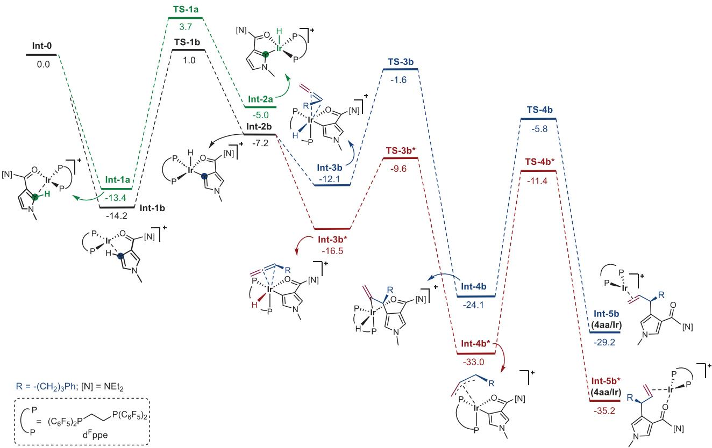

Figure 1. Computed reaction profiles for the reaction model of 1a and 2a with catalyst $[ \mathsf { I r } ( \mathsf { d } ^ { \mathsf { F } } \mathsf { p p e } ) ] ^ { + }$ . Relative free energies (-G, at 353 K) are given in kcal mol−1. All data have been computed at the B3LYP/6-31 G(d) (LANL2DZ for Ir)//M06/6-311 g(d,p) (SDD for Ir) level.  
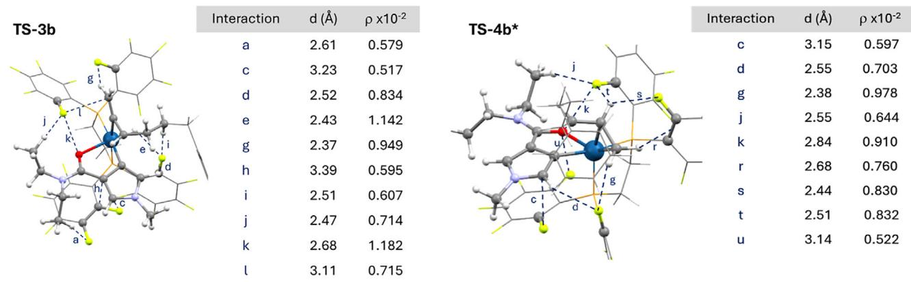  
Figure 2. NCI’s found in key transition states TS-3b and TS-4b\*. Dashed lines correspond to NCI’s for which bond paths and bond critical points were found by AIM formalism. Non-relevant parts of the structures are drawn in a wireframe style for clarity; see the Supporting Information for further representations.

and the C─C reductive elimination steps (G 7 kcal mol−1, Figure S5). Therefore, these calculations are in consonance with the unique performance of dFppe as a ligand.

To shed further light on the physical reasons for the efficiency of this ligand $( \mathsf { d } ^ { \mathrm { F } } \mathsf { p p e } )$ , we carried out an analysis of NCI’s through the atoms in molecules (AIM) formalism,[49–52] of key transition states for both the carbometallation and hydrometallation routes. Our data, summarized in Figures 2 and S8–S14, unveil the participation of several stabilizing C─F···H─C interactions between fluorine atoms of the bisphosphine ligand and key hydrogen atoms of the pyrroleallene scaffold.[53–56] In the carbometallation-based route, the key transition state, TS-3b, leading to the observed branched product (4aa), holds a significantly higher number of these stabilizing interactions, including those with hydrogens at the allene distal carbon (Figure 2, interaction g), at the pyrrole C-2 position (interaction $d ) _ { ; }$ , or at the alkyl carboxamide (interactions a and j). Moreover, the terminal C─C double bond of the allene also interacts with a fluorine atom,[57] while the pyrrole ring might also be involved in a stabilizing π–π interaction with one of the pentafluorinated rings of dFppe.[58]

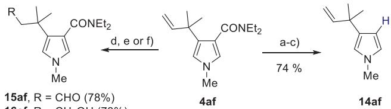

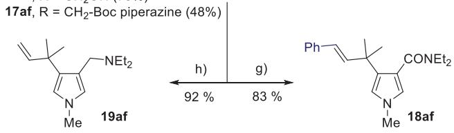  
Scheme 6. Preliminary synthetic transformations. Conditions: a) $\mathsf { E t } _ { 3 } \mathsf { O } { \cdot } \mathsf { B F } _ { 4 } , \mathsf { N a } _ { 2 } \mathsf { H P O } _ { 4 } ,$ , MeCN, NaH $\mathsf { I C O } _ { 3 } , \mathsf { 5 0 } ^ { \circ } \mathsf { C } ; \mathsf { b } )$ NaOH, H O 1:1 MeOH, 100 ${ } ^ { \circ } \mathsf { C } ; \mathsf { c } )$ Aminoethanol, $1 7 5 ^ { \circ } \mathsf { C } ; \mathsf { d } ) \mathsf { K } _ { 2 } \mathsf { O } \mathsf { s } \mathsf { O } _ { 6 } { \cdot } 2 \mathsf { H } _ { 2 } \mathsf { O } _ { \cdot }$ $N a l O _ { 4 } ,$ pyridine, tBuOH, H2O, rt; e) i) $\mathsf { K } _ { 2 } \mathsf { O s O } _ { 6 } . 2 \mathsf { H } _ { 2 } \mathsf { O } , \mathsf { N a l O } _ { 4 } ,$ pyridine, ${ } ^ { t } { \mathsf { B u O H } }$ , H2O, rt; ii) NaBH4, MeOH; f) i $) \mathsf { K } _ { 2 } \mathsf { O } \mathsf { s O } _ { 6 } . 2 \mathsf { H } _ { 2 } \mathsf { O } , \mathsf { N a l O } _ { 4 } ,$ pyridine, tBuOH, H2O, rt; ii) Boc-piperazine, AcOH, NaBH(OAc)3, ${ \mathsf { C H } } _ { 2 } { \mathsf { C l } } _ { 2 } ;$ g) PhI, $P d ( O A c ) _ { 2 }$ (5%), PPh3 (10%), KOAc, TBAB, DMF, 140 ${ } ^ { \circ } C ;$ h) LiAlH , THF $6 0 ^ { \circ } \mathsf C ,$ 18 h.

The key transition state of the complementary route based on a hydrometallation/C─C reductive elimination (i.e., TS-4b\*) also showed an important number of NCI’s between fluorine atoms of the bisphosphine ligand and key hydrogen atoms of the pyrrole-allene scaffold.

In both cases, the number and/or strength of these subtle interactions in the key transition states toward 4aa are higher than those found in the transition states leading to the experimentally non-observed isomers (7aa and 8aa). Therefore, these results strongly suggest that the exceptional performance of the perfluorinated ligand stems from unusual NCI’s involving fluorine atoms, a type of contact that has been scarcely considered in previous works but that should be taken into account in the future of ligand designs for related metal-promoted reactions.

Finally, to further highlight the relevance of having an alkene handle in the addition products, we made a preliminary evaluation of the synthetic possibilities of the products. As shown in Scheme 6, a model product like pyrrole 4af can be converted into the $\beta \cdot$ -unsubstituted pyrrole 14af, whereas the presence of the alkene moiety also allows for standard transformations such as an oxidative cleavage (15af, 78% yield), which can be coupled to a subsequent reduction to the alcohol (16af) or to a reductive amination process (17af). Moreover, a Heck cross-coupling reaction allowed us to obtain the product 18af in 83% yield. Finally, the carboxamide group can be easily transformed into the corresponding alkyl amine (19af), which should also be suitable for further transformations. While simple, these transformations exemplifies the new opportunities for functionalizing these allylic systems with all-carbon quaternary centers.

## Conclusion

In summary, we have discovered that switching from dppe to dFppe as an iridium ligand in allene hydroarylation reactions not only triggers the reactivity but also allows an exquisite chemo- and regiocontrol to give unusual, sterically congested branched allylic products. The reaction is also effective with furans, as well as with $\alpha { , } \beta { - }$ unsaturated dialkylamides. Particularly interesting, using 1,1-disubstituted allenes, it is possible to build challenging allylic all-carbon quaternary stereocenters with good yields and excellent selectivities. Moreover, a preliminary exploration of different chiral ligands allowed us to identify perfluorinated bisphosphinite ligands, such as Biphop-F, as suitable candidates for an enantioselective variant. DFT computational analysis confirmed the critical role of the perfluorinated ligand for the observed reactivity and selectivity, which not only decreases the energy barriers but also determines the regioselectivity of the process by establishing subtle NCI’s between its fluorine atoms and the pyrrole scaffold.

## Acknowledgements

This work received financial support from the Spanish Government (Grants PID2020-118579GB-I00, PID2022- 139318NB-I00, and PID2023-152054NB-I00 funded by MCIN/AEI/ 10.13039/501100011033, ORFEO-CINQA network RED2022-134287-T, Grant IHRC22-00009 funded by MCIN/ISCIII and by the “European Union Next Generation EU/PRTR”). All authors also thank the Xunta de Galicia (Grant ED431C 2021/25 and Grant ED431G 2023/03: Centro de Investigación do Sistema Universitario de Galicia accreditation 2023–2027) and the European Union (European Regional Development Fund-ERDF corresponding to the multiannual financial framework). All calculations were carried out at the Centro de Supercomputación de Galicia (CESGA). They also thank the Xunta de Galicia for the scholarship to A.R and Dr. Martin Calvelo for helpful discussions.

## Conflict of Interests

The authors declare no conflict of interest.

## Data Availability Statement

The data that support the findings of this study are available in the Supporting Information of this article.

Keywords: Allenes • C─H activation • Enantioselective • Hydroarylation • Iridium

[1] C–H Bond Activation and Catalytic Functionalization I (Eds.: P. H. Dixneuf, H. Doucet), Springer, Heidelberg, Germany 2016, pp 1–260.

[2] Z. Chen, B. Wang, J. Zhang, W. Yu, Z. Liu, Y. Zhang, Org. Chem. Front. 2015, 2, 1107–1295.

[3] J. Wencel-Delord, F. Glorius, Nat. Chem. 2013, 5, 369–375.

[4] C–H Activation (Eds.: J.-Q. Yu, L. Ackermann, Z. Shi), Springer, Heidelberg, Germany pp 1–378.

[5] M. Font, M. Gulías, J. L. Mascareñas, Angew. Chem. Int. Ed. 2022, 61, e20211284.

[6] Z. Dong, Z. Ren, S. J. Thompson, Y. Xu, G. Dong, Chem. Rev. 2017, 117, 9333–9403.

[7] P. Gandeepan, T. Müller, D. Zell, G. Cera, S. Warratz, L. Ackermann, Chem. Rev. 2019, 119, 2192–2452.

[8] T. Nishimura, Chem. Rec. 2021, 21, 3532–3545.

[9] D. F. Fernández, J. L. Mascareñas, F. López, Chem. Soc. Rev. 2020, 49, 7378–7405.

[10] T. K. Achar, S. Maiti, S. Jana, D. Maiti, ACS Catal. 2020, 10, 13748–13793.

[11] A. Arribas, C. Lázaro-Milla, J. L. Mascareñas, F. López, in Comprehensive Organic Synthesis (Third Edition) (Eds.: G. Molander, P. Knochel), Elsevier, Oxford, 2025, pp. 1–94.

[12] J. H. Docherty, T. M. Lister, G. McArthur, M. T. Findlay, P. Domingo-Legarda, J. Kenyon, S. Choudhary, I. Larrosa, Chem. Rev. 2023, 123, 7692–7760.

[13] R. Blieck, M. Taillefer, F. Monnier, Chem. Rev. 2020, 120, 13545– 13598.

[14] R. A. Ali Abdine, L. Pages, M. Taillefer, F. Monnier, Eur. J. Org. Chem. 2020, 2020, 7466–7469.

[15] R. Santhoshkumar, C.-H. Cheng, Asian J. Org. Chem. 2018, 7, 1151–1163.

[16] J. M. González, X. Vidal, M. A. Ortuño, J. L. Mascareñas, M. Gulías, J. Am. Chem. Soc. 2022, 144, 21437–21442.

[17] Y. J. Zhang, E. Skucas, M. J. Krische, Org. Lett. 2009, 11, 4248– 4250.

[18] A. M. Messinis, L. H. Finger, L. Hu, L. Ackermann, J. Am. Chem. Soc. 2020, 142, 13102–13111.

[19] A. M. Messinis, J. C. A. Oliveira, A. C. Stückl, L. Ackermann, ACS Catal. 2022, 12, 4947–4960.

[20] S. Nakanowatari, T. Mueller, J. C. A. Oliveira, L. Ackermann, Angew. Chem. Int. Ed. 2017, 56, 15891–15895.

[21] For alternative branched-selective intermolecular functionalizations of allenes that do not proceed via C H oxidative additions, but through concerted metalation deprotonations or related C-H activation paths, see: R. Zeng, C. Fu, S. Ma, J. Am. Chem. Soc. 2012, 134, 9597–9600. See also references 22 and 23.

[22] B. Ye, N. Cramer, J. Am. Chem. Soc. 2013, 135, 636–639.

[23] For the only case reporting the synthesis of all-carbon quaternary allylic centers, in a racemic variant, see: Q. Wang, Z.-Q. Li, L. Tian, P. J. Walsh, C. Feng, Cell Rep. Phys. Sci. 2022, 3, 101117.

[24] Alternative metal-catalyzed reactions of allenes, leading to branched allylic systems bearing all-carbon quaternary stereocenters are very scarce, see refs. 13, 23 and: B.-J. Li, X. Sun, Synthesis 2022, 54, 2103–2118.

[25] For a related addition to alkenes, see: P. Cooper, A. G. Dalling, E. H. E. Farrar, T. P. Aldhous, S. Grelaud, E. Lester, L. J. Feron, P. D. Kemmitt, M. N. Grayson, J. F. Bower, Chem. Sci. 2022, 13, 11183–11189. See also reference 26.

[26] K. Yamakawa, T. Nishimura, ACS Catal. 2025, 15, 8733–8739.

[27] A. Arribas, M. Calvelo, A. Rey, J. L. Mascareñas, F. López, Angew. Chem. Int. Ed. 2024, 63, e202408258.

[28] J. W. Campbell, M. J. Cotnam, F. R. Annan, J. W. Hilborn, A. Thompson, Chem. Commun. 2024, 60, 11385–11414.

[29] A. Arribas, M. Calvelo, D. F. Fernández, C. A. B. Rodrigues, J. L. Mascareñas, F. López, Angew. Chem. Int. Ed. 2021, 60, 19297– 19305.

[30] D. F. Fernández, C. A. B. Rodrigues, M. Calvelo, M. Gulias, J. L. Mascareñas, F. López, ACS Catal. 2018, 8, 7397–7402.

[31] I. S. Young, P. D. Thornton, A. Thompson, Nat. Prod. Rep. 2010, 27, 1801–1839.

[32] N. Singh, S. Singh, S. Kohli, A. Singh, H. Asiki, G. Rathee, R. Chandra, E. A. Anderson, Org. Chem. Front. 2021, 8, 5550–5573.

[33] A. Fürstner, Angew. Chem. Int. Ed. 2003, 42, 3582–3603.

[34] S. Thirumalairajan, B. M. Pearce, A. Thompson, Chem. Commun. 2010, 46, 1797–1812.

[35] See the Supporting Information for further details.

[36] For alternative reactions where the use of dFppe proved to be critical, see reference 27 and: D. F. Fernández, M. Gulías, J. L. Mascareñas, F. López, Angew. Chem. Int. Ed. 2017, 56, 9541– 9545. See also reference 37.

[37] G. E. M. Crisenza, N. G. McCreanor, J. F. Bower, J. Am. Chem. Soc. 2014, 136, 10258–10261.

[38] A. P. Pawar, J. Yadav, M. Q. Mir, L. Gong, E. Meggers, Org. Chem. Front. 2016, 3, 1319–1325.

[39] A. Beriša, M. Gredicak, ˇ Org. Biomol. Chem. 2023, 21, 3381– 3387.

[40] For few exceptions, see: A. P. Pawar, J. Yadav, N. A. Mir, E. Iype, K. Rangan, S. Anthal, R. Kant, I. Kumar, Chem. Commun. 2021, 57, 251–254, and reference 41.

[41] A. P. Pawar, J. Yadav, A. J. Dolas, Y. K. Nagare, E. Iype, K. Rangan, I. Kumar, Org. Lett. 2022, 24, 7549–7554.

[42] When performing the reaction between 1f and 2a with other ligands like Binap, instead of dFppe, we observed almost equimolar mixtures of linear and branched products, also at the C2 position. This highlights again the unique performance of the Ir(I)/dFppe catalyst.

[43] We also proved that the use of trisubstituted allenes is also possible, leading to the major formation of the branched product bearing a carbon quaternary stereocenter, in moderate yield (see the Supp. Info., Scheme S2).

[44] F. Mascarenhas-Melo, M. M. Ribeiro, K. H. Kahkesh, S. Parida, K. D. Pawar, K. Velsankar, N. K. Jha, F. Damiri, G. Costa, F. Veiga, A. C. Paiva-Santos, Phytochem. Rev. 2024, 23, 1377– 1413.

[45] J. Rickerby, M. Vallet, G. Bernardinelli, F. Viton, E. P. Kündig, Chem. Eur. J. 2007, 13, 3354–3368.

[46] See the Supporting Information, Figure S1, for the full energy profile from Int-2a, corresponding to the hydroarylation of 1a at its C-2 position, to eventually give product 3aa.

[47] Coordination of the allene promotes a conformational change from square pyramidal (Int-2) to octahedral (Int-3) geometry. The coordination of the carbonyl trans to the hydride has been calculated to provide the most favoured path.

[48] With dppe as ligand, instead of dFppe, the corresponding oxidative additions at C2 and C4 involve much closer energy barriers (G 0.6 kcal mol-1).

[49] P. S. V. Kumar, V. Raghavendra, V. Subramanian, J. Chem. Sci. 2016, 128, 1527–1536.

[50] T. Lu, F. Chen, J. Comput. Chem. 2012, 33, 580–592.

[51] T. Lu, J. Chem. Phys. 2024, 161, 082503.

[52] W. Humphrey, A. Dalke, K. Schulten, J. Mol. Graphics 1996, 14, 33–38.

[53] H.-J. Schneider, Chem. Sci. 2012, 3, 1381–1394.

[54] A. Changotra, S. Das, R. B. Sunoj, Org. Lett. 2017, 19, 2354– 2357.

[55] M. Morisue, M. Kawanishi, I. Ueno, T. Nakamura, T. Nabeshima, K. Imamura, K. Nozaki, J. Phys. Chem. B 2021, 125, 9286–9295. See also reference 27 and 56.

[56] D. Marcos-Atanes, C. Vidal, C. D. Navo, F. Peccati, G. Jiménez-Osés, J. L. Mascareñas, Angew. Chem. Int. Ed. 2023, 62, e202214510.

[57] M. T. Scerba, S. Bloom, N. Haselton, M. Siegler, J. Jaffe, T. Lectka, J. Org. Chem. 2012, 77, 1605–1609.

[58] S. Bacchi, M. Benaglia, F. Cozzi, F. Demartin, G. Filippini, A. Gavezzotti, Chem. Eur. J. 2006, 12, 3538–3546.

Manuscript received: June 02, 2025   
Revised manuscript received: July 29, 2025   
Accepted manuscript online: August 04, 2025   
Version of record online: August 22, 2025