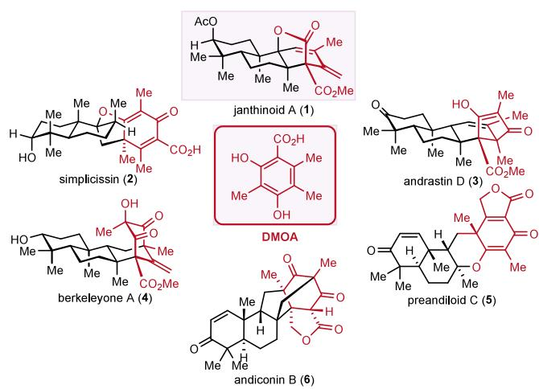
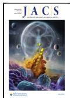
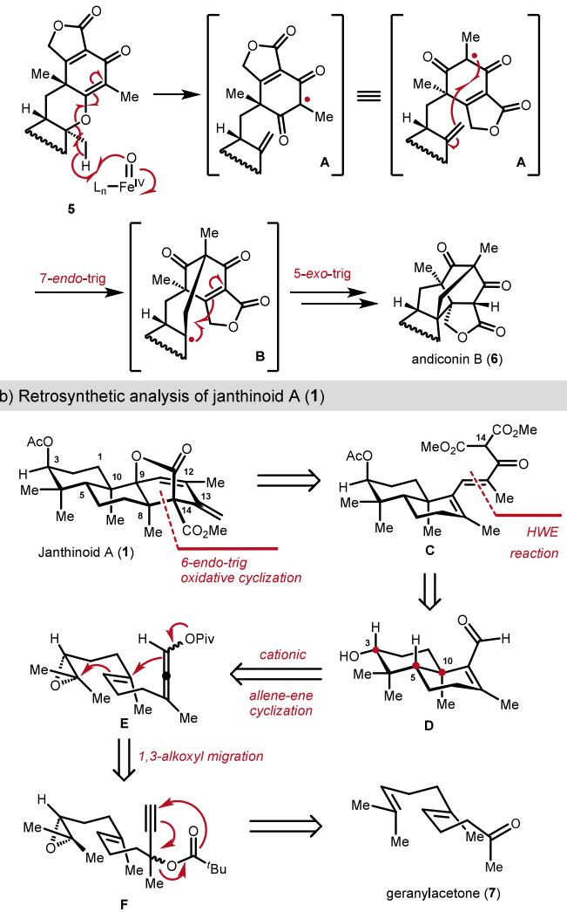
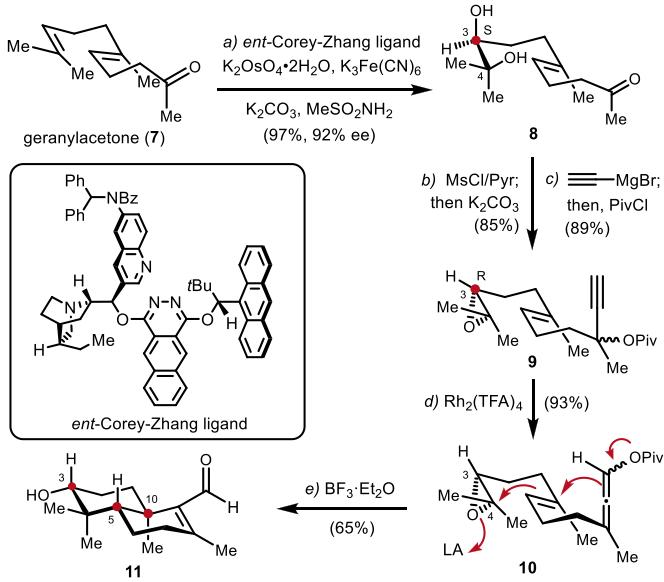
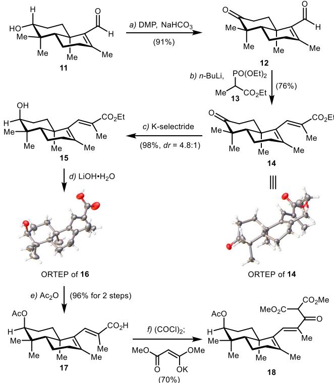
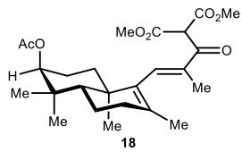
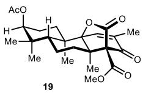
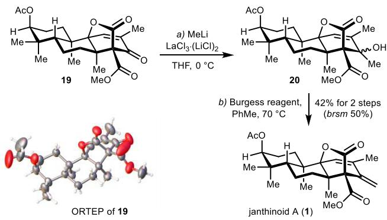

3,5-Dimethylorsellinic acid (DMOA)-derived meroterpenoids (Figure 1), encompassing over 200 known compounds, have  

pubs.acs.org/JACS

Communication

# Asymmetric Total Synthesis of Janthinoid A

Fu Tang,# Zhong-Chao Zhang,\*,# Zhi-Lin Song, Yuan-He Li, Zi-Hao Zhou, Jia-Jun Chen, and Zhen Yang\*

Cite This: J. Am. Chem. Soc. 2025, 147, 4731−4735

Read Online

ACCESS

Metrics & More

Article Recommendations

\*sı Supporting Information

ABSTRACT: The asymmetric total synthesis of janthinoid A has been accomplished for the first time in 14 steps without using a protecting group. The trans-decalin subunit and the rigid oxabicyclo[3.2.1]octane motif were constructed via an epoxide-initiated cationic π-cyclization reaction and a $\mathrm { F e } \left( \mathrm { C l O } _ { 4 } \right) _ { 3 }$ -mediated oxidative cascade cyclization reaction, respectively.  
  
Figure 1. Naturally occurring DMOA-derived meroterpenoids.

attracted attention due to their structural diversity and intriguing biological activities.1 The total synthesis of several notable DMOA-derived meroterpenoids, including simplicissin (2), berkeleyone A (3), andrastin D (4), and related congeners, has been successfully achieved by the research groups of Porco, Jr., Maimone, Newhouse, Li, and Xie.2

In 2021, a novel DMOA-derived tri-nor-meroterpenoid janthinoid A (1)3 was isolated from the tabacum-derived endophytic fungus Penicillium janthinellum TE-43 by Zhang and co-workers. Janthinoid A (1), characterized by a strained oxabicyclo[3.2.1]octane motif with four continuous quaternary stereogenic centers4 and hallmark embedded rigid lactone, exhibits in vivo antitumor activities against NSCLC cells A549. The structure of 1 was elucidated through extensive NMR spectroscopic analysis and single-crystal X-ray single crystal difraction.

Given the challenges surrounding chemo-, regio-, and stereocontrolled assembly of the rigid oxabicyclo[3.2.1]octane core, we aimed to develop a novel and concise strategy for construction of this intriguing motif and to accomplish the total synthesis of 1.

In 2014, Abe and co-workers proposed a biosynthetic pathway of andiconin (6) from preandiloid C (5),5 featuring a nonheme Fe-dependent oxygenase-initiated cascade radical cyclization via intermediates A and B (Figure 2a). In this work, we report our efort to accomplish these transformations and achieve a 14-step total synthesis of 1 in a protecting-group-free 12 manner.

Retrosynthetically, we envisaged that the oxabicyclo[3.2.1]- octane core of compound 1 could be constructed from ketoester C via a sequence of oxidation,6 double bond isomerization,7 6-endo-trig radical cyclization, and intramolecular oxidative lactonization8 (Figure 2b), with the siteselectivity based on the acidity of the C14 proton.9 We expected to construct compound C with a Horner−Wadsworth−Emmons (HWE) reaction and a condensation from the trans-decalin aldehyde D, which could be stereoselectively constructed via a novel approach from propargyl ester E through a stepwise intramolecular 1,3-acyloxy migration10 and an epoxide-initiated cationic π-cyclization reaction via intermediate F.11 The propargyl ester F in turn could be constructed from geranylacetone.

Our research began by investigating the asymmetric synthesis of trans-decalin-based aldehyde 11 (Scheme 1) from geranylacetone (7). We were keen to devise a novel strategy for the synthesis of decalin11,13 where the C3−C4 epoxide was designed as a stereocontrolling element for an asymmetric synthesis of aldehyde 11 with three newly generated stereogenic centers from allene-ene 10 in a single 14 step.

To ensure that the stereogenic center at C10 in 11 adopts an R-configuration, the dihydroxylation15 of geranylacetone (7) was carried out in the presence of ent-Corey−Zhang a) Proposed mechanism for the transformations from 5 to 6 (Abe et al., 2014)

  
Figure 2. (a) Proposed biosynthetic transformation from 5 to 6. (b) Retrosynthetic analysis of janthinoid A (1).

ligand16,18e to give diol 8 with an S-configuration at C3 in 97% yield with 92% ee. Thus, epoxide 9 could be obtained stereoselectively by the selective reaction of diol 8 with MsCl/ pyridine followed by treatment with ${ \mathrm { K } } _ { 2 } { \mathrm { C O } } _ { 3 }$ in methanol. The resultant ketone was then subjected to a Grignard reaction and acylation to give epoxide 10 in 77% yield over three steps.

We next aimed to convert the propargyl ester in 9 to the corresponding allene motif in 10, targeting aldehyde 11 via the proposed Lewis-acid-mediated epoxide-initiated cationic π- cyclization reaction.10,17 To this end, substrate 9 was treated with a catalytic amount of Rh (TFA) (1.0 mol $\% ) ^ { 1 0 \mathrm { a } }$ to give allene-ene 10 in 93% yield. Notably, when allene-ene 10 was treated with $\mathrm { B F } _ { 3 } { \cdot } \mathrm { E t } _ { 2 } \mathrm { O } ^ { \mathrm { i } ^ { \prime } 4 }$ (4.0 equiv) in DCM, aldehyde 11 was obtained in 65% yield, realizing a novel and concise approach for the synthesis of the trans-decalin-based aldehyde 11.18

With an eficient and scalable route to aldehyde 11, we started to explore the preparation of ketoester 18 (Scheme 2). To this end, 11 first underwent a two-step DMP-oxidation/ regioisomer in 69% overall yield. Further treatment of 14 with K-selectride20 furnished alcohol 15 in 81% yield, together with its C3 diastereoisomer in 17% yield. To achieve the preparation of ketoester 18, the ester group in 15 was

Scheme 1. Synthesis of Aldehyde 11a

  
aReagents and conditions: (a) enantiomer of Corey−Zhang ligand (1.0 mol %), $\mathrm { K } _ { 2 } \mathrm { O s O } _ { 4 } { \cdot } 2 \mathrm { H } _ { 2 } \mathrm { O }$ (0.5 mol %), $\mathrm { K } _ { 3 } \mathrm { F e ( C N ) } _ { 6 }$ (3.0 equiv), ${ \mathrm { K } } _ { 2 } { \mathrm { C O } } _ { 3 }$ (3.0 equiv), $\mathrm { M e S O } _ { 2 } \mathrm { N H } _ { 2 }$ (1.0 equiv) t-BuOH $\mathrm { / H } _ { 2 } \mathrm { O } = 1 { : } 1 , \ \mathrm { r t } , \ 2 4 \ \mathrm { h } ,$ 97%, 92% ee, $r r > 2 0 { : } 1 ;$ (b) MsCl (1.2 equiv), pyridine (15 equiv), DCM, $\operatorname { r t } , ~ 7$ h; then ${ \mathrm { K } } _ { 2 } { \mathrm { C O } } _ { 3 }$ (10.0 equiv), MeOH, rt, 6 h, 85%; (c) ethynyl magnesium bromide (0.5 M in THF, 1.5 equiv), THF, 0 °C to rt, 1 h; then PivCl (4.0 equiv), rt, 10 h, 89%; (d) Rh (TFA) (1.0 mol %), PhMe, 60 ${ } ^ { \circ } C ,$ 19 h, 93%; (e) $\mathrm { B F } _ { 3 } { \cdot } \mathrm { E t } _ { 2 } \mathrm { O }$ (4.0 equiv), DCM, 0 $^ \circ \mathrm { C }$ to rt, 12 h, 65%.

hydrolyzed with LiOH to obtain the resultant hydroxyl acid 16. The structures of 14 and 16 were determined by single crystal X-ray difraction. The hydroxyl group in 16 was then acylated, giving 17 in a high yield. The carboxylic acid in 17 was then converted to its corresponding acyl chloride, which was then reacted with potassium 1,3-dimethoxy-3-oxoprop-1- en-1-olate to give tricarbonyl compound 18 in 70% yield.21

We then investigated the key step for regio- and stereoselective construction of the oxabicyclo[3.2.1]octane core. Shown in Table 1, when ketoester 18 underwent the common oxidative cyclization conditions such as $\mathbf { M n } ( \mathrm { O A c } ) _ { 3 }$ with $\mathrm { C u } ( \mathrm { O A c } ) _ { 2 } , ^ { 6 , 2 2 }$ we did not observe the desired annulated product 19 (Table 1, entry 1). No reaction occurred when attempting the oxidation of 18 with $\scriptstyle \mathbf { M n } ( \mathbf { O A c } ) _ { 3 }$ and $\operatorname { C u } ( \operatorname { O A c } ) _ { 2 }$ in MeCN and DCM (entries 2 and 3). However, oxidation with $\mathbf { M n } ( \mathrm { O A c } ) _ { 3 }$ in DCM in the presence of TfOH (1.0 equiv) aforded the desired product 19 in 20% yield (entry 4). The structure of 19 was later unambiguously determined by X-ray crystallographic analysis (see Scheme 3). Attempts to improve the yield by systematic profiling of the reaction conditions using $\mathbf { M n } ( \mathrm { O A c } ) _ { 3 }$ were unsuccessful.

Since acid-based Fe $\mathrm { ( C l O _ { 4 } ) _ { 3 } { \cdot } } 9 \mathrm { H _ { 2 } O ^ { 7 , 8 , 2 3 } }$ has been reported as an eficient oxidant for the synthesis of complex molecules,24 we then carried out the annulation in the presence of $\mathrm { F e } ( \mathrm { C l O } _ { 4 } ) _ { 3 } { \cdot } 9 \mathrm { H } _ { 2 } \mathrm { O }$ for the synthesis of 19 from 18. When ketoester 18 was treated with $\mathrm { F e } ( \mathrm { C l O } _ { 4 } ) _ { 3 } { \cdot } 9 \mathrm { H } _ { 2 } \mathrm { O }$ in CH CN at 25 $^ \circ \mathrm { C }$ for 18 h, to our delight, the desired product 19 was obtained in 55% yield (entry 5). We next tested the annulation reaction at both higher and lower temperatures; however, lower yields of 19 were obtained (entries 6 and 7). The $\mathrm { F e } ( \mathrm { C l O } _ { 4 } ) _ { 3 } { \cdot } 9 \mathrm { H } _ { 2 } \mathrm { O }$ -mediated reaction was also carried out in DCM, but no reaction occurred due to the poor solubility of

## Scheme 2. Synthesis of Enol $1 8 ^ { a }$

  
aReagents and conditions: (a) Dess−Martin periodinane (1.5 equiv), NaHCO (1.5 equiv), DCM, rt, 1 h, 91%; (b) triethyl 2-phosphonopropionate (10.0 equiv), n-BuLi (10.0 equiv), THF, rt, 36 h, 76%; (c) K-selectride (2.0 equiv), THF, rt, 1 h, 98%, $d r = 4 . 8 { : } 1 ;$ (d) LiOH· $\mathrm { H } _ { 2 } \mathrm { O }$ (10.0 equiv), THF/MeOH/H O = 4:1:1, rt, 12 h. (e) $\mathbf { A c } _ { 2 } \mathbf { O }$ (2.0 equiv), Et N (2.0 equiv), DMAP (0.2 equiv), DCM, rt, 1 h, 96% over 2 steps; (f) (COCl) (2.0 equiv), DMF (10.0 mol %), DCM, rt, 3 h, then dimethyl malonate (1.5 equiv), KHMDS (1.0 M in THF, 1.5 equiv), THF, rt, 0.5 h, 70%.

## Table 1. Oxidative Cascade Cyclization of Ketoester $1 8 ^ { a }$

<table><tr><td>entry</td><td>conditions</td><td>outcome/yield</td></tr><tr><td>1</td><td> $\mathrm { M n } ( \mathrm { O A c } ) _ { 3 } { \cdot } 2 \mathrm { H } _ { 2 } \mathrm { O } \ ( 2 . 2 \ \mathrm { e q u i v } ) , \mathrm { C u } ( \mathrm { O A c } ) _ { 2 } \ ( 1 . 0 $   $\mathrm { e q u i v ) , \tilde { A } c O \tilde { H } , 2 \dot { 5 } ~ ^ { \circ } C , \tilde { \mathrm { ~ 1 ~ h ~ } } }$ </td><td>decomposed</td></tr><tr><td>2</td><td> $\mathrm { M n } ( \mathrm { O A c } ) _ { 3 } { \cdot } 2 \mathrm { H } _ { 2 } \mathrm { O } \ ( 2 . 2 \ \mathrm { e q u i v } ) , \mathrm { C u } ( \mathrm { O A c } ) _ { 2 } \ ( 1 . 0 $   $\mathrm { e q u i v ) , \tilde { M e } C \tilde { N } , \ 2 \dot { 5 } \ ^ { \circ } C \ \hat { t o } \ r e f l u x , \ 1 8 \ h }$ </td><td>no reaction</td></tr><tr><td>3</td><td> $\mathrm { M n } ( \mathrm { O A c } ) _ { 3 } { \cdot } 2 \mathrm { H } _ { 2 } \mathrm { O }$  (2.2 equiv), DCM, 25 °C to reflux, 18 h</td><td>no reaction</td></tr><tr><td>4</td><td>Mn(OAc)₃·2H2O (2.2 equiv), TFA (1.0 equiv),  $\mathrm { D } \dot { \mathbf { C } } \mathbf { M } , \dot { 2 } \dot { 5 } ^ { \circ } \mathrm { C } , 1 8 \dot { \mathrm { ~ h ~ } }$ </td><td>20%</td></tr><tr><td>5</td><td> $\mathrm { F e ( C l O _ { 4 } ) _ { 3 } { \cdot } 9 H _ { 2 } O \ ( 2 . 2 \ e q u i v ) , M e C N } , \ 2 5 \ ^ { \circ } \mathrm { C } , \ 1 8 \ \mathrm { h }$ </td><td>55%</td></tr><tr><td>6</td><td> $\mathrm { F e ( C l O _ { 4 } ) _ { 3 } { \cdot } 9 H _ { 2 } O \ ( 2 . 2 \ e q u i v ) , M e C N } , \ 0 \ ^ { \circ } \mathrm { C } , \ 1 8 \ \mathrm { h }$ </td><td>46%</td></tr><tr><td>7</td><td> $\mathrm { F e ( C l O _ { 4 } ) _ { 3 } { \cdot } 9 H _ { 2 } O \ ( 2 . 2 \ e q u i v ) , M e C N } , 5 0 \ ^ { \circ } \mathrm { C } , 1 8 \ \mathrm { h }$ </td><td>40%</td></tr><tr><td>8</td><td> $\mathrm { F e ( C l O _ { 4 } ) _ { 3 } { \cdot } 9 H _ { 2 } O \ ( 2 . 2 \ e q u i v ) , D C M , 2 5 ^ { \circ } C , 1 8 \ h }$ </td><td>no reaction</td></tr><tr><td>9</td><td> $\mathrm { F e C l _ { 3 } { \cdot } 6 H _ { 2 } O \ ( 2 . 2 \ e q u i v ) , M e C N } , \ 2 5 \ ^ { \circ } \mathrm { C } ,$  18 h</td><td>trace</td></tr><tr><td>10</td><td> $\mathrm { F e ( a c a c ) _ { 3 } } \ : \mathrm { ( 2 . 2 \ e q u i v ) , M e C N , 2 5 \ e ^ { \circ } C , 1 8 \ h }$ </td><td>no reaction</td></tr></table>

aReactions were carried out at 100 mg scale of 18 at a concentration of 0.01 M.

## Scheme 3. Total Synthesis of Janthinoid A (1)a

  
aReagents and conditions: (a) MeLi (1.3 M in $\mathrm { E t } _ { 2 } \mathrm { O } ,$ 1.1 equiv), Et O, 0 ${ } ^ { \circ } \mathrm { C } , \ 3 0$ min; (b) Burgess reagent, toluene, ${ 7 0 ~ ^ { \circ } C } ,$ 30 min. 42% in 2 steps.

$\mathrm { F e } \left( \mathrm { C l O } _ { 4 } \right) _ { 3 } { \cdot } 9 \mathrm { H } _ { 2 } \mathrm { O }$ in DCM (entry 8). Other iron-based oxidants, such as $\mathrm { F e C l } _ { 3 }$ and $\mathrm { F e } ( \mathsf { a c a c } ) _ { 3 } ,$ were tested, but no positive results were observed (entries 9 and 10). A brief discussion about the mechanism of this reaction was included in the Supporting Information.

Completion of the total synthesis of target 1 required conversion of the ketone group in 19 to the corresponding methylene. Thus, 19 was treated with MeLi in the presence of $\mathrm { L a C l } _ { 3 } ^ { \cdot } { \cdot } 2 \mathrm { L i C l } ^ { 2 5 } { \mathrm { a t } } 0 ^ { \circ } { \mathrm { C } } ,$ and the resultant tertiary alcohols in 20, upon exposure to the Burgess-reagent-mediated dehydration conditions, were converted into the final target 1 in 42% yield over 2 steps (Scheme 3). The structure of 1 was unequivocally confirmed by the spectroscopic (1H and $^ { 1 3 } \mathrm { C }$ NMR) and optical rotation data for the synthetic 1 matched well with those reported for the natural product.3

In summary, the asymmetric, protecting-group-free synthesis of janthinoid A (1) is accomplished for the first time in 14 steps starting from the commercially available geranylacetone. The enabling tandem reactions of Lewis-acid-mediated cationic-allene-ene cyclization and $\mathrm { F e ( C l O _ { 4 } ) _ { 3 } }$ -mediated oxidative annulation provide novel ways for the synthesis of the trans-decalin-based aldehyde 11 and the oxabicyclo[3.2.1]- octane core 19 in a regio- and stereoselective manner. Application of the developed chemistry for the synthesis of other types of complex natural products is currently underway in our laboratories and will be reported in due course.

## ■ ASSOCIATED CONTENT

## \*sı Supporting Information

The Supporting Information is available free of charge at https://pubs.acs.org/doi/10.1021/jacs.4c17480.

Experimental procedures and compound characterizations (PDF)

## Accession Codes

Deposition Numbers 2407901, 2416040, and 2416232 contain the supplementary crystallographic data for this paper. These data can be obtained free of charge via the joint Cambridge Crystallographic Data Centre (CCDC) and Fachinformationszentrum Karlsruhe Access Structures service.

## ■ AUTHOR INFORMATION

## Corresponding Authors

Zhen Yang − State Key Laboratory of Chemical Oncogenomics and Laboratory of Chemical Genomics, School of Chemical

Biology and Biotechnology, Peking University Shenzhen Graduate School, Shenzhen 518055, China; Key Laboratory of Bioorganic Chemistry and Molecular Engineering of Ministry of Education, Beijing National Laboratory for Molecular Science and Peking-Tsinghua Center for Life Sciences, Peking University, Beijing 100871, China; Institute of Chemical Biology, Shenzhen Bay Laboratory, Shenzhen 518132, China; orcid.org/0000-0001-8036-934X; Email: zyang@pku.edu.cn

Zhong-Chao Zhang − State Key Laboratory of Chemical Oncogenomics and Laboratory of Chemical Genomics, School of Chemical Biology and Biotechnology, Peking University Shenzhen Graduate School, Shenzhen 518055, China; orcid.org/0000-0001-5017-5691; Email: zc\_zhang@ pku.edu.cn

## Authors

Fu Tang − State Key Laboratory of Chemical Oncogenomics and Laboratory of Chemical Genomics, School of Chemical Biology and Biotechnology, Peking University Shenzhen Graduate School, Shenzhen 518055, China

Zhi-Lin Song − State Key Laboratory of Chemical Oncogenomics and Laboratory of Chemical Genomics, School of Chemical Biology and Biotechnology, Peking University Shenzhen Graduate School, Shenzhen 518055, China

Yuan-He Li − State Key Laboratory of Chemical Oncogenomics and Laboratory of Chemical Genomics, School of Chemical Biology and Biotechnology, Peking University Shenzhen Graduate School, Shenzhen 518055, China

Zi-Hao Zhou − State Key Laboratory of Chemical Oncogenomics and Laboratory of Chemical Genomics, School of Chemical Biology and Biotechnology, Peking University Shenzhen Graduate School, Shenzhen 518055, China

Jia-Jun Chen − State Key Laboratory of Chemical Oncogenomics and Laboratory of Chemical Genomics, School of Chemical Biology and Biotechnology, Peking University Shenzhen Graduate School, Shenzhen 518055, China

Complete contact information is available at: https://pubs.acs.org/10.1021/jacs.4c17480

## Author Contributions

#F.T. and Z.-C.Z. contributed equally to this work.

## Notes

The authors declare no competing financial interest.

## ■ ACKNOWLEDGMENTS

We are grateful for the insightful discussions provided by the reviewer concerning the study of the mechanism. We thank the National Science Foundation of China (Grant Nos. 22171013), Guangdong Natural Science Foundation (Grant Nos. 2020B0303070002), Shenzhen Basic Research Program (Grant No. JCYJ 20180302180215524), Shenzhen-Hong Kong Institute of Brain Science-Shenzhen Fundamental Research Institutions (2022SHIBS0004), the research grants from the Major Program of Shenzhen Bay Laboratory, and the Shenzhen Outstanding Talents Training Fund for financial support.

## ■ REFERENCES

(1) For reviews of meroterpenoids, see: (a) Geris, R.; Simpson, T. J. Meroterpenoids Produced by Fungi. Nat. Prod. Rep. 2009, 26, 1063− 1094. (b) Jiang, M.; Wu, Z.; Liu, L.; Chen, S. The Chemistry and

Biology of Fungal Meroterpenoids (2009−2019). Org. Biomol. Chem. 2021, 19, 1644−1704.

(2) For chemical synthesis of DMOA-derived meroterpenoids, see: (a) Ting, C. P.; Xu, G.; Zeng, X.; Maimone, T. J. Annulative Methods Enable a Total Synthesis of the Complex Meroterpene Berkeleyone A. J. Am. Chem. Soc. 2016, 138, 14868−14871. (b) Elkin, M.; Szewczyk, S. M.; Scruse, A. C.; Newhouse, T. R. Total Synthesis of (±)-Berkeleyone A. J. Am. Chem. Soc. 2017, 139, 1790−1793. (c) Xu, G.; Elkin, M.; Tantillo, D. J.; Newhouse, T. R.; Maimone, T. J. Traversing Biosynthetic Carbocation Landscapes in the Total Synthesis of Andrastin and Terretonin Meroterpenes. Angew. Chem.; Int. Ed. 2017, 56, 12498−12502. (d) Powers, Z.; Scharf, A.; Cheng, A.; Yang, F.; Himmelbauer, M.; Mitsuhashi, T.; Barra, L.; Taniguchi, Y.; Kikuchi, T.; Fujita, M.; Abe, I.; Porco, J. A., Jr. Biomimetic Synthesis of Meroterpenoids by Dearomatization-Driven Polycyclization. Angew. Chem., Int. Ed. 2019, 58, 16141−16146. (e) Zhang, Y.; Ji, Y.; Franzoni, I.; Guo, C.; Jia, H.; Hong, B.; Li, H. Enantioselective Total Synthesis of Berkeleyone A and Preaustinoids. Angew. Chem.; Int. Ed. 2021, 60, 14869−14874. (f) Yang, F.; Porco, J. A., Jr. Unified, Asymmetric Total Synthesis of the Asnovolins and Related Spiromeroterpenoids: A Fragment Coupling Approach. J. Am. Chem. Soc. 2022, 144, 12970−12978. (g) Li, X.; Chang, Z.; Duan, S.; Xie, Z. Total Synthesis of Berkeleyone A and Preaustinoid A through Epoxypolyene Cyclization. Angew. Chem., Int. Ed. 2025, 64, No. e202416211.

(3) Li, X. D.; Su, J. C.; Jiang, B. Z.; Li, Y. L.; Guo, Y. Q.; Zhang, P. Janthinoid A, an Unprecedented Tri-nor-meroterpenoid with Highly Modified Bridged 4a, 1-(Epoxymethano) Phenanthrene Scaffold, Produced by the Endophyte of Penicillium janthinellum TE-43. Org. Chem. Front. 2021, 8, 6196−6202.

(4) (a) Peterson, E. A.; Overman, L. E. Contiguous Stereogenic Quaternary Carbons: A Daunting Challenge in Natural Products Synthesis. Proc. Natl. Acad. Sci. U. S. A. 2004, 101, 11943−11948.

(b) Long, R.; Huang, J.; Gong, J.; Yang, Z. Direct Construction of Vicinal All-Carbon Quaternary Stereocenters in Natural Product Synthesis. Nat. Prod. Rep. 2015, 32, 1584−1601.

(5) Matsuda, Y.; Wakimoto, T.; Mori, T.; Awakawa, T.; Abe, I. Complete Biosynthetic Pathway of Anditomin: Nature’s Sophisticated Synthetic Route to a Complex Fungal Meroterpenoid. J. Am. Chem. Soc. 2014, 136, 15326−15336.

(6) (a) Snider, B. B. Manganese(III)-Based Oxidative Free-Radical Cycliza-tions. Chem. Rev. 1996, 96, 339−363. (b) Snider, B. B. Manganese(III) Acetate Mediated Cyclizations. In Manganese Catalysis in Organic Synthesis; Sortais, J.-B., Ed.; Wiley-VCH: Weinheim, Germany, 2021; pp 293−322.

(7) For precedent study on oxidative radical cyclization, which involves olefin isomerization and generates a trapable and isolatable cyclopropane intermediate, see: Citterio, A.; Sebastiano, R.; Nicolini, M. Oxidation of Diethyl ω-Phenylalkenylmalonates by High Valent Metal Salts. Tetrahedron 1993, 49, 7743−7760.

(8) (a) Corey, E. J.; Kang, M. C. A New and General Synthesis of Polycyclic γ-Lactone by Double Annulation. J. Am. Chem. Soc. 1984, 106, 5384−5385. (b) Citterio, A.; Sebastiano, R.; Nicolini, M.; Santi, R. Synthesis of γ-Lactones by Iron(III) Perchlorate Oxidation of Malonic Esters in the Presence of Olefins. Synlett 1990, 1990, 42−43.

(9) Snider, B. B.; Patricia, J. J.; Kates, S. A. Mechanism of Manganese(III)-Based Oxidation of β-Keto Esters. J. Org. Chem. 1988, 53, 2137−2143.

(10) (a) Miki, K.; Ohe, K.; Uemura, S. A New Ruthenium-Catalyzed Cyclopropanation of Alkenes Using Propargylic Acetates as a Precursor of Vinylcarbenoids. Tetrahedron Lett. 2003, 44, 2019− 2022. (b) Marion, N.; Nolan, S. P. Propargylic Esters in Gold Catalysis: Access to Diversity. Angew. Chem., Int. Ed. 2007, 46, 2750− 2752. (c) Teng, T. M.; Liu, R. S. Gold-Catalyzed Stereocontrolled Oxacyclization/[4 + 2]-Cycloaddition Cascade of Ketone-Allene Substrates. J. Am. Chem. Soc. 2010, 132, 9298−9300.

(11) (a) Fish, P. V.; Johnson, W. S. The First Examples of Nonenzymic, Biomimetic Polyene Pentacyclizations. Total Synthesis of the Pentacyclic Triterpenoid Sophoradiol. J. Org. Chem. 1994, 59,

2324−2335. (b) Brunoldi, E.; Luparia, M.; Porta, A.; Zanoni, G.; Vidari, G. Biomimetic Cyclizations of Functionalized Isoprenoid Polyenes: A Cornucopia of Synthetic Opportunities. Curr. Org. Chem. 2006, 10, 2259. (c) Snowden, R. L.; Eichenberger, J.; Linder, S.; Sonnay, P. Internal Nucleophilic Termination in Acid-Mediated Polyene Cyclizations. Part 3. Helv. Chim. Acta 2004, 87, 1711−1723. (d) Harding, K. E.; Puckett, P. M.; Cooper, J. L. Studies on allenes as participants in cationic π-cyclizations. Bioorg. Chem. 1978, 7, 221− 234. (e) Harding, K. E.; Cooper, J. L.; Puckett, P. M. Cationic cyclization of allenes. Preferential cyclization via vinyl cations. J. Am. Chem. Soc. 1978, 100, 993−994.

(12) (a) Young, I. S.; Baran, P. S. Protecting-Group-Free Synthesis as an Opportunity for Invention. Nat. Chem. 2009, 1, 193−205. (b) Hoffmann, R. W. Protecting-Group-Free Synthesis. Synthesis 2006, 2006, 3531−3541.

(13) Sun, S. X.; Wang, X.; Hu, N. D.; Fu, S. Q.; Li, S. K. Siccaninrelated drimane meroterpenoids: biological activities and synthesis. Nat. Prod. Rep. 2025, 42, 113.

(14) (a) Corey, E. J.; Kurti, L. Enantioselective Chemical Synthesis; Elsevier Publishers: Amsterdam, The Netherlands, 2010; pp 281− 307. (b) Rajendar, G.; Corey, E. J. A Systematic Study of Functionalized Oxiranes as Initiating Groups for Cationic Polycyclization Reactions. J. Am. Chem. Soc. 2015, 137, 5837−5844.

(15) (a) Corey, E. J.; Noe, M. C.; Lin, S. A Mechanistically Designed Bis-cinchona Alkaloid Ligand Allows Position- and Enantioselective Dihydroxylation of Farnesol and Other Oligoprenyl Derivatives at the Terminal Isopropylidene Unit. Tetrahedron Lett. 1995, 36, 8741− 8744. (b) Corey, E. J.; Noe, M. C. Kinetic Investigations Provide Additional Evidence That an Enzyme-like Binding Pocket Is Crucial for High Enantioselectivity in the Bis-Cinchona Alkaloid Catalyzed Asymmetric Dihydroxylation of Olefins. J. Am. Chem. Soc. 1996, 118, 319−329.

(16) Corey, E. J.; Zhang, J. Highly Effective Transition Structure Designed Catalyst for the Enantio- and Position-Selective Dihydroxylation of Polyisoprenoids. Org. Lett. 2001, 3, 3211−3214.

(17) Huang, S.; Li, X.; Lin, C. L.; Guzei, I. A.; Tang, W. Rhodium-Catalyzed 1,3-Acyloxy Migration and Subsequent Intramolecular [4 + 2] Cycloaddition of Vinylallene and Unactivated Alkyne. Chem. Commun. 2012, 48, 2204−2206.

(18) For the synthesis of decalin 11 by other groups, see: (a) Kende, A. S.; Deng, W.-P.; Zhong, M.; Guo, X.-C. Enantioselective Total Synthesis and Structure Revision of Spirodihydrobenzofuran Lactam 1. Total Synthesis of Stachybotry Lactam. Org. Lett. 2003, 5, 1785− 1788. (b) Boyko, Y. D.; Huck, C. J.; Sarlah, D. Total Synthesis of Isomalabaricane Triterpenoids. J. Am. Chem. Soc. 2019, 141, 14131− 14135. (c) Li, J.; Li, F.; King-Smith, E.; Renata, H. Merging Chemoenzymatic and Radical-Based Retrosynthetic Logic for Rapid and Modular Synthesis of Oxidized Meroterpenoids. Nat. Chem. 2020, 12, 173−179. (d) Chen, P.; Wu, H.; Li, Y.; Tang, Y. Total Syntheses of (+)-Arisugacins F, G. Tetrahedron Lett. 2020, 61, 152172. (e) Boyko, Y. D.; Huck, C. J.; Ning, S.; Shved, A. S.; Yang, C.; Chu, T.; Tonogai, E. J.; Hergenrother, P. J.; Sarlah, D. Synthetic Studies on Selective, Proapoptotic Isomalabaricane Triterpenoids Aided by Computational Techniques. J. Am. Chem. Soc. 2021, 143, 2138−2155.

(19) Wadsworth, W. S., Jr.; Emmons, W. D. The Utility of Phosphonate Carbanions in Olefin Synthesis. J. Am. Chem. Soc. 1961, 83, 1733−1738.

(20) Li, F.; Renata, H. A Chiral-Pool-Based Strategy to Access transsyn-Fused Drimane Meroterpenoids: Chemoenzymatic Total Syntheses of Polysin, N-Acetyl-polyveoline and the Chrodrimanins. J. Am. Chem. Soc. 2021, 143, 18280−18286.

(21) (a) Rathke, M. W.; Cowan, P. J. Procedures for the Acylation of Diethyl Malonate and Ethyl Acetoacetate with Acid Chlorides Using Tertiary Amine Bases and Magnesium Chloride. J. Org. Chem. 1985, 50, 2622−2624. (b) Martin, C. L.; Overman, L. E.; Rohde, J. M. Total Synthesis of (−)-Actinophyllic Acid. J. Am. Chem. Soc. 2010, 132, 4894. (c) Nawrat, C. C.; Moody, C. J. Total Synthesis of Mevashuntin. Org. Lett. 2012, 14, 1484−1487. (d) Nicolaou, K. C.;

Hale, C. R. H.; Nilewski, C.; Ioannidou, H. A.; ElMarrouni, A.; Nilewski, L. G.; Beabout, K.; Wang, T. T.; Shamoo, Y. Total Synthesis of Viridicatumtoxin B and Analogues Thereof: Strategy Evolution, Structural Revision, and Biological Evaluation. J. Am. Chem. Soc. 2014, 136, 12137−12160.

(22) For comprehensive reviews on oxidative cyclization reactions, see ref 6 as well as the following: Snider, B. B. Manganese(III)-Based Oxidative Free-Radical Cyclizations. In Transition Metals for Organic Synthesis, 2nd ed.; Beller, M., Bolm, C., Eds.; Wiley-VCH Verlag: Weinheim, Germany, 2004; Vol. 1, pp 483−490.

(23) Citterio, A.; Cerati, A.; Sebastiano, R.; Finzi, C.; Santi, R. Oxidative deprotonation of carbonyl compounds by Fe (III) salts. Tetrahedron Lett. 1989, 30, 1289−1292.

(24) (a) Jiang, H. F.; Yao, W. J.; Cao, H.; Huang, H. W.; Cao, D. R. Iron-Catalyzed Domino Process for the Synthesis of α-Carbonyl Furan Derivatives via One-Pot Cyclization Reaction. J. Org. Chem. 2010, 75, 5347−5350. (b) Li, D.; Yang, J.-F.; Liu, B.-Y.; Gong, J.-X.; Yang, Z. Synthesis of Desacyl Furanmonogones A and B. Org. Lett. 2021, 23, 4532−4537.

(25) Krasovskiy, A.; Kopp, F.; Knochel, P. Soluble Lanthanide Salts (LnCl ·2LiCl) for the Improved Addition of Organomagnesium Reagents to Carbonyl Compounds. Angew. Chem., Int. Ed. 2006, 45, 497−500.