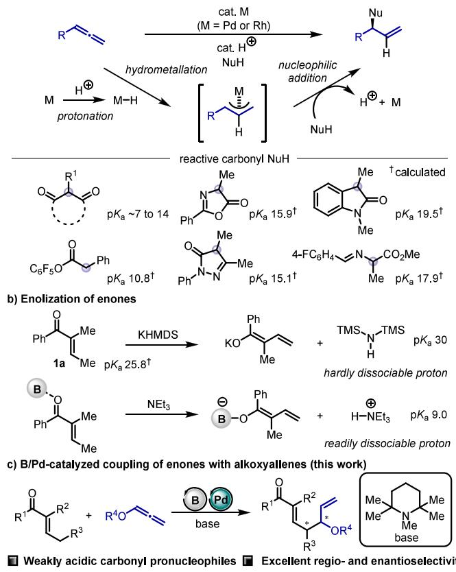
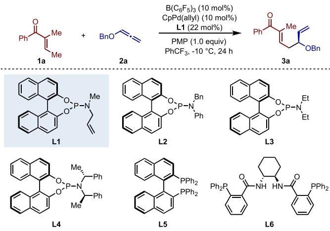
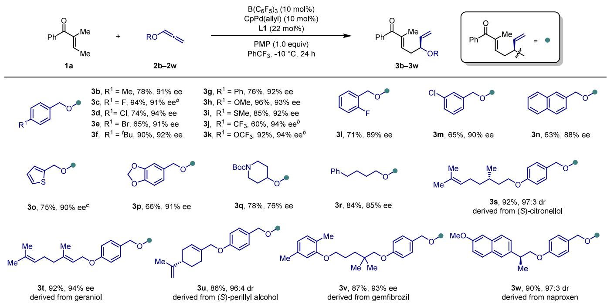
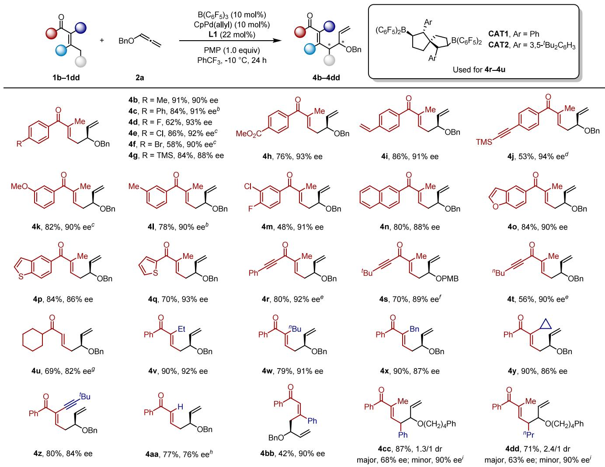
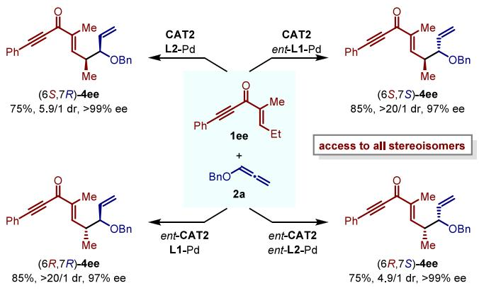
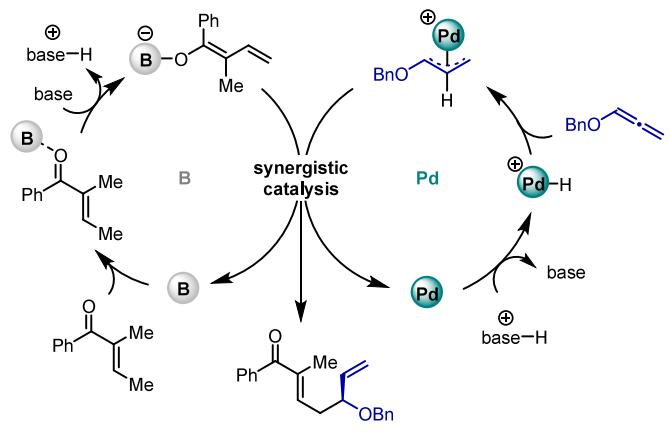

pubs.acs.org/JACS

# Enantioselective Vinylogous Addition of Enones to Allenes Enabled by Synergistic Borane/Palladium Catalysis

Heng Luo, Ming Zhang, Ze-Qun Xing, and Xiao-Chen Wang\*

Cite This: J. Am. Chem. Soc. 2025, 147, 104−110

Metrics & More

Read Online

ACCESS

Article Recommendations

\*sı Supporting Information

ABSTRACT: Herein, we report a method for enantioselective vinylogous addition of enones to alkoxyallenes enabled by synergistic borane/palladium catalysis. The inductive efect provided by borane coordination to the ketone was essential for closing the gap between the conditions needed for the generation of a dienolate and those needed for initiation of the palladium catalytic cycle by protonation of the metal catalyst. Furthermore, we accomplished the first example of stereodivergent synthesis with chiral borane/ transition-metal catalysts.

pronucleophile (NuH) is a versatile, atom-economical way to generate allylic compounds, which are widely used for the synthesis of natural products as well as drugs and other bioactive molecules.1 As shown in Scheme 1a (top panel) with allenes as an example, the first step in these reactions is in situ formation of a M−H species by protonation of the metal catalyst with a proton generated by dissociation of the pronucleophile or a Brønsted acid cocatalyst. The resulting M−H species undergoes a hydrometalation reaction with the unsaturated hydrocarbon to generate a M(π-allyl) complex, which participates in an addition reaction with the nucleophile to deliver the allylic product. Since the pioneering work in this area by the groups of Trost,2 Yamamoto,3 and Breit4 with palladium and rhodium catalysts, highly enantioselective reactions involving various pronucleophiles have been developed.1,5

A variety of carbonyl pronucleophiles have been used for this purpos e.2b−e,3a,4e,6 Because both a proton and an enol or enolate nucleophile are required for such reactions, carbonyl pronucleophiles have been confined to compounds with relatively acidic α protons, which can form an enol nucleophile under acidic conditions and/or can dissociate to generate a proton when an acid cocatalyst is not present (Scheme $^ { \mathrm { 1 a , } }$ bottom panel). It can be imagined that if a weakly acidic carbonyl compound was used, access to the corresponding enolate would require a strong base, which would limit the availability of a free proton for protonation of the metal catalyst. To date, the only known reactions of poorly acidic carbonyl compounds, such as arylalkylketones and amides, have involved dienes and nickel catalysis.7 Unfortunately, in palladium- and rhodium-catalyzed reactions, a proton captured by a strong base has dificulty reacting with the metal. To date, the least acidic carbonyl pronucleophile that has been used for the coupling reaction is 1,3- dimethylindolin-2-one ,2e the calculated $\mathsf { p } K _ { \mathrm { a } }$ of which in DMSO is 19.5, as determined by a machine learning approach developed by the Luo group. 8,9

## Scheme 1. Metal-Catalyzed Coupling of Allenes with Carbonyl Pronucleophiles

a) Metal-catalyzed coupling of allenes with pronucleophiles (NuH)

Stereodivergent synthesis Broad substrate scope

Received: November 15, 2024

Revised: December 17, 2024

Accepted: December 19, 2024

Published: December 24, 2024

Enolization of $\alpha { , } \beta { \cdot }$ -unsaturated carbonyls has enabled their vinylogous addition reactions with various electrophiles.10,11 However, vinylogous coupling reactions of $\alpha { , } \beta { \cdot }$ -unsaturated carbonyls with allenes, 1,3-dienes, or alkynes have not been reported.12 This challenge arises from the weak acidity of the γ-protons. For enones (e.g., 1a with a calculated $\mathsf { p } K _ { \mathrm { a } }$ of 25.8 in $\mathrm { \dot { D M S O } ) , ^ { 8 } }$ enolization can be accomplished with potassium bis(trimethylsilyl)amide (KHMDS).13 However, bis-(trimethylsilyl)amine has a $\mathsf { p } K _ { \mathrm { a } }$ of 30 in $\mathrm { D M S O } , ^ { 1 4 }$ so proton dissociation is strongly disfavored (Scheme 1b). Recently, our group developed a method for asymmetric vinylogous Mannich reactions between enones and imines with catalysis by a chiral bicyclic bisborane.15,16 Coordination of the borane catalyst with the carbonyl oxygen inductively increases the acidity of the γ-proton of the enone, facilitating enolization by a trialkylamine. The steric bulk of the catalyst prevents mutual quenching with the amine base. Such an unquenched borane− amine pair can be described as a frustrated Lewis pair, as defined by Stephan.17 Because protonated triethylamine has a measured $\mathsf { p } K _ { \mathrm { a } }$ of 9.0 in DMSO,14 which is acidic enough to protonate a palladium catalyst,18 we hypothesized that a synergistic borane/palladium system might be able to promote addition reactions between enones and allenes in the presence of a trialkylamine proton shuttle. Indeed, we herein report that we have developed a method for highly regio- and enantioselective coupling reactions between enones and alkoxyallenes mediated by a synergistic catalyst system and $^ { 1 , 2 , 2 , 6 , 6 }$ -pentamethylpiperidine (PMP) as the base (Scheme 1c).

We began by investigating the reaction between enone 1a and allene 2a (Table 1). After careful screening of the reaction conditions, we found that target product 3a could be obtained in 96% yield with 92% enantiomeric excess (ee) by reaction of 0.20 mmol 1a with 0.30 mmol 2a in 1.0 mL of $\mathrm { P h C F } _ { 3 } \mathrm { a t } - 1 0$ °C for 24 h in the presence of 10 mol % $\mathrm { B } ( \mathrm { C } _ { 6 } \mathrm { F } _ { 5 } ) _ { 3 } ,$ 10 mol % CpPd(allyl), 22 mol % ligand L1, and 1.0 equiv of PMP (entry 1). The strong Lewis acidity and steric bulk of $\mathrm { B } ( \mathrm { C } _ { 6 } \mathrm { F } _ { 5 } ) _ { 3 }$ were critical, as indicated by the fact that $\scriptstyle \mathrm { \mathrm { B } } ( 2 , 4 , 6 -$ $\mathrm { F } _ { 3 } \mathrm { C } _ { 6 } \mathrm { H } _ { 2 } ) _ { 3 } ,$ which is less acidic,19 and $\mathrm { B F } _ { 3 } { \cdot } \mathrm { O E t } _ { 2 } ,$ which is less bulky, were inactive (entries 2 and 3). The metal Lewis acids Sc(OTf) Yb(OTf) and Mg(OTf) were also inactive (entries 4−6). Variation of the ligand revealed that phosphoramidite ligands L2 and L3 promoted the reaction; L4, (S)-BINAP (L5), and Trost’s ligand (L6) failed to aford the desired product (entries 7−11). Next, the efect of the base was studied. The bulky base diisopropylethylamine (DIPEA) gave results similar to those obtained with PMP (96% yield and 90% ee, entry 12). The less bulky bases Et N and N-methylpiperidine gave lower yields and ee values (entries 13 and 14), perhaps because of coordination of the base to the borane or palladium species.18e Use of the stronger bases LiHMDS and Barton’s base (2-tert-butyl-1,1,3,3- tetramethylguanidine) shut down the reaction (entries 15 and 16) probably because of the dificulty of generating the necessary Pd−H species.20

Having determined the optimal reaction conditions, we turned our attention to an investigation of the substrate scope. Reactions of 1a with benzoxyallenes bearing an electrondonating or electron-withdrawing group at the para position of the benzene ring gave the desired products (3b−3k) in 60−96% yields with excellent enantioselectivities (>90% ee) (Table 2). Specifically, halogen atoms (3c−3e) and methoxy (3h), methylthio (3i), trifluoromethyl (3j), and trifluoromethoxy (3k) groups were compatible with the reaction conditions. In addition, ortho-fluoro- and meta-chlorosubstituted benzoxyallenes gave 3l and 3m, respectively, with high enantioselectivities. Replacing the benzene ring with a naphthalene ring (3n) or a heterocyclic ring (3o and 3p) did not afect the enantioselectivity, but an allene derived from N-Boc-piperidine gave 3q with only 76% ee. An alkoxyallene with a relatively long alkyl chain gave 3r in 84% yield with 85% ee. To our delight, alkoxyallenes derived from (S)- citronellol (3s), geraniol (3t), (S)-perillyl alcohol (3u), gemfibrozil (3v), and naproxen (3w) all gave the corresponding products in high yields with high diastereo- or enantioselectivities. Moreover, a gram-scale reaction of 1a with 2h gave 3h in 87% yield and 92% ee (see the Supporting Information). Unfortunately, when phenylallene, benzylallene, or 1-benzyloxy-1-methylallene was reacted with 1a under the standard reaction conditions, no product formation was observed (see the Supporting Information for details on limitations). Notably, alkoxyallenes are known to be more reactive than alkyl- or aryl-substituted allenes in Pd-catalyzed hydrofunctionalization reactions of allenes. 1d

Table 1. Optimization of Reaction Conditionsa  

<table><tr><td>entry</td><td>deviation from standard conditions</td><td>yield (%)</td><td>ee (%)</td></tr><tr><td>1</td><td>none</td><td> $9 6 ^ { b }$ </td><td>92</td></tr><tr><td>2</td><td> $\mathrm { B } \left( 2 , 4 , 6 { \cdot } \mathrm { F } _ { 3 } \mathrm { C } _ { 6 } \mathrm { H } _ { 2 } \right) ;$  instead of  $\mathrm { B } \big ( \mathrm { C } _ { 6 } \mathrm { F } _ { 5 } \big ) _ { 3 }$ </td><td>trace</td><td>ND</td></tr><tr><td>3</td><td> $\mathrm { B F } _ { 3 } { \bullet } \mathrm { O E t } _ { 2 }$  instead of  $\mathrm { B } ( \mathrm { C } _ { 6 } \mathrm { F } _ { 5 } ) _ { 3 }$ </td><td>trace</td><td>ND</td></tr><tr><td>4</td><td> ${ \mathrm { S c } } ( \mathrm { O T f } ) ;$  instead of  $\mathrm { B } ( \mathrm { C } _ { 6 } \mathrm { F } _ { 5 } ) _ { 3 }$ </td><td>trace</td><td>ND</td></tr><tr><td>5</td><td> $\mathrm { Y b ( O T f ) _ { 3 } }$  instead of  $\mathrm { B } \big ( \mathrm { C } _ { 6 } \mathrm { F } _ { 5 } \big ) _ { 3 }$ </td><td>NR</td><td>ND</td></tr><tr><td>6</td><td>Mg(OTf)2 instead of  $\mathrm { B } ( \mathrm { C } _ { 6 } \mathrm { F } _ { 5 } ) { } _ { \vdots }$  0</td><td>NR</td><td>ND</td></tr><tr><td>7</td><td>L2 instead of L1</td><td>31</td><td>80</td></tr><tr><td>8</td><td>L3 instead of L1</td><td>90</td><td>90</td></tr><tr><td>9</td><td>L4 instead of L1</td><td>trace</td><td>ND</td></tr><tr><td>10</td><td>L5 instead of L1</td><td>NR</td><td>ND</td></tr><tr><td>11</td><td>L6 instead of L1</td><td>NR</td><td>ND</td></tr><tr><td>12</td><td>DIPEA as the base</td><td>96</td><td>90</td></tr><tr><td> $1 3 ^ { c }$ </td><td>Et3N as the base</td><td>58</td><td>68</td></tr><tr><td> $1 4 ^ { c }$ </td><td>N-methylpiperidine as the base</td><td>65</td><td>70</td></tr><tr><td>15</td><td>LiHMDS as the base</td><td>NR</td><td>ND</td></tr><tr><td>16</td><td>Barton&#x27;s base as the base</td><td>NR</td><td>ND</td></tr></table>

aUnless otherwise specified, all reactions were performed with 0.20 mmol 1a, 0.30 mmol $^ { 2 \mathrm { a } , }$ 10 mol % $\mathrm { { B } } ( \mathrm { { C } } _ { 6 } \mathrm { { F } } _ { 5 } ) _ { 3 } ,$ 10 mol % CpPd(allyl), 22 mol % ligand, and 0.20 mmol base in 1.0 mL of PhCF $\mathrm { \bar { a t } - } 1 0 \mathrm { \bar { ~ } C }$ for 24 h under $\mathrm { N } _ { 2 } .$ NMR yields are reported and were determined by using 4-dimethylaminopyridine as an internal standard, and ee values were determined by HPLC analysis on a Daicel CHIRALCEL OJ-H column. NR, no reaction; ND, not determined. bIsolated yield. cReaction at room temperature.

Table 2. Scope of Alkoxyallenesa  
  
aUnless otherwise specified, all reactions were performed with 0.20 mmol 1a, 0.30 mmol alkoxyallene (2b−2w), 10 mol % $\mathrm { B } \big ( \mathrm { C } _ { 6 } \mathrm { F } _ { 5 } \big ) _ { 3 } ,$ 10 mol % CpPd(allyl), 22 mol % L1, and 0.20 mmol PMP in 1.0 mL of $\mathrm { P h C F } _ { 3 } \mathrm { a t } - 1 0 { } ^ { \circ } \mathrm { C }$ for 24 h under $\mathrm { \dot { N } } _ { 2 } .$ Isolated yields are provided. Abbreviation: dr, diastereomer ratio. bReaction at $0 ~ ^ { \circ } \mathrm { C }$ cReaction $\mathrm { a t } - 1 5 \ ^ { \circ } \mathrm { C } .$

Next, we investigated the scope with respect to the enone by using benzyloxyallene (2a) as the coupling partner (Table 3). Aryl ketones with various substituents on the benzene ring attached to the carbonyl group were tolerated, giving corresponding products 4b−4m. Functionality such as halogen atoms (4d−4f, 4m) and ester (4h), vinyl (4i), and alkynyl (4j) groups were retained. Moreover, the benzene ring could be replaced by a 2-naphthyl (4n), 5-benzofuranyl (4o), 5-benzothiophenyl (4p), or 2-thienyl (4q) group. However, little of the desired product was obtained when the aryl group was replaced with an alkynyl or alkyl group under the standard conditions (data not shown). Interestingly, however, we found that these substrates could be converted if $\mathrm { B } ( \mathrm { C } _ { 6 } \mathrm { F } _ { 5 } ) .$ 3 was replaced with one of the chiral spirobicyclic bisborane catalysts developed in our group (CAT1 or CAT2).21 With these catalysts, reactions of alkynyl-substituted enones gave the target products (4r−4t) with high enantioselectivities, and a cyclohexyl-substituted ketone gave 4u in 69% yield with 82% ee. The activity of CAT1 and CAT2 in these reactions is similar, with the diference lying in their enantioselectivity. A matched/mismatched efect also impacts the enantioselectivity. For example, the use of ent-CAT2 with L1 in the reaction of 1r aforded 4r in 71% yield and 73% ee. Notably, even though ketone 1u has an additional enolization site on the cyclohexyl group, no side product resulting from enolate addition at this site was detected. However, replacing the cyclohexyl group in 1u with methyl or t-butyl groups results in no reaction or the formation of only trace amounts of products.

Subsequently, we tested enones with various α and β substituents. When the α substituent was ethyl, n-butyl, benzyl, cyclopropyl, or alkynyl, corresponding products 4v−

4z, respectively, were obtained in 79−90% yields with 84− 92% ee. However, the ee dropped to 76% when the ketone had an α-hydrogen atom (4aa). Interestingly, β-disubstituted enone 1bb was also reactive, giving 4bb in 42% yield with 90% ee, despite the increased steric hindrance. When we replaced the β-methyl group with a benzyl or n-butyl group, products 4cc and 4dd, which have adjacent stereogenic centers, were formed in good yields but with poor diastereoselectivity. Notably, no byproducts generated by reactions at the α position of the enones were detected in any of the above-mentioned reactions in Tables 2 and 3, perhaps because of the steric bulk of the borane catalyst. The absolute configuration of 4h was determined by X-ray single-crystal analysis (CCDC 2401879), whereas the configurations of the other products in Tables 2 and 3 were tentatively assigned by analogy.

Inspired by the fact that the combination of a transitionmetal catalyst with an organocatalyst or a Lewis acid catalyst has been successfully used for many stereodivergent reactions,22 we wondered whether the catalytic system described herein could also be used for stereodivergent synthesis. Satisfyingly, we found that by varying the stereochemistry of chiral spirobicyclic bisborane catalyst CAT2, we were able to control the stereochemistry of the γ stereogenic center of the product (4ee) generated by reaction of alkynylsubstituted enone 1ee with 2a and that by varying the ligand for the palladium catalyst, we could control the stereochemistry of the δ stereogenic center (Scheme 2).23−25 In this way, we were able to achieve diastereoselective formation of all four stereoisomers with high enantioselectivities.

On the basis of literature reports,1,18 we propose that these synergistic catalytic reactions proceed via the mechanism shown in Scheme 3. The catalytic cycle is initiated by coordination of the borane catalyst to the carbonyl group of

## Table 3. Scope of $\alpha , \beta \mathrm { . }$ -Unsaturated Ketonesa

aUnless otherwise specified, all reactions were performed with 0.20 mmol enone (1b−1dd), 0.30 mmol 2a, 10 mol % $\mathrm { B } \big ( \mathrm { C } _ { 6 } \mathrm { F } _ { 5 } \big ) _ { 3 } ,$ 10 mol % CpPd(allyl), 22 mol % L1, and 0.20 mmol PMP in 1.0 mL of Ph $\mathrm { T } \mathrm { F } _ { 3 } \mathrm { a t } - 1 0 { } ^ { \circ } \mathrm { C }$ for 24 h under $\mathrm { N } _ { 2 } .$ Isolated yields are provided. bReaction $\tt a t - 2 0$ ${ } ^ { \circ } \bar { C } . { } ^ { c } 0 . 5$ mL of $\mathrm { P h C F } _ { 3 }$ was used. $^ { d } 2 0$ mol % $\mathrm { B } ( \mathrm { C } _ { 6 } \mathrm { F } _ { 5 } ) _ { 3 }$ was used. $^ e 5$ mol % CAT2 was used $\mathrm { a t } - 2 0 { } ^ { \circ } \mathrm { C } . { } ^ { f _ { 0 . 3 0 } }$ mmol 2h and 5 mol % ent-CAT1 were used $\mathrm { a t } - 2 0 \ ^ { \circ } \mathrm { C }$ . PMB = p-methoxybenzyl. $^ { g } 5$ mol % CAT1 was used $\mathrm { a t } - 1 0 \ ^ { \circ } \mathrm { C } .$ . hReaction at $0 ~ ^ { \circ } C . ~ ^ { i } 0 . 3 0$ mmol 2r and 20 mol % $\mathrm { B } ( \mathrm { C } _ { 6 } \mathrm { F } _ { 5 } ) { \it \Psi } _ { 3 }$ were used at $0 ~ ^ { \circ } \mathrm { C } .$

## Scheme 2. Stereodivergent Synthesis

the enone, which inductively activates the $\gamma { \mathrm { - C - H } }$ bond. Subsequent deprotonation with the base generates a dienolate. The protonated base then enters the palladium cycle to efect protonation of Pd(0) to give Pd(II)-H. Hydropalladation of

## Scheme 3. Proposed Catalytic Cycle

the allene with Pd(II)-H generates a Pd(π-allyl) complex, which react with the dienolate to give the final product, with regeneration of both the borane and the palladium catalysts.

In summary, we have developed a method for regio- and enantioselective coupling of enones with alkoxyallenes with synergistic borane/palladium catalysis. The strong inductive efect of coordination of the borane catalyst to the carbonyl group of the enone enabled trialkylamine-promoted enolization, a process that is otherwise impossible because of the high pK values of these compounds. The resulting protonated trialkylamine could protonate the palladium catalyst to initiate the palladium catalytic cycle. In this way, the pK limit for carbonyl pronucleophiles in palladium-catalyzed coupling reactions with unsaturated hydrocarbons has been increased to approximately 26. Furthermore, by combining chiral spirobicyclic bisborane catalysts with chiral palladium catalysts, we accomplished stereodivergent synthesis. We believe that such synergistic borane/transition-metal catalytic systems could push the boundaries of well-established catalytic systems with transition metals, thereby leading to the discovery of new reactions.

## ■ ASSOCIATED CONTENT

## \*sı Supporting Information

The Supporting Information is available free of charge at https://pubs.acs.org/doi/10.1021/jacs.4c16214.

Experimental details, compound characterization data, and NMR spectra (PDF)

## Accession Codes

Deposition Numbers 2401638 and 2401879 contain the supplementary crystallographic data for this paper. These data can be obtained free of charge via the joint Cambridge Crystallographic Data Centre (CCDC) and Fachinformationszentrum Karlsruhe Access Structures service.

## ■ AUTHOR INFORMATION

## Corresponding Author

Xiao-Chen Wang − State Key Laboratory and Institute of Elemento-Organic Chemistry, Haihe Laboratory of Sustainable Chemical Transformations, Frontiers Science Center for New Organic Matter, College of Chemistry, Nankai University, Tianjin 300071, China; orcid.org 0000-0001-5863-0804; Email: xcwang@nankai.edu.cn

## Authors

Heng Luo − State Key Laboratory and Institute of Elemento-Organic Chemistry, Haihe Laboratory of Sustainable Chemical Transformations, Frontiers Science Center for New Organic Matter, College of Chemistry, Nankai University, Tianjin 300071, China

Ming Zhang − State Key Laboratory and Institute of Elemento-Organic Chemistry, Haihe Laboratory of Sustainable Chemical Transformations, Frontiers Science Center for New Organic Matter, College of Chemistry, Nankai University, Tianjin 300071, China

Ze-Qun Xing − State Key Laboratory and Institute of Elemento-Organic Chemistry, Haihe Laboratory of Sustainable Chemical Transformations, Frontiers Science Center for New Organic Matter, College of Chemistry, Nankai University, Tianjin 300071, China

Complete contact information is available at: https://pubs.acs.org/10.1021/jacs.4c16214

## Notes

The authors declare no competing financial interest.

## ■ ACKNOWLEDGMENTS

We thank the National Key R&D Program of China (2021YFA1500200), the National Natural Science Foundation of China (22371141, 22221002, 22188101), the Haihe Laboratory of Sustainable Chemical Transformations, the Frontiers Science Center for New Organic Matter at Nankai University (63181206), and the Tencent Foundation for financial support.

## ■ REFERENCES

(1) For reviews, see: (a) Koschker, P.; Breit, B. Branching Out: Rhodium-Catalyzed Allylation with Alkynes and Allenes. Acc. Chem. Res. 2016, 49, 1524−1536. (b) Haydl, A. M.; Breit, B.; Liang, T.; Krische, M. J. Alkynes as Electrophilic or Nucleophilic Allylmetal Precursors in Transition-Metal Catalysis. Angew. Chem., Int. Ed. 2017, 56, 11312−11325. (c) Adamson, N. J.; Malcolmson, S. J. Catalytic Enantio- and Regioselective Addition of Nucleophiles in the Intermolecular Hydrofunctionalization of 1,3-Dienes. ACS Catal. 2020, 10, 1060−1076. (d) Li, G.; Huo, X.; Jiang, X.; Zhang, W. Asymmetric Synthesis of Allylic Compounds via Hydrofunctionalisation and Difunctionalisation of Dienes, Allenes, and Alkynes. Chem. Soc. Rev. 2020, 49, 2060−2118. (e) Blieck, R.; Taillefer, M.; Monnier, F. Metal-Catalyzed Intermolecular Hydrofunctionalization of Allenes: Easy Access to Allylic Structures via the Selective Formation of C−N, C−C, and C−O Bonds. Chem. Rev. 2020, 120, 13545−13598. (f) Flaget, A.; Zhang, C.; Mazet, C. Ni-Catalyzed Enantioselective Hydrofunctionalizations of 1,3-Dienes. ACS Catal. 2022, 12, 15638−15647. (g) Panahi, F.; Bauer, F.; Breit, B. Rhodium-Catalyzed Allylic Addition as an Atom-Efficient Approach in Total Synthesis. Acc. Chem. Res. 2023, 56, 3676−3693.

(2) (a) Trost, B. M.; Brieden, W.; Baringhaus, K. H. Intermolecular Additions and Cycloisomerizations by a Pd-Catalyzed Sequence of an Intramolecular Redox Reaction and an Addition. Angew. Chem., Int. Ed. Engl. 1992, 31, 1335−1336. (b) Trost, B. M.; Gerusz, V. J. Palladium-Catalyzed Addition of Pronucleophiles to Allenes. J. Am. Chem. Soc. 1995, 117, 5156−5157. (c) Trost, B. M.; Jäkel, C.; Plietker, B. Palladium-Catalyzed Asymmetric Addition of Pronucleophiles to Allenes. J. Am. Chem. Soc. 2003, 125, 4438−4439. (d) Trost, B. M.; Simas, A. B. C.; Plietker, B.; Jäkel, C.; Xie, J. Enantioselective Palladium-Catalyzed Addition of 1,3-Dicarbonyl Compounds to an Allene Derivative. Chem.-Eur. J. 2005, 11, 7075−7082. (e) Trost, B. M.; Xie, J.; Sieber, J. D. The Palladium Catalyzed Asymmetric Addition of Oxindoles and Allenes: An Atom-Economical Versatile Method for the Construction of Chiral Indole Alkaloids. J. Am. Chem. Soc. 2011, 133, 20611−20622.

(3) (a) Yamamoto, Y.; Al-Masum, M.; Asao, N. Palladium-Catalyzed Addition of Activated Methylene and Methyne Compounds to Allenes. J. Am. Chem. Soc. 1994, 116, 6019−6020. (b) Al-Masum, M.; Yamamoto, Y. Palladium-Catalyzed Hydrocarboxylation of Allenes. J. Am. Chem. Soc. 1998, 120, 3809−3810. (c) Kadota, I.; Shibuya, A.; Gyoung, Y. S.; Yamamoto, Y. Palladium/Acetic Acid Catalyzed Allylation of Some Pronucleophiles with Simple Alkynes. J. Am. Chem. Soc. 1998, 120, 10262−10263.

(4) (a) Lumbroso, A.; Koschker, P.; Vautravers, N. R.; Breit, B. Redox-Neutral Atom-Economic Rhodium-Catalyzed Coupling of Terminal Alkynes with Carboxylic Acids Toward Branched Allylic Esters. J. Am. Chem. Soc. 2011, 133, 2386−2389. (b) Koschker, P.; Lumbroso, A.; Breit, B. Enantioselective Synthesis of Branched Allylic Esters via Rhodium-Catalyzed Coupling of Allenes with Carboxylic Acids. J. Am. Chem. Soc. 2011, 133, 20746−20749. (c) Koschker, P.; Kähny, M.; Breit, B. Enantioselective Redox-Neutral Rh-Catalyzed Coupling of Terminal Alkynes with Carboxylic Acids Toward Branched Allylic Esters. J. Am. Chem. Soc. 2015, 137, 3131−3137. (d) Pritzius, A. B.; Breit, B. Asymmetric Rhodium-Catalyzed Addition of Thiols to Allenes: Synthesis of Branched Allylic Thioethers and Sulfones. Angew. Chem., Int. Ed. 2015, 54, 3121−3125. (e) Beck, T. M.; Breit, B. Regio- and Enantioselective Rhodium-Catalyzed Addition of 1,3-Diketones to Allenes: Con-

struction of Asymmetric Tertiary and Quaternary All Carbon Centers. Angew. Chem., Int. Ed. 2017, 56, 1903−1907. (f) Panahi, F.; Breit, B. Rhodium-Catalyzed Asymmetric Macrocyclization towards Crown Ethers Using Hydroamination of Bis(allenes). Angew. Chem., Int. Ed. 2024, 63, No. e202317981.

(5) For selected recent reports, see: (a) Zhang, Q.; Zhu, M.; Zi, W. Synergizing Palladium with Lewis Base Catalysis for Stereodivergent Coupling of 1,3-Dienes with Pentafluorophenyl Acetates. Chem. 2022, 8, 2784−2796. (b) Cheng, L.; Li, M.-M.; Li, M.-L.; Xiao, L.-J.; Xie, J.-H.; Zhou, Q.-L. Nickel-Catalyzed Regio- and Enantioselective Hydroarylation of 1,3-Dienes with Indoles. CCS Chem. 2022, 4, 2612−2619. (c) Han, J.; Liu, R.; Lin, Z.; Zi, W. Stereodivergent Construction of Csp3−Csp3 Bonds Bearing Vicinal Stereocenters by Synergistic Palladium and Phase-Transfer Catalysis. Angew. Chem., Int. Ed. 2023, 62, No. e202215714. (d) He, F.; Hou, L.; Wu, X.; Ding, H.; Qu, J.; Chen, Y. Enantioselective Synthesis of α- Alkenylated γ-Lactam Enabled by Ni-Catalyzed 1,4-Arylcarbamoylation of 1,3-Dienes. CCS Chem. 2023, 5, 341−349. (e) Ma, X.; Malcolmson, S. J. Palladium-Catalyzed Regiodivergent Three-Component Alkenylamination of 1,3-Dienes with Alkyl and Aryl Amines. J. Am. Chem. Soc. 2023, 145, 27680−27689. (f) Li, P.; Zheng, E.; Li, G.; Luo, Y.; Huo, X.; Ma, S.; Zhang, W. Stereodivergent access to non-natural α-amino acids via enantioand Z/E-selective catalysis. Science 2024, 385, 972−979.

(6) (a) Zhou, H.; Wei, Z.; Zhang, J.; Yang, H.; Xia, C.; Jiang, G. From Palladium to Brønsted Acid Catalysis: Highly Enantioselective Regiodivergent Addition of Alkoxyallenes to Pyrazolones. Angew. Chem., Int. Ed. 2017, 56, 1077−1081. (b) Zhu, M.; Zhang, Q.; Zi, W. Diastereodivergent Synthesis of β-Amino Alcohols by Dual-Metal-Catalyzed Coupling of Alkoxyallenes with Aldimine Esters. Angew. Chem., Int. Ed. 2021, 60, 6545−6552. (c) Jang, D.-J.; Lee, S.; Lee, J.; Moon, D.; Rhee, Y. H. Palladium-Catalyzed Asymmetric Decarboxylative Addition of β-Keto Acids to Heteroatom-Substituted Allenes. Angew. Chem., Int. Ed. 2021, 60, 22166−22171. (d) Lin, H.-C.; Knox, G. J.; Pearson, C. M.; Yang, C.; Carta, V.; Snaddon, T. N. A Pd−H/ Isothiourea Cooperative Catalysis Approach to anti-Aldol Motifs: Enantioselective α-Alkylation of Esters with Oxyallenes. Angew. Chem., Int. Ed. 2022, 61, No. e202201753. (e) Zhu, M.; Wang, P.; Zhang, Q.; Tang, W.; Zi, W. Diastereodivergent Aldol-Type Coupling of Alkoxyallenes with Pentafluorophenyl Esters Enabled by Synergistic Palladium/Chiral Lewis Base Catalysis. Angew. Chem., Int. Ed. 2022, 61, No. e202207621.

(7) (a) Cheng, L.; Li, M.-M.; Xiao, L.-J.; Xie, J.-H.; Zhou, Q.-L. Nickel(0)-Catalyzed Hydroalkylation of 1,3-Dienes with Simple Ketones. J. Am. Chem. Soc. 2018, 140, 11627−11630. (b) Shao, W.; Besnard, C.; Guénée, L.; Mazet, C. Ni-Catalyzed Regiodivergent and Stereoselective Hydroalkylation of Acyclic Branched Dienes with Unstabilized C(sp3) Nucleophiles. J. Am. Chem. Soc. 2020, 142, 16486−16492.

(8) Yang, Q.; Li, Y.; Yang, J.-D.; Liu, Y.; Zhang, L.; Luo, S.; Cheng, J.-P. Holistic Prediction of the pK in Diverse Solvents Based on a Machine Learning Approach. Angew. Chem., Int. Ed. 2020, 59, 19282−19291.

(9) Measuring pK values required expertise that was out of our reach, so we sought to calculate pK values using simulation. We found that the pK values obtained by means of density functional theory calculations deviated substantially from the experimental values listed in the Bordwell pK table (https://organicchemistrydata. org/hansreich/resources/pka/) and in Cheng’s iBonD databank (http://ibond.nankai.edu.cn/); in contrast, the values calculated by the machine learning model mentioned in the text correlated relatively well with experimental values.

(10) (a) Li, H.; Yin, L. Recent Progress on Direct Catalytic Asymmetric Vinylogous Reactions. Tetrahedron Lett. 2018, 59, 4121−4135. (b) Curti, C.; Battistini, L.; Sartori, A.; Zanardi, F. New Developments of the Principle of Vinylogy as Applied to π- Extended Enolate-Type Donor Systems. Chem. Rev. 2020, 120, 2448−2612.

(11) For selected recent reports, see: (a) Zhong, F.; Yue, W.-J.; Zhang, H.-J.; Zhang, C.-Y.; Yin, L. Catalytic Asymmetric Construction of Halogenated Stereogenic Carbon Centers by Direct Vinylogous Mannich-Type Reaction. J. Am. Chem. Soc. 2018, 140, 15170−15175. (b) Zhang, H.-J.; Yin, L. Asymmetric Synthesis of α,β-Unsaturated δ-Lactones through Copper(I)-Catalyzed Direct Vinylogous Aldol Reaction. J. Am. Chem. Soc. 2018, 140, 12270− 12279. (c) Xu, J.; Song, Y.; He, J.; Dong, S.; Lin, L.; Feng, X. Asymmetric Catalytic Vinylogous Addition Reactions Initiated by Meinwald Rearrangement of Vinyl Epoxides. Angew. Chem., Int. Ed. 2021, 60, 14521−14527. (d) Curti, C.; Rassu, G.; Lombardo, M.; Zambrano, V.; Pinna, L.; Battistini, L.; Sartori, A.; Pelosi, G.; Zanardi, F. Unlocking Access to Enantiopure Fused Uracils by Chemodivergent [4 + 2] Cross-Cycloadditions: DFT-Supported Homo-Synergistic Organocatalytic Approach. Angew. Chem., Int. Ed. 2020, 59, 20055−20064. (e) Qian, H.-D.; Li, Z.-H.; Deng, S.; Yao, C.; Xiang, H.-M.; Xu, G.; Geng, Z.-Q.; Wang, Z.; Chen, L.; Liu, C.; Zhu, C.; Qi, X.; Xu, H. Catalytic Asymmetric Vinylogous and Bisvinylogous Propargylic Substitution. J. Am. Chem. Soc. 2022, 144, 15779−15785.

(12) For related γ-allylation reactions of α,β-unsaturated carbonyls or dienoates with allylic alcohols or esters, see: (a) Chen, M.; Hartwig, J. F. Iridium-Catalyzed Regio- and Enantioselective Allylic Substitution of Silyl Dienolates Derived from Dioxinones. Angew. Chem., Int. Ed. 2014, 53, 12172−12176. (b) Næsborg, L.; Halskov, K. S.; Tur, F.; Mønsted, S. M. N.; Jørgensen, K. A. Asymmetric γ- Allylation of α,β-Unsaturated Aldehydes by Combined Organocatalysis and Transition-Metal Catalysis. Angew. Chem., Int. Ed. 2015, 54, 10193−10197. (c) Chen, M.; Hartwig, J. F. Iridium-Catalyzed Regio- and Enantioselective Allylic Substitution of Trisubstituted Allylic Electrophiles. Angew. Chem., Int. Ed. 2016, 55, 11651−11655. (d) Su, Y.-L.; Han, Z.-Y.; Li, Y.-H.; Gong, L.-Z. Asymmetric Allylation of Furfural Derivatives: Synergistic Effect of Chiral Ligand and Organocatalyst on Stereochemical Control. ACS Catal. 2017, 7, 7917−7922. (e) Yang, P.; Wang, R.-X.; Cheng, Y.-Z.; Zheng, C.; You, S.-L. Iridium-Catalyzed Asymmetric Allylic Benzylation with Photogenerated Hydroxy-o-Quinodimethanes. Angew. Chem., Int. Ed. 2022, 61, No. e202213520. (f) Zhang, J.; Yang, W.-L.; Zheng, H.; Wang, Y.; Deng, W.-P. Regio- and Enantioselective γ-Allylic Alkylation of In Situ-Generated Free Dienolates via Scandium/ Iridium Dual Catalysis. Angew. Chem., Int. Ed. 2022, 61, No. e202117079.

(13) Denmark, S. E.; Heemstra, J. R., Jr Lewis Base Activation of Lewis Acids: Catalytic, Enantioselective Vinylogous Aldol Addition Reactions. J. Org. Chem. 2007, 72, 5668−5688.

(14) The measured pK values were obtained from the Bordwell pK table (https://organicchemistrydata.org/hansreich/resources/ pka/) and Cheng’s iBonD databank (http://ibond.nankai.edu.cn/).

(15) Tian, J.-J.; Liu, N.; Liu, Q.-F.; Sun, W.; Wang, X.-C. Borane-Catalyzed Direct Asymmetric Vinylogous Mannich Reactions of Acyclic α,β-Unsaturated Ketones. J. Am. Chem. Soc. 2021, 143, 3054−3059.

(16) For relevant studies, see: (a) Shang, M.; Cao, M.; Wang, Q.; Wasa, M. Enantioselective Direct Mannich-Type Reactions Catalyzed by Frustrated Lewis Acid/Brønsted Base Complexes. Angew. Chem., Int. Ed. 2017, 56, 13338−13341. (b) Cao, M.; Yesilcimen, A.; Wasa, M. Enantioselective Conia-Ene-Type Cyclizations of Alkynyl Ketones through Cooperative Action of B(C F ) , N-Alkylamine and a Zn-Based Catalyst. J. Am. Chem. Soc. 2019, 141, 4199−4203. (c) Ai, C.- R.; Liu, L.; Wang, X.-C. Borane-Catalyzed Enantioselective α- Alkylation of Unactivated 2-Alkylbenzoxazoles with Electron-Deficient Olefins. J. Am. Chem. Soc. 2024, 146, 24663−24669.

(17) (a) Stephan, D. W. The Broadening Reach of Frustrated Lewis Pair Chemistry. Science 2016, 354, aaf7229. (b) Lam, J.; Szkop, K. M.; Mosaferi, E.; Stephan, D. W. FLP Catalysis: Main Group Hydrogenations of Organic Unsaturated Substrates. Chem. Soc. Rev. 2019, 48, 3592−3612. (c) Feng, X.; Meng, W.; Du, H. Asymmetric catalysis with FLPs. Chem. Soc. Rev. 2023, 52, 8580−8598. (d) Pramanik, M.; Guerzoni, M. G.; Richards, E.; Melen, R. L.

Recent advances in asymmetric catalysis using p-block elements. Angew. Chem., Int. Ed. 2024, 63, No. e202316461.

(18) (a) Adamson, N. J.; Wilbur, K. C. E.; Malcolmson, S. J. Enantioselective Intermolecular Pd-Catalyzed Hydroalkylation of Acyclic 1,3-Dienes with Activated Pronucleophiles. J. Am. Chem. Soc. 2018, 140, 2761−2764. (b) Park, S.; Adamson, N. J.; Malcolmson, S. J. Brønsted acid and Pd−PHOX dual-catalysed enantioselective addition of activated C-pronucleophiles to internal dienes. Chem. Sci. 2019, 10, 5176−5182. (c) Adamson, N. J.; Park, S.; Zhou, P.; Nguyen, A. L.; Malcolmson, S. J. Enantioselective Construction of Quaternary Stereogenic Centers by the Addition of an Acyl Anion Equivalent to 1,3-Dienes. Org. Lett. 2020, 22, 2032− 2037. (d) Wang, H.; Zhang, R.; Zhang, Q.; Zi, W. Synergistic Pd/ Amine-Catalyzed Stereodivergent Hydroalkylation of 1,3-Dienes with Aldehydes: Reaction Development, Mechanism, and Stereochemical Origins. J. Am. Chem. Soc. 2021, 143, 10948−10962. (e) Zhang, M.; Tang, Z.-L.; Luo, H.; Wang, X.-C. β-C−H Allylation of Trialkylamines with Allenes Promoted by Synergistic Borane/Palladium Catalysis. Angew. Chem., Int. Ed. 2024, 63, No. e202317610.

(19) (a) Heiden, Z. M.; Lathem, A. P. Establishing the Hydride Donor Abilities of Main Group Hydrides. Organometallics 2015, 34, 1818−1827. (b) Alharbi, M. M.; van Ingen, Y.; Roldan, A.; Kaehler, T.; Melen, R. L. Synthesis and Lewis acidity of fluorinated triaryl borates. Dalton Trans. 2023, 52, 1820−1825.

(20) (a) Hills, I. D.; Fu, G. C. Elucidating Reactivity Differences in Palladium-Catalyzed Coupling Process: The Chemistry of Palladium Hydrides. J. Am. Chem. Soc. 2004, 126, 13178−13179. (b) Zhang, Q.; Yu, H.; Shen, L.; Tang, H.; Dong, D.; Chai, W.; Zi, W. Stereodivergent Coupling of 1,3-Dienes with Aldimine Esters Enabled by Synergistic Pd and Cu Catalysis. J. Am. Chem. Soc. 2019, 141, 14554−14559.

(21) (a) Li, X.; Tian, J.-J.; Liu, N.; Tu, X.-S.; Zeng, N.-N.; Wang, X.-C. Spiro-Bicyclic Bisborane Catalysts for Metal-Free Chemoselective and Enantioselective Hydrogenation of Quinolines. Angew. Chem., Int. Ed. 2019, 58, 4664−4668. (b) Zhang, M.; Wang, X.-C. Bifunctional Borane Catalysis of a Hydride Transfer/Enantioselective [2 + 2] Cycloaddition Cascade. Angew. Chem., Int. Ed. 2021, 60, 17185−17190. (c) Luo, H.; Yang, Z.-Y.; Zhang, M.; Wang, X.-C. Borane-Catalyzed Asymmetric Reduction of 2-Alkylpyridines. Chin. J. Chem. 2024, 42, 3088−3092.

(22) (a) Krautwald, S.; Sarlah, D.; Schafroth, M. A.; Carreira, E. M. Enantio- and Diastereodivergent Dual Catalysis: α-Allylation of Branched Aldehydes. Science 2013, 340, 1065. (b) Krautwald, S.; Schafroth, M. A.; Sarlah, D.; Carreira, E. M. Stereodivergent α- Allylation of Linear Aldehydes with Dual Iridium and Amine Catalysis. J. Am. Chem. Soc. 2014, 136, 3020−3023. (c) Jiang, X.; Beiger, J. J.; Hartwig, J. F. Stereodivergent Allylic Substitutions with Aryl Acetic Acid Esters by Synergistic Iridium and Lewis Base Catalysis. J. Am. Chem. Soc. 2017, 139, 87−90. (d) Wang, H.; Zhang, R.; Zi, W. Synergistic Palladium/Copper-Catalyzed 1,4-Difunctionalization of 1,3-Dienes for Stereodivergent Construction of 1,5- Nonadjacent Stereocenters. Angew. Chem., Int. Ed. 2024, 63, No. e202402843. (e) Liu, Y.; Li, C.; Zhang, R.; Liu, Z.; Han, Z.; Wang, Z.; Ding, K. Pd/Zn Dual Catalysis for Site-, Enantio-, and Diastereo-Divergent 2-(Alkoxycarbonyl)allylation of α-Hydroxyketones with Morita−Baylis−Hillman Adducts. CCS Chem. 2024, 6, 2607−2618. (f) Peng, Y.; Li, G.; Han, C.; Luo, Y.; Huo, X.; Zhang, W. Stereodivergent Benzylic Substitution of Racemic Secondary Benzyl Esters Enabled by Pd/Cu Dual Catalysis. CCS Chem. 2024, 6, 2452−2464. (g) Li, P.; Liu, Z.; Huo, X.; Zhang, W. Stereodivergent Construction of 1,5/1,7-Nonadjacent Tetrasubstituted Stereocenters Enabled by Pd/Cu-Cocatalyzed Asymmetric Heck Cascade Reaction. Angew. Chem., Int. Ed. 2024, 63, No. e202407498. (h) Zhu, W.; Han, C.; Yang, G.; Huo, X.; Zhang, W. Pd/Cu-Cocatalyzed Enantio- and Diastereodivergent Wacker-Type Dicarbofunctionalization of Unactivated Alkenes. J. Am. Chem. Soc. 2024, 146, 26121−26130.

(23) The absolute configuration of (6R,7R)-4ee was determined by X-ray single-crystal difraction of its derivative (CCDC 2401638).

(24) The slight variation in diastereoselectivity observed during the formation of (6S,7R)-4ee and (6R,7S)-4ee may be attributed to impurities in the catalysts.

(25) The use of CAT2 and ent-L2-Pd gave (6S,7S)-4ee in 80% yield, 8.4/1 dr, and 94% ee.