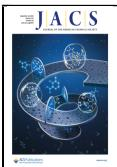
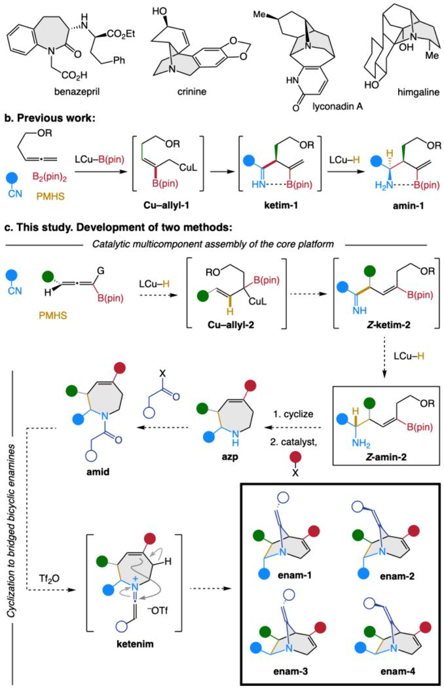
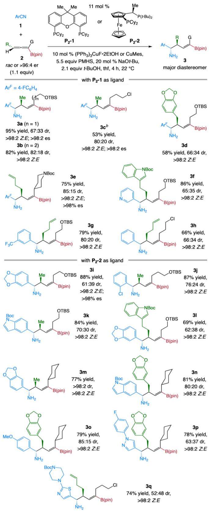
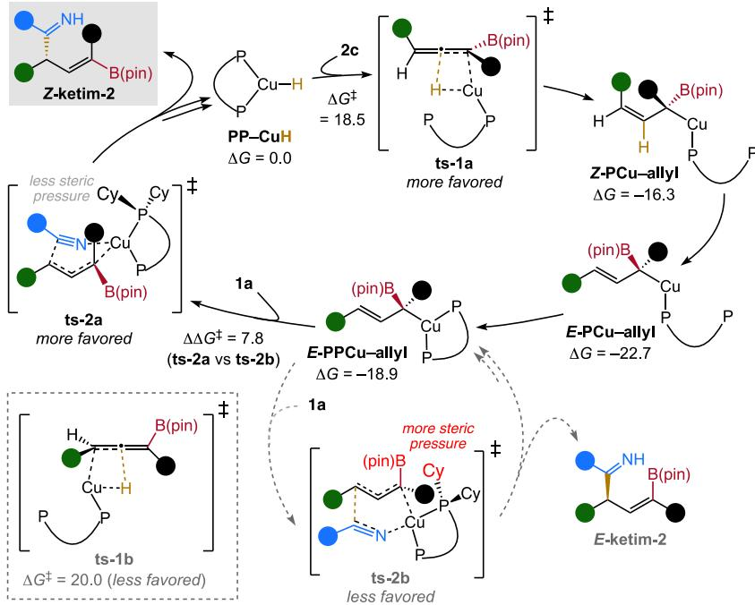
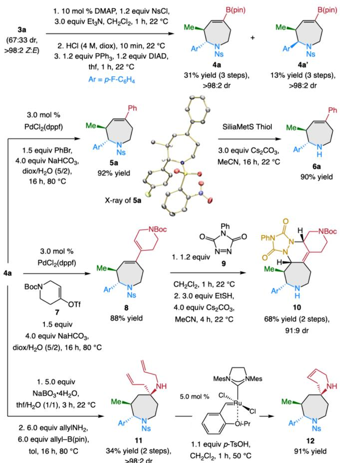
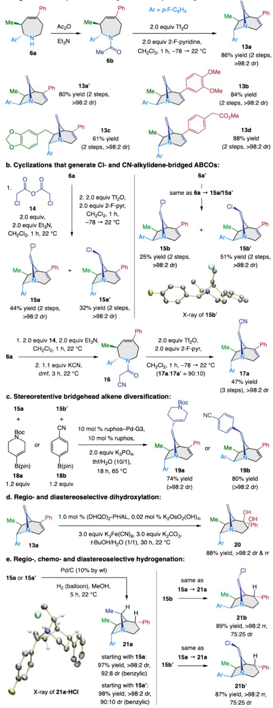

pubs.acs.org/JACS

# Diversity-Oriented Method Development: Multifunctional Homoallylic Amines and Azabicyclooctanes Bearing a Bridgehead Enamine

Zoé C. Mueller,# Ryan P. Ponzi,# Xin Zhi Sui, Peng Liu,\* and Amir H. Hoveyda\*

Cite This: J. Am. Chem. Soc. 2025, 147, 32335−32340

Read Online

ACCESS

Metrics & More

Article Recommendations

\*sı Supporting Information

ABSTRACT: Two methods, designed primarily for applications in diversity-oriented synthesis (DOS), are introduced. The first is a Cu−H-catalyzed multicomponent process that involves a nitrile and a trisubstituted allenyl boronate. The first set of products are homoallylic α-secondary NH -amines, containing a trisubstituted alkenyl boronate, formed with >98% enantiospecificity, in up to >98:2 dr and as a single alkene isomer (>98% Z). The second method is eficient and diastereoselective triflic anhydride-mediated conversion of an unsaturated azapane-amide, generated from modification of the products of the foregoing catalytic process to azabicyclooctanes (ABCOs). The ABCOs contain a bridged enamine moiety and a trisubstituted alkene, which can be functionalized chemo- and stereoselectively. Accordingly, natural product-like rigid bicyclic frameworks can be obtained wherein four diferent fragments can be installed in space in a controllable fashion.

like molecules are much sought after,1 a key example being diversity-oriented synthesis (DOS).2 However, DOS relies heavily on existing synthesis methods; consequently, certain types of frameworks tend to dominate the resulting compound collections.2c What is needed then are strategies that are designed specifically for applications in DOS.3 One way to achieve this is by generating natural product-like skeletons in which diferent moieties can be arranged controllably in the three-dimensional space. This would allow topological optimization of a molecule’s receptor binding.

In planning these studies, the inspiration came from azapenes (AZPs; Scheme 1a), exemplified by benazepril4 and the related azabicyclooctanes (ABCOs), such as crinine,5 lyconadin A6 and himgaline.7 We wanted to develop methods that can be used to generate stereochemically defined multifunctional compounds that, while possessing the same AZP or ABCO core framework, would be clearly distinct from any extant natural products. The first step would be a catalytic multicomponent reaction that afords a multifunctional core platform. A related transformation, reported previously, is promoted by a Cu−B(pin) and a Cu−H catalyst (Scheme 1b)8 and involves a nitrile and a monosubstituted allene (→ Cuallyl-1 → ketim-1 → amin-1). Here, we would have a chiral trisubstituted allenyl boronate (Scheme 1c) and a Cu−H catalyst9 would be involved in both C−C bond formation (→ Z-ketim-2) and ketimine reduction (→ Z-amin-2). Because the catalytic reaction would deliver a Z-trisubstituted alkenyl boronate (vs a 1,1-disubstituted boronate in the earlier report), we would be able to access AZPs via Z-amin-2 (azp; Scheme 1c). Ensuing amide formation (amid) and cyclization through a keteniminium salt (ketenim)10 by a Bischler−Napieralskitype cyclization would deliver ABCOs bearing a rarely encountered11 bridgehead enamine and a fourth stereodefined moiety (enam-1−4).

Our plan raised several questions. Compared to reactions with allenes bearing a single substituent, where a Cu−H complex adds to the less substituted site, the situation is more complex with a trisubstituted allenyl boronate. Although Cu− allyl-2 formation would be favored based on electronic stabilization,12 addition to the less substituted C�C would be less sterically demanding. It was also unclear to what degree stabilization of electron density12 by the boryl unit would impact the allyl-metal’s nucleophilicity, and whether it would be this initially formed species that would react with a nitrile, a transformation that, as far as we know, has no precedent, or a less substituted Cu−allyl complex. There would be no internal C�N→B chelation to facilitate Cu−H addition, and the ketimine would be more exposed and susceptible to a second Cu−allyl addition. 8 Furthermore, in view of the dynamic nature of Cu−allyl ,12 we did not know to what degree Z-amin-2 would be favored (vs E). It was also unclear how eficient and diastereoselective ketimine reduction would be without C� N→B coordination. However, the criteria are diferent when diversification is the primary objective (applicable to lead identification) as opposed to the more traditional selectivity/ target-oriented synthesis (relevant to process optimization). In the case of enantiospecific reactions, where both product enantiomers can be generated, high diastereoselectivity would not be required nor would it be necessarily advantageous as

## Scheme 1. Inspiration, Past Work and This Study

a. Representative bioactive azapenes and azabicyclooctanes:

this would diminish diversity. As long as the diastereomers are separable, pure stereodefined frameworks would be accessible.

The first step was investigation of the catalytic multicomponent reaction of 1a with 2a (Scheme 2), the latter accessed as racemate or in high enantiomeric purity.13 With $\left( \mathrm { P P h } _ { 3 } \right) _ { 3 } ($ CuF·2EtOH and Cy-Xantphos $( \mathbf { P } _ { 2 }  – \mathbf { 1 } ;$ identified by screening14), 3a was obtained in 95% yield, 67:33 dr and >98:2 Z:E with complete enantiospecificity (es). The catalytic process is scalable: 15 g of rac-2a was converted to 3a in 92% yield (same dr and $\breve { Z } { : } E ) . ^ { 1 4 }$ This finding confirmed that in the absence of $\mathrm { C } { = } \mathrm { N } {  } \mathrm { B }$ interaction, catalytic reduction is less diastereoselective. Furthermore, the Cu−allyl intermediate is reactive enough to add to a nitrile, despite electronic stabilization and high substitution of the $\mathrm { { a l l y l - C u } }$ which might also be why there is no further Cu−allyl addition to the ketimine.

Various aryl and heteroaryl nitriles and allenyl boronates can be used (Scheme 2). Several additional points merit note: (a) As our studies progressed, it became evident that $\mathbf { P } _ { 2 } { \boldsymbol { - } } \mathbf { 1 }$ is not always optimal. For example, there was 65−70% conversion to the desired product in the case of 3i−j and $4 0 { - } 4 5 \%$ for 3k and 3p. Rescreening led us to determine that ${ \bf P } _ { 2 } { \bf - } 2$ is the superior choice with the latter nitriles (no change in stereoselectivity). Thus, for instance, there was 93% and 87% conv to 3i and 3j (vs 69% and 43%).14 Although high (>98%) conversion can be

## Scheme 2. Catalytic Synthesis of Homoallylic Aminesa

aPerformed under $\mathrm { N } _ { 2 } .$ Conv (>98%), dr and Z:E by 1H NMR analysis. Enantiospecificity (es) by HPLC analysis. Data for 3a−e are with $\left( \mathrm { P P h } _ { 3 } \right)$ CuF·2EtOH; all others are with CuMes. Yield of purified products $( \pm 5 \% )$ . bPurified as the N-Ns derivative; the yield is for 2 steps. See the Supporting Information for details.

Scheme 3. Catalytic Cycle Supported by DFT Studiesa  
  
aCalculated for reaction of 1a and 2c with ${ \bf P } _ { 2 } { \bf - 1 }$ as the ligand at the M06/6-311+G(d,p)-SDD(Cu)/SMD(thf)//B3LYP-D3/6-31G(d)-SDD(Cu) level of theory; in kcal/mol. All Gibbs free energy values are with respect to PP−CuH. See the Supporting Information for details.

## Scheme 4. Synthesis and Modification of $\mathbf { A Z P s } ^ { a }$

generally obtained with CuMes, and this can be a better choice with heterocyclic nitriles (e.g., 3k−q), the CuF salt is less sensitive and easier to use, especially on a larger scale. (c) A homoallylic amine may contain one or more modifiable moieties; this includes a silyl ether $( \mathrm { e . g . } ,$ 3a and 3j), a heterocycle $( \mathbf { e . g . , 3 f , 3 k , 3 p - q } )$ , a terminal alkene (e.g., 3g and 3q), or an alkyl halide (e.g., 3c, 3h and 3q). (d) Reactions involving a Cy-substituted alkenyl boronate are at times more diastereoselective (e.g., 3m and 3o). The reason for variations in dr were probed by DFT studies14 and can be accounted for by a combination of steric and electrostatic factors; dr is not impacted by whether racemic or enantiomerically enriched allene is used.14 (e) DFT studies show that the catalytic cycle starts with addition of PPCu−H to the allene via ts-1a (Scheme 3) in preference to ts-1b that would aford a less electronically stabilized organocopper species.14 The resulting Z-PCu−allyl can rapidly isomerize to E-PCu−allyl and then E-PPCu−allyl (minimal barriers15). E-PPCu−allyl reacts with a nitrile to generate Z-ketim-2 via ts-2a with high enantiospecificity (vs ts-2b → E-ketim-2; $\Delta \Delta G ^ { \ddagger } = 7 . 8$ kcal/ mol). Further mechanistic investigations designed to elucidate the origin of such variations are in progress. The insight gained from these studies might allow for an expanded scope as, thus far, we have been unable to efect additions to an alkyl nitrile (<2% conv).

Homoallylic amines were converted to AZPs in three straightforward steps (Scheme 4). Preparation of Ns-protected AZPs 4a (31% yield, >98:2 dr) and 4a′ (13% yield, >98:2 dr) is illustrative. This reaction was performed on 15 g of 3a with similar eficiency and selectivity.14 The product isomers can be separated by silica gel chromatography or recrystallization.14 With 4a as a model substrate, cross-coupling aforded 5a (92% yield), the X-ray structure of which confirmed its identity. Deprotection aforded cyclic amine 6a (90% yield). Reaction with triflate 7 gave diene 8 (88% yield). Cycloaddition of 8 and 9 and deprotection furnished tetracyclic amine 10 in 68% yield (2 steps) and 91:9 dr. Oxidation of 4a and subjection of the resulting ketone to allylamine and $\mathrm { { a l l y l - B } } ( \mathrm { { p i n } } ) ^ { 1 6 }$ delivered 11 in 34% yield17 (2 steps) and >98:2 dr; ring-closing metathesis aforded spiro-cycle 12 in 91% yield.

  
aPerformed under $\mathrm { N } _ { 2 } .$ Conv (>98%) and dr by 1H NMR analysis. Yield of purified products (±5%). See the Supporting Information for details.

We then probed the feasibility of AZP to ABCO conversion (Scheme 1c). Treatment of amide 6b (Scheme 5a) with 2.0 equiv Tf O and 2-F-pyridine in $\mathrm { C H } _ { 2 } \mathrm { C l } _ { 2 }$ starting $\mathrm { a t ~ - 7 8 ~ ^ { \circ } C }$ followed by warming to $2 2 { \ } ^ { \circ } \mathrm { C } \ ( 1 \ \mathrm { h } )$ , led to the formation of 13a in 86% yield (2 steps) and >98:2 dr; 13a′ and $\mathbf { 1 3 b - d } ,$ were synthesized similarly. A more eficient approach to synthesis of ABCOs is by cyclizing the AZP as a diastereomeric mixture (e.g., with 4a+4a′ isolated in 65% yield) and obtaining the more easily separable derived tertiary stereochemically pure bicyclic enamines.16 Cyclizations were less eficient with electron-deficient and sterically hindered alkenyl substituents, likely because of the insuficient stability of the carbocation intermediates. Thus, reaction of o-tolyl- and $p { \mathrm { - C F } } _ { 3 } { \mathrm { - p h e n y l - } }$ substituted AZP aforded only ∼30% of the corresponding ABCOs (∼70% unidentifiable byproducts owing to inadequate cation stabilization).14 The bridgehead enamine was modified with diferent acylating agents. An example is the conversion of 6a to the derived α-Cl-amide (Scheme 5b), the cyclization of which aforded separable 15a and ${ \bf 1 5 a ^ { \prime } }$ in 44% and 32% yield, respectively. Bridged bicyclic enamines 15b and $\mathbf { 1 5 b ^ { \prime } }$ were synthesized similarly. The X-ray structure of $\mathbf { 1 5 b ^ { \prime } }$ supports the structural assignments. Simple modification of the synthesis route, via α-cyano amide 16, furnished nitrile-substituted bridged enamine 17a with 90:10 E:Z selectivity (17a:17a′) and >98:2 dr in 47% yield (3 steps). By synthesizing ${ \bf 1 3 a - d , }$ we were able to generate ABCOs bearing three moieties with diferent spatial orientations. In the case of $\mathbf { 1 5 a - b } ,$ a fourth moiety was incorporated through cross-coupling at the bridgehead alkenyl chloride. The conversion of 15a and 15b′ to 19a and 19b is illustrative (Scheme 5c). Another ABCO feature is the presence of sterically and electronically diferentiable alkenes, functionalization of which would enhance the 3D character and stereodiversity of the ABCOs. Regio- and diastereoselective dihydroxylation18 of 13a to generate 20 is a representative case (Scheme 5d), which underscores the twisted enamine’s electron-deficient character. Hydrogenation/dehalogenation of 15a or ${ \bf 1 5 a ^ { \prime } }$ (Scheme 5e), bearing an endoaryl group, aforded 21a eficiently in >98:2 dr (aryl olefin) and 92:8 and $9 0 { : } 1 0$ dr (alkenyl chloride). The X ray structure of the 21a·HCl salt confirmed product identity. The same reduction with 15b and 15b′, bearing an exoaryl group, was regioselective: only the endocyclic alkene was reduced, afording 21b and ${ \bf 2 1 6 ^ { \prime } }$ in 89% and 87% yield, respectively, and 75:25 dr. These enamines resist reduction, likely because the exo aryl moiety would engender severe steric repulsion if the alkene were to be hydrogenated.

In closing, two methods are introduced for potential DOS applications. The first is a catalytic enantiospecific and diastereoselective multicomponent process that generates the core platform: homoallylic amines containing a stereodefined trisubstituted alkenyl boronate. The second is a $\mathrm { T f } _ { 2 } \mathrm { O }$ -mediated cyclization that converts the derived AZPs to $_ \mathrm { A B C O s }$ bearing a twisted bridgehead enamine. Assorted chiral N-containing frameworks can thus be synthesized in which up to four fragments can be controllably positioned in space. Unlike studies related to $\mathrm { C } \big ( \mathrm { s p } ^ { 3 } \big )$ -rich phenyl bioisosteres,19 the frameworks generated here are not replacement skeletons with moieties that are positioned the same way as the parent systems. Instead, the resulting compounds are new stereo-

## Scheme 5. ABCO Synthesis and Modificationsa

a. Tf2O-Promoted cyclizations that generate methylene-bridged ABCOs:

## Scheme 5. continued

aPerformed under N . Conv (>98%) and dr by 1H NMR analysis. Yield of purified products (±5%). See the Supporting Information for details. rr, regioisomeric ratio.

defined constructs. For the viewpoint of target-oriented synthesis, a multicomponent transformation that is more generally diastereoselective would be desirable. This would probably require identification of a Cu−H complex that can not only promote the C−C bond forming but also promote eficient ketimine reduction with greater control of facial selectivity.

## ■ ASSOCIATED CONTENT

## \*sı Supporting Information

The Supporting Information is available free of charge at https://pubs.acs.org/doi/10.1021/jacs.5c09730.

Part 1: Analytical, experimental, and computational data (PDF)

Part 2: NMR spectra (PDF)

## Accession Codes

Deposition Numbers 2448387−2448388 and 2448403 contain the supplementary crystallographic data for this paper. These data can be obtained free of charge via the joint Cambridge Crystallographic Data Centre (CCDC) and Fachinformationszentrum Karlsruhe Access Structures service.

## ■ AUTHOR INFORMATION

## Corresponding Authors

Peng Liu − Department of Chemistry, University of Pittsburgh, Pittsburgh, Pennsylvania 15260, United States; orcid.org/ 0000-0002-8188-632X; Email: pengliu@pitt.edu

Amir H. Hoveyda − Department of Chemistry, Boston College, Merkert Chemistry Center, Chestnut Hill, Massachusetts 02467, United States; Supramolecular Science and Engineering Institute, University of Strasbourg, CNRS, 67000 Strasbourg, France; orcid.org/0000-0002-1470-6456; Email: amir.hoveyda@bc.edu, ahoveyda@unistra.fr

## Authors

Zoé C. Mueller − Department of Chemistry, Boston College, Merkert Chemistry Center, Chestnut Hill, Massachusetts 02467, United States

Ryan P. Ponzi − Department of Chemistry, Boston College, Merkert Chemistry Center, Chestnut Hill, Massachusetts 02467, United States

Xin Zhi Sui − Department of Chemistry, Boston College, Merkert Chemistry Center, Chestnut Hill, Massachusetts 02467, United States; orcid.org/0000-0001-7435-2381

Complete contact information is available at: https://pubs.acs.org/10.1021/jacs.5c09730

## Author Contributions

#Z.C.M. and R.P.P. contributed equally.

## Notes

The authors declare no competing financial interest.

## ■ ACKNOWLEDGMENTS

This work was financially supported by the NIH (R35 GM-128779 to P.L. and GM-130395 to A.H.H.). The NMR facility at Boston College is supported by the NSF (CHE-2117246)

and the NIH (1S10OD026910-01A1). The X-ray crystallography facility at Boston College is supported by the NIH (S10 grant S10OD030360); we are grateful to Dr. B. Li for assistance in securing the X-ray structures. Computational calculations were performed at the University of Pittsburgh Center for Research Computing and the Advanced Cyberinfrastructure Coordination Ecosystem: Services & Support (ACCESS) program, supported by NSF award numbers OAC-2117681, OAC-1928147, and OAC-1928224. We thank F. Romiti, S. Xu, and X. Li for helpful discussions and suggestions.

## ■ REFERENCES

(1) Gerry, C. J.; Schreiber, S. L. Chemical probes and drug leads from advances in synthetic planning and methodology. Nat. Rev. Drug. Discovery 2018, 17, 333−352.

(2) For discussion regarding, and studies related to, the original concept of DOS, see: (a) Schreiber, S. L. Target-oriented and diversity-oriented organic synthesis in drug discovery. Science 2000, 287, 1964−1969. (b) Gerry, C. J.; Schreiber, S. L. Recent achievements and current trajectories of diversity-oriented synthesis. Curr. Opin. Chem. Biol. 2020, 56, 1−9. (c) Galloway, W. R. J. D.; Isidro-Llobet, A.; Spring, D. R. Diversity-oriented synthesis as a tool for discovery of novel biologically active small molecules. Nat. Commun. 2010, 1, 80. For DOS based on “privileged” structures (pDOS), see: (d) Kim, J.; Kim, H.; Park, S. B. Privileged structures: effective chemical “navigators” toward unexplored biologically relevant chemical spaces. J. Am. Chem. Soc. 2014, 136, 14629− 14638. For the related biology-oriented synthesis (BiOS), see: (e) Karageorgis, G.; Foley, D. J.; Laraia, L.; Waldmann, H. Principle and design of pseudo-natural products. Nat. Chem. 2020, 12, 227− 235.

(3) Huang, Y.; Li, X.; Mai, B. K.; Tonogai, E. J.; Smith, A. J.; Hergenrother, P. J.; Liu, P.; Hoveyda, A. H. A catalytic process enables efficient and programmable access to precisely altered indole alkaloid scaffolds. Nat. Chem. 2024, 16, 1003−1014.

(4) Hou, F. F.; Zhang, X.; Zhang, G. H.; Xie, D.; Chen, P. Y.; Zhang, W. R.; Jiang, J. P.; Liang, M.; Wang, G. B.; Liu, Z. R.; Geng, R. W. Efficacy and safety of benazepril for advanced chronic renal insufficiency. N. Engl. J. Med. 2006, 354, 131−140.

(5) Jin, Z.; Yao, G. Amaryllidaceae and Sceletium alkaloids. Nat. Prod. Rep. 2019, 36, 1462−1488.

(6) Ma, X.; Gang, D. R. The Lycopodium alkaloids. Nat. Prod. Rep. 2004, 21, 752−772.

(7) Mander, L. N.; Prager, R. H.; Rasmussen, M.; Ritchie, E.; Taylor, W. C. The chemical constituents of Galbulimima species X. The structure of himgaline. Aust. J. Chem. 1967, 20, 1705−1718.

(8) Zhang, S.; del Pozo, J.; Romiti, F.; Mu, Y.; Torker, S.; Hoveyda, A. H. Delayed catalyst function enables direct enantioselective conversion of nitriles to NH -amines. Science 2019, 364, 45−51.

(9) For reviews on Cu−H-catalyzed processes, see: (a) Liu, R. Y.; Buchwald, S. L. CuH-catalyzed olefin functionalization: from hydroamination to carbonyl addition. Acc. Chem. Res. 2020, 53, 1229−1243. (b) Dherbassy, Q.; Manna, S.; Talbot, F. J. T.; Prasitwatcharakorn, W.; Perry, G. J. P.; Procter, D. J. Coppercatalyzed functionalization of enynes. Chem. Sci. 2020, 11, 11380− 11393.

(10) Movassaghi, M.; Hill, M. D. A versatile cyclodehydration reaction for the synthesis of isoquinoline and β-carboline derivatives. Org. Lett. 2008, 10, 3485−3488.

(11) (a) Bender, D. R.; Coffen, D. L. Synthetic quinine analogs. The synthesis and some chemical transformations of 6′-methoxy-7-oxo-8- rubene. J. Org. Chem. 1968, 33, 2504−2509. (b) Nielsen, A. R. Systems with bridged nitrogen. B-ketols of the 1-azabicyclo[2.2.2]- octane series. J. Org. Chem. 1966, 31, 1053−1059. (c) Warawa, E. J.; Campbell, J. R. Quinuclidine chemistry. I. Configuration and chemistry of 2-substituted benzylidene-3-quinuclidinones. J. Org. Chem. 1974, 39, 3511−3516. (d) Kirby, A. J.; Komarov, I. V.; Feeder,

N. J. Chem. Soc., Perkin Trans. 2 2001, 522−529. (e) Crawley, S. L.; Funk, R. L. Generation of Aza-ortho-xylelenes via ring opening of 2- (2-acylaminophenyl)aziridines: application in the construction of the communesin ring system. Org. Lett. 2006, 8, 3995−3998. (f) Szostak, M.; Yao, L.; Aube, J. Proximity effects in nucleophilic addition reactions to medium-bridged twisted lactams: remarkably stable tetrahedral intermediates. J. Am. Chem. Soc. 2010, 132, 2078−2084.

(12) (a) Sun, Y.; Zhou, Y.; Shi, Y.; del Pozo, J.; Torker, S.; Hoveyda, A. H. Copper−hydride-catalyzed enantioselective processes with allenyl boronates. Mechanistic nuances, scope, and utility in targetoriented synthesis. J. Am. Chem. Soc. 2019, 141, 12087−12099. (b) Wheatley, E.; Zanghi, J. M.; Mason, M. M.; Meek, S. J. A catalytic method for the enantioselective synthesis of α-quaternary ketones, α- ketoesters and aldehydes. Angew. Chem., Int. Ed. 2023, 62, No. e202215855.

(13) Enantiomerically enriched allenyl−B(pin) substrates were prepared by boryl substitution involving propargyl carbonates. See the Supporting Information for details.

(14) See the Supporting Information for details.

(15) (a) Yuan, Y.; Zhang, X.; Qian, H.; Ma, S. Catalytic enantioselective allene−anhydride approach to b,g-unsaturated enones bearing an α-all-carbon quaternary stereogenic center. Chem. Sci. 2020, 11, 9115−9121. (b) Dong, Y.; Shin, K.; Mai, B. K.; Liu, P.; Buchwald, S. L. Copper hydride−catalyzed enantioselective olefin hydrometallation. J. Am. Chem. Soc. 2022, 144, 16303−16309.

(16) (a) Wright, D. L.; Schulte, J. P., II; Page, M. A. An imine addition/ring-closing metathesis approach to the spirocyclic core of halichlorine and pinnaic acid. Org. Lett. 2000, 2, 1847−1850. (b) Gracias, V.; Gasiecki, A. F.; Moore, J. D.; Akritopoulou-Zanze, I.; Djuric, S. W. An expedient route to diaza-spirocycles utilizing a sequential multicomponent α-aminoallylation/ring-closing metathesis strategy. Tetrahedron Lett. 2006, 47, 8977−8980.

(17) The relatively low yield is due to sensitivity of 11 to silica gel. (18) (a) Kolb, H. C.; VanNieuwenhze, M. S.; Sharpless, K. B. Catalytic asymmetric dihydroxylation. Chem. Rev. 1994, 94, 2483− 2574. (b) Heravi, M. M.; Zadsirjan, V.; Esfandyari, M.; Lashaki, T. B. Applications of Sharpless asymmetric dihydroxylation in the total synthesis of natural products. Tetrahedron Asymm. 2017, 28, 987− 1043.

(19) For selected reviews, see: (a) Subbaiah, M. A. M.; Meanwell, N. A. Bioisosteres of the phenyl ring: recent strategic applications in lead optimization and drug design. J. Med. Chem. 2021, 64, 14046−14128. (b) Tsien, J.; Hu, C.; Merchant, R. R.; Qin, T. Three-dimensional saturated C(sp3)-rich bioisosters for benzene. Nat. Rev. Chem. 2024, 8, 605−627. (c) Koo, Y.; Jeong, J.; Hong, S. Recent advances in catalytic asymmetric transformations of bicyclobutane: a versatile building block for enantiopure bioisosteric molecules. ACS Catal. 2025, 15, 8078−8093.