pubs.acs.org/JACS

Communication

# Ruthenium-Catalyzed Intermolecular [2 + 2] Cycloaddition of Unactivated Allenes and Alkynes with Unusual Regioselectivity

Chaoshen Zhang, Herman H. Y. Sung, Ian D. Williams, Yun-Dong Wu,\* and Jianwei $\operatorname { S u n } ^ { * }$

Cite This: J. Am. Chem. Soc. 2025, 147, 33350−33358

Read Online

ACCESS

Metrics & More

Article Recommendations

\*sı Supporting Information

ABSTRACT: Described here is an eficient protocol for intermolecular $[ 2 + 2 ]$ cycloaddition of unactivated and unsymmetrical allenes and alkynes with unusual regioselectivity, counterintuitively favoring the most hindered isomer. $\mathrm { C p R u } ( \mathrm { M e C N } ) _ { 3 } \mathrm { P F } _ { 6 }$ served as a uniquely efective catalyst, providing diverse 3-alkylidenecyclobutenes with a broad scope and good functional group compatibility. Both experiments and DFT studies provided important insights into the mechanism, particularly the unusual regioselectivity.

Alkylidenecyclobutene and related four-membered carbo- cycles are unique substructures present in diverse natural and bioactive molecules.1 Owing to the high ring strain and two reactive C = C bonds, they also have broad applications in organic synthesis.2 The $[ 2 + \dot { 2 } ]$ cycloaddition of allenes3 and alkynes4 represents arguably the most direct approach to access 3-alkylidenecyclobutenes (Scheme 1a).5−9 However, both allenes and alkynes have reactive π-systems that can undergo homo- and cross- $[ 2 ~ + ~ 2 ]$ and $[ 2 ~ + ~ 2 ~ + ~ 2 ]$ cycloadditions, with the latter leading to more stable 6- membered (often aromatic) products.10,11 Moreover, for terminal alkynes, hydroalkynylation of allenes is another wellknown process, which may lead to multiple regio- and stereoisomers.12,13 Therefore, the chemoselective generation of a highly strained cross-[2 + 2] cycloadduct among so many thermodynamically favorable pathways represents a formidable challenge. Consequently, although this process has been known for over a half century, limited success has been achieved regarding substrate generality, eficiency, regioselectivity, and mild conditions. If fact, current success has been largely limited to activated substrates (e.g., electron-rich allenes and electron-poor alkynes)6 and/or intramolecular processes, where the electronic bias or geometric constraints help simplify the complications.

Indeed, there has been almost no progress in developing eficient intermolecular $[ 2 ~ + ~ 2 ]$ cycloadditions between unactivated allenes and alkynes.8,9 Moreover, when both allenes and alkynes are unsymmetrical but lack electronic bias, controls over regioselectivity are required, which constitutes another substantial challenge (Scheme 1b). Among the four possible isomers, the $\beta 2 \dot { - } \gamma 1$ adduct is least hindered, whereas the α1-β2 adduct contains all the bulky groups in proximity and is least favored (Scheme 1b). In 2019, the Yoshikai laboratory pioneered an eficient protocol favoring the least hindered $\beta 2 \mathfrak { - } \gamma 1$ adduct using cobalt catalysis. 8b Though limited to internal alkynes and with moderate regioselectivity for unsymmetrical cases, this represents an important milestone for unactivated substrates in an intermolecular reaction. In contrast, selective formation of other isomers is more challenging. In continuation of our eforts in alkyne and allene functionalization,13,14 here we report our progress by developing such a mild eficient with excellent regioselectivity favoring the most hindered (α1−β2) isomer (Scheme 1c).

We employed allene 1a and terminal alkyne 2a as the model substrates. Ruthenium complexes were examined as catalysts, as they are known for alkyne/allene functionalization with unorthodox selectivity. $^ { 1 3 - 1 5 ^ { \circ } } [ \mathrm { C p } ^ { \ast } \mathrm { R u C l } ] _ { 4 } ,$ previously used for α-selective hydrofucntionalization of allenes,13 was unable to catalyze the desired $[ 2 + 2 ]$ cycloaddition (Table 1, entry 1). Other complexes, including $\mathrm { \dot { C } p ^ { * } R u ( c o d ) C l } _ { \mathrm { \scriptsize { 1 } } }$ Ru $\mathrm { ( P P h } _ { 3 } ) _ { 3 } \mathrm { C l } _ { 2 } ,$ and $\mathrm { C p R u ( c o d ) C l } _ { \mathrm { \AA } }$ , did not provide the desired product either (entries 2−4). Next, we resorted to $\mathrm { C p ^ { * } R u ( \bar { M } e C N ) _ { 3 } P F _ { 6 } , \Delta _ { \ Z } }$ cationic complex known for alkyne trans-addition.14,15 Encouragingly, the desired $[ 2 + 2 ]$ cycloadduct 3a was formed, albeit in low yield (entry 5). More importantly, only the most hindered α1-β2 regioisomer was observed (>20:1 rr). We believe that the cationic nature of the metal center combined with weak ligands contributed significantly to the high activity by facilitating ligand exchange and substrate binding. We then evaluated the less hindered complex $\mathrm { C p R u } ( \mathrm { M e C N } ) _ { 3 } \mathrm { P F } _ { 6 } ,$ which significantly improved the chemoselectivity and yield (78% yield, entry 6). The same reaction provided much lower eficiency in other solvents (e.g., halogenated or polar solvents) than THF (entries 7−11). However, increasing the concentration to 0.1 M improved the yield (entry 12), but no improvement was observed by further increasing the concentration (entry 13). The sensitivity to concentration might be related to some competing side reactions that may have diferent kinetic dependence on substrates. For comparison, the reaction did not proceed in the absence of a catalyst, thus confirming the essential role of the ruthenium (c) This work: Ru-catalyzed regioselective formation of the most hinderded isomer

Scheme 1. Introduction to [2 + 2] Cycloaddition of Allenes and Alkynes (a) Current state of [2+2] cycloaddition of allenes and alkynes  
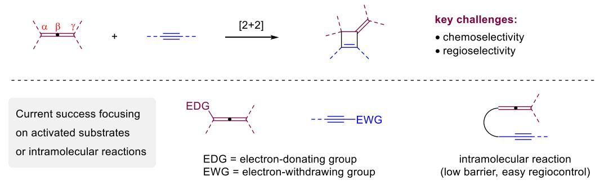

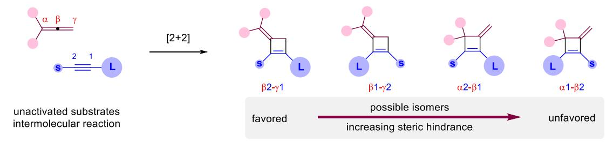

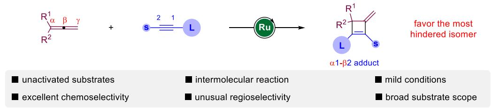

Table 1. Condition Optimization  
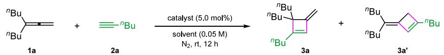

<table><tr><td>entry</td><td>catalyst</td><td>solvent</td><td>conv  $\left( \% \right) ^ { b }$ </td><td>yield  $\left( \% \right) ^ { b }$ </td><td> ${ 3 \mathbf { a } } / { 3 \mathbf { a } ^ { \prime } } ^ { b }$ </td></tr><tr><td>1</td><td> $[ \mathrm { C p } ^ { \ast } \mathrm { R u C l } ] _ { 4 }$ </td><td>THF</td><td>67</td><td>0</td><td>一</td></tr><tr><td>2</td><td> $\mathrm { C p } ^ { * } \mathrm { R u } ( \mathrm { c o d } ) \mathrm { C l }$ </td><td>THF</td><td>68</td><td>0</td><td>一</td></tr><tr><td>3</td><td> $\mathrm { R u } ( \mathrm { P P h } _ { 3 } ) _ { 3 } \mathrm { C l } _ { 2 }$ </td><td>THF</td><td>24</td><td>0</td><td>一</td></tr><tr><td>4</td><td> $\mathrm { C p R u ( c o d ) C l }$ </td><td>THF</td><td>46</td><td>0</td><td>一</td></tr><tr><td>5</td><td> $\mathrm { C p ^ { * } R u ( M e C N ) } _ { 3 } \mathrm { P F } _ { 6 }$ </td><td>THF</td><td>&gt;99</td><td>36</td><td>&gt;20:1</td></tr><tr><td>6</td><td> $\mathrm { C p R u ( M e C N ) } _ { 3 } \mathrm { P F } _ { 6 }$ </td><td>THF</td><td>&gt;99</td><td>78</td><td>&gt;20:1</td></tr><tr><td>7</td><td> $\mathrm { C p R u ( M e C N ) } _ { 3 } \mathrm { P F } _ { 6 }$ </td><td>EtOAc</td><td>&gt;99</td><td>28</td><td>&gt;20:1</td></tr><tr><td>8</td><td> $\mathrm { C p R u ( M e C N ) } _ { 3 } \mathrm { P F } _ { 6 }$ </td><td>DCM</td><td>38</td><td>0</td><td>一</td></tr><tr><td>9</td><td> $\mathrm { C p R u ( M e C N ) } _ { 3 } \mathrm { P F } _ { 6 }$ </td><td>DMF</td><td>&gt;99</td><td>46</td><td>7:4</td></tr><tr><td>10</td><td> $\mathrm { C p R u ( M e C N ) } _ { 3 } \mathrm { P F } _ { 6 }$ </td><td>PhCl</td><td>&gt;99</td><td>20</td><td>4:1</td></tr><tr><td>11</td><td> $\mathrm { C p R u ( M e C N ) } _ { 3 } \mathrm { P F } _ { 6 }$ </td><td>MeCN</td><td>&gt;99</td><td>68</td><td>&gt;20:1</td></tr><tr><td> $1 2 ^ { c }$ </td><td> $\mathrm { C p R u ( M e C N ) } _ { 3 } \mathrm { P F } _ { 6 }$ </td><td>THF</td><td>&gt;99</td><td>89</td><td>&gt;20:1</td></tr><tr><td> $1 3 ^ { d }$ </td><td> $\mathrm { C p R u ( M e C N ) } _ { 3 } \mathrm { P F } _ { 6 }$ </td><td>THF</td><td>&gt;99</td><td>78</td><td>&gt;20:1</td></tr><tr><td>14</td><td></td><td>THF</td><td>0</td><td></td><td></td></tr></table>

a1a (0.05 mmol), 2a (0.07 mmol), catalyst (5.0 mol % based on metal), solvent (1.0 mL). bDetermined by 1H NMR analysis of the crude product with $\mathrm { C H } _ { 2 } \mathrm { B r } _ { 2 }$ as an internal standard. $^ { c } c = 0 . 1$ M, $6 \mathrm { ~ h . ~ } ^ { d } c = 0 . 2 \mathrm { ~ M , ~ } 6 \mathrm { ~ \overset { . } { h } ~ }$

catalyst (entry 14). Notably, this catalytic process proceeded eficiently at room temperature, which is remarkable since almost all previous reported cases required an elevated temperature, including intramolecular ones or activated substrates.6−8 Other competing reactions, including hydroalkynylation and allene dimerization, were inhibited under the present conditions.

Scheme 2. Scope of Alkynesa  
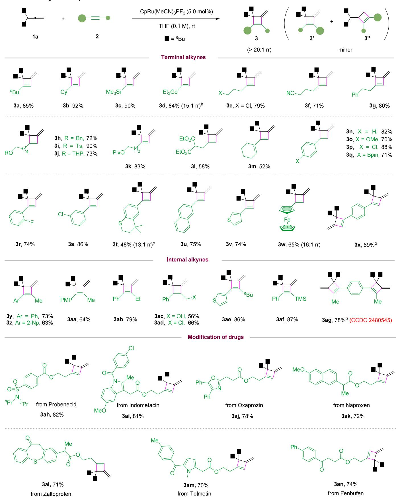  
a1a (0.30 mmol), 2 (0.42 mmol), CpRu $( \mathrm { M e C N } ) _ { 3 } \mathrm { P F } _ { 6 }$ (5.0 mol %), THF (3.0 mL), 6−12 h. Isolated yield, >20:1 rr. ${ } ^ { b } 0 \ { } ^ { \circ } { \bf C } ,$ 8 h. c10 mol % of catalyst, 12 h. d1a (0.72 mmol), 2x or 2ag (0.30 mmol). $\mathrm { P M P } = \bigl ( p { \mathrm { - O M e } } \bigr ) \mathrm { C } _ { 6 } \mathrm { H } _ { 4 } .$

Next, we examined the alkyne scope (Scheme 2). Various terminal alkynes substituted with alkyl-, alkenyl-, and arylgroups all eficiently reacted smoothly to furnish the corresponding cyclobutenes, favoring the hindered isomer with exceptional regioselectivity (3a−3w). The mild conditions tolerated diverse functional groups, including silyl, germanyl, halide, nitrile, (thio)ether, mesyl, acetal, ketone, ester and even free alcohol. Electron-rich aryl acetylenes also showed good reactivity, although they are known to deactivate the catalyst by π-coordination. 1,4-Diethynylbenzene underwent double cycloaddition successfully (3x). This protocol was also applicable to internal alkynes, maintaining the unusual excellent regioselectivity (3y−3ag). Complex alkynes derived from active pharmaceutical molecules also reacted with equally high eficiency. Of note, some products were generated in low yield (e.g., 3l, 3m, 3ac) due to oligomerization of the alkyne partne r,10a−c,11d,e but the regioselectivity remained excellent in these reactions. The low yield of 3t might be related to the thioether motif that may deactivate the catalyst. The structure of 3ag was unambiguously confirmed by X-ray crystallography. 2D NMR and NOE studies were also performed on other representative products.

Regarding the generality of allenes, both monosubstituted and 1,1-disubstituted allenes with aryl and alkyl groups all led to the desired products (4a−4m) with moderate to good eficiency and excellent regioselectivity (Scheme 3). Increasing the size of the substituents (4k−4m) had no detrimental efect.

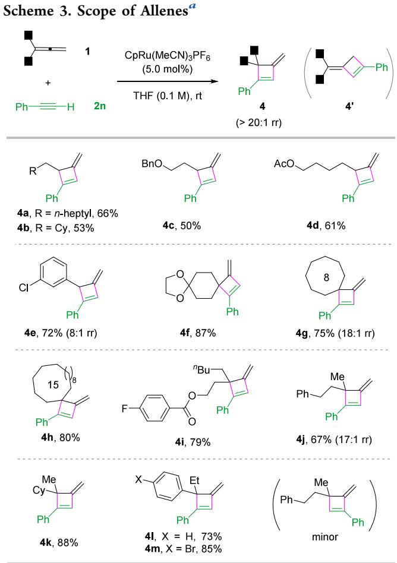  
a1 (0.3 mmol), 2n (0.42 mmol), CpRu(MeCN) PF (5.0 mol %), THF (3.0 mL), 6 h. Isolated yield. >20:1 rr.

Such hindered products were not easily accessible by conventional methods. Moderate yields were observed for some monosubstituted allenes (e.g., 4a−4d), presumably due to substrate dimerization/oligomerization.10d,11 We also tried di-, tri-, and tetrasubstituted internal allenes, but no desired [2 + 2] cycloaddition products were obtained (see the SI for details).

This protocol is robust for scale-up synthesis. With only 1 mol % of catalyst, a 2 mmol reaction of 1a and 2n aforded 3n in 80% yield (Scheme 4). The product could be further

Scheme 4. Scale-up Reaction and Product Transformation  
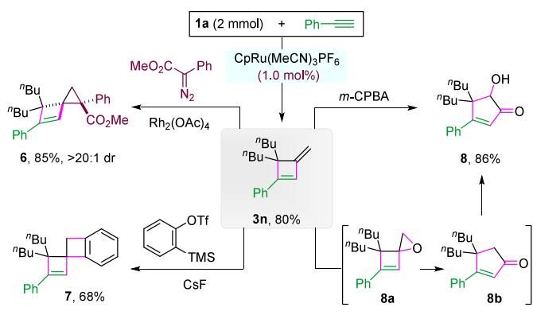

functionalized. For example, the exocyclic olefin reacted with in situ generated Rh-carbene and benzyne to form spiro cyclopropane 6 (>20:1 dr) and double cyclobutene 7, respectively. Interestingly, m-CPBA promoted an oxidative rearrangement to form cyclopentenone 8, likely via epoxide 8a followed by House−Meinwald Rearrangement to 8b and a Rubottom oxidation.

Control experiments and kinetic studies were performed to help understand the mechanism (Figure 1). The reaction of 1e with deuterated phenylacetylene aforded 4d-d with complete D-incorporation at the same carbon without scrambling (Figure 1a). Moreover, a mixture of two diferent aryl alkynes, one of which was deuterated, resulted in a mixture without intermolecular deuterium crossover. These observations suggested that the cleavage of C(sp)−H bond may not be involved, thus distinct from allene hydroalkynylation.12,13 To know more about the relationship between regioselectivity and the alkyne size, we made a plot between the observed regioisomeric ratio (rr) and the A-value of the alkyne substituent. In fact, a reverse linear relationship was observed (Figure 1b), suggesting that the bulkier alkyne tends to give a lower regioisomeric ratio (e.g., rr = 2 for tBu group, more details in the SI).

Kinetic studies were performed. This reaction exhibits zeroth order in allene 1a and alkyne 2a, and first order in catalyst (Figure 1c), implying that the catalyst might be saturated by the two substrates by forming a stable complex, serving as the catalyst resting state before the rate-determining step.

DFT Studies. To shed more light on the mechanism, density functional theory (DFT) calculations were performed using the model reaction of 1a and 2a. All energies discussed are relative Gibbs free energies at room temperature in kcal/ mol (see the SI for details). As shown in Figure 2, the reaction starts with ligand exchange to form complex C-IM1a, which is slightly endothermic. Next, oxidative cyclometalation occurs to form a ruthenacyclopentene. There are 8 permutations regarding which double bond in allene to participate and the orientations of each partner. Among them, C-TS1a is least hindered and has the lowest energy (15.5 kcal/mol, Figure 2a). In contrast, A-TS1a, seemingly leading to the observed product, has the highest energy (29.3 kcal/mol). While this step can be a pre-equilibrium and not regio-determining, it is unlikely for this process to proceed via A-TS1a considering the high eficiency at room temperature.

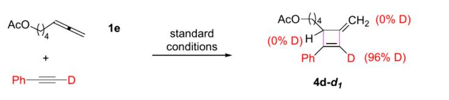

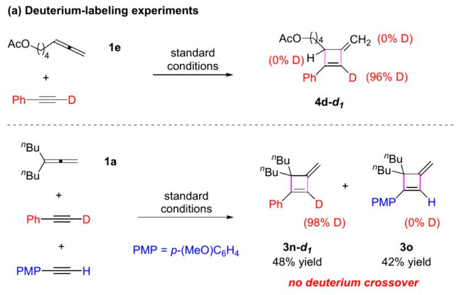

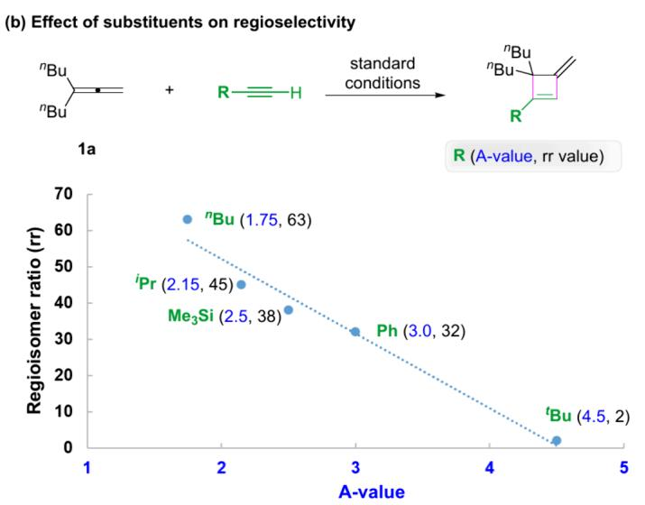  
Figure 1. Control experiments and kinetic studies.

Next, we investigated the subsequent steps from C-TS1a. Notably, by adopting a π-allyl complexation form, the resulting C-IM2a gains additional stabilization. Structural analysis showed that the dihedral angle between $\mathrm { C } _ { \alpha } . . \mathrm { C } _ { \beta }$ bond and the Ru-attached C�C bond is almost perpendicular (83.0°) in C-IM2a. Unfortunately, direct reductive elimination is kineti cally inaccessible, with a barrier as high as 38.6 kcal/mol (C-TS2a′ relative to C-IM2a, see Figure S13 for details). Nevertheless, upon dissociation of a ligand, C-IM2a gains substantial stabilization by forming C-IM3a (Figure S14) after crossing a low barrier of 12.9 kcal/mol via C-TS2a. The detailed intrinsic reaction coordinate (IRC) calculations indicated that the above-mentioned dihedral angle gradually decreases to $3 3 . 6 ^ { \circ }$ in this step, with the vinyl ruthenium approaching toward $\mathrm { C } _ { \alpha }$ but the Cp ligand moving away (Figure S15). This sets the stage for a facile reductive elimination at $\mathrm { C } _ { \alpha }$ to form C-IM4a, which then releases the observed product 3a. Notably, the rate-determining step is reductive elimination with a total barrier of 17.9 kcal/mol, in agreement with the mild conditions. Moreover, C-IM3a is a stable resting state, in which the catalyst is saturated by the two substrates, thus consistent with the kinetic results showing pseudo zeroth order in both allene and alkyne.

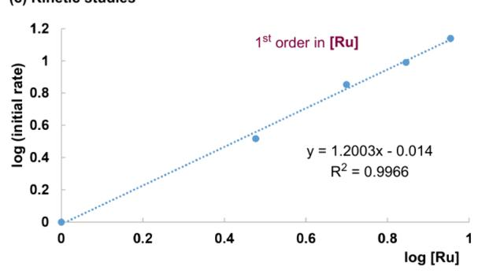

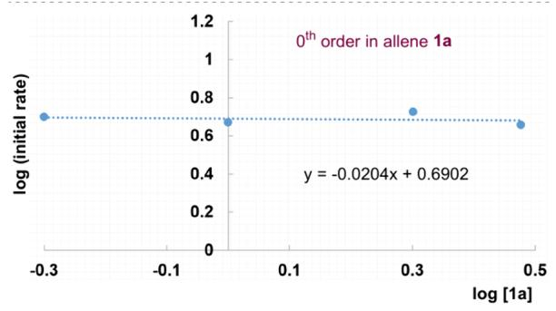

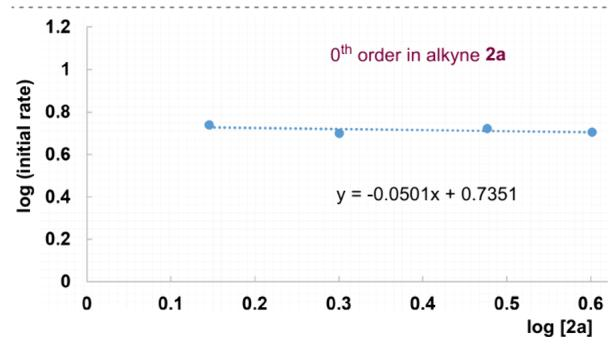

Although the above pathway well explains the experimental results, a key question remains unanswered, i.e., why the vinyl ruthenium does not approach the more accessible γ-position. Indeed, we examined the pathway toward reductive elimination at the γ-position. For this to take place, an additional rotation of the vinyl ruthenium motif toward the γ- position is required. Indeed, once this rotation is achieved, the reductive elimination via C-TS5a to form the least hindered isomer is both kinetically and thermody namically favored. However, the crucial rotation barrier is surprisingly high (20.2 kcal/mol, C-TS4a), likely due to severe steric clashes between the substituents (e.g., 2.29 Å). Overall, the energy barrier diference between the two pathways (2.3 kcal/mol, C-TS4a vs C-TS3a) is suficient to ensure a high regioselectivity observed experimentally (see Figure S16 in the SI for details). We also examined the hydroalkynylation pathway, which requires a higher energy barrier (>25.5 kcal/mol, see Figure S17) and thus explains the preference for [2 + 2] cycloaddition.

Finally, based on the above mechanism, we were curious about whether a suitable alkyne can reverse the relative energies of the two key transition states (e.g., C-TS4a and C-

(a) Possible transition states of (2+2) cyclometallation  
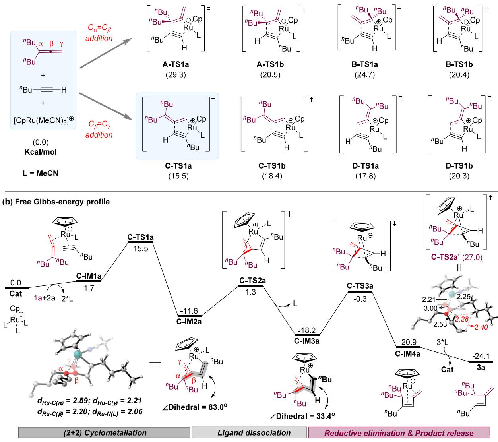

(c) Rationale of the disfavored reductive elimination at the γ position  
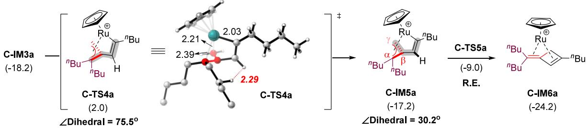  
Figure 2. Gibbs-free energy profile (kcal/mol) for the [2 + 2] cycloaddition of allene 1a and alkyne 2a. The selected bond lengths in the key structures are labeled in Å. R.E., reductive elimination.

TS3a). We first performed studies on a more hindered triisopropylsilyl (TIPS) alkyne (Figure 3a and more details in Figures S18−20 in the SI). DFT studies suggested that the direct reductive elimination at the α position sufered extremely severe steric repulsion between the bulky TIPS group and both the allene and $\mathrm { C p }$ moieties (C-TS7a). In contrast, the rotation via C-TS8a and subsequent reductive elimination at the γ-position is relatively more facile (Figures S21−S22), thus implying reversal of regioselectivity. Indeed, under the standard conditions, both TIPS- and $\mathrm { P h } _ { 3 } \mathrm { S i } -$ substituted alkynes reacted exclusively on the less hindered γ-position, thereby consistent with the theoretical studies (Figure 3b), which also provided support to the overall reaction pathway.

In conclusion, we have developed a highly eficient and mild protocol for intermolecular $[ 2 + 2 ]$ cycloaddition of unactivated allenes and alkynes, an important process with long history but with limited success in achieving high chemoselectivity and regioselectivity for unsymmetrical unactivated substrates. More importantly, our protocol not only achieved excellent regioselectivity but also counterintuitively favored the most hindered isomer. Cationic complex CpRu-(MeCN) PF served as a uniquely efective catalyst in promoting the formation of the strained cyclobutene products with excellent chemoselectivity, overcoming many competing pathways, such as homo- and cross- [2 + 2 + 2] cycloadditions and hyroalkynylations. This protocol features mild conditions, a broad scope, and good functional group compatibility. The products can be easily converted to other functionalized strained molecules that are not straightforward to access. Both experiments and DFT studies provided important insights into the mechanism, which involves an initial oxidative cyclo metalation, ligand dissociation, followed by reductive elimi nation. In contrast to the direct reductive elimination at the more hindered α-position, the key π-allyl ruthenium intermediate must undergo an energetically unfavored rotation to allow reductive limitation at the less hindered γ position, which explains the unusual regioselectivity. Finally, DFT studies predicted a possible reversal of this unusual regioselectivity for bulky silyl alkynes, which was confirmed experimentally.

(a) Prediction of selectivity reversal on TIPS-substituted alkyne by DFT study  
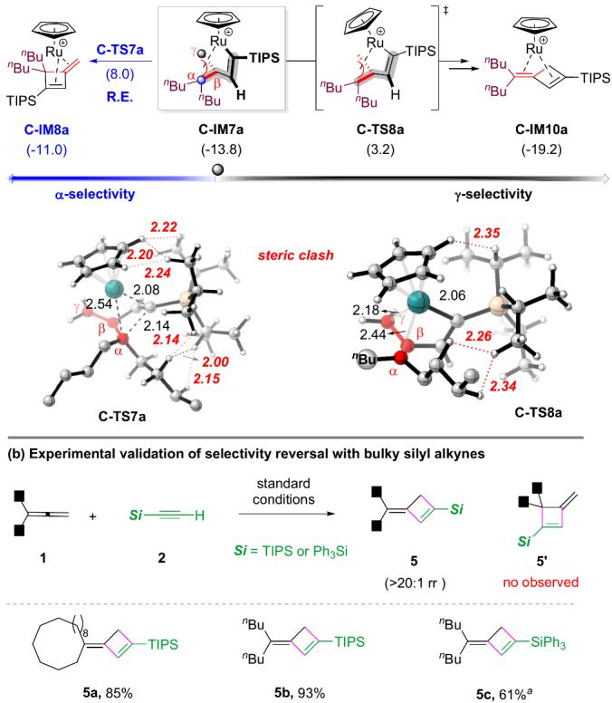  
Figure 3. (a) DFT studies on the key transition states with TIPSsubstituted alkyne. (b) Experimental validation of the regioselectivity reversal using bulky silyl alkynes. aRun in MeCN.

## ■ ASSOCIATED CONTENT

## \*sı Supporting Information

The Supporting Information is available free of charge at https://pubs.acs.org/doi/10.1021/jacs.5c11285.

Experimental procedures, spectroscopic data for substrates and products, and DFT calculations data (PDF)

## Accession Codes

Deposition Number 2480545 contains the supplementary crystallographic data for this paper. These data can be obtained free of charge via the joint Cambridge Crystallographic Data

Centre (CCDC) and Fachinformationszentrum Karlsruhe Access Structures service.

## ■ AUTHOR INFORMATION

## Corresponding Authors

Yun-Dong Wu − Shenzhen Bay Laboratory, Shenzhen 518132, China; Lab of Computational Chemistry and Drug Design, State Key Laboratory of Chemical Oncogenomics, Peking University Shenzhen Graduate School, Shenzhen 518055, China; orcid.org/0000-0003-4477-7332; Email: wuyd@pkusz.edu.cn

Jianwei Sun − Department of Chemistry and the Hong Kong Branch of Chinese National Engineering Research Centre for Tissue Restoration & Reconstruction, The Hong Kong University of Science and Technology, Kowloon, Hong Kong SAR 999077, China; orcid.org/0000-0002-2470-1077; Email: sunjw@ust.hk

## Authors

Chaoshen Zhang − Department of Chemistry and the Hong Kong Branch of Chinese National Engineering Research Centre for Tissue Restoration & Reconstruction, The Hong Kong University of Science and Technology, Kowloon, Hong Kong SAR 999077, China; orcid.org/0009-0004-0736- 957X

Herman H. Y. Sung − Department of Chemistry and the Hong Kong Branch of Chinese National Engineering Research Centre for Tissue Restoration & Reconstruction, The Hong Kong University of Science and Technology, Kowloon, Hong Kong SAR 999077, China

Ian D. Williams − Department of Chemistry and the Hong Kong Branch of Chinese National Engineering Research Centre for Tissue Restoration & Reconstruction, The Hong Kong University of Science and Technology, Kowloon, Hong Kong SAR 999077, China

Complete contact information is available at: https://pubs.acs.org/10.1021/jacs.5c11285

## Notes

The authors declare no competing financial interest.

## ■ ACKNOWLEDGMENTS

We gratefully acknowledge the financial support from National Natural Science Foundation of China (22271242, 22471232), Research Grants Council of Hong Kong (16309722, 16304322, 16309023, 16310924), and Innovation and Technology Commission (ITC−CNERC14SC01). We also thank Dr. Yun-Xuan Tan and Mr. Yuxuan Li for preliminary studies.

## ■ REFERENCES

(1) (a) Semmelhack, M. F.; Tomoda, S. Synthesis of (±)-Fomannosin. J. Am. Chem. Soc. 1981, 103, 2427−2428. (b) Paquette, L. A.; Peng, X.; Yang, J. Asymmetric Synthesis of the Phytopathogen (+)-Fomannosin. Angew. Chem., Int. Ed. 2007, 46, 7817−7819. (c) Dembitsky, V. M. Bioactive Cyclobutane-containing Alkaloids. J. Nat. Med. 2007, 62, 1−33. (d) Dembitsky, V. M. Naturally Occurring Bioactive Cyclobutane-containing (CBC) Alkaloids in Fungi, Fungal Endophytes, and Plants. Phytomedicine 2014, 21, 1559−1581. (e) Li, J.; Gao, K.; Bian, M.; Ding, H. Recent Advances in the Total Synthesis of Cyclobutane-containing Natural Products. Org. Chem. Front. 2020, 7, 136−154.

(2) (a) Namyslo, J. C.; Kaufmann, D. E. The Application of Cyclobutane Derivatives in Organic Synthesis. Chem. Rev. 2003, 103,

1485−1538. (b) Seiser, T.; Saget, T.; Tran, D. N.; Cramer, N. Cyclobutanes in Catalysis. Angew. Chem., Int. Ed. 2011, 50, 7740− 7752. (c) Nandy, M.; Das, S.; Nanda, S. Cyclobutane Based ″Overbred Intermediates″ and Their Exploration in Organic Synthesis. Org. Biomol. Chem. 2022, 20, 1582−1622. (d) Golfmann, M.; Walker, J. C. L. Bicyclobutanes as Unusual Building Blocks for Complexity Generation in Organic Synthesis. Commun. Chem. 2023, 6, 9.

(3) Selected leading reviews of allenes: (a) Hoffmann-Röder, A.; Krause, N. Synthesis and Properties of Allenic Natural Products and Pharmaceuticals. Angew. Chem., Int. Ed. 2004, 43, 1196−1216. (b) Ma, S. Some Typical Advances in the Synthetic Applications of Allenes. Chem. Rev. 2005, 105, 2829−2871. (c) Ma, S. Electrophilic Addition and Cyclization Reactions of Allenes. Acc. Chem. Res. 2009, 42, 1679−1688. (d) Rivera-Fuentes, $\mathrm { P . } _ { \mathrm { j } }$ Diederich, F. Allenes in Molecular Materials. Angew. Chem., Int. Ed. 2012, 51, 2818−2828. (e) $\mathrm { Y e , } \mathrm { J . } ;$ Ma, S. Palladium-catalyzed Cyclization Reactions of Allenes in the Presence of Unsaturated Carbon-carbon Bonds. Acc. Chem. Res. 2014, 47, 989−1000. (f) Huang, $\mathrm { X . } ;$ Ma, S. Allenation of Terminal Alkynes with Aldehydes and Ketones. Acc. Chem. Res. 2019, 52, 1301−1312. (g) Blieck, R.; Taillefer, M.; Monnier, F. Metal-Catalyzed Intermolecular Hydrofunctionalization of Allenes: Easy Access to Allylic Structures via the Selective Formation of C-N, C-C, and C-O Bonds. Chem. Rev. 2020, 120, 13545−13598. (h) Li, G.; Huo, X.; Jiang, X.; Zhang, W. Asymmetric Synthesis of Allylic Compounds via Hydrofunctionalisation and Difunctionalisation of Dienes, Allenes, and Alkynes. Chem. Soc. Rev. 2020, 49, 2060−2118. (i) Pradhan, T. R.; Park, J. K. Intermolecular Allene−Alkyne Coupling: A Significantly Useful Synthetic Transformation. ACS Catal. 2024, 14, 7814−7845. (j) Tan, Y.-X.; Song, L.-J.; Zhang, X.; Wu, Y.-D.; Sun, J. Transition Metal-catalyzed Selective Hydroboration of Allenes. Sci. China Chem. 2025, 68, 3996−4011.

(4) Trost, B. M.; Li, C.-J. Modern Alkyne Chemistry: Catalytic and Atom-Economic Transformations; Wiley-VCH: New York, 2014.

(5) Kirk, B. E.; Taylor, D. R. Allene Cycloadditions. Part V. Temperature Dependence of Product Distribution in Alkylallene− alkyne Reactions. J. Chem. Soc. Perkin Trans. 1 1974, 1844−1848.

(6) Examples of [2 + 2] cycloaddition between activated allenes and alkynes: (a) Kimura, M.; Horino, Y.; Wakamiya, $\mathrm { Y . } _ { \mathrm { j } }$ Okajima, T.; Tamaru, Y. Pronounced Chemo-, Regio-, and Stereoselective [2 + 2] Cycloaddition Reaction of Allenes toward Alkenes and Alkynes. J. Am. Chem. Soc. 1997, 119, 10869−10870. (b) Hojo, M.; Murakami, $\mathrm { C . } \mathrm { \mathrm { ; } }$ Nakamura, $\mathrm { S . j }$ Hosomi, A. Allenylmethylsilane Derivative as a Synthetic Equivalent of $^ { 1 , 2 , 3 }$ -Butatriene: Synthesis and Reactions of Di-exo-methylenecyclobutanes and -cyclobutenes. Chem. Lett. 1998, 27, 331−332. (c) Maas, G.; Manz, B.; Mayer, T.; Werz, U. The [1,4]oxazino[4,3-a]azepine ring system: Construction from Morpholinoallenes and a Structural Study. Tetrahedron 1999, 55, 1309−1320. (d) Horino, $\mathrm { Y . } _ { \mathrm { j } }$ Kimura, M.; Tanaka, $S . ;$ Okajima, T.; Tamaru, Y. Preparation, Structure, and Unique Thermal [2 + 2], [4 + 2], and [3 $+ \ 2 ]$ Cycloaddition Reactions of 4-Vinylideneoxazolidin-2-one. Chem.�Eur. J. 2003, 9, 2419−2438. (e) Xu, Z.; Zhu, D.; Wu, R.; Zhu, S. Tandem Rh(II)-Catalyzed 1,3-Acyloxy Migration/intermolecular [2 + 2] Cycloaddition of Electron-deficient Propargylic Esters with Alkenes and Alkynes. Chem. Sci. 2024, 16, 205−210. (f) Qian, Y. S. Synthesis of Methylenecyclobutenes by [2 + 2] Cycloaddition of Allene Ethers and Alkyne. Eur. J. Org. Chem. 2024, 27, No. e202400041.

(7) Intramolecular examples: (a) Shen, Q.; Hammond, G. B. Regiospecific Synthesis of Bicyclo- and Heterobicyclo-gem-difluorocyclobutenes Using Functionalized Fluoroallenes and a Novel Mo-Catalyzed Intramolecular [2 + 2] Cycloaddition Reaction. J. Am. Chem. Soc. 2002, 124, 6534−6535. (b) Oh, C. H.; Gupta, A. K.; Park, D. I.; Kim, N. Highly Efficient [2 + 2] Intramolecular Cyclizations of Allenynes under Microwave Irradiation: Construction of Fused Bicyclic Compounds. Chem. Commun. 2005, 5670−5672. (c) Brummond, K. M.; Chen, D. Microwave-Assisted Intramolecular $[ 2 + 2 ]$ Allenic Cycloaddition Reaction for the Rapid Assembly of Bicyclo[4.2.0]octa-1,6-dienes and Bicyclo[5.2.0]nona-1,7-dienes.

Org. Lett. 2005, 7, 3473−3475. (d) Ohno, $\mathrm { H . } ;$ Mizutani, T.; Kadoh, Y.; Miyamura, K.; Tanaka, T. Thermal Intramolecular $[ 2 ~ + ~ 2 ]$ Cycloaddition of Allenenes and Allenynes: Diastereoselective Access to Bicyclic Nitrogen Heterocycles. Angew. Chem., Int. Ed. 2005, 44, 5113−5115. (e) Mukai, $\mathrm { C . j }$ Hara, $\bar { \mathrm { Y } } . \mathrm { ; }$ Miyashita, $\mathrm { Y . } _ { \mathrm { i } }$ Inagaki, F. Thermal $[ 2 + 2 ]$ Cycloaddition of Allenynes: Easy Construction of Bicyclo[6.2.0]deca-1,8-dienes, Bicyclo[5.2.0]nona-1,7-dienes, and Bicyclo[4.2.0]octa-1,6-dienes. J. Org. Chem. 2007, 72, 4454−4461. (f) Ovaska, T. V.; Kyne, R. E. Intramolecular Thermal Allenyne [2 + 2] Cycloadditions: Facile Construction of the 5−6−4 Ring Core of Sterpurene. Tetrahedron. Lett. 2008, 49, 376−378. (g) Saito, N.; Tanaka, Y.; Sato, Y. Ruthenium-Catalyzed [2 + 2] Cycloaddition of Allenynes Leading to a Bicyclo[4.2.0]octa-1(8),5-diene Skeleton. Organometallics 2009, 28, 669−671. (h) Saito, N.; Tanaka, Y.; Sato, Y. Ruthenium-Catalyzed [2 + 2] Cycloaddition of Allenynes Leading to a Bicyclo[4.2.0]octa-1(8),5-diene Skeleton. Org. Lett. 2009, 11, 4124−4126. (i) Osipov, S.; Mailyan, A.; Krylov, I.; Bruneau, C.; Dixneuf, P. Thermal [2 + 2] Cycloaddition of CF -Substituted Allenynes: Access to Novel Cyclobutene-Containing α-Amino Acids. Synlett 2011, 2011, 2321−2324. (j) Le, A.; Lee, D. Selectivity between an Alder−ene Reaction and $\texttt { a } [ 2 \ + \ 2 ]$ Cycloaddition in the Intramolecular Reactions of Allene-tethered Arynes. Org. Chem. Front. 2021, 8, 3390−3397.

(8) For sporadic reports on intermolecular [2 + 2] cycloaddition of unactivated allenes and alkynes: (a) Pasto, D. J.; Kong, W. Cycloaddition Reactions of 1,1-Dimethylallene with Substituted Alkynes. J. Org. Chem. 1988, 53, 4807−4810. (b) Ding, W.; Yoshikai, N. Cobalt-Catalyzed Intermolecular $[ 2 + 2 ]$ Cycloaddition between Alkynes and Allenes. Angew. Chem., Int. Ed. 2019, 58, 2500− 2504. During the revision of this paper, a silylium-ion-promoted [2 + 2] cycloaddition was reported: (c) Deng, L.; Zuo, H.; Klare, H. F. T.; Oestreich, M. Silylium-Ion-Promoted Formation of Methylenecyclobutenes by Formal (2 + 2) Cycloaddition of Allenylsilanes and Internal Alkynes. J. Org. Chem. 2025, 90, 10555−10558.

(9) For a stepwise [2 + 2] cycloaddition: Zheng, W.; Wu, Y.; Zheng, F.; Hu, L.; Hong, Y. Selective Synthesis of α-Methylenyl Zirconacyclopentene via Cross-coupling of Alkyne and Allene. Tetrahedron. Lett. 2010, 51, 4702−4704.

(10) For leading reviews on possible reactions between allenes and alkynes, such as homo- and cross-dimerization and trimerization: (a) Saito, S.; Yamamoto, Y. Recent Advances in the Transition-Metal-Catalyzed Regioselective Approaches to Polysubstituted Benzene Derivatives. Chem. Rev. 2000, 100, 2901−2916. (b) Shibata, Yu.; Tanaka, K. Rhodium-Catalyzed [2 + 2 + 2] Cycloaddition of Alkynes for the Synthesis of Substituted Benzenes: Catalysts, Reaction Scope, and Synthetic Applications. Synthesis 2012, 44, 323−350. (c) Ruijter, E.; Broere, D. Recent Advances in Transition-Metal-Catalyzed [2 + 2+2]-Cyclo(co)trimerization Reactions. Synthesis 2012, 44, 2639− 2672. (d) Lledo, $\mathbf { A } . ;$ Pla-Quintana, $\mathbf { A . } _ { \mathrm { j } }$ Roglans, A. Allenes, Versatile Unsaturated Motifs in Transition-metal-catalysed $\left[ 2 \ + \ 2 \ + \ 2 \right]$ Cycloaddition Reactions. Chem. Soc. Rev. 2016, 45, 2010−2023. (e) Ma, $\mathrm { W . } \mathrm { \Sigma }$ Yu, $\mathrm { C . } \mathrm { \mathrm { j } }$ Chen, T.; Xu, $\mathrm { L . } ;$ Zhang, W. X.; Xi, Z. Metallacyclopentadienes: Synthesis, Structure and Reactivity. Chem. Soc. Rev. 2017, 46, 1160−1192.

(11) For selected examples of possible other cycloaddition reactions between allenes and alkynes, such as homo- and cross- dimerization and trimerization: (a) Englert, M.; Jolly, P. W.; Wilke, G. Reaction of a L Ni(0) System with Allenes. Angew. Chem., Int. Ed. 1972, 11, 136− 137. (b) Pasto, D. J.; Huang, N.; Eigenbrot, C. W. Study of the Reactions of Substituted Allenes with Tris(triphenylphosphine)- nickel(0). An Analysis of the Factors Affecting the Regio- and Stereochemistry of π-Complex Formation and Coupling to Form Nickelacyclopentane Complexes. J. Am. Chem. Soc. 1985, 107, 3160− 3172. (c) Shanmugasundaram, M.; Wu, M.-S.; Cheng, C.-H. Nickel-Catalyzed Highly Regio- and Chemoselective Cocyclotrimerization of Propiolates with Allenes: A Novel Route to Polysubstituted Benzene Derivatives. Org. Lett. 2001, 3, 4233−4236. (d) Yamamoto, Y.; Arakawa, $\mathrm { T } . \mathrm { } _ { \mathrm { \cdot } } ^ { }$ Ogawa, R.; Itoh, K. J. Ruthenium(II)-Catalyzed Selective Intramolecular $\left[ 2 + 2 + 2 \right]$ Alkyne Cyclotrimerizations. J. Am. Chem.

Soc. 2003, 125, 12143−12160. (e) Kirchner, K.; Calhorda, M. J.; Schmid, R.; Veiros, L. F. Mechanism for the Cyclotrimerization of Alkynes and Related Reactions Catalyzed by CpRuCl. J. Am. Chem. Soc. 2003, 125, 11721−11729. (f) Deng, Y.; Yu, Y.; Ma, S. PdCl / NaI-Catalyzed Homodimeric Coupling-Cyclization Reaction of 2,3- Allenols: An Efficient Synthesis of 4-(1′,3′-Dien-2′-yl)-2,5-dihydrofuran Derivatives. J. Org. Chem. 2008, 73, 585−589. (g) Bai, T.; Xue, P.; Zhang, L.; Ma, S.; Jia, G. An Efficient Synthesis of 2-Vinylic Cyclic 1,3-Alkadienes via the Cp\*Ru(II)-Catalyzed Intermolecular Coupling Reactions of Alkynes and Cyclic Allenes. Chem. Commun. 2008, 2929−2931. (h) Sakashita, K.; Shibata, Y.; Tanaka, K. Rhodium-Catalyzed Cross-Cyclotrimerization and Dimerization of Allenes with Alkynes. Angew. Chem., Int. Ed. 2016, 55, 6753−6757. (i) Song, L.-J.; Wang, T.; Zhang, X.; Chung, L. W.; Wu, Y.-D. A Combined DFT/ IM-MS Study on the Reaction Mechanism of Cationic Ru(II)- Catalyzed Hydroboration of Alkynes. ACS Catal. 2017, 7, 1361− 1368. (j) Huang, X.; Chen, B. Z.; Li, P.; Ji, D. W.; Liu, J.; Zheng, H.; Yang, S. N.; Hu, Y. C.; Wan, B.; Hu, X. P.; Fu, C.; Huang, Y.; Zheng, J.; Chen, Q. A.; Ma, S. Palladium-catalysed Construction of Butafulvenes. Nat. Chem. 2022, 14, 1185−1192. (k) Li, S.; Feng, Q.; Song, L.; Zhang, X.; Wu, Y.-D.; Sun, J. Mild Stereoselective Synthesis of Densely Substituted [3]Dendralenes via Ru-Catalyzed Intermolecular Dimerization of 1,1-Disubstituted Allenes. J. Am. Chem. Soc. 2024, 146, 1532−1542.

(12) (a) Trost, B. M.; Kottirsch, G. Novel Allene-acetylene Crosscondensation Catalyzed by Palladium Complexes. J. Am. Chem. Soc. 1990, 112, 2816−2818. (b) Yamaguchi, M.; Kido, Y.; Omata, K.; Hirama, M. Synthesis of Exo-enynes by Ruthenium-Catalyzed Cross Coupling Reaction of Hydroxy Allenes and 1-Alkynes. Synlett 1995, 1995, 1181−1182. (c) Rubin, M.; Markov, J.; Chuprakov, S.; Wink, D. J.; Gevorgyan, V. Highly Regiocontrolled Pd-Catalyzed Cross-Coupling Reaction of Terminal Alkynes and Allenylphosphine Oxides. J. Org. Chem. 2003, 68, 6251−6256. (d) Nishimura, T.; Guo, X. X.; Hayashi, T. Rhodium-catalyzed Asymmetric Addition of Terminal Alkynes to Diarylphosphinylallenes. Chem.�Asian J. 2008, 3, 1505−1510. (e) Sawano, T.; Ou, K.; Nishimura, T.; Hayashi, T. Cobalt-catalyzed Asymmetric Addition of Silylacetylenes to 1,1- disubstituted Allenes. J. Org. Chem. 2013, 78, 8986−8993. (f) Shi, Y.; Wu, X.; Fu, C.; Ma, S. Rh-Catalyzed Aerobic E-Selective Linear Coupling of Terminal Alkynes with 2,3-Allenols. ACS Catal. 2025, 15, 9555−9562.

(13) Our recent demonstration of unusual regioselectivity in Rucatalyzed addition to allenes: Tan, Y. X.; Li, S.; Chen, L.; Huang, J.; Zhang, C.; Song, L.; Zhang, X.; Wu, Y. D.; Sun, J. Ruthenium-Catalyzed alpha-Regioselective Hydroboration of Allenes. Angew. Chem., Int. Ed. 2025, 64, No. e202420370.

(14) Our eforts in Ru-catalyzed hydrofunctionalization of alkynes: (a) Ding, S.; Song, L.-J.; Chung, L. W.; Zhang, X.; Sun, J.; Wu, Y.-D. Ligand-Controlled Remarkable Regio- and Stereodivergence in Intermolecular Hydrosilylation of Internal Alkynes: Experimental and Theoretical Studies. J. Am. Chem. Soc. 2013, 135, 13835−13842. (b) Ding, S.; Song, L.-J.; Wang, Y.; Zhang, X.; Chung, L. W.; Wu, Y.- D.; Sun, J. Highly Regio- and Stereoselective Hydrosilylation of Internal Thioalkynes under Mild Conditions. Angew. Chem., Int. Ed. 2015, 54, 5632−5635. (c) Song, L.; Feng, Q.; Wang, Y.; Ding, S.; Wu, Y.-D.; Zhang, X.; Chung, L. W.; Sun, J. Ru-Catalyzed Migratory Geminal Semihydrogenation of Internal Alkynes to Terminal Olefins. J. Am. Chem. Soc. 2019, 141, 17441−17451. (d) Feng, Q.; Wu, H.; Li, X.; Song, L.; Chung, L. W.; Wu, Y.-D.; Sun, J. Ru-Catalyzed Geminal Hydroboration of Silyl Alkynes via a New gem-Addition Mechanism. J. Am. Chem. Soc. 2020, 142, 13867−13877. (e) Tan, Y.-X.; Li, S.; Song, L.; Zhang, X.; Wu, Y.-D.; Sun, J. Ruthenium-Catalyzed Geminal Hydroborative Cyclization of Enynes. Angew. Chem., Int. Ed. 2022, 61, No. e202204319. (f) Feng, Q.; Li, S.; Li, Z.; Yan, Q.; Lin, X.; Song, L.; Zhang, X.; Wu, Y.-D.; Sun, J. Ru-Catalyzed Hydroboration of Ynones Leads to a Nontraditional Mode of Reactivity. J. Am. Chem. Soc. 2022, 144, 14846−14855.

(15) Leading reviews and examples of CpRu- and Cp\*Ru-based catalytic addition to alkynes: (a) Trost, B. M.; Frederiksen, M. U.;

Rudd, M. T. Ruthenium-Catalyzed Reactions�A Treasure Trove of Atom-Economic Transformations. Angew. Chem., Int. Ed. 2005, 44, 6630−6666. (b) Trost, B. M.; Ball, Z. T. Alkyne Hydrosilylation Catalyzed by A Cationic Ruthenium Complex: Efficient and General Trans Addition. J. Am. Chem. Soc. 2005, 127, 17644−17655. (c) Matsuda, T.; Kadowaki, S.; Yamaguchi, Y.; Murakami, M. Ruthenium-Catalyzed trans-Hydrogermylation of Alkynes: Formation of 2,5-Disubstituted Germoles through Double trans-Hydrogermylation of 1,3-Diynes. Org. Lett. 2010, 12, 1056−1058. (d) Sundararaju, B.; Fürstner, A. A trans-Selective Hydroboration of Internal Alkynes. Angew. Chem., Int. Ed. 2013, 52, 14050−14054. (e) Rosca,̧ D.-A.; Radkowski, K.; Wolf, L. M.; Wagh, M.; Goddard, R.; Thiel, W.; Fürstner, A. Ruthenium-Catalyzed Alkyne trans-Hydrometalation: Mechanistic Insights and Preparative Implications. J. Am. Chem. Soc. 2017, 139, 2443−2455. (f) Fürstner, A. trans-Hydrogenation, gem-Hydrogenation, and trans-Hydrometalation of Alkynes: An Interim Report on an Unorthodox Reactivity Paradigm. J. Am. Chem. Soc. 2019, 141, 11−24.