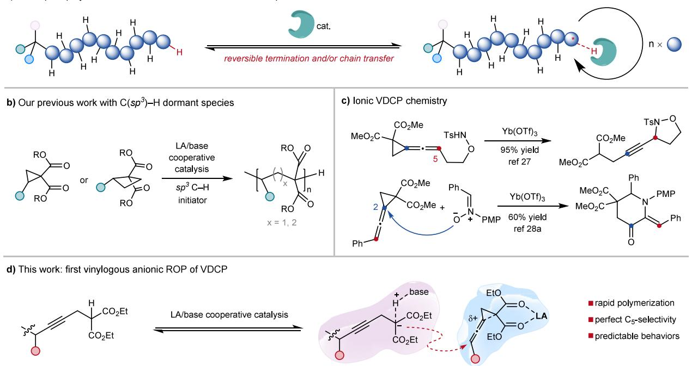
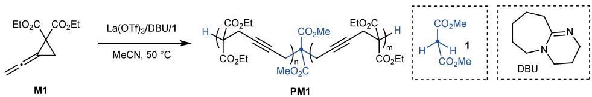
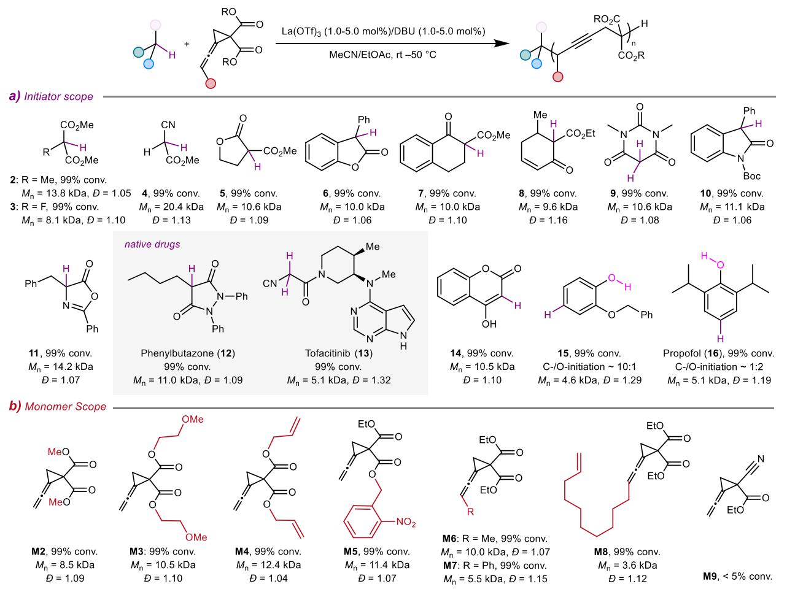
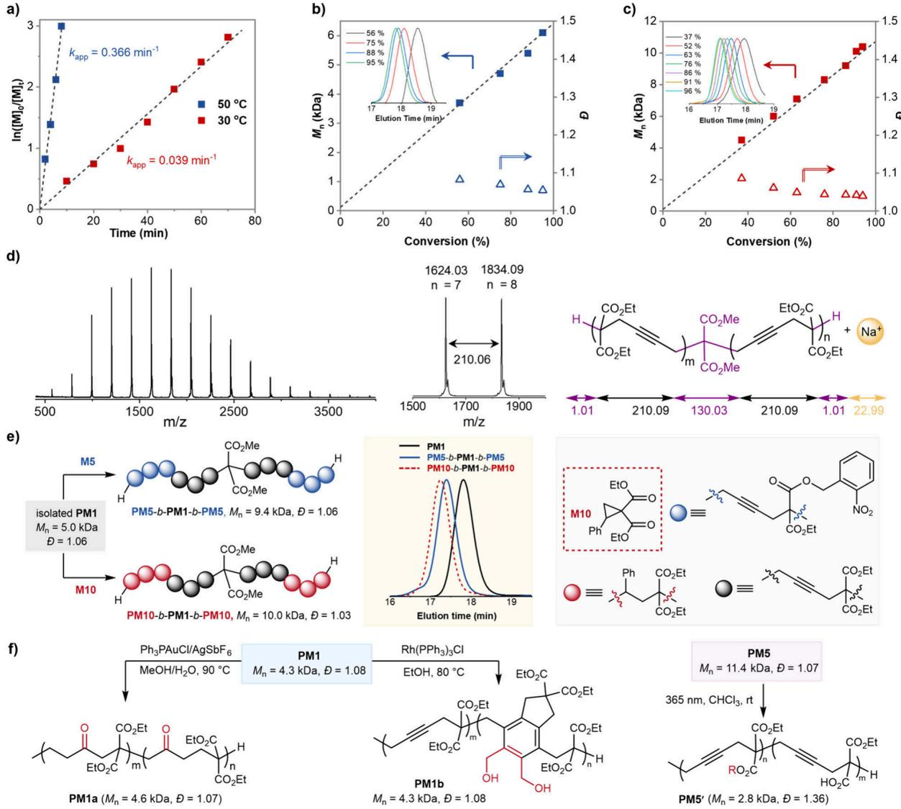
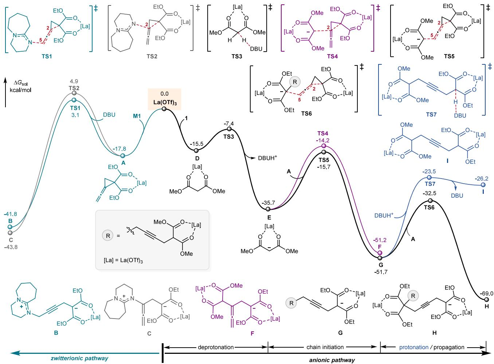

# Vinylogous Anionic Ring-Opening Polymerization of Vinylidenecyclopropanes with Native C−H Bonds as the Dormant Species

Shuai Tang,§ Xuhui Liang,§ Yuan Li,§ Yang-Yang Li, Gen Luo,\* Jinming Hu,\* and Dian-Feng Chen\*

Cite This: J. Am. Chem. Soc. 2025, 147, 7196−7202

Read Online

ACCESS

Metrics & More

Article Recommendations

\*sı Supporting Information

ABSTRACT: Since its inception in 2023, the concept of “C−H bonds as the dormant species” to control chain growth has emerged as a promising, though still evolving, strategy for precision polymer synthesis. Beyond ofering a simpler polymerization method, this concept is expected to promote unprecedented reaction pathways. In this study, we report the first vinylogous anionic ring-opening polymerization (ROP) of vinylidenecyclopropanes. Cooperative $\mathrm { L a ( O T f ) _ { 3 } / D \dot { B } U }$ catalysis, in conjunction with various $\mathsf { s p } ^ { 3 }$ and $\mathsf { s p } ^ { \mathsf { \breve { 2 } } }$ C−H bonds, has streamlined the synthesis of well-defined alkyne polymers, which are amenable to further chemical modifications. Control experiments and density functional theory (DFT) calculations provide insights into the origin of selectivity and the role of dormant C−H bonds in the reversible-deactivation equilibrium.

O ver the past few decades, controlled and living polymerizations (CLPs) of various mechanisms have significantly advanced polymer synthesis and materials science.1−8 These techniques enable the preparation of welldefined polymers with precisely controlled molecular weight (MW), low dispersity (Đ), and tailored structures and topologies. A key principle underlying these achievements is the reversible interconversion between dormant chain-end groups and the active propagating species, namely reversible deactivation,3−6,9 which minimizes termination reactions to secure high-level control over polymer chain growth. Notably, conventional CLPs typically rely on heteroatom-based dormant species, which are relatively unstable and often lead 10−15 to polymeric materials with reduced thermal stability.

An emerging strategy for reversible deactivation involves the use of native C−H bonds, providing an unprecedented solution to the heteroatom issue. In 2023, our group introduced the concept of “C−H bond as the dormant species” (Figure 1a),16 and, for the first time, demonstrated its proof of concept in the anionic ring-opening polymerization (ROP) of cyclopropanes (Figure 1b).17,18 The key to success lies in the catalytic synergy between a Lewis acid and an organic base, which not only activates a wealth of sp3 C−H bonds but also mediates reversible deactivation via proton transfer. Furthermore, this strategy tamed the challenging $S _ { \mathrm { N } } 1 \mathrm { - }$ type zwitterionic ROP of cyclobutanes,19 transforming a stepgrowth polymerization into a controlled chain polymerization (Figure 1b).20 However, these methods have thus far been limited to local reactivity within the ring, yielding only C3 and C4 polymers. We envisioned extending this new concept to harness global reactivity, where the incorporation of pendent functionalities for main-chain bond formation is realized, ultimately producing polymeric materials with advanced structures and properties.

a distal position via interposed conjugation, is one of the most extensively studied approaches to achieving global reactivity. Despite π-like molecular orbitals in cyclopropanes,22 their vinylogous ring-opening transformations via ionic pathways remain underexplored, with few exceptions observed on vinylcyclopropanes.23−25 In contrast, vinylidenecyclopropane $( \mathrm { V D C P } ) , ^ { 2 6 }$ a versatile building block featuring the strained cyclopropane and an allene moiety, has not been explored for ionic polymerizations. Shi et al. demonstrated that under Lewis acid catalysis, sulfonamides appended to VDCPs can add to the ${ \mathrm { C } } _ { 5 }$ -position,27 whereas intermolecular reactions proceeded via the $\mathrm { C } _ { 2 } .$ pathway (Figure 1c).28 These examples inspired us to explore general carbon nucleophiles for explicit ${ \mathrm { C } } _ { 5 }$ -addition, thereby achieving vinylogous reactivity. If successful, it could lead to propagation with excess VDCPs, building alkynes in each repeating unit. Here, we report the first vinylogous anionic ROP of $\mathrm { \Delta \nabla { \mathrm { V D C P s } } } , ^ { 2 9 }$ utilizing the Lewis acid/organic base/C−H bond triple system previously developed in our laboratory.16 The oxophilic lanthanide triflate coordinates to the 1,3-dicarbonyl moiety in VDCP, inducing charge relocation through π-conjugation, which enhances the $\dot { \mathrm { C } } _ { 5 } -$ electrophilicity. Concurrently, the base activates the C−H bond to generate an anion for the propagation (Figure 1d). This synchronous activation eventually enables rapid and controlled ROP of VDCPs with exclusive vinylogous selectivity.

a) Concept of polymerizations with C-H bond as the dormant species

  
Figure 1. Background and inspiration for developing vinylogous anionic ROP of VDCPs.

Table 1. Polymerization Developmenta  

<table><tr><td>entry</td><td>M1/La(OTf)₃/DBU/1</td><td>convers (%)b</td><td> $M _ { \mathrm { n , t h e o } } ~ ( \mathrm { k D a } ) ^ { c }$ </td><td> $M _ { \mathrm { n } } \ ( \mathrm { k D a } ) ^ { d }$ </td><td> $\boldsymbol { \mathbf { \mathit { \varepsilon } } } _ { \mathcal { P } } { } ^ { d }$ </td></tr><tr><td>1</td><td>100/5/5/5</td><td>99</td><td>4.3</td><td>4.3</td><td>1.07</td></tr><tr><td>2</td><td>100/0/5/5</td><td>&lt;5</td><td></td><td></td><td></td></tr><tr><td>3</td><td>100/5/0/5</td><td>&lt;5</td><td></td><td></td><td></td></tr><tr><td>4</td><td>100/5/5/0</td><td>99</td><td></td><td>18.3</td><td>1.10</td></tr><tr><td>5e</td><td>100/5/5/5</td><td>99</td><td>4.3</td><td>4.3</td><td>1.06</td></tr><tr><td> $\boldsymbol { 6 } ^ { f }$ </td><td>100/5/5/5</td><td>99</td><td>4.3</td><td>5.0</td><td>1.06</td></tr><tr><td>7</td><td>100/5/2/5</td><td>98</td><td>4.2</td><td>4.4</td><td>1.06</td></tr><tr><td>8</td><td>100/2/2/5</td><td>99</td><td>4.3</td><td>5.0</td><td>1.06</td></tr><tr><td>9</td><td>100/2/1/5</td><td>87</td><td>3.8</td><td>3.8</td><td>1.12</td></tr><tr><td>10g</td><td>100/1/2/5</td><td>99</td><td>4.3</td><td>4.4</td><td>1.04</td></tr><tr><td> $1 1 ^ { g }$ </td><td>100/1/1/5</td><td>67</td><td>2.9</td><td>3.7</td><td>1.07</td></tr><tr><td>12</td><td>100/2/2/2</td><td>99</td><td>10.6</td><td>10.2</td><td>1.05</td></tr><tr><td>13g</td><td>100/1/1/1</td><td>99</td><td>21.1</td><td>20.0</td><td>1.06</td></tr><tr><td>14g  $1 5 ^ { g }$ </td><td>100/0.5/0.5/0.5</td><td>95</td><td>40.0</td><td>32.0</td><td>1.07</td></tr><tr><td>16g</td><td>100/1/1/0.5</td><td>99</td><td>42.1</td><td>44.9</td><td>1.08</td></tr><tr><td></td><td>100/0.5/1/0.25</td><td>99</td><td>84.1</td><td>79.4</td><td>1.11</td></tr><tr><td>178</td><td>100/1/1/0.1</td><td>99</td><td>210.1</td><td>115.7</td><td>1.22</td></tr></table>

a0.2 mmol scale in 0.6 mL of anhydrous MeCN at $5 0 ~ ^ { \circ } \mathrm { C } .$ bMeasured by scrude 1H NMR. ${ } ^ { c } M _ { \mathrm { n , t h e o } } = \mathrm { M W } ( \mathrm { i n i t i a t o r } ) + \mathrm { M W } ( \mathbf { M } \mathbf { 1 } )$ × conversion × ([M1]/[initiator]). dDetermined by GPC (with polystyrene calibration). eWith 2.5 mol % of ${ \mathrm { \dot { H } } } _ { 2 } \mathrm { O } .$ fWith 20 mol % of t-BuOH. g0.6 mL of 1:1 MeCN:EtOAc. OTf = triflate. $\mathrm { G P C } = \mathrm { g e l }$ permeation chromatography.

We began our investigations by polymerizing diethyl 2- vinylidenecyclopropane-1,1-dicarboxylate (M1) with 5 mol % of 1,8-diazabicyclo[5.4.0]undec-7-ene (DBU) as the base and dimethylmalonate (1) as the initiator, in MeCN at $5 0 ~ ^ { \circ } \mathrm { C }$ to assess the impact of Lewis acid catalysts on the polymerization (Supporting Information Table S1). The use of 5 mol % La(OTf)3 achieved 99% monomer conversion within 10 min, producing PM1 with a $M _ { \mathrm { n } }$ of 4.3 kDa being close to its theoretical value and a low Đ of 1.07 (Table 1, entry 1). No allenyl groups were detected in PM1, indicating the polymerization proceeded via the vinylogous pathway. Control experiments showed that neither La(OTf) nor DBU was capable of driving the polymerization (entries 2 and 3); in the absence of 1, DBU initiated a vinylogous zwitterionic but uncontrolled polymerization (entry 4).16 Notably, this protocol was tolerant to small amounts of protic additives, such as H O and t-BuOH (entries 5 and 6), likely due to the reversible termination mechanism. Decreasing the amounts of DBU and/or La(OTf) had little efect on the polymerization outcomes, which consistently yielded PM1 with predictable $M _ { \mathfrak { n } }$ of 3.7−5.0 kDa and low Đ of 1.04−1.12 (entries 7−11), supporting the reversible chain transfer mechanism via protonation. Importantly, increasing the feed ratios of M1 and 1 (50−400) resulted in polymers with $M _ { \mathrm { n } }$ ranging from 10.2 to 79.4 kDa, while maintaining low dispersities of 1.05− 1.11 (entries 12−16). It is noteworthy that, due to the superior solubility of $\mathrm { L a } ( \mathrm { O T f } ) _ { 3 }$ in $\mathtt { E t O A c } ,$ the use of mixed MeCN/ EtOAc solvent improved the control over polymer chain growth in polymerizations of $[ \mathbf { M 1 } ] / [ \mathbf { 1 } ] \geq 1 0 0$ . However, when targeting a higher degree of polymerization (DP = 1000), the $M _ { \mathrm { n } }$ (115.7 kDa) deviated significantly from its theoretical value, likely due to the occurrence of competing DBU-initiated zwitterionic polymerization.

  
Figure 2. Scope of initiators and monomers.

We next explored the generality of C−H bonds (Figure 2a). A wide range of compounds, including dimethylmalonates (2− 3), α-substituted lactones (5−6), and β-ketoesters (7−8), proved to be excellent initiators/chain-transfer agents, all resulting in high monomer conversions (99%) and yielding α- functionalized PM1 with ω-C−H chain ends $( M _ { \mathrm { n } } \stackrel { \cdot } { = } 8 . 1 - \stackrel { \cdot } { 1 } 3 . 8$ kDa, $D = 1 . 0 5 \substack { - 1 . 1 6 } )$ . Polymerization with methyl cyanoacetate (4) led to PM1 of 20.4 kDa, which is twice as high as its theoretical value. This is likely due to the slow initiation from $^ { 4 , }$ as it typically does not form bidentate coordination with the Lewis acids. Complex heterocyclic compounds, such as $^ { 1 , 3 - }$ dimethylbarbituric acid (9), oxindole (10), azlactone (11), and several native drugs, including phenylbutazone (12) for treating ankylosing spondylitis and tofacitinib (13) for rheumatoid arthritis, were also efective in initiating and controlling the polymerization of M1.

Interestingly, polymerization with 4-hydroxycoumarin (14) also proceeded well to yield PM1 of 10.5 kDa and $\mathcal { P } = 1 . 1 0 .$ This is the first example of using acidic $\mathsf { s p } ^ { 2 } \mathsf { C } \mathrm { - } \mathsf { H }$ bonds as the dormant species. Encouraged by this result, we began to explore nonacidic $\mathsf { s p } ^ { 2 } \ \mathrm { C - H }$ bonds. We hypothesized that deprotonation of the phenolic O−H bond $\bar { ( } \mathsf { p } K _ { \mathrm { a } } \sim 1 8 . 0$ in $\mathrm { D } \dot { \mathrm { M S O } } ^ { 3 0 } )$ by DBU (pK 24.3 in $\mathbf { M e C N } ^ { 3 1 } )$ could enhance its ortho- and para-nucleophilicity. In practice, stoichiometric reaction of 2-benzyloxyphenol (15) with M1 under conditions of $\mathrm { L a } ( \mathrm { O T f } ) _ { 3 }$ (10 mmol %) and DBU (10 mmol %) yielded para-propargylated product in 45% isolated yield (Figure S65), supporting our hypothesis. Interestingly, the polymerization of M1 with 15 featured dual $\mathrm { C } / \mathrm { O }$ initiations (Figure S67). Propofol (16) exhibited significant O reactivity in its stoichiometric reaction with M1, and the C/O selectivity was ∼1.2:1 (Figures S68 and S70); while for polymerization, dual C/O initiations and single O initiation were observed with a ratio of ∼1.4:1 (Figure S72). These findings highlight the versatility of cooperative $\mathrm { L a ( O T f ) _ { 3 } / D B U }$ catalysis in promoting $\mathrm { s p } ^ { 2 } \ : \mathrm { C - H }$ bond initiation.

The scope of VDCPs was further explored (Figure 2b). Polymerizations of dimethyl 2-vinylidene-1,1-dicarboxylate (M2), di(2-methoxyethyl) 2-vinylidene-1,1-dicarboxylate (M3), and diallyl 2-vinylidene-1,1-dicarboxylate (M4), under conditions of $[ \mathrm { M } ] / [ \mathrm { L a ( O T f ) } _ { 3 } ] / [ \mathrm { D B U } ] / [ \dot { \mathrm { \bf 1 } } ] = 1 0 0 / 2 / 2 / 2 ,$ successfully yielded PM2−PM4 with target $M _ { \mathrm { n } }$ of 8.5−12.4 kDa and low Đ of 1.04−1.10. A photocleavable o-nitrobenzyl ester group in the monomer (M5) was tolerated, leading to degradable PM5 (11.4 kDa, $ { \mathcal { P } } = 1 . 0 7 )$ . Excitingly, monomers bearing a ${ \mathrm { C } } _ { 5 } .$ -substituent, including methyl (M6), phenyl (M7), and 10-ene-undecyl (M8) groups, proved polymerizable. The $M _ { \mathrm { n } } \boldsymbol { s }$ of obtained PM6 (10.0 kDa) and PM7 (5.5 kDa) were close to their theoretical values (11.2 kDa and $5 . 8 ~ \mathrm { \ k D a } ,$ respectively); while PM8 exhibited a lower $M _ { \mathrm { n } }$ of 3.6 kDa $( M _ { \mathrm { n , t h e o } } ~ = ~ 7 . 1$ kDa), probably due to background polymerization yielding cyclic polymers, as indicated by the matrixassisted laser desorption/ionization time-of-flight mass (MALDI-TOF MS) spectrometry (Figure S44). These results addressed the limitation on terminal substitutions in the radical polymerization.32 Replacing one of the 1,1-dicarboxylates with a cyano group (M9) led to <5% monomer conversion, likely due to the loss of bidentate coordination to $\mathrm { L a } ( \mathrm { O T f } ) _ { 3 }$

  
Figure 3. (a) Polymerization kinetics. Plots of $M _ { \mathrm { n } }$ and Đ as a function of monomer conversion at (b) 50 and (c) $3 0 ~ ^ { \circ } \mathrm { C } .$ (d) MALDI-TOF analysis of PM1. (e) Chain-extension experiments. (f) Postpolymerization modifications.

To evaluate the control imparted by dormant C−H bonds, several experiments were performed. First, progress analysis revealed temperature-dependent first-order polymerization kinetics, with apparent rate constants $( k _ { \mathrm { a p p } } )$ of ∼0.366 min−1 at ${ \sim } 5 0 ~ ^ { \circ } \mathrm { C }$ and ∼0.039 min−1 at ∼30 °C (Figure 3a). A linear increase in the $M _ { \mathfrak { n } }$ with monomer conversion, as well as consistently low dispersities through the entire course of polymerization, were observed (Figure 3b,c). Second, MALDI-TOF mass spectrum of PM1 showed one set of molecular peaks corresponding to a repeat unit mass of 210.06 Da and a dimethylmalonate chain-end group mass (plus Na+) of 155.03 Da (Figure 3d). Third, using an isolated PM1 (5.0 kDa, $\varTheta =$ 1.06) as the macroinitiator, chain-extension experiments with M5 and diethyl 2-phenyl-1,1-dicarboxylate (M10)16 produced ABA-type block copolymers, PM5-b-PM1-b-PM5 (9.4 kDa, Đ = 1.06) and PM10-b-PM1-b-PM10 (10.0 kDa, Đ = 1.03), as confirmed by NMR characterization (Figures S73 and S74) and shifts in the retention time of GPC traces (Figure 3e).

Since postpolymerization modification (PPM) has become a powerful strategy for creating novel functional polymers, we were interested in expanding the chemical space of poly-(VDCPs). As shown in Figure 3f, a gold-catalyzed hydration reaction26 quantitatively converted PM1 $( M _ { \mathrm { n } } = 4 . 3 $ kDa, Đ = 1.08) into polyketones (PM1a, $M _ { \mathrm { n } } = 4 . 6$ kDa, $\begin{array} { r }  D = 1 . 0 7 \ \end{array}$ ; while a rhodium-catalyzed [2 + 2+2] cycloaddition reaction33 with 2- butyne- $^ { - 1 , 4 }$ -diol built ∼50% in-chain benzene motif, producing PM1b with $M _ { \mathrm { n } } = 4 . 6 \ : \mathrm { k D a }$ and $\mathscr { D } = 1 . 0 7$ . Finally, UV light (365 nm)-induced photolysis34 removed ∼65% of preinstalled onitrobenzyl ester groups in PM5 (11.4 kDa, Đ = 1.07) within 8 ${ \mathrm { h } } ,$ accompanied by unexpected degradation to oligomers $\left( M _ { \mathrm { n } } \right) =$ 2.8 kDa, Đ = 1.36), probably via radical chain scission pathways.

  
Figure 4. Computational investigations of polymerization mechanism.

To gain deeper insights into the ROP of M1, we performed density functional theory (DFT) calculations, in which both the DBU-initiated zwitterionic pathway and the anionic pathway were considered. In general, La(OTf) preferentially coordinates to $^ { 1 , 3 \cdot }$ -dicarbonyls, giving energetically stable species A (by 17.8 kcal/mol) and D (by 15.5 kcal/mol). In the DBU-initiated zwitterionic pathway (Figure 4, left), although both reactions are significantly exothermic, the nucleophilic addition of DBU to A at the C -position, via the transition state TS1, is 1.8 kcal/mol kinetically more favorable than the addition at inner $\mathrm { C } _ { 2 ^ { - } }$ position, via the transition state TS2. In the anionic pathway (Figure 4, right), we found that the deprotonation of D by DBU through TS3 $( \Delta G ^ { \ddagger } = 8 . 1$ kcal/mol) is much easier than DBU initiations $( \Delta G ^ { \ddagger } = 2 0 . 9$ and 22.7 kcal/mol), thereby outcompeting the zwitterionic pathway.

Starting from the anionic species $\mathbf { E } ,$ both local $( \mathbf { C } _ { 2 }$ -selective) and vinylogous $( \mathrm { C } _ { 5 }$ -selective) ring-opening reactions are thermodynamically favorable. However, the latter process via TS5 is kinetically more favorable, by 1.5 kcal/mol, than the former via TS4. These findings align with our experimental observations, which suggest a predominant vinylogous anionic ROP mechanism. Due to the release of ring strain energy, further propagation from the propargyl carbon anion G with A is thermodynamically favorable, with an energy barrier of 19.2 kcal/mol. By contrast, the protonation reaction of the anion G with DBU-H+ has to overcome an energy barrier of 28.2 kcal/ mol. Notwithstanding, the tolerance to specific amounts of protic additives in the polymerization (Table 1, entries 5 and 6) supports the viability of reversible termination. Arguably, barrierless chain transfer events via proton exchange likely dominate the reversible deactivation equilibrium (Table 1, entries 7−11).

In summary, we have developed a La(OTf) /DBU/C−H triple system for the first vinylogous anionic ROP of vinylidenecyclopropane monomers, producing diverse mainchain alkyne polymers with tailored molecular weights and low dispersity. A number of $\mathsf { s p } ^ { 3 }$ and $\mathsf { s p } ^ { 2 }$ C−H bonds qualify in initiating the polymerization and regulating the chain growth via reversible termination and chain transfer. This strategy enables unprecedented polymer chemistry of cyclopropanes and is expected to transform precision polymer synthesis and related materials science.

## ■ ASSOCIATED CONTENT

## \*sı Supporting Information

The Supporting Information is available free of charge at https://pubs.acs.org/doi/10.1021/jacs.4c17911.

Experimental and computational details; characterization data for all monomers and polymers; 1H NMR and $^ { 1 3 } \mathrm { C }$ NMR spectra; and additional relevant references (PDF)

## ■ AUTHOR INFORMATION

## Corresponding Authors

Gen Luo − Institutes of Physical Science and Information Technology, Anhui University, Hefei 230601, China; orcid.org/0000-0002-5297-6756; Email: luogen@ ahu.edu.cn

Jinming Hu − Hefei National Research Center for Physical Sciences at the Microscale, Department of Polymer Science and Engineering, University of Science and Technology of China, Hefei 230026, China; orcid.org/0000-0002- 6969-1343; Email: jmhu@ustc.edu.cn

Dian-Feng Chen − Hefei National Research Center for Physical Sciences at the Microscale, Department of Polymer Science and Engineering, University of Science and Technology of China, Hefei 230026, China; orcid.org/ 0000-0003-1821-9783; Email: cdf@ustc.edu.cn

## Authors

Shuai Tang − Hefei National Research Center for Physical Sciences at the Microscale, Department of Polymer Science and Engineering, University of Science and Technology of China, Hefei 230026, China

Xuhui Liang − Hefei National Research Center for Physical Sciences at the Microscale, Department of Polymer Science and Engineering, University of Science and Technology of China, Hefei 230026, China

Yuan Li − Institutes of Physical Science and Information Technology, Anhui University, Hefei 230601, China

Yang-Yang Li − Hefei National Research Center for Physical Sciences at the Microscale, Department of Polymer Science and Engineering, University of Science and Technology of China, Hefei 230026, China

Complete contact information is available at: https://pubs.acs.org/10.1021/jacs.4c17911

## Author Contributions

§S.T., X.L., and Y.L. contributed equally to this work. All authors have given approval to the final version of the manuscript.

## Notes

The authors declare no competing financial interest.

## ■ ACKNOWLEDGMENTS

This work was supported by the National Key Research and Development Program of China (2024YFA1509202), the National Natural Science Foundation of China (Nos. 22471258, 22271001, and 52425306), and the CAS Project for Young Scientists in Basic Research (YSBR-094). This work was partially carried out at the Instruments Center for Physical Science, University of Science and Technology of China (USTC). Y.L. and G.L. acknowledge Hefei Advanced Computing Center and the High-Performance Computing Platform of Anhui University for computational support.

## ■ REFERENCES

(1) Muller, A. H. E., Matyjaszewski, K., Eds. Controlled and Living Polymerizations: From Mechanisms to Applications; Wiley-VCH GmbH, 2009. DOI: 10.1002/9783527629091.

(2) Hadjichristidis, N.; Pitsikalis, M.; Pispas, S.; Iatrou, H. Polymers with Complex Architecture by Living Anionic Polymerization. Chem. Rev. 2001, 101, 3747−3792.

(3) Matyjaszewski, K.; Xia, J. Atom Transfer Radical Polymerization. Chem. Rev. 2001, 101, 2921−2990.

(4) Kamigaito, M.; Ando, T.; Sawamoto, M. Metal-Catalyzed Living Radical Polymerization. Chem. Rev. 2001, 101, 3689−3745.

(5) Keddie, D. J.; Moad, G.; Rizzardo, E.; Thang, S. H. RAFT Agent Design and Synthesis. Macromolecules 2012, 45, 5321−5342.

(6) Aoshima, S.; Kanaoka, S. A Renaissance in Living Cationic Polymerization. Chem. Rev. 2009, 109, 5245−5287.

(7) Bielawski, C. W.; Grubbs, R. H. Living Ring-Opening Metathesis Polymerization. Prog. Polym. Sci. 2007, 32, 1−29.

(8) Grubbs, R. B.; Grubbs, R. H. 50th Anniversary Perspective: Living Polymerization�Emphasizing the Molecule in Macromolecules. Macromolecules 2017, 50, 6979−6997.

(9) Corrigan, N.; Jung, K.; Moad, G.; Hawker, C. J.; Matyjaszewski, K.; Boyer, C. Reversible-Deactivation Radical Polymerization (Controlled/Living Radical Polymerization): From Discovery to Materials Design and Applications. Prog. Polym. Sci. 2020, 111, 101311.

(10) Coessens, V.; Matyjaszewski, K. Dehalogenation of Polymers Prepared by Atom Transfer Radical Polymerization. Macromol. Rapid Commun. 1999, 20, 66−70.

(11) Chong, Y. K.; Moad, G.; Rizzardo, E.; Thang, S. H. Thiocarbonylthio End Group Removal from RAFT-Synthesized Polymers by Radical-Induced Reduction. Macromolecules 2007, 40, 4446−4455.

(12) Willcock, H.; O’Reilly, R. K. End Group Removal and Modification of RAFT Polymers. Polym. Chem. 2010, 1, 149−157.

(13) Mattson, K. M.; Pester, C. M.; Gutekunst, W. R.; Hsueh, A. T.; Discekici, E. H.; Luo, Y.; Schmidt, B. V. K. J.; McGrath, A. J.; Clark, P. G.; Hawker, C. J. Metal-Free Removal of Polymer Chain Ends Using Light. Macromolecules 2016, 49, 8162−8166.

(14) Carmean, R. N.; Figg, C. A.; Scheutz, G. M.; Kubo, T.; Sumerlin, B. S. Catalyst-Free Photoinduced End-group Removal of Thiocarbonylthio Functionality. ACS Macro Lett. 2017, 6, 185−189.

(15) Li, N.; Yang, S.; Huang, Z.; Pan, X. Radical Reduction of Polymer Chain-End Functionality by Stoichiometric N-Heterocyclic Carbene Boranes. Macromolecules 2021, 54, 6000−6005.

(16) Li, Y.-Y.; Xie, T.; Zhu, L.; Zheng, S.-Q.; Chen, D.-F.; Gong, L.- Z. Organo-Metal Cooperative Catalysis for C(sp3)-H Alkylation Polymerization. Nat. Synth. 2023, 2, 1232−1242.

(17) Reissig, H.-U.; Hirsch, E. Donor-Acceptor Substituted Cyclopropanes: Synthesis and Ring Opening to 1,4-Dicarbonyl Compounds. Angew. Chem., Int. Ed. Engl. 1980, 19, 813−814.

(18) (a) Reissig, H.-U.; Zimmer, R. Donor-Acceptor-Substituted Cyclopropane Derivatives and Their Application in Organic Synthesis. Chem. Rev. 2003, 103, 1151−1196. (b) Schneider, T. F.; Kaschel, J.; Werz, D. B. A New Golden Age for Donor-Acceptor Cyclopropanes. Angew. Chem., Int. Ed. 2014, 53, 5504−5523.

(19) (a) Hall, H. K. Bond-Forming Initiation in Spontaneous Addition and Polymerization Reactions of Alkenes. Angew. Chem., Int. Ed. 1983, 22, 440−445. (b) Hall, H. K.; Padias, A. B. Zwitterion and Diradical Tetramethylenes as Initiators of ″Charge-Transfer″ Polymerizations. Acc. Chem. Res. 1990, 23, 3−9.

(20) Xie, T.; Chen, S.-S.; Li, Y.-Y.; Chen, D.-F. Leveraging Electron Push-Pull Effect for Catalytic Polymerization and Degradation of a Cyclobutane Monomer System. Angew. Chem., Int. Ed. 2024, 63, No. e202405408.

(21) (a) Fuson, R. C. The Principle of Vinylogy. Chem. Rev. 1935, 16, 1−27. (b) Curti, C.; Battistini, L.; Sartori, A.; Zanardi, F. New Developments of the Principle of Vinylogy as Applied to π-Extended Enolate-Type Donor Systems. Chem. Rev. 2020, 120, 2448−2612.

(22) de Meijere, A. Bonding Properties of Cyclopropane and Their Chemical Consequences. Angew. Chem., Int. Ed. Engl. 1979, 18, 809− 826.

(23) Ketley, A. D.; Berlin, A. J.; Fisher, L. P. Rearrangements of the Propagating Chain End in the Cationic Polymerization of Vinyl-Cyclopropane and Related Compounds. J. Polym. Sci., Part A-1: Polym. Chem. 1967, 5, 227−230.

(24) (a) Bai, H.; Leng, X.; Han, L.; Yang, L.; Li, C.; Shen, H.; Lei, L.; Zhang, S.; Wang, X.; Ma, H. Thermally Controlled On/Off Switch ina Living Anionic Polymerization of 1-Cyclopropylvinylbenzene

withan Anion Migrated Ring-Opening Mechanism. Macromolecules 2020, 53, 9200−9207. (b) Bai, H.; Han, L.; Li, W.; Li, C.; Zhang, S.; Wang, X.; Yin, Y.; Yan, H.; Ma, H. C5 and C6 Polymerizations by Anion Migrated Ring-Opening of 1-Cyclopropylvinylbenzene and 1- Cyclobutylvinylbenzene. Macromolecules 2021, 54, 1183−1191.

(c) Bai, H.; Han, L.; Wang, X.; Yan, H.; Leng, H.; Chen, S.; Ma, H. Anion Migrated Ring Opening and Rearrangement in Anionic Polymerization Induced C7 and C8 Polymerizations. Macromolecules 2022, 55, 9751−9765.

(25) Hayakawa, K.; Matsuoka, S.; Suzuki, M. Ring-Opening Polymerization of Donor-Acceptor Cyclopropanes Catalyzed by Lewis Acids. Polym. Chem. 2017, 8, 3841−3847.

(26) (a) Shi, M.; Shao, L.-X.; Lu, J.-M.; Wei, Y.; Mizuno, K.; Maeda, H. Chemistry of Vinylidenecyclopropanes. Chem. Rev. 2010, 110, 5883−5913. (b) Yang, S.; Shi, M. Recent Advances in Transition-Metal-Catalyzed/Mediated Transformations of Vinylidenecyclopropanes. Acc. Chem. Res. 2018, 51, 1667−1680. (c) Zhang, D.-H.; Tang, X.-Y.; Shi, M. Gold-Catalyzed Tandem Reactions of Methylenecyclopropanes and Vinylidenecyclopropanes. Acc. Chem. Res. 2014, 47, 913−924.

(27) Wu, L.; Shi, M. Yb(OTf) - or AuI-Catalyzed Domino Intramolecular Hydroamination and Ring-Opening of Sulfonamide-Substituted 1,1-Vinylidenecyclopropanediesters. Chem.�Eur. J. 2011, 17, 13160−13165.

(28) (a) Wu, L.; Shi, M. Yb(OTf) -Catalyzed Construction of Indole Derivatives through Formal [3 + 3] Cycloaddition of 1,1- Vinylidenecyclopropanediesters with Nitrones. Chem.�Eur. J. 2010, 16, 1149−1152. (b) Wu, L.; Shi, M. Ring-Opening Reaction of Vinylidenecyclopropanediesters Catalyzed by Re (CO) or Yb-(OTf) . Eur. J. Org. Chem. 2011, 2011, 1099−1105.

(29) During the preparation of this manuscript, Zhu et al. reported a palladium-catalyzed ring-opening polymerization of terminal 2- vinylidenecyclopropane-1,1-dicarboxylates: Wang, Z.-L.; Zhu, R. Controlled Chain-Growth Polymerization via Propargyl/Allenyl P a l l a d i u m I n t e r m e d i a t e s . C h e m Rx i v P rep ri n t, 2 0 2 4 , DOI: 10.26434/chemrxiv-2024-5tsv7.

(30) Bordwell, F. G.; McCallum, R. J.; Olmstead, W. N. Acidities and Hydrogen Bonding of Phenols in Dimethyl Sulfoxide. J. Org. Chem. 1984, 49, 1424−1427.

(31) Kaljurand, I.; Kütt, A.; Sooväli, L.; Rodima, T.; Mäemets, V.; Leito, I.; Koppel, I. A. Extension of the Self-Consistent Spectrophotometric Basicity Scale in Acetonitrile to a Full Span of 28 pK Units: Unification of Different Basicity Scales. J. Org. Chem. 2005, 70, 1019− 1028.

(32) Wu, B.; Ding, Q.-J.; Wang, Z.-L.; Zhu, R. Alkyne Polymers from Stable Butatriene Homologues: Controlled Radical Polymerization of Vinylidenecyclopropanes. J. Am. Chem. Soc. 2023, 145, 2045−2051.

(33) Shibata, Y.; Tanaka, K. Rhodium-Catalyzed [2 + 2+2] Cycloaddition of Alkynes for the Synthesis of Substituted Benzenes: Catalysts, Reaction Scope, and Synthetic Applications. Synthesis 2012, 44, 323−350.

(34) Liu, T.; Bao, B.; Li, Y.; Lin, Q.; Zhu, L. Photo-Responsive Polymers based on ο-Nitrobenzyl Derivatives: From Structural Design to Applications. Prog. Polym. Sci. 2023, 146, 101741.