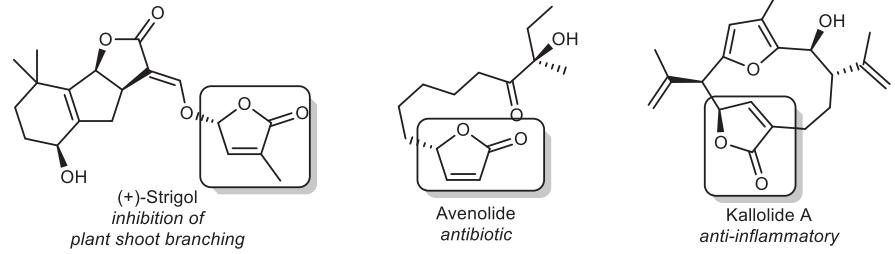
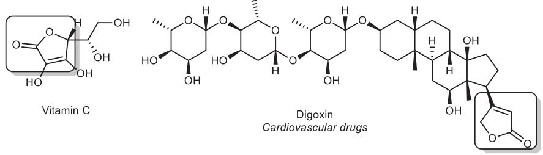
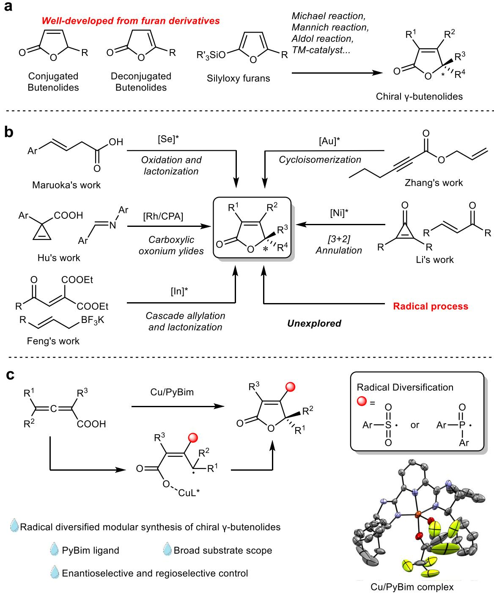
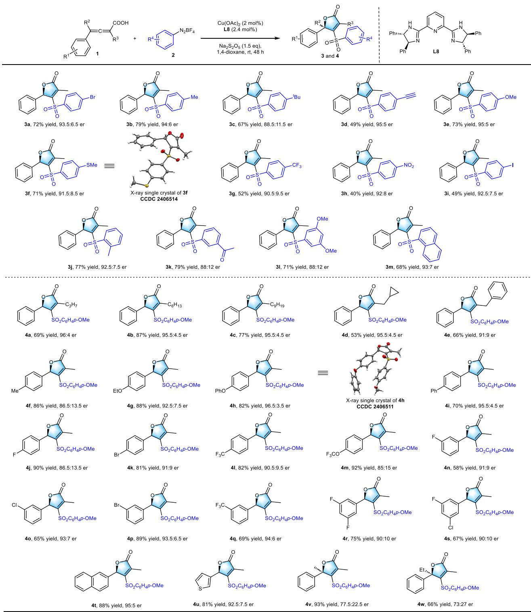
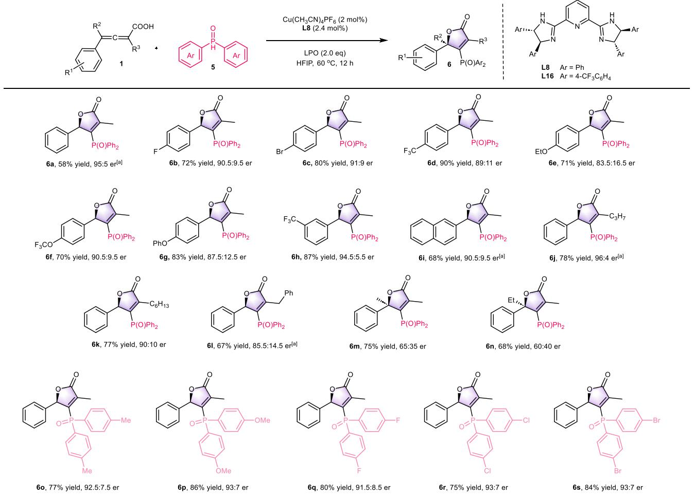
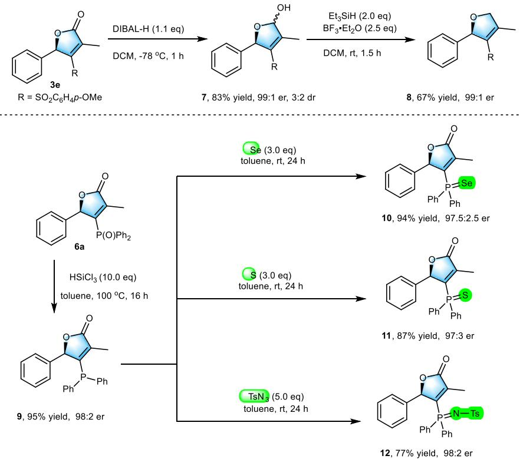
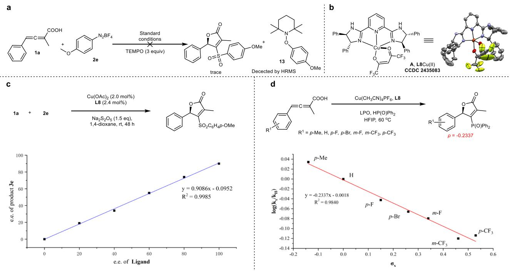
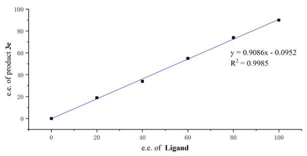
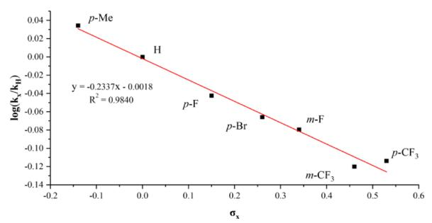
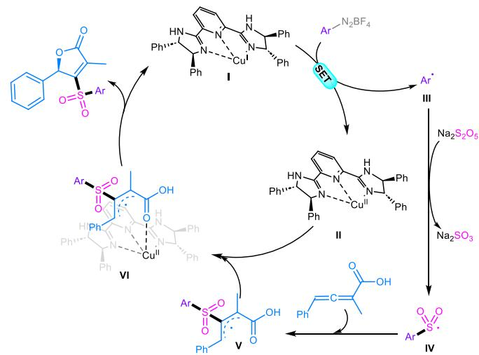

Article

https://doi.org/10.1038/s41467-025-64398-8

# Copper-catalyzed enantioselective synthesis of γ-butenolides via radical diversification of allenoic acid

Received: 29 April 2025

Accepted: 17 September 2025

Published online: 23 October 2025

Check for updates

Bingxu Han 1,2, Zaicheng Nie1, Changqing Ye 1 & Hongli Bao 1,3

Chiral γ-butenolides, which are widely prevalent in natural products and pharmaceuticals, necessitate synthetic methods that precisely control both stereochemistry and substituent diversity. In this study, we report a Cu/PyBimcatalyzed asymmetric lactonization of2,3-allenoic acids initiated by sulfonyl or phosphonyl radicals. This strategy facilitates the direct construction of enantioenriched γ-butenolides featuring modular endocyclic double bond substituents, thereby circumventing the traditional reliance on prefunctionalized substrates. Synthetic applications of the obtained chiral γ-butenolide are emphasized and mechanistic experiments are investigated.

γ-Butenolides represent a class of compounds characterized by a fivemembered cyclic lactone backbone, which features an α,β-unsaturated ester unit in its core structure1. This structural motif is prevalent in various natural products, such as plant defensins and microbial secondary metabolites, as well as in pharmaceutical compounds, including antitumor and cardiovascular drugs (Fig. 1)2–6. The unique cyclic enone system of γ-butenolides not only imparts significant biological activities, including electrophilicity and covalent bonding capabilities, but also positions them as crucial intermediates for the synthesis of complex chiral molecules. Furthermore, the diversity of substituents on the double bond and the precise control of chiral centers directly influences their pharmacological activities and selectivity. Consequently, the development of efficient and highly enantioselective synthetic methodologies remains a central challenge in this area.

Current enantioselective syntheses of γ-butenolides strategically employ on furan-derived precursors (e.g., 2-silyloxyfurans7–9, conjugated8,10–12/deconjugated butenolides13–24), achieving precise stereochemical control through sophisticated catalytic systems such as transition-metal complexes or organocatalysts (Fig. 2a). While effective, these strategies inherently limit structural diversification due to the furan frameworks. Notably, approaches utilizing non-furan substrates to access chiral γ-butenolides remain underexplored, with only sporadic reports addressing the challenges (Fig. 2b). For instances, Maruoka et al.25 demonstrated the intramolecular cascade oxidation/lactonization of β,γ-unsaturated carboxylic acids into enantioenriched γ-butenolides, utilizing a chiral selenium catalyst. Zhang et al.26 developed an efficient synthesis of chiral γ-butenolides through the gold-catalyzed cycloisomerization of allylic ynolates. Li et al.27 synthesized a series of chiral γ-alkenyl butenolides via Ni(0)- catalyzed enantioselective [3 + 2] cycloaddition reactions, which involved enones/imines and cyclopropenones, with C–C bond activation as a pivotal step. Meanwhile, Hu et al.28 directly synthesized enantiomer enriched γ-butenolides through the highly enantioselective trapping of carboxylic oxonium ylides with imines. Furthermore, Feng et al.29 successfully constructed chiral γ-butenolides via cascade allylation and lactonization reactions. Despite these advances, direct enantioselective C–O bond formation via radical intermediates—a strategy enabling modular substitution and stereochemical control— remains unexplored in γ-butenolide synthesis.

Recent breakthroughs in stereoselective bond formation at radical intermediates have revolutionized the synthesis of chiral molecules30–41. Inspired by pioneering work42–49 on enantioselective C–O bond construction via carbon radical intermediates, we aimed to extend this strategy to access enantioenriched γ-butenolides through intramolecular stereocontrolled radical cyclization. Leveraging the inherent reactivity of 2,3-allenoic acids50–60—versatile precursors for γ- butenolide derivatization—we developed a Cu/PyBim-catalyzed asymmetric lactonization platform (Fig. 2c). This method employs sulfonyl or phosphonyl radicals to initiate a cascade process, enabling simultaneous control over enantioselectivity and endocyclic double bond a Naturally occurring products which contain chiral y-butenolide

b Commercially available pharmaceutical compounds  
  
Fig. 1 | Pharmaceuticals and natural products containing chiral γ-butenolide cores. a Naturally occurring products which contain chiral γ-butenolide. b Commercially available pharmaceutical compounds.

substitution. This approach directly establishes a modular pathway for the synthesis of chiral γ-butenolides with diverse functional group versatility.

## Results

Initial ligand screening was performed with 2-methyl-4-phenylbuta-2,3-allenoic acid (1a) and 4-bromophenyldiazonium tetrafluoroborate (2a) as model substrates under Cu(OAc) catalysis (Table 1; full ligand screening data in Table S1, Supplementary information). Guided by our earlier work47,48, oxazoline derivatives (L1–L7) were first explored, with L3 providing 3a in 68% yield and 83:17 er. Notably, substitution with the PyBim ligand L8 dramatically enhanced both catalytic efficiency and enantioselectivity, yielding 3a in 72% yield and 93.5:6.5 er. Subsequent structural modifications of the PyBim framework (L9–L20) failed to surpass L8. Crucially, tosyl protection of the imidazole N–H moiety in L8 nearly abolished reactivity. Further adjustments to catalysts, solvents, and temperatures (entries 2–8) yielded no substantial improvement.

With optimized conditions in hand, the substrate generality ofthe asymmetric synthesis of sulfonyl γ-butenolides was investigated using diverse aryl diazonium salts and 2,3-allenoic acids (Fig. 3). Aryl diazonium salts bearing electron-withdrawing and electron-donating substituents (3a–3i) proved broadly compatible, furnishing products in 40–79% yield with 88.5:11.5–95:5 er. Notably, substrate 2d, containing a terminal C≡C bond—typically prone to radical addition—reacted efficiently to afford 3d in 49% yield and 95:5 er, underscoring the method’s functional group tolerance. In addition to para-substituted aryl diazonium salts, ortho- (3j), meta- (3k), 3,5-disubstituted (3l), and 1- naphthyl (3m) diazonium salts also demonstrated good compatibility achieving yields from 68% to 79% yield and 88:12 to 93:7 er. Systematic variation of the ${ \boldsymbol { \mathsf { R } } } ^ { 3 }$ substituents in 2,3-allenoic acids demonstrated exceptional versatility. Linear alkyl chains (4a–4c), cyclopropyl (4d), and benzyl groups (4e) delivered products in 53–87% yield with 91:9–96:4 er. Para-substituted aromatic derivatives—spanning electron-donating (Me, OEt, OPh, $\operatorname { O C F } _ { 3 } ;$ 4f–4h, 4m) and electronwithdrawing (Ph, F, Br, CF ; 4i–4l) groups—achieved 70–92% yield and 85.5:14.5–96.5:3.5 er. Meta-substituted analogues (F, Cl, Br, CF3, 3,5- difluoro, 3-fluoro-5-chloro; 4n–4s) exhibited 58%–89% yield and 90:10– 94:6 er. Heteroaromatic (thiophene, 4u) and polycyclic (naphthalene, 4t) substrates performed admirably, yielding products in 81–88% yield with 92.5:7.5–95.5:4.5 er. Strikingly, installing a methyl (4v) or ethyl (4w) group at $\mathsf { R } ^ { 2 }$ efficiently generated a chiral tetrasubstituted carbon center in 66–93% yield, albeit with reduced enantiocontrol (73:27–77.5:22.5 er).

Having demonstrated the versatility ofsulfonyl radical precursors in accessing γ-butenolides with diverse electronic and steric profiles, we subsequently investigated the scope of phosphonyl radical precursors to further enhance the structural and functional diversity of this privileged scaffold (Fig. 4). By using the LPO-initiated phosphonyl radicals from diphenylphosphine oxide, we successfully synthesized a series of chiral phosphonyl γ-butenolides. Fourteen 2,3-allenoic acids (6a–6n) bearing diverse substituents reacted efficiently, delivering products in 58–90% yield with 60:40–96:4 er. Diarylphosphine oxides with electronically varied aryl groups—including methyl (6o), methoxy (6p), fluoro (6q), chloro (6r), and bromo (6s)—exhibited excellent compatibility, affording products in 75–86% yield and 91.5:8.5–93:7 er, thereby demonstrating robust tolerance to steric and electronic modulation.

Synthetic applications of sulfonyl chiral γ-butenolides and phosphonyl chiral γ-butenolides have been demonstrated and are shown in Fig. 5. After recrystallization, γ-butenolide 3e obtained by the gramscale reaction, could be obtained with a 99:1 er. The carbonyl group of 3e was selectively reduced with diisobutylaluminum hydride agent, yielding the hemiacetal 7. Compound 7 can be further reduced with Et SiH and ${ \tt B F } _ { 3 } { \cdot } { \tt E t } _ { 2 } { \tt O } _ { \tt \mathrm { \perp } }$ resulting in the formation of a 2-aryl-3,4-dihydrofuran derivative. The recrystallized chiral phosphonyl-substituted γ-butenolide 6a (98:2 er) can be reduced from pentavalent to trivalent phosphine (9) by using trichlorosilane as the reductant. Additionally, compound 9 can be further transformed into the corresponding phosphanimine (12), phosphine sulfide (11), and phosphine selenide (10). Notably, the stereoselectivity of all these transformations is well preserved.

To investigate the reaction mechanism, control experiments were conducted (Fig. 6). Notably, the formation of product 3e was not observed upon the addition of 2,2,6,6-tetramethylpiperidine-1-yloxy (TEMPO) to the reaction mixture (Fig. 6a), indicating the free radical nature of the reaction. The enantiomeric excess of ligand L8 showed a linear correlation with the enantiomeric excess of 3e, suggesting that the active catalytic species is a mono-copper complex with a single chiral ligand (Fig. 6c). To further confirm the active catalyst, L8Cu(II)

  
Fig. 2 | Synthesis ofchiral γ-butenolide and this work. a Construction of chiral γ-butenolides from furan derivatives. b Construction of chiral γ-butenolides from non furan derivatives. c Synthesis of chiral γ-butenolides via radical diversification of allenoic acids (this work).

(A) was synthesized and characterized using X-ray single-crystal diffraction (Fig. 6b). Catalyst A demonstrated similar reactivity to the standard reaction conditions with ligand L8, implying that A is likely the initial active catalyst. A Hammett analysis was performed to examine the electronic effects of the 2,3-allenoic acid substrate on the reaction rate (Fig. 6d). A linear correlation was observed between log(kX/kH) and Hammett’s constant (σ), with a small negative ρ value (−0.23). This observation suggests that a slight partial positive charge develops in the transition state of the turnover-limiting step.

Based on the results of mechanistic experiments, a potential reaction mechanism has been proposed (Fig. 7). Initially, the monoligand Cu(I) complex (I) and the aryl diazonium salt undergo a singleelectron transfer (SET), generating a Cu(II) complex (II) and an aryl radical (III). The aryl radical then reacts with ${ \mathsf { S O } } _ { 2 }$ from ${ \ N a } _ { 2 } S _ { 2 } O _ { 5 }$ to form an aryl sulfonyl radical (IV). This aryl sulfonyl radical (IV) subsequently attacks 2,3-allenoic acid, leading to the formation of a resonancestabilized species, the π-allyl radical (V), which benefits from enhanced stability due to resonance delocalization. The radical intermediate (V) is then oxidized and undergoes intramolecular cyclization by Cu(II) complex (II), resulting in the formation of the desired chiral γ butenolide and the regeneration of the reactive Cu(I) complex (I). Despite the different radical species involved, we anticipate that phosphonylation reactions will proceed through a similar mechanism. The proposed reaction mechanism for the phosphonyl radical path way is shown in Fig. S2 (Supplementary information).

In conclusion, we have developed a Cu/PyBim-catalyzed asym metric radical lactonization strategy that enables the direct synthesis of enantioenriched γ-butenolides from readily available 2,3-allenoic acids. By leveraging sulfonyl and phosphonyl radicals as both initiators and functional group carriers, this method achieves simultaneous control over stereochemistry and substituent diversity at the endocyclic double bond, overcoming the limitations of traditional furanbased approaches. The reaction is characterized by high yields, good enantioselectivity, and excellent functional group compatibility.

<table><tr><td colspan="3"></td></tr><tr><td colspan="4">L6, 53% yield, 50:50 er er 93.5:6.5 92.5:7.5 91.5:8.5 90.5:9.5 92:8 92:8 94:6</td></tr><tr><td>Entry</td><td colspan="3">L11, trace</td></tr><tr><td>1</td><td colspan="3">Change from standard conditions Yield (%) None 72</td></tr><tr><td>2</td><td colspan="3"></td></tr><tr><td></td><td colspan="3">CuBr2 instead of Cu(OAc)₂ 50</td></tr><tr><td>3</td><td colspan="3">THF instead of 1,4-dioxane 32</td></tr><tr><td>4</td><td colspan="3">Under 60 °C, 8 h 76</td></tr><tr><td>5</td><td colspan="3">50 ℃, 15 h 64</td></tr><tr><td>6</td><td colspan="3">40 ℃, 24 h 62</td></tr><tr><td>7 8</td><td colspan="3">10 ℃, 48 h 64 -20 ℃, 120 h 10</td></tr><tr><td colspan="3"></td></tr></table>

Table1|Reactionconditionoptimizations

  
Fig. 3 | Substrate scope ofsulfonyl radical. Reaction conditions: 1 (0.2 mmol, 1.0 equiv), 2 (0.3 mmol, 1.5 equiv), Na2S2O5 (0.3 mmol, 1.5 equiv), Cu(OAc)2 (2.0 mol%) and L8 (2.4 mol%) in 1,4-dioxane (0.1 M) at room temperature for 48 h under a nitrogen atmosphere.

Successful gram-scale reactions and a series of subsequent transfor mations highlight the practical applicability of this approach. Key mechanistic insights, supported by radical trapping experiments and Hammett analysis, reveal a radical pathway initiated by aryl sulfonyl/ phosphonyl radicals, followed by stereodetermining cyclization orchestrated by the Cu/PyBim complex.

  
Fig. 4 | Substrate scope ofphosphonyl radical. Reaction conditions: 1 (0.2 mmol, 1.0 equiv), 5 (0.4 mmol, 2.0 equiv), LPO (0.4 mmol, 2.0 equiv), Cu(CH CN) PF (2.0 mol %) and L8 (2.4 mol%) in HFIP (0.1 M) at 60 °C for 12 h under a nitrogen atmosphere. [a] L16 instead of L8.

  
Fig. 5 | Synthetic applications. The transformation of chiral γ-butenolides.

  
Fig. 6 | Mechanistic studies. a Radical trapping experiment. b Single crystal. c Non-linear effect study. d Hammett analysis

  
Fig. 7 | Possible reaction mechanism. The proposed catalytic cycle for the synthesis of chiral γ-butenolides through the radical diversification of allenoic acids.

## Methods

General method for synthesis of chiral sulfonyl γ-butenolides In a flame-dried Schlenk tube, Cu(OAc) (0.004 mmol, 2 mol%) and ligand L8 (0.0048 mmol, 2.4 mol%) were dissolved in DCM (1.0 mL) under a nitrogen atmosphere, and the mixture was stirred at room temperature for 30 mins. Then, the solvent was evaporated under reduced pressure, aryldiazonium tetrafluoroborate (0.3 mmol, 1.5 equiv), ${ \sf N a } _ { 2 } { \sf S } _ { 2 } { \sf O } _ { 5 }$ (0.3 mmol, 1.5 equiv), 2,3-Allenoic acid (0.2 mmol, 1.0 equiv) and 1,4-dioxane (0.1 M) were sequentially added. The reaction mixture was stirred at room temperature for 48 h under a nitrogen atmosphere. After reaction completion, the solvent was evaporated under reduced pressure. The residue was purified by flash column chromatography on silica gel to afford the product.

## General method for synthesis of chiral phosphonyl γ- butenolides

In a flame-dried Schlenk tube, $\mathrm { C u } ( \mathrm { C H } _ { 3 } \mathrm { C N } ) _ { 4 } \mathrm { P F } _ { 6 }$ (0.004 mmol, 2 mol%) and ligand L8 or L16 (0.0048 mmol, 2.4 mol%) were dissolved in DCM (1.0 mL) under a nitrogen atmosphere, and the mixture was stirred at room temperature for 30 min. Then, the solvent was evaporated under reduced pressure, diarylphosphine oxide (0.4 mmol, 2.0 equiv), LPO (0.4 mmol, 2.0 equiv), 2,3-Allenoic acid (0.2 mmol, 1.0 equiv) and HFIP (0.1 M) were sequentially added. The reaction mixture was stirred at $6 0 ^ { \circ } \mathrm { C }$ for 12 h under a nitrogen atmosphere. After reaction completion, the solvent was evaporated under reduced pressure. The residue was purified by flash column chromatography on silica gel to afford the product.

## Data availability

The data generated in this study have been deposited in the Supple mentary Information file. The experimental procedures, data of NMR, and HRMS have been deposited in the Supplementary Information file. The X-ray crystallographic coordinates for structures reported in this study have been deposited at the Cambridge Crystallographic Data Centre (CCDC: 2406514), (CCDC:2406511) and (CCDC: 2435083). These data could be obtained free of charge from The Cambridge Crystallographic Data Centre (https://www.ccdc.cam.ac.uk/data\_ request/cif). All data are available from the corresponding author upon request.

## References

1. Rao, Y. S. Chemistry of butenolides. Chem. Rev. 64, 353–388 (1964).

2. Ottow, E. A. et al. Populus euphratica displays apoplastic sodium accumulation, osmotic adjustment by decreases in calcium and soluble carbohydrates, and develops leaf succulence under salt stress. Plant Physiol. 139, 1762–17672 (2005).

3. De Souza, M. V. The Furan-2(5H)-ones: recent synthetic methodologies and its application in total synthesis of natural products. Mini Rev. Org. Chem. 2, 139–145 (2005).

4. Tichenor, M. S. & Boger, D. L. Yatakemycin: total synthesis, DNA alkylation, and biological properties. Nat. Prod. Rep. 25, 220–226 (2008).

5. Uchida, M. et al. Total synthesis and absolute configuration of avenolide, extracellular factor in Streptomyces avermitilis. J. Antibiot. 64, 781–787 (2011).

6. Kitani, S. et al. Avenolide, a Streptomyces hormone controlling antibiotic production in Streptomyces avermitilis. Proc. Natl Acad. Sci. USA 108, 16410–16415 (2011).

7. Singh, R. P., Foxman, B. M. & Deng, L. Asymmetric vinylogous aldol reaction of silyloxy furans with a chiral organic salt. J. Am. Chem. Soc. 132, 9558–9560 (2010).

8. Richard, F. et al. Enantioselective synthesis of γ-butenolides through Pd-catalysed C5-selective allylation of siloxyfurans. Nat. Synth. 1, 641–648 (2022).

9. Olen, C. L. et al. Chemoinformatic catalyst selection methods for the optimization of copper–bis(oxazoline)-mediated, asymmetric, vinylogous mukaiyama aldol reactions. ACS Catal. 14, 2642–2655 (2024).

10. Yang, Y. et al. Asymmetric direct vinylogous aldol reaction of unactivated gamma-butenolide to aldehydes. J. Org. Chem. 75, 5382–5384 (2010).

11. Luo, J. et al. The direct asymmetric vinylogous aldol reaction of furanones with alpha-ketoesters: access to chiral gammabutenolides and glycerol derivatives. Angew. Chem. Int. Ed. 50, 1861–1864 (2011).

12. Yin, L., Takada, H., Lin, S., Kumagai, N. & Shibasaki, M. Direct catalytic asymmetric vinylogous conjugate addition of unsaturated butyrolactones to alpha,beta-unsaturated thioamides. Angew. Chem. Int. Ed. 53, 5327–5331 (2014).

13. Cui, H. L. et al. Direct asymmetric allylic alkylation of butenolides with Morita-Baylis-Hillman carbonates. Org. Lett. 12, 720–723 (2010).

14. Quintard, A. & Alexakis, A. 1,2-Sulfone rearrangement in organocatalytic reactions. Org. Biomol. Chem. 9, 1407–1418 (2011).

15. Zhang, W. et al. Highly enantio- and diastereoselective reactions of gamma-substituted butenolides through direct vinylogous conjugate additions. Angew. Chem. Int. Ed. 51, 10069–10073 (2012).

16. Ji, J. et al. N,N′-dioxide–scandium(III)-catalyzed asymmetric michael addition of β,γ-unsaturated butenolides to α,β-unsaturated γ-keto esters. Adv. Synth. Catal. 355, 2764–2768 (2013).

17. Manna, M. S. & Mukherjee, S. Remarkable influence of secondary catalyst site on enantioselective desymmetrization of cyclopentenedione. Chem. Sci. 5, 1627–1633 (2014).

18. Ji, J. et al. Highly efficient asymmetric synthesis of chiral γ-alkenyl butenolides catalyzed by chiral N,N′-dioxide–scandium(III) complexes. ACS Catal. 7, 3763–3767 (2017).

19. Tang, Q. et al. Catalytic asymmetric direct vinylogous aldol Reaction of isatins with beta,gamma-unsaturated butenolides. Chem. Eur. J. 23, 16447–16451 (2017).

20. Trost, B. M., Gnanamani, E., Kalnmals, C. A., Hung, C. J. & Tracy, J. S. Direct enantio- and diastereoselective vinylogous addition of butenolides to chromones catalyzed by Zn-ProPhenol. J. Am. Chem. Soc. 141, 1489–1493 (2019).

21. Cheng, X., Li, T., Gutman, K. & Zhang, L. Chiral bifunctional phosphine ligand-enabled cooperative Cu catalysis: formation of chiral alpha,beta-butenolides via highly enantioselective gammaprotonation. J. Am. Chem. Soc. 143, 10876–10881 (2021).

22. Deng, Y. et al. One-step asymmetric construction of 1,4-stereocenters via tandem mannich-isomerization reactions mediated by a dual-functional betaine catalyst. JACS Au 2, 2678–2685 (2022).

23. Li, S., Chen, Q., Yang, J. & Zhang, J. Palladium-catalyzed enantioselective gamma-arylation of beta,gamma-unsaturated butenolides. Angew. Chem. Int. Ed. 61, e202202046 (2022).

24. Li, Y., Xin, S., Weng, R., Liu, X. & Feng, X. Asymmetric synthesis of chromanone lactones via vinylogous conjugate addition of butenolide to 2-ester chromones. Chem. Sci. 13, 8871–8875 (2022).

25. Kawamata, Y., Hashimoto, T. & Maruoka, K. A chiral electrophilic selenium catalyst for highly enantioselective oxidative cyclization. J. Am. Chem. Soc. 138, 5206–5209 (2016).

26. Li, T. et al. Asymmetric construction of alpha,gamma-disubstituted alpha,beta-butenolides directly from allylic ynoates using a chiral bifunctional phosphine ligand enables cooperative Au catalysis. Org. Lett. 24, 4427–4432 (2022).

27. Bai, D., Yu, Y., Guo, H., Chang, J. & Li, X. Nickel(0)-catalyzed enantioselective [3+2] annulation of cyclopropenones and alpha,betaunsaturated ketones/imines. Angew. Chem. Int. Ed. 59, 2740–2744 (2020).

28. Zhang, D. et al. Highly enantioselective trapping of carboxylic oxonium ylides with imines for direct assembly of enantioenriched γ-butenolides. CCS Chem. 2, 432–439 (2020).

29. Tan, Z. et al. Concise synthesis of chiral gamma-butenolides via an allylation/lactonization cascade reaction. Chem. Commun. 60, 7926–7929 (2024).

30. Wang, F., Chen, P. & Liu, G. Copper-catalyzed radical relay for asymmetric radical transformations. Acc. Chem. Res. 51, 2036–2046 (2018).

31. Gu, Q. S., Li, Z. L. & Liu, X. Y. Copper(I)-catalyzed asymmetric reactions involving radicals. Acc. Chem. Res. 53, 170–181 (2020).

32. Li, Z. L., Fang, G. C., Gu, Q. S. & Liu, X. Y. Recent advances in coppercatalysed radical-involved asymmetric 1,2-difunctionalization of alkenes. Chem. Soc. Rev. 49, 32–48 (2020).

33. Mondal, S. et al. Enantioselective radical reactions using chiral catalysts. Chem. Rev. 122, 5842–5976 (2022).

34. Zhang, Z., Chen, P. & Liu, G. Copper-catalyzed radical relay in C(sp3)–H functionalization. Chem. Soc. Rev. 51, 1640–1658 (2022).

35. Dong, X. Y., Li, Z. L., Gu, Q. S. & Liu, X. Y. Ligand development for copper-catalyzed enantioconvergent radical cross-coupling of racemic alkyl halides. J. Am. Chem. Soc. 144, 17319–17329 (2022).

36. Mo, X., Guo, R. & Zhang, G. Recent developments in copper(I)- catalyzed enantioselective alkynylation reactions via a radical process. Chin. J. Chem. 41, 481–489 (2022).

37. Bauer, T., Hakim, Y. Z. & Morawska, P. Recent advances in the enantioselective radical reactions. Molecules 28, 6252 (2023).

38. Zhang, J. & Wu, J. Recent progress in asymmetric radical reactions enabled by chiral iron catalysts. Chem. Commun. 60, 12633–12649 (2024).

39. Ge, L., Wang, H., Liu, Y. & Feng, X. Asymmetric three-component radical alkene carboazidation by direct activation of aliphatic C-H Bonds. J. Am. Chem. Soc. 146, 13347–13355 (2024).

40. Yan, Z., Wang, S., Mao, X. & Xing, D. Asymmetric alkylative difunctionalization of carbon–carbon double bonds by aliphatic C─H bond activation. ChemCatChem 16, e202401380 (2024).

41. Sun, J., Zheng, G., Zhang, G., Li, Y. & Zhang, Q. Recent advances in enantioselective construction of C–N bonds involving radical intermediates. Org. Chem. Front. 12, 1671–1694 (2025).

42. Bovino, M. T. et al. Enantioselective copper-catalyzed carboetherification of unactivated alkenes. Angew. Chem. Int. Ed. 126, 6501–6505 (2014).

43. Karyakarte, S. D., Um, C., Berhane, I. A. & Chemler, S. R. Synthesis of spirocyclic ethers by enantioselective copper-catalyzed carboetherification of alkenols. Angew. Chem. Int. Ed. 130, 13103–13106 (2018).

44. Zhu, X. et al. Asymmetric radical carboesterification of dienes. Nat. Commun. 12, 6670 (2021).

45. Chen, J. et al. Photoinduced copper-catalyzed asymmetric C-O cross-coupling. J. Am. Chem. Soc. 143, 13382–13392 (2021).

46. Wang, P. Z. et al. Photoinduced copper-catalyzed asymmetric three-component coupling of 1,3-Dienes: an alternative to

Kharasch-Sosnovsky Reaction. Angew. Chem. Int. Ed. 60, 22956–22962 (2021).

47. Nie, Z. et al. Copper-catalyzed radical enantioselective carboesterification of styrenes enabled by a perfluoroalkylated-PyBox ligand. Angew. Chem. Int. Ed. 61, e202202077 (2022).

48. Xue, M. et al. Copper-catalyzed radical enantioselective synthesis of gamma-butyrolactones with two non-vicinal carbon stereocenters. Angew. Chem. Int. Ed. 62, e202304275 (2023).

49. Li, G. Q. et al. Photoinduced copper-catalyzed asymmetric threecomponent radical 1,2-azidooxygenation of 1,3-dienes. Angew. Chem. Int. Ed. 63, e202405560 (2024).

50. Ma, S., Duan, D. & Wang, Y. Palladium(0)-catalyzed couplingcyclization reaction of polymer-supported aryl iodides with 1,2- allenyl carboxylic acids. Solid-phase parallel synthesis of butenolides. J. Comb. Chem. 4, 239–247 (2002).

51. Ma, S. & Yu, Z. Pd(II)-catalyzed coupling cyclization of 2,3-allenoic acids with allylic halides. An efficient methodology for the synthesis of beta-allylic butenolides. J. Org. Chem. 68, 6149–6152 (2003).

52. Gu, Z., Wang, X., Shu, W. & Ma, S. Palladium acetate-catalyzed cyclization reaction of 2,3-allenoic acids in the presence of simple allenes: an efficient synthesis of 4-(1’-bromoalk-2’(Z)-en-2’-yl)furan-2(5H)-one derivatives and the synthetic application. J. Am. Chem. Soc. 129, 10948–10956 (2007).

53. Zhou, C., Ma, Z., Gu, Z., Fu, C. & Ma, S. An efficient approach for monofluorination via aqueous fluorolactonization reaction of 2,3- allenoic acids with selectfluor. J. Org. Chem. 73, 772–774 (2008).

54. Yu, Q. & Ma, S. Copper-catalyzed cyclic oxytrifluoromethylation of 2,3-allenoic acids to trifluoromethylated butenolides. Chem. Eur. J. 19, 13304–13308 (2013).

55. Pan, S., Huang, Y., Xu, X. H. & Qing, F. L. Copper-assisted oxidative trifluoromethylthiolation of 2,3-allenoic acids with AgSCF(3). Org. Lett. 19, 4624–4627 (2017).

56. Xin, Y. X., Pan, S., Huang, Y., Xu, X. H. & Qing, F. L. Copper-catalyzed sulfenylation, sulfonylation, and selenylation of 2,3-allenoic acids with disulfides or diselenides. J. Org. Chem. 83, 6101–6109 (2018).

57. Zhou, K., Zhang, J., Qiu, G. & Wu, J. Copper(II)-catalyzed reaction of 2,3-allenoic acids, sulfur dioxide, and aryldiazonium tetrafluoroborates: route to 4-sulfonylated furan-2(5 H)-ones. Org. Lett. 21, 275–278 (2019).

58. Zhong, T., Zheng, X., Yin, C., Shen, Q. & Yu, C. Copper-catalyzed phosphorylation of 2,3-allenoic acids and phosphine oxide: access to phosphorylated butenolides. J. Org. Chem. 86, 9699–9710 (2021).

59. Fan, J., Zhang, D., Shi, Y., Fu, C. & Ma, S. Aerobic bimetallic catalysis for oxy-alkynylation of allenes. Org. Chem. Front. 11, 3842–3848 (2024).

60. Shi, Y., Fu, C., Zheng, J. & Ma, S. Photocatalytic chemoselective cyclic oxysulfonylation of 2,3-allenoic acids. Org. Lett. 26, 5182–5186 (2024).

## Acknowledgements

Thanks to Professor Daqiang Yuan and Zhanfeng Ju from our institute for X-ray crystallography analysis. This work was supported by the NSFC (Grant No. 22225107, H. Bao and 22301302, C. Ye), the Self-deployment Project Research Program of Haixi Institutes, Chinese Academy of Sciences (CXZX-2022-GH03, H. Bao), Natural Science Foundation of Fujian Province (Grant No. 2025J08116, C. Ye).

## Author contributions

H. Bao and C. Ye directed the investigations. H. Bao and C. Ye prepared the paper. B. Han and Z. Nie performed the synthetic experiments and analyzed the experimental data. All authors contributed to the writing of this paper.

## Competing interests

The authors declare no competing interests.

## Additional information

Supplementary information The online version contains supplementary material available at https://doi.org/10.1038/s41467-025-64398-8.

Correspondence and requests for materials should be addressed to Changqing Ye or Hongli Bao.

Peer review information Nature Communications thanks Yangbin Liu and the other anonymous reviewer(s) for their contribution to the peer review of this work. A peer review file is available.

Reprints and permissions information is available at http://www.nature.com/reprints

Publisher’s note Springer Nature remains neutral with regard to jurisdictional claims in published maps and institutional affiliations.

Open Access This article is licensed under a Creative Commons Attribution-NonCommercial-NoDerivatives 4.0 International License, which permits any non-commercial use, sharing, distribution and reproduction in any medium or format, as long as you give appropriate credit to the original author(s) and the source, provide a link to the Creative Commons licence, and indicate if you modified the licensed material. You do not have permission under this licence to share adapted material derived from this article or parts of it. The images or other third party material in this article are included in the article’s Creative Commons licence, unless indicated otherwise in a credit line to the material. If material is not included in the article’s Creative Commons licence and your intended use is not permitted by statutory regulation or exceeds the permitted use, you will need to obtain permission directly from the copyright holder. To view a copy of this licence, visit http:// creativecommons.org/licenses/by-nc-nd/4.0/.

© The Author(s) 2025